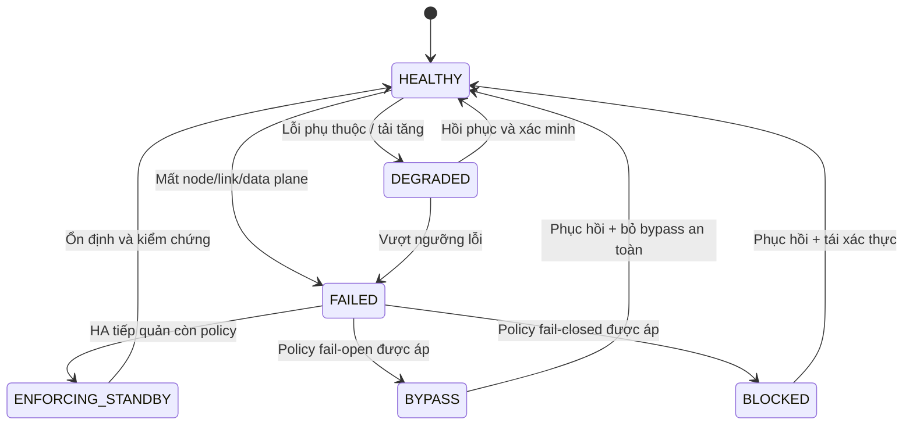
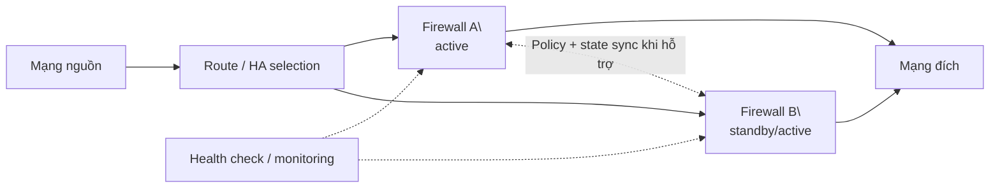

# Fail-open và fail-closed trong firewall

## Mục tiêu học tập

Sau bài học, bạn có thể:

1. Giải thích chính xác **fail-open** và **fail-closed** đối với một điểm kiểm soát lưu lượng mạng khi thành phần kiểm soát bị lỗi hoặc không thể đưa ra quyết định.
2. Phân biệt hành vi **trong trạng thái lỗi** với **default allow/default deny của policy**, với **HA failover**, và với việc một hệ thống **ngừng ghi log**.
3. Chỉ ra những thành phần có thể hỏng: nguồn điện, đường dữ liệu, thiết bị inline, policy engine, DNS/identity dependency, bảng session, cơ chế đồng bộ HA và hệ thống quan sát.
4. Chọn hành vi lỗi phù hợp với **mức độ tin cậy của từng tuyến mạng**, tính sẵn sàng, an toàn vận hành và khả năng duy trì chính sách bảo mật.
5. Thiết kế phương án HA, bypass được kiểm soát, policy cache, giám sát và khôi phục để không vô tình tạo đường truy cập trái phép.
6. Xây dựng **ma trận kiểm thử lỗi** trong lab, quan sát thực tế lưu lượng hợp lệ và không hợp lệ, ghi nhận bằng chứng trước khi khẳng định firewall đã fail-open hoặc fail-closed.

## 1. Fail-open và fail-closed nghĩa là gì?

Firewall là một **điểm thực thi chính sách**: với lưu lượng đi qua một ranh giới mạng, nó đánh giá điều kiện rồi cho phép hoặc chặn theo rule, session state và các chức năng bảo vệ đã cấu hình. Nhưng chuyện gì xảy ra nếu chính điểm thực thi đó bị lỗi?

- **Fail-open** (*fail-allow, fail-to-bypass* theo ngữ cảnh): khi một thành phần kiểm soát không còn hoạt động đúng, **lưu lượng trên đường liên quan vẫn được cho đi qua hoặc được chuyển qua đường bypass**, có thể không còn chịu một số hoặc toàn bộ chính sách/kiểm tra bảo mật mà thành phần đó cung cấp. Mục tiêu thường là duy trì lưu thông hoặc tính sẵn sàng.
- **Fail-closed** (*fail-block, fail-secure* trong một số thiết kế): khi không thể tiếp tục thực thi chính sách một cách đáng tin cậy, **lưu lượng phụ thuộc vào điểm kiểm soát đó bị chặn**, thường nhằm tránh cấp truy cập mà không qua đánh giá bảo mật.

**Hai thuật ngữ mô tả kết quả khi xảy ra một lỗi cụ thể, tại một điểm cụ thể.** Một kiến trúc có thể fail-closed đối với đường quản trị Internet → thiết bị nhưng duy trì một số tuyến vận hành nội bộ theo chính sách dự phòng. Vì vậy, cần nói rõ:

> **Thành phần nào hỏng? Luồng nào bị ảnh hưởng? Điều kiện lỗi nào được phát hiện? Trong bao lâu? Bảo vệ nào còn hoạt động?**

Ví dụ với firewall inline đặt giữa mạng khách và mạng nội bộ:

```text
Trạng thái bình thường:
Guest LAN ----> [ Firewall: policy allow/deny ] ----> Internal services
                  |                           |
                  |-- lưu lượng hợp lệ ------>|  tùy rule
                  |-- lưu lượng trái phép --X |

Nếu firewall lỗi và thiết kế FAIL-OPEN:
Guest LAN ----> [ Hardware/software bypass ] ------> Internal services
                      Kiểm tra ở điểm này có thể bị bỏ qua

Nếu firewall lỗi và thiết kế FAIL-CLOSED:
Guest LAN ----> [ Đường bị chặn / link down ] --X--> Internal services
                      Ngăn truy cập, nhưng gián đoạn đường liên quan
```

Ví dụ cố ý đơn giản. Trong sản phẩm thực tế, cơ chế bypass phụ thuộc phần cứng, wiring và chế độ hoạt động. Một firewall có hai cổng ethernet **không mặc định** tự nối chúng với nhau khi mất điện.

### 1.1. Ba khái niệm rất dễ bị lẫn

| Khái niệm | Câu hỏi được trả lời | Ví dụ |
|---|---|---|
| **Default deny** | Khi một rule không khớp trong trạng thái firewall hoạt động bình thường, kết quả là gì? | Không có rule allow → drop |
| **Fail-closed** | Khi điểm thực thi chính sách gặp lỗi, nó có ngăn đường lưu lượng thuộc phạm vi kiểm soát không? | Policy engine không thể cho phép → chặn phiên mới |
| **HA failover** | Nếu node chính hỏng, có node khác tiếp quản và **vẫn thực thi chính sách** không? | Firewall A hỏng; firewall B xử lý tiếp với rule tương đương |

**Default deny không tự chứng minh fail-closed.** Một thiết bị có default deny nhưng được lắp **bypass link** khi mất điện vẫn có thể fail-open đối với lưu lượng đi qua link đó.

**HA failover thành công không đồng nghĩa fail-open.** Nếu firewall dự phòng tiếp tục kiểm tra và áp chính sách đúng, hệ thống vẫn đang **enforce**, chỉ thay node xử lý. Tương tự, failover thất bại và traffic bị chặn là một **kết quả fail-closed** đối với tuyến đó, không phải mục tiêu mong muốn của một thiết kế HA tốt.

## 2. Vì sao lựa chọn này là quyết định an ninh kiến trúc?

Trong `SECURITY_NETWORK_SECURITY`, firewall là một lớp phòng vệ giữa phân đoạn mạng, truy cập từ xa qua VPN/ZTNA, kết nối quản trị, IDS/IPS, DNS security, thiết bị không dây và hạ tầng cloud. Khi firewall lỗi, hành vi mạng ảnh hưởng trực tiếp tới hai thuộc tính:

- **Confidentiality / Integrity:** tránh lưu lượng trái phép truy cập dữ liệu, hệ thống quản trị hoặc thay đổi tài nguyên.
- **Availability:** duy trì giao tiếp cần thiết để hệ thống, sản xuất hoặc dịch vụ cứu hộ tiếp tục hoạt động.

Lựa chọn fail-open có thể giữ dịch vụ hoạt động nhưng mở **khoảng thời gian không được kiểm tra như bình thường**. Lựa chọn fail-closed có thể giữ ranh giới an toàn hơn nhưng tạo **outage** và, trong môi trường có yêu cầu vận hành đặc biệt, có thể gây hậu quả nghiêm trọng.

Không có quy tắc “luôn fail-closed mọi nơi” hay “luôn fail-open để không gián đoạn”. Cần xác định **rủi ro của từng luồng**, kiểm soát thay thế, khả năng phát hiện lỗi, cơ chế khôi phục và cách chứng minh kết quả.

### 2.1. Các tình huống minh họa

| Vùng/tuyến | Nếu fail-open | Nếu fail-closed | Hướng tiếp cận thường hợp lý |
|---|---|---|---|
| Internet → giao diện quản trị firewall | Có thể lộ điểm quản trị | Mất quản trị trực tiếp theo tuyến đó | Thiết kế fail-closed, có OOB/bastion khôi phục |
| Guest Wi-Fi → mạng nội bộ | Khách có thể vào vùng hạn chế | Khách mất đường vào tài nguyên nội bộ | Fail-closed cho ranh giới nội bộ |
| Workload ứng dụng → cơ sở dữ liệu nhạy cảm | Có thể bỏ qua segmentation | Ứng dụng lỗi khi không kết nối DB | Ưu tiên bảo vệ dữ liệu, HA để duy trì availability |
| Đường inline IPS trên một tuyến công nghiệp | Mất chức năng IPS, nhưng kết nối có thể tiếp tục | Dừng dây chuyền/gián đoạn vận hành | Quyết định dựa vào phân tích an toàn và kiểm soát thay thế |
| Kết nối Internet của văn phòng | Có thể mất inspection trên đường ra | Nhân viên mất Internet | Phụ thuộc dữ liệu/rủi ro, thiết kế HA và phương án dự phòng |
| Đường gửi log tới SIEM | Tiếp tục phục vụ nhưng có điểm mù telemetry | Chặn ứng dụng chỉ vì log chưa đến có thể gây outage | Ưu tiên buffer/queue, cảnh báo, xác định ngưỡng và chính sách theo mức nhạy cảm |

Bảng trên là **định hướng phân tích**, không phải cấu hình mặc định cho mọi doanh nghiệp. Một hệ thống công nghiệp hoặc dịch vụ thiết yếu cần phân tích an toàn vận hành riêng; không áp một mẫu bypass tùy tiện vào đường truy cập đến tài sản nhạy cảm.

## 3. “Firewall bị lỗi” có nhiều nghĩa

Hành vi fail-open/fail-closed chỉ có ý nghĩa khi biết **failure mode** đang xét.

| Dạng lỗi | Điều thực sự xảy ra | Câu hỏi cần kiểm chứng |
|---|---|---|
| **Mất điện toàn bộ thiết bị** | Firewall và NIC có thể ngừng chuyển gói | Thiết bị có **hardware bypass relay** không? Bypass nối cổng nào? |
| **Crash data plane/forwarding process** | Chương trình chuyển tiếp gói ngừng hoặc sai trạng thái | Gói bị drop, tiếp tục theo flow cũ hay được bypass? |
| **Control/management plane lỗi** | Không thể đăng nhập hoặc nhận policy mới | Data plane còn enforce **rule cuối cùng** không? |
| **Policy decision engine/PDP không liên lạc** | Không lấy được quyết định cho phiên mới | PEP deny, allow, cache hay timeout? Cache có hết hạn không? |
| **HA primary bị lỗi** | Node phụ có thể tiếp quản | Rule/route/NAT/session state có đồng bộ? Có split-brain? |
| **NIC/link/switch lỗi** | Đường vật lý bị ngắt hoặc chất lượng kém | Có đường vòng khác bỏ qua firewall không? |
| **Bị quá tải CPU/session table** | Thiết bị có thể drop/timeout hoặc giảm chức năng | Existing/new sessions bị xử lý ra sao? Có bảo vệ overload? |
| **DNS/IdP/AAA mất khả dụng** | Rule theo FQDN/user không có đủ ngữ cảnh | Quyết định từ cache, sai người dùng hay deny? |
| **Collector/logging lỗi** | Traffic vẫn có thể qua, nhưng bằng chứng/alert giảm | Fail logging có làm fail access? Có local buffer và cảnh báo? |
| **Sai cấu hình khi deploy** | Policy khác mong muốn dù thiết bị không hỏng | Có version/rollback/approval và canary? |

Một lỗi có thể xảy ra **một phần**. Ví dụ Web UI firewall treo, nhưng data plane vẫn lọc traffic. Gọi đó là “firewall đã fail-open” khi chưa quan sát đường dữ liệu là một kết luận sai.

### 3.1. Trạng thái lỗi và chuyển đổi



Sơ đồ chỉ mô tả **các khả năng**, không phải mọi sản phẩm đều có đủ trạng thái. Trong triển khai, cần xác định rõ ai/điều kiện nào được quyền chuyển sang BYPASS và **làm sao phát hiện hệ thống chưa trở về trạng thái bảo vệ ban đầu**.

## 4. Fail-open ở lớp phần cứng: bypass của thiết bị inline

Một số thiết bị **inline IPS**, NGFW hoặc network security appliance có chế độ **hardware fail-open/bypass**. Chúng có thể dùng relay hoặc bypass NIC nối hai cổng khi thiết bị mất điện/được coi là không khỏe. Mục tiêu là tiếp tục lưu lượng qua đường vật lý, thường **không có inspection đầy đủ** của appliance.

### 4.1. Vì sao cần phân biệt đường đi vật lý?

Giả sử:

```text
Router A ---> [ IPS inline: Port 1 | Port 2 ] ---> Router B
```

Trong chế độ vận hành bình thường, lưu lượng đi qua engine kiểm tra. Khi engine lỗi:

- Thiết bị **có hardware bypass đúng cấu hình** có thể nối Port 1 ↔ Port 2 để tiếp tục truyền (fail-open đối với chức năng IPS).
- Thiết bị **không có bypass** có thể đưa hai cổng xuống/link down hoặc không chuyển tiếp (fail-closed đối với link).
- Nếu có switch/router bên ngoài tự động đổi route, đường dự phòng có thể tiếp tục hoạt động; cần xác nhận đường đó vẫn qua điểm kiểm soát tương đương hay đang vòng qua inspection.

**Fail-open của IPS không đồng nghĩa mọi chính sách firewall khác đã mất.** Nếu một firewall độc lập vẫn nằm trên đường lưu lượng, nó có thể tiếp tục enforce segmentation. Ngược lại, nếu inline appliance đồng thời thực thi chính sách ranh giới duy nhất và bypass toàn bộ, rủi ro nghiêm trọng hơn nhiều.

### 4.2. Những điểm phải xác minh trước khi bật bypass

1. Chính xác **cặp cổng** và **đường vật lý** được nối khi bypass.
2. Bypass hoạt động khi **mất điện**, khi **software crash**, khi **watchdog timeout** hay trong từng trạng thái cụ thể?
3. Thiết bị có hỗ trợ **fail-to-wire** cho tốc độ/loại media hiện dùng không?
4. Policy nào bị bỏ qua: IPS, ACL, firewall stateful, NAT, TLS inspection, rate limiting?
5. Đường phụ thuộc layer 2/3 có hoạt động khi relay đóng không? Có mất ARP/ND, MAC learning, LACP, MTU hoặc route?
6. Có một điểm kiểm soát khác độc lập bảo vệ mạng nội bộ trước các nguồn không đáng tin không?
7. Bypass có **telemetry độc lập**, cảnh báo và cơ chế khôi phục được phép không?

Không thể suy từ tên model chung hoặc giá trị một nút “fail-open” mà bỏ qua tài liệu phần cứng, license, loại card và topology thật.

## 5. Fail-closed ở điểm quyết định chính sách

Nhiều hệ thống hiện đại tách:

- **PDP** (*Policy Decision Point*): xác minh danh tính, posture, phân quyền và đưa ra quyết định.
- **PEP** (*Policy Enforcement Point*): thực thi quyết định tại gateway, firewall, switch, proxy hoặc agent.
- **PAP** (*Policy Administration Point*): nơi chính sách được cấu hình và phân phối.

Nếu **PEP không liên lạc được với PDP**, những lựa chọn thường có là:

| Chế độ xử lý | Hành vi | Rủi ro/ưu điểm |
|---|---|---|
| **Deny khi không có quyết định** | Chặn các phiên yêu cầu quyết định mới | Bảo vệ khỏi việc tự cấp quyền, có thể làm gián đoạn dịch vụ |
| **Allow khi không có quyết định** | Cho phép truy cập theo cấu hình fail-open | Duy trì availability nhưng tăng nguy cơ truy cập trái phép |
| **Last-known-good (LKG) policy** | Duy trì rule đã được kiểm chứng gần nhất | Cần quy định tuổi cache, trạng thái thu hồi và việc cấp quyền mới |
| **Grace period** | Dùng quyết định cũ trong một khoảng giới hạn | Giảm outage ngắn, nhưng quyền đã thu hồi có thể còn hiệu lực |
| **Fallback local policy** | Áp policy tối thiểu được lưu trên PEP | Cần thiết kế trước, nhất quán và hạn chế đặc quyền |
| **HA PDP/replica** | Chuyển sang nguồn quyết định khác | Giúp tiếp tục kiểm tra, vẫn cần xác minh tính đồng bộ |

**LKG không mặc định là fail-open hoặc fail-closed hoàn toàn.** Một policy cũ có thể cho phép những phiên đã được cấp, từ chối những phiên khác, hoặc còn chứa quyền đã bị thu hồi. Phải đánh giá **từng loại lưu lượng** và tuổi quyết định, tránh gán nhãn chung.

### 5.1. Ví dụ: policy gateway cho ứng dụng nhạy cảm

Một người dùng cần truy cập dashboard quản trị. PEP có thể tiếp tục một phiên **đang được xác thực, chưa hết thời hạn và thuộc phạm vi allow**, trong khi deny các phiên **mới** nếu PDP mất kết nối. Đây là thiết kế hỗn hợp:

- Phiên đã cấp có giới hạn TTL ngắn và được giám sát.
- Mở phiên mới cần **quyết định fresh**, không tự cho phép khi PDP lỗi.
- Khi hết TTL, yêu cầu reauthentication/reauthorization; nếu PDP chưa có thì deny.
- Khi policy hoặc trạng thái người dùng thay đổi, cần cơ chế revoke/reauthorization kịp thời.

Thiết kế chỉ đáng tin nếu **PEP thực thi thời hạn thực tế** và có khả năng chặn các phiên đã kéo dài quá giới hạn; chỉ có timestamp trong database là chưa đủ.

## 6. Stateful firewall, NAT và lưu lượng đang tồn tại

Firewall stateful có thể lưu trạng thái phiên TCP/UDP, cùng thông tin NAT, route và nhiều điều kiện. Khi lỗi, **lưu lượng mới** và **lưu lượng đã được thiết lập** có thể có kết quả khác nhau.

### 6.1. Câu hỏi cần trả lời

| Trường hợp | Cần xác minh |
|---|---|
| Node đang xử lý bị mất điện | Firewall dự phòng có tiếp quản không? Existing sessions có còn hoạt động? |
| Policy được cập nhật nhưng state table chưa xóa | Những kết nối trước đó có tiếp tục đến khi timeout/đóng phiên không? |
| HA đồng bộ policy nhưng không đồng bộ session | Kết nối mới có thể hoạt động; kết nối cũ có thể reset hoặc timeout |
| Firewall NAT failover | Địa chỉ public, NAT mapping, port và đường về có thay đổi không? |
| Asymmetric routing | Đường đi và đường về có đi qua cùng nhóm thiết bị cần state không? |
| UDP “session” | Firewall theo dõi timeout giả lập dù UDP không có connection handshake |
| TLS/QUIC | Session được ứng dụng giữ sống, thiết bị có thể mất trạng thái hoặc bị đổi đường |
| Dual stack | Có thể IPv4 bị chặn nhưng IPv6 vẫn có đường không được xét? |

**Gỡ rule allow không chắc đã kết thúc phiên đang hoạt động.** Một số thiết bị duy trì connection state cho đến khi phiên kết thúc hoặc timeout; hành vi khác nhau theo sản phẩm, chiều lưu lượng và chính sách. Nếu mục tiêu là thu hồi **ngay lập tức**, cần cơ chế xử lý session table/conntrack hoặc reauthorization phù hợp, có kiểm thử trước.

### 6.2. Ví dụ tách ba kết quả kiểm thử

```text
Trước sự cố:
  TCP/443 app hợp lệ:                 ALLOW
  TCP/22 từ guest đến management:     DENY
  Phiên HTTPS đã thiết lập:           ACTIVE

Khi node chính bị lỗi:
  A. Kết nối HTTPS mới hợp lệ:        ?
  B. Kết nối SSH mới trái phép:       ?
  C. Phiên HTTPS cũ:                  ?
```

Chỉ kiểm tra A là chưa đủ. Một kiến trúc có thể **giữ availability cho A**, **vẫn deny B** nhờ HA, nhưng **làm đứt C** vì không có session sync. Tình huống đó là HA không giữ được phiên, **không phải fail-open về bảo mật**.

## 7. High availability (HA) và failover có bảo vệ chính sách

Để vừa giữ tính sẵn sàng vừa duy trì enforcement, kiến trúc thường ưu tiên **nhiều điểm kiểm soát có chính sách tương đương**, thay vì bypass toàn bộ firewall khi một node lỗi.



Một số topology HA có thiết bị active/passive, active/active, cluster hoặc route failover; chi tiết đồng bộ session và NAT rất khác nhau theo sản phẩm.

### 7.1. Những thuộc tính cần kiểm tra

- **Health detection:** ai nhận biết node hỏng? heartbeat, data plane probe, interface monitor hay process monitor?
- **Policy consistency:** rule, object, certificate, identity mapping và version của hai node có khớp không?
- **State synchronization:** có đồng bộ session, NAT mapping, VPN tunnel/session hoặc SSL inspection state không?
- **Routing convergence:** khi đổi node, default route, ARP/ND, dynamic route và đường về có hội tụ đúng không?
- **Split-brain:** hai node cùng nhận mình là active có tạo routing loop, lỗi NAT hoặc policy bất nhất không?
- **Capacity:** node còn lại có chịu được tải tổng khi một node rời cluster không?
- **Failure domain:** hai node có cùng nguồn điện, switch upstream, cloud zone, control plane hay dependency IdP/DNS không?
- **Recovery:** node cũ quay lại có thu hồi vai trò, đồng bộ policy và session một cách an toàn không?

Một thiết kế HA tốt **không chỉ chuyển gói** mà còn duy trì những kiểm soát bắt buộc đối với tất cả đường đi sau failover.

### 7.2. Không có single point of failure bảo mật

Nếu cùng một network switch lỗi khiến hai firewall **đều** rơi vào bypass ngoài ý muốn, hệ thống không đạt yêu cầu. Tương tự, một router có static route dự phòng đi thẳng từ Internet đến backend có thể biến **network failover** thành **security bypass**.

Để phát hiện điều này, vẽ **tất cả tuyến khả thi** gồm đường thường, đường dự phòng, peering, overlay, VPN và cloud route. Với mỗi tuyến, chỉ rõ **điểm enforcement thực sự** và chính sách tương đương.

## 8. Thiết kế chính sách theo dữ liệu và phân đoạn

Chính sách nên dựa vào phân loại tài sản và hướng kết nối:

| Loại lưu lượng | Yêu cầu bảo vệ | Hành vi khi mất điểm kiểm soát (gợi ý) |
|---|---|---|
| Internet/public → management plane | Rất cao; kiểm soát truy cập quản trị | **Deny**, quản trị khẩn cấp qua OOB/bastion được bảo vệ |
| Guest/BYOD → production | Rất cao; không có lý do kết nối trực tiếp | **Deny**, không dùng bridge bypass đến production |
| User → hệ thống nhạy cảm | Xác thực, phân đoạn, ứng dụng | **Deny hoặc LKG giới hạn**, tính đến phiên đã cấp và tuổi quyền |
| Internal app → DB | Dữ liệu nhạy cảm, availability quan trọng | HA cùng policy; khi không còn enforcement đáng tin, chặn theo quy trình |
| Giám sát/backup → thiết bị quản trị | Luồng vận hành được phê duyệt | Fallback hạn chế theo nguồn-đích và tài khoản chuyên dụng |
| DNS/NTP/PKI/IdP | Phụ thuộc cốt lõi, thiếu có thể gây outage dây chuyền | Dự phòng dịch vụ, cache có giới hạn, kiểm soát riêng thay vì mở mọi luồng |
| Internet egress của môi trường ít nhạy cảm | Đánh giá theo dữ liệu và khả năng chịu lỗi | Có thể có tuyến dự phòng được bảo vệ bằng policy tối thiểu |
| Hạ tầng vận hành đặc biệt | Có thể có yêu cầu an toàn vật lý | Phân tích safety, vùng riêng, kế hoạch ứng phó và kiểm soát bù |

**Câu hỏi then chốt:** Nếu phải duy trì một luồng dù inspection không còn, có thể **giảm phạm vi, giảm chức năng, giới hạn thời gian và bổ sung kiểm soát khác** không? Ví dụ, đường bypass chỉ cho một dịch vụ kiểm soát được và ngắt quyền quản trị thay vì kết nối hai zone hoàn toàn.

### 8.1. Yêu cầu “fail securely” theo mức độ rủi ro

Trong thiết kế an ninh, **fail securely** nghĩa là trạng thái sau lỗi **không làm tăng quyền không được phép**. Điều đó thường dẫn đến deny khi thiếu bằng chứng cho phép, nhưng cách thực thi còn phụ thuộc nguy cơ an toàn vận hành, cơ chế giám sát và khả năng chuyển sang một firewall dự phòng.

**Tách hai mục tiêu:**
- **Security invariant:** giao diện quản trị không thể truy cập trực tiếp từ guest/Internet; traffic bí mật phải qua điểm kiểm soát tương đương.
- **Availability objective:** dịch vụ nghiệp vụ hợp lệ được khôi phục hoặc tiếp tục trong giới hạn downtime mục tiêu.

Không vì một mục tiêu availability mà âm thầm phá vỡ security invariant. Nếu được chấp nhận một trường hợp ngoại lệ, nó phải **có người chịu trách nhiệm, phê duyệt, thời hạn, giám sát và cách khôi phục kiểm soát**.

## 9. Ví dụ chính sách và trạng thái lỗi

Giả sử một firewall bảo vệ hệ thống thanh toán nội bộ. Khách hàng chỉ đến frontend HTTPS, frontend chỉ đến service API, service API chỉ đến database theo giao thức đã định. Bastion là điểm vào quản trị riêng.

### 9.1. Ma trận luồng cần bảo vệ

| Nguồn | Đích | Traffic | Bình thường | Khi firewall hỏng không có HA |
|---|---|---|---|---|
| Internet | Payment frontend | TCP/443 | Allow qua inspection | Chặn nếu không còn enforcement thay thế |
| Internet/guest | Database | Mọi protocol | Deny | **Deny bắt buộc** |
| Payment frontend | Payment API | TCP/443 | Allow theo scope | Chặn nếu không thể kiểm soát; ưu tiên khôi phục HA |
| Payment API | Database | Cổng DB được duyệt | Allow theo scope | Chặn nếu không thể kiểm soát |
| Bastion | Management interface | SSH/HTTPS theo phân quyền | Allow + MFA/AAA | Quản trị khẩn cấp qua OOB, không mở direct |
| Workload bất kỳ | Management interface | Mọi protocol | Deny | **Deny bắt buộc** |

Ví dụ nêu trên **không khẳng định mọi hệ thống thanh toán phải ngắt hoàn toàn** khi một thiết bị lỗi; mục tiêu là minh họa bất biến bảo vệ dữ liệu và cách dùng HA để tránh phải chọn giữa bypass và outage.

### 9.2. Pseudocode cho policy decision

```python
def decide_flow(flow, health, last_known_policy, now):
    # Mã minh họa, không phải thuật toán hoàn chỉnh của một firewall.
    if flow.crosses_protected_management_boundary:
        if not health.enforcement_available:
            return "DENY"

    if health.enforcement_available:
        return evaluate_current_policy(flow)

    # Có thể dùng cache với giới hạn thời gian cho một số luồng ít rủi ro.
    if (
        flow.category == "low_risk_operational"
        and last_known_policy.is_verified
        and now < last_known_policy.expires_at
        and last_known_policy.explicitly_allows(flow)
    ):
        return "ALLOW_WITH_LIMITED_FALLBACK"

    return "DENY"
```

Đoạn này là **mô hình quyết định**, không phải mã vận hành được trên switch/firewall thật. Đặc biệt, nếu data plane đã mất hoàn toàn thì không có chương trình nào đang chạy để gọi `decide_flow`; lúc đó phải xác định **trạng thái vật lý, node HA hoặc điểm thực thi khác**.

### 9.3. Policy và enforcement phải được kiểm chứng độc lập

Một file cấu hình có `fallback_mode: deny` chỉ là **ý định thiết kế**. Cần kiểm tra tại **điểm thực thi**: traffic thật có bị chặn không, có route khác không, established sessions còn tồn tại không và các thiết bị downstream có tiếp nhận gói vượt chính sách không.

## 10. Hành vi lỗi trong firewall cloud, WAF, service mesh và Kubernetes

Thuật ngữ fail-open/fail-closed còn xuất hiện trong các hệ thống được phân phối hoặc hoạt động ở tầng ứng dụng. Phải xác định **điểm kiểm soát** thay vì suy rằng mọi loại firewall có cùng semantics.

### 10.1. Cloud network firewall và security groups

Trong cloud, “firewall” có thể gồm:

- **Security group/NSG** gắn tại NIC/VM: policy data plane do provider quản lý.
- **Network firewall appliance** trên tuyến routing riêng: cần route và health.
- **Cloud WAF** ở edge/load balancer: thực thi điều kiện HTTP(S).
- **Cloud control plane API** nơi thay đổi policy: bảo vệ bằng IAM, MFA và audit.

Khi một appliance cloud không khỏe, route được chuyển sang AZ/node khác hay trực tiếp về đích là **quyết định topology**. Cần theo dõi route table, target health, autoscaling, endpoint và firewall policy. Không suy rằng provider sẽ tự fail-open hoặc fail-closed trong mọi sản phẩm/trường hợp; kiểm tra tài liệu dịch vụ và cấu hình thực tế.

Nếu **control plane API tạm không khả dụng**, data plane có thể tiếp tục xử lý theo policy đã áp dụng. Đây không tự động là fail-open.

### 10.2. Web Application Firewall (WAF)

Một số WAF/plugin hoặc lớp tích hợp có chế độ **bypass traffic khi WAF mất kết nối** để tránh gián đoạn website. Nếu HTTP request tiếp tục đến backend nhưng rule WAF không còn được kiểm tra, đó là fail-open đối với **chức năng WAF**.

Ngược lại, một reverse proxy/WAF ngừng trả lời khi engine chết có thể tạo lỗi HTTP 5xx hoặc timeout, phù hợp với kết quả fail-closed trên đường HTTP. Cần kiểm tra người dùng có thể truy cập **backend trực tiếp** qua DNS/IP hoặc route khác không. Nếu được, WAF chặn ở proxy nhưng tuyến bypass vẫn tồn tại: bảo vệ tổng thể **không fail-closed**.

### 10.3. Service mesh / external authorization

Một proxy dịch vụ có thể gọi **external authorization service** trước khi forward request. Khi dịch vụ authorization timeout, cấu hình có thể cho phép hay từ chối request theo chính sách. Nếu **allow on error**, đó là fail-open đối với kiểm soát authorization đang phụ thuộc.

Các nguyên tắc:

- Chỉ bypass authorization ở những đường đã được phân loại, nếu thực sự được phê duyệt.
- Endpoint quản trị, dữ liệu nhạy cảm, thao tác ghi hoặc thay quyền nên có yêu cầu fail securely cao hơn.
- Kiểm tra cả **request đang mở, retry, timeout, circuit breaker** và proxy cache.
- Không suy rằng **mTLS thành công** đồng nghĩa request đã được authorization đầy đủ.

### 10.4. Kubernetes NetworkPolicy và CNI

NetworkPolicy mô tả ý định cho phép/chặn giữa các pod; **CNI và các điểm enforcement** quyết định kết quả thực tế. Nếu CNI agent, datapath hoặc policy distribution gặp lỗi, hành vi không thể khẳng định chung cho mọi implementation. Cần kiểm thử:

- Pod mới tạo có nhận policy đúng không?
- Kết nối đã được thiết lập có tiếp tục không?
- Namespace/pod thuộc default-deny còn bị chặn không?
- Traffic từ hostNetwork, node admin hoặc các plugin đặc thù có đi qua cùng enforcement không?
- Có control plane, node, DNS hoặc API path bỏ qua chính sách pod không?

**Chính sách “deny” trong YAML chỉ là khai báo; hành vi lúc lỗi phải đo tại runtime.**

## 11. Giám sát và cảnh báo: phát hiện trạng thái giảm bảo vệ

Fail-open đặc biệt nguy hiểm khi **hệ thống vẫn hoạt động bình thường với người dùng**, khiến đội vận hành không biết đã mất một lớp phòng vệ.

| Tín hiệu | Ý nghĩa có thể | Hành động vận hành |
|---|---|---|
| Hardware bypass engaged | Engine kiểm tra bị bypass | Xác minh đường đi, kích hoạt cảnh báo an ninh, kiểm tra kiểm soát bù |
| Inspection rate giảm bất thường trong khi lưu lượng ứng dụng vẫn tăng | Có thể mất khả năng quan sát hoặc bypass | Đối chiếu upstream/downstream counters, flow logs, telemetry độc lập |
| Policy decision timeout tăng | PDP hoặc mạng liên lạc gặp lỗi | Kiểm tra deny/allow fallback, cache TTL, tình trạng phiên |
| Node HA đổi vai trò liên tục | Flapping, split-brain hoặc dependency lỗi | Kiểm tra heartbeat, session sync, capacity, route hội tụ |
| Firewall session table đầy | Rủi ro từ chối phiên mới hoặc giảm chất lượng | Kiểm tra tải, baseline, nguyên nhân, bảo vệ overload |
| Rule/version không đồng bộ giữa các node | Khả năng enforcement khác nhau sau failover | Chặn promote không hợp lệ nếu có thể, đồng bộ và review policy |
| Syslog/flow log mất đột ngột | Có thể lỗi collector, agent hoặc data path | Health check độc lập, buffer, log integrity và cảnh báo |
| Kết nối bất thường tới vùng quản trị xuất hiện trong lúc sự cố | Có thể có đường bypass | Đối soát nguồn/đích, firewall logs, packet capture từ điểm độc lập |
| Lỗi DNS/IdP/AAA kéo dài | Context ra quyết định có thể lỗi thời | Kiểm tra cache, timeout, chính sách offline và thu hồi quyền |

### 11.1. Các mốc thời gian quan trọng

Để điều tra một khoảng fail-open, cần ghi:

1. `fault_started_at`: thời điểm phát hiện lỗi đầu tiên.
2. `enforcement_lost_at`: thời điểm **bằng chứng cho thấy** kiểm soát thực sự mất, nếu xác định được.
3. `bypass_activated_at`: thời điểm chuyển sang bypass.
4. `operator_acknowledged_at`: thời điểm có người nhận cảnh báo.
5. `restoration_started_at`: thời điểm bắt đầu khôi phục.
6. `enforcement_verified_at`: thời điểm kiểm chứng traffic đã trở lại policy.
7. `exception_closed_at`: thời điểm đóng ngoại lệ và lưu kết quả hậu kiểm.

**Đừng dùng mỗi thời điểm log phát cảnh báo để suy đoán chính xác lúc lưu lượng bắt đầu không được kiểm tra.** Collector có thể ghi trễ; cần đồng bộ NTP, so sánh counter, packet capture hoặc upstream/downstream monitoring.

### 11.2. Audit và bằng chứng điều tra

Bảo vệ log bằng kênh xác thực, đồng bộ thời gian, tách quyền và retention phù hợp. Khi thiết bị bị mất điện, log cục bộ có thể không có sự kiện kết thúc; cần telemetry **từ hai phía** của điểm kiểm soát, các switch/router lân cận và HA controller.

Trong thời gian bypass, dùng NetFlow/IPFIX, log edge, EDR, IDS độc lập hoặc telemetry từ backend để hiểu traffic đã đi qua, nhưng đánh dấu **độ đầy đủ và sai số**. Không suy rằng lưu lượng “không xuất hiện trong log firewall” là “không có lưu lượng”.

## 12. Lập kế hoạch kiểm thử lỗi trong lab

Để nghiệm thu, thiết lập môi trường cô lập có kiểm soát và **quyền thay đổi rõ ràng**. Không thử cắt điện hay ép lỗi đối với firewall production đang phục vụ dịch vụ thực khi chưa có runbook, bảo đảm an toàn và cửa sổ thay đổi.

### 12.1. Topology thử nghiệm

Giả sử các địa chỉ sau **chỉ là dải tài liệu**:

```text
Client hợp lệ:       192.0.2.10        (Users)
Client không hợp lệ: 192.0.2.20        (Guest)
Firewall/HA:         Đặt giữa Users/Guest và Server
Server hợp lệ:       198.51.100.20:443 (HTTPS)
Management server:   198.51.100.30:22  (SSH)

Policy đang enforce:
- Users -> Server TCP/443:      ALLOW
- Guest -> Management TCP/22:  DENY
- Guest -> Server TCP/443:     DENY
- Internet -> Management:     DENY
```

Kiểm tra **baseline trước sự cố**: kết nối đúng scope được phép, các kết nối guest bị chặn, log và số liệu counter đầy đủ. Sau đó thử một failure mode mỗi lần trong lab: disable thành phần kiểm soát **theo tính năng kiểm thử được cung cấp**, chuyển HA node, làm mất kết nối PDP hoặc giả lập lỗi health check. Mỗi kịch bản có rollback và đường OOB đã được kiểm tra.

### 12.2. Ma trận kiểm thử bắt buộc

| Tình huống | Kỳ vọng khi chính sách yêu cầu fail-closed | Kỳ vọng nếu tuyến được cho phép fail-open có kiểm soát | Bằng chứng |
|---|---|---|---|
| Mất node active nhưng HA standby khỏe | Node B nhận traffic **và vẫn chặn guest** | Không cần bypass nếu HA tiếp quản | HA state, rule version, deny/allow probes |
| Mất cả engine inline | Luồng phụ thuộc bị chặn | Bypass chỉ đúng tuyến được thiết kế | Link counters, hardware bypass state, probes hai chiều |
| PDP timeout | New access không có quyết định bị từ chối | Chỉ những luồng ngoại lệ được phép/giới hạn | Decision logs, cache age, deny probes |
| Existing TCP session khi failover | Theo thiết kế: có thể giữ hoặc kết thúc, không tự mở quyền mới | Có thể giữ phiên, nhưng phải chỉ rõ lớp kiểm soát còn | Session counters, packet captures, application behavior |
| Quá hạn policy cache | Quyền cũ bị loại, deny hoặc re-evaluate | Phần ngoại lệ có TTL riêng, cảnh báo | Cache timestamp, decision/revocation logs |
| Syslog collector ngừng | Traffic xử lý theo policy; local buffer/alert | Traffic tiếp tục nhưng telemetry được bù theo phương án | Queue stats, gap alerts, downstream logs |
| HA split-brain/sai policy sync | Không cho đường quản trị trái phép | Không âm thầm chọn node thiếu policy | Policy diffs, routing, route probes |
| IPv6 song song IPv4 | Ranh giới deny được giữ trên cả hai stack | Bypass nếu cho phép phải xét cả IPv6 | IPv4/IPv6 packet captures và logs |
| Đường dự phòng Internet/MPLS/VPN | Không bypass security boundary | Tuyến giảm kiểm tra phải có approval và scope | Route table, path trace, firewall logs |
| Khôi phục thiết bị | Policy được áp lại trước khi đóng ngoại lệ | Bypass được tắt, enforcement test PASS | Version, health, deny test, session review |

**Hạn chế một lỗi mỗi lượt thử**, sau đó khôi phục/đối soát rồi mới kiểm tra lỗi khác. Những tình huống lỗi đồng thời chỉ thực hiện theo kế hoạch lab riêng vì tác động có thể làm mất hoàn toàn quyền quản trị.

### 12.3. Lệnh quan sát mức cơ bản

Trên client trong lab đã được cấp phép, có thể thử kết nối tới **đúng dịch vụ** trước, trong và sau khi kích hoạt tình huống lỗi:

```bash
# Từ Users client: kiểm tra kết nối hợp lệ HTTPS
curl --head --connect-timeout 3 --max-time 6 https://app.lab.example.test

# Từ Guest client: kiểm tra TCP/22 tới management phải bị chặn
nc -vz -w 3 198.51.100.30 22

# Từ Guest client: kiểm tra TCP/443 tới server không được phép
nc -vz -w 3 198.51.100.20 443

# Ghi thời gian mốc theo UTC trên Linux
date -u +'%Y-%m-%dT%H:%M:%SZ'
```

Tên `app.lab.example.test` trong ví dụ phải được cấu hình **trong DNS lab**; không có bảo đảm tên này tồn tại ngoài môi trường giả lập.

**Diễn giải cẩn thận:**
- `nc` thành công chứng minh TCP handshake được thiết lập tại thời điểm quan sát, **không** chứng minh authentication/authorization của ứng dụng.
- `nc` thất bại có thể vì firewall deny, route lỗi, listener tắt hoặc server quá tải. Cần nhìn log/counter tại PEP và packet capture đúng vị trí để phân biệt.
- `curl` trả HTTP `401/403` nghĩa là **đã đến lớp HTTP** nhưng ứng dụng từ chối; không thể coi đó là chứng cứ network-layer firewall đã chặn.
- `ping` dùng ICMP; không thay thế kiểm tra đúng TCP/UDP và ứng dụng cần bảo vệ.
- Nếu có stateful sessions, phải thử **kết nối mới và kết nối mở sẵn**; một phiên cũ tiếp tục chạy chưa đủ để khẳng định đã fail-open đối với truy cập mới.

### 12.4. Quan sát ở hai phía của thiết bị

```text
[Client] -- (Capture A) -- [Firewall/IPS] -- (Capture B) -- [Server]
```

Khi traffic bị chặn:

- Capture A thấy packet hướng tới điểm kiểm soát.
- Capture B **không** thấy packet tương ứng (nếu route/topology đúng).
- Log/drop counter hoặc policy decision hỗ trợ giải thích.

Khi fail-open:

- Capture A và B có thể cùng thấy packet vượt ranh giới vốn bị deny.
- Có thể không có log tại firewall đang bị bypass.
- Telemetry độc lập là bằng chứng quan trọng.

Nếu chỉ có một điểm capture hoặc capture bị loss, cần ghi **giới hạn độ tin cậy**, không diễn giải chắc chắn theo số gói.

## 13. Runbook phản ứng khi fail-open hoặc fail-closed bất ngờ

### 13.1. Khi phát hiện fail-open ngoài dự kiến

1. **Xác nhận phạm vi:** nguồn/đích/port, zone, đường đi, node và policy nào bị bỏ qua.
2. **Cô lập rủi ro theo phương án đã duyệt:** áp ACL ở upstream/downstream, route qua firewall khỏe, hạn chế dịch vụ nhạy cảm hoặc tạm khóa đường không cần thiết.
3. **Kích hoạt cảnh báo:** thông báo đội vận hành và an ninh; ghi thời điểm, người xử lý và change/incident ID.
4. **Thu thập bằng chứng:** trạng thái bypass, HA, route, policy version, session table, logs/counters ở điểm độc lập.
5. **Khôi phục enforcement:** sửa nguyên nhân, đồng bộ rule, đưa lại traffic qua PEP hợp lệ, xác minh **deny case** trước khi coi đã hồi phục.
6. **Đánh giá cửa sổ phơi bày:** truy vấn telemetry và log server cho lưu lượng trái phép có thể đã đi qua; không suy diễn quá mức dữ liệu thiếu.
7. **Hậu kiểm:** sửa thiết kế, bổ sung giám sát bypass, kiểm soát rollback và cập nhật threat model.

### 13.2. Khi fail-closed gây outage ngoài dự kiến

1. Xác định có thật **do firewall drop** hay do route/ARP/ND/NAT/server/listener/DNS.
2. Xác minh ảnh hưởng tới dịch vụ và luồng thiết yếu theo mức độ ưu tiên.
3. Kích hoạt HA/route dự phòng **vẫn bảo vệ ranh giới**, hoặc dùng phương án khôi phục đã phê duyệt.
4. Xem health, policy engine, bảng session, log, certificate/identity dependency, tài nguyên CPU/memory.
5. Nếu buộc phải mở ngoại lệ, giới hạn **nguồn, đích, port, thời hạn**, bổ sung telemetry và người phê duyệt; không mở toàn mạng theo thói quen.
6. Khôi phục policy chuẩn, thử cả allow/deny, đối soát session và đóng ngoại lệ.
7. Ghi rõ downtime, nguyên nhân, thời gian phát hiện, thời gian khôi phục và hành động cải tiến.

**Ưu tiên khôi phục trong phạm vi đã được ủy quyền.** Trong hệ thống sản xuất, thao tác thay route, bypass hoặc tắt firewall có thể tác động đến nhiều người dùng; cần tuân thủ quy trình change/incident của tổ chức.

## 14. Những sai lầm thường gặp

| Sai lầm | Vì sao không đúng? | Cách cải thiện |
|---|---|---|
| “Default deny nghĩa là fail-closed” | Hardware bypass hoặc tuyến vòng có thể vẫn mở | Kiểm tra chính xác failure mode và đường đi |
| “Mọi fail-open đều xấu” | Một số tuyến an toàn vận hành cần duy trì connectivity | Phân tích risk/safety, kiểm soát bù, scope và giám sát |
| “Mọi fail-closed đều an toàn” | Outage có thể tác động dịch vụ trọng yếu; tuyến thay thế có thể bypass | Đánh giá availability, HA, rollback, OOB |
| “HA failover = fail-open” | Node dự phòng vẫn có thể thực thi đủ chính sách | Kiểm chứng rule, session, route của node mới |
| “LKG policy là fail-safe hoàn toàn” | Quyền bị thu hồi có thể tồn tại trong cache | TTL, revalidation, hạn chế privilege, audit |
| Chỉ kiểm tra được phép, không kiểm tra bị chặn | Không phát hiện bypass đang cho phép traffic trái phép | Dùng **positive và negative tests** |
| Chỉ dùng ping hoặc HTTP status 200 | Không phản ánh rule riêng hoặc authorization | Kiểm tra đúng protocol/port và PEP logs |
| Bỏ qua existing sessions | Session được giữ qua state table/cache | Kiểm tra cả new/existing connections |
| Chỉ log tại firewall có thể chết | Lúc bypass sẽ mất nguồn bằng chứng | Health/counter/capture độc lập và collector tách quyền |
| Bỏ quên IPv6, NAT hoặc route dự phòng | Ranh giới có đường bỏ qua policy IPv4 | Kiểm kê mọi đường, dual-stack, HA/SD-WAN |
| Bật bypass bằng tay không có expiry | Khoảng giảm bảo vệ kéo dài sau khi hết sự cố | Exception ID, phê duyệt, TTL và tự đối soát |
| Thiếu thử nghiệm phục hồi | Thiết bị quay lại nhưng rule/policy chưa được áp | Kiểm tra state, rule version và deny case sau restore |

## 15. Bài tập tự kiểm tra

**Bài 1 — Default deny và hardware bypass.** Một firewall có rule mặc định `deny all`. Khi mất điện, bypass NIC nối hai cổng, khách có thể kết nối vào mạng nội bộ. Thiết bị fail-open hay fail-closed?

**Đáp án:** **Fail-open đối với tuyến đó** khi mất điện, vì traffic được nối qua mà không chịu firewall policy. `Default deny` chỉ áp dụng khi thiết bị còn thực thi rule.

**Bài 2 — HA tiếp quản đúng chính sách.** Firewall A hỏng, Firewall B tiếp quản; người dùng hợp lệ vẫn dùng HTTPS, guest vẫn bị chặn SSH. Có thể gọi đây là fail-open không?

**Đáp án:** Không. Đây là **HA failover vẫn duy trì enforcement**. Cần tiếp tục xác minh session sync, NAT, routing và policy parity.

**Bài 3 — PDP mất kết nối.** Gateway từ chối phiên mới khi IdP/PDP lỗi nhưng cho những phiên đã xác thực tiếp tục tối đa 5 phút. Đó là fail-open hay fail-closed?

**Đáp án:** Đây là **chính sách fallback hỗn hợp**: fail-closed cho quyết định mới, cho phép có thời hạn đối với phiên cũ. Phải đánh giá liệu rủi ro của cache và thu hồi quyền có chấp nhận được không.

**Bài 4 — Fail-closed nhưng route phụ.** Firewall chính drop mọi traffic khi lỗi, nhưng router tự chuyển traffic qua một mạng peering trực tiếp tới DB. Có thể nói kiến trúc bảo vệ DB fail-closed không?

**Đáp án:** **Không** nếu route phụ bỏ qua kiểm soát tương đương. Cần đo end-to-end mọi tuyến, không chỉ quan sát thiết bị chính.

**Bài 5 — WAF bị bypass.** WAF lỗi và upstream vẫn đến được backend, nhưng backend yêu cầu token và kiểm tra RBAC. Điều gì đã mất và điều gì còn?

**Đáp án:** **Mất kiểm tra WAF** trên đường bypass; application authentication/authorization có thể còn. Không nói “toàn bộ an ninh mất” cũng không nói “hệ thống hoàn toàn an toàn”. Cần đánh giá lớp kiểm soát bị mất và rủi ro còn lại.

**Bài 6 — Existing session.** Sau khi gỡ rule allow, một kết nối TCP cũ vẫn hoạt động, còn kết nối mới bị chặn. Có thể kết luận firewall fail-open không?

**Đáp án:** Chưa đủ. Đây có thể là hành vi **stateful conntrack/session persistence**. Cần xác minh yêu cầu thu hồi ngay và điều khiển các phiên hiện hữu.

**Bài 7 — Chẩn đoán timeout.** Client không kết nối được port 443 trong lúc fail-closed test. Chỉ dựa vào `curl` timeout có thể đánh giá PASS không?

**Đáp án:** Chưa. Timeout cũng có thể do DNS, route, server hoặc listener lỗi. Cần log firewall, capture hai phía và kiểm tra dịch vụ đích hoạt động độc lập.

**Bài 8 — Thiết kế bảo vệ và tính sẵn sàng.** Hệ thống cần Internet egress liên tục nhưng không được phơi management interface. Nên mở toàn bộ lưu lượng khi firewall chết?

**Đáp án:** Không. Thiết kế HA/tuyến backup có **policy tương đương**, mặc định deny management; nếu có ngoại lệ egress cho dịch vụ ít rủi ro thì giới hạn phạm vi, thời gian, audit và kiểm soát bù.

## 16. Checklist thiết kế và nghiệm thu

- [ ] Mô tả **thành phần bị lỗi** và **luồng chịu ảnh hưởng** trước khi gán nhãn fail-open/fail-closed.
- [ ] Phân biệt **default policy**, **hardware bypass**, **HA failover**, **policy cache**, **log outage**.
- [ ] Lập danh sách ranh giới bảo mật, tài sản nhạy cảm, yêu cầu availability và các luồng ngoại lệ.
- [ ] Xác định security invariant: ví dụ guest/Internet không thể vào management/DB.
- [ ] Chọn mode lỗi theo từng tuyến/ứng dụng, có owner, lý do, approval, giới hạn và cách khôi phục.
- [ ] Kiểm tra đường vật lý, bypass relay/NIC, tương tác route và các link dự phòng.
- [ ] HA có health check, policy parity, session/NAT sync khi cần, capacity và chống split-brain.
- [ ] PDP/PEP quy định timeout, LKG cache TTL, revoke và xử lý new/existing sessions.
- [ ] Kiểm soát cả IPv4/IPv6, NAT, VPN, SD-WAN, cloud peering, DNS và các đường có thể bypass.
- [ ] Có telemetry độc lập khi firewall mất điện/bypass; cảnh báo, runbook và thời gian xác minh hồi phục.
- [ ] Kiểm thử **allow/deny**, phiên cũ/mới, trước-trong-sau lỗi và nhiều failure mode trọng yếu.
- [ ] Không đánh giá PASS từ một dấu hiệu kết nối thất bại; phải đối chiếu packet capture/log/PEP counters.
- [ ] Có OOB/rollback phù hợp để tránh tự khóa khỏi hệ thống trong khi thay đổi chính sách.
- [ ] Mỗi lần bypass khẩn cấp có ticket, scope, expiry, kiểm soát bù và hậu kiểm.
- [ ] Ghi nhận evidence, version của policy và tác động tới dịch vụ, sau đó cập nhật threat model.

## 17. Tài liệu tham khảo

- [NIST SP 800-41 Rev. 1 — Guidelines on Firewalls and Firewall Policy](https://csrc.nist.gov/pubs/sp/800/41/r1/final): kiến trúc, rule, chính sách và vận hành firewall.
- [NIST SP 800-53 Rev. 5 — Security and Privacy Controls](https://csrc.nist.gov/pubs/sp/800/53/r5/upd1/final): các nhóm bảo vệ ranh giới (SC), truy cập (AC), tính sẵn có/khôi phục (CP) và audit (AU).
- [NIST SP 800-207 — Zero Trust Architecture](https://csrc.nist.gov/pubs/sp/800/207/final): policy decision, enforcement và điều kiện truy cập theo danh tính/tài nguyên.
- [RFC 2979 — Behavior of and Requirements for Internet Firewalls](https://www.rfc-editor.org/rfc/rfc2979): hành vi và yêu cầu liên quan firewall trong kiến trúc Internet.
- [RFC 6092 — Recommended Simple Security Capabilities in Customer Premises Equipment for Providing Residential IPv6 Internet Service](https://www.rfc-editor.org/rfc/rfc6092): ví dụ về các yêu cầu/đề xuất bảo vệ ingress với IPv6.
- [RFC 4787 — Network Address Translation (NAT) Behavioral Requirements for Unicast UDP](https://www.rfc-editor.org/rfc/rfc4787): những hành vi NAT UDP cần cân nhắc khi xem session state.
- [RFC 5424 — The Syslog Protocol](https://www.rfc-editor.org/rfc/rfc5424): cấu trúc sự kiện dùng trong quan sát và điều tra.

**Ghi nhớ:** *Fail-open* và *fail-closed* phải được đánh giá **trên đường lưu lượng thực và trong lỗi thực tế**. Cách thiết kế tốt nhất thường là **duy trì tuyến dự phòng vẫn thực thi chính sách**, giới hạn các ngoại lệ duy trì kết nối, bảo vệ tuyệt đối những ranh giới không được bypass và có kiểm thử chứng minh trạng thái sau lỗi.
