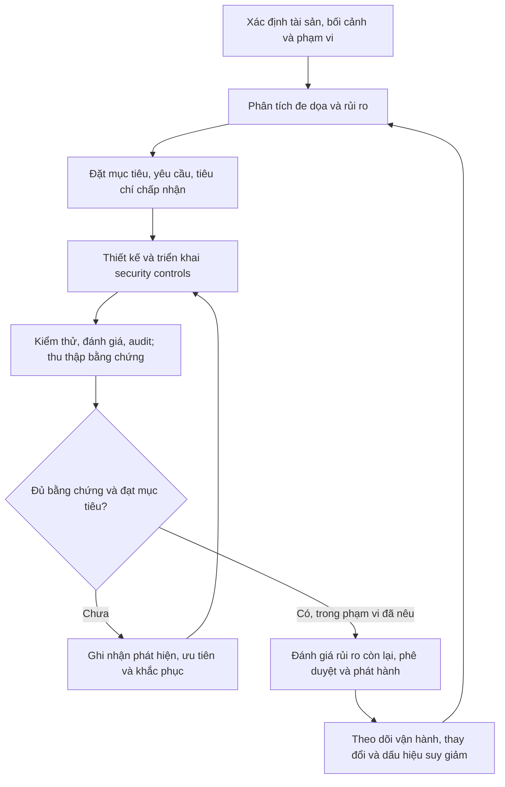

# Security assurance là gì?

Một hệ thống có thể triển khai mã hóa, kiểm soát truy cập và quét lỗ hổng nhưng vẫn chưa trả lời được câu hỏi quan trọng: **Dựa trên bằng chứng nào để tin rằng hệ thống đáp ứng các mục tiêu bảo mật đã đặt ra?** Security assurance giải quyết chính câu hỏi đó.

**Security assurance (đảm bảo an ninh/bảo mật)** là quá trình có hệ thống nhằm hình thành, kiểm tra và duy trì **mức độ tin cậy có cơ sở** rằng một hệ thống, sản phẩm, dịch vụ hoặc quy trình đáp ứng các mục tiêu bảo mật trong **phạm vi, điều kiện và khoảng thời gian xác định**. Mức độ tin cậy ấy được xây dựng từ lập luận rõ ràng và bằng chứng có thể kiểm tra: phân tích rủi ro, yêu cầu, thiết kế biện pháp kiểm soát, kết quả kiểm thử, đánh giá độc lập, dữ liệu vận hành và kết quả khắc phục.

Trong module `SECURITY_SECURITY_ASSURANCE`, chúng ta học cách tạo chuỗi chứng minh từ **rủi ro → yêu cầu bảo mật → biện pháp kiểm soát (security controls) → bằng chứng đánh giá → phát hiện và khắc phục → đánh giá lại**, để hoạt động assurance tiếp diễn trong cả quá trình phát triển lẫn vận hành.

> **Ý chính:** Security assurance không hứa rằng hệ thống “an toàn tuyệt đối”. Nó chỉ ra **đang tin vào điều gì, vì sao có thể tin, bằng chứng mạnh đến đâu và phần rủi ro nào vẫn còn**.

## 1. Assurance đánh giá điều gì?

Ba mục tiêu kinh điển của bảo mật là:

- **Confidentiality (tính bí mật):** thông tin chỉ được truy cập bởi chủ thể có quyền.
- **Integrity (tính toàn vẹn):** dữ liệu và hành vi hệ thống không bị thay đổi trái phép hoặc không được phát hiện.
- **Availability (tính sẵn sàng):** dịch vụ và dữ liệu có thể sử dụng khi cần, theo mức cam kết.

Tùy hệ thống, mục tiêu còn bao gồm xác thực danh tính, phân quyền, khả năng truy vết, khả năng phục hồi, bảo vệ khóa và bí mật, an toàn chuỗi cung ứng phần mềm, quyền riêng tư hoặc yêu cầu pháp lý cụ thể.

Ví dụ, yêu cầu “chỉ quản trị viên được xem nhật ký kiểm toán” mới là một **phát biểu mong muốn**. Việc thêm kiểm tra vai trò trong mã nguồn mới là một **biện pháp kiểm soát**. Assurance đi xa hơn: kiểm tra đường dẫn API liên quan, xác minh tài khoản thông thường thực sự bị từ chối, đối chiếu cấu hình khi triển khai, lưu kết quả kiểm thử và đánh giá lại khi quyền hoặc mã nguồn thay đổi.

Một kết luận assurance chỉ có ý nghĩa khi nêu được:

1. **Đối tượng và ranh giới:** phiên bản ứng dụng nào, môi trường nào, dịch vụ hoặc luồng dữ liệu nào.
2. **Mục tiêu và mô hình đe dọa:** cần bảo vệ điều gì, trước lỗi hoặc đối thủ nào.
3. **Tiêu chí đánh giá:** yêu cầu nào phải được thỏa mãn và thế nào là đạt.
4. **Bằng chứng cùng giới hạn:** đã kiểm tra bằng cách nào, khi nào, ai thực hiện, còn tình huống nào chưa kiểm tra.
5. **Rủi ro còn lại:** vấn đề nào đã được xử lý, vấn đề nào được chấp nhận có thẩm quyền.

Một báo cáo `PASS` cho lần quét hôm qua không tự suy ra toàn bộ hệ thống an toàn hôm nay. Phạm vi quét có thể thiếu API, cấu hình triển khai có thể khác, hoặc lỗ hổng mới đã xuất hiện.

## 2. Phân biệt security, security control, assessment, audit và assurance

| Khái niệm | Câu hỏi chính | Ví dụ | Giới hạn khi đứng riêng |
|---|---|---|---|
| **Security (bảo mật)** | Tài sản có được bảo vệ trước các đe dọa không? | Ngăn truy cập đơn hàng của người khác | Là mục tiêu/trạng thái cần đạt, chưa chỉ ra cách chứng minh |
| **Security control** | Biện pháp nào ngăn ngừa, phát hiện hoặc giảm tác động của rủi ro? | Phân quyền theo người sở hữu đơn hàng; cảnh báo hành vi bất thường | Có control trên giấy chưa chứng minh control hoạt động đúng |
| **Security assessment / testing** | Một yêu cầu hay control có đạt tiêu chí kiểm tra không? | Unit test, kiểm thử tích hợp, pentest, đánh giá cấu hình | Kết quả phụ thuộc phạm vi, phương pháp và thời điểm |
| **Security audit** | Quy trình, kiểm soát và bằng chứng có phù hợp tiêu chí đánh giá không? | Kiểm tra chính sách, nhật ký thay đổi, bằng chứng phê duyệt | Có thể nhấn mạnh tuân thủ và lấy mẫu, không bao phủ mọi nguy cơ thực tế |
| **Security compliance** | Có đáp ứng một bộ quy định hoặc tiêu chuẩn đã chọn không? | Đối chiếu yêu cầu ISO/IEC 27001 hay chính sách nội bộ | “Đạt checklist” không đồng nghĩa không tồn tại lỗ hổng |
| **Security assurance** | Từ các bằng chứng trên, tin cậy đến mức nào rằng mục tiêu bảo mật được đáp ứng? | Liên kết rủi ro, yêu cầu, control, kiểm thử, vận hành và xử lý sai lệch | Kết luận luôn có phạm vi, giả định, hạn chế và thời hạn hiệu lực |

Kiểm thử, audit và compliance **có thể cung cấp bằng chứng** cho assurance; bản thân chúng không thay thế toàn bộ hoạt động assurance. Một tổ chức cũng có thể áp dụng tiêu chuẩn như **ISO/IEC 27001** (hệ thống quản lý an toàn thông tin), **NIST SP 800-53/800-53A** (danh mục và quy trình đánh giá control) hoặc **OWASP ASVS** (yêu cầu xác minh bảo mật ứng dụng) tùy mục tiêu và bối cảnh. Việc tham chiếu tiêu chuẩn cần gắn với phiên bản, phạm vi và yêu cầu thực tế.

## 3. Cấu trúc của một kết luận có bằng chứng: Claim – Argument – Evidence

Một cách tổ chức assurance hữu ích là mô hình **Claim – Argument – Evidence (CAE)**:

- **Claim (khẳng định):** hệ thống đáp ứng một mục tiêu bảo mật có thể đánh giá, chẳng hạn “người dùng không đọc được dữ liệu của tài khoản khác”.
- **Argument (lập luận):** giải thích vì sao thiết kế, control và cách vận hành có thể hỗ trợ khẳng định ấy; các giả định hoặc đường tấn công nào đã được xem xét.
- **Evidence (bằng chứng):** kết quả kiểm thử, cấu hình, bản ghi triển khai, báo cáo đánh giá, nhật ký giám sát, biên bản rà soát hoặc hồ sơ khắc phục có thể truy xuất và kiểm chứng.

Ví dụ với một API trả về thông tin đơn hàng:

| Thành phần | Minh họa |
|---|---|
| **Claim** | Người dùng A không thể xem đơn hàng thuộc người dùng B |
| **Argument** | API xác thực người dùng; tầng nghiệp vụ đối chiếu chủ sở hữu đơn hàng với danh tính đã xác thực; kiểm tra áp dụng cho mọi đường đọc dữ liệu liên quan |
| **Control** | Xác thực ở điểm vào, kiểm tra quyền trên tài nguyên (object-level authorization), nguyên tắc từ chối mặc định |
| **Evidence** | Kiểm thử trường hợp cùng chủ sở hữu, khác chủ sở hữu, chưa xác thực; rà soát các endpoint có thể đọc đơn hàng; kết quả chạy CI của bản phát hành; rà soát cấu hình production |
| **Giới hạn** | Kiểm thử chỉ bao phủ những đường truy cập đã liệt kê; chức năng xuất báo cáo hoặc cache mới có thể tạo đường truy cập khác |

**Tính truy vết (traceability)** là yêu cầu cốt lõi: từ một rủi ro phải lần ra yêu cầu, control, cách đánh giá, bằng chứng và người chịu trách nhiệm. Ngược lại, một phát hiện thất bại phải chỉ ra những claim nào bị ảnh hưởng.

Bằng chứng hữu ích nên trả lời được tối thiểu: **đã kiểm tra cái gì**, theo **tiêu chí nào**, trên **phiên bản/môi trường nào**, **khi nào**, **kết quả ra sao**, ai thực hiện và nơi lưu hồ sơ gốc. Thiếu các thông tin ấy, một ảnh chụp màn hình “test passed” thường khó được tái kiểm tra.

## 4. Security assurance diễn ra liên tục như thế nào?



Các giai đoạn nối với nhau nhưng không nhất thiết hoàn toàn tuần tự. Trong môi trường phát triển liên tục, một thay đổi mã nguồn, chính sách IAM, hạ tầng, nhà cung cấp hoặc mô hình đe dọa đều có thể kích hoạt đánh giá lại.

| Giai đoạn | Công việc assurance tiêu biểu | Bằng chứng có thể lưu |
|---|---|---|
| **Khởi tạo, thiết kế** | Xác định tài sản, ranh giới tin cậy, luồng dữ liệu, đe dọa và mức rủi ro | Sơ đồ kiến trúc có phiên bản, threat model, risk register |
| **Định nghĩa yêu cầu** | Biến rủi ro thành yêu cầu có thể kiểm tra và tiêu chí chấp nhận | Danh mục yêu cầu, ma trận rủi ro–control–test |
| **Xây dựng** | Review thiết kế/mã nguồn, kiểm tra phụ thuộc, secret scanning, SAST, kiểm thử bảo mật | Pull request review, báo cáo quét và kiểm thử gắn với commit |
| **Trước phát hành** | Đánh giá tích hợp, cấu hình môi trường, xác nhận các phát hiện quan trọng đã xử lý | Kết quả DAST/pentest khi phù hợp, hồ sơ xử lý, quyết định chấp nhận rủi ro |
| **Vận hành** | Giám sát, kiểm tra quyền định kỳ, phản ứng sự cố, kiểm tra sao lưu/phục hồi | Log, cảnh báo đã phân loại, kết quả diễn tập khôi phục, hồ sơ incident |
| **Sau thay đổi hoặc sự cố** | Xác định claim bị ảnh hưởng, kiểm thử hồi quy, cập nhật control và kết luận | Change record, test rerun, bằng chứng khắc phục, ngày đánh giá lại |

Đối với rủi ro cao, assurance có thể cần đánh giá độc lập, kiểm thử nhiều lớp hoặc bằng chứng vận hành dài hạn. Đối với rủi ro thấp, đánh giá tự động và review theo thay đổi có thể đủ. **Mức độ kiểm chứng phải tương xứng mức rủi ro**, thay vì áp một mức thủ tục cho mọi thành phần.

## 5. Ví dụ xuyên suốt: chứng minh API quản trị được phân quyền

Giả sử một dịch vụ Java/Spring Boot cung cấp `GET /api/admin/audit-events`. Mục tiêu: **tài khoản chỉ có vai trò `USER` không đọc được sự kiện kiểm toán dành cho quản trị viên**. Rủi ro tương ứng là lộ dữ liệu nhạy cảm nếu authorization hoạt động sai hoặc bị bỏ qua.

Có thể lập hồ sơ assurance như sau:

| Mã | Nội dung | Tiêu chí đạt | Cách thu thập bằng chứng |
|---|---|---|---|
| REQ-AC-01 | Người chưa xác thực bị từ chối | Trả `401` theo chính sách API | Kiểm thử tích hợp tình huống không có danh tính |
| REQ-AC-02 | Vai trò `USER` bị từ chối | Trả `403`, không có dữ liệu sự kiện | Kiểm thử tích hợp với danh tính có quyền thấp |
| REQ-AC-03 | Vai trò `ADMIN` hợp lệ được phép truy cập | Phản hồi đúng theo API contract | Kiểm thử tích hợp trường hợp tích cực |
| REQ-AC-04 | Quy tắc quyền được áp dụng trong bản triển khai | Cấu hình và phiên bản phù hợp bản đã kiểm thử | Review cấu hình, kiểm tra artefact triển khai |
| REQ-AC-05 | Truy cập trái phép có khả năng phát hiện/điều tra | Có log phù hợp chính sách, không ghi dữ liệu nhạy cảm quá mức | Kiểm tra log, giám sát và quy trình xử lý cảnh báo |

Một phép kiểm tra tự động trong dự án đã cấu hình Spring Boot, Spring Security và `spring-security-test` có thể trông như sau:

```java
import org.junit.jupiter.api.Test;
import org.springframework.beans.factory.annotation.Autowired;
import org.springframework.boot.test.autoconfigure.web.servlet.AutoConfigureMockMvc;
import org.springframework.boot.test.context.SpringBootTest;
import org.springframework.test.web.servlet.MockMvc;

import static org.springframework.security.test.web.servlet.request.SecurityMockMvcRequestPostProcessors.user;
import static org.springframework.test.web.servlet.request.MockMvcRequestBuilders.get;
import static org.springframework.test.web.servlet.result.MockMvcResultMatchers.status;

@SpringBootTest
@AutoConfigureMockMvc
class AdminAuditAuthorizationTest {
    @Autowired
    private MockMvc mockMvc;

    @Test
    void regularUserCannotReadAdminAuditEvents() throws Exception {
        mockMvc.perform(get("/api/admin/audit-events")
                .with(user("member").roles("USER")))
            .andExpect(status().isForbidden());
    }
}
```

Đây là **ví dụ minh họa một phép kiểm chứng**, với giả định API tồn tại và chính sách từ chối tài khoản không đủ quyền bằng HTTP `403`. Một API khác có thể chủ đích trả `404` để không tiết lộ sự tồn tại của tài nguyên; tiêu chí phải bám vào hợp đồng bảo mật của chính API đó.

Khi phép kiểm thử chạy thành công, nó mới chứng minh rằng **tình huống cụ thể trong môi trường kiểm thử** hoạt động như kỳ vọng. Nó chưa chứng minh mọi endpoint đều được bảo vệ, rằng role mapping ở production giống môi trường test, hay nhật ký vận hành đủ để phát hiện lạm dụng. Muốn kết luận claim có cơ sở, cần ghép nhiều nguồn bằng chứng và nêu rõ điểm chưa được bao phủ.

Một bản ghi bằng chứng tối thiểu có thể được lưu trong hệ thống quản lý test/assurance như sau (giá trị là **minh họa**, không phải kết quả kiểm thử thực tế):

```yaml
claim_id: "CLAIM-AC-01"
requirement_id: "REQ-AC-02"
scope: "GET /api/admin/audit-events"
environment: "integration-test"
application_version: "<commit-or-release-id>"
method: "AdminAuditAuthorizationTest.regularUserCannotReadAdminAuditEvents"
expected: "HTTP 403 for USER role"
result: "PASS"
executed_at: "<ISO-8601-timestamp>"
evidence_ref: "<CI-run-or-test-report-link>"
owner: "<responsible-team>"
limitations:
  - "Chỉ kiểm chứng một endpoint trong môi trường tích hợp"
  - "Chưa xác minh cấu hình IAM tại production"
```

Không nên coi phần YAML mẫu là bằng chứng thật. Bằng chứng thật phải liên kết tới kết quả có thể kiểm tra, có dấu thời gian và gắn được với artefact đã phát hành.

## 6. Làm thế nào biết bằng chứng đủ tốt?

Không phải bằng chứng nào cũng có giá trị như nhau. Khi đánh giá, hãy xem xét:

- **Liên quan:** trực tiếp hỗ trợ claim nào? Báo cáo quét lỗ hổng không tự chứng minh cơ chế phân quyền theo từng đơn hàng.
- **Độ bao phủ:** đã xét các tài sản, luồng truy cập, vai trò, trường hợp thất bại và môi trường quan trọng chưa?
- **Tính xác thực và tái lập:** có nguồn gốc, tham số kiểm tra, phiên bản, kết quả gốc và khả năng chạy/đối chiếu lại không?
- **Độ mới:** có còn đúng sau bản phát hành, thay đổi cấu hình hoặc sự kiện bảo mật gần nhất không?
- **Độ độc lập:** người tạo control và người đánh giá có sự phân tách phù hợp với rủi ro không? Với rủi ro nghiêm trọng có thể cần review độc lập.
- **Chất lượng suy luận:** bằng chứng thực sự hỗ trợ kết luận đến đâu, có giả định chưa kiểm tra hoặc cách giải thích khác không?
- **Khả năng truy vết và bảo vệ:** có gắn với yêu cầu/rủi ro, chủ sở hữu và thời hạn lưu trữ; có tránh đưa mật khẩu, token hoặc dữ liệu cá nhân vào hồ sơ không?

Chẳng hạn, ảnh chụp màn hình bật tùy chọn “encryption enabled” chứng minh một phần **cấu hình** tại thời điểm chụp. Nó chưa chứng minh mọi đường truyền đều dùng mã hóa, khóa được quản trị đúng hay bản production đang chạy cùng cấu hình. Bằng chứng có thể bổ sung gồm đánh giá thiết kế, kiểm tra cấu hình triển khai, kiểm thử giao tiếp thực tế và lịch sử thay đổi khóa.

**Bằng chứng thiết kế** cho thấy control dự kiến tồn tại; **bằng chứng triển khai** cho thấy nó được cấu hình/đưa vào hệ thống; **bằng chứng vận hành** cho thấy nó đã hoạt động trong thực tế. Với control quan trọng, nên cân nhắc cả ba lớp.

## 7. Kết luận assurance luôn gắn với rủi ro còn lại

Sau đánh giá, hệ thống có thể có các phát hiện (`findings`) như quyền truy cập quá rộng, cấu hình yếu, không có log cho hành động nhạy cảm hoặc kiểm thử thiếu trường hợp âm tính. Mỗi phát hiện nên có **mô tả có thể tái hiện, tài sản ảnh hưởng, tác động, mức ưu tiên, chủ sở hữu và bằng chứng kiểm chứng sau khi xử lý**.

Thông thường, một tổ chức có bốn cách ứng xử với rủi ro: giảm thiểu bằng control, tránh bằng thay đổi hoạt động, chuyển giao/chia sẻ theo cơ chế phù hợp, hoặc **chấp nhận rủi ro còn lại**. Chấp nhận rủi ro không phải là đánh dấu lỗi thành `PASS`; đó là quyết định có căn cứ, do người có thẩm quyền đưa ra, có phạm vi, lý do, thời hạn và điều kiện xem xét lại.

Ví dụ: hệ thống đã bảo vệ API quản trị bằng role nhưng chưa có cảnh báo theo ngưỡng truy cập bất thường. Nhóm có thể đánh giá tác động và khả năng bị khai thác, đặt biện pháp giảm thiểu tạm thời, ghi nhận người sở hữu, thời hạn hoàn thành, rồi đưa claim phát hiện/giám sát vào trạng thái **chưa đủ bằng chứng** cho đến khi kiểm chứng được. Nếu phát hiện được khắc phục, phải chạy kiểm thử hoặc đánh giá lại và lưu kết quả; trạng thái `FIXED` trong ticket một mình chưa chứng minh sửa lỗi thành công.

Một kết luận assurance hữu ích có dạng:

> Trong phạm vi API quản trị của bản phát hành được đánh giá, các phép kiểm tra phân quyền theo ma trận vai trò đã đạt và cấu hình triển khai được đối chiếu. Vẫn còn giới hạn về khả năng phát hiện truy cập bất thường; rủi ro liên quan được ghi nhận cùng chủ sở hữu và mốc đánh giá lại.

Câu kết luận như vậy có phạm vi và điều kiện rõ ràng, giúp người ra quyết định biết **có thể dựa vào phần nào của hệ thống và còn phải xử lý điều gì**.

## 8. Tổ chức một chương trình assurance trong phát triển và vận hành

Assurance hiệu quả cần được đưa vào cách đội ngũ làm việc hằng ngày, thay vì chỉ tạo báo cáo ngay trước một kỳ audit.

**Trong phát triển (shift left):** nêu yêu cầu bảo mật ở user story/thiết kế, nhận diện rủi ro trước khi viết code, đưa kiểm thử âm tính vào CI, yêu cầu review thay đổi nhạy cảm và gắn báo cáo với commit/bản phát hành.

**Trước phát hành:** kiểm tra mức độ đáp ứng các claim ưu tiên cao, xử lý phát hiện vượt ngưỡng đã thống nhất, xác định ngoại lệ còn hiệu lực và ghi nhận quyết định phát hành với rủi ro còn lại.

**Trong vận hành:** theo dõi control quan trọng, giám sát sự cố, rà soát quyền truy cập, kiểm thử khả năng phục hồi, làm mới bằng chứng định kỳ và tái đánh giá khi có thay đổi đủ lớn.

Các vai trò nên rõ ràng: **chủ sở hữu rủi ro** quyết định mức rủi ro có thể chấp nhận; **nhóm phát triển/vận hành** triển khai và vận hành control; **người đánh giá** kiểm tra chất lượng bằng chứng; **người phụ trách assurance/security** duy trì ma trận và theo dõi khoảng trống. Một người có thể kiêm nhiều vai trò ở đội nhỏ, nhưng những quyết định rủi ro quan trọng vẫn cần được xem xét với mức độc lập phù hợp.

Có thể bắt đầu bằng một bảng truy vết đơn giản:

| Trường | Cần ghi |
|---|---|
| `Risk ID` | Rủi ro cụ thể và mức độ ưu tiên |
| `Requirement/Claim ID` | Mục tiêu bảo mật có thể đánh giá |
| `Control ID` | Biện pháp phòng ngừa, phát hiện hoặc phục hồi |
| `Assessment` | Phương pháp, trường hợp kiểm tra, tiêu chí đạt |
| `Evidence` | Liên kết hồ sơ gốc, phiên bản, môi trường, thời gian |
| `Owner` | Người/nhóm chịu trách nhiệm control và khắc phục |
| `Finding/Exception` | Vấn đề còn mở, quyết định chấp nhận và hạn xem lại |
| `Reassessment trigger` | Thay đổi code, cấu hình, rủi ro, sự cố hoặc chu kỳ định kỳ |

Tổ chức có thể theo dõi một số chỉ báo để điều hành chương trình: tỷ lệ claim rủi ro cao có bằng chứng còn hiệu lực, số phát hiện nghiêm trọng chưa xử lý, thời gian khắc phục, tỷ lệ kiểm thử bảo mật âm tính được tự động hóa, số ngoại lệ đã quá hạn hoặc tỷ lệ control quan trọng được kiểm tra lại sau thay đổi.

Ví dụ, có thể tính:

```text
Độ bao phủ assurance của claim rủi ro cao (%) =
  (Số claim rủi ro cao có bằng chứng hợp lệ, còn hiệu lực
   / Tổng số claim rủi ro cao trong phạm vi) × 100
```

Chỉ số này cho biết **mức độ bao phủ hồ sơ**, không trực tiếp đo “hệ thống an toàn bao nhiêu phần trăm”. Nếu claim được định nghĩa thiếu, phương pháp kiểm chứng yếu hoặc bằng chứng sai, tỷ lệ 100% vẫn không bảo đảm an toàn. Vì vậy phải theo dõi **chất lượng bằng chứng** và **kết quả phát hiện thực tế**, không chỉ đếm số tài liệu hay số test chạy thành công.

## 9. Các ngộ nhận thường gặp

| Ngộ nhận | Cách hiểu đúng |
|---|---|
| “Đã chạy pentest nên hệ thống được bảo đảm an toàn.” | Pentest cung cấp bằng chứng trong phạm vi, kỹ thuật và thời điểm kiểm thử; cần kết hợp thêm hoạt động khác |
| “Đạt tiêu chuẩn nghĩa là không thể bị tấn công.” | Tuân thủ một bộ tiêu chí không bao phủ mọi kịch bản tấn công hoặc mọi thay đổi trong tương lai |
| “Có control là đủ.” | Cần đánh giá control được thiết kế đúng, triển khai đúng và vận hành hiệu quả |
| “Test xanh là claim đã được chứng minh tuyệt đối.” | Phải xem test bao phủ gì, giả định gì và có đúng môi trường triển khai không |
| “Assurance chỉ phục vụ audit hằng năm.” | Bằng chứng cần được cập nhật theo phát hành, thay đổi và sự cố; audit chỉ là một nguồn đánh giá |
| “Không tìm ra lỗ hổng tức là không có lỗ hổng.” | Không phát hiện được một vấn đề không đồng nghĩa chứng minh nó không tồn tại |

## 10. Bắt đầu từ đâu?

Với một hệ thống đang phát triển, có thể khởi động một vòng assurance nhỏ nhưng đầy đủ:

1. **Chọn một tài sản hoặc luồng nghiệp vụ quan trọng**, ví dụ API xem đơn hàng.
2. **Nêu một rủi ro rõ ràng**, ví dụ người dùng xem dữ liệu của tài khoản khác.
3. **Viết claim và tiêu chí đạt có thể kiểm chứng**, kể cả trường hợp chưa đăng nhập, đúng chủ sở hữu và sai chủ sở hữu.
4. **Chỉ ra các control bảo vệ claim**, ví dụ kiểm tra quyền ở tầng tài nguyên và từ chối mặc định.
5. **Chạy đánh giá phù hợp** trên phiên bản cụ thể; lưu báo cáo gốc, cấu hình, người thực hiện và thời điểm.
6. **Ghi nhận khoảng trống và xử lý**, gắn owner, mức ưu tiên, deadline, kết quả kiểm tra lại.
7. **Đưa điều kiện đánh giá lại vào quy trình thay đổi**, nhất là khi thêm endpoint, sửa quyền hoặc thay đổi hệ thống định danh.

Sau một vòng như vậy, nhóm có được một chuỗi bằng chứng thực tế từ rủi ro tới kết luận. Sau đó mới mở rộng sang các mục tiêu khác như bảo vệ dữ liệu, phát hiện sự cố, an toàn dependency, sao lưu và phục hồi.

**Ghi nhớ:** Security assurance là **khả năng bảo vệ một kết luận về bảo mật bằng lập luận và bằng chứng có thể kiểm tra**, đồng thời công khai giới hạn và rủi ro còn lại. Giá trị của nó nằm ở việc giúp kỹ sư, người đánh giá và người quyết định cùng biết hệ thống đã được kiểm tra đến đâu, dựa trên cơ sở nào và khi nào cần kiểm tra lại.
