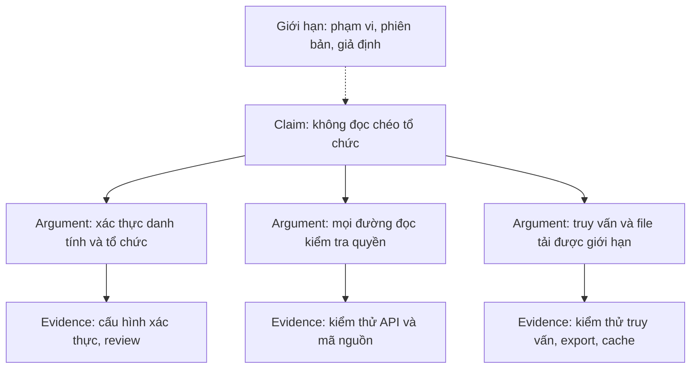
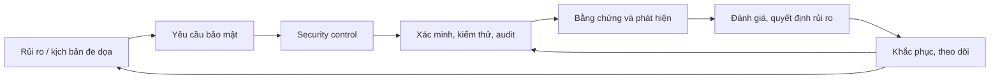

# Niềm tin có căn cứ

Một nhóm phát triển nói rằng: **“Hệ thống của chúng ta an toàn.”** Câu nói này nghe yên tâm nhưng chưa giúp người phụ trách bảo mật, kỹ thuật hay kinh doanh ra quyết định. *An toàn trước mối đe dọa nào? Trong phạm vi và phiên bản nào? Dựa trên kiểm tra gì? Có điểm chưa được xác minh không?*

Trong **security assurance** (bảo đảm an ninh), niềm tin có căn cứ là mức độ tin cậy hình thành từ **những khẳng định bảo mật rõ ràng, lập luận có thể xem xét và bằng chứng phù hợp**, đồng thời thừa nhận giới hạn của bằng chứng và rủi ro còn lại. Đây là nền tảng để đánh giá liệu hệ thống đã đáp ứng các mục tiêu bảo mật được đặt ra hay chưa, từ phân tích rủi ro, yêu cầu và security controls đến kiểm thử, audit, khắc phục phát hiện và giám sát trong vận hành.

## 1. Từ cảm giác an toàn đến kết luận có thể kiểm chứng

Hãy xét một nền tảng quản lý tài liệu dùng chung cho nhiều tổ chức (*multi-tenant*). Một lập trình viên nói: “Chúng ta đã dùng JWT và HTTPS nên dữ liệu khách hàng được bảo vệ.” JWT giúp truyền tải thông tin danh tính hoặc quyền trong một số kiến trúc xác thực; HTTPS bảo vệ dữ liệu trên đường truyền. Nhưng hai cơ chế này **chưa chứng minh** rằng người thuộc tổ chức B không thể đọc tài liệu của tổ chức A. Sai sót trong truy vấn dữ liệu, kiểm tra quyền tại API, luồng xuất file hoặc bộ nhớ đệm vẫn có thể làm lộ thông tin.

Ta có thể thay lời khẳng định chung chung bằng một khẳng định hẹp, kiểm chứng được:

> Với phiên bản dịch vụ `document-api` đang được đánh giá, người dùng thông thường của tổ chức B không thể đọc hoặc tải tài liệu thuộc tổ chức A qua các API được công bố; các đường truy cập được liệt kê trong phạm vi đều thực thi kiểm tra phân quyền phía máy chủ.

Khẳng định này tốt hơn vì nêu được **tài sản cần bảo vệ** (tài liệu), **chủ thể và mối đe dọa** (truy cập chéo tổ chức), **phạm vi** (dịch vụ, API, phiên bản) và **hành vi mong muốn** (từ chối truy cập trái quyền). Nó vẫn chỉ là *claim* (điều cần chứng minh), chưa phải kết luận đã được chứng minh.

Một kết luận security assurance có ích thường trả lời được năm câu hỏi:

1. **Ta muốn bảo vệ điều gì, chống lại nguy cơ nào?** Ví dụ: tính bí mật tài liệu trước lỗi phân quyền theo tổ chức.
2. **Yêu cầu nào thể hiện mục tiêu?** Ví dụ: mọi lần đọc tài liệu phải được ràng buộc bởi định danh tổ chức lấy từ danh tính đã xác thực.
3. **Biện pháp nào thực thi yêu cầu?** Ví dụ: kiểm tra quyền trong tầng nghiệp vụ và giới hạn truy vấn dữ liệu theo `tenant_id`.
4. **Bằng chứng nào cho thấy biện pháp hoạt động?** Ví dụ: review mã nguồn, kiểm thử vượt quyền, cấu hình thực tế, kết quả xác minh sau triển khai.
5. **Điều gì chưa biết hoặc có thể thay đổi?** Ví dụ: chưa kiểm tra đường tải file tạm; một bản phát hành mới có thể khiến bằng chứng cũ không còn giá trị.

Vì thế, **assurance không đồng nghĩa với việc tuyên bố hệ thống không có lỗ hổng**. Nó là quá trình đưa ra mức tin cậy hợp lý cho các mục tiêu xác định, dựa trên bằng chứng hiện có và trong những giả định được công khai.

## 2. Ba thành phần của niềm tin có căn cứ: claim, argument, evidence

Một cách tổ chức kết luận bảo mật là mô hình **Claim – Argument – Evidence (CAE)**, thường dùng khi xây dựng *assurance case* (hồ sơ lập luận bảo đảm):

| Thành phần | Câu hỏi chính | Ví dụ đối với phân quyền tài liệu |
| --- | --- | --- |
| **Claim — Khẳng định** | Điều gì cần được tin là đúng? | Người dùng tổ chức B không đọc được tài liệu của tổ chức A. |
| **Argument — Lập luận** | Vì sao các bằng chứng ủng hộ khẳng định? Những giả định và mắt xích nào cần đúng? | Mọi đường đọc đều qua kiểm soát quyền phía máy chủ; kiểm tra dựa vào danh tính đáng tin cậy; dữ liệu trả về được giới hạn theo tổ chức. |
| **Evidence — Bằng chứng** | Có hiện vật hoặc kết quả kiểm tra cụ thể nào? | Danh sách endpoint, review code, bài test truy cập chéo tổ chức, kết quả chạy CI trên commit được phát hành và cấu hình triển khai. |



Điểm quan trọng nằm ở **lập luận**. Một ảnh chụp màn hình báo “CI passed” là bằng chứng cho việc pipeline đã hoàn thành theo cấu hình của nó; tự nó không chứng minh mọi đường truy cập đều được bảo vệ. Muốn dùng kết quả CI để hỗ trợ claim phân quyền, cần chỉ ra pipeline đã chạy những bài kiểm thử nào, trên phiên bản nào, với dữ liệu và điều kiện nào, rồi giải thích vì sao các bài kiểm thử đó đại diện cho nguy cơ đang xét.

### 2.1. Viết claim sao cho có thể bác bỏ

Claim nên đủ cụ thể để người đánh giá có thể xây dựng một phép kiểm tra có khả năng phát hiện trường hợp claim sai. Một mẫu hữu ích:

> **Trong [phạm vi/phiên bản/môi trường], [chủ thể] không thể hoặc phải có khả năng [hành vi] đối với [tài sản], dưới [điều kiện và giả định].**

Ví dụ:

- **Mơ hồ:** “Mật khẩu được bảo mật.”
- **Cụ thể hơn:** “Tại bản phát hành đang xét, mật khẩu tài khoản nội bộ được lưu dưới dạng hàm băm dành cho mật khẩu với tham số được cấu hình và không được ghi vào application log.”
- **Mơ hồ:** “Hệ thống có giám sát bảo mật.”
- **Cụ thể hơn:** “Trong môi trường production, các sự kiện đăng nhập thất bại theo ngưỡng được định nghĩa tạo cảnh báo đến kênh trực vận hành; có kiểm tra định kỳ khả năng gửi và tiếp nhận cảnh báo.”

Tránh các từ tuyệt đối như *“không thể bị tấn công”*, *“bảo mật 100%”*, *“đạt mọi tiêu chuẩn”* nếu phạm vi và mức bằng chứng không cho phép kết luận như vậy.

### 2.2. Lập luận phải nêu cả giả định

Một claim có thể dựa trên các giả định như: khóa ký token được quản lý an toàn, dịch vụ xác thực không bị chiếm quyền, người đánh giá đã liệt kê đủ đường truy cập, môi trường kiểm thử phản ánh chính sách production. Nếu giả định sai, sức nặng của bằng chứng giảm.

Lập luận tốt cần nêu **phạm vi áp dụng, các trường hợp ngoại lệ, sự phụ thuộc và điều kiện làm bằng chứng mất hiệu lực**. Việc ghi nhận những điều chưa biết làm cho quyết định đáng tin cậy hơn, vì người đọc hiểu chính xác phần nào đã được kiểm chứng.

## 3. Bằng chứng bảo mật tốt trông như thế nào?

Không phải mọi loại bằng chứng đều trả lời cùng một câu hỏi. Security assurance cần phối hợp chứng cứ về **thiết kế**, **triển khai**, **hành vi thực tế** và **vận hành**.

| Bằng chứng | Có thể hỗ trợ kết luận | Không đủ để tự kết luận |
| --- | --- | --- |
| Threat model, phân tích rủi ro | Đã nhận diện các tài sản, điểm tin cậy và kịch bản tấn công được xét | Không còn rủi ro chưa được phát hiện |
| Yêu cầu bảo mật và sơ đồ kiến trúc | Có mục tiêu, ranh giới tin cậy và biện pháp dự kiến | Biện pháp đã được cài đặt đúng |
| Review mã nguồn, cấu hình, quyền truy cập | Cơ chế kiểm soát được triển khai tại các đường đi đã kiểm tra | Không có đường đi khác hoặc lỗi lúc chạy |
| Unit/integration/security test | Hành vi kiểm soát đúng trong điều kiện và dữ liệu đã kiểm thử | Mọi trường hợp tấn công đều được bao phủ |
| SAST, SCA, DAST, pentest | Phát hiện một số loại điểm yếu theo khả năng, cấu hình, thời điểm và phạm vi từng công cụ | Không tìm thấy phát hiện đồng nghĩa không tồn tại lỗ hổng |
| Audit log, alert, diễn tập phản ứng | Sự kiện đã được ghi nhận và xử lý trong kịch bản được kiểm tra | Mọi sự cố tương lai chắc chắn sẽ bị phát hiện |
| Báo cáo audit độc lập, hồ sơ kiểm tra | Một bên có năng lực đã đánh giá tiêu chí và phạm vi được nêu | Toàn bộ hệ thống an toàn hay mọi phiên bản sau đều đạt |

### 3.1. Tiêu chí đánh giá chất lượng bằng chứng

- **Liên quan:** Bằng chứng trả lời trực tiếp claim và mối đe dọa đang xét, không chỉ là một kết quả bảo mật bất kỳ.
- **Đủ phạm vi:** Các đường truy cập, loại người dùng, luồng lỗi, môi trường và biện pháp quan trọng đã được xét đến mức phù hợp với rủi ro. Nếu thiếu, phải ghi rõ phần thiếu.
- **Có thể truy vết và tái lập:** Có mã yêu cầu, phiên bản hoặc commit, cấu hình kiểm thử, thời gian, kết quả, người hoặc hệ thống thực hiện, đường dẫn hiện vật; người khác có thể kiểm tra lại khi cần.
- **Đáng tin cậy:** Phương pháp kiểm tra phù hợp, dữ liệu kiểm thử có ý nghĩa, tiêu chí đạt/trượt rõ ràng; với quyết định rủi ro cao có thể cần người kiểm tra độc lập.
- **Còn hiệu lực:** Bằng chứng gắn với thành phần và cấu hình hiện hành. Thay đổi mã, phụ thuộc, hạ tầng, chính sách hoặc threat model có thể kích hoạt đánh giá lại.

Số lượng báo cáo không thay thế chất lượng chứng cứ. Mười lần chạy cùng một bài test thiếu trường hợp truy cập chéo tổ chức vẫn để hở cùng một điểm mù.

### 3.2. Bằng chứng “đạt” và bằng chứng “chưa đạt” đều có giá trị

Một bài test thất bại, một phát hiện lỗ hổng chưa được xử lý hay một ngoại lệ phê duyệt cũng là thông tin cần có trong assurance case. Nếu chỉ lưu kết quả thuận lợi, quyết định dễ trở thành thiên lệch. Người đánh giá nên giữ lịch sử phát hiện, mức độ ảnh hưởng, chủ sở hữu, hạn xử lý, xác nhận khắc phục và những rủi ro được chấp nhận có thẩm quyền.

## 4. Chuỗi truy vết từ rủi ro đến quyết định

Security assurance tạo liên kết giữa điều hệ thống cần bảo vệ và lý do ta có thể tin rằng điều đó đang được bảo vệ:



Các mắt xích có vai trò khác nhau:

1. **Rủi ro:** Xác định điều có thể xảy ra, ảnh hưởng đến mục tiêu bảo mật và mức ưu tiên xử lý. Chẳng hạn, người dùng sửa `documentId` để lấy tài liệu của tổ chức khác (*broken object level authorization*).
2. **Yêu cầu:** Chuyển rủi ro thành điều kiện cần thỏa mãn. Ví dụ, mọi truy cập tài liệu phải xác minh quyền theo đối tượng và tổ chức.
3. **Control:** Chọn và triển khai cơ chế để đáp ứng yêu cầu, chẳng hạn chính sách phân quyền trên service layer và truy vấn được giới hạn theo tổ chức.
4. **Xác minh:** Đánh giá thiết kế và quan sát hành vi bằng code review, kiểm thử cả trường hợp hợp lệ và trái quyền, kiểm tra cấu hình, kiểm tra thủ công có mục tiêu.
5. **Bằng chứng:** Lưu kết quả có thể truy vết, gồm cả trường hợp thất bại và giới hạn của phương pháp.
6. **Đánh giá và quyết định:** Đối chiếu kết quả với tiêu chí chấp nhận, phân loại rủi ro còn lại, quyết định khắc phục, chặn phát hành hoặc chấp nhận theo thẩm quyền.
7. **Khắc phục và xác nhận lại:** Sửa nguyên nhân, chạy kiểm tra hồi quy, xác minh phát hiện đã được giải quyết; cập nhật claim nếu phạm vi thay đổi.

Ví dụ ma trận truy vết tối giản:

| Mã | Nguy cơ | Yêu cầu / control | Bằng chứng cần có | Quyết định khi chưa đạt |
| --- | --- | --- | --- | --- |
| `R-01` | Đọc tài liệu chéo tổ chức | `SR-01`: kiểm tra quyền theo đối tượng, giới hạn truy vấn theo tenant | Review các đường đọc, test API trái quyền, kiểm tra luồng tải file | Dừng phát hành luồng ảnh hưởng hoặc cô lập chức năng; sửa và kiểm chứng lại |
| `R-02` | Lộ dữ liệu khi truyền | `SR-02`: TLS và cấu hình giao tiếp phù hợp | Kiểm tra cấu hình điểm kết thúc TLS và các đường kết nối liên quan | Sửa cấu hình, kiểm tra lại kết nối |
| `R-03` | Sự cố không được phát hiện | `SR-03`: ghi nhận sự kiện quan trọng và cảnh báo khả dụng | Cấu hình log/alert, sự kiện thử nghiệm được quan sát đầu-cuối | Khôi phục giám sát, đánh giá mức phơi nhiễm trong thời gian gián đoạn |

Một **control tồn tại** chưa đủ để suy ra **control hiệu quả**. Bằng chứng phải cho thấy control bao phủ đúng rủi ro, có hiệu lực tại nơi cần áp dụng và được xác minh theo tiêu chí cụ thể.

## 5. Ví dụ xuyên suốt: chứng minh ngăn truy cập chéo tổ chức

Giả sử một dịch vụ Java cung cấp API `GET /api/documents/{id}` và API lấy file. Dữ liệu mẫu có `doc-101` của `tenant-a`, `doc-202` của `tenant-b`. Ở đây các tên, kết quả và đoạn mã chỉ để minh họa cách lập luận; chúng **không phải kết quả kiểm thử của một hệ thống có thật**.

### 5.1. Phát biểu claim và tiêu chí đạt

**Claim `CLM-01`:** Với bản phát hành được đánh giá, người dùng có danh tính hợp lệ của `tenant-b` không đọc được metadata hoặc nội dung `doc-101` của `tenant-a` qua các endpoint trong danh sách phạm vi.

**Tiêu chí đạt:** Mọi đường đọc thuộc phạm vi trả kết quả từ chối theo chính sách (ví dụ `403`, hoặc `404` để không tiết lộ sự tồn tại), không rò rỉ metadata/nội dung tài liệu, và hành vi đọc hợp lệ của `tenant-a` vẫn hoạt động. Cần kiểm tra riêng các đường tải file, đường dẫn ký tạm thời, danh sách, tìm kiếm và cache nếu chúng tồn tại.

**Giả định cần xác nhận:** `tenant_id` từ danh tính được xác thực không thể do client tự ý thay đổi; tất cả điểm truy cập được mô tả đầy đủ; quyền quản trị hoặc liên tổ chức, nếu có, được đặc tả riêng.

### 5.2. Chứng minh bằng cả thiết kế và hành vi

Một thiết kế có thể dùng định danh tenant từ ngữ cảnh xác thực, sau đó giới hạn truy vấn bằng cả `id` và `tenant_id`:

```java
// Mã minh họa: tenantId phải lấy từ ngữ cảnh xác thực đã được kiểm tra.
public DocumentView readDocument(String documentId, AuthenticatedUser user) {
    return repository.findByIdAndTenantId(documentId, user.tenantId())
            .map(this::toDocumentView)
            .orElseThrow(DocumentNotFoundException::new);
}
```

Đoạn mã này gợi ý một lớp phòng vệ nhưng **không chứng minh toàn bộ claim**: cần kiểm tra phần tải nội dung file, các endpoint khác, chính sách của người dùng đặc biệt và khả năng bỏ qua service layer. Truyền `tenantId` do client gửi trong query hoặc header mà không xác thực sẽ làm suy yếu lập luận.

Ví dụ một phần kiểm thử API bằng Spring MockMvc với Spring Security test support, giả định ứng dụng dùng claim `tenant_id` trong JWT và chính sách trả `404` khi truy cập trái tổ chức:

```java
@Test
void userCannotReadDocumentFromAnotherTenant() throws Exception {
    mockMvc.perform(get("/api/documents/{id}", "doc-101")
            .with(jwt().jwt(token -> token.claim("tenant_id", "tenant-b"))))
        .andExpect(status().isNotFound());
}

@Test
void userCanReadDocumentFromOwnTenant() throws Exception {
    mockMvc.perform(get("/api/documents/{id}", "doc-101")
            .with(jwt().jwt(token -> token.claim("tenant_id", "tenant-a"))))
        .andExpect(status().isOk())
        .andExpect(jsonPath("$.id").value("doc-101"));
}
```

Test này chỉ có ý nghĩa khi test fixture thực sự lưu `doc-101` cho `tenant-a`, các lớp phân quyền trong ứng dụng được bật và không có mocking bỏ qua logic cần đánh giá. Cần thêm assertion phù hợp để đảm bảo phản hồi lỗi không tiết lộ dữ liệu; đồng thời thử API tải file, danh sách, tìm kiếm, cập nhật và các tình huống thay đổi quyền nếu chúng thuộc phạm vi claim.

### 5.3. Gói bằng chứng có thể truy vết

Một nhóm có thể giữ bản kê bằng chứng (*evidence manifest*) để người đánh giá tìm đúng hiện vật. Các giá trị sau là **mẫu cấu trúc**, cần thay bằng dữ liệu thực khi sử dụng:

```yaml
claim_id: CLM-01
scope:
  service: document-api
  release: "<release-id>"
  environment: "<environment>"
risk_ids: [R-01]
requirement_ids: [SR-01]
argument:
  - tenant_id_lay_tu_danh_tinh_duoc_xac_thuc
  - moi_duong_doc_duoc_bao_ve_theo_doi_tuong
  - ket_qua_truy_van_va_file_duoc_gioi_han_theo_tenant
evidence:
  - type: source_review
    reference: "<review-link-or-id>"
    commit: "<commit-sha>"
  - type: integration_test
    reference: "<ci-run-link-or-id>"
    result: "<pass-or-fail>"
  - type: runtime_config_review
    reference: "<deployment-review-link-or-id>"
open_findings: [] # Điền các phát hiện chưa khắc phục trong hệ thống thực tế
assessed_by: "<reviewer>"
assessed_at: "<timestamp>"
decision: "<pending-accepted-or-rejected>"
```

Manifest giúp nối claim với các kết quả kiểm tra; bản thân nó **không thay thế hiện vật gốc**. Cần bảo vệ dữ liệu nhạy cảm bên trong log, báo cáo và mẫu khai thác; phân quyền người xem, che thông tin cần thiết và quản lý thời gian lưu giữ theo quy định tổ chức.

### 5.4. Khi bằng chứng làm lộ khoảng trống

Giả sử toàn bộ test của API metadata đều đạt, nhưng review phát hiện endpoint tải file tạo URL tạm thời mà không ràng buộc quyền đối với tài liệu. Khi đó không được kết luận `CLM-01` đã đạt chỉ vì phần metadata an toàn. Nhóm cần ghi nhận phát hiện, mức ảnh hưởng, người chịu trách nhiệm, biện pháp giảm thiểu hoặc sửa lỗi, rồi **kiểm thử lại đường tải file**. Sau khi xác minh, cập nhật bằng chứng và đánh giá mức rủi ro còn lại trước khi phê duyệt.

Trong tình huống này, phát hiện thất bại khiến assurance hữu ích: nó ngăn một kết luận quá mức dựa trên tập kiểm thử thiếu phạm vi.

## 6. Mức độ tin cậy và giới hạn của kết luận

Niềm tin có căn cứ không nhất thiết là một con số phần trăm. Tổ chức có thể dùng nhận định định tính có tiêu chí rõ ràng:

| Mức tin cậy minh họa | Điều kiện đánh giá | Hành động thường phù hợp |
| --- | --- | --- |
| **Thấp** | Claim mơ hồ, thiếu liên kết với rủi ro, chủ yếu dựa vào lời xác nhận hoặc bằng chứng không truy vết được | Làm rõ claim, hoàn thiện phân tích rủi ro và kế hoạch kiểm chứng |
| **Có cơ sở nhưng còn khoảng trống** | Có thiết kế, control và kiểm thử liên quan; một số đường đi hoặc giả định quan trọng chưa được xác minh | Tập trung kiểm tra phần thiếu, quyết định giảm thiểu rủi ro |
| **Cao trong phạm vi xác định** | Bằng chứng từ nhiều phương pháp phù hợp, có truy vết, đã xử lý phát hiện trọng yếu và được đánh giá trên phiên bản hiện hành | Cho phép quyết định theo ngưỡng rủi ro đã định, tiếp tục theo dõi thay đổi |

Đây chỉ là thang minh họa; mỗi tổ chức cần quy định rõ tiêu chí, thẩm quyền phê duyệt và mức rủi ro chấp nhận. **Mức tin cậy cao không có nghĩa là chắc chắn tuyệt đối.** Một pentest tốt có thể bỏ sót đường khai thác; một control hiệu quả hôm nay có thể mất tác dụng sau thay đổi hệ thống hoặc kỹ thuật tấn công mới.

Cần phân biệt thêm ba khái niệm:

- **Security control:** Biện pháp ngăn ngừa, phát hiện hoặc giảm tác động của rủi ro, như phân quyền, mã hóa, logging và giới hạn truy cập.
- **Security verification / testing:** Hoạt động kiểm tra control hoặc thuộc tính bảo mật trong điều kiện xác định. Kết quả kiểm thử là một nguồn bằng chứng.
- **Security assurance:** Lập luận tổng hợp dựa trên nhiều loại bằng chứng để đánh giá claim và hỗ trợ quyết định. Nó bao gồm việc chỉ rõ phạm vi, giới hạn, phát hiện và rủi ro còn lại.

**Compliance** (tuân thủ) có thể là một phần của assurance khi các yêu cầu pháp lý, chính sách hoặc tiêu chuẩn liên quan đến mục tiêu bảo mật. Tuy nhiên, đạt một checklist tuân thủ không tự động chứng minh hệ thống an toàn trước mọi rủi ro kỹ thuật; ngược lại, kiểm thử kỹ thuật tốt cũng chưa đủ chứng minh việc đáp ứng đầy đủ nghĩa vụ tuân thủ.

## 7. Niềm tin phải được duy trì trong phát triển và vận hành

Một hồ sơ bằng chứng được lập trước phát hành chỉ phản ánh trạng thái và giả định tại thời điểm đó. Security assurance liên tục đòi hỏi cập nhật đánh giá khi hệ thống hoặc bối cảnh rủi ro thay đổi.

| Thời điểm | Hoạt động assurance | Bằng chứng đầu ra điển hình |
| --- | --- | --- |
| **Thiết kế** | Xác định tài sản, kịch bản đe dọa, ranh giới tin cậy, yêu cầu bảo mật và tiêu chí chấp nhận | Threat model, risk register, security requirements, kiến trúc và quyết định thiết kế |
| **Thực thi và pull request** | Review thay đổi nhạy cảm, đối chiếu control với yêu cầu, kiểm thử các trường hợp được phép và bị cấm | Review record, kết quả test, kết quả phân tích mã và phụ thuộc |
| **Build / release** | Rà soát bằng chứng cho đúng commit, artifact, cấu hình và môi trường; xử lý các phát hiện ngăn phát hành | Kết quả CI, chứng cứ cấu hình, ngoại lệ được phê duyệt, quyết định phát hành |
| **Production** | Quan sát sự kiện bảo mật, kiểm tra cảnh báo, rà soát thay đổi quyền và cấu hình, đánh giá sự cố | Log/alert có kiểm soát truy cập, kiểm tra vận hành, post-incident review, kết quả diễn tập |
| **Sau thay đổi hoặc phát hiện mới** | Đánh giá lại giả định và claim liên quan, sửa lỗi, kiểm thử hồi quy, cập nhật rủi ro | Evidence mới liên kết với phiên bản mới, biên bản xác minh khắc phục |

Các tín hiệu có thể làm một claim cần được xét lại gồm: thay đổi endpoint hoặc luồng dữ liệu, nâng cấp thư viện xác thực, thay đổi chính sách phân quyền, dịch vụ phụ trợ mới, thay đổi cấu hình cloud, lỗ hổng mới của phụ thuộc, phát hiện từ pentest, audit hoặc sự cố thực tế.

Trong CI/CD, các *quality gate* có thể chặn việc phát hành khi những kiểm tra bắt buộc không đạt hoặc khi có phát hiện chưa được xử lý vượt mức chấp nhận. Nhưng quyết định chặn/phê duyệt cần phản ánh tính quan trọng của hệ thống và rủi ro thực tế; **không nên dùng một điểm tổng hợp duy nhất để che mất các phát hiện nghiêm trọng**.

### Chỉ số nên hỗ trợ câu hỏi, không thay thế phán đoán

Một vài tín hiệu vận hành hữu ích là tỷ lệ yêu cầu bảo mật quan trọng có bằng chứng còn hiệu lực, số phát hiện nghiêm trọng chưa khắc phục, thời gian xác minh lại sau sửa lỗi, số kiểm tra phân quyền thất bại ở CI và tỷ lệ cảnh báo quan trọng được diễn tập. Các mẫu số, phạm vi và kỳ đo phải rõ ràng.

Chẳng hạn, `18/20 yêu cầu quan trọng có bằng chứng hiện hành` giúp thấy hai yêu cầu còn thiếu; nó **không đồng nghĩa hệ thống an toàn 90%**. Tương tự, 100% bài test hiện tại đạt không cho biết có bao nhiêu kịch bản tấn công chưa được viết thành test.

## 8. Ra quyết định với bằng chứng, phát hiện và rủi ro còn lại

Một báo cáo assurance có ích cho người quyết định nên trả lời:

| Nội dung | Cần trình bày |
| --- | --- |
| **Mục tiêu và phạm vi** | Claim, phiên bản, môi trường, tài sản, người dùng và đường truy cập được xét |
| **Phương pháp và bằng chứng** | Những loại kiểm tra đã thực hiện, kết quả và liên kết đến hiện vật, năng lực/độ độc lập của người đánh giá nếu cần |
| **Khoảng trống và giả định** | Phần chưa kiểm tra, điều kiện giới hạn, kiểm soát phụ thuộc hệ thống khác |
| **Phát hiện và khắc phục** | Mức ảnh hưởng, chủ sở hữu, trạng thái sửa lỗi, bằng chứng kiểm tra lại |
| **Rủi ro còn lại và quyết định** | Điều còn có thể xảy ra, biện pháp giảm thiểu, người có thẩm quyền chấp nhận, thời hạn và điều kiện phải đánh giá lại |

Ví dụ, một báo cáo có thể kết luận: *“Claim phân quyền API tài liệu được hỗ trợ cho các endpoint và bản phát hành đã liệt kê, dựa trên review và kiểm thử chéo tổ chức; còn thiếu đánh giá đường xuất file theo lô, nên chưa đủ cơ sở để xác nhận claim cho toàn bộ chức năng xuất dữ liệu.”* Đây là kết luận cụ thể và có thể hành động, dù chưa thể ghi trạng thái “đạt” cho toàn phạm vi.

Một phát hiện đã được sửa nhưng **chưa có bằng chứng kiểm chứng lại** vẫn nên được ghi là đang chờ xác nhận. Nếu rủi ro được chấp nhận, cần ghi người có thẩm quyền, lý do, phạm vi và thời điểm xem lại; việc chấp nhận rủi ro không biến phát hiện thành bằng chứng rằng control đã hoạt động.

## 9. Các ngộ nhận thường gặp

| Ngộ nhận | Cách hiểu đúng |
| --- | --- |
| “Đã bật HTTPS/JWT/MFA nên hệ thống an toàn.” | Một control chỉ giải quyết một nhóm rủi ro; vẫn cần xác minh cấu hình, cách dùng và các đường bị bỏ sót. |
| “CI xanh nghĩa là bảo mật đạt.” | CI chỉ xác nhận những kiểm tra đã cấu hình; cần đối chiếu với threat model và yêu cầu bảo mật. |
| “Không có phát hiện trong pentest nghĩa là không có lỗ hổng.” | Pentest có giới hạn về thời gian, phạm vi, phương pháp và năng lực; không phát hiện không phải bằng chứng phủ định tuyệt đối. |
| “Đạt audit một lần thì đủ cho các lần phát hành sau.” | Kết luận audit có phạm vi và thời điểm; thay đổi hệ thống có thể làm bằng chứng hết hiệu lực. |
| “Càng nhiều tài liệu thì niềm tin càng cao.” | Điều quyết định là chất lượng lập luận, sự liên quan, độ bao phủ và độ mới của bằng chứng. |
| “Khắc phục xong là có thể đóng phát hiện.” | Cần xác minh sửa lỗi có hiệu lực và không làm hỏng chức năng liên quan, rồi cập nhật hồ sơ. |

## 10. Áp dụng ngay: tạo một assurance case tối thiểu

Khi triển khai một tính năng nhạy cảm như đổi quyền người dùng, tải dữ liệu, thanh toán hay quản lý khóa, nhóm có thể bắt đầu bằng mẫu sau:

```text
Claim ID:
Khẳng định cần chứng minh:
Phạm vi (dịch vụ, phiên bản, môi trường, luồng dữ liệu):
Rủi ro và yêu cầu bảo mật liên quan:
Các control và lập luận vì sao chúng xử lý rủi ro:
Giả định / phụ thuộc / ngoại lệ:
Bằng chứng (liên kết, kết quả, commit, người kiểm tra, thời điểm):
Phần chưa xác minh và phát hiện còn mở:
Đánh giá rủi ro còn lại:
Quyết định / người phê duyệt / điều kiện đánh giá lại:
```

Để tự kiểm tra chất lượng, hãy tưởng tượng một người chưa tham gia dự án mở hồ sơ này. **Họ có thể lần từ một claim về tài sản và mối đe dọa cụ thể, qua cơ chế kiểm soát, đến bằng chứng đúng phiên bản, nhìn thấy phần thiếu và hiểu tại sao quyết định được đưa ra không?** Nếu chưa, hồ sơ cần thêm chứng cứ hoặc làm rõ lập luận.

**Điều cốt lõi:** Trong security assurance, niềm tin là một kết luận **có điều kiện và có thể kiểm tra lại**. Nó hình thành khi mục tiêu bảo mật được chuyển thành claim rõ ràng, các control được kiểm chứng bằng bằng chứng phù hợp, giới hạn được công khai và phát hiện dẫn đến hành động khắc phục. Niềm tin ấy cần được duy trì liên tục trong suốt vòng đời phát triển và vận hành, mỗi khi hệ thống hoặc rủi ro thay đổi.
