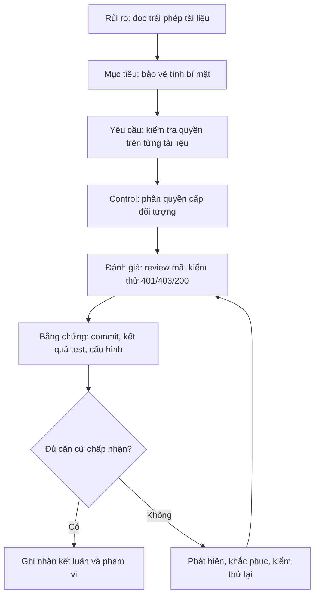

# Bằng chứng bảo mật

## Mục tiêu học tập

Sau bài học, bạn có thể:

- Giải thích bằng chứng bảo mật (security evidence) là gì, vì sao một tuyên bố “hệ thống an toàn” chưa đủ để kết luận hệ thống đáp ứng mục tiêu bảo mật.
- Phân biệt mục tiêu, yêu cầu, biện pháp kiểm soát (security control), hoạt động đánh giá và bằng chứng thu được.
- Đánh giá tính phù hợp, độ tin cậy, phạm vi, thời điểm và giới hạn của một bằng chứng.
- Tạo hồ sơ bằng chứng có thể truy vết từ rủi ro đến kết quả kiểm thử, audit và khắc phục.
- Tổ chức thu thập, xem xét và cập nhật bằng chứng liên tục trong phát triển, triển khai và vận hành.

## 1. Bằng chứng bảo mật là gì?

**Bằng chứng bảo mật** là thông tin có thể kiểm tra, gắn với một hệ thống, phạm vi và thời điểm xác định, được dùng để đánh giá một khẳng định về bảo mật. Bằng chứng có thể là kết quả kiểm thử, cấu hình đang chạy, bản ghi kiểm toán, mã nguồn gắn với phiên bản phát hành, kết quả rà soát quyền truy cập hoặc tài liệu phê duyệt có người chịu trách nhiệm.

Trong **security assurance**, câu hỏi không dừng ở “đã có biện pháp bảo mật chưa?” mà đi tiếp tới “dựa vào đâu để tin rằng biện pháp đó được thiết kế đúng, triển khai đúng và thực sự hoạt động?”. Quá trình này liên kết **phân tích rủi ro → mục tiêu bảo mật → yêu cầu → security controls → hoạt động đánh giá → bằng chứng → phát hiện → khắc phục và xác minh lại**.

Ba thành phần cần phân biệt:

| Thành phần | Câu hỏi cần trả lời | Ví dụ |
| --- | --- | --- |
| **Khẳng định (claim)** | Hệ thống cần đáp ứng điều gì? | “Người dùng chỉ xem được tài liệu họ có quyền truy cập.” |
| **Lập luận đánh giá (argument)** | Vì sao các bằng chứng hỗ trợ khẳng định? | “API kiểm tra quyền trên từng tài liệu; các trường hợp truy cập hợp lệ và trái phép đều được thử nghiệm.” |
| **Bằng chứng (evidence)** | Hiện vật hoặc kết quả nào có thể kiểm tra? | Mã kiểm tra quyền tại một commit, báo cáo integration test, cấu hình triển khai, bản ghi truy cập đã được ẩn dữ liệu nhạy cảm. |

**Có bằng chứng không có nghĩa là an toàn tuyệt đối.** Một lần quét lỗ hổng không phát hiện vấn đề chỉ cho biết công cụ, cấu hình và phạm vi quét tại thời điểm đó không tìm thấy vấn đề tương ứng. Một bộ kiểm thử đạt cũng không tự chứng minh rằng đúng phiên bản mã và cấu hình ấy đang chạy trên production.

## 2. Từ rủi ro đến bằng chứng có thể truy vết

Xét dịch vụ quản lý tài liệu lưu thông tin cá nhân. Rủi ro chính là người dùng A thay đổi ID trong URL để đọc tài liệu của người dùng B (broken object-level authorization).



Một hồ sơ truy vết tối thiểu có thể gồm:

| Mã | Thành phần | Nội dung minh họa |
| --- | --- | --- |
| RISK-01 | Rủi ro | Lộ tài liệu qua thay đổi ID trên API. |
| OBJ-01 | Mục tiêu | Chỉ chủ sở hữu hoặc người được ủy quyền mới đọc được tài liệu. |
| REQ-01 | Yêu cầu có thể đánh giá | Mọi request đọc tài liệu đều được kiểm tra quyền theo danh tính và tài liệu đích. |
| CTRL-01 | Biện pháp kiểm soát | Kiểm tra phân quyền cấp đối tượng ở lớp xử lý request, áp dụng nhất quán cho mọi đường truy cập. |
| TEST-01 | Hoạt động đánh giá | Kiểm thử truy cập không đăng nhập, truy cập tài liệu của người khác và truy cập hợp lệ. |
| EV-01 | Bằng chứng | Kết quả kiểm thử gắn với commit và pipeline cụ thể; review logic phân quyền. |
| FIND-01 | Phát hiện (nếu có) | Một endpoint bỏ sót kiểm tra quyền; phải sửa và kiểm thử hồi quy. |

Điểm quan trọng là **mỗi bằng chứng phải trả lời một câu hỏi đánh giá cụ thể**. Bản chụp màn hình “Build succeeded” không đủ để kết luận REQ-01 đạt; cần biết pipeline đã chạy bài kiểm thử nào, trên phiên bản và môi trường nào, kết quả gì, và cách đối chiếu lại hiện vật gốc.

## 3. Những dạng bằng chứng thường dùng

| Nhóm bằng chứng | Ví dụ | Có thể hỗ trợ kết luận | Giới hạn cần nêu rõ |
| --- | --- | --- | --- |
| **Thiết kế và quản trị** | Threat model, yêu cầu bảo mật, sơ đồ luồng dữ liệu, chính sách | Rủi ro và phương án kiểm soát đã được nhận diện, xem xét | Tài liệu được phê duyệt không chứng minh hệ thống đang thực thi đúng |
| **Triển khai** | Mã nguồn, cấu hình IaC, rule phân quyền, pull request được review | Control đã được cài đặt trong phiên bản xác định | Mã trong repository có thể khác bản đang chạy |
| **Kiểm thử và đánh giá kỹ thuật** | Unit/integration test, SAST, DAST, kiểm thử xâm nhập, kiểm thử cấu hình | Hành vi hoặc điểm yếu trong tập ca kiểm tra có thể lặp lại | Phụ thuộc phạm vi, chất lượng test, công cụ và thời điểm |
| **Trạng thái vận hành** | Cấu hình thực tế, phiên bản triển khai, tình trạng mã hóa, danh sách quyền hiện hành | Kiểm soát được bật trên môi trường hoặc tài sản xác định | Snapshot không chứng minh trạng thái liên tục trong quá khứ |
| **Hoạt động thực tế** | Audit log, nhật ký phát hiện và xử lý cảnh báo, ticket sự cố | Hệ thống ghi nhận và xử lý những sự kiện quan sát được | Thiếu log, sai thời gian, lọc sự kiện hoặc thời gian lưu ngắn có thể làm mất ngữ cảnh |
| **Đánh giá độc lập và khắc phục** | Biên bản audit, kết quả review quyền, phát hiện, pull request sửa lỗi, retest | Có hoạt động giám sát, xác nhận và xử lý vấn đề | “Đã đóng ticket” không thay thế kết quả xác minh biện pháp sửa lỗi |

Bằng chứng **trực tiếp** quan sát hành vi hoặc trạng thái cần đánh giá, chẳng hạn bài kiểm thử truy cập trái phép nhận HTTP 403. Bằng chứng **gián tiếp** hỗ trợ niềm tin nhưng cần kết hợp thêm, chẳng hạn chính sách quy định việc kiểm soát truy cập. Một kết luận có sức thuyết phục thường sử dụng nhiều nguồn bổ sung cho nhau: thiết kế, mã, kết quả kiểm thử và trạng thái vận hành.

## 4. Khi nào bằng chứng được xem là đủ tốt?

Chất lượng bằng chứng phụ thuộc vào rủi ro và khẳng định cần chứng minh. Người đánh giá nên xem xét:

1. **Liên quan:** Bằng chứng có trực tiếp trả lời yêu cầu bảo mật không? Báo cáo quét dependency không thay thế kiểm thử phân quyền cấp đối tượng.
2. **Đúng phạm vi:** Có nêu hệ thống, phiên bản, endpoint, tài sản, môi trường, tenant, vai trò người dùng và khoảng thời gian được bao phủ không?
3. **Đầy đủ và có cả trường hợp thất bại:** Kiểm thử cả đường hợp lệ lẫn đường bị từ chối, trường hợp biên và các tuyến truy cập tương đương; nhận diện phần chưa kiểm tra.
4. **Nguồn gốc có thể xác minh:** Ai hoặc hệ thống nào tạo ra kết quả, bằng cách nào, từ input nào, gắn với commit/build/deployment nào?
5. **Toàn vẹn:** Hiện vật được lưu tại nơi có kiểm soát sửa đổi, có lịch sử truy cập hoặc checksum nếu cần. Chỉ riêng checksum không chứng minh nguồn gốc đáng tin nếu không có hệ thống lưu giữ tin cậy.
6. **Còn hiệu lực:** Thời điểm tạo bằng chứng có phù hợp với phiên bản và môi trường hiện tại không? Thay đổi mã, quyền, cấu hình hoặc hạ tầng có thể khiến bằng chứng cũ hết giá trị.
7. **Có thể tái kiểm tra:** Phương pháp đánh giá, bộ dữ liệu kiểm thử an toàn, điều kiện chạy và tiêu chí pass/fail đủ rõ để lặp lại.
8. **Có người chịu trách nhiệm xem xét:** Đã xác định người tạo, chủ sở hữu control, người review và cách xử lý bất đồng hoặc bằng chứng mâu thuẫn.

Ví dụ: một bài test integration chạy trên staging chứng minh hành vi của build trên staging với dữ liệu test. Để kết luận control có hiệu lực ở production, cần thêm căn cứ về **đúng phiên bản được phát hành**, cấu hình thực tế, chính sách phân quyền và/hoặc giám sát hoạt động production. Không cần thử truy cập trái phép vào dữ liệu thật để tạo bằng chứng; có thể dùng tài khoản, tài liệu và môi trường kiểm thử được kiểm soát.

## 5. Ví dụ thực hành: chứng minh API đã kiểm tra quyền truy cập

Giả sử hệ thống Java/Spring Boot cung cấp `GET /api/documents/{id}`. **Khẳng định cần đánh giá:** tài khoản không có quyền với tài liệu sẽ không đọc được nội dung của tài liệu đó.

Một cách triển khai kiểm soát là kiểm tra quyền **trên từng tài liệu**, bên cạnh xác thực người dùng:

```java
@RestController
@RequestMapping("/api/documents")
class DocumentController {
    private final DocumentService documentService;

    DocumentController(DocumentService documentService) {
        this.documentService = documentService;
    }

    @GetMapping("/{id}")
    @PreAuthorize("@documentPermissions.canRead(authentication, #id)")
    DocumentDto read(@PathVariable UUID id) {
        return documentService.read(id);
    }
}
```

Ở ví dụ trên, `documentPermissions.canRead(...)` là logic do ứng dụng tự triển khai để kiểm tra danh tính, chủ sở hữu, quyền được chia sẻ và chính sách liên quan. Chỉ kiểm tra “đã đăng nhập” hoặc “có role USER” **không đủ** cho yêu cầu này. Phương thức `@PreAuthorize` cũng phải được kích hoạt và áp dụng thực tế trong cấu hình method security.

Với một fixture gồm tài liệu thuộc Alice và Bob, một kiểm thử phân quyền có thể viết:

```java
@Test
@WithMockUser(username = "alice")
void cannotReadAnotherUsersDocument() throws Exception {
    mockMvc.perform(get("/api/documents/{id}", bobDocumentId))
           .andExpect(status().isForbidden());
}
```

Để bằng chứng đủ mạnh hơn, bộ kiểm thử cần ít nhất các tình huống sau:

| Tình huống | Kết quả kỳ vọng theo chính sách ví dụ |
| --- | --- |
| Không đăng nhập, gọi API yêu cầu xác thực | HTTP 401 |
| Alice đọc tài liệu Bob mà không được cấp quyền | HTTP 403 |
| Alice đọc tài liệu của mình | HTTP 200, nội dung đúng |
| Người được chia sẻ quyền đọc hợp lệ | HTTP 200 theo phạm vi được cấp |
| Người đã bị thu hồi quyền thử đọc lại | HTTP 403 |
| Truy cập qua endpoint hoặc phương thức thay thế | Vẫn áp dụng cùng chính sách quyền |

Mã nguồn và bài kiểm thử mới là **thiết kế và cơ chế đánh giá**. Để thành hồ sơ bằng chứng, cần lưu kết quả chạy thực tế, đầu vào/phiên bản tương ứng và người review. Nếu chính sách cố ý trả 404 thay vì 403 để tránh tiết lộ sự tồn tại của tài liệu, sửa tiêu chí mong đợi và lập luận đánh giá cho đúng; điều cốt lõi là không trả nội dung trái phép.

Ví dụ một **bản ghi hồ sơ bằng chứng** (tất cả giá trị trong dấu `<...>` là chỗ điền, không phải kết quả thật):

```yaml
evidence_id: EV-ACCESS-001
claim_id: CL-ACCESS-001
risk_id: RISK-01
requirement_id: REQ-01
control_id: CTRL-01
system: document-service
environment: staging
source:
  kind: integration-test
  commit: "<GIT_COMMIT_SHA>"
  ci_run: "<CI_RUN_ID>"
  artifact_uri: "<RESTRICTED_ARTIFACT_URI>"
  sha256: "<ARTIFACT_SHA256>"
observed_at: "<ISO_8601_UTC>"
scope: "GET /api/documents/{id}; anonymous, owner, non-owner"
result: "<PASSED_OR_FAILED>"
owner: "<CONTROL_OWNER>"
reviewer: "<EVIDENCE_REVIEWER>"
limitations: "Chưa tự chứng minh cấu hình và phiên bản production"
```

Một **gói bằng chứng** cho yêu cầu REQ-01 có thể gồm kết quả test trong CI, commit của mã và các test, trạng thái review, ID bản build/deployment, xác nhận policy trên môi trường đích và bản ghi đánh giá. Gói này trả lời được: **đã đánh giá điều gì, bằng phương pháp nào, trên cái gì, kết quả ra sao và còn giới hạn gì**.

## 6. Đánh giá bằng chứng và xử lý phát hiện

Không nên đồng nhất “có file bằng chứng” với “control đạt”. Một quy trình đánh giá rõ ràng có thể phân loại từng yêu cầu:

| Kết luận | Ý nghĩa | Hành động |
| --- | --- | --- |
| **Đạt, có căn cứ** | Bằng chứng phù hợp, đủ phạm vi yêu cầu và đã được review | Ghi nhận kết luận, phiên bản, ngày đánh giá, ngày/điều kiện cần đánh giá lại |
| **Chưa đủ bằng chứng** | Chưa thể kết luận vì thiếu hiện vật, thiếu phạm vi hoặc dữ liệu đã cũ | Thu thập thêm hoặc thực hiện đánh giá bổ sung |
| **Không đạt** | Bằng chứng cho thấy control hoặc yêu cầu bị vi phạm | Tạo finding, đánh giá mức độ ảnh hưởng, phân công và khắc phục |
| **Ngoại lệ được chấp nhận** | Có thiếu hụt/rủi ro còn tồn tại nhưng cấp có thẩm quyền đã phê duyệt chấp nhận trong phạm vi và thời hạn cụ thể | Lưu quyết định, lý do, biện pháp bù trừ, người phê duyệt và ngày hết hạn; vẫn ghi nhận thiếu hụt |

**Ngoại lệ không biến control thất bại thành control đạt.** Nó là quyết định quản trị rủi ro cần được theo dõi riêng.

Ví dụ chu trình xử lý finding:

1. **Phát hiện:** `FIND-01` cho thấy `GET /api/documents/export/{id}` bỏ qua kiểm tra quyền. Đính kèm request đã làm sạch thông tin nhạy cảm, build bị ảnh hưởng và cách tái hiện.
2. **Phân tích:** xác định tài liệu, người dùng, môi trường và thời gian có thể bị ảnh hưởng; đánh giá mức độ rủi ro và mức ưu tiên khắc phục.
3. **Sửa lỗi:** bổ sung kiểm tra quyền cho luồng export; review các endpoint tương tự và cập nhật test để tái hiện lỗi cũ.
4. **Xác minh lại:** chạy test thất bại trước sửa, đạt sau sửa, kiểm tra các ca hồi quy; ghi lại commit, CI run và deployment chứa bản sửa.
5. **Đóng phát hiện:** reviewer kiểm tra bằng chứng retest và kết quả triển khai rồi mới chuyển trạng thái; nếu còn rủi ro tồn dư, ghi ngoại lệ và người chấp nhận.

Ticket có nhãn “Done” chỉ thể hiện tiến độ công việc. **Bằng chứng khắc phục** phải cho thấy hành vi hoặc cấu hình sai đã thay đổi theo tiêu chí chấp nhận, và thay đổi đó đã đến đúng môi trường.

## 7. Quản lý vòng đời bằng chứng trong chương trình security assurance

Bằng chứng có giá trị nhất khi được tích hợp vào quy trình hằng ngày thay vì chỉ thu gom trước kỳ audit.

```text
Xác định claim và tiêu chí chấp nhận
    -> Xây dựng control và phương pháp kiểm chứng
    -> Thu thập hiện vật theo phiên bản/môi trường/thời gian
    -> Kiểm tra nguồn gốc, tính toàn vẹn và phạm vi
    -> Review, kết luận và ghi nhận khoảng trống
    -> Khắc phục / chấp nhận rủi ro có thời hạn
    -> Giám sát thay đổi và đánh giá lại
```

| Giai đoạn | Bằng chứng nên có | Tác nhân chịu trách nhiệm điển hình | Khi nào cần cập nhật |
| --- | --- | --- | --- |
| Phân tích và thiết kế | Threat model, ma trận rủi ro, yêu cầu, tiêu chí đánh giá | Kiến trúc sư, chủ sản phẩm, security | Khi thay đổi tài sản, luồng dữ liệu, giả định tin cậy |
| Pull request / CI | Review, kiểm tra policy, SAST/SCA, kết quả test bảo mật, build ID | Nhóm phát triển, AppSec, CI | Mỗi thay đổi ảnh hưởng control hoặc mỗi build liên quan |
| Trước phát hành | Bản kiểm kê finding, phê duyệt ngoại lệ, đối chiếu build và kết quả test | Người phê duyệt release, security | Mỗi bản phát hành hoặc thay đổi rủi ro cao |
| Triển khai và vận hành | Cấu hình thực tế, deployment ID, log audit, cảnh báo, rà soát quyền | SRE/Ops, IAM, SOC, control owner | Theo lịch đánh giá và khi có thay đổi/sự cố |
| Audit và cải tiến | Bộ chứng cứ đã review, finding, kế hoạch sửa lỗi, retest | Assessor, audit, chủ sở hữu control | Theo kỳ audit, sau phát hiện và khi rủi ro thay đổi |

Nên dùng một **evidence register** hoặc hệ thống quản lý có khả năng truy vết để giữ các trường tối thiểu: ID bằng chứng; ID claim/risk/control; hệ thống/tài sản; phiên bản và môi trường; thời điểm; phương pháp; nguồn hiện vật; kết quả; chủ sở hữu; người review; mức độ bao phủ; giới hạn; thời điểm hoặc sự kiện cần đánh giá lại; liên kết finding và retest.

Một số cách làm thực tế:

- **Tự động hóa thu thập** từ CI/CD, công cụ kiểm tra cấu hình, quản lý định danh và hệ thống giám sát; tránh phụ thuộc vào ảnh chụp màn hình thủ công.
- **Gắn bằng chứng với thay đổi:** lưu commit, build ID, deployment ID và revision cấu hình để tìm ra bằng chứng nào hết hiệu lực sau một release.
- **Thiết lập trigger đánh giá lại:** sửa logic authorization, thay đổi quyền IAM, cấu hình mạng, nhà cung cấp hoặc phát hiện sự cố đều có thể yêu cầu cập nhật đánh giá ngay, kể cả chưa đến kỳ audit.
- **Giữ khả năng truy xuất có kiểm soát:** phân quyền người tạo/người đọc, ghi lịch sử thay đổi, có lịch lưu giữ phù hợp chính sách và yêu cầu áp dụng.
- **Bảo vệ nội dung bằng chứng:** log, request, token, dữ liệu khách hàng và cấu hình có thể chứa bí mật; dùng dữ liệu thử, ẩn danh hoặc che thông tin nhạy cảm trước khi chia sẻ. Không đẩy secret thô vào ticket, báo cáo hoặc artifact CI.

Thời hạn hiệu lực và lưu giữ **không có một con số chung cho mọi loại bằng chứng**; chúng phụ thuộc quy định áp dụng, độ biến động của control, mức rủi ro và mục tiêu đánh giá. Bằng chứng cần được đánh dấu hết hiệu lực khi thay đổi nền tảng khiến lập luận ban đầu không còn đúng.

## 8. Các lỗi diễn giải phổ biến

| Cách kết luận thiếu cơ sở | Vấn đề | Cách cải thiện |
| --- | --- | --- |
| “Có chính sách nên hệ thống đã tuân thủ.” | Chính sách mô tả ý định, chưa chứng minh thực thi | Kèm bằng chứng triển khai và hiệu quả vận hành |
| “CI xanh nên release an toàn.” | Không rõ job, phạm vi test hoặc bản deploy | Truy vết test suite, commit, build và production deployment |
| “Không có cảnh báo nghĩa là không có tấn công.” | Giám sát có thể thiếu nguồn log hoặc quy tắc phát hiện | Đánh giá độ bao phủ telemetry, thử tình huống phát hiện và xác minh pipeline |
| “Một ảnh chụp cấu hình đủ cho cả năm.” | Cấu hình có thể thay đổi | Thu thập snapshot có timestamp, theo dõi drift và thay đổi |
| “Đã sửa ticket nên lỗ hổng hết.” | Không có retest hoặc chưa triển khai bản sửa | Gắn kết quả kiểm chứng với build và môi trường đã sửa |
| “Kết quả audit đạt bao phủ mọi rủi ro.” | Audit có phạm vi, thời điểm và tiêu chí riêng | Đọc giới hạn báo cáo, đối chiếu với hệ thống và rủi ro đang xét |

Các tiêu chuẩn và framework như **NIST SP 800-53A** (phương pháp đánh giá control), **OWASP ASVS** (yêu cầu kiểm chứng bảo mật ứng dụng), hay **ISO/IEC 27001** (hệ thống quản lý an toàn thông tin) có thể giúp tổ chức xác định tiêu chí và cấu trúc đánh giá. Tuy nhiên, việc viện dẫn tiêu chuẩn hoặc có chứng nhận không thay cho bằng chứng cụ thể của hệ thống, phiên bản và mục tiêu đang được xem xét.

## 9. Bài tập tự kiểm tra

**Tình huống:** API tải xuống tệp từ object storage được đội phát triển mô tả là “an toàn vì bucket đã bật mã hóa và các URL có thời hạn 10 phút”. Hãy xác định các khẳng định cần kiểm chứng, bằng chứng nên yêu cầu, và điều chưa thể kết luận từ mô tả ban đầu.

Gợi ý trả lời:

| Khẳng định cần đánh giá | Bằng chứng phù hợp | Điều cần làm rõ |
| --- | --- | --- |
| Object được mã hóa khi lưu | Cấu hình mã hóa thực tế trên bucket/object, quyền quản lý khóa, kết quả kiểm tra cấu hình có timestamp | Cơ chế và phạm vi mã hóa; khả năng đọc dữ liệu của người có quyền |
| Chỉ người có quyền mới nhận được URL tải xuống | Mã và integration test kiểm tra quyền sở hữu/chia sẻ trên từng object, gồm ca truy cập chéo người dùng | API tạo URL có kiểm tra quyền mỗi lần không? |
| URL hết hạn theo chính sách | Test URL trước/sau hết hạn; cấu hình giới hạn TTL tại dịch vụ phát hành URL | URL có bị log, rò rỉ hoặc có thể tái sử dụng trước hạn không? |
| Không thể tải object bằng đường công khai khác | Cấu hình bucket public access, policy, kết quả kiểm tra truy cập trực tiếp | Có CDN, endpoint hoặc bucket phụ bỏ qua kiểm soát không? |
| Control đang có hiệu lực ở production | Build/deployment, cấu hình cloud hiện hành, kiểm tra drift và đánh giá quyền liên quan | Kết quả staging có tương ứng production không? |

**Kết luận từ tình huống:** “Có mã hóa” và “URL hết hạn sau 10 phút” là hai đặc điểm cần xác minh, nhưng chưa đủ để kết luận quyền tải xuống được kiểm soát. Một chương trình security assurance tốt diễn đạt rõ claim, tập hợp bằng chứng đủ phạm vi, nêu giới hạn, và cập nhật kết luận khi hệ thống thay đổi.

## Ghi nhớ

- Bằng chứng phải **gắn với một khẳng định bảo mật có thể kiểm chứng**, cùng phạm vi, phiên bản, thời điểm và nguồn gốc.
- Kết luận đáng tin dựa trên **chuỗi truy vết từ rủi ro đến control và kết quả đánh giá**, không dựa trên tên công cụ hoặc nhãn “Pass” đơn lẻ.
- **Thiết kế đúng, triển khai đúng và vận hành hiệu quả** là những khẳng định khác nhau; cần những bằng chứng phù hợp cho từng khẳng định.
- Một phát hiện chỉ thực sự được khắc phục khi có **bằng chứng kiểm chứng lại**; ngoại lệ chấp nhận rủi ro phải được theo dõi riêng.
- Thu thập và rà soát bằng chứng là **hoạt động liên tục** xuyên suốt phát triển, triển khai, vận hành và audit.
