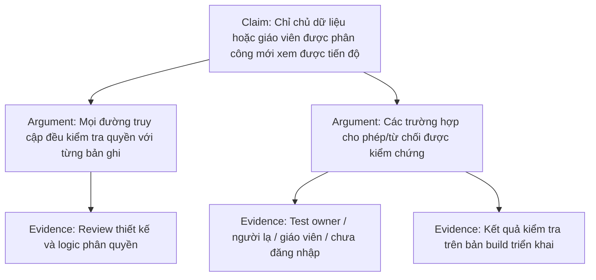

# Assurance và security

## Mục tiêu học tập

Sau bài này, người học có thể:

- Phân biệt **security** (tính bảo mật/an toàn thông tin của hệ thống) với **security assurance** (cơ sở để tin rằng các mục tiêu security đang được đáp ứng).
- Giải thích vì sao đã triển khai security control vẫn cần kiểm chứng bằng bằng chứng có thể xem xét lại.
- Viết một lập luận assurance theo chuỗi **tuyên bố (claim) → lập luận (argument) → bằng chứng (evidence)**.
- Liên kết rủi ro, yêu cầu security, control, kết quả kiểm thử, audit và biện pháp khắc phục thành một quá trình có thể truy vết.
- Nhận ra giới hạn của kết quả kiểm thử, chứng nhận hay audit tại một thời điểm và biết cách duy trì assurance khi hệ thống thay đổi.

## 1. Security trả lời câu hỏi nào?

Trong bối cảnh phát triển và vận hành hệ thống phần mềm, **security** là khả năng bảo vệ tài sản trước các mối đe dọa trong phạm vi và mức rủi ro đã xác định. Tài sản có thể là dữ liệu người dùng, mã nguồn, bí mật truy cập, tài nguyên tính toán, giao dịch hoặc sự liên tục của dịch vụ. Security không đồng nghĩa với việc một hệ thống hoàn toàn không có lỗ hổng; mục tiêu thực tế là kiểm soát các rủi ro phù hợp với nhu cầu nghiệp vụ.

Các thuộc tính thường gặp:

| Thuộc tính | Câu hỏi thực tế | Ví dụ trong nền tảng học tập |
| --- | --- | --- |
| **Confidentiality** – tính bí mật | Ai được phép xem thông tin? | Học viên khác không đọc được bảng điểm riêng tư. |
| **Integrity** – tính toàn vẹn | Ai được phép sửa dữ liệu và làm sao phát hiện sửa trái phép? | Điểm số chỉ được cập nhật bởi luồng nghiệp vụ có thẩm quyền. |
| **Availability** – tính sẵn sàng | Dịch vụ có thể tiếp tục phục vụ khi gặp lỗi hoặc tấn công không? | API học tập duy trì dịch vụ theo mục tiêu đã công bố. |
| **Authentication** – xác thực | Chủ thể đang tương tác là ai? | Hệ thống xác thực tài khoản trước khi cấp phiên làm việc. |
| **Authorization** – phân quyền | Chủ thể đó được làm gì với tài nguyên cụ thể? | Giáo viên chỉ xem tiến độ của lớp mình được phân công. |
| **Accountability** – trách nhiệm giải trình | Có đủ dấu vết để điều tra hành động quan trọng không? | Thao tác đổi quyền được ghi nhật ký có thời gian, chủ thể và kết quả. |

Xác thực và phân quyền là hai cơ chế khác nhau: đăng nhập hợp lệ **không** tự động cho phép xem mọi bản ghi. Tương tự, ghi log giúp phát hiện hoặc điều tra sự cố nhưng tự nó không ngăn một yêu cầu truy cập trái phép. Mỗi security control phải được gắn với mục tiêu và rủi ro cụ thể.

Giả sử dịch vụ đã cấu hình Spring Security và mã hóa kết nối bằng TLS. Đây là những biện pháp security có giá trị, nhưng chưa đủ để kết luận rằng học viên không thể đọc tiến độ của người khác. Cần kiểm tra cả logic phân quyền ở cấp đối tượng, cách triển khai, cấu hình khi phát hành và hành vi thực tế.

## 2. Assurance bổ sung điều gì cho security?

**Assurance** là mức độ tin cậy có căn cứ rằng một tuyên bố về hệ thống là đúng, trong **phạm vi, điều kiện và thời điểm** được xác định. Khi áp dụng cho security, assurance tập trung vào việc trả lời:

> Dựa vào bằng chứng nào, và trong những giới hạn nào, chúng ta có thể tin rằng hệ thống đáp ứng mục tiêu security?

Điểm phân biệt nằm ở **đối tượng đánh giá**:

| Khía cạnh | Security | Security assurance |
| --- | --- | --- |
| Trọng tâm | Thuộc tính và cơ chế bảo vệ hệ thống. | Căn cứ chứng minh các thuộc tính và cơ chế đó đáp ứng yêu cầu. |
| Câu hỏi | “API có chặn truy cập trái phép không?” | “Ta kiểm chứng việc chặn truy cập bằng cách nào, trên phiên bản nào?” |
| Hoạt động điển hình | Thiết kế phân quyền, mã hóa, quản lý khóa, giới hạn truy cập. | Review thiết kế, kiểm thử phủ định, đánh giá cấu hình, kiểm tra nhật ký, audit. |
| Sản phẩm | Security controls và hành vi phòng vệ của hệ thống. | Tuyên bố, tiêu chí chấp nhận, kết quả thử nghiệm, báo cáo phát hiện và quyết định rủi ro. |
| Thất bại điển hình | Tồn tại lỗ hổng bị khai thác. | Tin rằng đã an toàn vì kiểm tra thiếu phạm vi hoặc bằng chứng quá cũ. |

Hai khái niệm gắn bó nhưng **không thay thế nhau**. Một control được cài đặt đúng vẫn có thể chưa được đánh giá đầy đủ; ngược lại, có thể sở hữu rất nhiều báo cáo kiểm thử nhưng vẫn chưa giải quyết một yêu cầu security quan trọng. Assurance tốt phải xem xét cả việc **yêu cầu có đúng với rủi ro** và việc **giải pháp có thực sự đáp ứng yêu cầu**.

Một mức assurance cao cũng không tự động có nghĩa là sản phẩm có security cao: nếu mục tiêu đánh giá bỏ sót một nguy cơ quan trọng, chúng ta có thể tự tin vào một kết luận quá hẹp. Vì vậy, luôn nêu rõ *đang bảo đảm điều gì*, *trong phạm vi nào* và *bằng chứng còn hiệu lực không*.

## 3. Từ lời khẳng định đến bằng chứng: Claim – Argument – Evidence

Một cách xây dựng assurance có cấu trúc là mô hình **Claim – Argument – Evidence (CAE)**:

1. **Claim (tuyên bố):** Yêu cầu bảo vệ có thể kiểm chứng, tránh những câu tuyệt đối như “hệ thống hoàn toàn an toàn”.
2. **Argument (lập luận):** Vì sao các cơ chế và cách đánh giá đã chọn đủ liên quan để hỗ trợ claim; nêu giả định, phạm vi và các trường hợp cần kiểm tra.
3. **Evidence (bằng chứng):** Sản phẩm có thể đối chiếu: kết quả test, review có chữ ký/người phê duyệt, cấu hình triển khai, nhật ký audit, báo cáo scan, báo cáo khắc phục và kiểm tra lại.



Ví dụ minh họa:

- **Claim:** “Người dùng đã đăng nhập không thể xem tiến độ của học viên khác nếu không có quyền được phân công.”
- **Argument:** Quyết định truy cập được thực hiện phía máy chủ, dựa trên danh tính đã xác thực và quan hệ chủ sở hữu/phân công lưu trong nguồn dữ liệu đáng tin cậy; mọi entry point đều đi qua kiểm tra này.
- **Evidence:** Review các điểm gọi service, test trả về `403 Forbidden` cho truy cập khác chủ sở hữu, test cho phép với chủ sở hữu và giáo viên hợp lệ, cùng hồ sơ chạy test gắn với phiên bản phát hành.
- **Giới hạn:** Các test đã nêu chưa chứng minh mọi endpoint phụ trợ hay bản triển khai tương lai đều an toàn; phạm vi bao phủ và giả định phải được ghi rõ.

Không phải cứ nhiều file hoặc nhiều dòng log là assurance mạnh. Một bộ kiểm thử lặp đi lặp lại cùng một luồng “đăng nhập thành công” có thể để sót lỗi phân quyền cấp bản ghi. **Chất lượng mối liên kết giữa claim và evidence** quan trọng hơn số lượng bằng chứng.

## 4. Kết nối security assurance với rủi ro và yêu cầu

Security assurance cần một điểm bắt đầu rõ ràng: **tài sản, mối đe dọa và mức độ tác động**. Nếu chưa xác định điều cần bảo vệ, nhóm khó chọn đúng loại control và bằng chứng.

Quy trình suy luận điển hình:

```text
Tài sản và bối cảnh hệ thống
    ↓
Mối đe dọa, lỗ hổng, tác động và rủi ro
    ↓
Mục tiêu và yêu cầu security có tiêu chí kiểm chứng
    ↓
Security controls trong thiết kế, mã nguồn, cấu hình, vận hành
    ↓
Verification + validation + audit → bằng chứng và phát hiện
    ↓
Khắc phục → kiểm tra lại → chấp nhận rủi ro còn lại (nếu có)
    ↓
Theo dõi thay đổi, tái đánh giá và cập nhật bằng chứng
```

**Verification** hỏi “Giải pháp có đáp ứng yêu cầu đã viết không?”; **validation** hỏi “Yêu cầu và giải pháp có giải quyết đúng vấn đề an ninh thực tế không?”. Cả hai đều cần thiết. Chẳng hạn, test hoàn hảo cho quy tắc “người dùng đã đăng nhập được xem mọi tiến độ” vẫn không cứu được một quy tắc phân quyền vốn sai với nhu cầu bảo mật.

Xem trường hợp **Broken Object Level Authorization (BOLA/IDOR)**: học viên A thay mã định danh trong URL để đọc hồ sơ của học viên B.

| Thành phần | Nội dung có thể truy vết |
| --- | --- |
| Tài sản | Tiến độ và dữ liệu học tập cá nhân. |
| Kịch bản rủi ro | Người dùng hợp lệ thay `learnerId` trong API để truy xuất dữ liệu người khác. |
| Yêu cầu `SEC-AUTHZ-01` | API chỉ trả dữ liệu khi người gọi là chủ sở hữu hoặc giáo viên đã được phân công. |
| Tiêu chí chấp nhận | Chủ sở hữu và giáo viên hợp lệ được phép; người dùng khác nhận `403`; không xác thực nhận `401` theo chính sách API. |
| Control | Kiểm tra quyền trên server theo từng tài nguyên; không tin `learnerId` hay vai trò do client tự khai. |
| Bằng chứng | Kết quả integration test, review đường đi xử lý, hồ sơ cấu hình bảo mật bản triển khai. |
| Phát hiện và xử lý | Nếu có endpoint bỏ qua kiểm tra: ghi nhận mức độ nghiêm trọng, chủ trách nhiệm, bản sửa, test chống tái phát. |
| Rủi ro còn lại | Ví dụ: quyền giáo viên hết hạn chưa được thu hồi kịp thời; cần cơ chế thu hồi và kiểm tra định kỳ. |

Ở ví dụ này, các mắt xích phải **khớp nhau**. Một báo cáo quét thư viện phụ thuộc không chứng minh được `SEC-AUTHZ-01`, vì vấn đề là logic nghiệp vụ. Ngược lại, test phân quyền cũng không chứng minh dịch vụ đã được vá các thư viện có lỗ hổng đã biết.

## 5. Assurance diễn ra ở những giai đoạn nào?

Không nên chờ đến đợt pentest hoặc audit cuối kỳ mới kiểm tra security. Bằng chứng được tạo và cập nhật trong cả vòng đời phát triển, triển khai và vận hành.

| Giai đoạn | Hoạt động assurance | Bằng chứng có thể giữ lại | Giới hạn cần nhớ |
| --- | --- | --- | --- |
| Xác định yêu cầu | Phân tích rủi ro, phân loại dữ liệu, review yêu cầu security. | Risk register, security requirements, quyết định phạm vi. | Bỏ sót tài sản hoặc use case sẽ dẫn tới thiếu kiểm chứng. |
| Thiết kế | Threat modeling, review trust boundary, luồng dữ liệu và mô hình quyền. | Sơ đồ, kịch bản tấn công, biên bản review, quyết định thiết kế. | Thiết kế đúng chưa đảm bảo code đúng. |
| Phát triển | Peer review, SAST, SCA, secret scanning, unit/security test. | Kết quả CI, phát hiện, bản sửa, test liên quan đến commit. | Công cụ tự động có false positive và false negative. |
| Tích hợp | Integration test, kiểm thử phân quyền, DAST, fuzzing khi phù hợp. | Báo cáo kiểm thử chức năng bảo mật và ca thất bại. | Test chỉ chứng minh các điều kiện đã kiểm tra. |
| Trước phát hành | Review cấu hình, kiểm thử xâm nhập có phạm vi, xét duyệt ngoại lệ. | Release checklist, pentest report, remediation evidence. | Môi trường thử nghiệm có thể khác production. |
| Vận hành | Kiểm tra thay đổi, theo dõi cảnh báo, audit quyền, thử khôi phục, đánh giá sự cố. | Nhật ký được bảo vệ, báo cáo giám sát, kết quả diễn tập, biên bản audit. | Hành vi vận hành và mối đe dọa thay đổi theo thời gian. |

Một số cách nhìn bổ sung:

- **Testing** tạo bằng chứng từ hành vi trong các ca kiểm tra đã chọn. Một ca test pass không thể chứng minh không còn lỗi ngoài phạm vi test.
- **Review** đánh giá giả định, luồng dữ liệu, kiến trúc và logic; đặc biệt hữu ích cho những lỗi khó phát hiện bằng scanner.
- **Audit** đối chiếu hoạt động hoặc cấu hình với tiêu chí đã định, đánh giá hồ sơ, trách nhiệm và tính tuân thủ trong phạm vi audit.
- **Penetration testing** tìm lỗ hổng có thể khai thác trong một thời gian và phạm vi xác định; không tương đương chứng minh “không có lỗ hổng”.
- **Formal methods**, khi chi phí và mức rủi ro phù hợp, có thể đưa ra bằng chứng toán học cho một số thuộc tính của mô hình/triển khai dưới các giả định cụ thể; không tự bao phủ toàn bộ hệ thống thực tế.

Các phương pháp bổ trợ nhau vì chúng quan sát những loại sai sót khác nhau. Nhóm assurance cần biết *phương pháp nào kiểm chứng claim nào*.

## 6. Ví dụ Java/Spring Boot: từ control đến assurance

Giả sử nền tảng học tập có endpoint `GET /api/learners/{learnerId}/progress`. Người dùng phải được xác thực; dữ liệu chỉ được xem bởi chủ tài khoản hoặc giáo viên được phân công. Việc chỉ thêm quy tắc “mọi request phải đăng nhập” là chưa đủ, vì A vẫn có thể thử ID của B.

Một điểm kiểm tra quyền tại tầng dịch vụ có thể được tổ chức như sau:

```java
@Configuration
@EnableMethodSecurity
class MethodSecurityConfig {}

@Service
class ProgressService {
    private final ProgressRepository repository;

    ProgressService(ProgressRepository repository) {
        this.repository = repository;
    }

    @PreAuthorize("@progressAccess.canRead(authentication, #learnerId)")
    public ProgressDto findProgress(long learnerId) {
        return repository.findProgress(learnerId);
    }
}
```

Trong đó, bean `progressAccess` phải kiểm tra người gọi đã xác thực và đối chiếu quan hệ chủ sở hữu/phân công trong dữ liệu tin cậy phía server. Toàn bộ API/controller dẫn tới việc đọc tiến độ cần sử dụng cùng cơ chế kiểm soát quyền. Đoạn mã trên chỉ minh họa **vị trí đặt control**; tự nó chưa chứng minh quyền được đánh giá đúng.

Ví dụ một bài kiểm thử tích hợp (giả sử dữ liệu test đã thiết lập `learnerId = 42` thuộc người dùng `bob`, còn `alice` không phải giáo viên được phân công):

```java
@Test
@WithMockUser(username = "alice")
void otherLearnerCannotReadProgress() throws Exception {
    mockMvc.perform(get("/api/learners/42/progress"))
           .andExpect(status().isForbidden());
}

@Test
@WithMockUser(username = "bob")
void ownerCanReadProgress() throws Exception {
    mockMvc.perform(get("/api/learners/42/progress"))
           .andExpect(status().isOk());
}
```

Để dùng các test như bằng chứng assurance, bộ kiểm thử còn cần kiểm tra người chưa đăng nhập, giáo viên được/không được phân công, thay đổi quyền giữa các lần gọi, đường truy cập phụ và trường hợp cố tình sửa ID. Test cũng cần chạy qua cấu hình security thực, không mock bỏ qua chính bộ phận phân quyền đang được kiểm tra.

**Điểm quan trọng:** Hai test trên chỉ chứng minh hành vi trong fixture và bản build mà chúng chạy. Một đánh giá thuyết phục cần thêm thông tin về các luồng đã bao phủ, kết quả review implementation, phiên bản mã nguồn, cấu hình khi triển khai và tình trạng phát hiện chưa được xử lý.

## 7. Thế nào là bằng chứng assurance có chất lượng?

Một bằng chứng có ích khi người khác có thể sử dụng nó để đánh giá lại claim. Khi lưu kết quả, cần trả lời:

1. **Liên quan:** Bằng chứng kiểm chứng đúng requirement/claim nào? Ví dụ, SCA không thay thế test BOLA.
2. **Đủ bao phủ:** Có các trường hợp bị từ chối, đường đi phụ, boundary case và điều kiện lỗi chưa?
3. **Đáng tin:** Nguồn dữ liệu có thể xác thực không, test có chạy trong điều kiện thực sự kích hoạt control không, người review có đủ năng lực không?
4. **Truy vết được:** Có mã yêu cầu, phiên bản build/commit, môi trường, cấu hình, người chịu trách nhiệm và ngày thực hiện không?
5. **Có thể lặp lại:** Có cách tái tạo test hoặc xác minh lại kết quả không?
6. **Còn hiệu lực:** Từ khi tạo bằng chứng, code, cấu hình, quyền, phụ thuộc hoặc mối đe dọa đã thay đổi chưa?
7. **Có tính độc lập phù hợp rủi ro:** Với chức năng nhạy cảm, có cần reviewer khác nhóm phát triển hoặc đánh giá bên ngoài không?

Một bản ghi minh họa để liên kết yêu cầu với kết quả:

```yaml
requirement_id: SEC-AUTHZ-01
claim: "Chỉ người được phép mới xem được tiến độ học viên"
scope: "GET /api/learners/{learnerId}/progress"
build: "release-2026.11.28+<commit-sha>"
environment: "staging, security profile tương đương production"
evidence:
  - type: integration_test
    case: "Người dùng khác chủ sở hữu bị từ chối"
    result: PASS
    artifact: "ci/security-tests/<run-id>"
  - type: code_review
    artifact: "review/<review-id>"
open_findings: []
review_due: "Khi sửa luồng phân quyền hoặc thay đổi mô hình role"
```

Các định danh trong ví dụ chỉ là **placeholder**; khi vận hành, chúng phải trỏ đến kết quả thật và có khả năng truy cập theo phân quyền nội bộ. Nên bảo vệ tính toàn vẹn của artifact và giới hạn dữ liệu nhạy cảm xuất hiện trong log, report hoặc bản đính kèm.

**Evidence freshness** (độ mới của bằng chứng) quan trọng vì hệ thống không đứng yên. Sau khi đổi code phân quyền, nâng cấp Spring Security, chuyển cổng API, thay cơ chế SSO hoặc sửa quyền giáo viên, cần xác định những claim nào bị ảnh hưởng và chạy lại các phép kiểm chứng tương ứng.

## 8. Độ tin cậy, phạm vi và rủi ro còn lại

Security assurance không phải nhãn nhị phân “đã bảo mật/chưa bảo mật”. Mức tin cậy phụ thuộc độ nghiêm trọng của rủi ro, chiều sâu đánh giá, khả năng bao phủ, tính độc lập, chất lượng và độ mới của bằng chứng.

Ví dụ, yêu cầu chỉ bảo vệ dữ liệu hiển thị công khai có thể cần mức kiểm chứng khác với chức năng đổi tài khoản nhận tiền hoặc cấp quyền quản trị. Cần chọn độ sâu tương xứng với tác động khi thất bại, **không** mặc định mọi chức năng phải qua cùng số lượng bài kiểm tra.

Đánh giá hoàn chỉnh thường có ba kết quả khác nhau:

- **Đạt trong phạm vi:** Bằng chứng hiện có hỗ trợ claim theo tiêu chí đã định, tại phiên bản và môi trường được đánh giá.
- **Chưa đủ bằng chứng:** Chưa có test phù hợp, test không chạy hoặc thiếu truy vết; chưa được phép suy ra rằng control chắc chắn sai hay chắc chắn đúng.
- **Phát hiện không đáp ứng:** Kiểm thử, review hoặc audit chỉ ra sai lệch; cần ghi nhận, xử lý và xác minh khắc phục.

Ngay cả khi đạt, vẫn có **residual risk** (rủi ro còn lại) do hạn chế của control, giả định hoặc phạm vi đánh giá. Chủ rủi ro cần quyết định cách xử lý theo chính sách tổ chức: giảm thiểu thêm, tránh, chuyển giao hoặc chấp nhận có thời hạn và điều kiện rõ ràng. Việc “chấp nhận rủi ro” không biến điểm yếu thành an toàn; nó ghi lại quyết định quản trị, trách nhiệm và thời điểm xem xét lại.

Các tiêu chuẩn và khung tham chiếu có thể hỗ trợ:

| Khung tham chiếu | Dùng để làm gì trong assurance? | Không được suy diễn thành |
| --- | --- | --- |
| **ISO/IEC 27001** | Định hướng hệ thống quản lý an toàn thông tin, đánh giá rủi ro và kiểm soát ở cấp tổ chức. | Chứng minh mọi dòng code của một API không có lỗi. |
| **NIST SP 800-53** | Tham khảo danh mục security/privacy controls và cách tổ chức kiểm soát. | Bằng chứng rằng một control đã vận hành hiệu quả nếu chưa được đánh giá. |
| **OWASP ASVS** | Xây yêu cầu và tiêu chí xác minh bảo mật ứng dụng web. | Thay thế toàn bộ việc kiểm tra cấu hình và hoạt động production. |
| **Common Criteria (ISO/IEC 15408)** | Đánh giá sản phẩm trong phạm vi, cấu hình, chức năng bảo mật và các mức assurance xác định. | Bảo đảm vô điều kiện cho mọi phiên bản hoặc hệ thống tích hợp sản phẩm đó. |

Tên một framework hoặc chứng nhận không đủ để kết luận hệ thống đang xét đã an toàn. Phải đọc **phạm vi đánh giá, phiên bản, tiêu chí, ngoại lệ và thời điểm**.

## 9. Duy trì assurance liên tục trong phát triển và vận hành

Một chương trình security assurance hiệu quả gắn các bằng chứng với luồng thay đổi thực tế:

1. **Thiết lập baseline:** Xác định tài sản quan trọng, rủi ro ưu tiên, yêu cầu security và người sở hữu.
2. **Lập traceability:** Liên kết requirement → control → test/review/audit → kết quả → phát hiện → hành động khắc phục.
3. **Tự động hóa những kiểm chứng lặp lại được:** Đưa các security test, SAST/SCA, kiểm tra secret và cấu hình vào CI/CD theo ngưỡng và quy tắc đã thỏa thuận.
4. **Bổ sung đánh giá của con người:** Review threat model, logic nghiệp vụ, quyền đặc biệt và các exception mà tự động hóa khó hiểu được.
5. **Quản lý phát hiện:** Gán mức ưu tiên theo khả năng bị khai thác và tác động, chủ xử lý, hạn xử lý; kiểm tra lại sau khi sửa.
6. **Theo dõi thay đổi và vận hành:** Cập nhật bằng chứng sau thay đổi đáng kể, kiểm soát drift cấu hình, theo dõi tín hiệu tấn công và định kỳ diễn tập khả năng khôi phục.
7. **Xem lại kết luận:** Khi test thất bại, xuất hiện lỗ hổng mới hoặc giả định không còn đúng, mở lại claim liên quan và ra quyết định dựa trên tình trạng mới.

Những chỉ số hỗ trợ điều hành gồm: tỷ lệ yêu cầu quan trọng có bằng chứng còn hiệu lực, số rủi ro cao chưa được xử lý/chấp nhận hợp lệ, tuổi của phát hiện theo mức độ nghiêm trọng, số exception quá hạn và tỷ lệ bản phát hành thực hiện các phép kiểm chứng bắt buộc. Chỉ số giúp phát hiện chỗ trống; không nên dùng riêng tỷ lệ “test pass” hoặc “số lỗ hổng bằng 0” làm thước đo security.

### Những ngộ nhận cần tránh

| Ngộ nhận | Cách hiểu chính xác |
| --- | --- |
| “Đã bật TLS nên hệ thống an toàn.” | TLS bảo vệ một số thuộc tính của kênh truyền; không xử lý lỗi phân quyền hay logic nghiệp vụ. |
| “Pipeline xanh nghĩa là không có lỗ hổng.” | Chỉ có thể kết luận các bước kiểm tra được chạy đã đạt ngưỡng thiết lập. |
| “Pentest không phát hiện gì nghĩa là không có lỗ hổng.” | Pentest bị giới hạn bởi phạm vi, thời gian, kỹ thuật và trạng thái hệ thống lúc thử. |
| “Audit đạt nghĩa là rủi ro bằng 0.” | Audit kiểm tra tiêu chí và bằng chứng trong phạm vi nhất định; rủi ro còn lại vẫn tồn tại. |
| “Có đầy đủ báo cáo là có assurance.” | Báo cáo phải đúng claim, đáng tin, còn hiệu lực và có bằng chứng xử lý phát hiện. |
| “Assurance chỉ làm trước khi phát hành.” | Thay đổi và vận hành có thể làm mất hiệu lực các kết luận trước đó. |

## 10. Tự kiểm tra khả năng áp dụng

**Tình huống:** Nhóm phát triển cho phép người học tải chứng chỉ qua `GET /api/certificates/{id}/download`. CI báo 100% unit test pass, SCA không có cảnh báo mức cao. Một người kiểm thử nhận thấy người dùng A có thể tải chứng chỉ của B bằng cách đổi `id`.

Hãy trả lời:

1. Thuộc tính security nào đã bị vi phạm và rủi ro nghiệp vụ là gì?
2. Vì sao hai bằng chứng “unit test pass” và “SCA sạch” không đủ cho claim bảo vệ chứng chỉ?
3. Viết một claim có thể kiểm chứng, chỉ ra control thích hợp và ít nhất ba ca test tích cực/tiêu cực.
4. Sau khi sửa, cần lưu thông tin gì để kết quả trở thành bằng chứng assurance có thể truy vết?

**Gợi ý đối chiếu:** Đây chủ yếu là lỗi phân quyền cấp đối tượng làm lộ dữ liệu; cần xác minh quyền theo từng chứng chỉ trong server. Bộ kiểm thử nên bao gồm chủ sở hữu tải thành công, người khác bị từ chối, người chưa xác thực bị từ chối và vai trò đặc biệt (nếu có) chỉ được phép trong phạm vi được giao. Hồ sơ bằng chứng phải gắn với requirement, commit/build, cấu hình/môi trường, đầu vào và kết quả test, bản sửa, người review, ngày thực hiện cùng giới hạn bao phủ.

## Kết luận

**Security** đặt ra và thực thi các mục tiêu bảo vệ; **security assurance** xây dựng mức tin cậy có căn cứ rằng các mục tiêu ấy đã được đáp ứng trong phạm vi xác định. Hạt nhân của assurance là chuỗi **rủi ro → yêu cầu → control → claim → lập luận → bằng chứng → khắc phục và tái đánh giá**. Không một scan, test, báo cáo audit hay chứng nhận đơn lẻ nào thay thế được chuỗi này. Với hệ thống phát triển liên tục, assurance cũng phải liên tục thay đổi theo mã nguồn, kiến trúc, cấu hình và bối cảnh đe dọa.
