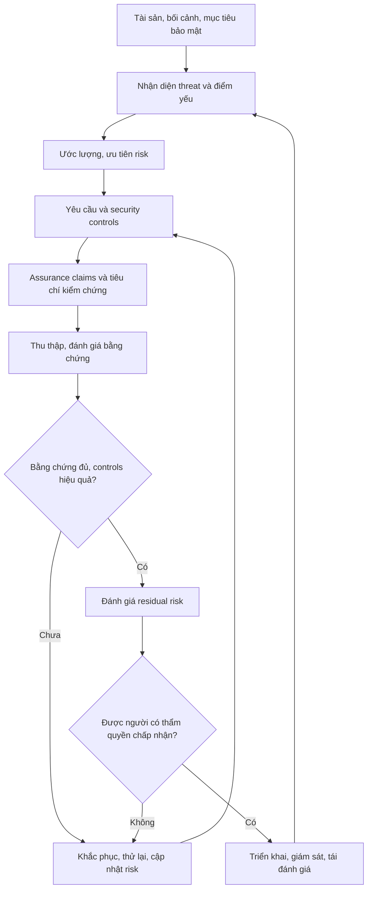

# Assurance và risk trong bảo mật hệ thống

## 1. Vì sao security assurance phải bắt đầu từ risk?

Một hệ thống có thể vượt qua nhiều bài kiểm thử bảo mật nhưng vẫn không an toàn trước những rủi ro quan trọng nhất của tổ chức. Ví dụ: nhóm phát triển quét mã nguồn và không tìm thấy thư viện có lỗ hổng nghiêm trọng, trong khi API vẫn cho phép người dùng của tổ chức A đọc dữ liệu học tập của tổ chức B. Kết quả quét là một **bằng chứng có ích**, nhưng không đủ để chứng minh mục tiêu **chỉ người được cấp quyền mới xem được dữ liệu** đã đạt.

**Risk (rủi ro bảo mật)** trả lời: *Điều gì có thể xảy ra, vì sao, với khả năng và hậu quả như thế nào?* **Security assurance (bảo đảm an ninh dựa trên bằng chứng)** trả lời: *Dựa vào đâu và với mức tin cậy nào, chúng ta có thể kết luận rằng những rủi ro đó đang được kiểm soát ở mức chấp nhận được?*

Security assurance không bảo đảm hệ thống tuyệt đối không thể bị tấn công. Nó tạo ra một **lập luận có thể kiểm chứng** rằng các mục tiêu bảo mật được thỏa mãn trong phạm vi, điều kiện và thời điểm xác định, nhờ yêu cầu rõ ràng, security controls phù hợp và bằng chứng đánh giá hiệu lực của chúng. Vì mối đe dọa và hệ thống luôn thay đổi, mức tin cậy ấy cũng cần được xem xét liên tục.

Trong chương **Tổng quan security assurance**, chủ đề này đặt nền tảng cho chương trình đánh giá liên tục: đi từ phân tích rủi ro, xác định yêu cầu và controls, đến kiểm thử, audit, xử lý phát hiện và theo dõi rủi ro còn lại trong phát triển lẫn vận hành.

### Mục tiêu học tập

Sau bài này, bạn có thể:

1. Phân biệt *risk*, *control*, *assurance claim* và *assurance evidence*.
2. Dùng rủi ro làm căn cứ lựa chọn yêu cầu bảo mật, controls và mức độ kiểm chứng.
3. Nhận diện sự khác nhau giữa rủi ro ban đầu, rủi ro còn lại và sự thiếu chắc chắn về mức rủi ro.
4. Xây dựng chuỗi truy vết từ mục tiêu bảo mật đến bằng chứng và quyết định chấp nhận hoặc xử lý rủi ro.
5. Đề xuất hoạt động assurance xuyên suốt thiết kế, phát triển, triển khai và vận hành.

## 2. Các khái niệm cốt lõi

| Khái niệm | Câu hỏi cần trả lời | Ví dụ trong nền tảng học tập |
|---|---|---|
| **Asset** (tài sản) | Cái gì cần được bảo vệ? | Hồ sơ người học, điểm bài kiểm tra, token phiên, khả năng truy cập dịch vụ |
| **Security objective** (mục tiêu) | Trạng thái bảo mật mong muốn là gì? | Chỉ người có quyền mới xem được kết quả học tập của một tổ chức |
| **Threat** (mối đe dọa) | Tác nhân hoặc sự kiện nào có thể gây hại? | Người dùng cố truy cập hồ sơ thuộc tổ chức khác |
| **Vulnerability/weakness** (điểm yếu) | Điều kiện nào khiến đe dọa thành hiện thực? | Backend chỉ kiểm tra đăng nhập, không kiểm tra quyền trên từng đối tượng |
| **Risk** (rủi ro) | Kịch bản gây hại có khả năng xảy ra và tác động gì? | Rò rỉ kết quả học tập xuyên tổ chức làm mất tính bí mật và niềm tin |
| **Security requirement** (yêu cầu) | Hệ thống phải đáp ứng tiêu chí cụ thể nào? | Mọi truy cập dữ liệu phải kiểm tra cả danh tính, vai trò và phạm vi tổ chức |
| **Security control** (biện pháp kiểm soát) | Điều gì ngăn chặn, phát hiện hoặc xử lý sự cố? | Kiểm tra quyền tại tầng dịch vụ, ràng buộc tenant tại truy vấn dữ liệu, ghi audit log |
| **Assurance claim** (luận điểm bảo đảm) | Chúng ta muốn chứng minh điều gì? | Không thể đọc kết quả của tenant khác thông qua API đã xác định |
| **Evidence** (bằng chứng) | Dữ liệu nào hỗ trợ hoặc bác bỏ luận điểm? | Kết quả kiểm thử truy cập trái phép, cấu hình policy, review truy vấn, audit log |
| **Residual risk** (rủi ro còn lại) | Sau khi áp dụng controls, còn điều gì có thể xảy ra? | Sai lệch policy ở endpoint mới hoặc lỗi cấu hình chưa được phát hiện |

**Risk không đồng nghĩa với vulnerability.** Một điểm yếu là điều kiện có thể bị khai thác; rủi ro mô tả *kịch bản và hậu quả trong bối cảnh tài sản, tác nhân, khả năng khai thác và controls*. Một lỗ hổng có điểm kỹ thuật cao chưa chắc tạo rủi ro kinh doanh cao trong mọi môi trường; ngược lại, một lỗi phân quyền đơn giản có thể tạo rủi ro rất cao nếu làm lộ dữ liệu nhạy cảm trên diện rộng.

**Compliance cũng không đồng nghĩa với assurance.** Việc đánh dấu đã tuân thủ một quy định hoặc checklist chỉ cung cấp một phần bằng chứng. Muốn kết luận kiểm soát hiệu quả, cần kiểm tra nó có phù hợp với mối đe dọa thực tế, được triển khai chính xác và hoạt động ổn định hay không.

## 3. Risk management và security assurance liên kết như thế nào?

Quản lý rủi ro (*risk management*) xác định, phân tích, ưu tiên, xử lý, theo dõi và đưa ra quyết định về rủi ro. Security assurance cung cấp mức tin cậy có căn cứ để kiểm tra các giả định và kết luận của quá trình đó. Hai hoạt động tạo thành một vòng phản hồi:



Ví dụ: một tổ chức đánh giá nguy cơ *credential stuffing* (kẻ tấn công sử dụng thông tin đăng nhập rò rỉ từ nơi khác) ở mức cao. Nhóm đặt yêu cầu hạn chế đăng nhập tự động, triển khai giới hạn tốc độ, phát hiện bất thường và xác thực đa yếu tố theo ngữ cảnh. Security assurance kiểm tra từng control qua test, cấu hình đang chạy, dữ liệu giám sát và thử nghiệm có kiểm soát. Nếu rule giới hạn tốc độ chỉ áp dụng ở một node nhưng không có hiệu lực trên toàn cụm, bằng chứng sẽ **làm thay đổi đánh giá rủi ro** và dẫn đến khắc phục.

Điểm cốt lõi: **risk quyết định cần kiểm chứng cái gì và sâu đến đâu; assurance làm sáng tỏ mức rủi ro thực sự đã được kiểm soát đến đâu**.

## 4. Đánh giá rủi ro để thiết kế hoạt động assurance

### 4.1. Xác định phạm vi, tài sản và bối cảnh

Không nên bắt đầu bằng một danh sách công cụ quét. Trước hết hãy ghi rõ:

- **Hệ thống/phạm vi:** dịch vụ, API, môi trường production hoặc staging, thành phần bên thứ ba và ranh giới tin cậy.
- **Tài sản và thuộc tính bảo mật:** *confidentiality* (bí mật), *integrity* (toàn vẹn), *availability* (sẵn sàng), cùng khả năng truy vết hay quyền riêng tư khi liên quan.
- **Luồng dữ liệu:** dữ liệu xuất phát từ đâu, ai xử lý, lưu ở đâu và đi qua ranh giới quyền hạn nào.
- **Tác nhân và mối đe dọa:** người dùng ngoài hệ thống, người dùng nội bộ, tài khoản bị chiếm, lỗi tích hợp, thao tác vận hành.
- **Mức chịu đựng rủi ro:** giới hạn hậu quả hoặc mức tiếp xúc được tổ chức và chủ sở hữu rủi ro phê duyệt.

Phạm vi phải nhất quán giữa nhận định rủi ro và kết quả kiểm chứng. Một bài test chạy trên staging với policy khác production không thể tự động chứng minh cấu hình production an toàn.

### 4.2. Mô tả rủi ro thành kịch bản có thể kiểm chứng

Mẫu đơn giản:

> Do **[tác nhân/sự kiện]** khai thác **[điểm yếu/điều kiện]** tại **[tài sản/luồng dữ liệu]**, **[sự cố]** có thể xảy ra và dẫn đến **[hậu quả đối với tổ chức/người dùng]**.

**Mô tả yếu:** “Có rủi ro API”.

**Mô tả tốt:** “Người dùng tenant A thay đổi ID trên endpoint xem kết quả, backend thiếu kiểm tra tenant tại truy vấn dữ liệu, nên có thể đọc kết quả của tenant B, gây lộ thông tin học tập và vi phạm chính sách truy cập”.

Mô tả tốt cho phép biến kịch bản thành yêu cầu, test âm tính (*negative test*) và bằng chứng có thể tái hiện.

### 4.3. Ước lượng likelihood và impact

Một cách phổ biến là sử dụng thang bán định lượng 1–5. Đây chỉ là **mô hình ưu tiên minh họa**, không phải xác suất đo được hay quy định chung của tiêu chuẩn.

| Điểm | Likelihood — khả năng xảy ra trong kỳ đánh giá | Impact — hậu quả nếu xảy ra |
|---|---|---|
| 1 | Rất hiếm; đòi hỏi điều kiện khó đạt | Không đáng kể; ảnh hưởng cục bộ, hồi phục dễ |
| 2 | Ít khả năng; có nhiều rào cản | Thấp; ảnh hưởng hạn chế, ít gián đoạn |
| 3 | Có thể xảy ra; có đường khai thác khả thi | Trung bình; ảnh hưởng một nhóm người dùng hoặc quy trình |
| 4 | Dễ xảy ra; đối tượng bị phơi lộ đáng kể | Cao; gián đoạn hoặc lộ dữ liệu đáng kể |
| 5 | Rất dễ xảy ra; nhiều tác nhân có thể khai thác | Rất cao; tác động diện rộng hoặc tổn thất nghiêm trọng |

Trong ví dụ này, `risk_score = likelihood × impact`, từ 1 đến 25. Tổ chức có thể đặt ngưỡng minh họa: **1–5 thấp**, **6–11 trung bình**, **12–19 cao**, **20–25 rất cao**. Phải ghi rõ lý do chấm điểm, nguồn dữ liệu, thời hạn xem xét, người đánh giá và cơ chế hiệu chỉnh theo thực tế.

Đừng xem điểm nhân là chân lý toán học: thang 1–5 mang tính thứ bậc; một rủi ro hiếm nhưng có hậu quả thảm họa vẫn có thể cần ưu tiên đặc biệt. Khi đủ dữ liệu có thể dùng phân tích kịch bản hoặc định lượng sâu hơn. Trong mọi trường hợp, kết quả chỉ đáng tin cậy khi các giả định được công khai.

### 4.4. Phân biệt inherent risk và residual risk

- **Inherent risk (rủi ro ban đầu):** đánh giá trong kịch bản chưa tính tác dụng của nhóm controls đang xem xét; cách đặt giả định phải được nêu rõ.
- **Residual risk (rủi ro còn lại):** rủi ro sau khi đã xét đến các controls được triển khai **và mức hiệu quả thực tế được chứng minh**.
- **Uncertainty (độ bất định):** mức thiếu thông tin về likelihood, impact hoặc hiệu quả control. Không có bằng chứng kiểm chứng không đồng nghĩa rủi ro thấp.

Ví dụ có giả định minh họa:

| ID / kịch bản | Rủi ro ban đầu | Controls dự kiến | Rủi ro còn lại *nếu control hiệu quả* | Trạng thái assurance |
|---|---|---|---|---|
| R-01: truy cập dữ liệu xuyên tenant | L=3, I=5 ⇒ **15 (cao)** | Policy trên mọi API; kiểm tra tenant trong query; negative tests | L=1, I=5 ⇒ **5 (thấp)** | Chưa thể xác nhận mức 5 nếu endpoint mới chưa được test |
| R-02: credential stuffing | L=4, I=4 ⇒ **16 (cao)** | MFA theo ngữ cảnh, rate limit phân tán, cảnh báo | L=2, I=4 ⇒ **8 (trung bình)** | Cần kiểm tra lưu lượng thực và hiệu lực trên toàn cụm |

Controls thường làm giảm khả năng xảy ra hoặc phạm vi tác động, nhưng **không có quy tắc trừ điểm tự động** từ rủi ro ban đầu. Trong R-01, mức tác động vẫn là 5 vì nếu lộ dữ liệu thì hậu quả không biến mất; mức likelihood 1 chỉ hợp lý sau khi có bằng chứng cho thấy đường khai thác đã được ngăn chặn. Khi hiệu quả chưa được xác nhận, ghi rõ *residual risk dự kiến/chưa xác minh*, không báo cáo như kết quả đã đạt.

## 5. Biến risk thành security requirements, controls và assurance claims

Một control hữu ích phải nối trực tiếp với mục tiêu và kịch bản rủi ro. Có thể phân loại:

- **Preventive:** ngăn ngừa sự kiện, như xác thực, phân quyền theo đối tượng, mã hóa, cấu hình an toàn.
- **Detective:** phát hiện bất thường hoặc vi phạm, như audit log, giám sát truy cập, cảnh báo thay đổi policy.
- **Corrective/recovery:** giới hạn hậu quả và phục hồi, như thu hồi phiên, vá lỗi, khôi phục từ bản sao lưu, quy trình ứng phó.
- **Compensating:** biện pháp thay thế có lý do khi chưa triển khai được control mục tiêu; phải kiểm chứng khả năng giảm cùng rủi ro chứ không chỉ ghi tên trong checklist.

Phân loại giúp bảo đảm không chỉ có một lớp phòng vệ. Ví dụ: phân quyền chặn truy cập trái phép, audit log giúp phát hiện hành vi đáng ngờ, quy trình thu hồi quyền và thông báo sự cố giúp giảm tác động sau khi phát hiện.

### Ma trận truy vết

| Từ risk đến evidence | Ví dụ cho R-01: truy cập xuyên tenant |
|---|---|
| **Risk statement** | Người dùng có thể đọc kết quả của tenant khác qua endpoint dùng ID do client cung cấp |
| **Security objective** | Bảo vệ tính bí mật và tách biệt dữ liệu giữa các tenant |
| **Requirement REQ-01** | Mọi API đọc kết quả phải xác thực chủ thể và kiểm tra quyền trên tổ chức lẫn đối tượng dữ liệu |
| **Control CTRL-01** | Policy tại tầng dịch vụ và điều kiện tenant trong truy vấn dữ liệu; từ chối mặc định nếu không đủ quyền |
| **Assurance claim CLM-01** | Với tập endpoint và vai trò đã liệt kê, tài khoản tenant A không thể đọc kết quả tenant B |
| **Evidence EV-01** | Test tích hợp âm tính có ID đối tượng tenant B, chạy trên bản build mục tiêu, tất cả trả 403/404 theo hợp đồng API |
| **Evidence EV-02** | Review mã nguồn/policy chứng minh mọi đường truy cập dữ liệu đều qua kiểm soát quyền |
| **Evidence EV-03** | Kiểm tra cấu hình production và audit log cho yêu cầu bị từ chối trên môi trường tương ứng |
| **Acceptance criterion** | Không có đường truy cập ngoài phạm vi quyền; test và review hợp lệ, đủ bao phủ; phát hiện còn mở được xử lý hoặc chấp thuận có điều kiện |

Một yêu cầu chỉ ghi “hệ thống phải an toàn” rất khó đánh giá. Yêu cầu tốt chỉ ra **đối tượng, hành vi, điều kiện, kết quả mong đợi và cách chứng minh**. Tương tự, claim “đã dùng Spring Security” chỉ nói về công nghệ, không chứng minh mọi endpoint và luồng dữ liệu đều thực thi phân quyền đúng.

## 6. Assurance case: lập luận và bằng chứng phải khớp

**Assurance case** là cấu trúc nối một hoặc nhiều luận điểm bảo mật với lý do và bằng chứng xác nhận chúng, đồng thời ghi rõ phạm vi, giả định và giới hạn.

Ví dụ:

```text
CLAIM: Dữ liệu kết quả học tập được cô lập giữa các tenant
  |
  +-- ARGUMENT: Mỗi đường truy cập đều kiểm tra quyền đối tượng/tenant
  |     +-- EVIDENCE: Ma trận API -> policy; review backend; test âm tính
  |
  +-- ARGUMENT: Policy hoạt động đúng trên hệ thống triển khai
  |     +-- EVIDENCE: Bản cấu hình; smoke test sau triển khai; audit log
  |
  +-- ASSUMPTIONS: Danh mục endpoint đầy đủ; token được xác minh đúng
  +-- LIMITATIONS: Chưa kiểm chứng integration mới với kho dữ liệu đối tác
```

Nếu xuất hiện endpoint mới nhưng chưa có trong ma trận, claim cần được **thu hẹp hoặc tạm đánh dấu chưa chứng minh**, dù các test hiện tại đều xanh. Đây là khác biệt quan trọng giữa *đã thực hiện test* và *có đủ cơ sở kết luận an toàn*.

### Đánh giá chất lượng evidence

| Tiêu chí | Câu hỏi kiểm chứng | Dấu hiệu bằng chứng yếu |
|---|---|---|
| **Relevance — liên quan** | Có thực sự kiểm tra claim và rủi ro được nêu? | Scan dependency được dùng để chứng minh quyền truy cập đúng |
| **Coverage — độ bao phủ** | Có đủ vai trò, đường đi, biên dữ liệu, API và môi trường? | Chỉ kiểm thử một endpoint trong nhiều endpoint tương tự |
| **Correctness — đúng đắn** | Phương pháp, expected result, dữ liệu test có đáng tin? | Test chỉ kiểm tra status 200 mà bỏ qua dữ liệu trả về |
| **Freshness — tính cập nhật** | Bằng chứng áp dụng cho phiên bản và cấu hình đang chạy? | Pen test từ phiên bản cũ sau khi kiến trúc đã đổi |
| **Integrity & provenance — toàn vẹn và nguồn gốc** | Ai tạo, khi nào, với bản build nào, kết quả có thể bị sửa? | Ảnh chụp màn hình không có commit, thời gian hay môi trường |
| **Independence — tính độc lập phù hợp** | Mức độ đánh giá khách quan có tương ứng độ nghiêm trọng? | Người xây dựng control tự xác nhận mà không có phản biện với rủi ro trọng yếu |
| **Repeatability — tái thực hiện** | Có thể chạy lại hoặc đối chiếu một cách nhất quán? | Kết luận thủ công không ghi điều kiện, bước test và đầu ra |

Không có một loại evidence nào đủ cho mọi claim. **Tài liệu thiết kế** cho thấy ý định; **source review và cấu hình** cho thấy triển khai; **automated test, kiểm thử độc lập** cho thấy hành vi trong điều kiện đã thử; **monitoring/audit log** cho thấy một phần hành vi thực tế theo thời gian. Chúng bổ sung cho nhau và đều có giới hạn.

Một bộ bằng chứng tốt thường chứa: ID claim/control, phiên bản và commit của thành phần, môi trường, thời điểm chạy, phạm vi test, người hoặc hệ thống thực hiện, kết quả kỳ vọng/thực tế, link artifact, phát hiện còn mở và người phê duyệt quyết định.

## 7. Ví dụ xuyên suốt: bảo vệ kết quả học tập trên nền tảng Java

Giả sử một nền tảng học tập Java phục vụ nhiều tổ chức. Backend dùng Spring Boot; API trả kết quả bài kiểm tra cho người học và giảng viên. Mỗi kết quả thuộc đúng một `tenant_id`. Tổ chức lo ngại người dùng đổi tham số `tenantId` hoặc `learnerId` trong URL để truy cập kết quả ngoài phạm vi quyền.

### 7.1. Risk và tiêu chí kiểm soát

- **Tài sản:** kết quả học tập cá nhân và dữ liệu tổ chức.
- **Threat:** người dùng đã xác thực thử ID thuộc tenant khác; token bị lạm dụng cũng là trường hợp cần xem xét.
- **Điểm yếu giả định:** backend dựa vào ID do client cung cấp mà không so với phạm vi tenant trong danh tính và chính sách truy cập.
- **Impact:** lộ dữ liệu, sai lệch ranh giới tổ chức, khiếu nại và chi phí ứng phó.
- **Mục tiêu:** không trả dữ liệu của tenant B cho tài khoản chỉ có quyền ở tenant A.
- **Controls:** xác minh token, kiểm tra quyền trong service layer, ràng buộc tenant trong truy vấn, kiểm thử âm tính, ghi log truy cập bị từ chối.

Trong Spring Security, annotation ở tầng service có thể diễn đạt yêu cầu (minh họa, chưa phải cấu hình hoàn chỉnh):

```java
@PreAuthorize("@tenantAccess.canReadResults(authentication, #tenantId, #learnerId)")
public ResultDto getResult(String tenantId, String learnerId) {
    // Repository vẫn phải lọc theo tenantId đã được kiểm tra.
    return resultRepository.findForTenantAndLearner(tenantId, learnerId)
        .orElseThrow(ResultNotFoundException::new);
}
```

Điều kiện `canReadResults(...)` phải dựa trên danh tính và quyền được **xác minh phía server**, không tin một claim hoặc header tùy ý từ client. Method security phải được bật và bao phủ đúng luồng gọi; truy vấn dữ liệu phải duy trì phạm vi tenant. Cần xét cả API xuất báo cáo, truy vấn batch, cache và tác vụ nền có thể bỏ qua service method. Đây là những giả định phải kiểm chứng trong assurance.

### 7.2. Chuyển thành test có thể thu thập evidence

| Tình huống | Kết quả mong đợi | Bằng chứng |
|---|---|---|
| Người học tenant A đọc kết quả của chính họ | Thành công theo quyền và hợp đồng API | Integration test với identity A và dữ liệu A |
| Người học tenant A đọc kết quả người học tenant B | Bị từ chối hoặc che giấu tài nguyên đúng chính sách | Negative integration test; xác nhận không có dữ liệu B trong body |
| Giảng viên A đọc kết quả của người học A mà họ được phân quyền | Thành công trong phạm vi quyền được cấp | Test kết hợp vai trò, tổ chức và quan hệ với người học |
| Giảng viên A cố đọc dữ liệu B dù đổi ID trong URL | Bị từ chối | Test đổi `tenantId` và `learnerId` cùng lúc và từng biến |
| Endpoint export hoặc batch được thêm sau này | Cùng chính sách cô lập dữ liệu | API inventory, review endpoint mới, test regression |
| Một yêu cầu bị từ chối khi chạy production | Không lộ dữ liệu, sự kiện có thể truy vết an toàn | Log có correlation ID, loại hành động, kết quả; không ghi token/dữ liệu bí mật |

Test âm tính phải kiểm tra cả **mã trạng thái và nội dung trả về**. Hệ thống có thể chọn HTTP 403 hoặc 404 tùy chính sách tránh tiết lộ tài nguyên; điều quyết định là không trả dữ liệu ngoài phạm vi quyền và hành vi đúng hợp đồng đã công bố.

### 7.3. Risk register và kế hoạch evidence

Một bản ghi tối thiểu có thể được quản lý như YAML hoặc trong công cụ theo dõi rủi ro:

```yaml
id: R-01
scenario: "Tenant A đọc kết quả học tập thuộc tenant B qua API"
asset: "Kết quả học tập theo tenant"
owner: "Chủ sở hữu dịch vụ kết quả học tập"
inherent_risk:
  likelihood: 3
  impact: 5
  score: 15
controls:
  - id: CTRL-01
    description: "Kiểm tra quyền theo đối tượng và tenant"
  - id: CTRL-02
    description: "Lọc tenant tại truy vấn dữ liệu"
assurance:
  claim: "CLM-01"
  criteria: "Không có đọc xuyên tenant ở toàn bộ API trong phạm vi"
  evidence_required:
    - "Danh mục endpoint và mapping chính sách"
    - "Negative integration tests theo vai trò và tenant"
    - "Review query, cấu hình và smoke test sau triển khai"
  evidence_status: "PARTIAL"
residual_risk:
  estimated_score_if_controls_verified: 5
  status: "UNVERIFIED"
next_action: "Bổ sung test cho endpoint export và đánh giá lại"
```

Ví dụ này **không khẳng định hệ thống thực đã đạt score 5**. Trường `evidence_status: PARTIAL` và `status: UNVERIFIED` cho thấy còn thiếu kiểm chứng. Người quản lý rủi ro chỉ nên ra quyết định với bối cảnh, giả định và khoảng trống minh bạch.

### 7.4. Khi evidence không đạt

Giả sử test phát hiện endpoint export không kiểm tra tenant. Hành động đúng gồm:

1. Tạo finding liên kết `R-01`, `CTRL-01` và `CLM-01`; ghi đường khai thác, phạm vi, tác động và bằng chứng tái hiện.
2. Xử lý nguy cơ trước mắt theo độ nghiêm trọng (chẳng hạn vô hiệu hóa tạm export hoặc giới hạn truy cập), phân công người chịu trách nhiệm và hạn xử lý.
3. Sửa logic phân quyền và truy vấn; thêm regression test cho lớp endpoint tương tự.
4. Kiểm chứng lại trên bản build và môi trường phù hợp, lưu artifact để truy vết.
5. Đánh giá lại likelihood/residual risk, cập nhật claim và trình quyết định chấp nhận khi các điều kiện đã đủ.

Đóng ticket vì code đã merge là chưa đủ: **finding được đóng khi hiệu lực sửa lỗi đã được xác minh**, hoặc còn tồn tại theo một quyết định ngoại lệ được phê duyệt rõ ràng.

## 8. Ưu tiên assurance theo mức rủi ro

Nguồn lực đánh giá có hạn, vì vậy độ sâu và tần suất assurance nên tương xứng với:

- **Mức độ nghiêm trọng và phạm vi ảnh hưởng:** tài sản nhạy cảm, dữ liệu diện rộng, khả năng gián đoạn dịch vụ.
- **Khả năng phơi lộ:** API Internet-facing, quyền cao, tích hợp bên thứ ba, bề mặt tấn công mới.
- **Độ bất định:** kiến trúc chưa được kiểm chứng, thiếu test, thiếu quan sát, control mới triển khai.
- **Tần suất thay đổi:** chính sách phân quyền, IAM, hạ tầng và endpoint biến động liên tục.
- **Độ tin cậy của evidence hiện có:** test có bao phủ không, kết quả có mới và gắn với phiên bản đang chạy không.

| Tình huống minh họa | Hoạt động assurance tương xứng |
|---|---|
| Thay đổi nội dung tĩnh, không ảnh hưởng đường truy cập hay dữ liệu nhạy cảm | Review thay đổi; chạy bộ kiểm thử nền phù hợp |
| Sửa policy truy cập dữ liệu nhiều tenant | Threat-model delta, review độc lập, test quyền âm tính và regression, xác minh deployment |
| Thêm dịch vụ xác thực hoặc tích hợp identity provider | Kiểm tra thiết kế, token validation, cấu hình, kịch bản tấn công, test tích hợp và vận hành |
| Phát hiện truy cập trái phép hoặc control quan trọng thất bại | Điều tra, giảm thiểu ngay, mở rộng kiểm thử, đánh giá lại risk và bằng chứng trước khi đóng finding |

**Risk-based assurance không có nghĩa bỏ hẳn kiểm tra với phần được chấm “thấp”.** Các kiểm soát nền như quản lý dependency, quản lý secret, logging, backup và kiểm soát thay đổi vẫn cần duy trì. Phân loại rủi ro giúp chọn mức độ đánh giá bổ sung và mức độc lập cần thiết.

## 9. Tích hợp assurance liên tục vào SDLC và vận hành

| Giai đoạn | Hoạt động risk | Hoạt động assurance | Artifact nên lưu |
|---|---|---|---|
| Khởi tạo/yêu cầu | Xác định tài sản, bối cảnh, risk appetite, kịch bản quan trọng | Rà soát yêu cầu an ninh và tiêu chí chấp nhận có thể test | Risk register, requirements, owner |
| Thiết kế | Phân tích trust boundary, threat modeling, lựa chọn control | Review kiến trúc, kiểm tra mô hình phân quyền và giả định | Sơ đồ data flow, quyết định thiết kế, claim |
| Phát triển | Đánh giá risk khi thay đổi mã, dependency, API | Code review, static analysis, dependency/secret scan, unit và integration tests | Kết quả pipeline gắn commit, coverage của kịch bản |
| Trước phát hành | Ước lượng residual risk, xử lý finding trọng yếu | Security regression, dynamic test phù hợp, đối chiếu cấu hình và bằng chứng | Release evidence, danh sách finding và quyết định |
| Vận hành | Theo dõi thay đổi đe dọa, cấu hình, tấn công và tác động | Alert, audit log, posture/config checks, exercise khôi phục, review quyền | Dashboard, log, kết quả diễn tập, risk review |
| Khi có sự cố/ngoại lệ | Cập nhật likelihood, impact và phạm vi ảnh hưởng | Điều tra nguyên nhân, đánh giá controls thất bại, retest | Incident record, corrective action, evidence mới |

Tự động hóa thích hợp cho những điều kiện có thể lặp lại: build không đạt nếu test phân quyền trọng yếu thất bại, dependency xuất hiện rủi ro vượt ngưỡng theo policy, hoặc cấu hình lệch chuẩn đã phê duyệt. Tuy nhiên, pipeline xanh không thay thế đánh giá thiết kế và threat modeling; nhiều sai lệch về nghiệp vụ, phân quyền, ranh giới tin cậy vẫn cần phân tích có ngữ cảnh.

### Trigger để phải tái đánh giá

Một kết luận assurance có “hạn sử dụng” gắn với bối cảnh. Cần xem xét lại khi thay đổi API, role, luồng dữ liệu, nhà cung cấp, cách triển khai, dependency hoặc khi phát hiện tấn công, lỗi kiểm soát và yêu cầu mới. Có thể kết hợp **chu kỳ cố định** (theo mức rủi ro) với **trigger theo sự kiện** để tránh dựa mãi vào bằng chứng cũ.

## 10. Risk treatment, risk acceptance và trách nhiệm

Sau khi đánh giá, người có thẩm quyền có thể lựa chọn:

1. **Mitigate/Reduce:** giảm likelihood hoặc impact bằng controls và xác minh hiệu quả.
2. **Avoid:** bỏ hoạt động hoặc thiết kế tạo ra rủi ro không thể chấp nhận.
3. **Transfer/Share:** phân chia một phần hậu quả hoặc trách nhiệm theo hợp đồng, bảo hiểm hay nhà cung cấp; **không làm rủi ro kỹ thuật tự biến mất**.
4. **Accept:** chấp thuận phần rủi ro còn lại trong giới hạn thẩm quyền, có ghi lý do, thời hạn, điều kiện và cơ chế rà soát.

**Risk owner** chịu trách nhiệm quyết định xử lý/chấp nhận theo thẩm quyền của tổ chức. **Engineering/control owner** triển khai và vận hành control; **security/assurance** hỗ trợ đánh giá, kiểm chứng và phản biện; **audit** có thể đánh giá độc lập tùy mô hình quản trị. Không nên để cùng một cá nhân tự tạo, tự xác nhận và tự chấp thuận rủi ro nghiêm trọng mà không có cơ chế kiểm tra phù hợp.

Biên bản risk acceptance cần nêu ít nhất: ID kịch bản, phạm vi, mức rủi ro còn lại và giả định, bằng chứng hiện có/thiếu, controls bù đắp, nguyên nhân chưa xử lý triệt để, người phê duyệt, ngày hết hạn và trigger đánh giá lại. **Ngoại lệ không có ngày rà soát** dễ trở thành lỗ hổng kéo dài.

### Khi nào chưa nên chấp nhận?

- Chưa xác định rõ tài sản, hệ thống hoặc người chịu trách nhiệm.
- Đánh giá residual risk chỉ dựa trên việc control “đã có trong thiết kế”, chưa kiểm chứng hoạt động.
- Phát hiện nghiêm trọng chưa có biện pháp giảm thiểu, chủ sở hữu hoặc kế hoạch xử lý.
- Bằng chứng cũ, thiếu phạm vi production hoặc xung đột với dữ liệu vận hành.
- Quyết định nằm ngoài risk appetite hoặc vượt thẩm quyền người phê duyệt.

Khi chưa đủ dữ liệu, nên ghi trạng thái **chưa xác minh**, bổ sung đánh giá và quyết định giảm thiểu tạm thời phù hợp; không tự động đổi nhãn rủi ro thành “đã chấp nhận”.

## 11. Các sai lầm thường gặp

| Sai lầm | Vì sao nguy hiểm? | Cách khắc phục |
|---|---|---|
| Xem danh sách công cụ scan là toàn bộ assurance | Bỏ sót lỗi business logic, authorization và luồng dữ liệu | Bắt đầu từ risk scenario/claim rồi chọn phương pháp kiểm chứng |
| Dùng số lượng test pass làm “điểm an toàn” | Test có thể không bao phủ đường khai thác thực | Theo dõi độ bao phủ theo risk, role, API và trust boundary |
| Giảm điểm risk chỉ vì đã cài control | Control có thể cấu hình sai hoặc không hoạt động trên production | Dùng evidence hiệu lực; phân biệt dự kiến và đã xác minh |
| Chỉ kiểm chứng ở thời điểm release | Drift, thay đổi quyền hoặc mối đe dọa mới có thể làm kết luận lỗi thời | Theo dõi liên tục và tái đánh giá theo trigger |
| Chấp nhận risk không có owner hoặc thời hạn | Không ai theo dõi ngoại lệ và phát hiện trở nên tồn đọng | Gắn owner, thời hạn, điều kiện và trigger hết hiệu lực |
| Tin rằng chứng nhận tuân thủ đồng nghĩa hệ thống an toàn tuyệt đối | Compliance chỉ phản ánh phạm vi và tiêu chí đánh giá nhất định | Đối chiếu bằng chứng với mục tiêu và rủi ro riêng của hệ thống |

## 12. Checklist áp dụng cho một thay đổi có ảnh hưởng bảo mật

Trước khi thông qua một thay đổi liên quan đến dữ liệu, quyền truy cập hoặc hạ tầng, người phụ trách có thể tự hỏi:

- [ ] Đã xác định tài sản, bối cảnh và risk owner?
- [ ] Kịch bản rủi ro mô tả cụ thể tác nhân, điểm yếu, sự kiện và hậu quả?
- [ ] Đã ghi giả định cho likelihood/impact và mức độ bất định?
- [ ] Có yêu cầu bảo mật đo được và mapping đến controls?
- [ ] Mỗi claim quan trọng có tiêu chí chấp nhận và evidence phù hợp?
- [ ] Evidence gắn phiên bản, môi trường, thời điểm, phạm vi, nguồn tạo và kết quả?
- [ ] Các trường hợp âm tính, biên quyền và đường đi thay thế đã được xem xét?
- [ ] Findings có severity, owner, hạn xử lý và kết quả retest?
- [ ] Residual risk dựa trên hiệu lực control đã kiểm chứng?
- [ ] Quyết định xử lý/chấp nhận đúng thẩm quyền, có lịch hoặc trigger tái đánh giá?

Checklist là công cụ hỗ trợ nhớ việc; **chất lượng kết luận vẫn phụ thuộc tính đúng đắn và đầy đủ của bằng chứng đối với từng kịch bản rủi ro**.

## 13. Câu hỏi tự ôn tập

1. Vì sao “không có kết quả cảnh báo từ SAST” không đủ để chứng minh API đã ngăn truy cập dữ liệu xuyên tenant?
2. Với một control đã triển khai nhưng chưa kiểm chứng trên production, nên ghi nhận residual risk và assurance status thế nào?
3. Một bản kết quả pen test sáu tháng trước còn phù hợp khi nhóm vừa thay identity provider và bổ sung endpoint export không? Cần evidence bổ sung gì?
4. Trường hợp nào rủi ro có likelihood thấp nhưng impact rất cao vẫn phải được ưu tiên assurance?
5. Nếu một negative test phát hiện lỗi phân quyền, cần những điều kiện nào để đóng finding và cập nhật risk register?

## 14. Ghi nhớ

- **Risk** nêu kịch bản có thể gây hại, mức độ ưu tiên và giới hạn tổ chức có thể chịu đựng.
- **Security assurance** đưa ra kết luận có phạm vi và bằng chứng về việc requirements/controls kiểm soát các kịch bản đó đến đâu.
- Một chuỗi truy vết hữu ích là **risk → objective/requirement → control → claim → evidence → residual risk → decision → monitoring**.
- Bằng chứng phải liên quan, đủ bao phủ, đúng, cập nhật, truy vết được và có mức độc lập tương xứng.
- Assurance là hoạt động **liên tục theo thay đổi và rủi ro**, không phải một lần kiểm tra để khẳng định hệ thống an toàn vĩnh viễn.

### Tài liệu tham khảo định hướng

- **NIST SP 800-30 Rev. 1 — Guide for Conducting Risk Assessments:** phương pháp xác định và đánh giá rủi ro bảo mật.
- **NIST SP 800-53 Rev. 5 — Security and Privacy Controls for Information Systems and Organizations:** thư viện controls để lựa chọn và đánh giá theo bối cảnh.
- **ISO/IEC 27005 — Information security risk management:** hướng dẫn quản lý rủi ro an toàn thông tin.
- **OWASP ASVS — Application Security Verification Standard:** danh mục yêu cầu/kiểm chứng có thể tham chiếu khi xây dựng tiêu chí assurance cho ứng dụng web.

Các tài liệu trên cung cấp khung tham khảo; mức rủi ro, cách chấm điểm và ngưỡng chấp nhận trong bài là **ví dụ minh họa**, cần được tổ chức xác định lại theo hệ thống, quy định và bối cảnh riêng.
