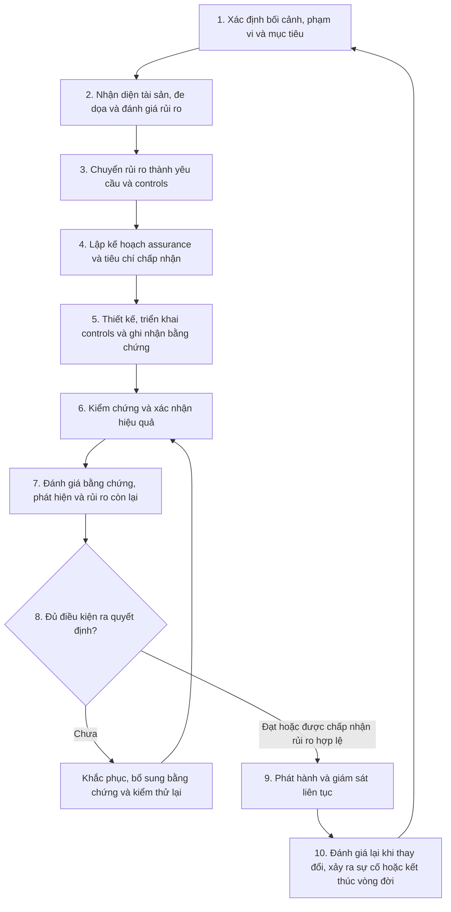

# Vòng đời assurance trong bảo mật hệ thống

## 1. Mục tiêu học tập

Sau bài học, người học có thể:

1. Giải thích vì sao **security assurance** là một quá trình tạo lập và duy trì sự tin cậy dựa trên bằng chứng, chứ không chỉ là một đợt kiểm thử hoặc kiểm toán.
2. Mô tả các giai đoạn của vòng đời assurance, đầu vào, đầu ra và quyết định cần đưa ra ở từng giai đoạn.
3. Liên kết tài sản, mối đe dọa, rủi ro, yêu cầu bảo mật, biện pháp kiểm soát (*security controls*) và bằng chứng kiểm chứng.
4. Thiết lập tiêu chí chấp nhận, đánh giá mức rủi ro còn lại và theo dõi hành động khắc phục.
5. Tổ chức assurance liên tục trong vòng đời phát triển phần mềm và vận hành hệ thống.

Trong phạm vi module **SECURITY_SECURITY_ASSURANCE**, mục đích của assurance là **đánh giá có bằng chứng rằng hệ thống đáp ứng các mục tiêu bảo mật**. Vòng đời được trình bày ở đây bao phủ phân tích rủi ro, yêu cầu và controls, thiết kế, kiểm thử, audit, khắc phục phát hiện và đánh giá lại khi hệ thống hoặc môi trường đe dọa thay đổi.

## 2. Vì sao assurance cần một vòng đời?

Một hệ thống có thể vượt qua kiểm thử bảo mật hôm nay nhưng phát sinh lỗ hổng ngày mai khi thêm API, nâng cấp thư viện, thay đổi cấu hình hạ tầng hoặc xuất hiện một kỹ thuật tấn công mới. Vì vậy, câu hỏi đúng không chỉ là *“Đã kiểm thử chưa?”* mà còn là:

- Hệ thống cần đáp ứng **mục tiêu bảo mật nào**, trong **phạm vi nào**?
- Những rủi ro nào có thể làm mục tiêu đó thất bại và controls nào đang xử lý chúng?
- **Bằng chứng nào** cho thấy controls được thiết kế đúng, triển khai đúng và hoạt động hiệu quả?
- Bằng chứng phản ánh **phiên bản, cấu hình, môi trường và thời điểm** nào?
- Ai có thẩm quyền kết luận mức tin cậy là đủ để phát hành hoặc tiếp tục vận hành?
- Khi có phát hiện mới, ai khắc phục, kiểm chứng lại và cập nhật kết luận assurance?

**Security assurance** là hoạt động xây dựng một lập luận có thể kiểm tra được về mức độ đáp ứng mục tiêu bảo mật của hệ thống, dựa trên những bằng chứng thích hợp và những giới hạn được công khai. Assurance không đồng nghĩa với cam kết hệ thống tuyệt đối an toàn; kết luận assurance luôn có **phạm vi, giả định, thời điểm và mức độ chắc chắn**.

Phân biệt các khái niệm thường đi cùng nhau:

| Khái niệm | Câu hỏi chính | Kết quả điển hình |
| --- | --- | --- |
| Security engineering | Thiết kế và triển khai cơ chế bảo vệ như thế nào? | Kiến trúc, cấu hình, mã nguồn, quy trình vận hành |
| Security verification | Hệ thống hoặc control có đúng theo yêu cầu đã đặt ra không? | Kết quả review, kiểm thử, quét cấu hình |
| Security validation | Biện pháp bảo vệ có phù hợp với mục tiêu và rủi ro thực tế không? | Kiểm thử luồng nghiệp vụ, mô phỏng tấn công, đánh giá hiệu quả |
| Security assurance | Có đủ bằng chứng đáng tin cậy để kết luận các mục tiêu bảo mật được đáp ứng ở mức chấp nhận được không? | Hồ sơ lập luận, đối chiếu bằng chứng, quyết định rủi ro |
| Audit | Hoạt động và bằng chứng có đáp ứng tiêu chí đánh giá được xác định không? | Phát hiện audit, ý kiến đánh giá, hành động khắc phục |
| Compliance | Hệ thống có đáp ứng nghĩa vụ, quy định hoặc chuẩn mực áp dụng không? | Bản đối chiếu yêu cầu, hồ sơ tuân thủ |

Tuân thủ một tiêu chuẩn có thể cung cấp bằng chứng cho assurance, nhưng không tự động chứng minh rằng mọi kịch bản tấn công quan trọng đã được kiểm soát.

## 3. Bản đồ vòng đời assurance

Vòng đời này là một **vòng lặp ra quyết định dựa trên rủi ro và bằng chứng**. Các nhóm có thể đặt tên hoặc ghép giai đoạn khác nhau, nhưng phải duy trì được liên kết từ mục tiêu đến kiểm chứng và khắc phục.



Một tổ chức có thể chạy đồng thời nhiều vòng lặp: mỗi thay đổi mã nguồn đi qua các kiểm chứng tự động, mỗi bản phát hành qua đánh giá rủi ro, còn hằng quý hoặc sau sự cố sẽ có đánh giá sâu hơn đối với các controls quan trọng. Khi ngừng dịch vụ, vòng đời vẫn tiếp tục đến khi xử lý xong dữ liệu, quyền truy cập, khóa và tài sản liên quan.

| Giai đoạn | Đầu vào then chốt | Đầu ra có thể kiểm tra | Câu hỏi để đi tiếp |
| --- | --- | --- | --- |
| 1. Bối cảnh và mục tiêu | Kiến trúc, chức năng, dữ liệu, nghĩa vụ | Phạm vi, tài sản, mục tiêu, tiêu chí tác động | Đang bảo vệ điều gì, cho ai? |
| 2. Phân tích rủi ro | Tài sản, luồng dữ liệu, mối đe dọa | Risk register, kịch bản tấn công, ưu tiên | Rủi ro nào cần xử lý trước? |
| 3. Yêu cầu và controls | Rủi ro, yêu cầu kinh doanh/quy định | Yêu cầu đo được, control owner, mapping | Mỗi rủi ro quan trọng được xử lý ra sao? |
| 4. Kế hoạch assurance | Yêu cầu, controls, mức độ rủi ro | Phương pháp, loại bằng chứng, tiêu chí pass/fail | Bằng chứng nào là đủ và ai đánh giá? |
| 5. Triển khai | Thiết kế, kế hoạch, code, IaC, quy trình | Cấu hình, log thay đổi, phiên bản, hiện vật triển khai | Controls có thực sự tồn tại? |
| 6. Kiểm chứng | Phiên bản cần đánh giá, test cases | Kết quả test/review/audit, lỗ hổng, độ phủ | Controls hoạt động đúng trong các tình huống cần thiết? |
| 7. Tổng hợp và đánh giá | Bằng chứng, phát hiện, ngoại lệ | Assurance case, rủi ro còn lại, kế hoạch sửa | Kết luận có được bằng chứng hỗ trợ đầy đủ? |
| 8. Quyết định | Tiêu chí phát hành, mức chấp nhận rủi ro | Phê duyệt, từ chối hoặc quyết định có điều kiện | Ai chịu trách nhiệm và chấp nhận giới hạn nào? |
| 9. Vận hành liên tục | Telemetry, cảnh báo, thay đổi | Đánh giá định kỳ, sự cố, kết quả kiểm tra control | Kết luận trước đó còn đúng không? |
| 10. Thay đổi hoặc kết thúc | Change request, sự cố, end-of-life | Reassessment, thu hồi quyền, xử lý dữ liệu | Cần tái mở giai đoạn nào và lưu bằng chứng gì? |

## 4. Giai đoạn 1: Xác định bối cảnh, phạm vi và mục tiêu

Trước khi kiểm thử, phải biết **đối tượng đánh giá**. Một báo cáo “pentest đã đạt” không có nhiều ý nghĩa nếu không rõ nó bao gồm ứng dụng nào, API nào, tài khoản có quyền gì, hạ tầng nào và phiên bản triển khai nào.

Các việc cần làm:

1. **Khoanh phạm vi:** dịch vụ, API, luồng dữ liệu, môi trường, hệ thống phụ trợ, nhà cung cấp và ranh giới tin cậy (*trust boundaries*).
2. **Phân loại tài sản và dữ liệu:** tài khoản người dùng, token, thông tin định danh, khóa bí mật, giao dịch, log, bản sao lưu.
3. **Nêu giả định và phụ thuộc:** ví dụ, dịch vụ giả định nhà cung cấp định danh đã xác thực token đúng; giả định đó phải có căn cứ kiểm tra được.
4. **Đặt mục tiêu bảo mật có thể đánh giá:** bảo mật dữ liệu (*confidentiality*), toàn vẹn (*integrity*), sẵn sàng (*availability*), xác thực, phân quyền, truy vết và khả năng phục hồi.
5. **Xác định người quyết định:** ai sở hữu hệ thống, ai sở hữu rủi ro, ai kiểm chứng độc lập và ai phê duyệt đưa vào vận hành.

Ví dụ, đối với dịch vụ Java Spring Boot xử lý yêu cầu chuyển tiền:

- **Phạm vi:** REST API chuyển tiền, database giao dịch, message broker, dịch vụ xác thực, secrets và môi trường production.
- **Mục tiêu bảo mật:** chỉ chủ tài khoản hoặc người được ủy quyền mới được khởi tạo giao dịch; số tiền và người thụ hưởng không bị sửa trái phép; giao dịch có thể truy vết; hệ thống phát hiện hành vi lạm dụng.
- **Ngoài phạm vi đã nêu rõ:** giao diện quản lý của một nhà cung cấp thanh toán độc lập, nếu tổ chức không kiểm soát giao diện đó. Sự phụ thuộc vào nhà cung cấp vẫn phải được đánh giá rủi ro.
- **Giả định cần xác minh:** token người dùng có chữ ký hợp lệ và đúng audience; các service account có quyền tối thiểu.

**Đầu ra/gate:** bản mô tả phạm vi có phiên bản, danh sách tài sản và luồng dữ liệu, chủ sở hữu, mục tiêu bảo mật và tiêu chí tác động. Không nên chấp nhận một phạm vi mơ hồ rồi mới cố “gắn” bằng chứng vào sau.

## 5. Giai đoạn 2: Phân tích rủi ro và ưu tiên

Assurance lấy rủi ro làm điểm xuất phát: một control kiểm thử thành công nhưng không xử lý được rủi ro cốt lõi vẫn tạo ra cảm giác an toàn sai lệch.

Một quy trình phân tích rủi ro gồm:

1. Nhận diện **tài sản** và giá trị cần bảo vệ.
2. Xác định **kịch bản đe dọa**: ai có thể tác động, qua điểm vào nào, khai thác yếu kém nào, dẫn tới hậu quả gì.
3. Ước lượng **khả năng xảy ra** và **mức độ tác động** bằng thang đo nhất quán do tổ chức xác định.
4. Ghi nhận controls hiện có và đánh giá **rủi ro trước xử lý** và **rủi ro còn lại**.
5. Chọn phương án xử lý: giảm thiểu, tránh, chuyển giao một phần hoặc chấp nhận rủi ro theo thẩm quyền.
6. Chỉ định **risk owner**, ngày đánh giá lại và các tín hiệu làm kết luận hết hiệu lực.

Ví dụ về risk register rút gọn:

| Risk ID | Kịch bản và hậu quả | Yêu cầu xử lý | Mức ưu tiên minh họa |
| --- | --- | --- | --- |
| R-01 | Người dùng A đoán ID tài khoản của B và gọi API tạo giao dịch → chuyển tiền trái quyền | Kiểm tra quyền trên **đối tượng** ở phía server cho mọi giao dịch | Cao |
| R-02 | Secret của ứng dụng bị đưa vào repository hoặc log → chiếm quyền hệ thống | Quản lý secret tập trung, quét lộ lọt, luân chuyển và giới hạn quyền | Cao |
| R-03 | Event giao dịch bị xử lý lặp → ghi nợ nhiều lần | Idempotency và cơ chế chống xử lý trùng, kiểm thử retry/failure | Cao |
| R-04 | Cảnh báo bị cấu hình sai → sự cố không được phát hiện kịp | Kiểm thử quy tắc cảnh báo, giám sát và diễn tập xử lý | Trung bình đến cao |

Các mức ưu tiên trên **chỉ là giả định để dạy cách phân tích**, không thay cho đánh giá rủi ro của hệ thống thật. Phương pháp STRIDE, attack tree, abuse case hoặc phân tích data flow có thể hỗ trợ phát hiện kịch bản; chọn phương pháp phải phù hợp với hệ thống và đội ngũ.

**Đầu ra/gate:** danh sách rủi ro có diễn giải hậu quả, owner, mức ưu tiên, phương án xử lý và liên kết sang yêu cầu bảo mật. Rủi ro quan trọng không được biến mất chỉ vì không có công cụ quét phù hợp.

## 6. Giai đoạn 3: Chuyển rủi ro thành yêu cầu và security controls

Một mục tiêu như “đảm bảo API an toàn” quá rộng để kiểm chứng. Cần chuyển thành **yêu cầu có điều kiện chấp nhận** rồi gắn với controls đủ cụ thể:

- **Yêu cầu (requirement):** điều hệ thống phải đảm bảo. Ví dụ: “Mọi yêu cầu chuyển tiền phải kiểm tra người gọi được quyền sử dụng tài khoản nguồn”.
- **Control:** biện pháp để đáp ứng yêu cầu. Ví dụ: kiểm tra quyền trên tài khoản nguồn ở service layer, kèm cơ chế từ chối mặc định và log sự kiện truy cập trái quyền.
- **Cách kiểm chứng:** cách thu thập bằng chứng. Ví dụ: thử người dùng khác chủ tài khoản, truy cập với nhiều vai trò, kiểm tra cấu hình bảo vệ ở từng endpoint và review đường đi của request.
- **Tiêu chí đạt:** kết quả mong đợi. Ví dụ: request trái quyền bị từ chối **theo chính sách API**, không thay đổi số dư và phát sinh dấu vết giám sát phù hợp.

Các nhóm controls cần phối hợp:

| Nhóm | Chức năng | Ví dụ |
| --- | --- | --- |
| Phòng ngừa (*preventive*) | Giảm cơ hội hoặc khả năng khai thác | Authorization theo đối tượng, MFA, mã hóa, phân tách nhiệm vụ |
| Phát hiện (*detective*) | Nhận ra hoạt động bất thường hoặc control thất bại | Audit log, cảnh báo, kiểm tra cấu hình lệch chuẩn |
| Ứng phó/khắc phục (*corrective*) | Giảm thiểu tác động sau khi phát hiện | Thu hồi khóa, cô lập service, vá lỗ hổng, khôi phục dữ liệu |
| Bù trừ (*compensating*) | Bảo vệ một phần trong khi control chính chưa hoàn thành | Hạn chế tính năng, kiểm soát lưu lượng, phê duyệt bổ sung có thời hạn |

Không phải control nào cũng được chứng minh chỉ bằng một unit test: ví dụ, khả năng khôi phục sau sự cố cần diễn tập có đo thời gian; việc quản lý quyền truy cập cần cả cấu hình lẫn lịch sử cấp/thu hồi; tính hiệu quả của cảnh báo cần thử tín hiệu thật hoặc mô phỏng có kiểm soát.

**Đầu ra/gate:** danh mục yêu cầu, controls, owner, mức quan trọng và liên kết hai chiều đến rủi ro. Từng yêu cầu phải đủ rõ để có thể xác định bằng chứng đạt hay chưa đạt.

## 7. Giai đoạn 4: Lập kế hoạch assurance

Kế hoạch assurance trả lời: **Sẽ thu thập bằng chứng gì, bằng phương pháp nào, ở thời điểm nào và dựa vào tiêu chí nào để kết luận?**

Tối thiểu cần xác định:

- **Đối tượng kiểm chứng:** control hoặc yêu cầu cụ thể, phiên bản và môi trường mục tiêu.
- **Phương pháp:** review thiết kế, static analysis (SAST), kiểm tra thư viện phụ thuộc (SCA), test tự động, kiểm thử tích hợp, DAST, pentest, review hạ tầng, diễn tập hoặc audit.
- **Độ sâu theo rủi ro:** control cho luồng chuyển tiền được kiểm chứng nhiều lớp hơn tính năng ít tác động; có thể cần người đánh giá độc lập.
- **Tiêu chí chấp nhận:** điều kiện pass/fail, mức độ bao phủ các kịch bản, chính sách với phát hiện chưa xử lý.
- **Chất lượng bằng chứng:** nguồn thu thập, tính nguyên vẹn, khả năng lặp lại, mối liên hệ với phiên bản được đánh giá.
- **Trách nhiệm và thời hạn:** ai thực hiện, ai review, thời điểm bằng chứng hết hiệu lực và lúc nào cần kiểm chứng lại.

Một kế hoạch hợp lý kết hợp nhiều loại bằng chứng. SAST có thể nhận ra một số mẫu lỗi trong mã nhưng không chứng minh authorization đúng cho từng chủ tài khoản; pentest kiểm tra các kịch bản thực tế nhưng có giới hạn phạm vi và thời gian; audit kiểm tra quy trình nhưng không thay thế việc xác minh chức năng bảo mật đang hoạt động.

**Đầu ra/gate:** assurance plan ghi rõ tiêu chí, trách nhiệm, phạm vi kiểm thử và điều kiện tái đánh giá; tránh tình trạng chọn công cụ trước rồi dùng kết quả công cụ làm định nghĩa “đã an toàn”.

## 8. Giai đoạn 5: Triển khai controls và ghi nhận dấu vết

Controls phải được đưa vào hệ thống theo quy trình phát triển và vận hành có kiểm soát:

1. Review kiến trúc và quyết định bảo mật (*security design review*), đặc biệt tại trust boundaries.
2. Triển khai code, chính sách truy cập, cấu hình cloud/IaC, mã hóa, quản lý secret và giám sát theo yêu cầu.
3. Áp dụng review và phê duyệt thay đổi khi đụng đến controls quan trọng.
4. Ghi nhận **commit, artifact build, phiên bản dependency, cấu hình, deployment ID** và người phụ trách.
5. Bảo vệ log, kết quả kiểm thử và các hiện vật chứa thông tin nhạy cảm khỏi thay đổi trái phép.

Ví dụ, nếu R-01 yêu cầu object-level authorization, bằng chứng triển khai có thể gồm đường dẫn tới quyết định thiết kế, pull request chứa kiểm tra quyền tại server, bản build sử dụng mã đó và cấu hình chính sách thực thi. Một ảnh chụp màn hình cho thấy giao diện ẩn nút “Chuyển tiền” không chứng minh được người dùng bị chặn ở API.

**Đầu ra/gate:** controls có thể truy vết tới mã và cấu hình đã triển khai; các yếu tố phụ thuộc có owner. Việc có code chưa chứng minh control hiệu quả, vì vậy phải sang bước kiểm chứng.

## 9. Giai đoạn 6: Kiểm chứng, xác nhận và thu thập bằng chứng

Kiểm chứng nên đi từ giả định, thiết kế, triển khai đến hành vi chạy thực tế, sử dụng **kiểm tra dương tính và âm tính**. Với yêu cầu phân quyền tài khoản:

```gherkin
Feature: Chỉ người có quyền mới truy cập được tài khoản
  Scenario: Chủ tài khoản truy cập tài khoản của mình
    Given tài khoản A thuộc người dùng Alice
    When Alice gọi GET /api/accounts/A với token hợp lệ
    Then API trả kết quả theo hợp đồng truy cập

  Scenario: Người dùng khác bị chặn
    Given tài khoản A thuộc người dùng Alice
    And Bob không có quyền với tài khoản A
    When Bob gọi GET /api/accounts/A với token hợp lệ của Bob
    Then API từ chối theo chính sách (ví dụ 403 hoặc 404)
    And dữ liệu của tài khoản A không bị lộ
    And sự kiện truy cập trái quyền được ghi nhận theo chính sách giám sát
```

Kết quả thử phải gắn với tập dữ liệu và quyền thực tế, phiên bản deploy và cấu hình xác thực. Nếu toàn bộ request đều bị chặn vì token sai, kiểm thử âm tính có thể “pass” nhưng **không chứng minh được authorization theo đối tượng**. Test dương tính và kiểm tra đúng đường đi qua authorization giúp phát hiện kiểu bằng chứng giả này.

Một danh mục phương pháp theo đối tượng kiểm chứng:

| Đối tượng | Cách kiểm chứng phù hợp | Giới hạn cần ghi rõ |
| --- | --- | --- |
| Thiết kế phân quyền | Threat modeling, design review, review chính sách | Thiết kế đúng chưa chứng minh cấu hình đang chạy đúng |
| Kiểm tra quyền API | Unit/integration/contract test, negative test, pentest có mục tiêu | Test chỉ bao phủ các vai trò và kịch bản đã chạy |
| Dependency và supply chain | SCA, kiểm tra SBOM, provenance của bản build, chính sách dependency | Không phát hiện được mọi lỗ hổng chưa công bố |
| Cấu hình hạ tầng | IaC scan, review quyền cloud, so sánh cấu hình production với baseline | Bản scan có thể không còn đúng sau thay đổi ngoài quy trình |
| Bảo vệ dữ liệu | Kiểm tra đường truyền, quyền truy cập, mã hóa, backup/restore test | Cần đánh giá cả vòng đời dữ liệu và khóa |
| Phát hiện và ứng phó | Tạo sự kiện thử, kiểm tra cảnh báo, tabletop/game day | Cảnh báo có thể hoạt động nhưng phản ứng vận hành vẫn chậm |
| Khả năng phục hồi | Diễn tập khôi phục, kiểm tra RTO/RPO theo yêu cầu | Một lần diễn tập không đảm bảo các lần phục hồi sau sẽ giống hệt |
| Quy trình tổ chức | Audit, phỏng vấn, lấy mẫu hồ sơ thay đổi và quyền | Mẫu bằng chứng có giới hạn về thời gian và phạm vi |

**Bằng chứng cần có đủ ngữ cảnh:** tên kiểm thử, kết quả, thời gian, người hoặc công cụ thực hiện, phiên bản, môi trường, tập dữ liệu, phạm vi, link artifact, lỗi còn mở. Với phát hiện có ảnh hưởng lớn, cần lưu cả bằng chứng **trước và sau khắc phục**.

**Đầu ra/gate:** kết quả có thể tái kiểm tra, danh sách phát hiện có mức ưu tiên và độ phủ rõ ràng. “Không tìm thấy lỗ hổng” chỉ có nghĩa là không phát hiện bằng những kỹ thuật và phạm vi đã sử dụng.

## 10. Giai đoạn 7: Tổng hợp lập luận assurance và rủi ro còn lại

Thay vì nộp một thư mục các file scan rời rạc, người thực hiện assurance phải **giải thích vì sao các bằng chứng hỗ trợ kết luận**. Một mô hình hữu ích là *Claim – Argument – Evidence*:

- **Claim (khẳng định):** mục tiêu cần chứng minh, ví dụ “Người dùng không thể thao tác trên tài khoản không được ủy quyền”.
- **Argument (lập luận):** claim được hỗ trợ bởi việc bảo vệ mọi điểm vào, phân quyền phía server, áp dụng nguyên tắc từ chối mặc định và kiểm thử nhiều vai trò.
- **Evidence (bằng chứng):** thiết kế, mã triển khai, test case và kết quả chạy, review độc lập, log triển khai, kiểm thử xâm nhập liên quan.
- **Assumptions/limits (giả định/giới hạn):** môi trường nào được thử, phần tích hợp nào chưa thử, bằng chứng có hiệu lực cho phiên bản nào.

Ma trận truy vết cho ví dụ:

| Risk | Yêu cầu | Control | Bằng chứng | Kết luận cần đánh giá |
| --- | --- | --- | --- | --- |
| R-01 | REQ-01: kiểm tra quyền từng tài khoản | CTRL-01: object-level authorization | Design review; test Alice/Bob; review đường truy cập API | Các vai trò và endpoint nhạy cảm đã được bao phủ đủ chưa? |
| R-02 | REQ-02: secrets không có trong mã/log | CTRL-02: secret store và quyền tối thiểu | Scan repository; review IAM; test luân chuyển key | Có đường rò rỉ nào ngoài phạm vi scan không? |
| R-03 | REQ-03: giao dịch không nhân đôi khi retry | CTRL-03: idempotency | Integration test với retry và lỗi broker; review dữ liệu | Có kiểm tra trường hợp race và failover không? |
| R-04 | REQ-04: phát hiện hành vi bất thường | CTRL-04: rule cảnh báo và quy trình trực | Kết quả bắn tín hiệu thử; log alert và ticket | Quy trình phản hồi có đáp ứng mục tiêu của tổ chức không? |

Một mẫu metadata bằng chứng mang tính **minh họa**, không phải kết quả đã kiểm chứng của hệ thống:

```yaml
claim_id: CLAIM-AUTHZ-01
risk_id: R-01
requirement_id: REQ-01
control_id: CTRL-01
system: transfer-api
version: "<build-or-commit-id>"
environment: "<environment-name>"
evidence:
  - type: integration-test
    artifact: "<protected-link-to-test-report>"
    collected_at: "<UTC-timestamp>"
    result: "<pass-or-fail>"
  - type: design-review
    artifact: "<protected-link-to-review>"
    result: "<approved-or-findings>"
limitations:
  - "<untested-scenario-or-dependency>"
reviewer: "<authorized-reviewer>"
decision: "<pending-approved-rejected-conditional>"
```

Đánh giá chất lượng bằng chứng theo năm câu hỏi:

1. **Liên quan:** bằng chứng thực sự kiểm tra claim hay chỉ kiểm tra một điều kiện gần giống?
2. **Đầy đủ:** đã bao phủ các kịch bản rủi ro chính, các luồng thất bại và vùng tích hợp chưa?
3. **Đáng tin:** nguồn, công cụ, người đánh giá, kết quả và dữ liệu thử có thể xác minh không?
4. **Còn hiệu lực:** phiên bản, cấu hình và môi trường còn tương ứng với hệ thống đang chạy không?
5. **Có thể truy vết:** có thể đi từ claim → risk → requirement → control → test → artifact → decision không?

Nếu phát hiện cho thấy control không đạt, cần mô tả **rủi ro còn lại** sau khi tính tới controls đang thực sự hiệu quả, chứ không tính controls mới dự kiến. Phát hiện chưa khắc phục phải có owner, hạn xử lý, điều kiện bù trừ, ngày đánh giá lại và thẩm quyền chấp nhận rủi ro khi chính sách cho phép.

**Đầu ra/gate:** assurance case có kết luận minh bạch, danh sách ngoại lệ, mức rủi ro còn lại và bằng chứng hỗ trợ. Một “pass” tổng quát không thay thế được việc xử lý các ngoại lệ có ảnh hưởng trọng yếu.

## 11. Giai đoạn 8: Quyết định phát hành và xử lý phát hiện

Quyết định assurance phải được đưa ra bởi người có **thẩm quyền chịu trách nhiệm rủi ro** theo chính sách tổ chức, dựa trên tư vấn và bằng chứng từ người kiểm chứng. Người viết test không mặc nhiên có quyền chấp nhận một rủi ro kinh doanh lớn.

Một cổng (*gate*) phát hành có thể kiểm tra:

- Các mục tiêu và yêu cầu bắt buộc có bằng chứng phù hợp với phiên bản sắp triển khai.
- Phát hiện vượt ngưỡng chấp nhận của tổ chức đã được khắc phục và **kiểm thử lại**.
- Phát hiện chưa sửa đã được phân loại, giao owner, đặt thời hạn và có phương án xử lý hoặc quyết định chấp nhận rủi ro hợp lệ.
- Các phụ thuộc bên ngoài, kiểm soát vận hành, khả năng giám sát và phương án rollback đã được xem xét.
- Người phê duyệt biết rõ giới hạn phạm vi, giả định, kết quả thử và những rủi ro còn lại.

Ba kết quả thường gặp là **cho phép phát hành**, **phát hành có điều kiện được phê duyệt** hoặc **chặn phát hành để xử lý**. Điều kiện và ngưỡng phải được quy định trước theo mức rủi ro; không nên tự đặt ngưỡng “mọi cảnh báo đều phải bằng 0” cho mọi hệ thống, cũng không nên tự động bỏ qua cảnh báo vì scanner có false positive.

Quy trình khắc phục nên đi thành một vòng khép kín:

```text
Phát hiện → Xác nhận/phân loại → Owner & hạn xử lý
         → Sửa hoặc giảm thiểu → Kiểm thử lại
         → Cập nhật bằng chứng → Đánh giá rủi ro còn lại
         → Đóng phát hiện hoặc trình phê duyệt ngoại lệ
```

**Ví dụ:** kiểm thử phát hiện endpoint quản lý có thể bị gọi bằng token người dùng thông thường. Dev sửa server-side authorization; QA/Security chạy lại test trái quyền và test đúng quyền trên bản build mới; nhóm vận hành xác minh chính sách trên môi trường mục tiêu; risk owner đánh giá lại trước khi đóng phát hiện. Chỉ sửa code mà chưa có bằng chứng kiểm thử lại thì trạng thái nên là “đã sửa, chờ xác minh”, chưa phải “đã được assurance”.

## 12. Giai đoạn 9: Assurance liên tục khi vận hành

Sau phát hành, tính hiệu lực của kết luận assurance giảm dần khi cấu hình, dependencies, dữ liệu, người dùng và kẻ tấn công thay đổi. Do đó vận hành cần một chu trình **observe → evaluate → respond → revalidate**:

1. **Quan sát:** thu thập cảnh báo, nhật ký bảo mật, thay đổi quyền, kết quả quét định kỳ, tình trạng backup và khôi phục.
2. **Đối chiếu:** kiểm tra rủi ro, controls, mức độ lệch cấu hình và thời hạn ngoại lệ.
3. **Phản ứng:** triage phát hiện, vá, cô lập, thu hồi secret, xử lý sự cố, cập nhật quy trình.
4. **Kiểm chứng lại:** đánh giá hiệu quả của thay đổi và cập nhật bằng chứng, quyết định assurance.

Các mốc kiểm tra có thể được tổ chức theo nhịp khác nhau:

| Nhịp hoặc tác nhân kích hoạt | Hoạt động assurance gợi ý |
| --- | --- |
| Mỗi commit hoặc pull request | Kiểm thử security regression liên quan, SAST/SCA, review thay đổi nhạy cảm |
| Mỗi bản build/release | Kiểm tra artifact và dependency, so sánh cấu hình, bằng chứng các control trọng yếu, release gate |
| Định kỳ theo rủi ro | Review quyền truy cập, kiểm tra cấu hình, đánh giá tính còn hiệu lực của bằng chứng, diễn tập khi cần |
| Sau thay đổi lớn | Threat model lại phần bị ảnh hưởng, cập nhật yêu cầu, chạy lại test phù hợp |
| Sau cảnh báo, lỗ hổng mới hoặc sự cố | Đánh giá ảnh hưởng, điều chỉnh risk register, khắc phục, xác minh lại |
| Sau thay đổi nhà cung cấp hoặc quy định | Đánh giá phụ thuộc, nghĩa vụ và controls liên quan |

Không phải mọi thay đổi đều buộc kiểm thử lại toàn bộ hệ thống. **Phân tích tác động** giúp chọn đúng claims và bằng chứng phải làm mới; riêng các thay đổi có ảnh hưởng sâu tới identity, phân quyền, dữ liệu nhạy cảm hoặc trust boundary thường cần đánh giá sâu.

### Gắn với CI/CD

Security assurance liên tục nên tận dụng pipeline nhưng không giới hạn ở pipeline. Mô hình vận hành tham khảo:

```text
Pull request
  ├─ Review yêu cầu, threat model và thay đổi nhạy cảm
  ├─ Unit/integration security tests
  ├─ SAST, SCA, kiểm tra secret và IaC
  └─ Lưu kết quả, build ID, commit ID
                  ↓
Build / staging
  ├─ Kiểm chứng identity, authorization, cấu hình triển khai
  ├─ DAST và kiểm thử các luồng rủi ro cao
  └─ Gắn evidence với release candidate
                  ↓
Release gate
  ├─ Đối chiếu claim ↔ evidence ↔ findings
  └─ Quyết định của người được ủy quyền
                  ↓
Production
  ├─ Giám sát, đánh giá thay đổi, quản lý lỗ hổng
  └─ Mở vòng assurance mới khi bằng chứng mất hiệu lực
```

Kết quả tool nên được lưu dưới dạng artifact có thể truy xuất, với quyền truy cập và thời gian lưu giữ phù hợp. Đường link tới một job CI đã bị xóa không còn là bằng chứng có khả năng kiểm toán. Với hoạt động security nhạy cảm, cần hạn chế quyền đọc log và dữ liệu thử.

### Đo hiệu quả của chương trình assurance

Không nên đánh giá chương trình chỉ bằng “đã chạy bao nhiêu công cụ” hoặc “có bao nhiêu trang báo cáo”. Một số chỉ số có ích:

| Chỉ số | Ý nghĩa | Cách tránh hiểu sai |
| --- | --- | --- |
| Độ bao phủ truy vết | Tỷ lệ yêu cầu/rủi ro trong phạm vi có control, evidence và owner | Có liên kết không có nghĩa bằng chứng đạt chất lượng |
| Tỷ lệ bằng chứng còn hiệu lực | Bằng chứng phù hợp với phiên bản và thời điểm đang đánh giá | Cần định nghĩa điều gì làm bằng chứng hết hiệu lực |
| Thời gian khắc phục theo mức rủi ro | Tốc độ xử lý phát hiện quan trọng | Không thưởng cho việc hạ mức severity sai |
| Tỷ lệ phát hiện được kiểm chứng lại | Bao nhiêu phát hiện được đóng bằng bằng chứng retest | Đếm cả những lần retest thất bại |
| Ngoại lệ quá hạn | Mức tồn đọng rủi ro đã được tạm chấp nhận | Theo dõi owner, tác động và biện pháp bù trừ |
| Hiệu quả phát hiện/ứng phó | Cảnh báo được xác thực, xử lý đúng thời hạn, bài học từ diễn tập | Tốc độ cảnh báo một mình không cho thấy chất lượng phản ứng |

Định nghĩa chỉ số và mục tiêu phải xuất phát từ chính sách, khả năng chấp nhận rủi ro và loại hệ thống, tránh biến chúng thành chỉ tiêu hình thức.

## 13. Giai đoạn 10: Đánh giá lại khi thay đổi và khi ngừng hệ thống

Assurance case không có giá trị vĩnh viễn. Cần mở lại đánh giá khi:

- Thêm endpoint, vai trò, permission, luồng dữ liệu hoặc tích hợp ngoài.
- Thay đổi mô hình xác thực, ủy quyền, thuật toán mã hóa hoặc hệ thống quản lý khóa.
- Thay dependency, image container, cloud configuration, network policy, cơ chế backup.
- Xuất hiện CVE hoặc kỹ thuật tấn công có liên quan trực tiếp tới tài sản.
- Phát sinh sự cố, cảnh báo bất thường, thất bại của control hoặc yêu cầu audit mới.
- Di chuyển hoặc **ngừng sử dụng** dịch vụ.

Khi đánh giá tác động, cần xác định rõ những claim nào bị ảnh hưởng, control nào thay đổi, test và bằng chứng nào phải làm mới, ai cần phê duyệt lại. Đối với ngừng hệ thống, phải kiểm chứng việc thu hồi tài khoản và token, ngừng tích hợp, xử lý hoặc lưu trữ dữ liệu theo chính sách, hủy hoặc thu hồi khóa, xóa tài sản không còn sử dụng và lưu hồ sơ audit theo thời hạn áp dụng.

**Đầu ra/gate:** kết luận assurance đã được cập nhật hoặc hồ sơ đóng hệ thống có bằng chứng hoàn tất, tránh để các tài nguyên “mồ côi” tiếp tục tạo rủi ro.

## 14. Ví dụ xuyên suốt: Assurance cho API chuyển tiền

Giả sử nhóm phát triển một dịch vụ Spring Boot nhận lệnh `POST /api/transfers`. Người dùng có thể chuyển tiền từ tài khoản được phép sử dụng. Nhóm chuẩn bị bản phát hành bổ sung chuyển tiền định kỳ.

### Bước 1 — Xác định mục tiêu và rủi ro

Mục tiêu: không ai tạo được giao dịch trái quyền; không xử lý trùng khi retry; có khả năng phát hiện và điều tra giao dịch bất thường. Nhóm lập R-01 (truy cập trái quyền), R-03 (xử lý trùng) và rủi ro giám sát.

### Bước 2 — Viết yêu cầu và controls

REQ-01 bắt buộc xác minh quyền truy cập tài khoản nguồn **phía server**, dựa trên danh tính từ cơ chế xác thực đáng tin. REQ-03 quy định mỗi yêu cầu nghiệp vụ có khóa idempotency và quy tắc xử lý lặp khi gặp timeout, retry hoặc event trùng. Hai controls tương ứng có code owner và người kiểm chứng riêng.

### Bước 3 — Chọn bằng chứng

Với REQ-01: review kiến trúc phân quyền, test thành công cho chủ tài khoản, test bị từ chối cho tài khoản khác, test role đặc biệt và kiểm chứng trên release candidate. Với REQ-03: integration tests mô phỏng retry đồng thời, lỗi giữa cập nhật database và phát event, kiểm tra rằng không tạo tác động tài chính trùng.

### Bước 4 — Thu thập và đánh giá

Giả sử các test REQ-01 đạt, nhưng test retry của REQ-03 phát hiện giao dịch đôi khi được ghi hai lần. Assurance case ghi **claim REQ-03 chưa được chứng minh**; kết quả REQ-01 không bù được thiếu sót này. Nhóm mở phát hiện, sửa tính nguyên tử của thao tác ghi nhận và chạy lại kịch bản trên bản build mới. Nếu chưa khắc phục, người có thẩm quyền phải cân nhắc chặn phát hành tính năng hoặc áp dụng biện pháp giảm rủi ro được phê duyệt.

### Bước 5 — Quyết định và vận hành

Khi bằng chứng đáp ứng các tiêu chí đã thỏa thuận, release gate có thể phê duyệt và lưu dấu vết. Sau phát hành, nhóm theo dõi cảnh báo giao dịch trùng, thay đổi permission, retry behavior và các phát hiện mới. Nếu nhà cung cấp message broker đổi cơ chế redelivery, claim về idempotency phải được đánh giá lại.

Điểm mấu chốt của ví dụ là **mỗi quyết định cần truy được từ mục tiêu tới bằng chứng và rủi ro còn lại**; bằng chứng đạt cho control này không mặc nhiên chứng minh control khác.

## 15. Vai trò, trách nhiệm và tính độc lập của đánh giá

Một chương trình assurance cần phân trách nhiệm rõ ràng, ngay cả trong nhóm nhỏ:

| Vai trò | Trách nhiệm điển hình |
| --- | --- |
| Product/system owner | Đặt mục tiêu dịch vụ, duy trì phạm vi và ưu tiên, đảm bảo có nguồn lực |
| Risk owner | Quyết định xử lý/chấp nhận rủi ro theo thẩm quyền và chính sách |
| Architect/engineering | Chuyển yêu cầu thành thiết kế, controls, code, cấu hình và tài liệu |
| Security engineering/AppSec | Hỗ trợ threat modeling, tiêu chí assurance, review và kiểm thử bảo mật |
| QA/testing | Thiết kế kiểm thử chức năng và security regression, ghi nhận kết quả có thể lặp lại |
| Platform/SRE/operations | Đảm bảo controls vận hành, giám sát, khôi phục, quản lý thay đổi và lưu bằng chứng |
| Audit/assessor độc lập khi cần | Đánh giá phạm vi, độ tin cậy của bằng chứng, hiệu lực controls và các ngoại lệ |

Tính **độc lập** nên tăng theo mức tác động: một control tác động tới tiền, danh tính hoặc dữ liệu nhạy cảm có thể cần review bởi người không trực tiếp viết code. Tuy vậy, người đánh giá độc lập không thay thế quyền và trách nhiệm của risk owner.

## 16. Hồ sơ assurance tối thiểu và cách kiểm soát chất lượng

Để một người mới tham gia có thể hiểu trạng thái bảo mật của bản phát hành mà không phải hỏi từng nhóm, hồ sơ nên bao gồm:

1. **Phạm vi và phiên bản:** dịch vụ, môi trường, commit/build, thời điểm đánh giá, các giả định và phụ thuộc.
2. **Mục tiêu và risk register:** tác động, mức ưu tiên, owner, rủi ro còn lại.
3. **Ma trận truy vết:** risk → requirement → control → verification → evidence → decision.
4. **Kế hoạch và kết quả:** phương pháp kiểm thử, dữ liệu, điều kiện pass/fail, độ phủ, người thực hiện, ngày chạy.
5. **Phát hiện và ngoại lệ:** trạng thái, bằng chứng sửa/kiểm thử lại, deadline, compensating controls và chấp nhận rủi ro hợp lệ.
6. **Kết luận assurance:** điều được chứng minh, điều chưa được chứng minh, giới hạn, phê duyệt và điều kiện đánh giá lại.
7. **Thông tin bảo quản:** quyền truy cập, khả năng truy xuất, tính toàn vẹn, thời gian lưu trữ và xử lý dữ liệu nhạy cảm trong evidence.

Kiểm soát **chất lượng và nguồn gốc bằng chứng** quan trọng như bản thân kết quả kiểm thử. Bằng chứng cần được gắn phiên bản, tránh chỉnh sửa tùy ý, có quy tắc giữ lại và có thể tái hiện hoặc kiểm tra nguồn. Kiểm tra tự động nên làm nổi bật thay đổi bất thường, còn quyết định rủi ro quan trọng nên có người đánh giá chịu trách nhiệm.

Các lỗi triển khai assurance thường gặp:

| Dấu hiệu | Hệ quả | Cách cải thiện |
| --- | --- | --- |
| Chỉ quét bảo mật cuối dự án | Phát hiện muộn, sửa tốn kém | Thiết kế assurance từ lúc viết yêu cầu và threat model |
| Chỉ lưu “pass/fail” | Không xác định được phiên bản, độ phủ hoặc nguyên nhân | Lưu metadata, phạm vi, artifact, hạn chế và link quyết định |
| Dùng compliance checklist thay mọi kiểm chứng | Bỏ sót lỗi nghiệp vụ hoặc quyền truy cập | Liên kết checklist với threat scenarios và tests thực tế |
| Đánh dấu “đã sửa” ngay khi merge code | Lỗi có thể vẫn tồn tại tại runtime | Retest trên bản build/cấu hình mục tiêu trước khi đóng |
| Không quản lý ngoại lệ | Rủi ro tạm chấp nhận tồn tại vô thời hạn | Bắt buộc owner, lý do, thời hạn, điều kiện và review |
| Không tái đánh giá khi production thay đổi | Bằng chứng cũ không còn đúng | Dùng phân tích tác động và trigger re-assurance |
| Tất cả bằng chứng do đúng người triển khai tự phê duyệt | Có nguy cơ bỏ sót hoặc thiên lệch | Review độc lập tương xứng với mức rủi ro |

## 17. Câu hỏi vận dụng

1. Một dịch vụ đạt kết quả pentest ở bản 1.0. Sau đó nhóm thêm chức năng nhập file ở bản 1.1. Kết luận assurance cũ còn đúng ở phần nào? Cần đánh giá lại claim, threat scenario và evidence nào?
2. Một bài test trả về HTTP 403 khi Bob truy cập tài khoản Alice. Vì sao kết quả này có thể chưa đủ chứng minh phân quyền theo đối tượng? Bạn sẽ bổ sung bài test nào?
3. SCA báo một thư viện có lỗ hổng nghiêm trọng nhưng nhóm cho rằng code không gọi chức năng bị ảnh hưởng. Cần thông tin gì trước khi quyết định xử lý hoặc chấp nhận rủi ro?
4. Tổ chức có bảng checklist tuân thủ được ký đầy đủ nhưng không có bằng chứng cấu hình production. Claim nào có thể được hỗ trợ và claim nào vẫn chưa được chứng minh?
5. Hãy phác thảo ma trận risk → requirement → control → evidence → decision cho một API đăng nhập và một tác vụ backup/restore. Nêu rõ ai chịu trách nhiệm kiểm chứng lại sau thay đổi.

Một vòng đời assurance có giá trị khi nó giúp nhóm trả lời được, tại **mọi thời điểm quyết định quan trọng**: hệ thống cần bảo vệ điều gì, các rủi ro chính đã được xử lý đến đâu, bằng chứng nào chứng minh điều đó, bằng chứng còn hiệu lực không, và ai chịu trách nhiệm với phần rủi ro chưa được loại bỏ.
