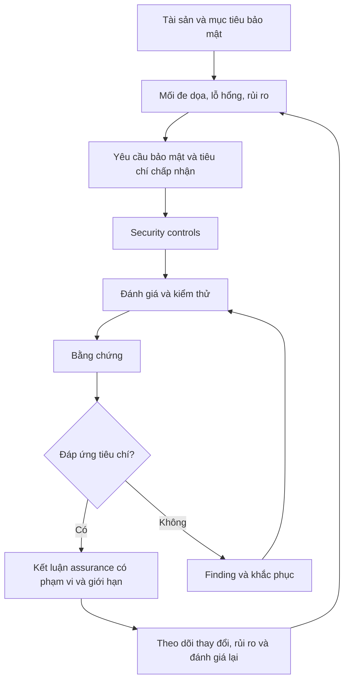

# Thuật ngữ cốt lõi trong Security Assurance

## 1. Security Assurance là gì?

**Security assurance (bảo đảm an ninh/bảo mật)** là quá trình tạo lập, kiểm tra và duy trì **mức độ tin cậy có căn cứ** rằng một hệ thống đáp ứng các mục tiêu và yêu cầu bảo mật đã xác định. Kết luận assurance phải dựa trên bằng chứng có thể truy vết: phân tích rủi ro, thiết kế biện pháp kiểm soát, kết quả kiểm thử, rà soát cấu hình, vận hành thực tế, audit và việc xử lý phát hiện.

Đối với module **SECURITY_SECURITY_ASSURANCE**, trọng tâm là biết hệ thống cần bảo vệ điều gì, vì sao cần bảo vệ, dùng biện pháp nào, làm thế nào chứng minh biện pháp đó hoạt động và duy trì kết luận này trong suốt vòng đời phát triển, vận hành.

Đừng đồng nhất security assurance với một lần quét lỗ hổng hoặc một chứng chỉ. Một kết luận như “kiểm soát truy cập của API đơn hàng đang hoạt động đúng” chỉ đáng tin khi nói rõ **phạm vi, tiêu chí, thời điểm, cách đánh giá, bằng chứng và giới hạn**. Không có một tập kiểm thử hữu hạn nào chứng minh hệ thống hoàn toàn không có lỗ hổng.

Sau bài này, người học có thể:

- Phân biệt tài sản, mối đe dọa, điểm yếu, lỗ hổng, cuộc tấn công và rủi ro.
- Phân biệt mục tiêu, yêu cầu bảo mật, chính sách, control, tiêu chí đánh giá và bằng chứng.
- Hiểu đúng vai trò của assessment, security testing, audit, finding và remediation.
- Ghép các thuật ngữ thành một chuỗi chứng cứ có thể kiểm tra lại cho một tính năng Java/backend.

### Bức tranh tổng thể



Chuỗi trên không phải quy trình tuyến tính chỉ làm một lần. Khi mã nguồn, cấu hình, nhà cung cấp, dữ liệu hoặc bối cảnh đe dọa thay đổi, tổ chức có thể phải đánh giá lại rủi ro, control và mức tin cậy của bằng chứng cũ.

## 2. Ngôn ngữ về tài sản, mối đe dọa và điểm yếu

| Thuật ngữ | Ý nghĩa thực hành | Ví dụ ở nền tảng học tập |
| --- | --- | --- |
| **Asset – tài sản** | Thứ có giá trị cần bảo vệ: dữ liệu, hệ thống, dịch vụ, danh tính, bí mật, quy trình, uy tín. | Hồ sơ học viên, điểm số, token đăng nhập, cơ sở dữ liệu. |
| **Security objective – mục tiêu bảo mật** | Kết quả bảo vệ mong muốn ở mức nghiệp vụ hoặc hệ thống. | Học viên chỉ được xem điểm của mình. |
| **Confidentiality – tính bí mật** | Chỉ người hoặc hệ thống được phép mới có thể tiếp cận thông tin. | Không lộ điểm của học viên khác. |
| **Integrity – tính toàn vẹn** | Dữ liệu và thao tác không bị sửa đổi trái phép, ngoài ý muốn. | Điểm số chỉ thay đổi qua quy trình chấm điểm hợp lệ. |
| **Availability – tính sẵn sàng** | Dịch vụ, dữ liệu được truy cập khi cần theo mức dịch vụ đã đặt ra. | Hệ thống nộp bài hoạt động trong kỳ thi. |
| **Threat – mối đe dọa** | Nguyên nhân hoặc tình huống có khả năng gây tổn hại. | Người dùng cố đọc điểm của người khác; mất khóa bí mật; cấu hình sai. |
| **Threat actor – tác nhân đe dọa** | Người, nhóm hoặc thực thể có thể thực hiện hành động gây hại; đôi khi lỗi vận hành hay sự cố tự nhiên cũng tạo ra tình huống đe dọa nhưng không phải “actor” có chủ ý. | Tài khoản học viên cố truy cập dữ liệu ngoài quyền. |
| **Vulnerability – lỗ hổng** | Điểm yếu có thể bị khai thác, dẫn đến vi phạm mục tiêu bảo mật trong một bối cảnh cụ thể. | API chỉ tra cứu bản ghi theo ID, không kiểm tra chủ sở hữu. |
| **Weakness – điểm yếu** | Sai sót trong thiết kế, triển khai hay vận hành có thể tạo lỗ hổng; không phải mọi điểm yếu đều khai thác được trong mọi môi trường. | Thiếu quy ước kiểm tra quyền ở tầng dịch vụ. |
| **Attack surface – bề mặt tấn công** | Tổng thể các điểm giao tiếp và chức năng mà tác nhân có thể tương tác hoặc lợi dụng. | REST API, trang quản trị, cổng upload, endpoint debug. |
| **Exposure – sự phơi lộ** | Trạng thái tài sản hoặc điểm yếu có thể bị tiếp cận trong điều kiện xác định. | Endpoint quản trị được mở ra Internet. |
| **Exploit – cách khai thác** | Kỹ thuật hoặc mã tận dụng lỗ hổng để tạo tác động. | Thay ID trên URL để đọc dữ liệu của tài khoản khác. |
| **Security event – sự kiện bảo mật** | Sự việc đáng ghi nhận liên quan đến bảo mật, chưa chắc đã là vi phạm. | Năm lần đăng nhập thất bại trong một phút. |
| **Security incident – sự cố bảo mật** | Sự kiện hoặc chuỗi sự kiện đã, hoặc theo quy tắc xử lý sự cố được đánh giá có khả năng, ảnh hưởng đến bảo mật và cần phản ứng. | Xác định dữ liệu của học viên đã bị truy cập trái phép. |

Ba thuộc tính **CIA (Confidentiality, Integrity, Availability)** là cách phân nhóm mục tiêu cơ bản, không phải toàn bộ bảo mật. Tùy hệ thống, còn có **authentication** (xác thực danh tính), **authorization** (quyết định quyền), **accountability** (khả năng quy trách nhiệm), **authenticity** (tính xác thực nguồn gốc) và **privacy** (bảo vệ dữ liệu cá nhân theo mục đích, căn cứ và giới hạn xử lý).

**Ví dụ phân biệt:** Một endpoint có tham số `studentId` là **bề mặt tấn công**. Thiếu kiểm tra quyền sở hữu là **lỗ hổng**. Người dùng gửi `studentId` của người khác là **hành vi tấn công**. Khả năng rò rỉ điểm số và tổn thất kéo theo là **kịch bản rủi ro**. Khi điều tra xác nhận có truy cập trái phép, đó là **sự cố**; một lần thử bị hệ thống chặn có thể chỉ là **sự kiện**.

## 3. Ngôn ngữ quản trị rủi ro

**Risk – rủi ro bảo mật** mô tả khả năng một tình huống đe dọa gây hậu quả đối với tài sản, mục tiêu của tổ chức. Trong thực tế thường đánh giá theo **likelihood (khả năng xảy ra)** và **impact (mức độ tác động)**, cùng bối cảnh kinh doanh, tính phơi lộ và các control hiện có.

| Thuật ngữ | Cần hiểu thế nào? |
| --- | --- |
| **Risk scenario – kịch bản rủi ro** | Mô tả đủ cụ thể: tác nhân/tình huống → điểm yếu → tài sản bị ảnh hưởng → hậu quả. |
| **Likelihood – khả năng xảy ra** | Ước lượng khả năng kịch bản hiện thực hóa trong khoảng thời gian và điều kiện xác định; thường phụ thuộc mức phơi lộ, độ dễ khai thác, động cơ và control. |
| **Impact – tác động** | Hậu quả đến bí mật, toàn vẹn, sẵn sàng, tài chính, pháp lý, uy tín hoặc hoạt động. |
| **Inherent risk – rủi ro ban đầu** | Mức rủi ro được xét trước khi tính hiệu quả các control giảm rủi ro liên quan. Cách xác định chi tiết phải theo phương pháp của tổ chức. |
| **Residual risk – rủi ro còn lại** | Rủi ro sau khi áp dụng và đánh giá các biện pháp xử lý; hiếm khi mặc định bằng 0. |
| **Risk appetite – khẩu vị rủi ro** | Mức và loại rủi ro tổ chức chủ động sẵn sàng chấp nhận để đạt mục tiêu. |
| **Risk tolerance – ngưỡng chịu đựng rủi ro** | Biên độ/giới hạn cụ thể được phép đối với một loại rủi ro, hoạt động hoặc chỉ tiêu. |
| **Risk owner – chủ sở hữu rủi ro** | Cá nhân/vai trò có thẩm quyền và trách nhiệm quản lý, quyết định xử lý rủi ro theo cơ chế tổ chức. |
| **Risk treatment – xử lý rủi ro** | Quyết định giảm thiểu, tránh, chia sẻ/chuyển một phần tác động, hoặc chấp nhận rủi ro. |
| **Risk acceptance – chấp nhận rủi ro** | Quyết định có thẩm quyền, được ghi lại, chấp nhận mức rủi ro còn lại trong phạm vi và thời hạn xác định. |
| **Risk register – sổ đăng ký rủi ro** | Nơi theo dõi kịch bản, điểm đánh giá, owner, control, phương án xử lý, hạn và trạng thái. |

Ví dụ một nhóm dùng thang **1–5** cho khả năng và tác động, rồi nhân hai điểm:

| Thời điểm | Likelihood | Impact | Điểm minh họa | Giải thích |
| --- | ---: | ---: | ---: | --- |
| Trước khi triển khai kiểm tra quyền ở API | 4 | 5 | 20 | Dễ thử ID của người khác, dữ liệu nhạy cảm. |
| Sau khi sửa, có negative test và giám sát | 2 | 4 | 8 | Khó khai thác hơn; vẫn còn rủi ro do sai sót mới hoặc sai cấu hình. |

Đây **chỉ là ví dụ phương pháp nội bộ**, không phải công thức hoặc ngưỡng phổ quát. Điểm 20 và 8 không thể tự động hiểu là “Critical” hay “Low” nếu chưa biết ma trận, định nghĩa mức điểm và ngưỡng chấp nhận của tổ chức. Việc **chấp nhận rủi ro** phải do đúng người có thẩm quyền quyết định; đội kiểm thử không thể đơn phương tuyên bố chấp nhận thay risk owner.

### Các nhầm lẫn thường gặp

- **Threat ≠ vulnerability:** mối đe dọa là điều có thể gây hại; lỗ hổng là điểm có thể bị lợi dụng. Hai khái niệm kết hợp trong một kịch bản.
- **Vulnerability severity ≠ business risk:** mức nghiêm trọng kỹ thuật của lỗ hổng (chẳng hạn điểm CVSS) hỗ trợ ưu tiên, nhưng chưa phản ánh đầy đủ tài sản, mức phơi lộ, control và tác động nghiệp vụ cụ thể.
- **Risk acceptance ≠ remediation:** ký chấp nhận rủi ro không làm lỗ hổng biến mất; nó tạo một quyết định quản trị có phạm vi, thời hạn và trách nhiệm.
- **Không phát hiện sự cố ≠ không có rủi ro:** khả năng quan sát thấp có thể khiến sự cố không được nhận biết.

## 4. Từ mục tiêu đến yêu cầu và security control

Trong security assurance, một **control (biện pháp kiểm soát bảo mật)** có thể là kỹ thuật, con người, quy trình hoặc kết hợp. Chỉ tên control chưa đủ để chứng minh nó thực sự hoạt động.

| Khái niệm | Câu hỏi cần trả lời | Ví dụ |
| --- | --- | --- |
| **Security objective** | Muốn bảo vệ kết quả gì? | Người học không xem được hồ sơ người khác. |
| **Security policy – chính sách** | Tổ chức yêu cầu những nguyên tắc nào? | Mọi truy cập dữ liệu học viên phải tuân theo nguyên tắc cấp quyền tối thiểu. |
| **Standard/baseline – tiêu chuẩn/cấu hình cơ sở** | Quy tắc cụ thể, mức tối thiểu bắt buộc là gì? | Dịch vụ phải thực thi kiểm tra quyền ở phía máy chủ cho mọi API đọc hồ sơ. |
| **Security requirement – yêu cầu bảo mật** | Hệ thống phải đáp ứng điều kiện kiểm chứng nào? | Tài khoản B yêu cầu hồ sơ A phải nhận phản hồi từ chối, không lộ nội dung A. |
| **Control objective – mục tiêu của control** | Control cần ngăn, phát hiện hoặc xử lý điều gì? | Ngăn người dùng đọc bản ghi không thuộc quyền của họ. |
| **Security control – biện pháp kiểm soát** | Dùng biện pháp nào để đạt mục tiêu? | Kiểm tra quyền ở tầng service kết hợp điều kiện `owner_id` trong truy vấn. |
| **Procedure – thủ tục** | Ai thực hiện các bước vận hành/đánh giá ra sao? | Người phụ trách chạy bộ kiểm thử phân quyền sau mỗi bản phát hành. |
| **Acceptance criteria – tiêu chí chấp nhận** | Kết quả nào được xem là đạt? | Ca thử khác chủ sở hữu trả `403` hoặc `404` theo thiết kế; không trả dữ liệu nhạy cảm. |

**Authentication (xác thực)** trả lời “bạn là ai?”. **Authorization (phân quyền)** trả lời “bạn được làm gì với tài nguyên này?”. Một tài khoản có phiên đăng nhập hợp lệ vẫn không được mặc nhiên xem tất cả tài nguyên. **Least privilege (đặc quyền tối thiểu)** là chỉ cấp những quyền cần cho nhiệm vụ; **separation of duties (phân tách nhiệm vụ)** tránh một người tự thực hiện và tự phê duyệt toàn bộ thao tác nhạy cảm.

Theo công dụng, control thường được nhóm thành:

| Nhóm control | Vai trò | Ví dụ |
| --- | --- | --- |
| **Preventive – phòng ngừa** | Ngăn hành vi gây hại trước khi thành công. | Kiểm tra quyền theo bản ghi, xác thực đa yếu tố, giới hạn truy cập mạng. |
| **Detective – phát hiện** | Nhận biết hành vi, sai lệch hoặc sự cố. | Phát hiện truy vấn dữ liệu bất thường, cảnh báo cấu hình đổi trái phép. |
| **Corrective – khắc phục** | Khôi phục hoặc xử lý sau sai lệch. | Thu hồi token lộ, khôi phục cấu hình và dữ liệu từ nguồn tin cậy. |
| **Compensating – bù trừ** | Biện pháp thay thế khi control dự kiến chưa khả thi, được đánh giá xem có giảm rủi ro tương đương/phù hợp hay không. | Tạm cô lập chức năng quản trị bằng mạng riêng, giới hạn người truy cập và giám sát tăng cường. |

Các nhóm này **có thể chồng lấn**: một control vừa phát hiện vừa hỗ trợ phản ứng. **Defense in depth (phòng thủ nhiều lớp)** là bố trí các lớp kiểm soát độc lập tương đối, để lỗi một lớp không mặc nhiên làm mất toàn bộ khả năng bảo vệ.

**Control design** (thiết kế control) nói control được xây dựng để xử lý đúng rủi ro hay chưa. **Control implementation** (triển khai) nói nó đã được cấu hình, áp dụng đúng hay chưa. **Operating effectiveness** (hiệu lực vận hành) nói nó có thực sự hoạt động ổn định trong thời gian và phạm vi đánh giá hay không. Ba kết luận này cần bằng chứng khác nhau.

## 5. Từ tuyên bố assurance đến bằng chứng

**Assurance claim** là phát biểu cụ thể cần chứng minh, ví dụ: “Tại bản phát hành `2026.11`, các API đọc đơn hàng dành cho học viên áp dụng kiểm tra quyền sở hữu phía máy chủ”. Claim cần đi cùng **evidence (bằng chứng)** và **reasoning (lập luận)** chỉ ra vì sao bằng chứng hỗ trợ kết luận.

| Thuật ngữ | Ý nghĩa | Câu hỏi kiểm tra |
| --- | --- | --- |
| **Assessment – đánh giá** | Thu thập và phân tích bằng chứng theo tiêu chí, phương pháp xác định nhằm kết luận mức đáp ứng. | Đã đánh giá yêu cầu nào và theo phương pháp nào? |
| **Verification – kiểm chứng** | Xác nhận sản phẩm/control đáp ứng yêu cầu và đặc tả đã nêu. | Đã xây đúng những gì được quy định? |
| **Validation – xác nhận tính phù hợp** | Xác nhận kết quả đáp ứng nhu cầu sử dụng và mục tiêu bảo mật thực tế. | Những yêu cầu đó có bảo vệ đúng điều cần bảo vệ? |
| **Test case – ca kiểm thử** | Điều kiện đầu vào, thao tác và kết quả dự kiến để kiểm tra một hành vi. | Có kiểm tra cả tình huống trái quyền? |
| **Test result – kết quả kiểm thử** | Kết quả quan sát khi thực thi, kèm trạng thái đạt/không đạt và dữ kiện đối chiếu. | Chạy trên bản build nào, khi nào, được gì? |
| **Evidence – bằng chứng** | Bản ghi, artifact hoặc quan sát có thể thẩm tra, phù hợp với kết luận. | Có thể xác thực nguồn, phạm vi và tính nguyên vẹn? |
| **Traceability – tính truy vết** | Quan hệ nối tài sản/rủi ro → yêu cầu → control → phép đánh giá → bằng chứng → finding. | Từ một rủi ro có tìm được test và bản sửa? |
| **Audit trail – dấu vết kiểm toán** | Chuỗi bản ghi giúp tái dựng ai làm gì, khi nào, trên đối tượng nào. | Có định danh người thao tác, thời gian và sự kiện phù hợp? |
| **Scope – phạm vi** | Hệ thống, thành phần, môi trường, thời gian, vai trò và phiên bản thuộc đánh giá. | Kết luận có bao trùm hệ thống production không? |
| **Assessment criteria – tiêu chí đánh giá** | Quy tắc hoặc chuẩn đối chiếu được xác định trước khi kết luận. | “Đạt” được định nghĩa rõ chưa? |
| **Assurance level/confidence – mức tin cậy** | Độ tin cậy vào claim, phụ thuộc độ phù hợp, độ sâu, độ độc lập, tính cập nhật và giới hạn bằng chứng; không tự mặc định có một thang điểm chung. | Điều gì có thể làm kết luận mất hiệu lực? |

### Bằng chứng tốt có đặc điểm gì?

Một bản ghi “**PASS**” đơn lẻ là yếu. Một bộ bằng chứng có sức thuyết phục cần thể hiện:

1. **Đúng đối tượng:** gắn với requirement ID, control ID, phiên bản dịch vụ, môi trường và cấu hình thực tế.
2. **Đúng phương pháp:** giải thích rõ cách kiểm tra, dữ liệu đầu vào, kết quả mong đợi và kết quả quan sát, gồm cả ca âm tính (negative test).
3. **Có nguồn gốc và thời điểm:** commit/build, công cụ, người thực hiện hoặc quy trình CI, ngày giờ và phạm vi.
4. **Có thể kiểm tra lại:** giữ đủ test report, log đã ẩn dữ liệu nhạy cảm, cấu hình, biên bản rà soát hoặc tham chiếu artifact.
5. **Nêu giới hạn:** test ở môi trường staging chưa tự chứng minh cấu hình production giống hệt; mẫu audit không đại diện mọi giao dịch nếu cách chọn mẫu không phù hợp.

**Evidence freshness (độ mới của bằng chứng)** quan trọng: kết quả kiểm thử của commit cũ không còn đủ để khẳng định cho commit mới nếu phần thay đổi có thể ảnh hưởng control. **Evidence integrity (tính toàn vẹn bằng chứng)** đòi hỏi ngăn sửa hoặc thay thế artifact trái phép, quản lý quyền và lưu dấu vết. Không đưa token, mật khẩu, dữ liệu người dùng thực vào báo cáo chỉ để “tăng bằng chứng”.

### Security assurance khác compliance và audit như thế nào?

- **Security** mô tả trạng thái/mức bảo vệ thực tế trước mối đe dọa; **security assurance** mô tả cơ sở để tin vào những kết luận về mức bảo vệ đó.
- **Compliance (tuân thủ)** là mức đáp ứng luật, quy định, chính sách hoặc chuẩn được chỉ định. Tuân thủ một checklist có thể là bằng chứng, nhưng chưa đủ chứng minh mọi rủi ro đã được xử lý.
- **Security assessment** có thể do đội kỹ thuật, bên độc lập hoặc đơn vị đánh giá thực hiện để kiểm tra control.
- **Audit (kiểm toán)** là hoạt động xem xét có cấu trúc dựa trên tiêu chí và bằng chứng, thường có yêu cầu về tính khách quan/độc lập theo loại audit. Audit có thể xem xét quy trình, quản trị, việc vận hành control, không chỉ lỗ hổng kỹ thuật.
- **Certification/attestation (chứng nhận/xác nhận)** chỉ có ý nghĩa theo chuẩn, tổ chức đưa ra, phạm vi và kỳ hiệu lực; không thay thế xác minh các rủi ro đặc thù.

## 6. Các hoạt động kiểm tra phổ biến

| Hoạt động | Nó cung cấp loại bằng chứng nào? | Giới hạn điển hình |
| --- | --- | --- |
| **Threat modeling – mô hình hóa mối đe dọa** | Sơ đồ luồng dữ liệu, ranh giới tin cậy, kịch bản đe dọa và quyết định thiết kế. | Phụ thuộc mức đầy đủ của mô hình và giả định. |
| **Security design review** | Đánh giá kiến trúc, đường đi của dữ liệu, phân quyền, lưu bí mật, các cơ chế phòng thủ. | Không chứng minh triển khai thực tế đúng thiết kế. |
| **Secure code review** | Chỉ ra lỗi logic, phân quyền, xử lý đầu vào hoặc sử dụng API thiếu an toàn. | Bị giới hạn bởi phạm vi mã và chất lượng rà soát. |
| **SAST – Static Application Security Testing** | Phát hiện mẫu điểm yếu bằng phân tích mã hoặc artifact mà không cần chạy ứng dụng theo luồng nghiệp vụ. | Có false positive và bỏ sót logic nghiệp vụ. |
| **DAST – Dynamic Application Security Testing** | Thử hành vi ứng dụng đang chạy qua giao diện/endpoint để phát hiện một số lỗi. | Phụ thuộc môi trường, quyền truy cập, độ bao phủ chức năng. |
| **SCA – Software Composition Analysis** | Nhận diện thư viện/phụ thuộc và đối chiếu những vấn đề đã biết; đôi khi hỗ trợ chính sách giấy phép. | Không đồng nghĩa tất cả lỗ hổng phụ thuộc đều khai thác được hoặc đã được phát hiện. |
| **SBOM – Software Bill of Materials** | Danh mục thành phần và phiên bản phần mềm phục vụ truy vết phụ thuộc, đánh giá ảnh hưởng. | Chỉ là inventory; tự nó không chứng minh an toàn. |
| **Configuration assessment** | So cấu hình chạy thực với baseline: TLS, IAM, secret, network, log, hardening. | Một cấu hình đạt baseline vẫn có thể tồn tại rủi ro thiết kế. |
| **Vulnerability assessment** | Tìm, kiểm tra và phân loại lỗ hổng trong phạm vi được giao. | Chủ yếu mô tả vấn đề được tìm thấy, chưa luôn chứng minh đường khai thác. |
| **Penetration test – kiểm thử xâm nhập** | Thử khai thác có kiểm soát để kiểm tra tác động và khả năng chuỗi điểm yếu dẫn đến vi phạm. | Theo phạm vi, thời điểm và thời lượng; không thể chứng minh vắng mặt mọi lỗ hổng. |
| **Control assessment/audit** | Đối chiếu thiết kế, triển khai và hiệu lực control với các yêu cầu, qua phỏng vấn, quan sát, xem hồ sơ, lấy mẫu, tái thực hiện. | Chất lượng kết luận phụ thuộc tiêu chí, phạm vi, mẫu và bằng chứng. |

Các phương pháp **bổ trợ lẫn nhau**: quét SAST không kiểm chứng được đầy đủ phân quyền theo đối tượng; penetration test không thay thế việc xem bằng chứng vận hành nhiều tháng; audit quy trình không thay thế kiểm thử kỹ thuật. Trong phát triển liên tục, nhiều hoạt động được chạy ở CI/CD, kết hợp rà soát thủ công cho logic nghiệp vụ và đánh giá độc lập khi cần.

**False positive (dương tính giả)** là công cụ báo lỗi nhưng sau kiểm tra không xác nhận được lỗi theo điều kiện đánh giá. **False negative (âm tính giả)** là lỗi tồn tại nhưng phương pháp kiểm tra không phát hiện được. Tỷ lệ này và phạm vi bao phủ phải được cân nhắc khi sử dụng kết quả quét làm bằng chứng.

## 7. Finding, khắc phục và rủi ro tồn đọng

**Finding (phát hiện)** là kết luận có căn cứ về một sai lệch, điểm yếu hoặc cơ hội cải thiện được ghi nhận trong đánh giá. Finding tốt mô tả **điều kiện quan sát, tiêu chí bị vi phạm, bằng chứng, tác động và hành động cần thực hiện**.

| Thuật ngữ | Ý nghĩa trong vòng xử lý |
| --- | --- |
| **Observation – quan sát** | Thông tin ghi nhận; có thể trở thành finding khi đủ tiêu chí, bằng chứng và đánh giá. |
| **Nonconformity – điểm không phù hợp** | Không đáp ứng yêu cầu/tiêu chí được áp dụng, thường dùng trong audit hệ thống quản lý. |
| **Severity – mức nghiêm trọng** | Mức độ nghiêm trọng được xác định theo thang công cụ hoặc chính sách; phải nói rõ thang nào. |
| **Exploitability – khả năng khai thác** | Mức độ khả thi của việc tận dụng một lỗ hổng trong các điều kiện đã xét. |
| **Prioritization – ưu tiên xử lý** | Quyết định thứ tự dựa trên rủi ro thực tế, mức phơi lộ, tài sản, phụ thuộc và cam kết thời gian. |
| **Remediation – khắc phục tận gốc** | Loại bỏ hoặc sửa nguyên nhân lỗi, như bổ sung kiểm tra quyền ở service. |
| **Mitigation – giảm thiểu** | Giảm khả năng hoặc tác động, có thể tạm thời nếu chưa sửa được nguyên nhân. |
| **Exception – ngoại lệ** | Phê duyệt có điều kiện cho việc chưa đáp ứng một yêu cầu, thường kèm owner, lý do, control bù trừ và ngày hết hiệu lực. |
| **Retest – kiểm tra lại** | Xác minh finding đã được giải quyết theo tiêu chí ban đầu và bối cảnh mới. |
| **Regression test – kiểm thử hồi quy** | Đảm bảo bản sửa không khiến hành vi bảo mật đã đúng trước đó bị hỏng. |
| **Closure – đóng phát hiện** | Chuyển trạng thái sau khi có đủ bằng chứng theo quy trình; “đã sửa code” chưa đủ để tự động đóng. |

Vòng đời điển hình: **ghi nhận → xác minh → đánh giá rủi ro → giao owner và hạn → sửa/giảm thiểu/xin ngoại lệ → kiểm tra lại → phê duyệt đóng hoặc theo dõi rủi ro còn lại**. Nếu lỗi vẫn tồn tại nhưng được chấp nhận rủi ro, ghi rõ đó là trạng thái **chấp nhận theo thẩm quyền**, không gắn nhãn “đã khắc phục”.

Trong thực tế có thể dùng **POA&M (Plan of Action and Milestones)** hoặc remediation tracker để quản lý hành động, người phụ trách, ngày hẹn, bằng chứng và trạng thái.

## 8. Ví dụ xuyên suốt: kiểm soát quyền đọc đơn hàng của người học

Giả sử một backend Java/Spring Boot phục vụ API:

```http
GET /api/orders/{orderId}
Authorization: Bearer <access-token>
```

Nếu service chỉ gọi `findById(orderId)` sau khi xác thực, người học B có thể thử ID đơn hàng của A. Đây là dạng lỗi **Broken Object Level Authorization (BOLA)**, thường được gọi là **IDOR** trong ngữ cảnh tham chiếu đối tượng trực tiếp thiếu kiểm tra quyền.

### Từ rủi ro đến claim

| Mắt xích | Nội dung ví dụ |
| --- | --- |
| **Asset** | Đơn hàng có thông tin người học và nội dung thanh toán. |
| **Threat scenario** | Người học đã đăng nhập đoán hoặc thu được ID đơn của người khác rồi gọi API. |
| **Vulnerability** | Truy vấn đơn hàng theo ID mà không ràng buộc với chủ sở hữu hoặc quyền hợp lệ. |
| **Risk** | Rò rỉ thông tin giao dịch; tác động CIA chính là tính bí mật. |
| **Security requirement: REQ-ORD-01** | Người học chỉ xem đơn hàng của mình; tài khoản không có quyền không nhận được nội dung đơn khác. |
| **Control: CTRL-ORD-01** | Xác thực người gọi và kiểm tra quyền tại backend, ràng buộc truy vấn với chủ sở hữu lấy từ danh tính đã xác thực. |
| **Assessment: TEST-ORD-01** | Chạy kiểm thử tự động cho chủ sở hữu, khác chủ sở hữu và chưa xác thực. |
| **Assurance claim** | Trên phiên bản và môi trường đã kiểm tra, API tuân thủ `REQ-ORD-01` đối với các ca đã xác định. |

Ví dụ triển khai phần logic truy vấn ở service, giả sử `requesterId` được lấy từ **principal đã xác thực phía server**, không nhận tùy ý từ query parameter:

```java
public OrderDto getOrder(UUID orderId, UUID requesterId) {
    Order order = orderRepository
        .findByIdAndCustomerId(orderId, requesterId)
        .orElseThrow(() ->
            new ResponseStatusException(HttpStatus.NOT_FOUND));

    return orderMapper.toDto(order);
}
```

Việc dùng `findByIdAndCustomerId` thể hiện control kiểm tra quyền sở hữu ngay trong truy vấn dữ liệu. Cần bảo đảm các API khác có thể đọc, xuất file hoặc cập nhật đơn hàng cũng áp dụng chính sách quyền phù hợp; chỉ sửa một endpoint không có nghĩa toàn hệ thống đã được bảo vệ. Vai trò nhân viên hỗ trợ, quản trị viên hoặc chia sẻ đơn hàng hợp lệ cần tiêu chí riêng nếu nghiệp vụ có những trường hợp đó.

### Kiểm thử và bằng chứng tối thiểu

| Test case | Tiền điều kiện và hành động | Kết quả mong đợi |
| --- | --- | --- |
| `TC-01` | A đăng nhập, yêu cầu đơn của A. | `200` và dữ liệu đúng đơn A. |
| `TC-02` | B đăng nhập, yêu cầu ID đơn của A. | `403` hoặc `404` theo thiết kế; tuyệt đối không có nội dung riêng của A. |
| `TC-03` | Không có thông tin xác thực, yêu cầu đơn A. | `401` theo giao thức xác thực của ứng dụng; không lộ dữ liệu. |
| `TC-04` | A gửi ID không tồn tại. | `404`; không lộ thông tin nội bộ. |
| `TC-05` | Người dùng có quyền đặc biệt hợp lệ, nếu hệ thống hỗ trợ. | Chỉ được truy cập theo quy tắc quyền đã đặc tả và đã kiểm thử. |

Lưu artifact có thể truy vết, chẳng hạn:

```yaml
evidenceId: EVD-ORD-2026-011
requirementId: REQ-ORD-01
controlId: CTRL-ORD-01
assessmentId: TEST-ORD-01
service: order-service
environment: staging
sourceCommit: "<commit-sha>"
buildId: "<ci-build-id>"
executedAt: "<ISO-8601-timestamp>"
testReport: "<artifact-reference>"
result: PASS
limitations:
  - "Chưa xác minh sự tương đồng cấu hình với production."
  - "Chỉ bao phủ các vai trò và đường truy cập trong bộ test."
```

Ở đây, **test report** là một phần bằng chứng, **result = PASS** là kết quả đánh giá so với tiêu chí, còn **assurance claim** là kết luận có phạm vi, dựa trên bằng chứng đó. Nếu `TC-02` trả `200` kèm đơn của A, phải ghi nhận **finding**, đánh giá ảnh hưởng, sửa control và **retest**. Khi test đạt sau sửa, vẫn cần theo dõi thay đổi và rủi ro còn lại.

### Mẫu finding có thể hành động

> **FIND-ORD-07:** Bản build X của `order-service` cho phép người dùng B đọc đơn của A qua `GET /api/orders/{orderId}`. Tiêu chí vi phạm: `REQ-ORD-01`. Bằng chứng: phản hồi đã ẩn thông tin nhạy cảm của `TC-02`, tham chiếu report Y. Tác động: rò rỉ thông tin giao dịch. Owner: nhóm Order Service. Hành động: kiểm tra quyền sở hữu ở backend, bổ sung negative test và kiểm tra lại trên bản build sửa lỗi. Trạng thái: OPEN.

Mẫu này giúp người sửa hiểu nguyên nhân và giúp người đánh giá có tiêu chí **đóng finding** rõ ràng.

## 9. Security assurance liên tục trong phát triển và vận hành

**Continuous security assurance** là duy trì và cập nhật bằng chứng khi ứng dụng thay đổi, thay vì chỉ đánh giá một lần trước khi ra mắt. Trên một nền tảng Java có CI/CD, hoạt động này có thể được tổ chức theo các điểm kiểm soát:

| Giai đoạn | Hoạt động assurance | Bằng chứng phù hợp |
| --- | --- | --- |
| Thiết kế | Xác định tài sản, threat modeling, đánh giá rủi ro, tiêu chí bảo mật. | Sơ đồ luồng dữ liệu, risk register, yêu cầu được duyệt. |
| Phát triển | Code review và kiểm thử bảo mật ở mức unit/integration; SAST, SCA khi phù hợp. | Pull request review, test report, danh mục phụ thuộc. |
| Trước phát hành | DAST, kiểm thử phân quyền, rà soát cấu hình và xử lý finding quan trọng. | Báo cáo theo build, phê duyệt ngoại lệ đúng thẩm quyền. |
| Vận hành | Theo dõi event/incident, drift cấu hình, thay đổi quyền, lỗ hổng mới và control định kỳ. | Alert, audit log, lịch sử thay đổi, kết quả đánh giá lại. |
| Sau khắc phục | Retest, hồi quy và cập nhật rủi ro còn lại. | Test report bản sửa, liên kết finding và quyết định closure. |

Một số chỉ số thường gặp:

- **KPI (Key Performance Indicator):** tỷ lệ control quan trọng được kiểm thử đúng kỳ, tỷ lệ finding quá hạn, thời gian khắc phục trung vị, mức bao phủ các yêu cầu có test liên kết.
- **KRI (Key Risk Indicator):** số lỗ hổng nghiêm trọng còn phơi lộ trên Internet, số ngoại lệ quá hạn, số quyền truy cập đặc quyền không được rà soát, số thành phần có vấn đề đã biết còn tồn đọng.
- **Control coverage:** phần yêu cầu/rủi ro trọng yếu có control và phương pháp kiểm chứng tương ứng; phải định nghĩa rõ mẫu số.
- **Evidence freshness:** tỷ lệ bằng chứng còn hiệu lực với phiên bản và khoảng đánh giá mục tiêu.

Ví dụ “95% test PASS” là chỉ báo không đủ nếu 5% thất bại đều thuộc kiểm soát quyền truy cập quan trọng. Chỉ số phải kết hợp **mức trọng yếu, độ bao phủ, xu hướng và giới hạn**, không biến thành mục tiêu chạy theo số lượng.

## 10. Bảng phân biệt nhanh và tự kiểm tra

| Cặp dễ nhầm | Cách phân biệt ngắn |
| --- | --- |
| **Mục tiêu vs yêu cầu** | Mục tiêu là kết quả muốn bảo vệ; yêu cầu là điều kiện cụ thể có thể kiểm tra. |
| **Yêu cầu vs control** | Yêu cầu nói *cần đạt gì*; control nói *dùng gì để đạt*. |
| **Control vs bằng chứng** | Control thực thi bảo vệ; bằng chứng cho thấy control được triển khai/vận hành theo tiêu chí. |
| **Kiểm thử vs audit** | Kiểm thử thực thi tình huống cụ thể; audit đánh giá theo bộ tiêu chí, có thể sử dụng cả test và hồ sơ/quy trình. |
| **Compliance vs assurance** | Compliance đối chiếu yêu cầu áp dụng; assurance xây dựng mức tin cậy có bằng chứng về các claim bảo mật. |
| **Finding vs incident** | Finding là phát hiện trong đánh giá; incident là sự cố hoặc tình huống cần xử lý theo quy trình ứng cứu. |
| **Fix vs verified closure** | Sửa xong là hành động của đội thực hiện; đóng có xác minh cần bằng chứng retest và phê duyệt theo quy trình. |

**Tự kiểm tra:**

1. Một báo cáo SAST trả về “0 lỗi”. Có thể khẳng định backend không có lỗi phân quyền theo bản ghi không? **Không.** Cần kiểm thử tình huống quyền nghiệp vụ, rà soát thiết kế/code và xét phạm vi của SAST.
2. Một bản build được kiểm thử đạt; sau đó thay đổi bộ lọc bảo mật của production. Bằng chứng trước còn đủ không? **Chưa chắc.** Phải đánh giá tác động thay đổi và kiểm chứng lại control bị ảnh hưởng.
3. Chủ sở hữu hệ thống nói “chúng tôi chấp nhận lỗ hổng này”. Có thể đánh dấu “đã sửa” không? **Không.** Cần quyết định chấp nhận rủi ro đúng thẩm quyền, thời hạn, phạm vi, điều kiện và trạng thái theo dõi phù hợp.
4. Một control được mô tả trong tài liệu nhưng kiểm thử cho thấy người dùng khác vẫn đọc được dữ liệu. Control đã “đạt” chưa? **Chưa.** Thiết kế/giấy tờ không thay thế bằng chứng hiệu lực triển khai.

### Cách áp dụng khi viết tài liệu hoặc báo cáo assurance

Với mỗi tuyên bố bảo mật, hãy trả lời đủ bảy câu: **(1)** tài sản/mục tiêu gì; **(2)** rủi ro nào; **(3)** yêu cầu và tiêu chí nào; **(4)** control nào; **(5)** đánh giá bằng phương pháp nào; **(6)** bằng chứng của phiên bản/môi trường nào; **(7)** nếu chưa đạt thì ai xử lý, khi nào kiểm tra lại và rủi ro còn lại được quản lý thế nào.

Đó là nền tảng để chuyển từ câu “hệ thống đã được kiểm thử bảo mật” thành một kết luận security assurance **có thể truy vết, có giới hạn rõ ràng và có khả năng kiểm chứng lại**.

### Khung tham khảo để học tiếp

- **NIST CSF:** ngôn ngữ quản trị kết quả an ninh mạng, tổ chức năng lực quản trị và giảm rủi ro.
- **NIST SP 800-30 / SP 800-37:** định hướng đánh giá rủi ro và quản lý rủi ro theo vòng đời.
- **NIST SP 800-53 / SP 800-53A:** danh mục control và phương pháp đánh giá control trong phạm vi áp dụng.
- **ISO/IEC 27001 và ISO/IEC 27002:** yêu cầu hệ thống quản lý an toàn thông tin và hướng dẫn về các control.
- **OWASP ASVS và OWASP Web Security Testing Guide:** yêu cầu xác minh và phương pháp kiểm thử bảo mật ứng dụng web.

Các khung này cung cấp cách diễn đạt và thực hành tham khảo; việc áp dụng phiên bản, phạm vi, bằng chứng và ngưỡng chấp nhận cụ thể do tổ chức xác định theo bối cảnh của mình.
