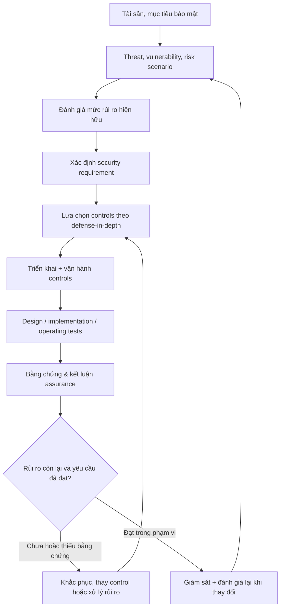
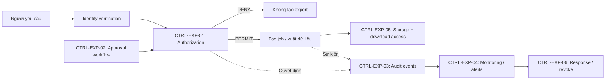
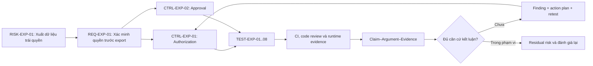

# Control là gì? Nền tảng security controls trong security assurance

Một hệ thống quản lý khách hàng cho phép nhân viên xuất báo cáo chứa dữ liệu nhạy cảm. Đội phát triển đã bổ sung nút “Export”, đội vận hành bật HTTPS và Security yêu cầu “hệ thống phải bảo mật”. Một ngày, tài khoản nhân viên có quyền quá rộng xuất được dữ liệu của tenant khác. Kiểm tra sự cố cho thấy hệ thống có đăng nhập nhưng **không kiểm tra quyền ở đúng đối tượng**, không giới hạn phạm vi xuất và cũng không có cảnh báo khi tải dữ liệu bất thường.

Sự cố này giúp phân biệt ba điều: **mục tiêu bảo mật** là không để người không có quyền lấy dữ liệu; **rủi ro** là người dùng hoặc tài khoản bị chiếm quyền có thể xuất dữ liệu trái phép; còn **security controls** là những biện pháp cụ thể được thiết kế, triển khai và vận hành để ngăn, phát hiện hoặc hạn chế tác động của kịch bản đó.

Trong module `SECURITY_SECURITY_ASSURANCE`, hiểu “control là gì” không dừng ở việc liệt kê MFA, mã hóa hay firewall. Người học cần biết cách đưa **rủi ro, yêu cầu và mục tiêu bảo mật** thành **controls có chủ sở hữu, tiêu chí hoạt động, phương pháp kiểm thử/audit, bằng chứng và kế hoạch khắc phục**. Đây là nền móng cho chương trình security assurance liên tục trong phát triển và vận hành.

> **Điểm cốt lõi:** Security control là một biện pháp làm thay đổi rủi ro hoặc hỗ trợ đạt mục tiêu bảo mật. **Có control** không có nghĩa control **được thiết kế đúng**, **đã triển khai đúng**, **đang hoạt động hiệu quả**, hay **đủ bằng chứng** để kết luận rủi ro đã giảm tới mức chấp nhận được.

## 1. Định nghĩa security control

**Security control (biện pháp kiểm soát bảo mật)** là biện pháp kỹ thuật, quản trị, vật lý hoặc kết hợp các biện pháp đó được tổ chức lựa chọn và áp dụng nhằm **ngăn ngừa, phát hiện, giảm thiểu, ứng phó hoặc hỗ trợ phục hồi** trước các tình huống có thể ảnh hưởng tới mục tiêu bảo mật.

Một control có thể là:

- **Cơ chế kỹ thuật:** xác minh token, kiểm tra phân quyền theo tài nguyên, mã hóa dữ liệu, IAM, rate limiting, giám sát log hoặc sao lưu.
- **Quy trình quản trị:** yêu cầu phê duyệt quyền truy cập, review quyền định kỳ, quản lý thay đổi, rà soát dependency hoặc phân tách nhiệm vụ.
- **Biện pháp vật lý:** kiểm soát ra vào phòng máy, tủ thiết bị có khóa, giám sát môi trường vật lý hoặc quản lý thiết bị lưu trữ.
- **Biện pháp liên kết nhiều lớp:** ví dụ quản lý truy cập đặc quyền gồm policy, xác thực mạnh, workflow phê duyệt, cấp quyền có hạn, audit log và hậu kiểm.

Control **không nhất thiết là một phần mềm**. Một quy trình phê duyệt có bằng chứng, được thực hiện nhất quán cũng có thể là control. Ngược lại, một phần mềm bảo mật được cài nhưng không cấu hình, không vận hành hoặc không bảo vệ đúng tài sản có thể **không tạo ra mức bảo đảm cần thiết**.

### Ví dụ đối chiếu

| Mục tiêu / rủi ro | Control được đề xuất | Tác dụng dự kiến |
|---|---|---|
| Ngăn nhân viên đọc đơn của tenant khác | Object-level authorization và tenant isolation | Ngăn hành động trái quyền trước khi trả dữ liệu |
| Hạn chế chiếm quyền quản trị | Xác thực mạnh và nguyên tắc least privilege | Giảm khả năng dùng danh tính/đặc quyền trái phép |
| Phát hiện xuất dữ liệu bất thường | Audit logging, cảnh báo theo ngữ cảnh | Phát hiện và hỗ trợ điều tra, không tự chặn mọi lần xuất |
| Hạn chế tổn thất do ransomware | Backup được bảo vệ và diễn tập restore | Tăng khả năng khôi phục và giảm thời gian gián đoạn |
| Giảm lỗ hổng từ dependency | SCA, inventory và quy trình xử lý vulnerability | Phát hiện thành phần bị ảnh hưởng và thúc đẩy khắc phục |
| Ngăn thay đổi production chưa phê duyệt | Branch protection, release approval, giới hạn quyền CI/CD | Hạn chế đường đưa thay đổi không hợp lệ vào production |

Lưu ý: **audit logging chủ yếu là control phát hiện và cung cấp bằng chứng**, không thể thay thế authorization. Tương tự, backup không ngăn dữ liệu bị đánh cắp; nó giúp phục hồi trước một số dạng mất mát hoặc gián đoạn.

## 2. Phân biệt control với các khái niệm liên quan

Một nhóm thường dùng nhầm các khái niệm **risk, threat, vulnerability, requirement, policy, standard, control và evidence**. Nếu không tách rõ, sẽ khó biết ai cần làm gì và điều gì phải được chứng minh.

| Khái niệm | Câu hỏi cần trả lời | Ví dụ xuất dữ liệu khách hàng |
|---|---|---|
| **Asset (tài sản)** | Điều gì cần bảo vệ? | Dữ liệu khách hàng trong từng tenant |
| **Security objective (mục tiêu)** | Thuộc tính bảo mật nào phải được giữ? | Tính bí mật và tính toàn vẹn dữ liệu |
| **Threat (mối đe dọa)** | Ai/sự kiện nào có thể gây tổn hại? | Người dùng lạm quyền hoặc tài khoản bị chiếm |
| **Vulnerability (lỗ hổng)** | Điểm yếu nào có thể bị khai thác? | API export không kiểm tra quyền trên tenant |
| **Risk (rủi ro)** | Điều bất lợi nào có thể xảy ra và tác động ra sao? | Xuất trái phép dữ liệu khách hàng |
| **Policy** | Tổ chức đặt nguyên tắc và trách nhiệm gì? | Dữ liệu nhạy cảm chỉ được xuất theo quyền đã được phê duyệt |
| **Standard / requirement** | Điều kiện cụ thể nào phải đạt? | Mọi lệnh xuất phải xác minh tenant, vai trò và trạng thái phê duyệt |
| **Security control** | Biện pháp nào thực thi hoặc hỗ trợ đạt yêu cầu? | Policy check trước export, approval workflow, monitoring |
| **Test / audit procedure** | Kiểm tra biện pháp hoạt động thế nào? | Thử xuất dữ liệu tenant khác, đối chiếu approval và log |
| **Evidence (bằng chứng)** | Căn cứ nào cho kết luận? | Kết quả test, code/config review, bản ghi approval, audit event |
| **Residual risk (rủi ro còn lại)** | Sau control, còn điều gì chưa được giải quyết? | Tài khoản được phê duyệt nhưng bị chiếm quyền hoặc luồng export cũ chưa bảo vệ |

**Policy không phải control thực thi.** Quy định “mọi lệnh export phải được phê duyệt” chỉ có ý nghĩa vận hành khi có quy trình hoặc hệ thống **thực sự kiểm tra phê duyệt trước khi xuất**.

**Test không mặc nhiên là control phòng ngừa.** Integration test giúp kiểm chứng policy check hoạt động; nó không tự chặn một request production nếu service bỏ qua bước kiểm tra. Dẫu vậy, kiểm thử bảo mật được tích hợp trong quy trình phát triển có thể là **một control mang tính phát hiện lỗi và bảo đảm chất lượng** ở cấp SDLC. Vai trò phải được xác định theo mục tiêu đánh giá.

**Công cụ không đồng nghĩa control hoàn chỉnh.** “Có SIEM” chưa chứng minh một control phát hiện hiệu quả nếu không có dữ liệu log phù hợp, quy tắc cảnh báo, người nhận cảnh báo và quy trình phản ứng.

## 3. Một security control hoàn chỉnh gồm những gì?

Để quản lý và đánh giá được, control nên được mô tả bằng các thành phần thay vì chỉ có tên công nghệ.

| Thành phần | Câu hỏi | Ví dụ |
|---|---|---|
| **Control ID / tên** | Đây là control nào? | `CTRL-EXPORT-01: Kiểm tra quyền trước xuất dữ liệu` |
| **Risk / objective** | Vì sao cần có control? | Ngăn đọc dữ liệu sai tenant; bảo vệ confidentiality |
| **Scope** | Áp dụng cho tài sản, đường xử lý, môi trường và thời gian nào? | API và worker export trong production |
| **Owner** | Ai chịu trách nhiệm vận hành và hiệu quả control? | Nhóm phụ trách export-service |
| **Mechanism** | Control tác động lên rủi ro bằng cách nào? | Từ chối nếu principal/tenant/quyền/approval không hợp lệ |
| **Trigger / frequency** | Control chạy khi nào? | Trước **mỗi** lệnh export |
| **Inputs / trust assumptions** | Dữ liệu quyết định lấy từ đâu và có đáng tin không? | Principal từ authentication context; approval từ workflow đáng tin |
| **Expected behavior** | Điều gì phải xảy ra ở trường hợp hợp lệ và không hợp lệ? | Chấp thuận đúng quyền; từ chối sai quyền và không tạo file |
| **Failure mode** | Khi thiếu dữ liệu hoặc phụ thuộc lỗi, hệ thống xử lý thế nào? | Fail closed đối với lệnh xuất nhạy cảm |
| **Assessment method** | Bằng cách nào kiểm chứng thiết kế và hiệu lực? | Unit/integration tests, code review, config audit |
| **Evidence** | Bằng chứng có nguồn, bản phát hành, thời gian ở đâu? | CI report, release metadata, log production |
| **Residual risk / limits** | Control không bao phủ vấn đề gì? | Tài khoản hợp lệ bị chiếm, quy trình phê duyệt bị lạm dụng |

Có thể xem mô tả này là **control specification** hoặc **control record**. Với control thủ công, `trigger` có thể là “mỗi lần cấp quyền” hoặc “theo kỳ review”; với control tự động, có thể là “mỗi request”, “mỗi build” hoặc “mỗi lần deploy”.

**Cần xác định ranh giới của control.** Nếu gateway kiểm tra xác thực cho HTTP request, claim không được tự mở rộng tới queue consumer hoặc batch job không qua gateway. Nếu một script chỉ quét repository mặc định, nó chưa chắc bao phủ binary được triển khai trong production.

## 4. Phân loại control theo chức năng

Một security control có thể được mô tả theo **thời điểm tác động lên sự kiện**.

### 4.1. Preventive — phòng ngừa

**Preventive control** nhằm ngăn hành động không mong muốn hoặc giảm khả năng sự kiện gây tổn thất xảy ra.

Ví dụ: kiểm tra quyền trước khi đọc dữ liệu, xác thực mạnh, hạn chế quyền IAM, parameterized SQL, cơ chế chỉ chấp nhận artefact được phê duyệt và bảo vệ khóa ký.

Tiêu chí kiểm chứng thường là: **hành vi trái quyền không thực hiện được** trong những trường hợp đã xác định. Một control phòng ngừa có thể vẫn thất bại trước kịch bản ngoài phạm vi thiết kế.

### 4.2. Detective — phát hiện

**Detective control** nhằm nhận biết sự kiện đáng ngờ, sai lệch hoặc sự thất bại của control khác.

Ví dụ: cảnh báo đăng nhập đặc quyền bất thường, audit log, đối chiếu cấu hình, secret scanning, phát hiện thay đổi không được phê duyệt và rà soát quyền định kỳ.

Cần kiểm tra không chỉ **có log/alert** mà còn: log có chứa sự kiện cần thiết không, cảnh báo có đến đúng người, có phản ứng đúng hạn, có quá nhiều false positive đến mức bị bỏ qua không.

### 4.3. Corrective / recovery — khắc phục và phục hồi

**Corrective control** hướng tới giải quyết sai lệch hoặc hạn chế tác động sau khi phát hiện. **Recovery control** hỗ trợ khôi phục chức năng/dữ liệu sau sự cố; nhiều tài liệu có thể nhóm hai loại này lại nhưng cần nêu rõ cách phân loại sử dụng.

Ví dụ: thu hồi token bị lộ, cô lập service, rollback bản phát hành rủi ro, áp dụng bản vá, phục hồi từ backup đã được kiểm thử.

Không nên tuyên bố backup đã **ngăn ransomware**. Nó có thể hỗ trợ **khả năng khôi phục** trong một số tình huống nhưng phải kiểm chứng khả năng khôi phục và thời gian thực tế.

### 4.4. Deterrent, compensating và directive

Các thuật ngữ khác đôi khi được dùng theo bối cảnh:

- **Deterrent (răn đe):** làm giảm động cơ hành vi trái quy định, ví dụ cảnh báo truy cập được ghi log và hậu quả vi phạm. Hiệu quả khó đo trực tiếp và không thay thế kiểm soát kỹ thuật.
- **Compensating (bù đắp):** biện pháp thay thế giúp giảm rủi ro khi control chính chưa thực hiện được. Ví dụ giới hạn mạng + giám sát tăng cường tạm thời cho một service chưa thể sửa lỗi. Bù đắp **không tự làm vulnerability biến mất**.
- **Directive (định hướng):** ban hành yêu cầu, hướng dẫn, đào tạo và quy trình để thúc đẩy hành vi mong muốn. Cần kiểm tra mức được hiểu và thực hiện, không chỉ sự tồn tại của tài liệu.

| Loại theo chức năng | Trước sự kiện | Trong/ngoài thời điểm sự kiện | Sau phát hiện/sự cố |
|---|---|---|---|
| **Preventive** | Giảm khả năng hành động trái phép thành công | Có thể chặn ngay tại quyết định | Không bảo đảm xử lý mọi hậu quả |
| **Detective** | Có thể phát hiện dấu hiệu chuẩn bị | Ghi nhận/cảnh báo hành vi | Hỗ trợ điều tra và kích hoạt ứng phó |
| **Corrective / recovery** | Chuẩn bị quy trình, backup, phương tiện phục hồi | Cô lập hoặc giảm tác động | Sửa nguyên nhân, khôi phục và kiểm chứng lại |

Một hệ thống có nhiều lớp control giúp tránh phụ thuộc một điểm duy nhất, nhưng số lượng control **không tương đương mức độ an toàn** nếu chúng cùng dựa vào một giả định sai.

## 5. Phân loại theo bản chất thực thi

Một chiều phân loại khác là **control được thực hiện bằng cách nào**, độc lập với phân loại chức năng ở trên.

| Bản chất | Ví dụ | Thông tin assurance cần có |
|---|---|---|
| **Administrative / organizational** | Policy, phê duyệt quyền, phân tách nhiệm vụ, đào tạo, quản lý rủi ro | Người chịu trách nhiệm, bản ghi thực hiện, độ bao phủ, ngoại lệ và hậu kiểm |
| **Technical / logical** | Authentication, authorization, encryption, network segmentation, logging, SAST | Cấu hình thực tế, logic code, phiên bản, negative tests và bằng chứng vận hành |
| **Physical / environmental** | Khóa phòng máy, kiểm soát ra vào, bảo vệ thiết bị, giám sát môi trường | Danh sách được cấp quyền, bản ghi ra vào, bảo trì/kiểm tra định kỳ |

Vì hai chiều này **khác nhau**, một control có thể mang nhiều nhãn:

- **MFA**: technical và preventive.
- **Access review định kỳ**: administrative; thường detective và corrective khi phát hiện quyền dư.
- **Tự động thu hồi quyền hết hạn**: technical và preventive/corrective tùy sự kiện cần ngăn.
- **Backup và restore drill**: kết hợp technical, administrative và recovery.
- **Kiểm soát cửa phòng máy có ghi log**: physical và preventive, đồng thời có yếu tố detective.

Ngoài ra còn phân biệt **manual / automated / hybrid**. Tự động hóa giảm phụ thuộc thao tác con người nhưng bổ sung rủi ro về rule, dữ liệu đầu vào, quyền pipeline và cấu hình. Control thủ công có thể phù hợp với quyết định phức tạp nhưng cần owner, mốc thời gian, bằng chứng và kiểm tra tính nhất quán.

## 6. Control liên hệ với risk treatment như thế nào?

Mọi control nên có **lý do lựa chọn gắn với kịch bản rủi ro**; không nên chọn công cụ chỉ vì phổ biến.



Các câu hỏi chọn control:

1. **Risk scenario cụ thể là gì?** Ví dụ lạm dụng tài khoản hợp lệ để xuất dữ liệu tenant khác.
2. **Control tác động vào đâu?** Giảm khả năng xảy ra, giảm mức tác động, tăng khả năng phát hiện hay cải thiện phục hồi?
3. **Độ bao phủ nào cần có?** API, worker, file export, storage, người dùng, admin và tài khoản dịch vụ.
4. **Có phụ thuộc và giả định nào?** Identity được xác thực, IAM đúng, clock, audit log và approval workflow đáng tin.
5. **Chi phí và tác động vận hành?** Độ trễ, khả năng sẵn sàng, false positive, khả năng rollback và maintenance.
6. **Làm sao chứng minh hiệu lực?** Kiểm thử âm tính, rà soát cấu hình, quan sát vận hành hoặc diễn tập.
7. **Ai chịu trách nhiệm residual risk?** Người vận hành control không tự động là người có thẩm quyền chấp nhận mọi rủi ro còn lại.

Một chương trình bảo đảm có thể chọn control từ control catalog, framework hoặc baseline được tổ chức áp dụng; nhưng **chọn control từ danh mục không có nghĩa nó tự phù hợp với mọi hệ thống**. Việc lựa chọn phải dựa trên rủi ro, nghĩa vụ và kiến trúc thực tế, có tài liệu giải thích điều chỉnh nếu có.

### Inherent risk và residual risk

- **Inherent risk** thường mô tả rủi ro của kịch bản trước khi xem xét hiệu quả của những controls đang được đánh giá, theo phương pháp đã chọn.
- **Residual risk** là rủi ro còn lại khi tính tới hiệu lực thực tế và giới hạn của controls.

Không phải cứ thêm một control thì residual risk tự giảm. Nếu policy engine bị bypass qua queue, hoặc MFA không bao phủ tài khoản đặc quyền của nhà cung cấp, hiệu quả giảm rủi ro phải được đánh giá theo **phạm vi thực tế**.

Cũng cần tránh mặc định nhân các tỷ lệ “giảm rủi ro 50%” của từng control để ra một con số cuối; các controls có thể **phụ thuộc, chồng lấp hoặc cùng thất bại** khi một điểm tin cậy chung bị phá vỡ.

## 7. Ví dụ xuyên suốt: kiểm soát xuất dữ liệu khách hàng

Giả định có hệ thống `customer-export-service`. Một nhân viên hợp lệ có thể gửi yêu cầu xuất dữ liệu nhưng chỉ trong tenant của mình, khi có quyền phù hợp và có phê duyệt còn hiệu lực. Dữ liệu có tính nhạy cảm cao; hành động export phải được theo dõi.

### 7.1. Xây kịch bản và mục tiêu control

| Thành phần | Nội dung minh họa |
|---|---|
| **Risk ID** | `RISK-EXP-01` |
| **Tài sản** | Dữ liệu khách hàng được xuất thành file |
| **Threat scenario** | Người dùng hoặc workload lạm quyền xuất dữ liệu của tenant khác |
| **Điểm yếu** | Dựa vào `tenantId` do client gửi hoặc bỏ qua approval ở worker |
| **Mục tiêu bảo mật** | Confidentiality, accountability và giới hạn đặc quyền |
| **Security requirement** | `REQ-EXP-01`: mọi lệnh export chỉ chạy khi subject, tenant, role và approval hợp lệ |
| **Rủi ro còn lại** | Tài khoản hợp lệ bị chiếm hoặc approval giả/được cấp sai; luồng legacy chưa bao phủ |

### 7.2. Thiết kế các controls theo lớp

| Control | Loại chính | Việc cụ thể phải thực hiện | Bằng chứng gợi ý |
|---|---|---|---|
| `CTRL-EXP-01`: kiểm tra quyền export | Preventive / technical | Xác minh principal, role, tenant, job và approval từ nguồn đáng tin **trước** khi tạo file | Policy code, negative integration tests, request trace |
| `CTRL-EXP-02`: phê duyệt export | Preventive / administrative + technical | Người phê duyệt có thẩm quyền, phân tách nhiệm vụ và approval có hạn | Workflow config, approval record, access review |
| `CTRL-EXP-03`: audit export | Detective / technical | Ghi subject, tenant, job, kết quả, thời gian; tránh log PII/credential nguyên bản | Audit events, kiểm tra tính đầy đủ và bảo vệ log |
| `CTRL-EXP-04`: phát hiện export bất thường | Detective / technical + operations | Theo dõi số lượng/kích thước, ngữ cảnh và tần suất; gửi alert và triage | Rule version, alert tests, tickets, diễn tập |
| `CTRL-EXP-05`: bảo vệ file export | Preventive / technical | Scope theo tenant/người nhận, hạn tải, storage IAM, retention | Config, download authorization tests, lifecycle records |
| `CTRL-EXP-06`: response và thu hồi | Corrective / organizational + technical | Hủy link/file, thu hồi credential và điều tra lạm dụng | Runbook, incident record, kiểm tra revoke thực tế |

Tập này chỉ là **baseline minh họa** cho một kịch bản, không phải danh sách controls bắt buộc cho mọi sản phẩm. Ví dụ “mọi file phải có link hết hạn sau đúng 10 phút” chỉ nên trở thành yêu cầu khi tổ chức lựa chọn thời hạn dựa trên rủi ro và nhu cầu thực tế.

### 7.3. Sơ đồ tương tác giữa controls



Trong thiết kế thật, worker bất đồng bộ cũng cần **kiểm tra hoặc xác minh lại ngữ cảnh quyền phù hợp**. Việc API nhận request được phép không đảm bảo một job sau đó vẫn có quyền nếu approval đã hết hạn hoặc nguồn dữ liệu bị thay đổi.

## 8. Ví dụ Java 17: một preventive control có thể kiểm thử

Ví dụ sau sử dụng Java thuần để thể hiện **quyết định bảo mật trước thao tác export**. Nó minh họa logic của `CTRL-EXP-01`, không tự cung cấp cơ chế xác thực hoặc workflow phê duyệt.

```java
import java.time.Instant;
import java.util.Objects;
import java.util.Set;

record Actor(String userId, String tenantId, Set<String> roles) {}

record ApprovedExport(
        String jobId,
        String tenantId,
        String requestedBy,
        String approvedBy,
        Instant validUntil
) {}

final class ExportPolicy {
    private ExportPolicy() {}

    static boolean permits(Actor actor, ApprovedExport job, Instant now) {
        if (actor == null || job == null || now == null) {
            return false;
        }
        if (actor.userId() == null || actor.userId().isBlank()
                || actor.tenantId() == null || actor.tenantId().isBlank()
                || actor.roles() == null) {
            return false;
        }
        if (job.jobId() == null || job.jobId().isBlank()
                || job.tenantId() == null || job.tenantId().isBlank()
                || job.requestedBy() == null || job.requestedBy().isBlank()
                || job.approvedBy() == null || job.approvedBy().isBlank()
                || job.validUntil() == null) {
            return false;
        }

        // Subject phải có vai trò xuất dữ liệu được cấp hợp lệ.
        if (!actor.roles().contains("DATA_EXPORTER")) {
            return false;
        }

        // Chỉ xử lý job trong đúng tenant và của người yêu cầu.
        if (!Objects.equals(actor.tenantId(), job.tenantId())
                || !Objects.equals(actor.userId(), job.requestedBy())) {
            return false;
        }

        // Không tự phê duyệt; approval phải còn hiệu lực.
        return !Objects.equals(actor.userId(), job.approvedBy())
                && now.isBefore(job.validUntil());
    }
}
```

**Ranh giới tin cậy quan trọng:**

- `Actor` phải được xây từ **authentication context đã kiểm chứng**, không lấy `userId` hoặc `tenantId` do client tự điền.
- `ApprovedExport` phải được tải từ **hồ sơ job và workflow phê duyệt đáng tin**, không chấp nhận một object “đã duyệt” do client gửi.
- `approvedBy` khác `requestedBy` **chưa chứng minh** người duyệt có thẩm quyền. Approval workflow phải kiểm tra người duyệt, chữ ký/sự kiện phê duyệt, phạm vi và trạng thái hủy.
- `now` phải đến từ nguồn thời gian phù hợp với hệ thống, không từ header do client tự gửi.
- Logic chỉ là **một PEP/PDP minh họa**. Ứng dụng thực cần đảm bảo kết quả `DENY` chặn **mọi tác dụng phụ**, kể cả tạo file, enqueue job, cache hoặc ghi bản export.

### Kiểm thử JUnit 5 với trường hợp cho phép và từ chối

```java
import static org.junit.jupiter.api.Assertions.assertFalse;
import static org.junit.jupiter.api.Assertions.assertTrue;
import java.time.Instant;
import java.util.Set;
import org.junit.jupiter.api.Test;

class ExportPolicyTest {
    private static final Instant NOW =
            Instant.parse("2026-11-28T00:00:00Z");

    private final Actor exporter =
            new Actor("user-A", "tenant-A", Set.of("DATA_EXPORTER"));

    private final ApprovedExport approved =
            new ApprovedExport("job-42", "tenant-A",
                    "user-A", "reviewer-B", NOW.plusSeconds(3600));

    @Test
    void validApprovalAndTenantAllowExport() {
        assertTrue(ExportPolicy.permits(exporter, approved, NOW));
    }

    @Test
    void crossTenantIsDenied() {
        ApprovedExport otherTenant =
                new ApprovedExport("job-42", "tenant-B",
                        "user-A", "reviewer-B", NOW.plusSeconds(3600));

        assertFalse(ExportPolicy.permits(exporter, otherTenant, NOW));
    }

    @Test
    void selfApprovalIsDenied() {
        ApprovedExport selfApproved =
                new ApprovedExport("job-42", "tenant-A",
                        "user-A", "user-A", NOW.plusSeconds(3600));

        assertFalse(ExportPolicy.permits(exporter, selfApproved, NOW));
    }

    @Test
    void expiredApprovalIsDenied() {
        ApprovedExport expired =
                new ApprovedExport("job-42", "tenant-A",
                        "user-A", "reviewer-B", NOW.minusSeconds(1));

        assertFalse(ExportPolicy.permits(exporter, expired, NOW));
    }

    @Test
    void insufficientRoleIsDenied() {
        Actor viewer = new Actor("user-A", "tenant-A", Set.of("VIEWER"));
        assertFalse(ExportPolicy.permits(viewer, approved, NOW));
    }

    @Test
    void missingInputsAreDenied() {
        assertFalse(ExportPolicy.permits(null, approved, NOW));
        assertFalse(ExportPolicy.permits(exporter, null, NOW));
    }
}
```

Các test này giúp kiểm tra **một phần thiết kế và logic control**. Chúng **không chứng minh** service đã tích hợp policy vào mọi đường export, database thực sự ràng buộc tenant, approval là xác thực, hoặc production đang chạy đúng phiên bản.

Để có bằng chứng assurance mạnh hơn, cần **integration tests** xác minh request đi qua gateway/service/worker, dữ liệu được đọc đúng tenant và **không có file hoặc job trái phép** sinh ra khi bị từ chối. Cần thêm review các đường phụ, kiểm tra cấu hình IAM và hồ sơ triển khai gắn commit/build/release.

## 9. Một control đạt yêu cầu cần được đánh giá ở ba mức

Đây là điểm thường bị bỏ qua khi nói “chúng tôi đã triển khai control”.

### 9.1. Design effectiveness — hiệu lực thiết kế

Câu hỏi: **Nếu control hoạt động đúng như thiết kế, liệu nó có thể giảm kịch bản rủi ro được chọn?**

Đối với `CTRL-EXP-01`, cần xem:

- Những thuộc tính nào quyết định quyền (user, tenant, role, approval, expiry)?
- Nguồn của các thuộc tính có đáng tin và có được kiểm tra trước khi dùng không?
- Mọi đường tạo export có đi qua điểm ra quyết định không?
- Trường hợp thiếu principal, token hết hạn hoặc approval source lỗi có được từ chối đúng không?
- Control có cần phối hợp với storage IAM, logging và worker validation không?
- Kẻ có quyền tạo job hoặc sửa queue payload có thể bỏ qua control không?

Một sơ đồ hoặc design review **có thể hỗ trợ** design effectiveness, nhưng không chứng minh control đã được cấu hình/triển khai đúng.

### 9.2. Implementation effectiveness — hiệu lực triển khai

Câu hỏi: **Thiết kế đã thành code, cấu hình, workflow và quyền thực tế trong hệ thống chưa?**

Bằng chứng có thể gồm code review, cấu hình IAM, policy rules, kết quả integration test, bản build và kiểm tra đúng môi trường production. Cần đối chiếu từng trust boundary: nếu worker hoặc API legacy bypass kiểm tra quyền, control chưa được triển khai đủ trên phạm vi claim.

### 9.3. Operating effectiveness — hiệu lực vận hành

Câu hỏi: **Trong khoảng thời gian cần đánh giá, control có thực sự hoạt động đúng và nhất quán không?**

Ví dụ để kiểm toán một quý, auditor có thể đối chiếu các yêu cầu export đã thực hiện với approval, quyền và thời gian hiệu lực; kiểm tra log đầy đủ, quyền đã bị thu hồi, trường hợp ngoại lệ và cách xử lý cảnh báo. Screenshot config chụp hôm nay không tự chứng minh control đã hoạt động suốt quý.

| Mức đánh giá | Câu hỏi | Bằng chứng phù hợp | Lỗi suy luận cần tránh |
|---|---|---|---|
| **Design** | Control có logic giảm rủi ro khi vận hành đúng? | Threat model, architecture, control specification | “Có tài liệu thiết kế nên chắc chắn production an toàn” |
| **Implementation** | Code/config/workflow đã áp dụng đúng và đủ? | PR, policy diff, tests, artefact và deployment | “Unit test PASS nghĩa là mọi luồng đã được bảo vệ” |
| **Operating** | Control hoạt động nhất quán trong kỳ đánh giá? | Access records, log, alert triage, review history | “Hôm nay cấu hình đúng nên cả quý trước đều đúng” |

Khi bằng chứng thiếu, trạng thái hợp lý có thể là **NOT VERIFIED** hoặc **INCONCLUSIVE** chứ không tự động `PASS`. Việc có một control **không tương đương có assurance đủ mạnh** về control đó.

## 10. Control testing và cách thiết kế bằng chứng

Kiểm thử security control không nên chỉ hỏi “có log hay không” hay “có bật một cờ hay không”. Cần dùng **kịch bản tích cực, tiêu cực, lỗi và bypass** phù hợp với threat model.

### 10.1. Ma trận kiểm thử control export

| Test ID | Tình huống | Kết quả mong đợi | Evidence |
|---|---|---|---|
| `TEST-EXP-01` | Người có role, đúng tenant, approval hợp lệ | Được xuất đúng dữ liệu trong scope | Unit/API test, artefact và phạm vi dữ liệu |
| `TEST-EXP-02` | Đúng role nhưng khác tenant | Từ chối; không tạo job/file; không lộ dữ liệu | Cross-tenant integration test |
| `TEST-EXP-03` | Không có role export | Từ chối trước mọi tác dụng phụ | Negative test + kiểm tra queue/storage |
| `TEST-EXP-04` | Approval hết hạn hoặc đã hủy | Từ chối; không dùng trạng thái approval stale | Approval-store + integration test |
| `TEST-EXP-05` | Người yêu cầu tự phê duyệt | Từ chối theo chính sách phân tách nhiệm vụ | Workflow/policy test |
| `TEST-EXP-06` | Client tự gửi `tenantId`, `role` hoặc approval giả | Thuộc tính không làm tăng quyền | Header/body spoofing test |
| `TEST-EXP-07` | Truy cập qua worker hoặc queue không qua HTTP API | Không bypass authorization và storage policy | Queue/worker integration test |
| `TEST-EXP-08` | Thiếu kết nối hệ thống approval | Xử lý fail-safe theo thiết kế; không cho phép xuất trái quyền | Failure-mode test |
| `TEST-EXP-09` | Yêu cầu xuất bất thường về số lượng/tần suất | Log và alert hoạt động theo tiêu chí | Detection/alert test và triage record |
| `TEST-EXP-10` | File export hết hạn hoặc quyền bị thu hồi | Không tải được file khi không còn quyền | Storage/download authorization test |

**Positive test** giúp xác nhận người có quyền làm được điều hợp lệ. **Negative test** quan trọng vì phần lớn mục tiêu bảo mật là **không cho phép hành vi trái quyền**. Tuy nhiên, negative test chỉ có ý nghĩa khi kiểm tra **hậu quả thực**, không chỉ HTTP status. Một API trả `403` sau khi đã tạo file chứa dữ liệu nhạy cảm vẫn không đạt yêu cầu.

### 10.2. Kiểm soát chất lượng evidence

Một bằng chứng nên có các thuộc tính:

1. **Liên quan:** kiểm tra đúng control và tiêu chí yêu cầu.
2. **Đủ phạm vi:** nêu rõ endpoint/worker/tenant/môi trường và đường chưa bao phủ.
3. **Có nguồn gốc:** build, commit, phiên bản rule, ngày giờ và người/công cụ thực hiện.
4. **Đáng tin:** không dễ bị sửa tùy tiện; biết hệ thống tạo ra và bảo vệ chứng cứ.
5. **Tái kiểm tra được:** có hướng đối chiếu hoặc quy trình chạy lại phù hợp.
6. **Còn hiệu lực:** không bị thay đổi sau khi hệ thống nâng dependency, đổi policy hoặc deploy bản mới.
7. **Bảo mật:** không làm lộ credential, PII hoặc dữ liệu nhạy cảm trong log và báo cáo.

Ví dụ, thông báo “SAST passed” có thể hỗ trợ control của SDLC nhưng **không trực tiếp chứng minh** authorization đúng ở mọi API. Bằng chứng mạnh hơn cho claim này là tập API/integration tests gắn với bản phát hành và code review bao phủ các đường đọc/xuất dữ liệu.

### 10.3. Automated evidence và sự độc lập

CI/CD có thể tự ghi test report và kết quả kiểm tra cấu hình để giảm chi phí audit. Tuy nhiên, auditor vẫn cần xem:

- Ai có quyền thay đổi pipeline, tắt test hoặc đánh dấu bỏ qua?
- Có sự kiện build không chạy scanner, test fail nhưng vẫn deploy hoặc evidence bị xóa?
- Quy tắc kiểm tra có phù hợp control và có bao phủ các luồng nguy cơ cao không?
- Kết quả test thuộc đúng commit, môi trường và artefact đang chạy không?
- Những phần cần **quan sát vận hành trong kỳ** có được thu thập ngoài CI không?

Automation hỗ trợ assurance liên tục nhưng **không thay thế việc đánh giá độc lập về chất lượng tiêu chí và nguồn bằng chứng**.

## 11. Mapping: Risk – Requirement – Control – Test – Evidence

Một control có thể quản lý dưới dạng **catalog** với mã duy nhất, liên kết các yêu cầu và bằng chứng. Điều này giúp tìm ra rủi ro có yêu cầu nhưng chưa có control, hoặc control có mặt nhưng chưa có test phù hợp.



### Claim – Argument – Evidence (CAE)

| Thành phần | Ví dụ với export-service |
|---|---|
| **Claim** | Trong bản phát hành và phạm vi đã kiểm tra, không thể tạo export trái tenant/quyền |
| **Argument** | Chủ thể và approval được xác minh từ nguồn đáng tin; mọi lệnh export đi qua policy check; worker và storage thực thi quyền tương ứng |
| **Evidence** | Threat model, code review, test âm tính và tích hợp, cấu hình production, kết quả retest và hồ sơ vận hành |
| **Assumptions** | IdP, approval workflow, mapping tenant và đồng hồ hoạt động theo tiêu chí |
| **Limitations** | Luồng export legacy hoặc tài khoản service chưa được kiểm tra |
| **Conclusion** | Đạt, chưa đạt hoặc chưa đủ bằng chứng theo phạm vi và tiêu chí cụ thể |

Một assurance claim quá rộng như “hệ thống luôn an toàn khi xuất dữ liệu” không thể được hỗ trợ chỉ từ sáu unit test. Phải diễn đạt phạm vi **đã thực sự được đánh giá** và tránh coi việc không phát hiện lỗ hổng là bằng chứng không còn lỗ hổng.

## 12. Ví dụ hồ sơ control bằng YAML

Đây là **control record minh họa**. Các placeholder và kết quả `PENDING` không phải bằng chứng kiểm thử có thật.

```yaml
control_id: CTRL-EXP-01
title: "Validate authorization before customer data export"
module: SECURITY_SECURITY_ASSURANCE
type:
  function: preventive
  nature: technical
  execution: automated
risk_ids: ["RISK-EXP-01"]
requirement_ids: ["REQ-EXP-01"]
owner: "<export-service-team>"
scope:
  system: "customer-export-service"
  environment: "production"
  flows: ["HTTP export", "async export worker"]
objective: "Reject unauthorized cross-tenant data exports"
trigger: "Before every export or creation of export artefact"
mechanism:
  identity_source: "Verified authentication context"
  approval_source: "Trusted approval workflow"
  checks: ["tenant", "role", "requester", "approver", "expiry"]
  failure_behavior: "DENY; no export side effects"
assessment:
  design_review: "<architecture-review-reference>"
  code_review: "<pull-request-review-reference>"
  tests: ["TEST-EXP-01", "TEST-EXP-02", "TEST-EXP-03",
          "TEST-EXP-04", "TEST-EXP-05", "TEST-EXP-06",
          "TEST-EXP-07", "TEST-EXP-08"]
  test_report: "<ci-run-url>"
  release_id: "<build-or-deployment-id>"
  evaluated_at: "<ISO-8601>"
  result: "PENDING"
known_limitations:
  - "Legacy export flow has not been verified"
findings:
  - "<open-finding-id-or-none>"
residual_risk:
  owner: "<authorized-risk-owner>"
  review_due: "<ISO-8601-date>"
reassessment_triggers:
  - "New export route, identity mapping or approval policy"
  - "IAM change, incident or new vulnerability"
```

Khi quản lý hồ sơ thật, không nên đưa secret, token hoặc dữ liệu khách hàng chưa xử lý vào YAML/ticket. Thay vào đó, dùng liên kết có phân quyền tới bằng chứng gốc và áp dụng chính sách lưu trữ, bảo vệ thông tin phù hợp.

**Điểm đặc biệt:** `result: "PENDING"` phản ánh điều chưa được xác minh. Không đổi thành `PASS` chỉ vì các trường về thiết kế đã được điền đầy đủ.

## 13. Control owner và phân chia trách nhiệm

Một control liên quan nhiều nhóm; có owner giúp tránh tình trạng “có công cụ nhưng không ai chịu trách nhiệm kết quả”.

| Vai trò | Trách nhiệm chính |
|---|---|
| **Control owner** | Định nghĩa phạm vi, đảm bảo control được duy trì, phối hợp xử lý điểm yếu và cung cấp evidence |
| **Developer / Tech Lead** | Thiết kế và triển khai control trong ứng dụng, review và test, sửa finding thuộc phần mềm |
| **Platform / Operations** | Vận hành IAM, network, secret, CI/CD, backup, log, triển khai và cấu hình theo phân công |
| **AppSec / Security architect** | Hỗ trợ threat modeling, chọn control, tiêu chí thiết kế, đánh giá lỗ hổng và giải pháp |
| **Product / Data owner** | Xác định yêu cầu nghiệp vụ, tài sản, mức tác động và quyền phù hợp dữ liệu |
| **Risk owner** | Quyết định xử lý hoặc chấp nhận rủi ro còn lại theo thẩm quyền |
| **Auditor / independent assessor** | Đánh giá khách quan tính đầy đủ/phù hợp của bằng chứng, ghi finding và đánh giá remediation theo phạm vi |

Control owner có thể là nhóm vận hành một service, nhưng **không mặc nhiên có thẩm quyền chấp nhận mọi rủi ro**. Với control ảnh hưởng mức rủi ro cao, người thực hiện và người phê duyệt ngoại lệ hoặc đánh giá độc lập nên được phân tách theo quy định quản trị.

### Từ control đến RACI

Một ví dụ phân công cho `CTRL-EXP-01`:

| Hoạt động | Developer | AppSec | Product/Risk owner | Auditor |
|---|:---:|:---:|:---:|:---:|
| Triển khai/kiểm thử authorization | **A/R** | C | I | I |
| Xác định tiêu chí security requirement | R | **A** | C | C |
| Xác định tác động nghiệp vụ/rủi ro còn lại | C | C | **A/R** | I |
| Đánh giá độc lập bằng chứng khi được giao | C | C | I | **A/R** |
| Quyết định chấp nhận rủi ro ngoại lệ | R | C | **A** | C |

Trong đó **R** là thực hiện, **A** là chịu trách nhiệm cuối cùng, **C** là được tham vấn, **I** là nhận thông tin. Đây là ma trận tham khảo; tổ chức cần xác định một vai trò A rõ cho từng hoạt động, tránh một nhóm vừa tự triển khai, vừa tự phê duyệt ngoại lệ đáng kể mà không có kiểm tra thích hợp.

## 14. Control thất bại thì xử lý thế nào?

Một control có thể thất bại vì thiết kế sai, thiếu triển khai, cấu hình sai, quy trình bị bỏ qua hoặc bằng chứng không đủ để xác nhận hiệu quả.

| Tình trạng | Ví dụ | Cách xử lý |
|---|---|---|
| **Design gap** | Kiểm tra role nhưng không kiểm tra tenant | Xem lại threat model, sửa yêu cầu/control và bổ sung test |
| **Implementation gap** | Worker export không gọi authorization policy | Sửa đường bypass, kiểm thử các luồng tương tự |
| **Operating gap** | Control hoạt động nhưng approval workflow bị bỏ qua trong một số trường hợp | Triage, xác minh population, sửa workflow và theo dõi lại |
| **Coverage gap** | Chỉ đánh giá API; queue/legacy chưa được xem | Mở rộng phạm vi hoặc thu hẹp claim, ghi residual risk |
| **Evidence gap** | Test report thiếu commit/môi trường hoặc log không đầy đủ | Thu thập lại chứng cứ, cải thiện nguồn và phương pháp kiểm tra |
| **Control degradation** | Policy cache stale, quyền cấp quá rộng hoặc scanner bị tắt | Giám sát, sửa cấu hình, cập nhật guardrail và đánh giá lại |
| **Incident** | Dấu hiệu xuất dữ liệu trái phép đang diễn ra | Escalate Incident Response, khoanh vùng và điều tra theo quy trình |

### Khắc phục và re-test

Với finding “worker nhận `tenantId` từ queue và không kiểm tra quyền”, chu trình phù hợp:

1. **Ghi phát hiện:** ID, ảnh hưởng, môi trường, bằng chứng, tiêu chí không đạt.
2. **Phân tích nguyên nhân:** worker không có policy check; producer IAM có thể quá rộng.
3. **Xác định owner và ưu tiên:** dựa trên mức rủi ro, mức phơi lộ và tác động dữ liệu.
4. **Thiết kế giải pháp:** kiểm tra quyền lại tại consumer, gắn job với approval đáng tin và giới hạn queue IAM.
5. **Triển khai và review:** code/config có thể truy vết cùng bộ test mới.
6. **Re-test:** kiểm tra job giả, cross-tenant, expired approval, queue bypass và không có file trái phép.
7. **Đối chiếu deployment:** xác nhận production dùng bản sửa; ghi lại rủi ro còn lại và giới hạn.
8. **Cải tiến phòng ngừa:** bổ sung design review, test harness hoặc rule cho kiểu sai tương tự.

Một ticket ở trạng thái `FIXED` chưa chứng minh lỗ hổng đã được xử lý ở production. Đóng finding theo kết quả `VERIFIED` khi có bằng chứng đánh giá lại phù hợp với tiêu chí và phiên bản.

### Control bù đắp và ngoại lệ

Nếu chưa sửa được worker, tổ chức có thể tạm thời giới hạn producer IAM, tắt export cho một số luồng hoặc giám sát tăng cường. Các biện pháp này có thể giảm rủi ro nhưng **không tự biến một yêu cầu bắt buộc chưa đạt thành đã đạt**.

Ngoại lệ cần mô tả điều khoản chưa đạt, tài sản/phạm vi, lý do, tác động, biện pháp bù đắp, owner, người có thẩm quyền phê duyệt, thời hạn và trigger xem lại. **Risk acceptance là quyết định quản trị, không phải bằng chứng về control effectiveness.**

## 15. Continuous control assurance trong SDLC và vận hành

Controls có thể mất hiệu lực khi thay đổi kiến trúc, dependency, quyền, quy trình hoặc mô hình tấn công. Vì vậy, cần xem security assurance như một vòng lặp thay vì một đợt kiểm tra duy nhất.

| Thời điểm | Việc với control | Bằng chứng lưu |
|---|---|---|
| **Threat modeling / thiết kế** | Chọn control theo risk scenario, xác định trust boundary, scope và assumption | DFD, risk/control mapping, review quyết định |
| **Coding / pull request** | Triển khai policy, secure coding, test tích cực/tiêu cực và review | Commit, PR, unit/integration tests |
| **CI / build** | Chạy scanner/test phù hợp, kiểm tra policy/config và nguồn artefact | Report theo commit, rule version, build metadata |
| **Trước release** | Kiểm tra control trên các đường quan trọng, xử lý finding/ngoại lệ | Release checklist, test và quyết định rủi ro |
| **Production** | Giám sát tính hoạt động của control, hiệu quả cảnh báo, quản lý quyền và sự cố | Log, IAM reviews, alert records, runbooks |
| **Sau thay đổi/sự cố** | Cập nhật rủi ro, kiểm tra lại control, đánh giá hiệu lực sửa lỗi | Retest, incident review, control record mới |

### Những điều kiện kích hoạt đánh giá lại

- Thêm endpoint, worker, queue, cache, pipeline hoặc data store.
- Thay phương thức xác thực, token claims, tenant mapping, IAM policy hoặc approval workflow.
- Thay đổi tài sản, phân loại dữ liệu, business process hoặc phạm vi nhà cung cấp.
- Phát hiện vulnerability, finding audit, incident hoặc alert chưa xử lý.
- Tool/rule mới, log bị mất, kiểm soát bị tắt hoặc có dấu hiệu control bị bypass.
- Đổi chủ sở hữu, quy trình và tiêu chuẩn áp dụng.

Một công cụ kiểm soát thường trực vẫn cần được **đánh giá chất lượng tiêu chí, cấu hình, phạm vi và dữ liệu đầu vào**. Continuous monitoring không tự tạo ra continuous assurance nếu người đánh giá không biết điều gì đang được đo và giới hạn của phép đo.

## 16. Chỉ số đánh giá control: đo gì và không đo gì?

Một chương trình tốt theo dõi cả **độ bao phủ**, **hoạt động** và **hiệu quả xử lý**.

| Chỉ số | Cách hiểu | Giới hạn |
|---|---|---|
| **Control coverage** | Tỷ lệ requirement/risk scenario có control được chỉ định trong phạm vi | Có control trên giấy không có nghĩa hoạt động |
| **Evidence coverage** | Tỷ lệ control trọng yếu có bằng chứng còn hiệu lực | Cần xét chất lượng test và phạm vi chứng cứ |
| **Test pass rate** | Tỷ lệ control test đạt trong bộ test đã chọn | Test có thể không bao phủ đường lạm dụng quan trọng |
| **Control exception count** | Số lần không đáp ứng hoặc được ngoại lệ hóa | Không phản ánh mức rủi ro nếu không xét mức nghiêm trọng |
| **Time to verified remediation** | Thời gian từ finding xác nhận tới khi có bằng chứng đã khắc phục | Fix nhanh chưa chắc giải quyết root cause |
| **False-positive/alert triage rate** | Mức thực dụng của detective controls | Ít cảnh báo không có nghĩa phát hiện đủ |
| **Access / approval completeness** | Độ đầy đủ của bản ghi review, phê duyệt và quyền thực tế | Phải xác minh population và các hệ thống không nằm trong inventory |
| **Restore test success / RTO performance** | Khả năng khôi phục trong điều kiện thử nghiệm | Chưa chứng minh mọi sự cố thực tế đều khôi phục đúng thời gian |

Ví dụ công thức:

```text
Evidence coverage (%) =
    Số control trọng yếu có bằng chứng hợp lệ, còn hiệu lực
    ----------------------------------------------------- × 100
               Tổng số control trọng yếu trong phạm vi
```

Khi báo cáo, phải định nghĩa **control trọng yếu**, tiêu chí chứng cứ hợp lệ, kỳ đo và hệ thống nằm ngoài phạm vi. Con số 100% evidence coverage không chứng minh **100% an toàn**; nó cho biết các control đã được bao phủ bằng chứng theo định nghĩa.

Với một control phòng ngừa quan trọng, một chỉ số có thể là **số lần bị từ chối trái quyền trong kiểm thử hoặc vận hành**. Tuy nhiên, số lần bị từ chối cao không tự cho thấy control tốt hay xấu, vì còn phụ thuộc lưu lượng và hành vi. Cần xem tính hiệu quả **theo đúng threat scenario**, không chỉ đếm sự kiện.

## 17. Những ngộ nhận thường gặp

| Ngộ nhận | Cách hiểu phù hợp |
|---|---|
| “Đã mua công cụ thì đã có security control hiệu quả.” | Cần cấu hình, phạm vi, owner, vận hành và bằng chứng kiểm chứng |
| “Control chỉ là cơ chế kỹ thuật.” | Control có thể là quản trị, vật lý hoặc kết hợp nhiều biện pháp |
| “Chỉ cần MFA là giải quyết mọi truy cập trái phép.” | MFA giảm một số nguy cơ xác thực, không thay authorization và least privilege |
| “Có audit log là đã ngăn được tấn công.” | Log chủ yếu hỗ trợ phát hiện, truy vết và phản ứng; không mặc định chặn |
| “Càng nhiều controls càng an toàn.” | Controls có thể chồng lấp và cùng thất bại vì một giả định sai |
| “Unit test xanh chứng minh control đang chạy trên production.” | Cần integration, deployment/config evidence và kiểm chứng runtime |
| “Control đã thiết kế là control đã vận hành.” | Design, implementation và operating effectiveness là các câu hỏi riêng |
| “Có backup nghĩa là ngăn được mọi ransomware.” | Backup hỗ trợ phục hồi trong điều kiện nhất định và cần restore test |
| “Có ngoại lệ được duyệt tức control đã đạt.” | Ngoại lệ là quyết định chấp nhận rủi ro, không biến kết quả chưa đạt thành PASS |
| “Scanner không thấy finding nên mọi control đang hoạt động.” | Scanner có phạm vi giới hạn, đặc biệt với logic nghiệp vụ và controls thủ công |
| “Cứ dùng control từ framework là đủ.” | Phải gắn với hệ thống, threat model, nghĩa vụ và bằng chứng thực tế |
| “Ai viết code cũng tự phê duyệt rủi ro còn lại.” | Quyền quyết định residual risk thuộc vai trò có thẩm quyền theo chính sách |

## 18. Bài tập tình huống để tự đánh giá

Một ứng dụng tài chính có cơ chế: người vận hành nhập lệnh chuyển khoản; người quản lý phải phê duyệt; mọi thay đổi được ghi vào audit log; hệ thống sao lưu dữ liệu cuối ngày. Khi review, auditor phát hiện cùng một tài khoản có thể tạo và phê duyệt lệnh thông qua API cũ.

**Câu hỏi:**

1. Đâu là **security objectives**, **risk scenario** và **vulnerability**?
2. Hãy chỉ ra control nào là **preventive**, control nào là **detective** và control nào hỗ trợ **recovery**.
3. “Quy trình yêu cầu hai người phê duyệt” là **policy/requirement** hay **control thực thi** trong bối cảnh API cũ?
4. Cần tối thiểu những **negative tests** và bằng chứng nào để chứng minh control phân tách nhiệm vụ đã được khắc phục?
5. Nếu chỉ có screenshot của UI chặn tự phê duyệt, auditor có nên kết luận tất cả đường gọi API đều đạt không?

**Gợi ý tự đối chiếu:** mục tiêu là tính toàn vẹn giao dịch và truy trách nhiệm; risk scenario là một chủ thể tự tạo và duyệt giao dịch; vulnerability là API cũ thiếu phân tách nhiệm vụ. Phê duyệt đúng thẩm quyền là preventive control **khi được thực thi ở tất cả các đường giao dịch**; log là detective/supporting evidence; backup có thể giúp recovery tùy tình huống nhưng không sửa giao dịch trái phép. Cần test API cũ, API mới, các vai trò, danh tính, thao tác trực tiếp qua backend, log và bản triển khai thực tế. Chỉ xem UI là chưa đủ vì UI không phải enforcement boundary duy nhất.

## 19. Checklist khi thiết kế hoặc đánh giá một security control

- [ ] Xác định **risk scenario**, tài sản, mục tiêu bảo mật và yêu cầu cần đáp ứng.
- [ ] Ghi rõ **control ID, owner, scope, trigger và cơ chế tác động tới rủi ro**.
- [ ] Phân loại đúng chức năng: phòng ngừa, phát hiện, khắc phục, phục hồi hoặc bù đắp.
- [ ] Phân biệt technical, administrative, physical và các phần hỗ trợ nhau.
- [ ] Hiểu **trust assumptions**, nguồn danh tính/dữ liệu và điểm thực thi; không tin dữ liệu client tự khai báo.
- [ ] Đặt control trước hành động có thể gây hậu quả, với đường xử lý lỗi an toàn phù hợp.
- [ ] Có **acceptance criteria** và phương pháp kiểm chứng thiết kế, triển khai, vận hành.
- [ ] Kiểm tra **đường thành công, bị từ chối, lỗi phụ thuộc, bypass và các đường phụ** trong phạm vi.
- [ ] Thu bằng chứng gắn với mã yêu cầu, commit/build, môi trường, thời gian và phiên bản config.
- [ ] Có kiểm soát truy cập đối với hồ sơ evidence, không ghi secret hoặc dữ liệu nhạy cảm quá mức.
- [ ] Phân biệt finding **chưa khắc phục**, **đã triển khai sửa** và **đã kiểm chứng sửa**.
- [ ] Khi chưa đạt control, ghi biện pháp bù đắp, residual risk, thẩm quyền ngoại lệ và hạn xem lại.
- [ ] Có quy trình giám sát, chỉ số phù hợp và trigger đánh giá lại khi hệ thống/rủi ro đổi.

**Ghi nhớ:** Một **security control** là biện pháp cụ thể làm giảm rủi ro hoặc giúp hệ thống đáp ứng mục tiêu bảo mật. Để phục vụ **security assurance**, control phải được xác định **có lý do, có phạm vi, có owner, có hành vi kiểm chứng được và có bằng chứng còn hiệu lực**. Chuỗi **rủi ro → yêu cầu → control → kiểm thử/audit → bằng chứng → phát hiện → khắc phục → đánh giá lại** biến một danh sách công cụ thành một chương trình bảo mật có thể giải thích, đánh giá và cải tiến liên tục.
