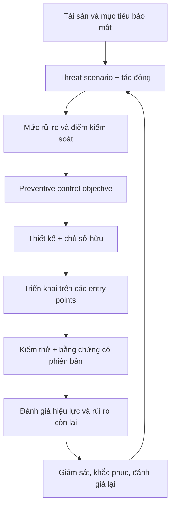
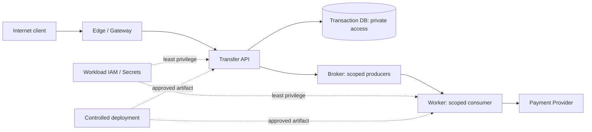
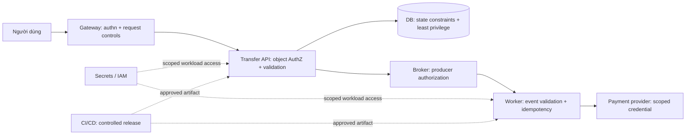

# Preventive control: Kiểm soát phòng ngừa trong security assurance

## 1. Mục tiêu học tập

Sau bài học, người học có thể:

1. Giải thích **preventive control** (kiểm soát phòng ngừa) là gì, tác động tới rủi ro ở đâu và khác gì với **detective**, **corrective** và **recovery controls**.
2. Liên kết một kịch bản rủi ro với **mục tiêu kiểm soát**, các điểm thực thi, cơ chế phòng ngừa, hành vi khi thất bại và người chịu trách nhiệm.
3. Lựa chọn và thiết kế các kiểm soát như **xác thực, phân quyền theo tài nguyên, quyền tối thiểu, xác thực đầu vào, bảo vệ dữ liệu, quản lý secrets, phân đoạn mạng và kiểm soát thay đổi**.
4. Nhận diện trường hợp kiểm soát phòng ngừa bị vượt qua: đường gọi nội bộ, event/worker, quyền quản trị, thay đổi cấu hình, điều kiện race, cache hoặc phụ thuộc bên ngoài.
5. Phân biệt **thiết kế hợp lý**, **triển khai hoàn tất** và **hiệu quả đã được kiểm chứng**; xác định bằng chứng cần cho mỗi cấp độ.
6. Đánh giá ưu điểm, hạn chế và trade-off của phòng ngừa; phối hợp chúng với phát hiện, ứng phó, phục hồi theo tư duy *defense in depth*.
7. Thực hành thiết kế, kiểm thử và báo cáo mức bảo đảm của các preventive controls cho ứng dụng Java/Spring Boot xử lý giao dịch.

Bài thuộc chương **Security control** của module **SECURITY_SECURITY_ASSURANCE**. Module hướng tới việc đánh giá **có bằng chứng** rằng hệ thống đáp ứng các mục tiêu bảo mật: từ phân tích rủi ro, yêu cầu và security controls đến kiểm thử, audit và khắc phục phát hiện. Vì vậy, bài học không coi việc “đã bật một tính năng bảo mật” là thành công cuối cùng; mỗi preventive control phải được gắn với **rủi ro cần giảm, điều kiện hoạt động và cách xác minh hiệu lực trong phát triển lẫn vận hành**.

## 2. Preventive control là gì?

**Preventive control** là một biện pháp kiểm soát được thiết kế để **ngăn một sự kiện không mong muốn xảy ra, làm hành vi trái phép không thể hoàn thành trong những điều kiện xác định, hoặc giảm khả năng một đường tấn công/thất bại dẫn đến hậu quả**.

Ví dụ:

- Kiểm tra quyền trên từng tài khoản trước khi cho phép chuyển tiền, ngăn người dùng thao tác tài sản không thuộc quyền.
- Bắt buộc xác thực đa yếu tố cho các hành động đặc quyền theo chính sách, giảm khả năng kẻ sở hữu mật khẩu bị lộ chiếm tài khoản.
- Giới hạn danh tính worker chỉ được truy cập đúng database và secrets cần thiết, giảm đường lạm dụng đặc quyền.
- Kiểm tra dữ liệu theo ngữ cảnh và sử dụng câu lệnh tham số hóa, ngăn một nhóm hành vi chèn lệnh truy vấn.
- Giới hạn khả năng triển khai production cho pipeline/role đã phê duyệt, giảm khả năng đưa bản build tùy ý vào hệ thống.
- Áp dụng trạng thái chuyển tiền nhất quán và cơ chế idempotency phù hợp, ngăn xử lý lặp gây tác động tài chính trùng.

Điểm then chốt là **control tác động trước hoặc tại điểm hành động có thể tạo hậu quả**, thay vì chỉ thông báo sau khi hậu quả đã xảy ra.

### 2.1. Phòng ngừa không đồng nghĩa loại bỏ hoàn toàn rủi ro

Một control thường chỉ chặn **một hoặc một số đường tấn công**. Ví dụ:

- MFA giảm rủi ro đăng nhập bằng mật khẩu bị lộ, nhưng không tự giải quyết mọi tình huống chiếm phiên, lừa đảo thời gian thực hoặc lạm dụng quyền nội bộ.
- TLS bảo vệ một số thuộc tính của dữ liệu truyền trong kênh được thiết lập đúng, nhưng không thay thế phân quyền tài nguyên hoặc bảo vệ endpoint đã bị xâm nhập.
- Network segmentation giới hạn đường kết nối, nhưng không mặc nhiên bảo đảm một service được phép gọi không thể lạm quyền.
- Input validation giảm các đầu vào không hợp lệ, nhưng không bảo đảm mọi truy vấn, mẫu dữ liệu hay logic nghiệp vụ đã an toàn.
- WAF có thể chặn một số request đáng ngờ, nhưng không đủ để thay thế kiểm tra quyền và tính đúng đắn nghiệp vụ trong backend.

Một preventive control có thể làm **khả năng xảy ra** thấp hơn, đôi khi giới hạn **hậu quả**, nhưng **rủi ro còn lại phải được đánh giá dựa trên thực tế và bằng chứng**.

## 3. Phân biệt các loại security controls

Phân loại kiểm soát theo mục đích giúp tránh kỳ vọng sai vào một biện pháp.

| Loại control | Mục tiêu trực tiếp | Ví dụ | Câu hỏi để kiểm chứng |
| --- | --- | --- | --- |
| **Preventive — phòng ngừa** | Ngăn hành vi/sự kiện có hại thành công hoặc giảm khả năng xảy ra | Object-level authorization, MFA, least privilege, parameterized query | Hành vi trái quyền có bị chặn **trước tác động** không? |
| **Detective — phát hiện** | Nhận biết hành vi hoặc trạng thái sai | Alert đăng nhập bất thường, integrity monitoring, SIEM rule | Sự kiện có được quan sát và nhận biết đúng thời điểm không? |
| **Corrective — khắc phục** | Sửa nguyên nhân hoặc tình trạng sau khi phát hiện vấn đề | Vá lỗ hổng, chỉnh lại IAM, thay mã xử lý lỗi | Hành động có khôi phục control về trạng thái đạt không? |
| **Responsive — ứng phó** | Cô lập hoặc xử lý sự cố đang diễn ra | Khóa tài khoản bị chiếm, thu hồi token, cô lập workload | Có hạn chế lan rộng và thực hiện được playbook không? |
| **Recovery — phục hồi** | Đưa dữ liệu/dịch vụ về trạng thái chấp nhận được sau sự cố | Restore backup, failover, đối soát giao dịch | Có đáp ứng mục tiêu phục hồi và kiểm tra toàn vẹn không? |
| **Compensating — bù trừ** | Giảm rủi ro khi control mong muốn chưa có hoặc không thể áp dụng | Giới hạn chức năng, phê duyệt bổ sung, tăng giám sát có điều kiện | Có giảm rủi ro cụ thể và được phê duyệt theo phạm vi không? |

Một biện pháp có thể đóng nhiều vai trò tùy mục đích và thời điểm. **Rate limiting** có thể phòng ngừa một số kiểu lạm dụng tài nguyên, đồng thời cung cấp sự kiện phục vụ phát hiện. **Key rotation** có thể là biện pháp phòng ngừa theo chu kỳ và cũng là biện pháp ứng phó sau lộ khóa.

### 3.1. Ngăn chặn trước hay giảm thiệt hại sau?

Giả sử người dùng B cố sửa lịch chuyển tiền của người dùng A:

1. **Preventive:** backend từ chối vì B không có quyền trên lịch của A; dữ liệu và event không bị thay đổi.
2. **Detective:** ứng dụng ghi security event và cảnh báo nếu có dấu hiệu dò nhiều lịch.
3. **Responsive:** nhóm ứng phó khóa tài khoản hoặc điều chỉnh chính sách khi có lạm dụng nghiêm trọng.
4. **Corrective:** nhóm sửa endpoint khác bị thiếu authorization rồi retest.
5. **Recovery:** nếu giao dịch đã bị sửa trái phép, thực hiện đối soát và phục hồi theo quy trình phù hợp.

Nếu bước 1 hoạt động, thiệt hại trực tiếp có thể được ngăn. Nhưng nếu B có một đường khác đi qua batch job, cần các lớp còn lại để hạn chế tác động và hỗ trợ khắc phục.

## 4. Vai trò preventive controls trong quản lý rủi ro

Một control phải có lý do tồn tại gắn với **tài sản và kịch bản rủi ro**. Chuỗi phân tích:



Ví dụ:

| Thành phần | Ví dụ cụ thể |
| --- | --- |
| Tài sản | Tính toàn vẹn lệnh chuyển tiền |
| Kịch bản rủi ro | Người dùng đã xác thực dùng `accountId` của người khác để tạo lệnh |
| Hậu quả | Giao dịch trái quyền, tổn thất, khó đối soát |
| Objective | Chỉ chủ thể được ủy quyền mới thực hiện lệnh trên tài khoản nguồn |
| Preventive controls | Backend object-level AuthZ, deny by default, kiểm tra mọi đường thực thi |
| Điểm thực thi | Trước thay đổi DB và trước phát event/call provider |
| Failure behavior | Không thể xác minh quyền thì từ chối thao tác nhạy cảm |
| Evidence | Negative tests đúng chủ thể/tài nguyên, review entry points và config theo build |
| Rủi ro còn lại | Các đường chưa kiểm chứng, dữ liệu quyền không nhất quán hoặc lỗi thay đổi quyền đồng thời |

Nếu một control được đề xuất nhưng chưa được triển khai hoặc kiểm thử, báo cáo chỉ nên nói **planned**, không được tự hạ mức rủi ro hiện tại như thể nó đã hoạt động.

## 5. Chọn kiểm soát theo kịch bản và điểm gây tác động

Muốn thiết kế kiểm soát phòng ngừa, không nên bắt đầu bằng danh sách sản phẩm. Hãy hỏi **“tại bước nào hành vi có hại trở thành hiện thực?”**

Quy trình gợi ý:

1. **Xác định tài sản:** tiền, dữ liệu cá nhân, khóa, khả năng phục vụ hoặc tính toàn vẹn bản build.
2. **Vẽ đường dẫn có hại:** actor → entry point → boundary → thành phần → hành động gây hậu quả.
3. **Xác định điểm phải chặn:** nơi có đầy đủ thông tin để ra quyết định (ví dụ service layer có tài nguyên và danh tính).
4. **Đặt điều kiện đạt:** chủ thể đúng quyền được phép; chủ thể trái quyền bị từ chối **không có side effect**.
5. **Chọn control và các lớp hỗ trợ:** control chính, hạn chế bypass, quyền tối thiểu, xác thực đầu vào, bảo vệ dữ liệu.
6. **Thiết kế hành vi khi lỗi:** timeout, identity source không hoạt động, broker gửi lặp, cache lỗi thời, hết khóa.
7. **Kiểm chứng:** negative tests, boundary/failure tests, review cấu hình và runtime.
8. **Đánh giá trade-off:** độ trễ, tính sẵn sàng, chi phí, vận hành, trải nghiệm người dùng, trường hợp khẩn cấp.

Ví dụ, đặt rule “chỉ chủ tài khoản mới sửa lịch” ở frontend **không ngăn được request trực tiếp** đến backend. Đặt rule tại API Gateway có thể chưa đủ nếu gateway không biết quan hệ chủ tài khoản hoặc một worker gọi database trực tiếp. Control có giá trị khi **nằm tại ranh giới đáng tin và bao phủ mọi đường tạo tác động**.

### 5.1. Chọn control ưu tiên theo hậu quả

| Kịch bản | Preventive control chính | Vì sao |
| --- | --- | --- |
| Người dùng truy cập dữ liệu của tenant khác | Tenant isolation, object-level AuthZ ở backend | Quyết định quyền gắn vào tài nguyên thật, không tin ID client |
| Token API bị giả mạo | Xác minh chữ ký/issuer/audience/expiry và policy phù hợp | Loại bỏ caller không chứng minh được danh tính tin cậy |
| Giao dịch bị lặp do retry | Idempotency và trạng thái nhất quán xuyên hệ thống | Không cho một operation có nhiều tác động trái ý muốn |
| Secret bị lộ từ repository | Quản lý bí mật ngoài code, giới hạn quyền truy cập và CI secret checks | Giảm khả năng bí mật được công bố hoặc dùng trái phép |
| Pipeline bị lạm dụng deploy code giả | Branch protection, approvals, artifact provenance, deploy IAM | Chặn đường thay đổi hệ thống không được cho phép |
| Database mở ra internet | Network controls, private access, identity và least privilege | Giảm bề mặt tiếp xúc và quyền có thể khai thác |
| Dữ liệu nhạy cảm bị sao chép qua export | Data minimization, authorization, kiểm soát luồng xuất | Giảm truy cập và chia sẻ ngoài mục đích |

Mỗi hàng chỉ là **gợi ý thiết kế**, không thay thế đánh giá rủi ro và ngữ cảnh hệ thống thật.

## 6. Các nguyên tắc thiết kế preventive controls

### 6.1. Deny by default

Khi chưa có quyền rõ ràng hoặc không xác minh được quyền cho thao tác nhạy cảm, hệ thống nên **từ chối theo chính sách an toàn đã thiết kế**. Không mặc định “cho phép để giữ trải nghiệm” khi authorization service lỗi.

Ví dụ: yêu cầu sửa lịch chuyển tiền phải bị từ chối nếu lookup quyền thất bại. Nhưng cần phân tích availability và đưa ra cơ chế phục hồi, thay vì lặng lẽ bypass kiểm tra.

### 6.2. Least privilege

Danh tính người dùng, service, worker và tài khoản quản trị chỉ được cấp quyền cần thiết, đúng môi trường và thời hạn phù hợp. Một worker chỉ cần phát event không nên có quyền xóa toàn bộ audit logs.

### 6.3. Complete mediation

Mọi hành động nhạy cảm phải được kiểm tra quyền tại **điểm thực thi có thể bảo vệ được**, không chỉ ở một đường UI hoặc request ban đầu. Cần xem API, batch, event, CLI, admin và background jobs.

### 6.4. Separation of duties

Những hành động có tác động lớn có thể cần tách người tạo, kiểm tra, phê duyệt và triển khai; ví dụ thay IAM production hoặc phát hành artifact chứa logic giao dịch. Cách tách cần tương xứng năng lực và mức rủi ro.

### 6.5. Defense in depth

Không dựa toàn bộ vào một control ở một tầng. Identity validation, authorization, data-layer constraints, IAM và giám sát có thể phối hợp để giảm khả năng một lỗi đơn lẻ gây hậu quả.

### 6.6. Secure defaults và tối thiểu hóa bề mặt tấn công

Không bật endpoint, service, quyền hoặc network exposure không cần thiết; các cấu hình mới nên mặc định an toàn và có cách kiểm tra drift.

### 6.7. Kiểm soát đơn giản và có thể kiểm chứng

Cấu trúc quá phức tạp có thể tạo lỗi triển khai và khó vận hành. Ưu tiên điểm kiểm soát rõ ràng, chính sách nhất quán, tính quan sát được và cách kiểm chứng thực tế.

Các nguyên tắc là **định hướng thiết kế**. Chúng không tự nói mức rủi ro đã được giảm bao nhiêu khi chưa xét triển khai và bằng chứng.

## 7. Identity và authentication là lớp phòng ngừa nền tảng

**Authentication (AuthN)** xác minh danh tính chủ thể; **authorization (AuthZ)** xác định chủ thể đó được phép làm hành động nào trên tài nguyên nào. Một access token hợp lệ **không đồng nghĩa** có quyền thực hiện mọi giao dịch.

Preventive controls liên quan xác thực:

- Xác thực đa yếu tố cho tài khoản hoặc hành động có rủi ro phù hợp với chính sách.
- Kiểm tra thông tin xác thực từ nguồn đáng tin: token signatures, issuer, audience, thời hạn và các điều kiện được hệ thống chấp nhận.
- Quy trình phát hành, thay đổi và thu hồi thông tin xác thực.
- Giới hạn thời gian sống credential, chống tái sử dụng ngoài ngữ cảnh, kiểm soát session theo rủi ro.
- Tách identity người dùng, service/workload và tài khoản quản trị.
- Bảo vệ đặc quyền trên hệ thống nhận dạng và đường cập nhật policy.

### 7.1. Ví dụ lỗi: kiểm tra token nhưng bỏ qua audience

Một API chỉ kiểm tra token được ký bởi tổ chức nhưng không xác minh **audience** phù hợp có thể chấp nhận token vốn được phát cho dịch vụ khác trong những điều kiện sai cấu hình. Control cần xác minh **các thuộc tính phù hợp với trust model**; không chỉ đọc được token hay chữ ký.

Bằng chứng có thể gồm review JWT validation config, negative tests với token sai issuer/audience/expiry và kiểm tra hoạt động của API trong môi trường mục tiêu. Không cần gọi Identity Provider qua mạng trên **mỗi request** nếu mô hình token cho phép xác minh chữ ký và các claims đáng tin, nhưng phải quản lý khóa và điều kiện thu hồi phù hợp.

### 7.2. MFA là preventive control, nhưng không phải vạn năng

MFA phù hợp giảm rủi ro sử dụng một yếu tố bị đánh cắp. Với hành động đặc quyền hoặc nhạy cảm, có thể xem xét cơ chế chống phishing phù hợp, step-up authentication, chính sách thiết bị và giám sát phiên.

Không nên viết kết luận “đã có MFA nên không còn nguy cơ chiếm tài khoản”. Cần xem yếu tố được sử dụng, các đường recovery, session management, service accounts, exception và hành vi khi mất yếu tố.

## 8. Authorization theo tài nguyên: chặn trước side effect

Lỗi phổ biến là **BOLA/IDOR**: một người dùng hợp lệ truyền ID của tài nguyên khác để thao tác. Control ở đây phải xét đầy đủ **caller, action, resource và context**.

| Thành phần quyết định | Câu hỏi |
| --- | --- |
| Caller | Danh tính đã xác thực từ hệ thống tin cậy nào? |
| Action | Đọc, tạo, sửa, duyệt, xóa, xuất dữ liệu hay thực thi giao dịch? |
| Resource | Tài khoản/lịch/tenant nào, thuộc ai, ở trạng thái nào? |
| Context | Role, quan hệ ủy quyền, giới hạn tiền, thời gian, trạng thái hoặc yêu cầu phê duyệt? |
| Decision | Cho phép hay từ chối, do ai/policy nào đưa ra? |
| Enforcement | Kiểm tra có diễn ra trước mọi thay đổi DB, event và lệnh gửi bên ngoài? |

### 8.1. Pseudocode Java/Spring Boot

Ví dụ sau là **pseudocode ở service layer**, cố ý lược bớt transaction management, exception mapping và các vấn đề đồng thời để làm rõ điểm enforcement:

```java
public TransferResult createTransfer(
        AuthenticatedPrincipal principal,
        TransferCommand command) {

    Account source = accountRepository.findRequired(command.sourceAccountId());

    // principal đến từ authentication context đáng tin,
    // không lấy subjectId do client tự khai trong request body.
    boolean allowed = authorizationPolicy.canTransfer(
            principal.subjectId(),
            source.id(),
            command.amount());

    if (!allowed) {
        securityEvents.recordAuthorizationDenied(
                principal.subjectId(), source.id(), "TRANSFER");
        throw new AccessDeniedException("Transfer not permitted");
    }

    return transferExecution.executeAuthorizedCommand(
            principal.subjectId(), source, command);
}
```

Điều phải kiểm chứng **vượt ra ngoài đoạn mã**:

1. Mọi entry point gây chuyển tiền có sử dụng kiểm tra quyền tương đương không?
2. Phép kiểm tra quyền phụ thuộc dữ liệu quyền có thể bị chỉnh sửa hoặc lỗi thời không?
3. Có race condition giữa lúc kiểm tra và lúc thực hiện khiến kết quả không còn hợp lệ?
4. Worker, webhook, batch hoặc admin endpoint có thể bypass logic này không?
5. Khi policy service không thể đáp ứng, hệ thống fail closed hay có phương án được thiết kế/duyệt?
6. Khi bị từ chối, **không ghi dữ liệu và không phát event tác động** đúng theo yêu cầu chứ?

Một test trả HTTP `403` **không đủ** nếu request có token hết hạn hoặc transaction đã bị thay đổi trước khi trả lỗi.

### 8.2. Multi-tenant isolation

Với hệ thống nhiều tenant, preventive controls cần giữ ranh giới từ API đến query, cache, search, storage, event và background processing:

- Tenant identity phải đến từ nguồn tin cậy, không chỉ header tự khai.
- Mọi truy vấn/tài nguyên nhạy cảm phải được ràng buộc với đúng tenant và quyền.
- Service accounts có quyền liên tenant phải được xem xét và giám sát đặc biệt.
- Cần test các đường export/bulk, cache keys, event topics và admin jobs.
- Cần xác định phản ứng khi context tenant bị thiếu hoặc không xác minh được.

Kiểm tra tenant ở frontend không chặn truy cập qua API trực tiếp; kiểm tra ở API không mặc nhiên bảo vệ worker đọc database bằng đặc quyền rộng.

## 9. Input validation, parsing và an toàn xử lý dữ liệu

Input validation là preventive control khi nó từ chối dữ liệu sai định dạng, ngoài miền giá trị hoặc vi phạm bất biến nghiệp vụ **trước khi được sử dụng**.

Các lớp thường có:

- **Schema/type validation:** kiểu, chiều dài, encoding, format, số lượng phần tử.
- **Semantic validation:** giá trị có hợp lệ với nghiệp vụ không, ví dụ số tiền dương, đơn vị tiền tệ được hỗ trợ.
- **Authorization-aware validation:** caller được phép dùng tài khoản hoặc dữ liệu đó không.
- **State validation:** giao dịch/lịch có ở trạng thái cho phép thao tác không.
- **Boundary validation:** dữ liệu từ broker, webhook và nhà cung cấp cũng phải được xem là đầu vào cần kiểm tra.
- **Safe processing:** parameterized queries, output encoding theo ngữ cảnh, parser phù hợp và tránh thực thi chuỗi làm lệnh.

### 9.1. Ví dụ SQL injection

**Không an toàn:** ghép chuỗi từ input vào SQL khiến dữ liệu không đáng tin trở thành một phần cú pháp lệnh.

**Thiết kế phòng ngừa:** dùng prepared statements hoặc cơ chế binding của data-access layer cùng validation đúng mục đích; hạn chế quyền database của ứng dụng.

```java
// Minh họa binding tham số, không phải đầy đủ repository implementation.
var accounts = jdbcTemplate.query(
        "SELECT id, owner_id FROM accounts WHERE id = ?",
        accountRowMapper,
        requestedAccountId);
```

Parameterized query giúp bảo vệ **ranh giới cú pháp truy vấn** nhưng không tự quyết định caller có quyền đọc `requestedAccountId` hay không. Cần thêm authorization theo tài nguyên.

### 9.2. Validation có thể được vượt qua khi chỉ ở client

Một form có thể giới hạn số tiền 1–1000 trên giao diện, nhưng API vẫn phải kiểm tra giới hạn nghiệp vụ ở server. Với hệ thống bất đồng bộ, consumer còn phải xác minh dữ liệu event, trạng thái và idempotency theo thiết kế. **Client-side validation chỉ hỗ trợ trải nghiệm**, không thay thế preventive controls ở boundary tin cậy.

## 10. Bảo vệ dữ liệu và mật mã

Một số preventive controls tập trung vào việc ngăn **đọc, dùng hoặc thay đổi dữ liệu trái phép**:

| Nguy cơ | Kiểm soát phòng ngừa | Điều cần kiểm chứng |
| --- | --- | --- |
| Dữ liệu truyền bị đọc/sửa trên đường truyền | TLS được cấu hình đúng và kiểm tra peer theo trust model | TLS/cert config, endpoint behavior, kịch bản sai cert |
| Dữ liệu lưu trữ bị truy cập trái phép | IAM, phân tách dữ liệu, mã hóa phù hợp, key management | Storage IAM, encryption/key config, truy cập mẫu |
| Ứng dụng/worker đọc dữ liệu ngoài phạm vi | Object/tenant authorization, data minimization | Query/permission review, negative tests |
| Secrets xuất hiện trong logs | Logging schema, masking, lọc trường nhạy cảm | Log inspection, test đường lỗi và debug |
| Backup/snapshot bị truy cập ngoài quyền | Tách quyền, mã hóa, kiểm soát khôi phục và copy | Backup policy, access review, restoration procedure |
| Dữ liệu được giữ quá mục đích | Retention/deletion controls theo yêu cầu dữ liệu | Data lifecycle rules, deletion verification |
| Khóa giải mã bị truy cập rộng | Key IAM, key lifecycle, workload identity | KMS access review, rotation/revocation evidence |

**Mã hóa không thay thế phân quyền.** Nếu ứng dụng hợp lệ có quyền giải mã toàn bộ dữ liệu nhưng backend không kiểm tra quyền người dùng, kẻ tấn công vẫn có thể đọc dữ liệu thông qua ứng dụng.

### 10.1. Dùng mật mã đã được đánh giá và quản lý khóa đúng

Security architect cần xác định:

- Mục đích: bí mật, toàn vẹn, xác thực nguồn hay chữ ký số?
- Thuật toán và cấu hình có phù hợp chuẩn/tập thư viện được chấp nhận của tổ chức?
- Ai tạo, dùng, lưu, rotate, revoke và recover khóa?
- Workload nào được phép sử dụng khóa và trong điều kiện nào?
- Dữ liệu ở logs, cache, backups hoặc export có được bảo vệ tương ứng không?
- Khi mất khóa hoặc dịch vụ KMS lỗi, khả năng khôi phục và chế độ thất bại là gì?

Tránh tự xây thuật toán mật mã hoặc coi việc “gắn cờ encryption enabled” là bằng chứng đủ. Cần kiểm tra cả **khóa và đường truy cập plaintext**.

## 11. Secrets management và workload identity

Mật khẩu database, API key, private key và token có thể mở đường truy cập lớn. Preventive controls nhằm giảm khả năng chúng bị lộ và giới hạn tác động nếu bị chiếm.

- Không đặt secrets trong source code, tài liệu công khai, build artifact, container image hoặc log.
- Dùng secret manager/vault hoặc cơ chế nền tảng phù hợp, phân quyền theo workload và môi trường.
- Ưu tiên credentials có vòng đời ngắn/định danh workload khi có thể áp dụng thay vì bí mật tĩnh dài hạn.
- Giới hạn service account chỉ truy cập đúng secret và API cần sử dụng.
- Có quy trình rotate/revoke khi nhân sự, quyền, hệ thống hoặc sự cố thay đổi.
- Kiểm soát khả năng xem/sửa secret của pipeline, operator và tài khoản break-glass.
- Gắn alert/audit cho việc truy cập hoặc thay đổi bí mật quan trọng.

### 11.1. Một tình huống nguy hiểm

Worker chuyển tiền chỉ cần secret kết nối payment provider nhưng được cấp quyền **đọc toàn bộ secret store**. Dù có TLS và auth token, một worker bị chiếm có thể đọc credentials của nhiều hệ thống khác.

**Control objective:** quyền truy cập secrets giới hạn theo chức năng, môi trường và workload.

**Kiểm chứng:** đọc IAM policy runtime, thử truy cập vào secret được phép/không được phép trong môi trường kiểm soát, xem lịch sử cấp quyền và quan sát việc thu hồi. Secret scanner trên repository chỉ hỗ trợ một phần, không chứng minh IAM runtime đã đúng.

## 12. Network, infrastructure và cloud preventive controls

Các control ở hạ tầng tập trung **giảm bề mặt tấn công và hạn chế đường di chuyển ngang**:

- Private networking và ingress/egress rules phù hợp với luồng dữ liệu được duyệt.
- Segmentation giữa môi trường, dịch vụ và vùng bảo mật.
- Firewall/network policies dựa trên nhu cầu truy cập; không mở port mặc định.
- Service/workload authentication và authorization tại boundary.
- Cloud IAM roles, hạn chế quyền tạo/sửa tài nguyên có tác động rộng.
- Cấu hình hạ tầng qua IaC, review, policy checks và phát hiện drift.
- Bảo vệ đường quản trị, break-glass và truy cập từ nhà thầu.
- Baseline cấu hình/hardening theo nền tảng và rủi ro thực tế.

Một sơ đồ ví dụ:



**Không giả định “private network = trusted network”.** Một service được kết nối về mặt mạng vẫn có thể không được phép đọc một bảng dữ liệu hoặc gửi lệnh thanh toán. Cần xác thực, phân quyền và kiểm tra dữ liệu ở những boundary thích hợp.

### 12.1. Phòng ngừa lạm dụng đường quản trị

Quyền admin, CI/CD và cloud account thường có **blast radius** lớn. Preventive controls nên xem:

1. Cấp quyền theo vai trò, thời hạn và nhiệm vụ.
2. MFA hoặc bước xác minh tăng cường cho hành động nhạy cảm theo chính sách.
3. Phê duyệt hoặc dual control khi thay đổi khả năng phát hành, xóa dữ liệu, tắt logging.
4. Giới hạn khả năng tạo credential và role có quyền rộng.
5. Kiểm soát đường emergency access và bảo đảm sự kiện được ghi nhận.
6. Kiểm tra thay đổi cấu hình và quyền production có đúng baseline.

Đồng thời cần thiết kế lối xử lý khi control chặn thao tác khẩn cấp hợp lệ, tránh biến giải pháp bảo mật thành điểm gián đoạn không kiểm soát.

## 13. Preventive controls trong chuỗi cung ứng phần mềm và CI/CD

Một phần quan trọng của phòng ngừa là bảo đảm **mã và cấu hình không được kiểm soát không thể âm thầm trở thành bản production**.

| Điểm cần bảo vệ | Preventive control | Bằng chứng có giá trị |
| --- | --- | --- |
| Source repository | Quyền thay đổi nhánh quan trọng, review, bảo vệ nhánh | Repository policy, PR review records |
| Dependencies | Nguồn dependency được quản lý, quy trình kiểm tra phù hợp | Dependency records, SCA results, exception review |
| Build pipeline | Quyền thực thi/đổi pipeline, tách quyền giữa môi trường | Pipeline IAM, configuration review |
| Secrets trong pipeline | Cấp theo job, giới hạn scope, không in log | Access policy, secret scanning, log inspection |
| Artifacts | Gắn bản build với source và workflow đáng tin cậy | Build metadata, provenance hoặc kiểm tra chữ ký nếu áp dụng |
| Deployment | Chỉ identity và artifact được phép đưa vào production | Deploy approvals, IAM, runtime artifact check |
| IaC | Policy check và peer review trước áp dụng | IaC review, deployment drift comparison |

**Scanner là một phần của phòng ngừa khi dùng để chặn bản build không đạt policy trước khi deploy**, nhưng scan có thể đồng thời có vai trò phát hiện điểm yếu. Cần xác định khi scanner fail thì pipeline xử lý thế nào, có thể bypass bởi ai và ngoại lệ được quản trị ra sao.

### 13.1. Ba tình huống thường bị bỏ sót

- Một pipeline có SAST nhưng token deploy vẫn cho phép bất kỳ developer nào push artifact ngoài pipeline.
- Một artifact được build đúng quy trình nhưng môi trường production kéo tag có thể bị thay đổi mà không kiểm tra digest/provenance phù hợp.
- IaC review đã đạt nhưng quyền cloud được sửa trực tiếp sau release và không có cơ chế phát hiện hoặc chặn drift.

Preventive controls phải bao phủ **đường đi thật của bản triển khai**, không chỉ một bước ở repository.

## 14. Kiểm soát phòng ngừa đối với tính toàn vẹn giao dịch

Preventive control không giới hạn ở “ngăn hacker”. Trong nghiệp vụ quan trọng, lỗi đồng thời, retry hoặc failover có thể tạo hậu quả lớn dù không có tác nhân ác ý.

Ví dụ: broker phát lại event vì chưa nhận acknowledgement; hai worker cùng thực thi một operation thanh toán. Nếu mỗi worker chỉ kiểm tra duplicate trong bộ nhớ cục bộ, có thể xảy ra **tác động tài chính trùng**.

Mục tiêu kiểm soát ở đây là **duy trì tính đúng đắn nghiệp vụ**.

Các thành phần có thể cần kết hợp:

1. Business operation ID/idempotency key được định nghĩa rõ nguồn và vòng đời.
2. Bảo đảm thao tác chống duplicate là atomic hoặc có cơ chế nhất quán phù hợp.
3. Thiết kế transaction state machine: pending, executing, confirmed, unknown, failed...
4. Phân tích ranh giới transaction giữa database, broker và provider.
5. Bounded retry, timeout, backoff và cơ chế không xử lý lặp trái ý muốn.
6. Reconciliation khi trạng thái provider không xác định.
7. Xác minh quyền khi tạo/chấp thuận operation và xác định chính sách quyền lúc worker thực thi.
8. Audit trail liên kết request → event → worker → provider.

### 14.1. Điều control phải thực sự bảo đảm

Không nên viết “queue hỗ trợ exactly once nên không chuyển trùng”. Phải xác định **side effect bên ngoài** có được bảo vệ hay không. Với nhà cung cấp thanh toán, trạng thái timeout có thể không chứng minh provider chưa xử lý lệnh.

Bằng chứng cần bao gồm **concurrency, duplicate delivery, crash/restart, timeout và reconciliation** theo phạm vi đã định nghĩa. Một test chỉ gửi event một lần chưa đủ.

### 14.2. Phân biệt preventive với detective/recovery

| Hành động | Vai trò chủ yếu |
| --- | --- |
| Chặn xử lý trùng trước khi tạo tác động | Preventive |
| Phát hiện lệnh nghi ngờ trùng trong đối soát | Detective |
| Khóa khả năng retry hoặc cô lập worker khi nghi sự cố | Responsive |
| Khắc phục logic idempotency sai rồi retest | Corrective |
| Phục hồi trạng thái dữ liệu và xử lý hậu quả sau sự cố | Recovery/Corrective |

Phòng ngừa cần đi cùng đối soát và khả năng phục hồi vì không thể giả định mọi failure mode đều được chặn tuyệt đối.

## 15. Các preventive controls thuộc con người và quy trình

Security controls không chỉ là công nghệ. Một số rủi ro được giảm ở **quy trình phê duyệt, phân quyền và kiểm tra thay đổi**.

Ví dụ:

| Rủi ro | Biện pháp phòng ngừa | Điểm cần xác minh |
| --- | --- | --- |
| Nhân viên mới được cấp quyền quá rộng | Quy trình phê duyệt quyền theo nhu cầu, role baseline | Mẫu hồ sơ cấp quyền, IAM đối chiếu |
| Nhân viên nghỉ nhưng còn truy cập | Offboarding, thu hồi tài khoản và credential | Hồ sơ nghỉ việc, quyền thực sau thu hồi |
| Một cá nhân tự sửa rồi tự deploy thay đổi trọng yếu | Separation of duties, review và approval | PR/pipeline audit, đặc quyền ngoại lệ |
| Nhà thầu truy cập dữ liệu không đúng mục đích | Hợp đồng, giới hạn account và thời hạn, review truy cập | Hợp đồng, IAM, review quyền |
| Chọn nhà cung cấp có thiếu sót nghiêm trọng | Supplier security assessment trước tích hợp | Hồ sơ rủi ro, điều kiện hợp đồng, action plan |
| Nhân sự vô tình chia sẻ bí mật | Đào tạo, chính sách xử lý dữ liệu, hạn chế xuất thông tin | Mẫu kiểm tra vận hành và controls kỹ thuật đi kèm |

**Đào tạo nhận thức** có thể hỗ trợ phòng ngừa sai sót, nhưng không nên coi là biện pháp duy nhất trước đường tấn công có hậu quả rất cao. Đặc biệt, với quyền production, nên kết hợp chính sách với controls kỹ thuật có thể enforcement.

### 15.1. Mẫu đánh giá control thủ công

Ví dụ objective: “Mọi thay đổi IAM đặc quyền phải được người có thẩm quyền xem xét trước khi áp dụng”.

Cần kiểm tra cả:

- Policy mô tả khi nào cần duyệt và ai được duyệt.
- Cơ chế kỹ thuật chặn thay đổi nếu thiếu approval trong đường chuẩn.
- Hồ sơ của những thay đổi thực tế theo kỳ kiểm tra.
- Khả năng bypass bằng cloud console, break-glass hoặc service account.
- Điều kiện xử lý khẩn cấp và kiểm tra sau hành động.

Chỉ có một bản policy PDF **chưa chứng minh control hoạt động trong vận hành**.

## 16. Phòng ngừa rủi ro sẵn sàng và resilience

Một số controls ngăn **sự kiện lỗi cục bộ gây gián đoạn lan rộng**:

- Input/request size bounds, concurrency limits và rate limits theo hệ thống.
- Resource quotas, backpressure và queue capacity controls.
- Timeout, bounded retry và circuit breakers để tránh cascade failures.
- Cô lập tài nguyên và các phụ thuộc quan trọng.
- Cơ chế xử lý thông điệp lỗi như dead-letter queue có quyền/retention phù hợp.
- Kiểm tra sức khỏe và cấu hình failover an toàn khi cần.

Ví dụ, retry không giới hạn có thể làm payment provider càng quá tải. Bounded retry và backoff giúp **giảm nguy cơ tự gây khuếch đại lỗi**. Tuy nhiên, failover và restore có thể mang tính phục hồi hơn là phòng ngừa; cần nêu chính xác vai trò của từng control.

### 16.1. Bảo mật và sẵn sàng có thể xung đột

Nếu dịch vụ authorization không hoạt động:

- **Fail open** có thể tăng tính sẵn sàng nhưng cho phép thao tác trái quyền.
- **Fail closed** chặn hành vi nguy hiểm nhưng có thể làm chức năng ngừng phục vụ.

Không nên chọn tùy tiện. Với lệnh chuyển tiền nhạy cảm, tổ chức thường cần bảo đảm không thực hiện thao tác khi chưa có quyết định quyền hợp lệ; đồng thời thiết kế cache policy, resilience hoặc chế độ vận hành phù hợp để giảm gián đoạn. **Phân tích rủi ro và yêu cầu nghiệp vụ phải định nghĩa hành vi lỗi trước triển khai**, cùng cách kiểm thử.

## 17. Preventive controls với bên thứ ba và shared responsibility

Một service có thể dựa vào cloud, Identity Provider, payment provider hoặc SaaS. Phòng ngừa phải xét cả **quyền và luồng dữ liệu xuyên ranh giới tổ chức**.

Các câu hỏi:

1. Nhà cung cấp xử lý tài sản và dữ liệu nào? Quyền truy cập được giao ở mức nào?
2. Controls nào thuộc nhà cung cấp, controls nào thuộc khách hàng trong mô hình dịch vụ/hợp đồng?
3. Đường kết nối có xác thực, phân quyền, bảo vệ dữ liệu và giới hạn truy cập phù hợp không?
4. Có yêu cầu với webhook, event integrity, replay, timeout hoặc side effects không?
5. Có khả năng thu hồi credential, chấm dứt tích hợp và xóa/di chuyển dữ liệu đúng nghĩa vụ không?
6. Bằng chứng nhà cung cấp cung cấp có **đúng phạm vi, kỳ, loại control và giới hạn** không?

Ví dụ, managed database có thể cung cấp năng lực mã hóa lưu trữ nhưng đội ứng dụng vẫn cần **cấu hình IAM, authorization và data lifecycle**. Sử dụng nhà cung cấp có chứng nhận không tự chứng minh mọi control phía khách hàng được cấu hình đúng.

### 17.1. Kiểm soát đường tích hợp

Với API thanh toán:

- Phát và bảo vệ credential theo phạm vi tối thiểu.
- Xác minh danh tính phía đối tác và các điều kiện chứng chỉ/token theo contract.
- Giới hạn dữ liệu gửi đi theo mục đích.
- Định nghĩa failure behavior và tính idempotent của request/response.
- Bảo vệ dữ liệu nhật ký và cơ chế đối soát.
- Xem xét kế hoạch fallback hoặc ngắt tích hợp khi bên thứ ba có sự cố.

Bằng chứng gồm integration tests có kiểm soát, config review, hợp đồng/bản mô tả giao thức và các test về trạng thái lỗi mà hai bên được phép thực hiện.

## 18. Thiết kế cho tình huống control thất bại hoặc bị bypass

Một preventive control chất lượng phải nêu rõ **giả định, điều kiện hoạt động, phụ thuộc và đường bypass**.

### 18.1. Bốn trường hợp cần phân tích

| Trường hợp | Ví dụ | Cần thiết kế/kiểm chứng |
| --- | --- | --- |
| **Control không tồn tại ở đường phụ** | HTTP API kiểm tra AuthZ, batch job ghi DB trực tiếp | Kiểm tra toàn bộ entry points; bảo vệ domain operation |
| **Control có nhưng cấu hình sai** | JWT validator không kiểm tra audience; IAM quá rộng | Configuration review, negative tests, drift checks |
| **Control hỏng khi dependency lỗi** | Policy service timeout, KMS mất kết nối | Failure behavior, fail closed phù hợp, khả năng phục hồi |
| **Control bị suy yếu theo thời gian** | Role mới, cache quyền lỗi thời, provider thay cách retry | Change triggers, periodic review và regression tests |

Một control chỉ “đúng” khi test ở đường thuận lợi có thể chưa đủ để giảm rủi ro chính.

### 18.2. Trust boundary và thời điểm thực thi

Một câu hỏi thiết kế quan trọng: **kiểm tra xảy ra trước hay sau tác động?**

Ví dụ, nếu code lưu giao dịch rồi mới kiểm tra quyền, việc ném exception chưa chắc hoàn tác tất cả side effects, đặc biệt event đã gửi hoặc provider đã nhận lệnh. Phải xét thứ tự enforcement, transaction boundaries và những hành động bên ngoài không thể rollback đơn giản.

### 18.3. Kiểm tra việc bypass không được phép

Đối với objective “mọi lệnh đều phải qua authorization”:

- Liệt kê route, RPC, queue consumer, batch, admin CLI và thao tác nội bộ có thể tạo lệnh.
- Xác định caller và context quyền ở mỗi đường.
- Kiểm tra quyền service account trên DB và provider.
- Thử hành vi trái quyền trên các đường hợp lệ trong môi trường cho phép.
- Xác nhận mọi đường lỗi từ chối **trước khi có side effect**.
- Lưu bằng chứng kiểm tra và những đường chưa thử.

Điều này là **review kỹ thuật và negative testing trong phạm vi được phép**, không phải khuyến khích truy cập hệ thống của người khác.

## 19. Design effectiveness và operating effectiveness

**Thiết kế kiểm soát hợp lý** và **kiểm soát vận hành hiệu quả** là hai kết luận khác nhau.

### 19.1. Design effectiveness

Câu hỏi: nếu control được triển khai đúng như thiết kế, nó có làm giảm kịch bản rủi ro trong phạm vi cần bảo vệ không?

Dữ liệu có thể xem:

- Threat model và data-flow diagrams.
- Control objective, requirements, acceptance criteria.
- Security architecture, ADR và failure behavior.
- Phân tích bypass, quyền tối thiểu và việc phối hợp các lớp.
- Phương pháp test dự kiến có thể bác bỏ giả định quan trọng hay không.

Ví dụ, thiết kế phân quyền chỉ ở frontend không thể đạt mục tiêu ngăn người dùng gửi request trực tiếp; đây là **lỗ hổng thiết kế** phát hiện được trước khi phát triển.

### 19.2. Operating effectiveness

Câu hỏi: control đã thực thi đúng trong phiên bản và kỳ đánh giá có liên quan hay chưa?

Bằng chứng có thể gồm:

- Kết quả test chức năng và bảo mật trên build phù hợp.
- Review code, IAM, network, policy và runtime config.
- Mẫu change/approval records trong kỳ.
- Log/telemetry cho biết control được gọi và hành vi từ chối.
- Regression/failure tests và đánh giá drift.
- Kết quả retest sau remediation.

Ví dụ, kiến trúc mô tả least privilege, nhưng policy của worker production vẫn có quyền toàn bộ secret store: **design có thể hợp lý, operating control không đạt**.

### 19.3. Chất lượng evidence và điều kiện kết luận

| Trạng thái | Ý nghĩa | Cách báo cáo |
| --- | --- | --- |
| Planned | Đã xác định control cần có | Chưa coi là mitigation đã thực hiện |
| Designed/reviewed | Đã đánh giá thiết kế | Không suy diễn runtime đạt |
| Implemented | Mã/config/quy trình đã triển khai | Cần verification |
| Verified in scope | Có evidence trên phiên bản/điều kiện đã kiểm tra | Kết luận kèm phạm vi, giới hạn |
| Failed | Test/review cho thấy vi phạm tiêu chí | Finding, owner, action và retest |
| Not assessed/insufficient evidence | Chưa có kiểm chứng đủ tin cậy | Không đánh dấu pass hoặc rủi ro thấp |
| Accepted exception | Chưa đáp ứng đầy đủ nhưng được phê duyệt theo thẩm quyền | Giữ rõ residual risk, điều kiện và expiry |

Một bảng trạng thái nên lưu cả **người phê duyệt, phương pháp, ngày và phiên bản**; không chỉ có nhãn xanh/vàng/đỏ.

## 20. Thiết kế kiểm thử cho preventive control

Để chứng minh tác động phòng ngừa, cần kiểm tra **điều gì không được phép xảy ra**, đồng thời bảo đảm chức năng hợp lệ vẫn hoạt động.

### 20.1. Positive và negative testing

- **Positive test:** người có quyền được phép thực hiện; điều kiện chức năng hợp lệ vẫn đạt.
- **Negative test:** người không có quyền, token không hợp lệ, dữ liệu sai, tài nguyên ngoài tenant, đường chưa được phép bị chặn.
- **Failure test:** policy service lỗi, timeout, retry, state thay đổi hoặc input bị lặp.
- **Boundary test:** vai trò và trạng thái sát ranh giới quyền/giới hạn.
- **Cross-path test:** REST API, worker, batch và admin path nhất quán với objective.
- **Concurrency test:** hai yêu cầu/worker đồng thời không phá bất biến nghiệp vụ.
- **Configuration test:** deployment target thực sự sử dụng policy và artifact đã review.

### 20.2. Bảng kiểm thử minh họa

| Control | Tình huống kiểm thử | Kết quả mong đợi | Evidence cần lưu |
| --- | --- | --- | --- |
| Object-level AuthZ | User A thao tác tài khoản A | Được cho phép theo nghiệp vụ | Test result, build, vai trò |
| Object-level AuthZ | User B thao tác tài khoản A | Từ chối, không thay đổi DB/event | Negative integration test và kiểm tra side effects |
| Token validation | Token sai issuer/audience/expiry | Bị từ chối ở boundary thích hợp | Test data, validator config |
| Tenant isolation | Tenant X yêu cầu dữ liệu tenant Y | Không đọc hoặc sửa được dữ liệu của Y | Integration tests/DB verification |
| Workload least privilege | Worker đọc secret không thuộc quyền | Bị từ chối | IAM policy/runtime permission test |
| Controlled deploy | Identity không có quyền đưa artifact vào production | Deploy thất bại | Pipeline/IAM audit |
| Idempotency | Hai worker nhận cùng operation | Không gây tác động tài chính trùng | Concurrent tests và đối soát |
| Input constraints | Số tiền/định dạng/trạng thái không hợp lệ | Từ chối trước side effect | Validation tests, logs phù hợp |
| Fail closed | Policy lookup timeout | Từ chối thao tác nhạy cảm, ghi event cần thiết | Fault injection và state inspection |

### 20.3. Một test 403 chưa đủ

Một kết quả `403 Forbidden` không chứng minh object-level AuthZ nếu request bị từ chối vì **token hết hạn**, route không tồn tại, CSRF rule khác hoặc hệ thống lỗi. Cần bảo đảm:

1. Chủ thể đã được xác thực hợp lệ.
2. Tài nguyên tồn tại và không thuộc quyền của chủ thể.
3. Người có quyền với cùng loại tài nguyên có thể thực hiện thao tác.
4. Quyết định từ chối xảy ra đúng logic quyền, trước mọi thay đổi.
5. Những route/worker khác thuộc phạm vi cũng được kiểm tra.

### 20.4. Bằng chứng phải gắn với điều kiện thử

Lưu ít nhất test ID, requirement/control ID, build/commit, cấu hình, môi trường, danh tính/role thử, dữ liệu thử, thời điểm, kết quả, người/công cụ thực hiện, phạm vi, giới hạn và link artifact có kiểm soát.

## 21. Đo hiệu quả mà không tạo “an toàn giả”

Preventive control nên được đo bằng **kết quả chặn hành vi nguy hiểm**, độ bao phủ và độ tin cậy.

| Chỉ số gợi ý | Giá trị | Nguy cơ diễn giải sai |
| --- | --- | --- |
| Tỷ lệ đường nhạy cảm có enforcement được kiểm chứng | Biết luồng quan trọng được bao phủ đến đâu | Danh sách đường đi có thể chưa đầy đủ |
| Negative tests theo actor/resource/state | Độ bao phủ tình huống trái quyền | Nhiều test trùng lặp không bằng nhiều rủi ro được bảo vệ |
| Drift IAM/config phát hiện và xử lý | Đo độ duy trì baseline | Không có drift được báo có thể do không kiểm tra |
| Service identities có quyền quá rộng | Xác định đường leo thang/di chuyển ngang | Quyền “đang dùng” chưa chắc là quyền tối thiểu |
| Thay đổi production không qua approval | Đo đường bypass quy trình phòng ngừa | Số ít có thể do không có audit/telemetry |
| Tỷ lệ controls có evidence còn hiệu lực | Độ tin cậy kết luận assurance | Có file đính kèm không đồng nghĩa control đạt |
| Các preventive findings mở/quá hạn | Ưu tiên remediation theo rủi ro | Số finding tăng có thể do kiểm thử tốt hơn |
| Sự cố cho thấy preventive control thất bại | Học được giả định hoặc lớp bảo vệ yếu | Không có sự cố đã biết không chứng minh tuyệt đối |

**Không lấy tổng số controls hoặc kết quả scan pass làm chỉ số an toàn duy nhất.** Một đường quyền bị bỏ sót có thể gây hậu quả lớn dù phần lớn checklist đã đạt.

## 22. Case study: Preventive controls cho nền tảng chuyển tiền

### 22.1. Hệ thống giả định

Một nền tảng thanh toán gồm:

- Mobile client và API Gateway.
- Java/Spring Boot Transfer API.
- Identity Provider và cơ chế phân quyền tài khoản.
- Database lưu tài khoản, giao dịch và lịch chuyển.
- Message broker, scheduler, transfer worker.
- Payment provider ngoài tổ chức.
- Secret manager, IAM, CI/CD và hệ thống log.

Hệ thống hỗ trợ lệnh chuyển tiền tức thời và **chuyển tiền định kỳ**. Mục tiêu quan trọng là không cho giao dịch trái quyền, không xử lý tài chính trùng và bảo vệ dữ liệu/credentials.

### 22.2. Sơ đồ điểm phòng ngừa



Sơ đồ phản ánh **ý định thiết kế**. Mọi nhãn control phải được chứng minh bằng code/config/tests trên phiên bản thật mới tạo được assurance.

### 22.3. Risk-to-control matrix

| Risk ID | Tài sản/hậu quả | Preventive controls | Bằng chứng quan trọng |
| --- | --- | --- | --- |
| R-01 | Người khác sửa lịch và chuyển tiền trái quyền | AuthN đáng tin, object-level AuthZ, deny before side effects | Positive/negative test A/B, review batch/API paths |
| R-02 | Event lặp gây hai tác động tài chính | Operation ID, atomic duplicate handling, state transition và provider reconciliation | Retry/concurrency/failure tests, đối soát |
| R-03 | Worker bị chiếm lộ credential hệ thống khác | Managed secrets, workload IAM least privilege, giới hạn egress | IAM/runtime access review, secret handling tests |
| R-04 | Hành vi deploy không được phê duyệt | Protected branch, approval, artifact/deploy controls | Pipeline/IAM review, build–deployment trace |
| R-05 | Client gây tải quá mức và làm cạn tài nguyên | Rate limits, resource quotas, backpressure, bounded retries | Load/failure tests, config/telemetry |
| R-06 | API hoặc log làm lộ dữ liệu khách hàng | Resource AuthZ, data minimization, log masking, storage access policy | Data-flow review, log tests, permission review |

### 22.4. Ưu tiên kiểm soát R-01: authorization

Thiết kế:

1. Principal đến từ auth context đã xác minh.
2. Mọi thao tác trên lịch/tài khoản được kiểm tra quyền tại service boundary.
3. Quyền được đánh giá trên tài nguyên thật và ngữ cảnh nghiệp vụ.
4. Nếu không xác minh được quyền, thao tác bị từ chối.
5. Không được ghi DB, phát event hay gọi provider trước quyết định quyền.
6. Worker thực thi operation dựa trên dữ liệu/lệnh đã được bảo vệ với policy phù hợp, không mặc nhiên tin một message có thể bị giả.
7. IAM giới hạn service account, bảo vệ đường gọi nội bộ.

**Bằng chứng:** test A sửa lịch A thành công; B sửa lịch A bị từ chối; B không thể xóa hoặc export lịch A; khi auth source lỗi không có state change; code/config review cho mọi entry point.

### 22.5. Ưu tiên kiểm soát R-02: duplicate processing

Control yêu cầu một *business operation* không thể tạo nhiều tác động tài chính ngoài ý định, kể cả khi broker redeliver, worker crash hoặc provider timeout.

Phân tích:

- Duplicate detection có tính nguyên tử trong phạm vi dữ liệu và transaction như thiết kế?
- Operation ID có ổn định qua retry, restore và replay không?
- Worker có thể thực thi side effect trước khi ghi trạng thái đáng tin không?
- Provider có hỗ trợ idempotency key hoặc cơ chế xác nhận/đối soát tương đương không?
- Timeout có khiến trạng thái **unknown** bị xử lý sai thành “chưa thực hiện” không?
- Có test concurrency, race, restart và khôi phục không?

Đây là **kiểm soát phòng ngừa hậu quả mất toàn vẹn**, nhưng nó vẫn cần controls phát hiện/đối soát vì không thể mặc định mọi side effect với provider có thể rollback.

### 22.6. Finding trong kiểm thử

Giả sử test trên release candidate phát hiện user B có thể gọi endpoint bulk update lịch của A vì endpoint đó bỏ qua service authorization.

Đánh giá:

- **Objective:** chỉ người có quyền mới được sửa lịch.
- **Finding:** endpoint bulk không enforcement đầy đủ.
- **Risk:** có thể sửa lịch trái quyền, tạo lệnh thanh toán ngoài ý định.
- **Nguyên nhân:** thiết kế/triển khai không bảo vệ mọi đường đi.
- **Treatment:** đưa authorization về điểm domain operation đáng tin; review các đường khác.
- **Verification:** retest endpoint bulk, API đơn lẻ và worker liên quan trên build sửa.
- **Rủi ro còn lại:** đánh giá lại theo evidence; kịch bản ngoài phạm vi phải nêu rõ.
- **Decision:** risk owner và release authority theo chính sách, không tự xóa finding.

Một lần kiểm thử cho endpoint thông thường đạt **không bù đắp được** endpoint bulk thiếu enforcement.

### 22.7. Cập nhật sau release

Sau phát hành, Platform đổi IAM role của worker để phục vụ một tích hợp mới. Đây là trigger phải đánh giá lại:

1. Inventory quyền/secret mới của worker.
2. Phạm vi thay đổi tới tài sản và các service khác.
3. Kiểm tra lại least privilege, egress, audit, rotation.
4. Cập nhật threat model/control mapping và evidence.
5. Đánh giá rủi ro còn lại; nếu quyền quá rộng, xử lý trước hoặc qua cơ chế ngoại lệ hợp lệ.
6. Lưu history để không dùng bằng chứng IAM cũ cho cấu hình mới.

Đó là cách preventive controls tham gia **security assurance liên tục**, không chỉ trong một đợt kiểm thử trước release.

## 23. Mẫu kiểm soát phòng ngừa dạng dữ liệu có cấu trúc

Mẫu YAML dưới đây chỉ để minh họa hồ sơ một preventive control. Nó **không phải bằng chứng đã thực thi** và không yêu cầu dự án dùng cùng định dạng.

```yaml
security_control:
  id: CTRL-AUTHZ-TRANSFER-01
  name: "Object-level authorization before transfer actions"
  type: preventive
  control_objective: "CO-TRANSFER-AUTHZ"
  risks: ["R-UNAUTHORIZED-TRANSFER"]
  assets: ["transaction-integrity", "customer-account-data"]

  scope:
    service: "transfer-api"
    release: "<target-build-or-commit>"
    environment: "<target-environment>"
    entry_points:
      - "POST /api/transfers"
      - "POST /api/schedules"
      - "PATCH /api/schedules/{id}"
      - "authorized background execution paths"

  enforcement:
    trust_boundary: "authenticated caller -> transaction domain"
    decision_inputs: ["subject", "account", "resource", "action", "context"]
    behavior: "Deny unapproved access before DB/event/provider side effects"
    on_policy_unavailable: "deny protected operation"
    on_insufficient_context: "deny protected operation"

  ownership:
    risk_owner: "<authorized-role>"
    control_owner: "<engineering-team>"
    platform_owner: "<platform-team>"
    assessor: "<security-or-QA-team>"

  requirements:
    - "REQ-AUTHZ-TRANSFER-01"
    - "REQ-AUTHZ-SCHEDULE-01"

  verification:
    - test: "Owner can modify own schedule"
      result: pending
    - test: "Another user cannot modify or delete schedule"
      result: pending
    - test: "Denied request causes no DB/event side effects"
      result: pending
    - test: "Worker/bulk/admin entry points follow approved policy"
      result: pending
    - test: "Policy dependency failure does not allow protected action"
      result: pending

  evidence:
    artifact: "<protected-link-to-build-specific-results>"
    build_id: "<build-id>"
    configuration_ref: "<runtime-config-reference>"
    tested_at: "<UTC-time>"
    limitations: ["<roles-or-flows-not-covered>"]

  lifecycle:
    design_status: reviewed
    implementation_status: pending
    operating_effectiveness: not_assessed
    residual_risk: not_assessed
    review_triggers:
      - "New API, role, tenant, batch job or event consumer"
      - "AuthN/AuthZ or policy/data source change"
      - "New finding, incident, or config drift"
```

Để tránh hiểu sai, `design_status: reviewed` không tự động làm `operating_effectiveness` thành *verified*. Các trường `result` và `residual_risk` chỉ được cập nhật khi có bằng chứng và đánh giá phù hợp.

## 24. Quyền sở hữu và phối hợp giữa các nhóm

Preventive controls thường cần nhiều nhóm tham gia, nhưng phải chỉ rõ **ai chịu trách nhiệm ra quyết định và ai kiểm chứng**.

| Vai trò | Công việc |
| --- | --- |
| Business/Service Owner | Nêu kết quả nghiệp vụ và mức tác động nếu control thất bại |
| Risk Owner | Quyết định phương án xử lý/chấp nhận rủi ro trong phạm vi thẩm quyền |
| Security Architect | Thiết kế boundary và các lớp kiểm soát, đánh giá control objective và trade-off |
| AppSec/Security Engineer | Tư vấn phương án, secure coding, review và kịch bản kiểm thử |
| Engineering | Thực thi kiểm tra quyền, validation, idempotency và nghiệp vụ trong code |
| Platform/SRE | Thực thi IAM, networking, secrets, CI/CD, quan sát và duy trì controls |
| QA/Assessor | Kiểm tra control, cung cấp evidence và ghi giới hạn kết luận |
| CISO/Security Leadership | Định hướng chính sách, ngưỡng rủi ro và giám sát ngoại lệ quan trọng |
| Audit | Đánh giá độc lập hồ sơ, thiết kế hoặc hiệu quả vận hành theo phạm vi |

### 24.1. Ví dụ RACI ngắn

| Hoạt động | Service/Risk Owner | Security Architect | Engineering/Platform | Assessor/AppSec |
| --- | --- | --- | --- | --- |
| Chọn objective và mức bảo vệ | **A** | **R** | C | C |
| Thiết kế controls và failure behavior | **A** | **R** | **R** | C |
| Triển khai code/IAM/config | I | C | **A/R** | C |
| Đánh giá hiệu lực và thu bằng chứng | I | C | C | **A/R** |
| Sửa finding | **A** | C | **R** | C |
| Retest và kết luận kỹ thuật | I | C | C | **A/R** |
| Chấp nhận residual risk | **A/R** trong thẩm quyền | C | C | C |

Bảng minh họa phải được điều chỉnh theo quyền phê duyệt và yêu cầu độc lập của tổ chức, đặc biệt với hệ thống rủi ro cao.

## 25. Từ preventive control đến quyết định release

Một control có thể ở trạng thái **designed**, **implemented**, **tested/verified**, **failed**, **exception** hoặc **not assessed**. Cổng release cần xem:

- Control objectives trọng yếu nào áp dụng cho release?
- Risk scenarios có được gắn control và owner, kể cả đường đi mới?
- Evidence có phù hợp build, môi trường, IAM/config và tình huống rủi ro không?
- Findings trọng yếu có đang mở, đã sửa chờ retest hay đã verified?
- Những phần ngoài scope, phụ thuộc bên thứ ba và điều kiện lỗi nào chưa kiểm chứng?
- Rủi ro hiện tại/còn lại là gì so với ngưỡng chấp nhận?
- Nếu có ngoại lệ, ai phê duyệt, trong bao lâu, có biện pháp bù trừ và trigger không?

Ví dụ, **AuthZ pass** ở API đơn lẻ nhưng **bulk update fail** thì objective “mọi thao tác lịch đều được ủy quyền” chưa đạt. Không được lấy số lượng test pass cao để che trường hợp rủi ro trọng yếu chưa xử lý.

### 25.1. Hồ sơ quyết định tối thiểu

| Trường | Nội dung |
| --- | --- |
| Release ID/scope | Build, cấu hình và tính năng được xét |
| Control objectives | Các kết quả bảo vệ bắt buộc |
| Evidence summary | Test/review đã chạy, phạm vi, kết quả |
| Findings/open risks | Những kịch bản chưa đạt, chưa thử |
| Treatment plan | Owner, hạn, acceptance criteria, retest |
| Residual risk | Đánh giá hiện tại và độ tin cậy |
| Decision | Approve/block/conditional theo policy |
| Authority | Người có quyền quyết định và căn cứ |
| Reassessment | Các trigger làm quyết định cần mở lại |

Người kiểm thử có thể đưa ra kết luận chuyên môn, nhưng không mặc nhiên được chấp nhận mọi rủi ro nghiệp vụ. **Phê duyệt ngoại lệ không có nghĩa preventive control đã hoạt động tốt**.

## 26. Những sai lầm cần tránh

| Sai lầm | Hệ quả | Cách cải thiện |
| --- | --- | --- |
| Coi preventive control là tên công cụ | Không biết nó giảm kịch bản rủi ro nào | Gắn control với asset, threat, outcome và evidence |
| Chỉ kiểm tra ở frontend | Request trực tiếp có thể vượt qua | Enforcement ở server/trust boundary phù hợp |
| Có JWT là coi mọi thao tác có quyền | BOLA/IDOR và truy cập xuyên tenant | Object-level authorization và negative tests |
| Chỉ kiểm tra một endpoint | Worker/batch/bulk/admin có thể bypass | Complete mediation và review mọi entry point |
| Mặc định internal network đáng tin | Service bị chiếm có thể lạm quyền | Workload identity, least privilege, authz nội bộ |
| Dùng TLS thay cho data authorization | Endpoint bị lạm dụng vẫn trả dữ liệu | Defense in depth và quyền theo tài nguyên |
| Chặn dữ liệu trên client nhưng tin input ở backend | Dễ bị gửi request không theo giao diện | Server validation và state/policy checks |
| Tự triển khai mật mã | Dễ mắc lỗi nghiêm trọng khó kiểm chứng | Dùng thư viện/cấu hình phù hợp và quản lý khóa |
| Ghi secret trong CI logs hoặc image | Lộ credential và tăng blast radius | Secret manager, hạn quyền và scan/kiểm tra log |
| Retry không giới hạn | Tự tạo DoS hoặc side effects trùng | Bounded retry, backoff, idempotency/reconciliation |
| Kết luận “exactly once” từ queue | Không xét external side effects và concurrency | Thiết kế transaction boundary + kiểm thử |
| Chỉ có policy là báo control đạt | Code/config/runtime có thể không đúng | Design và operating effectiveness riêng |
| Đánh dấu pass khi chưa test failure behavior | Control có thể fail open | Fault injection và negative tests |
| Dùng bằng chứng từ bản cũ | Kết luận không áp dụng release hiện tại | Versioned evidence, diff và retest |
| Không phân biệt planned và verified | Rủi ro được báo giảm khi chưa khắc phục | Lifecycle status và evidence gates |
| Đóng finding ngay khi merge code | Lỗi có thể còn tồn tại ở deployment | Retest, config check và residual-risk review |
| Không gán owner, hạn và trigger | Control bị bỏ quên hoặc drift | RACI, metrics, periodic/event reviews |
| Chỉ phòng ngừa mà không phát hiện/khôi phục | Không biết khi phòng ngừa thất bại | Kết hợp detective, response và recovery controls |

## 27. Checklist kiểm tra preventive control

Trước khi báo một preventive control đã được triển khai và có hiệu lực, hãy kiểm tra:

- [ ] Đã xác định **mục tiêu bảo mật, tài sản và kịch bản rủi ro cụ thể**?
- [ ] Đã chỉ rõ hành vi mà control phải ngăn và **điểm trước khi xảy ra side effect**?
- [ ] Đã xác định actor, resource, action, trust boundary và quyền cần thiết?
- [ ] Đã xem các đường HTTP, worker, event, batch, admin, CI/CD và tích hợp bên ngoài liên quan?
- [ ] Đã thiết kế deny by default, least privilege và hành vi khi dependency lỗi?
- [ ] Đã xem lại trạng thái đồng thời, retry, event replay và khả năng bypass?
- [ ] Control có owner, requirements, acceptance criteria và phương án vận hành?
- [ ] Đã đánh giá design effectiveness với threat model và architecture review?
- [ ] Control thực tế có được cấu hình/triển khai trên phiên bản/môi trường mục tiêu?
- [ ] Có positive/negative/failure tests và kiểm tra **không phát sinh side effects trái phép**?
- [ ] Bằng chứng có build, config, môi trường, thời điểm, người kiểm tra và giới hạn?
- [ ] Những findings đã được sửa có **retest** và đánh giá lại residual risk?
- [ ] Không báo “verified” cho control đang ở planned, merged hoặc not assessed?
- [ ] Có logging/detection và phương án khắc phục, phục hồi nếu lớp phòng ngừa thất bại?
- [ ] Bên thứ ba và shared responsibility có được xác định rõ?
- [ ] Có trigger xem lại control khi dữ liệu, quyền, kiến trúc, provider hoặc threat thay đổi?
- [ ] Nếu còn ngoại lệ, có quyết định đúng thẩm quyền, thời hạn và kiểm soát bù trừ phù hợp?

Checklist là công cụ hỗ trợ bảo đảm chất lượng, không thay thế phân tích rủi ro, kiểm thử thực tế hoặc quy định áp dụng cho hệ thống cụ thể.

## 28. Bài tập vận dụng

**Bài 1 — Phân loại control.** Phân biệt vai trò preventive/detective/corrective/recovery của: MFA, cảnh báo đăng nhập bất thường, khôi phục backup, thu hồi token sau sự cố, parameterized query và giới hạn số request. Có trường hợp một control có nhiều vai trò không?

**Bài 2 — Điểm chặn.** Một API cho phép sửa đơn hàng; backend ghi DB rồi mới kiểm tra quyền. Hãy nêu rủi ro, đề xuất vị trí enforcement mới, giải thích transaction/side-effect considerations và thiết kế test xác minh.

**Bài 3 — Token hợp lệ nhưng trái quyền.** Alice và Bob có token hợp lệ. Bob dùng ID tài khoản Alice để gửi lệnh. Hãy thiết kế objective, primary control, support controls, negative tests, điều kiện lỗi và các bằng chứng cần có.

**Bài 4 — Worker bị quá quyền.** Một worker chỉ cần đọc một secret nhưng có quyền đọc mọi secret và ghi tất cả audit logs. Hãy phân tích blast radius, thiết kế IAM controls, phương án thu hồi và test quyền runtime.

**Bài 5 — CI/CD bypass.** Pipeline có SAST pass nhưng production vẫn chấp nhận artifact deploy thủ công từ tài khoản cá nhân. Hãy xác định preventive control thiếu, rủi ro, yêu cầu, bằng chứng và cách khắc phục.

**Bài 6 — Retry và idempotency.** Hai worker xử lý cùng event; provider timeout sau khi nhận lệnh. Hãy xây thiết kế phòng ngừa tác động tài chính trùng, nêu các trường hợp không thể kết luận chắc chắn và cách đối soát.

**Bài 7 — Fail open/fail closed.** Dịch vụ authorization bị mất kết nối. Hãy đánh giá hai phương án đối với (a) đọc trang thông báo công khai và (b) sửa hạn mức chuyển tiền; nêu kết quả nghiệp vụ, security objective và kiểm chứng.

**Bài 8 — Evidence gap.** Nhóm nói “đã có secret manager nên credentials an toàn” nhưng chưa review IAM và quyền operator. Hãy viết phần nhận định assurance chính xác, giới hạn và danh sách bằng chứng bổ sung.

**Bài 9 — Phòng ngừa và giám sát.** Hệ thống có control ngăn đăng nhập mật khẩu sai nhiều lần. Hãy bổ sung detective/response controls cần thiết và giải thích vì sao không nên chỉ dựa vào việc khóa tài khoản tự động trong mọi tình huống.

**Bài 10 — Release decision.** Trong bản phát hành mới, 20 security tests pass nhưng test cập nhật lịch của tenant khác fail. Hãy lập bảng risk–control–evidence, đề xuất remediation và viết tóm tắt cho risk owner về quyết định cần đưa ra.

## 29. Kết luận

**Preventive control** là biện pháp nhằm **ngăn hành vi trái phép hoặc sự kiện gây hại hoàn thành trong phạm vi được xác định**, đặc biệt trước khi dữ liệu, giao dịch, quyền hoặc cấu hình bị tác động. Control phòng ngừa có thể là cơ chế kỹ thuật, chính sách enforced bởi quy trình hoặc kết hợp nhiều lớp bảo vệ.

Trong **SECURITY_SECURITY_ASSURANCE**, một preventive control có giá trị khi có thể truy vết **tài sản → rủi ro → control objective → điểm enforcement → yêu cầu → triển khai → kiểm thử/audit → bằng chứng → đánh giá rủi ro còn lại**. Việc “đã bật” hoặc “đã thiết kế” một control chưa đủ; cần chứng minh nó hoạt động trên **đúng đường đi, đúng phiên bản và điều kiện rủi ro**, đồng thời nhận diện giới hạn và phối hợp với phát hiện, ứng phó, khắc phục và phục hồi để duy trì assurance liên tục.
