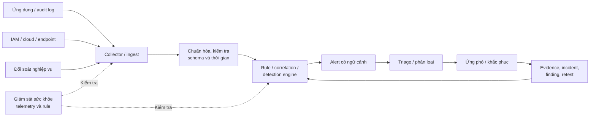
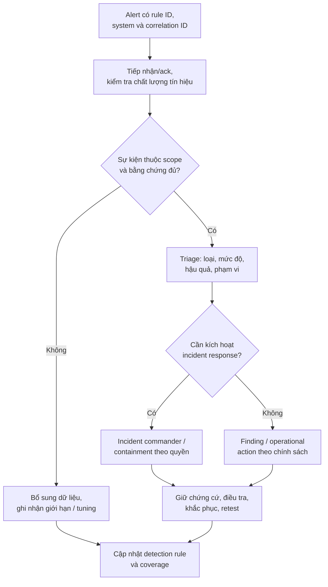
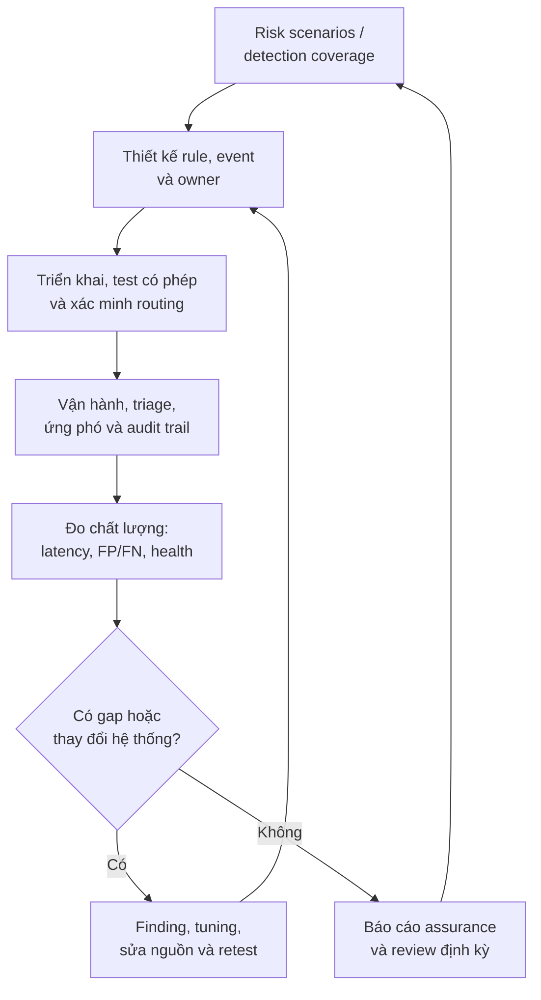

# Detective control: kiểm soát phát hiện và bằng chứng hiệu quả trong security assurance

## Mục tiêu học tập

Sau bài học, người học có thể:

1. Giải thích **detective control (kiểm soát phát hiện)**, phân biệt với *preventive*, *corrective*, *recovery* và *deterrent controls* theo **mục đích và thời điểm tác động**.
2. Chuyển một **kịch bản rủi ro** thành mục tiêu phát hiện, tín hiệu quan sát, logic cảnh báo, người xử lý và tiêu chí kiểm thử.
3. Thiết kế chuỗi **sự kiện → thu thập → chuẩn hóa → tương quan → phát hiện → cảnh báo → triage → ứng phó** có tính đến ranh giới hệ thống và tình huống mất dữ liệu giám sát.
4. Chọn nguồn bằng chứng phù hợp: audit log ứng dụng, IAM, endpoint, mạng, cloud, CI/CD, dữ liệu nghiệp vụ, kết quả đối soát và phản hồi nhà cung cấp.
5. Đánh giá hiệu quả bằng độ bao phủ, độ trễ, chất lượng tín hiệu, **false positive/false negative**, khả năng truy vết và kiểm chứng của quy trình ứng phó.
6. Chứng minh **control design, implementation và operating effectiveness** bằng test có kết quả, cấu hình đúng phiên bản, alert/incident record, audit và retest.
7. Thiết kế vận hành liên tục: trách nhiệm, lịch rà soát, tuning, kiểm soát quyền và lưu giữ log, phát hiện giám sát bị vô hiệu, xử lý findings và ngoại lệ.

Trong module **SECURITY_SECURITY_ASSURANCE**, mục đích là xây dựng cách đánh giá **có bằng chứng** rằng hệ thống đáp ứng các mục tiêu bảo mật, từ đánh giá rủi ro và security requirements tới controls, kiểm thử, audit và khắc phục. **Detective control** đóng vai trò đặc biệt quan trọng: khi kiểm soát phòng ngừa có thể bị vượt qua hoặc sự cố xảy ra do lỗi vận hành, tổ chức cần **nhận biết điều đó đủ sớm, đủ chính xác và có đủ ngữ cảnh để phản ứng**.

## 1. Detective control là gì?

**Detective control** là biện pháp được thiết kế để **nhận biết và báo hiệu dấu hiệu của sự kiện bất thường, hành vi không được phép, vi phạm quy tắc, sự cố hoặc việc kiểm soát khác không hoạt động**, trong phạm vi và thời hạn đã xác định.

Ví dụ:

- Phát hiện tài khoản đăng nhập từ vị trí/thiết bị bất thường kết hợp với thay đổi quyền quản trị.
- Ghi nhận và cảnh báo khi một API trả dữ liệu của tenant khác cho tài khoản không có quyền.
- Phát hiện lệnh hoàn tiền có người thụ hưởng thực tế khác bản đã được duyệt.
- Cảnh báo khi service account được cấp thêm quyền giải mã dữ liệu.
- Phát hiện bucket dữ liệu nhạy cảm trở thành public hoặc cấu hình production lệch khỏi baseline.
- Đối soát để nhận biết giao dịch bị chi trùng hoặc dữ liệu phục hồi không nhất quán.
- Phát hiện luồng audit log ngừng gửi dữ liệu trong khi ứng dụng vẫn hoạt động.

Từ khóa là **“phát hiện”**. Control phát hiện không nhất thiết ngăn một sự kiện xảy ra. Chỉ có cảnh báo nhưng **không có người nhận, quy trình xử lý hoặc dữ liệu hỗ trợ điều tra** thì khó chứng minh hiệu quả thực tế của chương trình bảo mật.

### 1.1. Phân biệt các loại kiểm soát theo mục đích

| Loại | Câu hỏi | Ví dụ | Giới hạn |
|---|---|---|---|
| **Preventive** – phòng ngừa | Làm thế nào ngăn sự kiện không mong muốn xảy ra? | Server-side authorization từ chối truy cập ngoài quyền | Có thể còn lỗi, đường bypass hoặc cấu hình sai |
| **Detective** – phát hiện | Làm thế nào nhận biết sự kiện hoặc dấu hiệu thất bại? | Cảnh báo truy cập hóa đơn chéo tenant, đối soát sai lệch | Có độ trễ, false positive hoặc bỏ sót |
| **Corrective** – khắc phục | Làm thế nào sửa sai hoặc giảm tác hại sau khi phát hiện? | Thu hồi quyền, sửa dữ liệu có kiểm soát, vá lỗi | Phụ thuộc quyền quyết định và khả năng triển khai |
| **Recovery** – phục hồi | Làm thế nào khôi phục năng lực/dữ liệu theo mục tiêu? | Restore backup, failover, đối soát lại sổ giao dịch | Khôi phục chưa chắc loại bỏ nguyên nhân gốc |
| **Deterrent** – răn đe | Làm gì để làm giảm ý định vi phạm? | Thông báo giám sát theo chính sách, chế tài phù hợp | Không thể xem là cơ chế ngăn chặn tuyệt đối |

Một biện pháp có thể có **nhiều tác dụng**: EDR có khả năng phát hiện tiến trình đáng ngờ và tự cách ly máy; phần **phát hiện** và **ngăn/cách ly** cần có tiêu chí, quyền, log và bằng chứng khác nhau. Tương tự, rule phát hiện gian lận có thể đưa giao dịch vào trạng thái *hold* trước khi chi, khi đó có cả thành phần detective và preventive; phải xác định **mốc sự kiện rủi ro** để nói đúng về hiệu quả.

### 1.2. Detective control tác động tới rủi ro như thế nào?

Trong một kịch bản “người dùng đọc trái phép dữ liệu khách hàng”, alert sau khi bản ghi đã được trả **không đảo ngược** lần lộ dữ liệu đó. Nó có thể giảm:

1. **Thời gian duy trì hành vi:** Hệ thống nhận biết và chặn các lần tiếp theo sớm hơn.
2. **Phạm vi ảnh hưởng:** Khóa tài khoản, thu hồi token, giới hạn số lượng dữ liệu bị lấy.
3. **Độ trễ xử lý:** Giúp điều tra, khoanh vùng, thông báo và khắc phục nhanh hơn.
4. **Khả năng sự kiện lan rộng:** Phát hiện các dấu hiệu ban đầu trước khi một bước gây hại lớn hoàn thành, nếu mô hình kịch bản có chuỗi giai đoạn.

Nhưng để tuyên bố giảm **likelihood của sự kiện đầu tiên**, control phải thực sự ngăn được đường sự kiện hoặc phát hiện đủ sớm để chặn nó. Vì vậy, trong đánh giá rủi ro cần phân biệt **khả năng xảy ra sự kiện**, **khả năng phát hiện sự kiện**, **thời gian phát hiện** và **tác động được giảm sau phản ứng**.

## 2. Bắt đầu từ mục tiêu bảo mật và kịch bản rủi ro

Không nên bắt đầu bằng “cài SIEM rồi bật thật nhiều rule”. Hãy bắt đầu bằng **tài sản, mục tiêu và những điều có thể đi sai**.

### 2.1. Mẫu phát biểu yêu cầu phát hiện

Một điều khoản detective control có thể viết:

> Khi **[điều kiện/sự kiện cần nhận biết]** xảy ra trong **[hệ thống, phiên bản, môi trường và phạm vi]**, hệ thống phải tạo **[tín hiệu có thể kiểm tra]**, phát hiện trong **[ngưỡng thời gian đã phê duyệt]**, chuyển thông tin tới **[vai trò tiếp nhận]**, lưu **[bằng chứng điều tra tối thiểu]** và xử lý theo **[quy trình escalation/response]**.

Điều khoản này giúp phát hiện khác với mô tả yếu như “Hệ thống phải có giám sát an ninh”. Nếu chưa có mục tiêu thời gian phù hợp, phải **xác định nó từ đánh giá rủi ro và năng lực vận hành**, không tự đưa một con số phổ quát.

### 2.2. Ví dụ: thay người nhận hoàn tiền sau khi phê duyệt

**Mục tiêu bảo mật:** Lệnh hoàn tiền thực thi phải khớp số tiền và người nhận đã được phê duyệt.

**Risk scenario:** Người có quyền chỉnh sửa thay người nhận sau phê duyệt; worker đọc nội dung mới và chi tiền theo thông tin chưa được duyệt.

**Preventive control:** Ràng buộc bản phê duyệt với phiên bản dữ liệu và từ chối thực thi nếu phiên bản không khớp.

**Detective controls có thể bổ sung:**

- Phát hiện thao tác sửa người nhận **sau khi lệnh được phê duyệt**, nhất là nếu người sửa khác người duyệt.
- Phát hiện một lệnh được đưa vào trạng thái *ready to pay* khi **approved version khác execution version**.
- Đối soát kết quả chi tiền của đối tác với **snapshot đã duyệt**, không chỉ với bản ghi hiện tại trong DB.
- Cảnh báo khi **luồng log phê duyệt ngừng hoạt động** hoặc có thay đổi quy tắc/feature flag liên quan.

Các kiểm soát này có tín hiệu, độ trễ và độ tin cậy khác nhau. Cảnh báo thao tác sửa có thể là **dấu hiệu đáng xem xét** ngay cả khi sửa đổi hợp lệ và đã được duyệt lại; đối soát dữ liệu đã chi có thể chứng minh sai lệch mạnh hơn nhưng xuất hiện muộn hơn.

### 2.3. Tách ba mốc thời gian

| Mốc | Diễn giải | Tác dụng của phát hiện |
|---|---|---|
| **T0 — Hành vi tiền đề** | Có yêu cầu thay người nhận sau duyệt | Có thể cảnh báo sớm và chuyển hồ sơ sang kiểm tra |
| **T1 — Quyết định thực thi** | Worker nhận lệnh; phiên bản được duyệt không khớp | Nếu phát hiện và chặn trước chi trả, control có vai trò phòng ngừa |
| **T2 — Hệ quả đã xảy ra** | Đối tác xác nhận chi trả cho người nhận sai | Đối soát là detective control; hỗ trợ ứng phó, thu hồi và đánh giá phạm vi |

Nếu kiểm soát chỉ hoạt động ở **T2**, không được ghi rằng nó ngăn toàn bộ sự kiện xảy ra ở T1. Trong assurance, phải ghi rõ **mốc sự kiện** mà mỗi kiểm soát được thiết kế để quan sát.

## 3. Kiến trúc của một detective control

Một cơ chế phát hiện không chỉ là truy vấn log. Nó gồm **nguồn tín hiệu, luồng thu thập, logic nhận biết, quy trình tiếp nhận và phản hồi**, đi kèm bằng chứng rằng từng khâu còn hoạt động.



### 3.1. Những điểm có thể thất bại

| Khâu | Kiểu thất bại | Tác động tới assurance |
|---|---|---|
| **Nguồn event** | Không phát event cho đường API cũ, job nền hoặc một vai trò | Không thể kết luận đã bao phủ kịch bản |
| **Collector** | Hỏng agent, mất quyền đọc, queue đầy, mất kết nối | Sự kiện có thể không đến hệ thống phát hiện |
| **Schema/normalization** | Sai tenant ID, không có correlation ID, lệch timestamp, field đổi tên | Rule hoạt động sai hoặc không liên kết được sự kiện |
| **Detection logic** | Ngưỡng không phù hợp, rule bị tắt, whitelist quá rộng | False negative hoặc false positive tăng |
| **Alert routing** | Gửi sai kênh, thiếu người trực, thông báo bị rate-limit | Phát hiện xảy ra nhưng không ai xử lý kịp |
| **Triage** | Thiếu runbook, thiếu dữ liệu, cảnh báo bị đóng mà không xác minh | Không chuyển được phát hiện thành hành động hữu ích |
| **Response** | Không có quyền cô lập, không biết ai phê duyệt, playbook lỗi | Sự kiện tiếp diễn dù có cảnh báo |
| **Evidence storage** | Log sửa/xóa được, retention quá ngắn, thiếu quyền truy xuất | Không thể điều tra hoặc chứng minh control đã hoạt động |

Đây là lý do kiểm thử một rule trong bảng điều khiển chưa đủ. Cần thử **đường đi end-to-end** từ hành vi cần phát hiện đến ticket/incident và bằng chứng xử lý, theo phạm vi yêu cầu.

## 4. Nguồn tín hiệu và giới hạn của từng loại

Tùy kịch bản, cần chọn tín hiệu từ nơi **quan sát gần nhất với sự kiện**; đôi khi phải đối chiếu nhiều nguồn mới phân biệt được hành vi hợp lệ và bất thường.

| Nguồn | Ví dụ tín hiệu | Phát hiện được điều gì? | Điểm mù cần kiểm tra |
|---|---|---|---|
| **Audit log ứng dụng** | Actor, hành động, target, trạng thái trước/sau, request ID | Hành vi nghiệp vụ nhạy cảm và thay đổi trạng thái | Nếu app bị lỗi ghi log hoặc actor/target bị gán sai |
| **API gateway/WAF** | Route, method, kết quả, tốc độ, danh tính/mạng nguồn | Dò quét, tăng đột biến request, lỗi giao tiếp | Không thấy quy tắc nghiệp vụ bên trong hoặc dữ liệu đã xuất |
| **IAM/IdP** | Login, thất bại MFA, role grant, token issuance | Thay đổi quyền, hành vi xác thực bất thường | Phiên hợp lệ bị lạm dụng, quyền của ứng dụng không đúng đối tượng |
| **Database audit** | Truy vấn/quyền DB, thay đổi bảng nhạy cảm | Thao tác trực tiếp tới DB, admin activity | Khó nhận biết chính xác ý nghĩa nghiệp vụ nếu không có context |
| **Cloud configuration** | Public bucket, security group mở, KMS policy update | Drift và rủi ro cấu hình | Scan theo chu kỳ có độ trễ; có thể thiếu tài khoản/vùng |
| **Endpoint/EDR** | Tiến trình bất thường, thực thi mã, persistence | Dấu hiệu xâm nhập máy trạm hoặc server | Không thấy mọi hành vi trong SaaS/ứng dụng nghiệp vụ |
| **Network/IDS** | Lưu lượng bất thường, dấu hiệu protocol | Di chuyển ngang, kết nối lạ, một số hành vi tấn công | Nội dung mã hóa, NAT, luồng không đi qua sensor |
| **CI/CD và artifact registry** | Build, publish, deploy, sửa pipeline/secret | Phát hành hoặc thay artifact ngoài quy trình | Không bảo đảm ứng dụng vận hành đúng bất biến |
| **Đối soát nghiệp vụ** | Chênh lệch giữa bản duyệt, sổ cái và bên thanh toán | Giao dịch trùng, tiền nhận sai, dữ liệu không nhất quán | Có thể đến chậm hơn sự kiện; phụ thuộc dữ liệu đối tác |
| **Vendor/managed service** | Security alert, access logs, báo cáo bất thường | Sự kiện trong vùng nhà cung cấp quản lý | Phạm vi, định dạng, độ trễ và quyền lấy bằng chứng phụ thuộc hợp đồng |

**Thiết kế theo kịch bản** là chọn tín hiệu phản ánh điều cần phát hiện. Ví dụ, để nhận biết **thanh toán trùng**, access log HTTP 200 là bằng chứng yếu hơn đối soát **business transaction ID** và giao dịch thành công tại đối tác.

### 4.1. Trường dữ liệu tối thiểu của một security event

Không có một schema bắt buộc cho mọi hệ thống, nhưng với những thao tác nhạy cảm thường cần:

| Trường | Ý nghĩa |
|---|---|
| **eventId** | Định danh sự kiện để chống đếm trùng |
| **eventType** | Loại hành động: thay người nhận, duyệt, chi trả, thay quyền |
| **occurredAt** và **ingestedAt** | Thời điểm sự kiện và thời điểm hệ thống nhận; phân tích trễ/đến sai thứ tự |
| **actorId / actorType** | Người dùng, service account hoặc tác nhân thực hiện |
| **system / environment / version** | Hệ thống, môi trường, bản triển khai hoặc cấu hình |
| **targetId / tenantId** | Đối tượng, phạm vi dữ liệu và tenant liên quan |
| **action / outcome** | Hành động và kết quả: cho phép, từ chối, lỗi, chờ xử lý |
| **correlationId** | Nối request, queue event, worker và phản hồi đối tác |
| **businessVersion / approvalVersion** | Trạng thái nghiệp vụ cần kiểm tra bất biến, nếu phù hợp |
| **source / integrity metadata** | Nguồn log và thông tin để truy xuất/kiểm tra độ tin cậy |

**Không ghi secret, token truy cập đầy đủ, số thẻ, mật khẩu hoặc bản sao không cần thiết của dữ liệu nhạy cảm vào event**. Phải chọn trường tối thiểu để điều tra, áp dụng phân loại dữ liệu, kiểm soát truy cập, retention và che/mã hóa phù hợp.

### 4.2. Dấu thời gian và xử lý sự kiện không đồng bộ

Trong hệ thống phân tán, log từ API, queue và worker có thể:

- Đến **không đúng thứ tự**; ingest thời điểm khác lúc hành vi xảy ra.
- Bị **gửi lặp** do retry, khiến rule đếm sai số lần.
- Bị **mất hoặc trễ** khi queue đầy, agent offline hoặc clock lệch.
- Không có **định danh chung** để đối chiếu cùng một giao dịch.

Rule cần xử lý hợp lý **event time**, độ trễ cho phép, idempotency/deduplication và trạng thái khi dữ liệu đến muộn. Không được coi một luồng log trống là bằng chứng không có hành vi bất thường.

## 5. Chọn loại kỹ thuật phát hiện

### 5.1. Rule dựa trên điều kiện rõ ràng

**Rule-based detection** kiểm tra trạng thái hoặc sự kiện so với một điều kiện được định nghĩa:

- Tài khoản được gán quyền quản trị ngoài quy trình phê duyệt.
- Lệnh hoàn tiền có `executionVersion != approvedVersion`.
- Bucket có dữ liệu nhạy cảm chuyển sang chế độ public.
- Cùng một business payment ID được xác nhận thành công hơn một lần.

Ưu điểm là giải thích được, test dễ và có thể liên kết trực tiếp tới yêu cầu bảo mật. Giới hạn: chỉ phát hiện những điều kiện **đã được mô tả và có dữ liệu đo đúng**; khi schema hoặc quy trình thay đổi, rule có thể bỏ sót.

### 5.2. Rule theo ngưỡng và hành vi

Ví dụ một tài khoản liên tục:

- Thử truy cập nhiều object ID không thuộc mình.
- Gọi nhiều endpoint nhạy cảm ngay sau khi được cấp quyền mới.
- Tạo nhiều yêu cầu export trong thời gian ngắn.

Ngưỡng cần xét **mức nền (baseline), vai trò, tenant, thời gian và khả năng xử lý thực tế**. Con số “100 request/phút” chỉ có nghĩa khi mô hình hoạt động của hệ thống cho thấy nó phù hợp. Ngưỡng quá thấp gây mệt mỏi cảnh báo; quá cao có thể bỏ sót kịch bản cần phát hiện.

### 5.3. Phát hiện tương quan (correlation)

Kết hợp nhiều tín hiệu có thể tăng tính hữu ích:

> Trong một khoảng thời gian: tài khoản được cấp quyền mới → chỉnh sửa người nhận sau duyệt → worker có kết quả chi trả bất thường.

Cần có identity mapping, correlation ID, sự kiện đáng tin và quy tắc xử lý thứ tự. Một mối tương quan **không tự chứng minh quan hệ nhân quả**; kết luận điều tra phải xem ngữ cảnh và bằng chứng.

### 5.4. Phát hiện bất thường theo thống kê/ML

Phân tích bất thường có thể phát hiện biến động chưa được mô tả bằng rule, ví dụ tăng mạnh export hoặc thay đổi mô hình đăng nhập. Nhưng cần:

1. Dữ liệu đủ chất lượng và phạm vi đại diện.
2. Tiêu chí theo dõi **drift, false positive và false negative**.
3. Cách giải thích tối thiểu cho alert để người xử lý điều tra.
4. Ngưỡng, lịch huấn luyện/cập nhật và giới hạn tác động.
5. Kiểm soát dữ liệu nhạy cảm và tránh dùng nhầm tín hiệu như bằng chứng hành vi ác ý.

Anomaly score **không đồng nghĩa sự cố xác thực**, và mô hình có thể mất hiệu quả khi hành vi người dùng hoặc kiến trúc đổi. Cần kiểm thử định kỳ trên kịch bản được xác định.

### 5.5. Đối soát như một detective control

Trong các luồng thanh toán, phân phối hoặc kế toán, **reconciliation** là kỹ thuật phát hiện mạnh vì so sánh **kết quả thực tế** với bất biến nghiệp vụ:

- Bản phê duyệt và bản thực thi phải trùng người nhận/số tiền.
- Một mã giao dịch chỉ có một hiệu ứng chi tiền hợp lệ.
- Tổng số tiền trên sổ cái và phía đối tác phải khớp theo chính sách.
- Bản restore phải bảo toàn số dư và lịch sử sự kiện ở mốc phù hợp.

Đối soát có thể chạy theo lô, vì vậy cần mô tả **độ trễ phát hiện và cách xử lý sai lệch**. Nếu chu kỳ đối soát kết thúc sau khi tiền đã được chi sai, đó vẫn là kiểm soát phát hiện hữu ích nhưng không phải bằng chứng rằng lỗi đã bị phòng ngừa.

## 6. Thiết kế detective control có tiêu chí đạt/trượt

Xét kịch bản **thay người thụ hưởng sau phê duyệt**. Một control có thể được định nghĩa như sau:

| Thuộc tính | Giá trị minh họa |
|---|---|
| **Control ID** | `DET-REFUND-01` |
| **Mục tiêu** | Phát hiện mọi lệnh thực thi có người nhận hoặc phiên bản không khớp bản được duyệt |
| **Risk ID** | `RSK-REFUND-CHANGE-01` |
| **Nguồn dữ liệu** | Approval event, refund execution event, đối soát kết quả nhà cung cấp |
| **Điều kiện phát hiện** | `executedBeneficiary != approvedBeneficiary` hoặc `executedVersion != approvedVersion` |
| **Scope** | API và payment worker production, bao gồm retry/batch theo phạm vi được phê duyệt |
| **Yêu cầu thời gian** | Độ trễ phát hiện/triage theo ngưỡng được risk owner và vận hành phê duyệt |
| **Hành động** | Alert tới on-call, giữ chứng cứ, đánh giá lệnh liên quan, chuyển cấp theo runbook |
| **Control owner** | Payments Observability Lead và Payment Service Owner theo phân công |
| **Bằng chứng** | Rule version, nguồn event, test injection, alert/ticket, thời gian chuyển xử lý |
| **Điểm mù** | Đường legacy hoặc vendor response chưa được bao phủ phải được ghi nhận |

### 6.1. Ví dụ cấu hình rule minh họa

Mẫu YAML dưới đây **không phải cú pháp có thể triển khai trực tiếp cho một SIEM bất kỳ**. Nó mô tả **yêu cầu phát hiện** và cách liên kết bằng chứng:

```yaml
control:
  id: DET-REFUND-01
  title: Detect execution inconsistent with approved refund
  type: detective
  system: Refund Service
  riskScenarioId: RSK-REFUND-CHANGE-01
  ownerRole: Payments Observability Lead
  scope:
    environment: production
    components:
      - refund-api
      - payment-worker
      - partner-settlement-reconciliation
  requiredSignals:
    - refund-approved
    - refund-executed
    - partner-payment-confirmed
  correlationKey: refundId
  detection:
    when:
      - executedVersion differs from approvedVersion
      - executedBeneficiary differs from approvedBeneficiary
    consider:
      - retries and duplicate events
      - events received out of order
      - approved changes that require reapproval
    severityRule: Based on payout state and possible financial impact
  routing:
    team: payments-oncall
    runbookId: RB-REFUND-MISMATCH
    incidentEscalation: According to approved incident policy
  assurance:
    requiredTests:
      - DET-REFUND-01-TRIGGER
      - DET-REFUND-01-NO-FALSE-ALERT
      - DET-REFUND-01-LATE-EVENT
      - DET-REFUND-01-MISSING-LOG
    evidenceIds:
      - TEST-DET-REFUND-2026-11
      - ALERT-TRACE-REFUND-SIM-17
  knownLimitations:
    - Legacy manual payout flow requires separate coverage check
  reviewTriggers:
    - Approval state machine changes
    - Payment provider integration changes
    - New alert suppression rule
```

Các giá trị trong ví dụ như `ownerRole`, `evidenceIds` là **tham chiếu minh họa**, không chứng minh hệ thống có thật đã triển khai hay đáp ứng.

### 6.2. Vì sao cần một nguồn sự thật đáng tin?

Nếu rule so sánh hai giá trị **cùng lấy từ một bản ghi đã bị sửa**, sự sai lệch có thể không xuất hiện dù nghiệp vụ bị vi phạm. Ví dụ, kẻ có quyền sửa cả nội dung hiện tại lẫn “approvedBeneficiary” trong cùng bảng có thể làm hai giá trị trông khớp nhau.

Nên xem xét:

- Phê duyệt được lưu dưới **phiên bản/snapshot được bảo vệ hoặc kiểm chứng** theo thiết kế.
- Event chứa correlation ID và **mối quan hệ đúng** với giao dịch, không tin mù quáng field do client gửi.
- Hệ thống giám sát có nguồn bằng chứng **độc lập phù hợp**, như phản hồi đối tác hoặc sổ đối soát.
- Người có quyền thực thi giao dịch không mặc nhiên có quyền **xóa hoặc sửa cả chứng cứ phát hiện**.

Mục tiêu không phải “log tất cả mọi thứ” mà là có dữ liệu đủ tin cậy để đánh giá **bất biến quan trọng**.

### 6.3. Minh họa test hành vi

```gherkin
Feature: Detect refund execution mismatch

  Scenario: Execution differs from approved beneficiary
    Given refund R100 was approved for beneficiary A at version 5
    And monitoring receives a trustworthy approved-version record
    When payment execution confirms beneficiary B at version 6
    Then detection DET-REFUND-01 produces an alert for R100
    And the alert links both approval and execution evidence
    And the alert reaches the designated triage queue

  Scenario: Legitimate change with fresh approval
    Given refund R200 was approved for beneficiary A at version 5
    And a permitted change creates version 6 with beneficiary B
    And version 6 receives fresh approval before execution
    When the worker confirms execution of approved version 6
    Then no mismatch alert should be produced for that execution

  Scenario: Monitoring signal stops arriving
    Given refund processing is active
    When the approved-event stream unexpectedly stops beyond its health threshold
    Then a telemetry health finding is raised to the control owner
    And the system must not report detection coverage as healthy
```

**Điều quan trọng:** Trường hợp thứ ba kiểm tra **độ tin cậy của hệ thống phát hiện**. Một rule không phát alert khi **mất log đầu vào** không thể được coi là đã “xác minh không có bất thường”.

## 7. Chất lượng phát hiện: đo gì và diễn giải thế nào?

Mục tiêu không phải số alert càng nhiều càng tốt. Một control hiệu quả cần **phát hiện đúng những trường hợp có ý nghĩa trong thời gian phù hợp và cho phép phản ứng có ích**.

### 7.1. Confusion matrix và bốn tình huống

| Kết quả thực tế | Control tạo cảnh báo | Control không cảnh báo |
|---|---|---|
| **Có sự kiện thuộc scope cần phát hiện** | **True positive (TP)** – phát hiện đúng | **False negative (FN)** – bỏ sót |
| **Không có sự kiện thuộc scope** | **False positive (FP)** – báo nhầm | **True negative (TN)** – không báo đúng |

Hai công thức hữu ích khi **có tập dữ liệu hoặc phép thử có nhãn tin cậy**:

```text
Precision = TP / (TP + FP)
Recall (detection sensitivity) = TP / (TP + FN)
```

Precision trả lời: “Trong các cảnh báo được tạo ra, bao nhiêu cảnh báo thực sự đúng?” Recall trả lời: “Trong các sự kiện thuộc scope phải phát hiện, bao nhiêu sự kiện được nhận biết?”

**Giới hạn:** Trong môi trường thực tế, rất khó biết **tổng số false negative** nếu không có cách quan sát độc lập. Không được công bố recall = 100% chỉ vì tất cả alert đã được triage, hay vì không có sự cố ghi nhận. Với kịch bản tấn công hiếm, các chỉ số cần được giải thích cùng **nguồn dữ liệu có nhãn, phương pháp thử và độ đại diện**.

### 7.2. Thời gian quan sát và phản ứng

Các thời điểm nên ghi tách biệt:

| Mốc | Ý nghĩa |
|---|---|
| `t_event` | Sự kiện thực sự xảy ra hoặc đạt điều kiện rule |
| `t_ingest` | Dữ liệu cần thiết có mặt tại hệ thống thu thập |
| `t_alert` | Rule tạo alert có thể xử lý |
| `t_ack` | Người/đội trực tiếp nhận và xác nhận |
| `t_contain` | Biện pháp giới hạn tác động được thực thi |
| `t_resolve` | Sự cố/vi phạm được xử lý theo định nghĩa hoàn tất |

Ví dụ:

```text
Detection latency = t_alert - t_event
Acknowledgment latency = t_ack - t_alert
Containment latency = t_contain - t_event
```

**MTTD (mean time to detect)** là trung bình thời gian phát hiện trên tập sự kiện được định nghĩa. **MTTR** thường được dùng với nhiều nghĩa (*repair*, *respond* hoặc *recover*); một chương trình cần định nghĩa cụ thể trước khi dùng trong báo cáo. Các trung bình có thể che giấu đuôi phân phối rất dài, nên cân nhắc percentile và số trường hợp trễ hạn.

Trong thiết kế kiểm soát, phải xét **thời gian thực tế cho phép** của kịch bản. Phát hiện chi tiền sai sau đối soát cuối ngày có giá trị cho xử lý sai lệch, nhưng chưa chắc đáp ứng mục tiêu ngăn nhiều giao dịch sai xảy ra liên tiếp trong vài phút.

### 7.3. Các chỉ số bổ sung

| Chỉ số | Ý nghĩa quản trị | Điều không nên suy ra |
|---|---|---|
| **Coverage of scoped scenarios** | Tỷ lệ risk scenarios quan trọng có detection use case được thiết kế và test | Có coverage trên giấy không đồng nghĩa event thực tế được ghi |
| **Telemetry health / completeness** | Nguồn log và trường bắt buộc đang gửi đủ, đúng giờ | Mất log có thể không lộ nếu không có kiểm tra độc lập |
| **Alert-to-triage rate** | Bao nhiêu alert được người phụ trách xem trong hạn | Triage nhiều không có nghĩa xử lý đúng |
| **False positive rate trong tập kiểm thử** | Độ nhiễu của rule trên tập có nhãn | Không tự đại diện cho tất cả hoạt động production |
| **Verified true-positive detection rate** | Khả năng phát hiện các kịch bản thử đã xác minh | Không tự chứng minh recall cho mọi kỹ thuật mới |
| **Rule disabled / overdue tuning** | Phát hiện rule mất hiệu lực hoặc bị ức chế quá lâu | “Rule enabled” chưa chứng minh nguồn dữ liệu còn hoạt động |
| **Alert without owner/runbook** | Khoảng trống trong vòng xử lý | Một alert gửi email không bảo đảm có ứng phó |
| **Retest closure rate** | Finding được khắc phục và kiểm chứng lại | Ticket đóng không đồng nghĩa đã retest |

Tỷ lệ alert tăng có thể do số vụ vi phạm tăng, **coverage tốt hơn**, nguồn log mới được bật hoặc rule gây nhiễu. Không coi số alert thấp là dấu hiệu an toàn khi chưa có dữ liệu nền và kiểm tra sức khỏe cảm biến.

## 8. Phân biệt thiết kế, triển khai và hiệu quả vận hành

Trong security assurance, một detective control thường cần ít nhất ba lớp bằng chứng.

| Lớp đánh giá | Câu hỏi | Bằng chứng tiêu biểu |
|---|---|---|
| **Design effectiveness** | Rule, nguồn dữ liệu, logic, phạm vi và quy trình có phù hợp kịch bản không? | Risk mapping, thiết kế detection use case, review event schema, runbook |
| **Implementation** | Có thật sự triển khai đúng rule/source/routing trên môi trường đang chạy không? | Rule config/version, collector config, inventory nguồn, route, người trực |
| **Operating effectiveness** | Khi điều kiện xảy ra, control có tạo tín hiệu, đến đúng người và được xử lý theo tiêu chí không? | Test end-to-end, alert/ticket, thời gian, kết quả triage/response, retest |

**Ví dụ:** Một SIEM có rule truy cập trái tenant (design), rule đã bật (implementation), nhưng không có log của API v1 và cảnh báo gửi tới queue không ai nhận. Khi đó **không đủ bằng chứng operating effectiveness**, dù hình chụp cấu hình cho thấy rule đang bật.

### 8.1. Những loại kiểm thử cần phối hợp

1. **Unit/logic test:** Dữ liệu giả lập khớp điều kiện có tạo kết quả đúng? Trường hợp hợp lệ có bị báo nhầm?
2. **Schema test:** Thiếu/misformat field, timestamp khác múi giờ, event đến sai thứ tự hoặc trùng được xử lý ra sao?
3. **Pipeline test:** Nguồn thực gửi event → collector → rule → alert → người nhận theo thời gian cho phép.
4. **Coverage test:** Bao phủ API mới/cũ, batch, tenant, vùng triển khai, service account và đường vendor trong scope?
5. **Failure/health test:** Ngừng collector, ngắt log stream, tắt rule, thay schema hoặc mất kết nối có được phát hiện không?
6. **Triage/response test:** On-call có nhận, phân loại, truy xuất chứng cứ và chuyển cấp theo runbook?
7. **Regression test:** Khi đổi rule, ứng dụng, feature flag, vendor hoặc nền tảng có lặp lại bộ kịch bản quan trọng?

Không chạy giả lập tấn công/điều chỉnh giao dịch thật trên production khi không có phê duyệt và phương án bảo vệ. Có thể dùng **test event được định danh, môi trường cô lập, synthetic transaction hoặc bài tabletop**, miễn là ghi rõ điều gì đã được chứng minh và điều gì chưa.

### 8.2. Test cả trường hợp không nên báo

Kiểm tra false positive giúp giữ alert có thể vận hành:

- Người nhận hoàn tiền được sửa **trước duyệt** hoặc đã **duyệt lại phiên bản mới**.
- Quản trị viên thay quyền theo change request đã được phê duyệt, trong phạm vi và thời hạn hợp lệ.
- Hệ thống xử lý lại **cùng event ID**, không phải một giao dịch mới.
- Dữ liệu đến muộn, job replay có giám sát và quy trình bảo trì được ghi nhận.

Nhưng **whitelist** không được nuốt mọi hành vi của một tài khoản hoặc subnet được đánh dấu “đáng tin”. Mọi suppression cần **chủ sở hữu, lý do, phạm vi, ngày hết hạn và bằng chứng rà soát**.

### 8.3. Test trường hợp bỏ sót

Muốn phát hiện false negative, cần tạo **kịch bản có thể kiểm soát, biết chắc điều kiện xảy ra và có quan sát độc lập**:

- Event đến từ đường API v1 không dùng middleware log chung.
- User thay người nhận bằng job nền thay vì UI.
- Payload bị xử lý trùng nhưng **eventId khác** do retry/gateway tạo lại.
- Rule dựa vào tên field cũ, trong khi phiên bản mới đã đổi schema.
- Collector mất 10 phút dữ liệu trong giai đoạn queue quá tải.
- Tài khoản quản trị làm thay đổi quyền log để che dấu hoạt động.

Nếu control không phát hiện, cần tạo finding cho **nguồn dữ liệu, logic, scope hoặc routing** tương ứng, không giải quyết bằng cách chỉ tăng ngưỡng.

## 9. Bảo vệ tính tin cậy của audit log và bằng chứng phát hiện

Detective control sống nhờ **khả năng quan sát**. Khi log không đáng tin, việc tính MTTD hay xác nhận sự kiện trở nên mơ hồ.

### 9.1. Nguyên tắc bảo vệ log

- **Phân quyền:** Tài khoản ứng dụng thường chỉ được ghi theo cơ chế được cho phép, không tự ý sửa/xóa chứng cứ đã lưu.
- **Tách vùng trách nhiệm:** Lưu trữ và kiểm soát truy cập log nên tránh cùng một chủ thể có thể vừa gây sự kiện vừa xóa toàn bộ bằng chứng.
- **Độ tin cậy thời gian:** Dùng cơ chế đồng bộ thời gian thích hợp; lưu event time và ingest time khi cần.
- **Tính toàn vẹn:** Kiểm soát sửa/xóa, audit thao tác quản trị, và cơ chế kiểm chứng tính nguyên vẹn phù hợp yêu cầu.
- **Tính sẵn sàng:** Kiểm tra mất luồng, trễ, drop, queue, quota và khả năng truy xuất khi điều tra.
- **Bảo vệ bí mật:** Che PII/secrets, phân loại, hạn chế truy cập, mã hóa và retention phù hợp.
- **Khả năng truy vết:** Event ID, correlation ID, schema version và nguồn tạo đáng tin để đối chiếu.

Không cần đưa toàn bộ payload nhạy cảm vào log để có thể điều tra. Thường có thể lưu **định danh, giá trị đã giảm thiểu/phân loại, trước/sau ở mức cần thiết, bản snapshot được bảo vệ và tham chiếu tới dữ liệu gốc có quyền**.

### 9.2. Phát hiện việc giám sát bị vô hiệu

Một hệ thống giám sát cần kiểm soát chính nó, ví dụ:

| Tình huống | Biện pháp phát hiện |
|---|---|
| Không nhận audit log dù service vẫn có traffic | Heartbeat/expected-event-volume check theo baseline |
| Collector mất kết nối hoặc queue đầy | Pipeline health metrics, dead-letter/error counters và cảnh báo |
| Rule bị tắt, sửa suppression hoặc route alert | Audit cấu hình rule, review thay đổi và cảnh báo quản trị |
| Schema thay đổi làm parse lỗi | Tỷ lệ parse error, missing-field alert, contract tests |
| Trễ thời gian event/ingest tăng | Đo event-time lag, đánh dấu degraded coverage |
| Quyền đọc/log store thay đổi | Access review và audit thao tác quản trị log |

Một hệ thống có thể cần kiểm tra sức khỏe **tách biệt** với cùng pipeline đang được giám sát để tránh một lỗi chung làm mất cả dữ liệu lẫn cảnh báo sức khỏe.

### 9.3. Giữ dữ liệu đúng hạn

Thời gian lưu log phải dựa trên **yêu cầu điều tra, độ trễ phát hiện, rủi ro, nghĩa vụ và phân loại dữ liệu**, không mặc định một con số giống nhau cho mọi tổ chức. Khi có yêu cầu legal hold hoặc incident investigation, việc giữ/xóa cần tuân thủ cơ chế có thẩm quyền. Ngược lại, giữ log nhạy cảm vô thời hạn có thể tạo thêm rủi ro bảo mật và quyền riêng tư.

## 10. Quy trình triage và ứng phó: alert chưa phải là kết luận

Một cảnh báo là **tín hiệu cần xác minh** chứ không tự chứng minh đã có vi phạm. Quy trình thường gồm:



### 10.1. Tối thiểu một alert hữu ích cần có

- **Control ID và rule version**, loại dấu hiệu, ngưỡng/điều kiện đã kích hoạt.
- **Đối tượng và thời gian:** Hệ thống, môi trường, event time, ingest time, target/tenant đã ẩn dữ liệu nhạy cảm phù hợp.
- **Tương quan:** Sự kiện liên quan, correlation ID, nguồn log và bằng chứng có thể truy xuất.
- **Mức ưu tiên:** Dựa trên rủi ro và trạng thái, không chỉ độ lớn của anomaly score.
- **Người tiếp nhận:** Đội chịu trách nhiệm, kênh on-call, runbook và tiêu chí escalation.
- **Giới hạn:** Có thiếu nguồn, chưa đủ phân quyền hoặc có độ trễ không?

### 10.2. Triage phải xác định sự kiện thật

Ví dụ có alert “đổi người nhận sau duyệt”. Đội trực cần:

1. Xác minh lệnh và trạng thái phê duyệt ban đầu từ nguồn tin cậy.
2. Xác định ai sửa, quyền nào, có thay đổi hợp lệ và duyệt lại không.
3. Kiểm tra worker đã chi chưa, chi cho ai, có thêm lệnh liên quan không.
4. Đối chiếu với log đối tác và trạng thái sổ cái nếu có quyền.
5. Xếp loại: **test/synthetic**, hành vi hợp lệ, lỗi kiểm soát, nghi gian lận, hoặc thiếu bằng chứng.
6. Kích hoạt ứng phó/khôi phục hoặc kiểm tra bổ sung theo phạm vi và thẩm quyền.

**Không tự động xử phạt tài khoản hoặc hoàn tiền đảo chiều** chỉ từ một rule chưa được xác minh nếu quy trình, hậu quả và quyền quyết định chưa cho phép. Trong các trường hợp cần phản ứng tự động khẩn cấp, phải có cơ chế giảm tác động và phê duyệt theo chính sách.

### 10.3. Hợp tác với những vai trò khác

| Vai trò | Trách nhiệm điển hình |
|---|---|
| **Business/data owner** | Xác định sự kiện nào gây hậu quả, mức độ ảnh hưởng dữ liệu/tiền |
| **Risk owner** | Chịu trách nhiệm rủi ro kịch bản, ưu tiên xử lý và quyết định/chuyển cấp đúng thẩm quyền |
| **System owner** | Xác định scope và phụ thuộc, điều phối kiểm soát, bằng chứng và khắc phục |
| **Control owner / detection engineer** | Thiết kế rule, nguồn telemetry, vận hành, test và tuning |
| **Application / platform owner** | Bảo đảm sự kiện đáng tin, sửa log schema, tích hợp pipeline và khắc phục code/config |
| **SOC / on-call analyst** | Nhận, phân loại và xác minh alert, kích hoạt escalation |
| **Incident commander / response team** | Điều hành ứng phó khi điều kiện kích hoạt được đáp ứng |
| **Security assurance / QA** | Đánh giá thiết kế/hiệu quả, kiểm thử, rà soát bằng chứng và retest |
| **Internal audit** | Đánh giá độc lập việc tuân thủ theo phạm vi và mục tiêu được giao |

**Phân quyền rõ ràng** đặc biệt quan trọng với kiểm soát xuyên đội: nền tảng logging có thể là control owner của đường thu thập, trong khi nhóm ứng dụng sở hữu **tính đầy đủ của event nghiệp vụ**. Không thể suy từ dashboard logging “healthy” rằng mọi sự kiện nhạy cảm của ứng dụng đã được gửi.

## 11. Chứng minh detective control đáp ứng security assurance

### 11.1. Chuỗi truy vết bắt buộc

Một kết luận bảo đảm nên có thể đi qua:

```text
Tài sản / mục tiêu bảo mật
  -> Risk scenario và sự kiện cần phát hiện
  -> Detection requirement, Control ID và owner
  -> Nguồn event, rule, threshold, routing, runbook
  -> Bản triển khai / môi trường / thời kỳ
  -> Test case và evidence (trigger + no-trigger + health)
  -> Alert/triage/response thực tế hoặc synthetic có kiểm soát
  -> Finding, remediation và retest
  -> Kết luận có giới hạn + lịch tái đánh giá
```

### 11.2. Ma trận yêu cầu – kiểm soát – bằng chứng

| Requirement | Mục tiêu kiểm tra | Bằng chứng thiết kế/triển khai | Bằng chứng hiệu quả |
|---|---|---|---|
| `DET-REFUND-01` | Phát hiện thực thi lệch bản duyệt | Event schema, rule version, owner, routing | Test mismatch, alert, ticket, kết quả triage |
| `DET-IAM-02` | Phát hiện cấp quyền quản trị ngoài quy trình | IAM event mapping, policy change-monitoring | Test grant có kiểm soát, alert, review authorization |
| `DET-EXPORT-03` | Nhận biết download/export dữ liệu ngoài mô hình hành vi hoặc quyền | Audit event, giới hạn đối tượng, rule/threshold | Test vai trò, dữ liệu tải, alert và kiểm tra false positive |
| `DET-CLOUD-04` | Phát hiện drift bucket/KMS/network thuộc scope | Inventory tài sản, IaC baseline, nguồn config events | Simulation thay đổi có phép, finding, xác minh config khôi phục |
| `DET-LOG-05` | Phát hiện audit pipeline mất log hoặc parse lỗi | Expected volume, heartbeat, health rule | Synthetic log failure test và alert đến on-call |
| `DET-PAY-06` | Phát hiện thanh toán trùng qua đối soát | Bất biến nghiệp vụ, nguồn từ đối tác, đối soát | Replay test, đối soát thành công và xử lý sai lệch |

### 11.3. Ví dụ kết luận Claim–Argument–Evidence

> **Claim:** Trong phạm vi Refund API và Payment Worker production của bản phát hành đã xác định, những trường hợp thực thi lệnh có người nhận hoặc phiên bản khác bản phê duyệt sẽ tạo alert theo tiêu chí kiểm thử hiện hành.
>
> **Argument:** Sự kiện phê duyệt và thực thi có định danh/phiên bản; pipeline gửi đầy đủ tín hiệu vào rule so sánh; alert được route tới người trực; health check nhận biết mất nguồn event.
>
> **Evidence:** Review event schema và rule version, kết quả test mismatch và hợp lệ, thử ngừng luồng event, alert/ticket với timestamps, deployment record, triage record và kết quả retest.
>
> **Limitations:** Chưa kiểm chứng đường chi tiền thủ công legacy và alert khi vendor gửi kết quả muộn quá thời hạn; các đường này phải có kế hoạch đánh giá riêng.

Một claim nên đề cập **đúng điều đã kiểm tra**. Nếu chỉ có log chứa dấu hiệu nhưng chưa có chứng cứ routing/triage, có thể kết luận “đã ghi nhận” chứ chưa đủ để nói “đã phát hiện và xử lý kịp thời”.

### 11.4. Hồ sơ kiểm tra dùng trong audit

Một evidence package cho control nên nêu:

1. Control ID, risk scenario, mục tiêu và bản quy định áp dụng.
2. Nguồn và scope telemetry, data lineage, schema version, điểm mù đã biết.
3. Rule expression/logic đã được review, quy trình change và lịch sử suppression.
4. Version triển khai, thời điểm, môi trường, rule enabled/routing đúng owner.
5. Bộ case **true-positive, false-positive, delayed/duplicate và failure/health**.
6. Input test đã kiểm soát, expected/actual, alert ID, timestamps và kết quả điều tra.
7. Các findings và xử lý/remediation/retest với người chịu trách nhiệm.
8. Kết luận và giới hạn, độ tin cậy và thời điểm đánh giá lại.

Tài liệu này giúp auditor **kiểm tra lại** chứ không chỉ tin một ảnh chụp dashboard “All rules enabled”.

## 12. Continuous assurance: duy trì hiệu quả sau phát hành

### 12.1. Những thay đổi làm detection mất hiệu lực

- Đổi **event schema**, tên field, source hoặc cách sinh correlation ID.
- Thêm API v2, background job, tenant, vendor hoặc môi trường mà rule chưa thu log.
- Cấu hình collector/IAM, retention, routing hoặc alert suppression bị thay đổi.
- Tài khoản on-call đổi chủ, kênh nhận cảnh báo hỏng hoặc runbook không còn phù hợp.
- Thay ngưỡng vì “nhiều alert” nhưng không lưu rationale, test và phê duyệt.
- Pipeline gặp lỗi mà không có health alert.
- Business workflow thay đổi; “hành vi bất thường” cũ trở thành hợp lệ hoặc ngược lại.
- Tăng khối lượng dữ liệu dẫn đến giới hạn ingest, xử lý chậm hoặc bỏ event.

### 12.2. Chu trình vận hành đề xuất



### 12.3. Nguyên tắc tuning

Khi rule gây quá nhiều cảnh báo:

1. Phân tích **cảnh báo nào sai**, vì sao, theo nguồn và ngữ cảnh.
2. Thử tăng độ chính xác bằng **tương quan thêm tín hiệu** hoặc điều kiện nghiệp vụ, thay vì chỉ nâng ngưỡng.
3. Đánh giá nguy cơ phát sinh **false negative** từ thay đổi.
4. Lưu **lý do, người duyệt, rule version, test trước/sau và hạn xem lại**.
5. Tạo test regression với các kịch bản quan trọng; theo dõi biến động alert và telemetry.

**Không tắt một rule quan trọng chỉ để báo cáo đẹp hơn.** Nếu cần tạm suppression vì sự cố vận hành, phải có phê duyệt phù hợp và biện pháp thay thế/giám sát, thời hạn và người chịu trách nhiệm.

### 12.4. Sự kiện cần kích hoạt đánh giá lại

Tái đánh giá không chỉ theo lịch. Những trigger quan trọng gồm: **thay kiến trúc, quyền hoặc business workflow; sửa API; thêm vendor; incident; critical finding; đổi log/collector/rule; phát hiện mất telemetry; ngoại lệ hết hạn hoặc thay risk appetite**.

System owner và control owner cần có cơ chế chuyển thông tin thay đổi từ đội phát triển/vận hành tới detection engineering, tránh “rule vẫn bật nhưng không còn nghe đúng sự kiện”.

## 13. Tình huống tổng hợp: hệ thống có alert nhưng không phát hiện được chi trả sai

Một dịch vụ hoàn tiền có xác thực người dùng, RBAC, payment worker và hệ thống log tập trung. Đội security báo cáo “đã bật cảnh báo cho mọi thao tác thay đổi người nhận”. Một tháng sau, đối soát của ngân hàng cho thấy vài lệnh đã được chi tới người nhận không trùng bản phê duyệt.

Điều tra cho thấy:

1. Frontend gửi audit event khi người dùng đổi người nhận trong UI, nhưng **job nhập lệnh batch cũ** cập nhật trực tiếp DB và không phát cùng event.
2. Rule chỉ so sánh **sự kiện thay đổi trên UI**, không so sánh **bản phê duyệt với kết quả thực thi**.
3. Một số sự kiện tới SIEM muộn hơn thời gian cửa sổ correlation và bị bỏ qua.
4. Alert được gửi tới email của một nhóm đã đổi lịch trực, không có xác nhận tiếp nhận.
5. Dashboard báo “tất cả rule được bật”, nhưng **không có kiểm thử end-to-end sau thay đổi worker**.

### 13.1. Phân tích khoảng trống

| Khoảng trống | Lớp thất bại | Điều cần bổ sung |
|---|---|---|
| Batch không phát event | **Coverage / event source** | Audit event tại tầng nghiệp vụ có bao phủ mọi đường cập nhật; có biện pháp đối chiếu DB phù hợp |
| Rule chỉ giám sát UI | **Detection design** | So sánh bản phê duyệt tin cậy với kết quả thực thi và đối soát độc lập |
| Event tới muộn | **Pipeline/correlation** | Event-time handling, cửa sổ trễ hợp lý, test late arrival |
| Alert gửi email không ai trực | **Routing/response** | On-call ownership, ack/escalation test và runbook |
| Chỉ dựa vào “rule enabled” | **Assurance evidence** | Test trigger/no-trigger/health, trace alert→ticket→response |

### 13.2. Sửa hệ thống theo hướng phòng ngừa và phát hiện

**Phòng ngừa:** Ràng buộc bản phê duyệt với version/snapshot; kiểm tra tại worker trước hiệu ứng chi tiền. Không để UI là lớp duy nhất thực thi quy tắc.

**Phát hiện sớm:** Tạo event đáng tin khi thay đổi dữ liệu đã duyệt và khi thực thi; correlation trên business ID/version; kiểm tra scope batch/retry.

**Phát hiện hậu quả:** Đối soát nguồn tiền thực tế với bản phê duyệt và sổ giao dịch; cảnh báo sai lệch theo độ trễ được chấp thuận.

**Bảo vệ telemetry:** Cảnh báo mất log, parse error, rule suppression, quá tải ingest và sai routing.

**Assurance:** Test tình huống có phép qua UI, API, batch và retry; đo thời gian `t_event → t_alert → t_ack`; ghi lại test result, alert ID, ticket và bằng chứng khắc phục.

### 13.3. Kết luận nên được diễn đạt ra sao?

Trước khắc phục, kết luận phù hợp là:

> Trong phiên bản đã kiểm tra, hệ thống ghi nhận một số thay đổi người nhận từ UI. Chưa đủ bằng chứng rằng control phát hiện mọi trường hợp thực thi không khớp phê duyệt, đặc biệt qua batch legacy, event đến muộn và quy trình routing. Những khoảng trống này được ghi thành findings với owner và kế hoạch khắc phục.

Sau khắc phục, chỉ có thể kết luận cho **những luồng, môi trường, phiên bản và độ trễ** đã được thử. Không tuyên bố “100% sự kiện gian lận đều sẽ được phát hiện” nếu chưa có cách chứng minh độ bao phủ của mọi đường và mô hình đối phương.

## 14. Những sai lầm thường gặp

| Sai lầm | Vì sao sai? | Cách cải thiện |
|---|---|---|
| “Có SIEM/SOC nên đã có detective control hiệu quả” | Công cụ không tự bảo đảm đúng scope, rule và response | Map risk scenario → detection use case → evidence |
| Đếm log như đếm sự cố | Log có thể là yêu cầu bị từ chối, event trùng hoặc hành vi hợp lệ | Xác định mốc sự kiện và điều kiện phân loại |
| Coi alert sau sự kiện là đã phòng ngừa | Thiệt hại ban đầu có thể đã xảy ra | Tách detection, prevention và impact reduction |
| Chỉ giám sát đường UI/API chính | Bỏ qua batch, retry, export, CI/CD và vendor | Kiểm tra toàn bộ data flow và component inventory |
| Ghi log nhưng không kiểm soát sửa/xóa | Chủ thể gây sự kiện có thể che dấu hoạt động | Phân quyền/tách trách nhiệm và thử integrity |
| Rule bật nhưng không có người nhận | Không chuyển tín hiệu thành hành động | Kiểm thử routing, on-call, ack và escalation |
| Tắt rule vì quá nhiều cảnh báo | Tạo blind spot không đánh giá rủi ro | Tuning có test và phê duyệt, suppression có hạn |
| Mặc định không có alert nghĩa là an toàn | Có thể mất telemetry hoặc rule bỏ sót | Health check, negative tests, coverage review |
| Công bố recall 100% từ vài alert thật | Không biết tổng số FN ngoài phạm vi quan sát | Nêu rõ tập thử có nhãn và giới hạn |
| Chỉ kiểm tra dữ liệu phát hiện mà không kiểm tra ứng phó | Control không đem lại lợi ích cần thiết | Test end-to-end và đo thời gian tới triage/containment |
| Dùng screenshot thay chứng cứ vận hành | Thiếu build, thời gian, context và kết quả test | Lưu hồ sơ evidence có thể truy vết |
| Lưu toàn bộ payload nhạy cảm vào log | Tạo bề mặt rò rỉ dữ liệu mới | Tối thiểu hóa/che dữ liệu, phân quyền và retention |

## 15. Bài tập thực hành

### Bài tập 1 — Thiết kế detector cho một risk scenario

Một nền tảng thương mại điện tử cho phép nhân viên support thay đổi địa chỉ giao hàng sau khi đơn đã khóa. Dữ liệu có thể được cập nhật qua giao diện support hoặc qua batch.

**Yêu cầu:** Viết một detector specification gồm **risk scenario, sự kiện cần phát hiện, nguồn telemetry, correlation ID, điều kiện trigger, false positive hợp lệ, owner, ngưỡng thời gian, routing, test cases và evidence**. Nêu ít nhất một trường hợp mất log cần cảnh báo.

**Gợi ý:** Cần phân biệt “có thay địa chỉ” với “địa chỉ bị thay ngoài quy trình phê duyệt và đã được dùng để giao hàng”. Chọn mốc sự kiện phù hợp với mục tiêu của detector.

### Bài tập 2 — Đánh giá chất lượng bằng chứng

Nhóm platform gửi hai ảnh chụp: “SIEM rule ENABLED” và “log ingestion 100%” trong một ngày. Hệ thống có ba API và một batch worker; audit gần nhất không kiểm tra đường batch.

**Yêu cầu:** Chỉ ra **tối thiểu sáu câu hỏi** mà security assurance phải đặt trước khi kết luận hiệu quả. Thiết kế test trigger và no-trigger cùng một health test; nêu giới hạn scope phải ghi trong báo cáo.

**Gợi ý:** Tập trung vào event schema, phiên bản production, các đường phát sự kiện, thời gian trễ, alert routing, retest và độ tin cậy của số liệu ingest.

### Bài tập 3 — Tính precision và recall trên tập có nhãn

Một bài thử có kiểm soát gồm 40 tình huống thật sự thuộc điều kiện phát hiện và 60 tình huống không thuộc điều kiện. Kết quả rule có **30 true positives**, **10 false negatives**, **12 false positives** và **48 true negatives**.

**Yêu cầu:** Tính precision, recall và giải thích ý nghĩa; cho biết có thể dùng những tỷ lệ này để tuyên bố hệ thống production sẽ phát hiện 75% mọi cuộc tấn công tương lai hay không.

**Gợi ý:**

```text
Precision = 30 / (30 + 12) ≈ 71,4%
Recall    = 30 / (30 + 10) = 75%
```

Kết luận chỉ phản ánh **tập kiểm thử đã biết nhãn**; cần đánh giá mức đại diện của tập thử, drift và các đường ngoài scope trước khi khái quát.

### Bài tập 4 — Xác định vai trò và quyết định xử lý

Detector phát hiện một service account được cấp quyền decrypt dữ liệu của nhiều tenant. Nhóm vận hành đề nghị tắt rule trong hai tuần để tránh alert; risk owner chưa được tham vấn.

**Yêu cầu:** Phân vai **system owner, control owner, on-call, IAM owner, risk owner và người có thẩm quyền phê duyệt ngoại lệ**. Đề xuất các bước giảm nhiễu mà không tạo blind spot, bằng chứng cần giữ và điều kiện đánh giá lại.

**Gợi ý:** Thay đổi suppression có thể làm tăng rủi ro; quyết định phải có đánh giá, thời hạn, kiểm soát thay thế, người phê duyệt đúng quyền và retest.

### Bài tập 5 — Lập claim assurance

Một rule phát hiện bucket public vừa được triển khai trên hai cloud accounts; một account thứ ba dùng để lưu backup nhạy cảm nằm ngoài phạm vi vì thiếu quyền đọc cấu hình.

**Yêu cầu:** Viết **claim–argument–evidence–limitations** phù hợp, nêu finding cho vùng ngoài scope và phương án bổ sung detection/assurance. Giải thích vì sao việc kiểm thử thành công trên hai accounts không cho phép kết luận toàn tổ chức “không có public bucket”.

## 16. Checklist cho detective control có thể kiểm chứng

- **Kịch bản:** Có định nghĩa rõ tài sản, mục tiêu, event và thời hạn đánh giá không?
- **Mục đích:** Control phát hiện điều gì; nó có thực sự ngăn được sự kiện đầu tiên hay chỉ giảm hậu quả?
- **Coverage:** Đã xác định đúng tất cả API, batch, queue, vendor, tenant, môi trường và phiên bản trong phạm vi chưa?
- **Telemetry:** Sự kiện có đủ trường đáng tin, thời gian, correlation ID và khả năng truy xuất không?
- **Sức khỏe giám sát:** Có phát hiện collector hỏng, schema drift, mất log, rule bị tắt và suppression bất thường không?
- **Logic:** Có tiêu chí trigger/no-trigger, cách xử lý event lặp/đến muộn và mức độ bất định rõ không?
- **Hiệu quả:** Có kiểm thử TP/FP/FN phù hợp, độ trễ và kết quả end-to-end không?
- **Ứng phó:** Alert có owner, on-call, runbook, ack, escalation và quyền xử lý không?
- **Bằng chứng:** Có link từ risk → control → rule/config → build/env → test/alert → ticket → remediation/retest không?
- **Quyền riêng tư:** Log có bị ghi thừa secret/PII? Ai được đọc, sửa, xóa và lưu giữ bao lâu?
- **Quản trị:** Có risk owner, control owner, system owner và thẩm quyền phê duyệt ngoại lệ rõ không?
- **Liên tục:** Change/release, incident, loss of telemetry và audit finding có kích hoạt review control không?

**Điều cần ghi nhớ:** Detective control không đơn thuần là “bật cảnh báo”. Nó là **khả năng phát hiện đúng một sự kiện rủi ro, trong phạm vi và thời hạn đã xác định, với dữ liệu đáng tin và quy trình phản ứng có người chịu trách nhiệm**. Trong **security assurance**, kiểm soát phát hiện chỉ được xem là hiệu quả trong phạm vi đã được kiểm chứng bằng **rule, telemetry, test, alert, triage, audit và bằng chứng khắc phục**, và phải được đánh giá lại khi hệ thống thay đổi.
