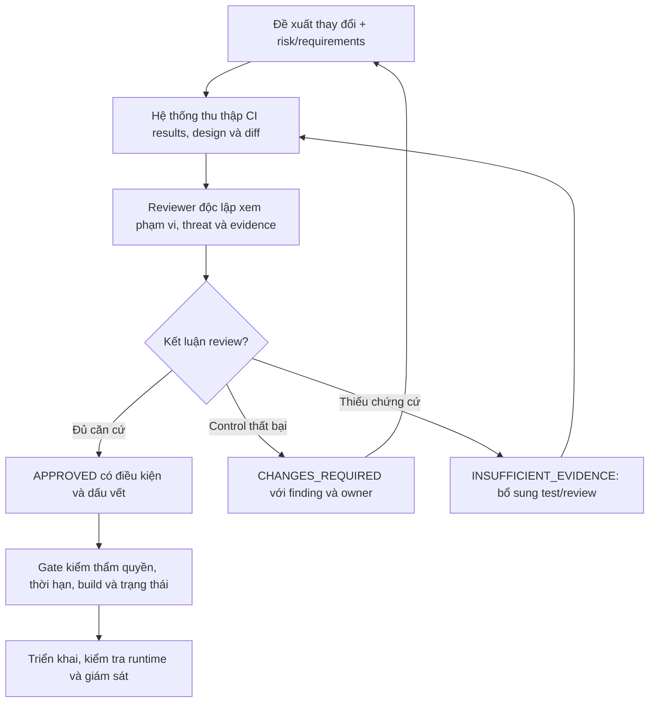

# Manual control

## Mục tiêu học tập

Sau bài học này, bạn có thể:

- Giải thích **manual control (kiểm soát thủ công)** trong security assurance và phân biệt nó với **automated control** và **hybrid/IT-dependent manual control**.
- Thiết kế một kiểm soát thủ công có **mục tiêu, trigger, tần suất, đối tượng, người thực hiện, người phê duyệt, tiêu chí xử lý ngoại lệ và bằng chứng** rõ ràng.
- Phân tích các kiểm soát như **phê duyệt thay đổi, rà soát quyền truy cập, đánh giá ngoại lệ bảo mật, review thủ công kết quả quét và xác minh khắc phục**.
- Đánh giá **design effectiveness** (hiệu lực thiết kế) và **operating effectiveness** (hiệu lực vận hành) mà không nhầm việc có checklist hoặc chữ ký với bằng chứng kiểm soát thật sự hoạt động.
- Liên kết **risk → security requirement → manual control → cách thực hiện → evidence → finding → remediation → residual risk**.
- Xây dựng quy trình kiểm chứng lặp lại, giám sát quá hạn và cải tiến thủ công/tự động hóa trong vòng đời phát triển và vận hành hệ thống Java/Spring Boot.

## 1. Manual control là gì?

**Security control** là biện pháp kỹ thuật, tổ chức hoặc quy trình nhằm thay đổi khả năng xảy ra hoặc tác động của rủi ro đối với mục tiêu bảo mật. **Manual control** là kiểm soát mà một hoặc nhiều **con người cần thực hiện một hành động, đánh giá hoặc quyết định có ý nghĩa** để kiểm soát rủi ro. Công cụ có thể hỗ trợ đưa dữ liệu, nhắc việc và lưu hồ sơ, nhưng bước quyết định hoặc kiểm chứng quan trọng **không hoàn toàn được hệ thống tự động thực hiện**.

Ví dụ: một thay đổi cấp thêm quyền `EXPORT_ALL_GRADES` vào production phải được một người có thẩm quyền độc lập với người đề xuất **đánh giá lý do nghiệp vụ, đối chiếu chính sách least privilege và phê duyệt** trước khi Operator cấp quyền. Ticket và biểu mẫu có thể được tạo tự động, nhưng việc đánh giá và phê duyệt là kiểm soát thủ công.

Manual control phù hợp với những trường hợp cần hiểu bối cảnh, suy luận nghiệp vụ hoặc đánh giá rủi ro mà một rule tự động chưa mô tả đầy đủ. Tuy nhiên, **con người có thể quên, thiên lệch, bị quá tải hoặc chỉ bấm phê duyệt hình thức**. Vì vậy, kiểm soát thủ công phải được thiết kế sao cho có thể **thực hiện nhất quán, truy vết và kiểm chứng bằng chứng**.

Trong chương trình **SECURITY_SECURITY_ASSURANCE**, một manual control không được xem là hiệu quả chỉ vì nó xuất hiện trong policy. Cần chứng minh nó được thực hiện đúng đối tượng, đúng lúc, bởi người có thẩm quyền, dựa trên đủ thông tin và có kết quả xử lý sai lệch.

### 1.1. Ba dạng kiểm soát theo mức tự động hóa

| Dạng | Thành phần quyết định | Ví dụ | Bằng chứng cần xem |
| --- | --- | --- | --- |
| **Manual control** | Người thực hiện trực tiếp một bước đánh giá, xác minh hoặc thao tác. | Security lead đọc thiết kế tích hợp đối tác và ký nhận xét rủi ro. | Hồ sơ review có nội dung, người làm, thời gian, kết quả và phát hiện. |
| **Automated control** | Hệ thống tự áp dụng rule được định nghĩa trước. | Pipeline chặn build khi một security test bắt buộc thất bại. | Rule/version, CI run, quyền sửa cấu hình gate và trạng thái build. |
| **IT-dependent manual / hybrid control** | Hệ thống tạo báo cáo/cảnh báo, con người dựa vào đó để review/quyết định. | IAM xuất danh sách quyền, service owner xem từng quyền rồi yêu cầu thu hồi. | Chất lượng báo cáo nguồn **và** bằng chứng người review, quyết định, kết quả thu hồi. |

**Có công cụ không đồng nghĩa tự động hóa kiểm soát.** Nếu công cụ chỉ gửi email mà không bảo đảm ai đã đánh giá nội dung, quy trình vẫn có thành phần thủ công cần kiểm chứng. Ngược lại, con người duyệt một dashboard không có nghĩa mọi bước phía sau là thủ công; backend có thể tự thực thi việc cấp hoặc thu hồi quyền.

### 1.2. Hai câu hỏi để nhận diện manual control

1. Nếu không có người thực hiện bước này, **cơ chế ngăn/nghiên cứu/phát hiện rủi ro còn hoạt động đủ theo yêu cầu không**?
2. Có thể chỉ ra **một quyết định hoặc hành động của người cụ thể**, cùng đầu vào và đầu ra có thể kiểm chứng, hay chỉ có trạng thái chung “đã xem”?

Nếu việc kiểm tra thay đổi mạng được một policy-as-code tự động chặn và con người chỉ nhận thông báo để biết, kiểm soát ngăn chặn chính là **automated**; con người có thể đóng vai trò giám sát. Nếu hệ thống chỉ báo cấu hình có nguy cơ và một chuyên gia phải đánh giá rồi quyết định rollback, đây là **hybrid control**.

## 2. Khi nào nên dùng manual control?

Không nên mặc định con người luôn tốt hơn automation hoặc ngược lại. Chọn mô hình từ **threat/risk scenario**, đặc tính dữ liệu, khả năng biểu diễn bằng rule, nhu cầu giải thích quyết định và chi phí vận hành.

| Bối cảnh | Vì sao có thể cần con người? | Gợi ý kết hợp công cụ |
| --- | --- | --- |
| **Phân quyền nghiệp vụ phức tạp** | Quyền của giáo viên phụ thuộc phân công lớp, tình trạng hợp đồng, mục đích sử dụng. | Hệ thống kiểm quyền runtime tự động; review thủ công các quyền đặc biệt, ngoại lệ hoặc thay đổi vai trò. |
| **Thay đổi kiến trúc** | Ranh giới tin cậy mới và tác động đến mục tiêu bảo mật đòi hỏi phân tích. | Checklist threat modeling, sơ đồ luồng, test và ticket hỗ trợ reviewer. |
| **Đánh giá kết quả scanner** | Severity máy quét không đủ ngữ cảnh khai thác và ảnh hưởng nghiệp vụ. | Tự động phát hiện, phân nhóm; chuyên gia xác nhận tình trạng và ưu tiên theo rủi ro. |
| **Chấp nhận rủi ro còn lại** | Quyết định trade-off phải theo risk appetite, thẩm quyền, nghĩa vụ và hậu quả. | Hệ thống ghi approval, giới hạn hiệu lực, nhắc hết hạn, chặn sai phạm vi. |
| **Phản ứng sự cố chưa có playbook đầy đủ** | Phải đánh giá dấu hiệu, hậu quả và nhiều phương án chưa dự đoán trước. | Tự động gom telemetry, tạo incident, đẩy cảnh báo; incident commander quyết định. |
| **Rà soát quyền định kỳ** | Người quản lý biết ai thực sự còn cần quyền nào. | Tự động xuất danh sách đầy đủ, nhắc lịch, thu hồi và đối soát sau review. |

**Không nên dùng phê duyệt thủ công làm biện pháp duy nhất** để chặn một đường khai thác kỹ thuật lặp lại được. Ví dụ, có người ký xác nhận rằng API đã an toàn không thay thế việc **server kiểm quyền theo từng tài nguyên** khi request đến. Manual control hỗ trợ thiết kế, kiểm chứng và quản trị của automated controls, không tự tạo ra authorization ở runtime.

## 3. Các loại manual control theo mục đích

Manual control có thể được phân loại theo **thời điểm tác động tới rủi ro**:

| Loại | Mục đích | Ví dụ | Giới hạn |
| --- | --- | --- | --- |
| **Preventive – phòng ngừa** | Ngăn hoạt động rủi ro trước khi nó được phép diễn ra. | Hai người độc lập review việc cấp quyền production đặc biệt. | Review quá hời hợt có thể để lọt quyết định sai. |
| **Detective – phát hiện** | Phát hiện control sai lệch hoặc hành vi bất thường sau khi hoạt động xảy ra. | Hằng tháng chủ dịch vụ đối chiếu quyền thực tế với danh sách được duyệt. | Khoảng thời gian giữa các lần review có thể chứa rủi ro chưa phát hiện. |
| **Corrective – khắc phục** | Đưa hệ thống về trạng thái phù hợp sau khi tìm ra lỗi. | Chủ control xác minh bản vá và yêu cầu mở lại nếu lỗi còn tồn tại. | Đóng finding thiếu re-test không chứng minh đã khắc phục. |
| **Directive – định hướng** | Thiết lập quy tắc và hướng dẫn hành vi. | Đào tạo bắt buộc về xử lý secrets cho người có quyền vận hành. | Đào tạo hoàn tất không chứng minh mọi thao tác thực tế đều đúng. |
| **Compensating – bù trừ** | Giảm rủi ro khi control dự kiến không khả dụng đầy đủ. | Review đặc biệt cho một luồng thay đổi trong khoảng ngoại lệ tạm. | Phải chứng minh giảm rủi ro đủ; không tự làm mất lỗ hổng gốc. |

Đây là các **nhãn có thể giao nhau**: rà soát quyền truy cập là detective vì tìm quyền không còn phù hợp; thao tác thu hồi sau review là corrective; phê duyệt yêu cầu cấp quyền mới là preventive. Khi thiết kế, phải nói rõ **hành động cụ thể** nào thực hiện chức năng nào.

## 4. Cấu trúc của một manual control có thể kiểm chứng

Một manual control nên có hồ sơ thiết kế gồm các thành phần sau:

| Thành phần | Câu hỏi bắt buộc | Ví dụ |
| --- | --- | --- |
| **Control ID và requirement** | Hỗ trợ mục tiêu rủi ro nào, yêu cầu nào? | `MAN-IAM-01`: review quyền đặc quyền. |
| **Phạm vi** | Áp dụng cho tài sản, môi trường, người dùng, dữ liệu nào? | Tất cả quyền production của `learning-platform`. |
| **Trigger/tần suất** | Khi nào phải thực hiện? Có trigger sau incident hoặc thay đổi? | Trước mỗi yêu cầu cấp quyền đặc biệt; rà soát theo kỳ. |
| **Input** | Reviewer cần hồ sơ, báo cáo và ngữ cảnh nào? | Danh sách quyền runtime, owner, nghiệp vụ, ngày sử dụng gần nhất theo dữ liệu có sẵn. |
| **Hoạt động** | Reviewer phải làm rõ những kiểm tra nào? | So sánh quyền được cấp với nhu cầu nhiệm vụ và phê duyệt hiện hành. |
| **Tiêu chí quyết định** | Thế nào là hợp lệ, không hợp lệ, chưa đủ dữ liệu? | `KEEP`, `REVOKE`, `INVESTIGATE` với lý do. |
| **Người thực hiện/độc lập** | Ai review và ai không được tự duyệt? | Service owner hoặc người được ủy quyền, không tự duyệt quyền cá nhân. |
| **Đầu ra và bằng chứng** | Lưu gì để người khác kiểm tra lại được? | Snapshot báo cáo, từng quyết định, người duyệt, mốc thời gian, ticket thu hồi. |
| **Theo dõi ngoại lệ** | Quyền thừa, thiếu dữ liệu hoặc quá hạn được xử lý thế nào? | Finding, chủ xử lý, SLA nội bộ, chuyển cấp. |
| **Kiểm tra hiệu quả** | Ai kiểm tra việc review đã thực hiện đúng? | Assurance reviewer lấy mẫu và đối chiếu quyền runtime. |
| **Điều kiện tái đánh giá** | Khi nào thiết kế control mất hiệu lực? | Đổi IAM/IdP, mô hình vai trò hoặc nguồn báo cáo. |

Một câu kiểu *“quản lý rà soát quyền thường xuyên”* thiếu hầu hết thông tin cần thiết. Ngược lại, chuẩn cụ thể không nhất thiết quy định mỗi cú click: **standard** nêu yêu cầu, **SOP/runbook** mô tả cách thực hiện, **control record** liên kết hai phần với kết quả và bằng chứng.

### 4.1. Thiết kế theo nguyên tắc “nói rõ ai làm gì”

**Ai:** reviewer thực hiện, chủ hệ thống chịu trách nhiệm, người phê duyệt và người xác minh độc lập khi cần.

**Làm gì:** không chỉ “review”, mà đối chiếu dữ liệu, nêu sai lệch, quyết định xử lý và theo dõi hoàn tất.

**Khi nào:** trước khi cấp quyền, sau thay đổi, theo lịch, khi nhận alert hoặc khi có dấu hiệu quyền bị lạm dụng.

**Với tiêu chí nào:** quyền có cần thiết, được phê duyệt, đúng đối tượng, có hạn và vẫn thuộc risk limits không?

**Bằng chứng nào:** nguồn danh sách, phiên bản snapshot, nhận xét, quyết định, người thực hiện, ngày giờ, yêu cầu khắc phục và kết quả kiểm tra lại.

## 5. Ví dụ 1: rà soát quyền truy cập thủ công

### 5.1. Kịch bản rủi ro

Một nền tảng học tập cho phép người vận hành truy cập dữ liệu điểm số qua tài khoản đặc quyền. Nhân viên đổi nhóm, nghỉ việc hoặc được cấp quyền tạm nhưng quyền không được thu hồi. **Threat scenario**: tài khoản bị chiếm đoạt hoặc người có quyền không còn chính đáng sử dụng quyền thừa để đọc/sửa dữ liệu.

Control `MAN-IAM-01` được thiết kế để **phát hiện và khắc phục quyền không còn cần thiết** bằng đối chiếu quyền runtime với nhu cầu nghiệp vụ. Tổ chức giả định thực hiện theo kỳ và bổ sung trigger khi người dùng đổi vị trí, có sự cố hoặc thay mô hình IAM. **Không có một chu kỳ mặc định phù hợp cho mọi tổ chức**; tần suất phải theo mức rủi ro và nghĩa vụ áp dụng.

### 5.2. Quy trình thực hiện

1. **Chuẩn bị nguồn dữ liệu:** hệ thống IAM xuất toàn bộ quyền thuộc phạm vi, bao gồm tài khoản con người, service account và quyền kế thừa nếu liên quan. Lưu timestamp, điều kiện lọc, môi trường và phiên bản truy vấn.
2. **Xác nhận độ đầy đủ:** đối chiếu số lượng tài khoản, hệ thống nguồn, role/group và quyền được kế thừa; không mặc định báo cáo có đủ chỉ vì đã tải CSV.
3. **Phân công reviewer:** service owner hoặc người có thẩm quyền hiểu nhu cầu công việc, có tuyến thay thế và quy tắc tránh tự xác nhận quyền của mình.
4. **Review từng quyền/ràng buộc:** đánh giá chức năng cần thiết, thời hạn, quan hệ với chủ hệ thống, quyền đặc biệt và sự khác biệt so với phê duyệt trước.
5. **Ghi quyết định:** `KEEP` (có căn cứ), `REVOKE` (không còn cần), `INVESTIGATE` (chưa đủ dữ liệu), cùng nhận xét; không dùng `KEEP` hàng loạt thiếu lý do với quyền rủi ro cao.
6. **Thực hiện thu hồi:** tạo ticket cho Operator/IAM service; bảo đảm quyền đã được sửa **ở hệ thống nguồn**, không chỉ đổi trạng thái trong bảng review.
7. **Đối soát:** kiểm tra quyền runtime sau xử lý và cập nhật những trường hợp chưa hoàn tất hoặc phải chuyển cấp.
8. **Lưu hồ sơ:** kết quả review, quyết định từng quyền, lịch sử thay đổi, evidence thu hồi và ngoại lệ còn hiệu lực.

### 5.3. Các trạng thái phải phân biệt

| Trạng thái | Ý nghĩa | Hành động |
| --- | --- | --- |
| `KEEP_VERIFIED` | Quyền trong phạm vi được reviewer xác minh còn phù hợp, có lý do và bằng chứng. | Giữ và xem lại theo trigger/tần suất. |
| `REVOKE_PENDING` | Reviewer quyết định thu hồi nhưng chưa có bằng chứng đã thu hồi. | Theo dõi owner, hạn và chuyển cấp khi quá hạn. |
| `REVOKED_VERIFIED` | Quyền đã không còn tại nguồn IAM được kiểm tra. | Lưu kết quả đối soát. |
| `INVESTIGATE` | Báo cáo thiếu hoặc có mâu thuẫn về chủ sở hữu/mục đích. | Thu thập bổ sung, chưa ghi là đạt. |
| `EXCEPTION_ACTIVE` | Có quyết định ngoại lệ hợp lệ, rõ phạm vi/thời hạn. | Giám sát điều kiện và không gộp thành `KEEP_VERIFIED` thuần túy. |

Chỉ thống kê “100% người quản lý đã bấm hoàn tất” là yếu: cần biết **từng quyền nào được xem**, báo cáo nguồn có đầy đủ không và bao nhiêu yêu cầu thu hồi thực sự được triển khai.

## 6. Ví dụ 2: phê duyệt thủ công thay đổi bảo mật quan trọng

### 6.1. Tình huống

Nhóm phát triển đề xuất thêm endpoint Java/Spring Boot `POST /api/classes/{classId}/grades/exports` để giáo viên xuất bảng điểm. Thay đổi có thể tăng phạm vi dữ liệu, xuất hiện kho tệp và đường tải xuống mới.

Control `MAN-CHG-02`: **mọi thay đổi đưa một đường đọc/xuất dữ liệu học viên mới vào production phải được security reviewer đánh giá tác động và xác nhận các security requirements bị ảnh hưởng trước khi phê duyệt phát hành**.

Đây là **manual preventive control** ở cấp quy trình phát hành. Nhưng control phân quyền runtime vẫn phải được triển khai và kiểm thử độc lập; một reviewer ký approval **không thay thế** logic xác thực/ủy quyền.

### 6.2. Checklist có nội dung đánh giá

| Nội dung reviewer cần xem | Câu hỏi cụ thể | Evidence |
| --- | --- | --- |
| Phạm vi dữ liệu | Endpoint xuất trường nào, số bản ghi nào, có dữ liệu cá nhân thừa không? | Data-flow diagram, schema export, kết quả test dữ liệu. |
| Danh tính/quyền | Giáo viên được phân công kiểm tra ở server chưa? Có đường bypass qua ID hoặc export job? | Code review, test cho phép/từ chối theo lớp. |
| Luồng tệp | Ai tạo và tải file, URL có hạn, quyền storage và xóa dữ liệu thế nào? | Storage policy, TTL test, API download test. |
| Abuse/availability | Có quota, giới hạn job, rollback khi lỗi không? | Load/abuse test phù hợp, metrics và runbook. |
| Audit | Sự kiện tạo/tải file có dấu vết, không lộ bí mật? | Audit-event test, log pipeline. |
| Risk/finding | Còn finding Critical/High hoặc khoảng trống assurance nào? | Risk register, release gate, ngoại lệ trong thẩm quyền. |

### 6.3. Luồng quyết định hợp lệ



Điểm quan trọng là **quyết định phải gắn với revision và scope**. Một approval cho commit `abc` không tự áp dụng cho commit `def` nếu thay đổi sau có thể ảnh hưởng tới security. Tương tự, một review staging không tự chứng minh config production sẽ đúng; cần kiểm tra runtime và thay đổi liên quan.

### 6.4. Hệ thống phải thực thi quyết định, không chỉ hiển thị nhãn

Nếu quy định bắt buộc phải có review trước phát hành, release gate cần kiểm tra **quyết định đang có hiệu lực, đúng người, đúng build, đúng tài sản và không bị thu hồi**. Không cho phép người tạo thay đổi tự đổi trường `approved=true` trong request rồi được cấp quyền production.

Một đoạn Java **minh họa logic bảo vệ quyết định** trong một ứng dụng quản lý change:

```java
public record ApprovalDecision(
        String changeId,
        String reviewedRevision,
        String requesterId,
        String reviewerId,
        String decision,
        Instant reviewedAt
) {}

public final class ApprovalRules {
    public static boolean isValidForRelease(
            ApprovalDecision approval,
            String releaseChangeId,
            String releaseRevision
    ) {
        return approval != null
                && "APPROVED".equals(approval.decision())
                && approval.changeId().equals(releaseChangeId)
                && approval.reviewedRevision().equals(releaseRevision)
                && !approval.requesterId().equals(approval.reviewerId());
    }
}
```

Đây chỉ là **một phần predicate** để minh họa scope và nguyên tắc hai người; nó **chưa đủ cho production**: phải xác minh danh tính reviewer từ hệ thống tin cậy, quyền duyệt, trạng thái thu hồi, thời hạn, toàn vẹn bản ghi, việc thay đổi lại code, các điều kiện policy và mối liên hệ với kết quả test. Các trường `requesterId`/`reviewerId` không được tin nếu client tự gửi; backend phải lấy từ authentication và hệ thống quản trị quyền. Việc lưu/chuyển approval cũng cần bảo vệ chống chỉnh sửa.

### 6.5. Review thủ công có thể kiểm thử tự động

Manual control không loại trừ automated test. Có thể kiểm tra **workflow** để phát hiện việc bỏ qua:

```text
Case 1: Không có approval → release bị chặn
Case 2: Người yêu cầu tự approve → bị chặn
Case 3: Approval thuộc commit cũ → bị chặn
Case 4: Reviewer không có quyền → bị chặn
Case 5: Approval hợp lệ nhưng security test bắt buộc FAIL → vẫn bị chặn
Case 6: Approval hợp lệ, tests đạt, runtime verification yêu cầu → tiếp tục đúng quy trình
```

Những phép kiểm này hỗ trợ kiểm chứng **cơ chế thực thi** phê duyệt; còn chất lượng phán đoán của người review phải được đánh giá qua nội dung hồ sơ, mẫu quyết định và kết quả thực tế.

## 7. Ví dụ 3: kiểm soát thủ công trong vulnerability và ngoại lệ

Máy quét SCA phát hiện một dependency có CVE. **Scanner tự động phát hiện chỉ dấu**, nhưng việc kết luận mức ưu tiên kinh doanh có thể cần chuyên gia xem phiên bản thực chạy, đường khai thác, exposure, bối cảnh dữ liệu và biện pháp giảm thiểu.

Control `MAN-VULN-03`: **mọi finding trọng yếu chưa sửa trong thời hạn quy định phải được chủ rủi ro có thẩm quyền đánh giá, quyết định phương án, ghi biện pháp bù trừ và theo dõi tới khi xác minh khắc phục**.

| Bước | Hành động của người thực hiện | Bằng chứng không thể thiếu |
| --- | --- | --- |
| Triage | Xác định thành phần có thật trong bản đang chạy và chức năng có liên quan. | SBOM/dependency inventory, version, cách xác định phạm vi. |
| Risk assessment | Xem khả năng khai thác, tác động, quyền và dữ liệu liên quan. | Threat scenario, inherent/residual risk, giả định. |
| Treatment | Sửa, giảm phơi bày, hoãn hoạt động, hoặc đề nghị ngoại lệ hợp lệ. | Kế hoạch hành động, controls, owner, thời hạn. |
| Approval | Người có thẩm quyền xem bằng chứng và phê duyệt/không phê duyệt. | Decision record, thẩm quyền, lý do, scope, expiry. |
| Verification | Reviewer kiểm tra biện pháp/patch trong môi trường thực và mở lại nếu chưa đạt. | Re-test, runtime evidence, kết quả đóng. |

**Risk acceptance không tự sửa vulnerability.** Nếu finding còn tồn tại mà có ngoại lệ hợp lệ, phải thể hiện rõ trạng thái `EXCEPTION_APPLIED`, không đổi sang `PATCH_VERIFIED` hay `PASS`. Nếu scanner báo sai, xử lý là **xác minh false positive** với chứng cứ, không nên xin ngoại lệ không cần thiết.

## 8. Tính hiệu quả của manual control: thiết kế và vận hành

Security assurance phải phân biệt **control được thiết kế hợp lý** với **control đã chạy đủ và đúng trong thực tế**.

### 8.1. Design effectiveness

Một manual control có thiết kế tốt khi:

- Gắn với **rủi ro và mục tiêu bảo mật cụ thể**, có chỉ rõ rủi ro nào nó *không* giải quyết.
- Có **trigger đầy đủ**, không bỏ qua thay đổi ngoài Git như cấu hình IdP hay cloud IAM.
- Người thực hiện có **chuyên môn, quyền truy cập dữ liệu đầu vào và thẩm quyền phù hợp**.
- Quy định **độ chính xác** của review (quyền theo tài nguyên, phiên bản, thời điểm), không chỉ mức tổng hợp như “đã xem report”.
- Có **tính độc lập** tương xứng rủi ro và tránh một người tự duyệt hoạt động của mình.
- Xử lý tình huống **người vắng mặt, dữ liệu không đủ, quá hạn và kết quả không thống nhất**.
- Có khả năng tạo **bằng chứng truy vết** và cơ chế phát hiện chính manual control bị bỏ qua.

Ví dụ, một review quyền hàng quý có thể có thiết kế kém nếu danh sách đầu vào chỉ lấy người dùng từ một IdP mà không bao gồm service accounts/role kế thừa của các hệ thống khác thuộc cùng phạm vi.

### 8.2. Operating effectiveness

Khi đánh giá vận hành, người kiểm chứng hỏi:

1. Kiểm soát có được kích hoạt **đúng mọi sự kiện/tần suất thuộc phạm vi** không?
2. Có bằng chứng người có thẩm quyền **thực sự xem thông tin cụ thể** không?
3. Reviewer có đủ thông tin và dành đủ phân tích để đưa ra kết luận hợp lý không?
4. Các trường hợp ngoại lệ có được phát hiện, ghi nhận, chuyển cấp và theo dõi không?
5. Hành động khắc phục có được **thực hiện trên hệ thống nguồn** và xác minh lại không?
6. Kết quả có khớp với revision, môi trường, thời điểm và trạng thái thực tế không?
7. Có dấu hiệu phê duyệt theo lô một cách máy móc hoặc backdate quyết định không?

**Chữ ký hoặc timestamp** giúp chứng minh có một hành động, nhưng không đủ kết luận chất lượng review. Ví dụ một manager bấm “Approve all” trong 10 giây cho 400 quyền rủi ro cao có thể hợp lệ về mặt thao tác, nhưng cần kiểm tra liệu quy trình review có thực sự đáp ứng mức độ yêu cầu.

### 8.3. Đánh giá báo cáo đầu vào cho hybrid control

Khi con người review dữ liệu do hệ thống xuất, assurance phụ thuộc vào **độ đầy đủ và chính xác của dữ liệu**. Cần đánh giá:

- Hệ thống nguồn và tập tài sản có đầy đủ không; có bộ lọc làm thiếu đối tượng không?
- Báo cáo được tạo vào lúc nào, theo timezone nào, đã bao gồm quyền kế thừa, quyền tạm và tài khoản không tương tác?
- Có ai sửa dữ liệu CSV/snapshot trước khi người review xem không?
- Dữ liệu còn **phù hợp thời điểm quyết định** không, hay đã thay đổi sau khi export?
- Có thể đối chiếu mẫu báo cáo với IAM/DB/log gốc để xác nhận không?

Nếu nguồn dữ liệu bị lỗi, việc người quản lý review cẩn thận một bản báo cáo thiếu dữ liệu vẫn có thể cho kết luận sai.

## 9. Phương pháp kiểm tra audit và lấy mẫu

Người đánh giá không chỉ tìm một ticket đẹp nhất; họ cần xác định **toàn bộ tập sự kiện mà control lẽ ra phải thực hiện**, sau đó dùng phương pháp phù hợp để kiểm tra.

### 9.1. Xác định population trước khi chọn mẫu

Ví dụ với control `MAN-CHG-02`, *population* là **tất cả thay đổi thuộc phạm vi phải security review trong kỳ**, không phải chỉ các ticket có nhãn `security-reviewed`. Để kiểm tra độ đầy đủ có thể đối soát danh sách deployments/config changes với change tickets và quy tắc trigger.

Với `MAN-IAM-01`, population có thể gồm toàn bộ tài khoản/quyền đặc quyền thuộc môi trường và thời gian được chuẩn quy định. Nếu chỉ lấy danh sách những tài khoản đã được reviewer mở, kiểm tra không phát hiện nhóm bị bỏ sót.

### 9.2. Kiểm tra trên một mẫu

Với từng mẫu, đối chiếu:

1. **Trigger đúng:** sự kiện có thuộc phạm vi và thời điểm phải áp dụng không?
2. **Input đáng tin:** danh mục quyền/build/manifest/scan đúng version và đầy đủ không?
3. **Hành động thủ công có nội dung:** reviewer xem gì, đưa nhận xét/quyết định nào?
4. **Thẩm quyền và tách nhiệm vụ:** ai thực hiện, có độc lập và đủ quyền không?
5. **Thời gian:** review xảy ra **trước** khi hoạt động được phép nếu control là preventive?
6. **Hành động sau quyết định:** thu hồi quyền, sửa config, chạy lại test, mở finding đã xảy ra chưa?
7. **Bằng chứng:** có timestamp, artifact, kết quả và lịch sử sửa đổi để người khác kiểm tra?

**Một mẫu đạt không chứng minh cả population đều đạt**. Kích thước, phương pháp chọn mẫu, mức rủi ro và độ tin cậy cần được nêu rõ theo mục tiêu đánh giá. Có thể ưu tiên chọn mẫu có rủi ro cao, gần cuối kỳ, người duyệt mới, ngoại lệ hoặc thao tác vào ngày nghỉ để kiểm tra sâu; nhưng đó là **risk-based sampling**, không tự mang ý nghĩa suy luận thống kê ngẫu nhiên cho toàn bộ population.

### 9.3. Mẫu bảng bằng chứng một lần review

| Thuộc tính | Giá trị minh họa | Vai trò kiểm chứng |
| --- | --- | --- |
| Review ID | `REV-IAM-042` | Định danh hồ sơ duy nhất. |
| Population ref | `iam-export/snapshot-2026-11` | Xác định nguồn và tập đối tượng. |
| Scope | Quyền production của dịch vụ học tập | Ngăn suy rộng ngoài phạm vi. |
| Reviewer và quyền | `service-owner-role` | Đối chiếu thẩm quyền và tính độc lập. |
| Input timestamp | `2026-11-28T02:00:00Z` | Kiểm tra độ mới. |
| Findings | 2 quyền không còn cần; 1 quyền cần làm rõ | Chứng minh có đánh giá chi tiết. |
| Follow-up refs | `IAM-REVOKE-42`, `IAM-INV-43` | Liên kết tới xử lý và điều tra. |
| Evidence đóng | Runtime quyền đã bị thu hồi, reviewer xác minh | Phân biệt quyết định với thực thi. |

Các giá trị chỉ minh họa cấu trúc, **không phải kết quả review có thật**.

## 10. Claim – Argument – Evidence cho manual control

**Claim**: “Trong kỳ đánh giá K, mọi thay đổi cấp quyền đặc quyền production thuộc phạm vi `MAN-IAM-01` đã được người có thẩm quyền độc lập với người yêu cầu đánh giá trước khi cấp, và mọi quyết định thu hồi quyền có bằng chứng đối soát.”

**Argument**:

1. Danh sách toàn bộ thay đổi quyền được lấy từ nguồn IAM và change-management, có đối soát để phát hiện thao tác ngoài quy trình.
2. Workflow không cho người yêu cầu tự duyệt và có cơ chế kiểm tra quyền của reviewer.
3. Người reviewer sử dụng mô tả mục đích và quyền cụ thể để đưa ra quyết định có nhận xét.
4. Chỉ quyết định hợp lệ trước thời điểm cấp quyền được phép tiếp tục; trường hợp ngoại lệ có tuyến xử lý riêng.
5. Hành động thu hồi và kiểm chứng trạng thái IAM được lưu, các việc quá hạn được chuyển cấp.

**Evidence**:

| Lập luận | Chứng cứ cần có | Phần có thể vẫn chưa chứng minh |
| --- | --- | --- |
| Tập sự kiện đầy đủ | IAM change log, deployment/change log, phương pháp đối soát. | Hệ thống nguồn chưa tích hợp hoặc quyền kế thừa không được ghi. |
| Người duyệt hợp lệ | Role assignment tại thời điểm duyệt, audit trail, kiểm tra tách nhiệm vụ. | Quyền reviewer thay đổi giữa kỳ, yêu cầu đặc biệt chưa được xét. |
| Review có nội dung | Quyết định từng quyền, nhận xét về nghiệp vụ và điều kiện. | Reviewer chỉ click mà không thực sự đối chiếu. |
| Hoạt động preventive | Mốc approval và mốc cấp quyền, gate logs. | Có đường cấp quyền ngoài gate/break-glass chưa được kiểm tra. |
| Thu hồi đã hoàn tất | Ticket, kết quả truy vấn IAM nguồn sau sửa, reviewer sign-off. | Quyền vẫn tồn tại ở cache, hệ thống thứ cấp hoặc token còn hiệu lực. |

**Giới hạn của claim**: Một đợt audit lấy mẫu chỉ hỗ trợ kết luận trong phạm vi/method đã kiểm tra. Không nên tuyên bố “mọi quyền đều an toàn” khi có quyền chưa xuất hiện trong báo cáo hoặc có service accounts chưa được bao phủ.

### 10.1. Mẫu bản ghi manual control cho assurance

```yaml
control_id: "MAN-IAM-01"
type: "IT_DEPENDENT_MANUAL"
purpose: "Detect and remediate unnecessary production privileges"
requirement_id: "SEC-IAM-LEAST-PRIVILEGE"
scope:
  system: "learning-platform"
  environments: ["production"]
  identities: ["human-admin", "service-accounts"]
trigger:
  - "Scheduled review according to approved policy"
  - "Role/ownership or high-risk access change"
owner_role: "service-owner"
reviewer_role: "authorized-access-reviewer"
population_source:
  ref: "<trusted-iam-snapshot>"
  timestamp: "<observed-instant>"
quality_checks:
  - "Coverage of all in-scope identities"
  - "Reconciliation with source IAM and inherited roles"
decisions:
  - subject_ref: "<identity-reference>"
    permission_ref: "<permission-reference>"
    outcome: "REVOKE_PENDING"
    reason: "<documented-justification>"
    followup_ref: "<remediation-ticket>"
evidence_refs:
  - "<secure-review-record>"
  - "<runtime-reconciliation-evidence>"
assurance_result: "INSUFFICIENT_EVIDENCE"
uncertainties:
  - "Permission revocation has not yet been confirmed on source system"
reassess_when:
  - "IAM source or access model changes"
```

YAML trên là **mẫu cấu trúc minh họa**. Không có công cụ nào tự bảo đảm control được đánh giá chỉ vì file chứa trường `outcome`. Bản ghi phải trỏ tới artifact thật, được phân quyền và có dấu vết đáng tin. Trạng thái `INSUFFICIENT_EVIDENCE` không phải `PASS`, cũng không tự kết luận control đã thất bại: cần thu thập bằng chứng còn thiếu.

## 11. Những rủi ro và điểm yếu của manual control

| Rủi ro của kiểm soát | Tín hiệu quan sát | Cải tiến |
| --- | --- | --- |
| **Rubber-stamping** (duyệt theo thói quen) | Hàng trăm quyết định `Approve All` trong thời gian ngắn, không nhận xét. | Đưa dữ liệu quan trọng tới reviewer, bắt giải trình các khoản rủi ro cao, review chất lượng theo mẫu. |
| **Reviewer thiếu độc lập** | Người tạo thay đổi cũng phê duyệt hoặc xác minh hoàn tất. | Phân tách nhiệm vụ, kiểm tra quyền duyệt tự động và audit trail. |
| **Nguồn dữ liệu không đầy đủ** | Danh sách IAM không gồm service accounts hoặc quyền kế thừa. | Đối soát với hệ thống nguồn, kiểm tra completeness và accuracy. |
| **Quá hạn hoặc bị bỏ qua** | Không có người nhận, reviewer nghỉ phép, ticket treo. | Backup owner, lịch nhắc, chuyển cấp và điều kiện chặn rõ. |
| **Thiếu tiêu chí đánh giá** | Cùng tình huống nhưng người này approve, người khác reject. | Xây rubric rủi ro, ví dụ rõ và huấn luyện reviewer. |
| **Không kiểm chứng hành động sau review** | Đã yêu cầu revoke nhưng quyền vẫn tồn tại. | Tạo task có owner, deadline và đối chiếu quyền thực sau xử lý. |
| **Bằng chứng có thể sửa hoặc không gắn phiên bản** | CSV rời rạc, không biết nguồn và thời điểm. | Lưu tại kho artifact có kiểm soát, audit trail, revision/timestamp. |
| **Quá nhiều ngoại lệ** | Manual process trở thành cơ chế bỏ qua control tự động. | Báo cáo rủi ro ngoại lệ, giới hạn scope và expiry, xử lý nguyên nhân gốc. |
| **Một điểm phụ thuộc con người** | Reviewer duy nhất vắng mặt, release bị ép bypass. | Phân công dự phòng, escalation và điều kiện dừng an toàn. |
| **Không đánh giá lại khi hệ thống thay đổi** | Duyệt theo mẫu cũ dù API hoặc dữ liệu thay đổi. | Trigger reassessment khi thay trust boundary, risk appetite, công cụ hoặc role. |

### 11.1. Có thể tự động hóa phần nào?

Một quy trình cải tiến thường là:

1. **Chuẩn hóa đầu vào** và mã requirement/control để giảm ghi chép tự do.
2. **Tự động tạo population và kiểm tra chất lượng dữ liệu**, giữ provenance.
3. **Tự động nhắc lịch, kiểm tra phân quyền approver và chặn tự phê duyệt**.
4. **Tự động thu thập một phần evidence và tạo remediation ticket**.
5. **Để con người xử lý phần đánh giá ngữ cảnh/ngoại lệ thật sự cần suy luận**.
6. **Tự động đối chiếu kết quả** (ví dụ quyền IAM đã được revoke hay chưa).
7. **Giám sát chất lượng review thủ công** qua audit sampling, tỷ lệ quá hạn và nguyên nhân sai lệch.

Tự động hóa làm giảm sai sót lặp lại nhưng có thể tạo rủi ro mới: rule sai, dữ liệu thiếu, tài khoản quản trị pipeline quá quyền hoặc quyền phê duyệt bị cấp nhầm. Bước chuyển đổi từ thủ công sang tự động cần có đánh giá rủi ro theo thay đổi và bằng chứng hiệu lực mới.

## 12. Theo dõi manual control liên tục trong vận hành

Với manual control, việc đánh giá **tần suất, tính kịp thời và chất lượng** quan trọng không kém việc đếm số quyết định:

| KPI/KRI | Câu hỏi | Cách tránh diễn giải sai |
| --- | --- | --- |
| Tỷ lệ sự kiện thuộc phạm vi đã được review trước hạn | Control có được kích hoạt đầy đủ và đúng lúc? | Population phải được lấy từ nguồn độc lập, không chỉ ticket hoàn tất. |
| Số approval tự duyệt hoặc sai thẩm quyền | Có dấu hiệu vi phạm separation of duties? | Cần kiểm tra role tại **thời điểm** approval. |
| Tỷ lệ review bị `INSUFFICIENT_EVIDENCE` | Reviewer thiếu input hoặc bằng chứng gì? | Không gộp với `FAIL` và không coi như `PASS`. |
| Số quyết định yêu cầu sửa nhưng chưa hoàn tất | Finding đã chuyển thành hành động thực tế chưa? | Đối chiếu trạng thái hệ thống nguồn, không chỉ ticket. |
| Tuổi của quyền/ngoại lệ quá hạn | Rủi ro tồn đọng bao lâu? | Xem theo mức nhạy cảm và tác động, không chỉ trung bình. |
| Tỷ lệ mẫu review có nhận xét/chứng cứ hợp lệ | Người review có thực sự áp dụng tiêu chí? | Nhận xét dài không tự chứng minh quyết định đúng; phải xem nội dung. |
| Tỷ lệ review bị mở lại sau kiểm tra độc lập | Có điểm yếu thiết kế hoặc chất lượng không? | Số tăng cũng có thể do phát hiện tốt hơn. |
| Tỷ lệ nguồn báo cáo đã kiểm tra completeness/accuracy | Hybrid control có dựa trên dữ liệu tin cậy? | Test nguồn và reconciliation phải phù hợp hệ thống. |

**Nhịp báo cáo** nên phù hợp mục tiêu: kết quả thực hiện và phát hiện cho chủ control; xu hướng và rủi ro vượt giới hạn cho risk owner; bằng chứng, mẫu và sai lệch cho assurance/audit. Một số issue cần chuyển cấp ngay, không chờ hết chu kỳ báo cáo.

## 13. Tình huống thực hành: review quyền production mang tính hình thức

### Bối cảnh

Hệ thống học tập chạy Spring Boot, có cơ sở dữ liệu điểm số và dịch vụ export CSV. Chính sách nội bộ yêu cầu các quyền đặc biệt production được người có thẩm quyền review theo kỳ. Hệ thống tự gửi bảng CSV mỗi tháng. Trong ba tháng gần đây:

- Mỗi tháng người quản lý bấm `Approve All` trong chưa đến một phút.
- Báo cáo chỉ gồm tài khoản nhân viên, **không gồm service account của export worker**.
- Một nhân viên đã chuyển bộ phận nhưng vẫn có quyền truy cập báo cáo của toàn bộ lớp.
- Reviewer đánh dấu quyền đó “cần thu hồi”, nhưng không có ticket sửa ở IAM và quyền vẫn được cấp.
- Dashboard hiển thị **`100% reviews completed`**, nên đội vận hành dự định dùng nó để chứng minh đã đạt control.

### 13.1. Phân tích theo assurance

**1. Thiết kế và nguồn dữ liệu:** có khoảng trống population vì service account không nằm trong báo cáo. Đây là vấn đề về **completeness** của nguồn hybrid control.

**2. Chất lượng vận hành:** `Approve All` quá nhanh và thiếu căn cứ là dấu hiệu cần kiểm tra **review có nội dung** hay chỉ hoàn thành hình thức. Không thể kết luận từng quyết định đều sai chỉ từ thời gian ngắn, nhưng cũng không được coi thao tác click là bằng chứng đầy đủ.

**3. Khắc phục không hoàn tất:** quyết định thu hồi quyền không đồng nghĩa đã thu hồi. Khi IAM vẫn cho phép truy cập, yêu cầu khắc phục **chưa đạt**.

**4. Claim không được chứng minh:** số liệu “100% completed” có thể phản ánh số lượt bấm xác nhận trong tập đã ghi nhận, không chứng minh mọi quyền thuộc phạm vi đã được review và xử lý đầy đủ.

**5. Hành động:** ghi finding về nguồn report, chất lượng review, quyền nhân viên chuyển bộ phận và xử lý sau quyết định. Phân công owner, đánh giá hậu quả, thu hồi quyền theo thẩm quyền, đối chiếu nguồn IAM, review lại nhóm tài khoản bị bỏ sót và cập nhật control.

### 13.2. Câu hỏi tự luyện

1. Xác định **risk scenario**, **security objective** và **manual control** cần đánh giá trong tình huống.
2. Nêu ít nhất **bốn điểm yếu thiết kế** và **ba điểm yếu vận hành**, phân biệt chúng với lỗ hổng trong chính ứng dụng.
3. Thiết kế lại nguồn population để gồm quyền nhân viên, service accounts, quyền thừa kế và quyền tạm; nêu cách kiểm tra completeness.
4. Xây workflow review với ba kết quả `KEEP`, `REVOKE`, `INVESTIGATE`, có lý do, người duyệt và evidence.
5. Viết một **claim – argument – evidence** cho quy trình được cải tiến; nêu những giới hạn của một cuộc audit lấy mẫu.
6. Đề xuất ít nhất **ba kiểm tra tự động** hỗ trợ (nhưng không thay thế hoàn toàn) phán đoán của người review.
7. Khi phát hiện nhân viên chuyển bộ phận vẫn có quyền đọc dữ liệu, ai cần được thông báo và cần điều tra thêm điều gì trước khi kết luận có incident?

**Gợi ý đối chiếu:** Claim đúng không phải “dashboard hiển thị 100%” mà là “toàn bộ quyền thuộc phạm vi đã được người đúng thẩm quyền đánh giá trong thời hạn, các quyết định thu hồi được thực hiện và đối chiếu trên IAM”. Bằng chứng gồm danh mục nguồn, kết quả reconciliation, quyết định từng quyền, quyền của reviewer, ticket thu hồi, log thay đổi IAM và kiểm tra sau sửa. Việc quyền còn tồn tại là vấn đề đã xác nhận; chưa có đủ dữ liệu để tự khẳng định quyền đã bị sử dụng trái phép. Cần đánh giá log/sự kiện, phạm vi tài sản và chuyển cấp theo playbook nếu có dấu hiệu sự cố.

## 14. Những ngộ nhận thường gặp

| Ngộ nhận | Cách hiểu đúng |
| --- | --- |
| “Manual control không cần công cụ.” | Công cụ có thể giúp lập danh sách, điều phối, ghi chứng cứ và theo dõi; bước phán đoán quan trọng vẫn là thủ công. |
| “Có chữ ký là đủ để audit.” | Cần thấy đúng người, đúng input, đúng thời điểm, có nội dung review và kết quả xử lý thực tế. |
| “Review thủ công thay được kiểm tra quyền ở API.” | Review là kiểm soát quy trình; authorization runtime phải hoạt động khi request đến. |
| “Bảng CSV có đủ dữ liệu vì được xuất từ IAM.” | Phải kiểm tra population, bộ lọc, quyền kế thừa, thời điểm và tính chính xác nguồn. |
| “Người quản lý luôn là reviewer phù hợp.” | Reviewer cần thẩm quyền, hiểu nghiệp vụ, dữ liệu và tránh xung đột lợi ích. |
| “Ticket đóng nghĩa là rủi ro đã xử lý.” | Phải có bằng chứng control đã sửa hoặc quyết định residual risk hợp lệ, không chỉ nhãn trạng thái. |
| “Review hằng quý tự động đáp ứng mọi rủi ro.” | Chu kỳ phụ thuộc tác động, nguồn đe dọa và trigger bất thường; có thể cần kiểm soát giữa kỳ. |
| “Lấy một mẫu không lỗi là cả quy trình hiệu quả.” | Kết luận phải giới hạn bởi population, phương pháp lấy mẫu và phạm vi test. |
| “Automated control luôn an toàn hơn manual.” | Automation giảm lỗi thao tác nhưng có thể sai rule hoặc thiếu dữ liệu; phải được kiểm chứng. |
| “Ngoại lệ được duyệt khiến control đã đạt.” | Ngoại lệ xử lý sai khác trong thẩm quyền, không biến một test FAIL thành PASS. |

## Tổng kết

**Manual control** đưa **sự đánh giá và quyết định của con người** vào quá trình quản trị rủi ro bảo mật: review quyền, phê duyệt thay đổi, xác minh rủi ro và theo dõi khắc phục. Giá trị của kiểm soát thủ công trong **security assurance** không nằm ở số checklist đã ký, mà ở khả năng chứng minh chuỗi **rủi ro → yêu cầu → người có thẩm quyền thực hiện → dữ liệu đầu vào đáng tin → quyết định có lý do → hành động thực thi → bằng chứng và kiểm chứng lại → rủi ro còn lại**. Thiết kế tốt phải tránh tự duyệt, dữ liệu thiếu và review hình thức; vận hành tốt phải phát hiện quá hạn, giữ dấu vết và đánh giá lại mỗi khi hệ thống hoặc bối cảnh rủi ro thay đổi.
