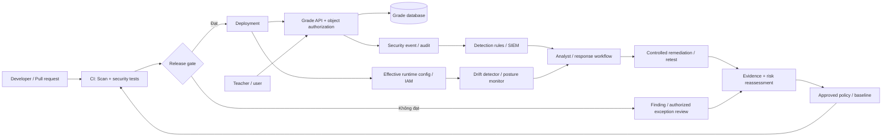
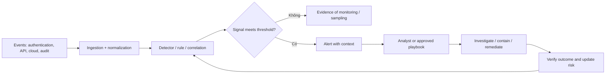

# Automated control: Kiểm soát bảo mật tự động và cách chứng minh hiệu lực

## 1. Automated control là gì?

**Automated control (kiểm soát tự động)** là một **security control** có một hoặc nhiều hoạt động được hệ thống thực thi theo **điều kiện, quy tắc hoặc quy trình đã định**, thay vì phụ thuộc vào người vận hành phải thực hiện từng lần. Hành động có thể là **ngăn**, **phát hiện**, **cảnh báo**, **hạn chế**, **cô lập**, **khắc phục** hoặc **ghi nhận bằng chứng** về một sự kiện bảo mật.

Trong chương **Security control** của module **SECURITY_SECURITY_ASSURANCE**, điều quan trọng không chỉ là thiết lập một tác vụ tự động. Chúng ta cần trả lời:

- Control nhằm giảm **kịch bản rủi ro** hoặc đáp ứng **mục tiêu bảo mật** nào?
- Điều kiện kích hoạt, nguồn dữ liệu, logic ra quyết định, hành động và quyền thực thi được xác định ra sao?
- Khi **hệ thống tự động thất bại, bỏ sót, nhầm lẫn hoặc bị lạm dụng**, hậu quả là gì?
- **Bằng chứng** nào chứng minh control được thiết kế đúng, đã triển khai đầy đủ và hoạt động hiệu quả theo thời gian?
- Ai có trách nhiệm sửa control, xét ngoại lệ, quyết định rủi ro còn lại và giám sát drift?

Ví dụ trên nền tảng học tập Java/Spring Boot:

1. Backend **tự động từ chối** yêu cầu sửa điểm khi người gọi không được phân công lớp tương ứng.
2. CI/CD **tự động chặn** triển khai khi phát hiện cấu hình hạ tầng vi phạm điều kiện bắt buộc của baseline.
3. Hệ thống giám sát **tự động cảnh báo** khi có nhiều lần đăng nhập bất thường.
4. Một workflow **tự động thu hồi** token đã xác nhận bị lộ, trong phạm vi và điều kiện được phê duyệt.

Bốn ví dụ đều có yếu tố tự động nhưng **không giống nhau về mục đích, quyền tác động, khả năng gây gián đoạn và bằng chứng cần thu**.

### Mục tiêu học tập

Sau bài này, người học có thể phân biệt kiểm soát tự động và thủ công; thiết kế control phòng ngừa/phát hiện/khắc phục theo rủi ro; sử dụng ví dụ Java/Spring Boot, pipeline và hạ tầng; lập tiêu chí kiểm thử và evidence; tổ chức giám sát, xử lý lỗi, ngoại lệ và đánh giá liên tục.

> **Nguyên tắc security assurance:** Có một automation đang chạy **không đồng nghĩa** với việc rủi ro đã được kiểm soát. Phải kiểm tra control xử lý **đúng tình huống**, chạy **đúng phạm vi**, tạo **đúng tác động**, không gây hậu quả không mong muốn và có **bằng chứng có thể xác minh**.

## 2. Phân biệt automated, manual và hybrid controls

Control có thể được phân loại theo **mức độ tự động hóa**. Việc phân loại này độc lập với việc control dùng để phòng ngừa hay phát hiện.

| Loại | Ai/kết cấu nào thực hiện? | Ví dụ | Điểm cần đánh giá |
| --- | --- | --- | --- |
| **Manual control** | Con người thực hiện và đưa ra thao tác chính. | Security reviewer đọc thiết kế IAM và phê duyệt quyền đặc biệt. | Năng lực người đánh giá, bằng chứng phê duyệt, tần suất, tính nhất quán. |
| **Automated control** | Logic/máy thực hiện hành động theo điều kiện được định nghĩa. | API tự kiểm quyền theo đối tượng và từ chối `403`; pipeline tự từ chối manifest không hợp lệ. | Chính xác của rule, coverage, vận hành, lỗi và quyền tự động. |
| **Hybrid / IT-dependent manual control** | Máy thu dữ liệu/phát hiện; người quyết định hoặc phê duyệt một phần quan trọng. | SIEM phát hiện đăng nhập bất thường, analyst xác minh rồi quyết định khóa tài khoản. | Cả độ chính xác detector lẫn thời gian, thẩm quyền và bằng chứng phản ứng của con người. |

**Cần xác định đâu là bước tự động, đâu là bước con người.** Nếu hệ thống gửi email cảnh báo nhưng không ai được phân công phản hồi, đây là **kiểm soát phát hiện/cảnh báo tự động**, không phải một kiểm soát khắc phục hoàn chỉnh.

### Automated assessment khác automated enforcement

| Hoạt động | Nó làm gì? | Nó có phải control ngăn hành vi không? |
| --- | --- | --- |
| SAST/SCA tự quét code ở pull request | Tạo tín hiệu/finding về vấn đề có thể tồn tại. | **Không mặc nhiên**; nếu kết quả không ảnh hưởng luồng duyệt/phát hành, nó chỉ cung cấp thông tin. |
| Pipeline bắt buộc PASS một rule trước merge | Ngăn thay đổi không đạt tiêu chí đi qua gate cụ thể. | **Có**, với điều kiện không có đường bypass trái phép. |
| Backend tự kiểm ownership trước đọc tệp | Ngăn truy cập dữ liệu không thuộc quyền. | **Có**, nếu mọi đường đọc thuộc scope đều kiểm tra. |
| Dashboard thu thập số liệu quyền IAM | Tăng khả năng quan sát. | Chưa đủ để nói quyền đã được thu hồi hoặc rủi ro đã giảm. |
| Workflow nhận finding rồi mở ticket | Tạo hành động theo dõi. | Không chứng minh lỗi đã được xử lý nếu ticket chưa sửa/retest. |

**Control được tự động hóa có thể vẫn không hiệu quả** nếu quy tắc sai, dữ liệu đầu vào thiếu, detector không đủ coverage, đường thực thi bị bypass hoặc hành động không tương xứng rủi ro.

## 3. Các nhóm automated controls theo mục đích

Một control có thể có nhiều tác dụng. Để dễ thiết kế và đánh giá, hãy xác định **tác dụng chính** đối với từng risk scenario.

| Nhóm | Tác dụng chính | Ví dụ tự động | Bằng chứng thiết yếu |
| --- | --- | --- | --- |
| **Preventive – phòng ngừa** | Ngăn sự kiện trái chính sách xảy ra. | Backend từ chối sửa điểm ngoài lớp; gateway từ chối token sai; admission controller chặn workload privileged trái chuẩn. | Negative tests chứng minh hành động bị chặn và không có side effect trái phép. |
| **Detective – phát hiện** | Nhận diện dấu hiệu bất thường/sai lệch đã hoặc đang diễn ra. | Alert login spraying; drift detector so effective IAM với baseline. | Test tín hiệu dương/âm, log nguồn, cảnh báo được tạo và đến đúng người. |
| **Corrective – khắc phục** | Giảm tác động/đưa hệ thống trở lại trạng thái chấp nhận sau phát hiện. | Tự đảo cấu hình cloud mở public ngoài policy, thu hồi credential đã xác nhận lộ. | Test hành động, giới hạn quyền, khả năng rollback và xác minh trạng thái sau sửa. |
| **Recovery – phục hồi** | Khôi phục dịch vụ/dữ liệu sau gián đoạn hoặc sự cố. | Failover có kiểm soát, khôi phục dịch vụ từ bản sao theo quy trình. | Test khôi phục đầu cuối; dữ liệu và thời gian đáp ứng RTO/RPO được duyệt. |
| **Compensating – bù trừ** | Giảm rủi ro khi control chính không khả dụng hoặc chưa đạt. | Tạm hạn chế route qua gateway khi backend chưa sửa quyền. | Bằng chứng bù trừ xử lý đúng kịch bản; phạm vi, thời hạn và giới hạn. |

**Ví dụ cùng một sự kiện:** SIEM phát hiện một token bị lạm dụng (**detective**), tạo ticket (**workflow**), tự yêu cầu approval (**hybrid**), rồi IAM thu hồi token (**corrective**). Không gộp chuỗi này thành một control “đã tự động bảo vệ toàn bộ” nếu bất kỳ mắt xích nào có thể thất bại.

### Theo thời điểm thực thi

- **Inline / synchronous:** kiểm soát ở đúng đường xử lý, như authorization ở service khi cập nhật điểm. Thường cần đáp ứng độ trễ và tính sẵn sàng nghiêm ngặt.
- **Event-driven:** nhận webhook/sự kiện từ IAM, SIEM, cloud audit; ví dụ tạo cảnh báo khi quyền admin tăng đột ngột.
- **Scheduled:** chạy theo lịch, như access review report, quét image hoặc kiểm tra cấu hình định kỳ.
- **Continuous / near-real-time:** theo dõi liên tục trạng thái hoặc event stream để phát hiện drift và phản ứng sớm.
- **Pipeline-time:** kiểm soát khi PR/build/deploy, như scan secrets và policy-as-code.

Tần suất tự động không tự xác định mức assurance. Một detector chạy mỗi phút nhưng bỏ sót đường dữ liệu quan trọng vẫn kém một test có coverage tốt ở đúng điểm kiểm soát.

## 4. Cấu trúc một automated control có thể kiểm chứng

Để không dừng ở khẩu hiệu “tự động hóa bảo mật”, hãy mô tả control bằng những thành phần sau:

| Thành phần | Câu hỏi cần trả lời | Ví dụ |
| --- | --- | --- |
| **Control ID và objective** | Control giảm rủi ro nào, điều kiện đạt là gì? | `AUTO-AUTHZ-01`: chặn giáo viên sửa điểm ngoài lớp. |
| **Scope/applicability** | Service, API, tenant, environment, account population nào? | Mọi endpoint cập nhật điểm ở production. |
| **Trigger** | Khi nào control chạy? | Mỗi request ghi điểm trước khi cập nhật DB. |
| **Trusted inputs** | Principal, object ID, mapping quyền, config đến từ đâu? | Principal từ server security context; phân công lớp từ DB được kiểm soát. |
| **Decision logic** | Chính sách và thuật toán ra quyết định là gì? | Teacher được giao lớp và có quyền ghi với bản ghi đích. |
| **Action** | Cho phép, từ chối, log, cảnh báo, đóng quyền, rollback? | Trả `403`, bảo đảm dữ liệu không đổi, ghi audit phù hợp. |
| **Failure behavior** | Nếu identity store/rule engine/queue không khả dụng thì sao? | Chọn hành vi thất bại theo mục tiêu và an toàn vận hành. |
| **Execution identity** | Automation chạy với quyền gì; ai cấp/thu hồi? | Service account chỉ có quyền cần thiết. |
| **Telemetry/evidence** | Làm sao chứng minh rule đã chạy và tạo kết quả đúng? | Test, decision event, cấu hình, build, phiên bản policy. |
| **Owner và change control** | Ai quản lý rule, phê duyệt thay đổi, xử lý false positive? | IAM/backend owner, security assessor và risk owner. |
| **Review triggers** | Khi nào phải đánh giá lại? | Role mới, API mới, incident, thay đổi schema/phân công. |

Một automated control tốt phải có **đầu vào đáng tin**, **quy tắc rõ**, **hành động có phạm vi**, **hành vi khi lỗi xác định**, **khả năng quan sát** và **đường kiểm chứng**.

### Control design, implementation và operating effectiveness

1. **Design adequacy:** Quy tắc có giải quyết đúng đường rủi ro không? Ví dụ role `TEACHER` **không** đủ để bảo vệ điểm theo lớp.
2. **Implementation:** Rule có được áp dụng ở **mọi** entry point quan trọng, không thể bypass qua batch/import, queue, admin API?
3. **Operating effectiveness:** Trong quá trình vận hành, rule có thực sự thực thi đúng build/policy, các sự kiện sai được từ chối, detector không bị tắt và con người có xử lý khi cần?

**Ba chiều này cần bằng chứng khác nhau.** Một tài liệu thiết kế không chứng minh triển khai; một unit test không xác nhận ingress production; một dashboard “healthy” không tự chứng minh những sự kiện nguy hiểm bị ngăn.

## 5. Chọn tự động hóa dựa trên rủi ro, không phải số lượng scripts

Lựa chọn tự động hóa nên bắt đầu bằng **risk scenario**, mục tiêu bảo mật, tần suất sự kiện, khả năng gây hại và đặc tính control, chứ không phải chỉ chọn công cụ đang phổ biến.

Ví dụ nền tảng học tập:

| Risk scenario | Automated control khả thi | Tác dụng | Giới hạn/rủi ro mới |
| --- | --- | --- | --- |
| Giáo viên sửa điểm lớp khác | Backend object-level authorization trên mọi đường ghi. | Phòng ngừa sửa dữ liệu trái quyền. | Sai mapping role/lớp hoặc đường batch bypass. |
| Token người dùng bị thử đoán trên API đăng nhập | Rate limiting, risk-based alert, MFA khi cần. | Giảm thử đoán và tăng phát hiện. | Lockout DoS, bot phân tán, false positive. |
| Cấu hình storage vô tình mở public | Policy-as-code và cloud config monitoring. | Chặn trước deploy, phát hiện drift sau deploy. | Rule không bao phủ tài nguyên tạo ngoài IaC; auto-remediation có thể ảnh hưởng dịch vụ. |
| Deploy image có thành phần không phù hợp baseline | Image scanning + provenance policy + release gate. | Giảm khả năng đưa artifact không được duyệt vào production. | Scanner có false positive/negative; CVE không phải toàn bộ rủi ro. |
| Audit log có thể bị mất khi queue lỗi | Retry, dead-letter queue, alert và quy trình phục hồi event. | Hạn chế mất bằng chứng và phát hiện lỗi vận hành. | Queue backlog, dữ liệu nhạy cảm trong log, duplicate delivery. |
| Provider IdP gián đoạn trong kỳ thi | Alert, graceful degradation/fallback được phê duyệt. | Hạn chế ảnh hưởng availability. | Fallback lỏng lẻo có thể bypass authentication. |
| Secret bị lộ trong repository | Secret scanning, chặn merge, workflow revoke có kiểm soát. | Phòng ngừa tiếp tục phát hành, giảm thời gian credential bị lạm dụng. | Scanner bỏ sót; tự revoke nhầm làm ngừng tích hợp quan trọng. |

### Ưu tiên triển khai theo ba câu hỏi

**(1) Tác động nếu control không chạy?** Một check bắt buộc trên API sửa điểm có mức quan trọng khác thông báo về một header trang tài liệu công khai.

**(2) Tự động hóa có đáng tin hơn thao tác thủ công không?** Những quyết định lặp lại, chính sách rõ, dữ liệu đầu vào đáng tin thường phù hợp tự động hóa. Những quyết định rủi ro phụ thuộc bối cảnh pháp lý/kinh doanh có thể cần phê duyệt của con người.

**(3) Tự động hóa thất bại có thể gây hại không?** Tự đóng mạng, xóa tài khoản hoặc rollback dữ liệu có hậu quả đáng kể; cần cơ chế giới hạn tác động, phê duyệt, canary, rollback hoặc thao tác thủ công được kiểm soát.

## 6. Mô hình kiến trúc automated control và assurance

Ví dụ dưới mô tả những lớp kiểm soát tự động trong vòng đời `grade-service` Java/Spring Boot:



Sơ đồ **không** tuyên bố mọi control đều tồn tại trong một hệ thống cụ thể. Nó minh họa các tuyến kiểm soát:

1. **Before deployment:** baseline được chuyển thành check/gate trên mã, artifact, hạ tầng.
2. **At runtime:** authorization và kiểm soát giao dịch được thực thi tại nơi phát sinh hành vi.
3. **After event:** logs, alerts, drift detector tạo tín hiệu cho điều tra và khắc phục.
4. **Feedback:** kết quả kiểm thử, finding, exception, incident và bằng chứng thực tế cập nhật risk assessment/baseline.

**Trust boundaries:** CI có quyền phát hành, service có quyền sửa DB, monitoring có quyền đọc telemetry và remediation automation có thể được cấp quyền thay IAM/network. Mỗi identity cần **least privilege**, kiểm soát thay đổi và audit tương xứng. Không cấp cho detector quyền quản trị toàn bộ cloud chỉ vì thao tác giám sát cần truy cập log.

## 7. Ví dụ preventive automated control: kiểm quyền khi cập nhật điểm

Một API Spring Boot nhận yêu cầu sửa điểm. Mục tiêu: chỉ giáo viên được phân công vào lớp liên quan mới có thể sửa, trừ các quyền quản trị đặc biệt **được policy cho phép rõ ràng**.

### Risk và requirement

**Risk ID – `RISK-GRADE-07`:** Giáo viên có tài khoản hợp lệ dùng ID bản ghi điểm thuộc lớp khác và gửi request cập nhật. Nếu service chỉ kiểm tra role tổng quát, dữ liệu có thể bị sửa trái quyền.

**Requirement – `REQ-GRADE-AUTHZ-01`:** Mỗi thao tác ghi điểm phải đánh giá principal đáng tin, bản ghi đích, quan hệ phân công lớp và trạng thái nghiệp vụ trước khi thay đổi dữ liệu.

**Control – `AUTO-AUTHZ-01`:** Service tự động **từ chối** khi không đủ quyền; không tạo thay đổi dữ liệu; tạo audit event phù hợp.

### Minh họa Java/Spring Boot

```java
// Pseudocode minh họa; các interface thuộc về ứng dụng.
@Service
public class GradeWriteService {
    private final GradeRepository grades;
    private final GradeAuthorizationPolicy authorization;
    private final GradeAuditPublisher audit;

    public GradeWriteService(
            GradeRepository grades,
            GradeAuthorizationPolicy authorization,
            GradeAuditPublisher audit) {
        this.grades = grades;
        this.authorization = authorization;
        this.audit = audit;
    }

    @Transactional
    public void updateScore(
            UUID gradeId, BigDecimal newScore, AuthenticatedPrincipal actor) {
        Grade grade = grades.findByIdForUpdate(gradeId)
            .orElseThrow(() -> new NotFoundException("Grade not found"));

        // Authorization chạy trên server và theo chính đối tượng cần sửa.
        if (!authorization.canEdit(actor, grade)) {
            audit.recordDenied(actor.id(), gradeId);
            throw new AccessDeniedException("No permission to edit grade");
        }

        grade.validateAllowedScore(newScore);
        BigDecimal oldScore = grade.getScore();
        grade.setScore(newScore);
        grades.save(grade);
        audit.recordChanged(actor.id(), gradeId, oldScore, newScore);
    }
}
```

**Lưu ý triển khai:** Đây là pseudocode, không phải một implementation hoàn chỉnh. `AuthenticatedPrincipal` phải được xây dựng từ **security context đã xác thực ở server**, không lấy từ tham số do client tự quyết định. `GradeAuthorizationPolicy` phải xét role, teacher–class assignment, tenant, trạng thái bài thi và quyền quản trị theo chính sách. `recordDenied` nằm trong transaction có khả năng rollback khi exception được ném; nếu yêu cầu giữ audit của request bị từ chối thì phải có **cơ chế ghi sự kiện độc lập/đáng tin** và kiểm thử đường lỗi. Audit của thay đổi đã commit cũng cần đảm bảo không mất event khi giao dịch/queue gặp sự cố (ví dụ transactional outbox nếu phù hợp thiết kế).

### Vì sao đây là automated preventive control?

Mỗi request đến service sẽ dẫn tới **quyết định tự động** trong luồng xử lý; không cần gọi một quản trị viên duyệt từng lần cập nhật điểm hợp lệ. Nếu điều kiện quyền sai, control phải **ngăn ghi dữ liệu** ngay cả khi frontend bị bypass.

### Khi nào control có thể không đạt?

- Check chỉ tồn tại tại controller web, nhưng job import điểm đi trực tiếp tới repository.
- Quyền theo lớp được cache quá lâu sau khi phân công bị thu hồi.
- Logic chỉ kiểm `ROLE_TEACHER` mà không xét bản ghi/tenant.
- Backend tin `teacherId` từ request body thay vì principal đã xác thực.
- Kiểm tra quyền trước khi đọc object, tạo lỗi TOCTOU nếu mapping quyền/bản ghi đổi trong lúc xử lý.
- Audit event bị mất do rollback hoặc queue lỗi, làm thiếu bằng chứng thao tác.

Điểm cuối chứng minh: **chỉ nhìn thấy một lệnh `if (!authorization...)` không đủ**. Assurance cần kiểm tra **mọi đường cập nhật, mọi role, hành vi cạnh tranh và trạng thái production thích hợp**.

## 8. Kiểm thử control tự động: không chỉ quan sát mã nguồn

Một bộ kiểm thử phải chứng minh **input → decision → action → outcome**; với preventive control, kiểm **side effects** và state của database, không chỉ HTTP status.

| Test ID | Trường hợp | Kết quả cần chứng minh |
| --- | --- | --- |
| `TC-AUTO-01` | Giáo viên A sửa điểm học viên trong lớp được giao. | Đúng policy; điểm thay đổi hợp lệ và có dấu vết. |
| `TC-AUTO-02` | Giáo viên A sửa điểm lớp B. | Từ chối; **DB không thay đổi**; hành vi bị từ chối được quan sát khi policy yêu cầu. |
| `TC-AUTO-03` | Học viên hoặc người chưa xác thực gọi API ghi điểm. | Không được phép; không có side effects. |
| `TC-AUTO-04` | Giáo viên bị thu hồi phân công trước request. | Không dùng quyền đã cũ; policy hiệu lực theo yêu cầu. |
| `TC-AUTO-05` | Batch/import/admin đường khác cập nhật cùng bảng điểm. | Mọi đường ghi thuộc scope đều áp dụng control hoặc ngoại lệ có chứng cứ. |
| `TC-AUTO-06` | DB/quyền mapping không khả dụng khi kiểm tra. | Không vô tình cấp quyền; lỗi được xử lý theo failure policy và được ghi nhận. |
| `TC-AUTO-07` | Thay đổi hai điểm đồng thời, race hoặc retry. | Không bypass policy hoặc ghi sai bản ghi; tính nhất quán theo thiết kế. |
| `TC-AUTO-08` | Audit publisher/queue lỗi. | Có cách phát hiện/khôi phục phù hợp và không giả định audit đã được lưu. |
| `TC-AUTO-09` | Deployment cấu hình role/tenant khác staging. | Control vẫn áp dụng đúng principal và policy ở môi trường mục tiêu. |
| `TC-AUTO-10` | Policy version đổi theo phân công/role mới. | Bộ negative tests bảo vệ các trường hợp cũ và mới, có traceability với version. |

Một test dùng Spring Security Test có thể thiết lập principal giả và gọi HTTP API. Tuy nhiên, **unit/integration test ở staging không tự chứng minh network, IAM, deployment config và quyền dữ liệu production giống hệt**. Cần phối hợp test ứng dụng với **effective configuration assessment** và evidence từ triển khai.

### Mẫu kịch bản Gherkin (minh họa)

```gherkin
Feature: Object authorization for grade updates
  Scenario: Teacher cannot update a grade outside assigned classes
    Given teacher A is authenticated
    And teacher A is assigned to class X only
    And grade G belongs to class Y
    When teacher A requests to update grade G
    Then the request is denied
    And the stored value of grade G remains unchanged
    And a security decision event is handled according to policy
```

Gherkin giúp diễn đạt acceptance criteria; nó **không tự tạo kiểm thử chạy được** nếu chưa có step definitions, test data, assertion và môi trường. Các test tự động cũng cần kiểm tra **test thực sự được thực thi**, không bị skip và không bị bypass trong release gate.

## 9. Automated control trong CI/CD: policy và release gate

CI/CD có thể giúp **ngăn thay đổi không đáp ứng baseline trước khi phát hành**. Các lớp:

| Điểm kiểm soát | Ví dụ | Khi nào chặn? | Lưu ý |
| --- | --- | --- | --- |
| **Pull request** | Secret scan, unit/security tests, branch protection, code owner review. | Trước merge theo policy. | Có thể bỏ sót secret được tạo ngoài repo hoặc rule bị tắt. |
| **Build** | Dependency/SBOM analysis, image scan, artifact integrity. | Trước phát hành artifact. | Cần triage finding theo reachability, risk và nghĩa vụ, không dùng severity máy móc. |
| **IaC validation** | Kiểm policy bucket private, workload security context, ingress. | Trước apply/merge/deploy. | Chỉ thấy desired state; phải kiểm drift của effective state. |
| **Deployment/admission** | Ngăn workload có cấu hình trái profile đã duyệt. | Trước khi tài nguyên được nhận. | Chính sách/engine có thể bị bypass qua đặc quyền hoặc đường tạo khác. |
| **Post-deploy** | Kiểm exposed endpoints, effective IAM, runtime security smoke tests. | Trước release traffic hoặc trong giám sát. | Cần tránh kiểm thử gây gián đoạn production. |

### Ví dụ baseline gate với dữ liệu có cấu trúc

```yaml
# Schema minh họa: không phải cấu hình Jenkins/GitHub/GitLab chạy được.
controlId: AUTO-CI-01
controlName: "Production workload security gate"
objective: "Prevent deployment of unapproved insecure workloads"
scope:
  environment: production
  workloadType: kubernetes
  policyVersion: "BASELINE-PROD-2026.1-example"
trigger: before-deployment
inputs:
  - "rendered-manifests"
  - "artifact-digest"
  - "policy-bundle-version"
rules:
  - id: "RUN-AS-NON-ROOT"
    criterion: "Unless approved exception, workload must not run as root"
  - id: "NO-PRIVILEGED-CONTAINER"
    criterion: "Privileged container requires separately approved exception"
  - id: "NO-UNREVIEWED-PUBLIC-INGRESS"
    criterion: "Public management exposure is blocked"
onFailure: "DENY_DEPLOY_AND_OPEN_FINDING"
evidence:
  - "rule-result-by-id"
  - "build-and-artifact-digest"
  - "policy-version"
  - "approval-or-exception-reference"
ownerRole: "devsecops-platform-owner"
```

**Điều quan trọng:** đây là **mẫu mô tả mục đích**, chưa có rule engine thực thi. Để triển khai cần ánh xạ sang công cụ thực tế như IaC scanner, policy engine hoặc admission controller; kiểm tra ngữ nghĩa policy và đường bypass, phân quyền thay policy, lưu kết quả theo build và thực hiện **post-deploy verification**.

### Khi gate có thể không bảo vệ được?

- Pipeline kiểm tra manifest trong Git, nhưng deploy sử dụng manifest sinh động khác.
- Rule được đánh dấu advisory thay vì blocking mà không có quyết định thay đổi.
- Token deploy có quyền bỏ qua admission hoặc administrator cập nhật tài nguyên trực tiếp.
- Exception hết hạn nhưng rule không kiểm ngày hết hạn và phạm vi.
- Tool lỗi nhưng pipeline lại hiểu `exit code 0` hay “no findings” và tiếp tục.
- Scan artifact A nhưng thực tế deploy artifact B.

Assurance cần kiểm tra cả **positive tests** (artifact đủ điều kiện đi qua) và **negative tests** (cấu hình cấm bị chặn). Cần bảo đảm **đúng artifact** được deploy và **policy version** tại thời điểm kiểm tra.

## 10. Runtime detection automation: giám sát không tự đồng nghĩa khắc phục

Một detective control ở runtime thường có chuỗi:



### Cách thiết kế detector có thể đánh giá

Ví dụ `AUTO-DET-01` nhận biết hành vi thử đoán mật khẩu phân tán:

| Thành phần | Câu hỏi và ví dụ |
| --- | --- |
| **Telemetry** | Login result, account reference, time, source context có đủ và được bảo vệ? |
| **Rule** | Correlation theo tài khoản, nguồn, thời gian và hành vi; có tránh ngưỡng chỉ theo một IP? |
| **Trigger/latency** | Trong bao lâu sau sự kiện, alert cần xuất hiện? Có SLO phát hiện được duyệt không? |
| **Output** | Alert có severity, time window, nguồn, lý do, liên kết evidence? |
| **Human response** | Ai nhận, kiểm tra, escalation và quyết định containment? |
| **Failure mode** | Nếu log ingestion ngừng, rule engine down hoặc dashboard không nhận data, ai được báo? |
| **Privacy** | Có tránh đưa password, token hay dữ liệu cá nhân không cần thiết vào cảnh báo? |

**Không alert ≠ không có tấn công.** Để chứng minh detective control, cần kiểm tra **log coverage**, pipeline health, rule version, thử kích hoạt tín hiệu có kiểm soát và việc alert tới đúng kênh. False negative có thể do thiếu event, parser sai field, drift schema hoặc scope hệ thống không gửi log.

### Phân biệt tín hiệu và kết luận

Alert “50 lần login thất bại” **không tự chứng minh** đã có compromise. Ngược lại, không có cảnh báo **không chứng minh** mọi tài khoản an toàn. Người đánh giá cần xem context, session, hành động tiếp theo và chất lượng phát hiện.

## 11. Automated remediation: điều kiện để tự hành động an toàn

**Automated remediation (khắc phục tự động)** chuyển tín hiệu thành hành động nhằm giảm rủi ro mà không chờ người vận hành nhập từng lệnh. Ví dụ, phát hiện bucket vô tình mở public và tự khôi phục policy được phê duyệt, hoặc xác nhận credential bị lộ rồi thu hồi nó.

Tuy nhiên, **hệ thống có quyền tự thay đổi production** cũng là mục tiêu tấn công và nguồn sự cố. Cần kiểm soát:

| Yếu tố | Thiết kế cần có | Ví dụ |
| --- | --- | --- |
| **Confidence threshold** | Chỉ hành động mạnh với tín hiệu đủ tin cậy và rule đã thử nghiệm. | Credential được xác nhận lộ thay vì chỉ có một alert mơ hồ. |
| **Blast-radius limit** | Giới hạn tài nguyên/tenant/phạm vi thao tác. | Chỉ thu hồi token được chỉ định, không khóa mọi token trong account. |
| **Least privilege** | Automation identity chỉ được thực hiện loại thay đổi cần thiết. | Quyền sửa policy của bucket cụ thể, không có admin toàn cloud. |
| **Idempotency** | Nhận event trùng không tạo tác động sai. | Thao tác revoke token lặp lại có kết quả hợp lệ. |
| **Dry run / staged rollout** | Kiểm thử dự kiến tác động, triển khai theo giai đoạn khi phù hợp. | Cảnh báo trước rồi tự sửa một nhóm bucket thử nghiệm. |
| **Human approval** | Các hành động phá hủy/gián đoạn lớn cần phê duyệt theo policy. | Khóa tài khoản admin hoặc thay network route production. |
| **Rollback/compensation** | Có cách phục hồi nếu detector hoặc remediation sai. | Khôi phục policy sau review, có snapshot cấu hình trước thay đổi. |
| **Auditability** | Ghi ai/automation nào làm, vì sao, theo policy nào, kết quả gì. | Event chứa rule/version, resource, action, approval reference. |
| **Post-action verification** | Đo trạng thái cuối đã đạt và không gây lỗi mới. | Effective bucket policy private và ứng dụng vẫn hoạt động. |
| **Kill switch / safe degradation** | Có thể vô hiệu hóa workflow lỗi theo quyền và quy trình. | Tạm chuyển từ auto-remediate sang alert + manual approval. |

### Fail-open và fail-closed không có đáp án cho mọi trường hợp

**Fail-closed** thường hợp lý với control phòng ngừa truy cập nhạy cảm: khi không xác minh được quyền sửa điểm, **không được mặc định cho phép sửa**. Nhưng fail-closed ở thành phần trung tâm có thể làm gián đoạn hoạt động lớn nếu dependency gặp sự cố. Phải có resilience và runbook.

**Fail-open** nghĩa là khi control gặp lỗi vẫn cho một hành động đi tiếp; điều này có thể được cân nhắc trong một số luồng **không trọng yếu** với biện pháp giám sát khác và quyết định rủi ro chính thức, nhưng không được dùng để bỏ qua các yêu cầu bảo mật bắt buộc. Với kiểm soát chống gian lận hoặc truy cập đặc biệt, thường cần hạn chế chức năng hoặc yêu cầu bước xác minh khác thay vì tự mở quyền.

**Chọn hành vi khi lỗi theo mục tiêu/rủi ro cụ thể**, lập test failure injection và ghi nhận ai phê duyệt. Không nên chỉ ghi “fail safe” mà không nói safe đối với **bảo mật, tính sẵn sàng, dữ liệu và người dùng** là trạng thái nào.

## 12. Automation identity và bảo vệ chính hệ thống kiểm soát

Một control tự động có thể trở thành **đường leo thang đặc quyền** nếu được cấp quyền quá rộng. Điều này đặc biệt đáng chú ý với CI/CD, IaC, remediation bot, IAM automation và security orchestration.

Các yêu cầu tiêu biểu:

1. **Danh tính riêng cho từng workflow/nhóm tác vụ**, không dùng chung tài khoản admin dài hạn.
2. **Least privilege:** quyền đúng resource, operation, environment; phân tách quyền đọc telemetry với quyền sửa production.
3. **Short-lived credentials / workload identity** khi khả thi, quản lý secret trong kho phù hợp, có quy trình thu hồi.
4. **Protected policy and code:** rule, playbook, pipeline config có review, branch protection và đường deploy được kiểm soát.
5. **Separation of duties:** người sửa rule không nhất thiết là người duyệt ngoại lệ hoặc người chấp nhận rủi ro.
6. **Immutable/independently protected audit** theo yêu cầu, hạn chế bot xóa hoặc sửa log chính nó tạo ra.
7. **Supply-chain security:** kiểm soát nguồn plugin, action, container image và dependency mà automation tải/chạy.
8. **Testing abuse cases:** attacker giả mạo webhook, tạo event gây auto-block, replay alert hoặc lợi dụng account lockout.

**Ví dụ rủi ro tự động hóa:** Một tài khoản có quyền chỉnh cloud firewall nhận sự kiện từ một webhook không được xác minh chữ ký. Kẻ tấn công có thể tạo event giả để workflow đóng một số đường mạng hoặc mở rule sai. Vì vậy **event source authenticity** và **permission boundary** là control bắt buộc cho chính automation, không chỉ cho ứng dụng nghiệp vụ.

## 13. Automated control as code: hồ sơ và truy vết

Để kiểm chứng lâu dài, có thể mô tả automated control bằng một **control register có cấu trúc**. Đây là **YAML mô hình học tập**, không phải cấu hình chạy trực tiếp của Spring Boot hoặc một SIEM cụ thể.

```yaml
controlId: AUTO-AUTHZ-01
name: "Grade object-level authorization"
controlType: PREVENTIVE
automationMode: INLINE_ENFORCEMENT
objectiveId: OBJ-GRADE-INTEGRITY
riskIds:
  - RISK-GRADE-07
requirementIds:
  - REQ-GRADE-AUTHZ-01

scope:
  service: grade-service
  environment: production
  applicationVersion: "<approved-build-id>"
  protectedOperations:
    - "PATCH /api/grades/{id}"
    - "POST /api/grades/import"
  exclusions: []

trigger: "Every attempted grade modification"
trustedInputs:
  - "Authenticated server principal"
  - "Grade record and class assignment"
decision:
  ruleReference: "grade-authorization-policy-v3"
  denyWhen: "Principal is not authorized for the target grade"
onDependencyFailure: "DENY_WRITE_AND_ALERT"
actions:
  approved:
    - "ALLOW_AUTHORIZED_UPDATE"
    - "DENY_UNAUTHORIZED_UPDATE"
  prohibited:
    - "ALLOW_WRITE_WITHOUT_AUTHORIZATION"

execution:
  ownerRole: "grade-backend-team"
  identityReference: "grade-service-runtime-identity"
  privilegeScope: "Only approved grade data operations"
assessment:
  assessorRole: "application-security-assessor"
  procedures:
    - "TC-AUTO-01"
    - "TC-AUTO-02"
    - "TC-AUTO-05"
    - "TC-AUTO-06"
  expectedEvidence:
    - "Negative authorization test and DB assertion"
    - "Build and policy version"
    - "Runtime configuration and route review"
    - "Audit decision coverage review"
  evidenceReferences: []

status: "PENDING_ASSESSMENT"
exceptions: []
review:
  dueAt: "<ISO-8601-date>"
  triggers:
    - "Role, class assignment or tenant mapping changes"
    - "New batch or administrative grade-write endpoint"
    - "Control failure, authorization incident or audit finding"
```

**Phân biệt rõ:** `controlType: PREVENTIVE` mô tả mục đích, `automationMode: INLINE_ENFORCEMENT` mô tả cách thực hiện, `status: PENDING_ASSESSMENT` mô tả **chưa có bằng chứng đủ để kết luận**. Không nên tự đổi `status` thành `PASS` chỉ vì code đã merge.

### Chuỗi truy vết bảo mật

```text
Business objective: tính toàn vẹn điểm thi
  -> RISK-GRADE-07: giáo viên sửa điểm ngoài lớp
  -> REQ-GRADE-AUTHZ-01: kiểm quyền theo đối tượng
  -> AUTO-AUTHZ-01: kiểm quyền tự động trước ghi
  -> TC-AUTO-02 / TC-AUTO-05: negative/batch tests
  -> EVD-AUTO-BUILD-X: kết quả kiểm thử và config theo version
  -> FIND-AUTO-03: điểm chưa đạt (nếu có)
  -> REM-AUTO-03 + RETEST: sửa và xác nhận
  -> DEC-GRADE-RELEASE-X: quyết định rủi ro và phát hành
```

Đây là liên kết giúp **audit** trả lời “vì sao control tồn tại, đã kiểm tra như thế nào, kết luận dựa trên phiên bản nào và rủi ro nào còn lại”.

## 14. Kiểm chứng tự động không thay thế đánh giá độc lập

Automated assessment có lợi thế **lặp lại, tốc độ, tính nhất quán** nhưng mỗi tool có **scope, rule logic, điều kiện và hạn chế**. Kết quả từ pipeline không phải “chân lý tuyệt đối”.

| Loại bằng chứng | Có thể chứng minh | Không tự chứng minh |
| --- | --- | --- |
| Test authorization trong CI | Các ca kiểm thử được định nghĩa đã chạy và đáp ứng assertion trên build test. | Mọi endpoint/role/tenant đều an toàn; production giống test. |
| IaC policy scan | Khai báo ở một phiên bản artifact đáp ứng các rule có thể phân tích. | Effective cloud IAM/network/runtime không drift. |
| SCA/SAST/DAST report | Những vấn đề tool tìm được, coverage và kết quả tại thời điểm scan. | Không có lỗi logic hoặc không có lỗ hổng khác. |
| Admission controller decision | Manifest thuộc đường được kiểm tra đã được cho phép/từ chối theo policy. | Không có đường thay đổi khác bỏ qua admission; runtime không drift. |
| SIEM alert test | Tín hiệu mẫu đi qua ingestion, detector và được cảnh báo. | Mọi cuộc tấn công thực sẽ bị phát hiện. |
| Auto-remediation log | Workflow có ghi nhận hành động trong một điều kiện. | Trạng thái sau sửa đã đạt và không gây ảnh hưởng ngoài dự kiến. |
| Runtime configuration evidence | Một trạng thái quan sát được ở environment/time xác định. | Trạng thái đó vĩnh viễn đúng sau mọi thay đổi. |

### Thực hành đánh giá ba chiều

**Thiết kế:** Đọc policy, control objective, threat model, trường hợp false positive/negative và hành vi khi lỗi.

**Triển khai:** Kiểm tra quyền thực thi, cấu hình, đường vào, code/IaC, phiên bản công cụ và khả năng bypass.

**Hiệu lực vận hành:** Thử sự kiện ở scope cho phép, kiểm tra output/action, mô phỏng lỗi an toàn, đo tốc độ phản ứng, xem log, tìm drift và kiểm tra quy trình escalation.

**Độc lập phù hợp rủi ro:** Với control trọng yếu như quyền sửa điểm, người đánh giá có thể cần review chéo hoặc assessment độc lập với người viết policy. Điều này không yêu cầu mọi test phải do bộ phận ngoài thực hiện; mức độc lập phải theo risk criteria và chương trình assurance.

## 15. Lập kế hoạch assessment và evidence collection

Một assessment tốt cần trả lời **điều gì được kiểm tra, trong phạm vi nào, bằng phương pháp nào và với kết quả nào**.

| Control | Test/examination | Evidence tối thiểu | Điều kiện cần chú ý |
| --- | --- | --- | --- |
| `AUTO-AUTHZ-01` | Negative tests + DB state + route review | Build, test report, policy version, DB invariant, environment | Đủ role, tenant, batch, admin, lỗi dependency. |
| `AUTO-CI-01` | Manifest hợp lệ/không hợp lệ qua đúng pipeline/deploy path | Rule result, manifest/artifact digest, job ID, gate decision | Đường bypass, exception scope, post-deploy state. |
| `AUTO-DET-01` | Synthetic event + ingestion/alert drill | Timestamp, correlation ID, rule version, alert delivery and acknowledgment | Coverage nguồn log, pipeline lag, false positives. |
| `AUTO-REM-01` | Dry run/canary + controlled remediation test | Resource snapshot, approval, action log, after-state, rollback outcome | Giới hạn tài nguyên, idempotency, quyền và an toàn vận hành. |
| `AUTO-DRIFT-01` | Thay đổi cấu hình thử nghiệm có ủy quyền | Before/after config, detection time, alert/ticket | Sensor health, tài nguyên nằm ngoài inventory. |

### Bằng chứng phải phù hợp claim

Một control được đánh giá **PASS** trên môi trường staging có thể hỗ trợ kết luận về code logic; để khẳng định production đạt cần xét sự tương đồng với production (build, IAM, ingress, storage, policy runtime). Độ tin cậy tăng khi bằng chứng có:

- **Scope:** hệ thống, environment, tenant, resource, version và time window.
- **Provenance:** nguồn, người/công cụ thực hiện, rule version và artifact có tính toàn vẹn.
- **Coverage:** các trường hợp positive/negative, đường bypass, failure path, đối tượng trọng yếu.
- **Outcome:** hành động thực tế và trạng thái sau hành động, không chỉ lệnh “đã gửi”.
- **Freshness:** bằng chứng còn phù hợp sau deploy, cập nhật rule, thay đổi IAM hoặc sự cố?
- **Limitations:** điều chưa kiểm tra, giả định, dữ liệu giả, false positive/negative, độ bất định.

Lưu evidence qua đường dẫn/tham chiếu được phân quyền; **không đính kèm token thực, password, PII, credential hoặc nội dung bài thi thật** vào ticket/dashboards công khai.

## 16. Kết quả assessment: PASS, FAIL, NOT VERIFIED và ngoại lệ

| Kết quả | Ý nghĩa đối với automated control | Hành động tiếp theo |
| --- | --- | --- |
| **PASS** | Có bằng chứng control đáp ứng tiêu chí **trong scope đã kiểm tra**. | Ghi artifact, thời điểm, version, hạn review; tiếp tục monitoring. |
| **FAIL** | Có bằng chứng rule/action/coverage/behavior không đáp ứng tiêu chí. | Mở finding, đánh giá rủi ro, khắc phục và retest. |
| **NOT VERIFIED** | Thiếu bằng chứng, test không chạy, detector mất data hoặc scope chưa đủ. | Thu thập bổ sung, không giả định PASS. |
| **NOT APPLICABLE (N/A)** | Control không áp dụng theo tiêu chí và architecture được xác minh. | Ghi lý do, người review và trigger nếu scope đổi. |
| **EXCEPTION / ACCEPTED GAP** | Control cần thiết nhưng chưa đạt; có phê duyệt rủi ro trong giới hạn được phép. | Giữ minh bạch về gap, owner, expiry, compensating controls và monitoring. |

Ví dụ: scanner CI báo `PASS` nhưng test authorization của endpoint import điểm **bị skip**. Không được kết luận toàn bộ automated authorization đạt. Cần xác định **những acceptance criteria nào chưa được thực thi** và trạng thái thực tế của gate.

### Phân biệt automated closure và verified remediation

Workflow tự đóng ticket khi có commit chứa chữ `fix` **không chứng minh** lỗ hổng đã được khắc phục. Một workflow đóng finding đáng tin phải kiểm tra tiêu chí: bản sửa đã deploy ở đâu, test nào đã chạy, hiệu lực control đã xác nhận, có rủi ro mới hoặc đường bypass nào chưa được xem xét.

## 17. Quản trị alert quality và hiệu quả automation

Đánh giá hiệu quả control tự động không thể chỉ đếm số lần công cụ chạy. Một detector có thể tạo rất nhiều cảnh báo nhưng ít giá trị, hoặc không tạo alert vì thiếu ingestion.

### Định nghĩa chỉ số cẩn thận

| Chỉ số | Cách hiểu | Giới hạn |
| --- | --- | --- |
| **Control coverage** | Tỷ lệ entry points/assets/operations thuộc scope có control thực thi/được kiểm tra. | Inventory thiếu làm tỷ lệ cao giả. |
| **Control execution success rate** | Tỷ lệ lần chạy automation hoàn thành theo định nghĩa kỹ thuật. | Chạy thành công chưa có nghĩa quyết định đúng. |
| **Detection precision** | Trong các alert được kiểm chứng, tỷ lệ alert phản ánh tình huống cần quan tâm. | Cần quy trình gán nhãn và xét sự thiên lệch khi chỉ kiểm một phần. |
| **Detection recall/sensitivity** | Trong các sự kiện cần phát hiện đã biết/được kiểm chứng, tỷ lệ được detector phát hiện. | Khó biết toàn bộ sự kiện thật; thường đo trên test/corpus được giới hạn. |
| **False-positive rate** | Mức cảnh báo sai theo định nghĩa và tập đánh giá. | Cần định nghĩa mẫu số rõ; không đánh đồng với 1 − precision. |
| **False-negative cases** | Các sự kiện lẽ ra phát hiện nhưng đã bỏ sót. | Có thể không quan sát được nếu không red-team/synthetic test. |
| **Detection latency** | Thời gian từ sự kiện có trong phạm vi đến khi có alert. | Phụ thuộc clock, log ingestion và thời điểm sự kiện được biết. |
| **Remediation time** | Thời gian từ xác nhận sự cố/gap đến khi xử lý được kiểm chứng. | Không lấy thời điểm ticket đóng thay mốc retest. |
| **Drift age / evidence freshness** | Thời gian cấu hình lệch baseline, tuổi bằng chứng. | Độ mới không chứng minh phương pháp đánh giá đủ. |
| **Automation-induced incidents** | Sự cố/gián đoạn do chính workflow hoặc rule gây ra. | Giúp nhận diện tác động phụ và nâng an toàn rollout. |

**Precision và recall** hữu ích khi có dữ liệu gán nhãn phù hợp. Không được tuyên bố “recall 100%” chỉ từ 10 synthetic events nếu hệ thống thực có nhiều kiểu đe dọa chưa được biểu diễn.

### Đo cả chất lượng lẫn độ ổn định

Với control phòng ngừa, phải đo **tỷ lệ bypass được phát hiện, điều kiện từ chối/cho phép đúng và dữ liệu không thay đổi trái phép**. Với control phát hiện, cần đo **coverage, tốc độ, chính xác và khả năng phản ứng**. Với control khắc phục, đo **outcome, blast radius, rollback, tính đúng đắn và hậu quả vận hành**.

## 18. Continuous assurance: giám sát control và đánh giá lại

Tự động hóa có thể giúp security assurance **liên tục hơn**, nhưng công cụ, rule, IAM, API và rủi ro cũng thay đổi liên tục.

| Giai đoạn | Nhiệm vụ với automated control | Evidence |
| --- | --- | --- |
| **Thiết kế/Threat modeling** | Gắn control với risk, boundary, mục tiêu, failure behavior. | Control specification, risk mapping. |
| **Implementation** | Code/policy được review, tối thiểu quyền, test cases. | PR, policy version, unit/integration reports. |
| **CI/build** | Chạy negative tests, policy checks, scanner triage. | Job ID, results, digests, approvals. |
| **Deployment** | Gate, admission, chứng minh artifact deployed tương ứng. | Deployment record, effective config. |
| **Operations** | Sensor health, alert routing, execution failures, drift detection. | Runtime events, KRI, incident tickets. |
| **Change/release review** | Xác định rule/test/evidence nào bị ảnh hưởng khi role/API/provider đổi. | Impact assessment, updated controls. |
| **Audit/periodic review** | Đánh giá thiết kế, triển khai, hiệu lực và ngoại lệ. | Evidence register, independent assessment. |

### Trigger cần reassessment

- Thêm endpoint, admin override, import/export hoặc batch processing.
- Thay role/tenant/permission mapping hoặc nguồn principal trong Spring Security.
- Đổi policy engine, scanner/rule pack, phiên bản CI/CD, image admission controller hoặc provider API.
- Cấp thêm quyền cho automation identity, đổi webhook/event schema, kết nối mới với cloud/IAM.
- Drift detector mất nguồn log; SIEM rules bị tắt; pipeline bắt đầu bỏ qua test hoặc scanner.
- False positive làm khóa hàng loạt tài khoản hoặc auto-remediation gây ngừng dịch vụ.
- Incident, audit finding, mô hình đe dọa mới, vulnerability mới hoặc nghĩa vụ bảo mật thay đổi.
- Ngoại lệ sắp hết hạn, chỉ số KRI vượt ngưỡng hoặc bằng chứng assessment không còn phù hợp.

Khi có trigger, **không nhất thiết kiểm tra lại mọi control**. Cần xác định những claims, đường dữ liệu và controls bị ảnh hưởng; cập nhật test và bằng chứng tương ứng. Tuy nhiên, không được sử dụng báo cáo “PASS” của một build/policy cũ làm chứng cứ cho trạng thái mới mà không đánh giá tác động.

## 19. Vai trò, phân quyền và phê duyệt

Tự động không có nghĩa “không cần người chịu trách nhiệm”. Một workflow có thể chạy 24/7 nhưng vẫn phải có owner và cơ chế phê duyệt thay đổi.

| Vai trò | Trách nhiệm chính |
| --- | --- |
| **Risk owner / business owner** | Xác định mức tác động, khẩu vị rủi ro, quyết định chấp nhận/exceptions trong thẩm quyền. |
| **Security control owner** | Chịu trách nhiệm thiết kế rule/logic đúng mục tiêu và hiệu lực control theo vòng đời. |
| **Application engineering** | Thực hiện authorization, authentication, data validation, integration tests và sửa lỗi. |
| **Platform/DevSecOps** | Bảo vệ CI/admission/runtime policies, identity, IaC, triển khai và drift monitoring. |
| **SOC/detection engineering** | Định nghĩa signal, detector, alert routing, quality review, response workflows. |
| **Incident commander / responder** | Điều phối khắc phục sự cố và phê duyệt containment theo quy trình. |
| **Security assessor/GRC** | Thiết kế assessment, kiểm chứng bằng chứng, báo findings và đánh giá hạn chế. |
| **Release/product owner** | Đảm bảo gate, quyết định release và ảnh hưởng vận hành phù hợp quyền đã duyệt. |
| **Internal audit / independent review** | Đánh giá khách quan về control và chương trình assurance theo nhiệm vụ được giao. |

### RACI minh họa

R = Responsible (thực hiện), A = Accountable (chịu trách nhiệm cuối cùng theo quyền hạn), C = Consulted, I = Informed.

| Hoạt động | Control owner | Engineering/Platform | Security assessor | Risk owner | Release/incident authority |
| --- | :---: | :---: | :---: | :---: | :---: |
| Thiết kế rule/điều kiện control | **A/R** | R | C | C | I |
| Triển khai và duy trì automation | **A** | **R** | C | I | I |
| Định nghĩa và thực hiện assessment | C | C | **A/R** | I | I |
| Theo dõi lỗi/drift và triển khai khắc phục thường lệ | **A** | **R** | C | C | I |
| Chấp nhận residual risk/ngoại lệ theo thẩm quyền | C | C | C | **A/R** | C |
| Phê duyệt release theo gate | C | R | C | C | **A/R** |
| Điều phối containment trong incident | R | R | C | C | **A/R** |

Đây là ví dụ phân vai, không tự thay thế sơ đồ phân quyền của tổ chức. Với hành động automation có tác động lớn, phải làm rõ **ai cho phép rule tự thực thi**, điều kiện nào cần human approval, cách emergency stop và ai được thay policy/gate.

## 20. Ngoại lệ và rủi ro từ việc tự động hóa

Một automated control có thể không phù hợp mọi hệ thống, hoặc chưa đủ tin cậy để thực thi hoàn toàn tự động. Trạng thái ngoại lệ cần minh bạch:

- **Không áp dụng (N/A):** không có đối tượng liên quan trong phạm vi; ví dụ kiểm tra cookie session cho một dịch vụ không dùng cookie theo kiến trúc đã xác minh.
- **Bù trừ tạm thời:** control tự động phòng ngừa chưa hoàn thiện, nhưng có gateway restriction/monitoring hạn chế một số điều kiện; phải kiểm chứng tác dụng và thời hạn.
- **Human-in-the-loop:** detector tự cảnh báo nhưng người được ủy quyền quyết định khóa tài khoản hoặc thay network rule khi rủi ro false positive lớn.
- **Risk acceptance:** chủ thể có quyền chấp nhận rủi ro còn lại theo policy, không biến control FAIL hoặc NOT VERIFIED thành PASS.

Hồ sơ ngoại lệ nên có **control ID, requirement/risk, phạm vi, lý do, bằng chứng, tác động, owner, approver, ngày hết hạn, biện pháp bù trừ, kiểm tra hiệu lực và reassessment triggers**.

### Control tự động có thể làm tăng rủi ro

- Quét hoặc test quá nặng làm chậm CI, khiến nhóm bypass gate.
- Auto-lock khi login fail làm khóa người dùng hợp lệ trong mùa thi.
- Auto-remediate network rule gây ngừng kỳ thi trực tuyến.
- Detector thu thập quá nhiều dữ liệu, làm lộ thông tin cá nhân vào SIEM.
- Bot có quyền quá rộng bị chiếm và thay policy của nhiều tenant.
- Rule sai version bỏ qua cấu hình drift thực tế.

Vì vậy phải quản trị **rủi ro do automation tạo ra**, không chỉ rủi ro mà nó dự kiến làm giảm.

## 21. Những lỗi lập luận thường gặp

| Lỗi | Vì sao không đúng? | Hướng sửa |
| --- | --- | --- |
| “Scanner chạy tự động nên đã có control phòng ngừa.” | Scan có thể chỉ báo, không chặn thay đổi/hành vi. | Phân biệt detection, gate và enforcement; kiểm đường bypass. |
| “Pipeline xanh nghĩa là production an toàn.” | Coverage thiếu, config/runtime khác và vulnerability mới xuất hiện. | Post-deploy assessment, risk-based testing, monitoring. |
| “Một unit test PASS chứng minh API phân quyền đúng.” | Có thể bỏ sót route, role, tenant, batch và DB side effects. | Negative integration tests + route inventory + config review. |
| “Có SIEM nên mọi xâm nhập đều được phát hiện.” | Sensor mất data, rule thiếu hoặc correlation sai. | Test synthetic events, ingest health, coverage và blind spots. |
| “Không có alert tức không có incident.” | Detector có thể chưa chạy, data source tắt hoặc sự kiện không tạo dấu vết. | Đánh giá telemetry và confidence, không suy luận ngược. |
| “Tự khóa mọi tài khoản sau 3 lần sai là an toàn hơn.” | Tạo điều kiện denial-of-service có chủ ý. | Risk-based throttling, tuning, human review khi cần. |
| “Automation chạy bằng cloud admin tiện nhất.” | Quyền rộng tăng hậu quả bị chiếm hoặc sai rule. | Least privilege, scope, service identities, change control. |
| “Tự đóng ticket là finding đã sửa.” | Không chứng minh lỗi được khắc phục và retest. | Verify outcome, evidence, decision. |
| “Fail-open luôn bảo đảm availability nên được phép.” | Có thể bỏ qua authorization và nghĩa vụ bắt buộc. | Đánh giá rủi ro/điểm chặn; lựa chọn failure mode theo từng control. |
| “Auto-remediation càng nhanh càng tốt.” | Tác động phụ có thể lớn hơn sự cố ban đầu. | Confidence, blast radius, canary, rollback, approval. |
| “Công cụ đã có chứng chỉ thì policy của ta đúng.” | Rule, scope, cấu hình, dữ liệu và cách tích hợp vẫn do tổ chức quản lý. | Kiểm tra effective settings và đầu ra thực tế. |
| “Thay rule nhỏ không cần retest.” | Rule có thể thay hành vi chấp nhận/từ chối, coverage và quyền. | Impact assessment, regression tests, versioned evidence. |

## 22. Bài tập tình huống và đáp án định hướng

### Tình huống 1 – Gate tự động PASS nhưng bypass được

CI từ chối manifest có `privileged: true`. Người quản trị vẫn có thể tạo workload privileged trực tiếp trên cluster, ngoài pipeline.

**Câu hỏi:** Control đã phòng ngừa đầy đủ chưa?

**Đáp án định hướng:** Chưa. Gate chỉ bảo vệ đường deploy qua CI. Cần inventory mọi đường thay đổi, áp dụng admission/RBAC hoặc cơ chế kiểm soát tương đương, kiểm quyền triển khai trực tiếp, phát hiện drift và đánh giá exception có thẩm quyền.

### Tình huống 2 – Auth policy bị lỗi lookup

Service sửa điểm không thể tải dữ liệu phân công giáo viên từ DB. Nhóm đề xuất cho request đi tiếp để tránh gián đoạn.

**Câu hỏi:** Automated control nên phản ứng ra sao?

**Đáp án định hướng:** Với thao tác nhạy cảm, không được mặc nhiên cho phép khi **không xác minh được quyền**. Cần quy định fail behavior, thông báo/giám sát, retry/resilience phù hợp, phương án vận hành thay thế có phê duyệt và kiểm thử failure injection. Chấp nhận bỏ qua authorization cần được đánh giá là rủi ro nghiêm trọng, không phải “tối ưu availability” đơn thuần.

### Tình huống 3 – SIEM im lặng

Dashboard báo không có credential stuffing trong 30 ngày. Sau khi điều tra, nhóm phát hiện parser của login events đã lỗi 20 ngày và không đẩy events vào SIEM.

**Câu hỏi:** Kết luận trước đó có đáng tin không?

**Đáp án định hướng:** Không. Cần điều chỉnh evidence confidence, xem lại time window, tạo alert cho sensor health/data loss, bổ sung test ingestion và đánh giá lại rủi ro. “0 alert” trong lúc thiếu telemetry không phản ánh “0 sự kiện”.

### Tình huống 4 – Auto-lock gây gián đoạn

Detector tự khóa mọi tài khoản giáo viên bị nhập sai mật khẩu ba lần. Kẻ tấn công gửi request khiến nhiều giáo viên bị khóa đúng giờ chấm thi.

**Câu hỏi:** Control giúp hay làm tăng rủi ro?

**Đáp án định hướng:** Nó có thể giảm online guessing nhưng tạo cơ hội denial-of-service. Cần phân tích kịch bản abuse, điều chỉnh throttling, tín hiệu nhiều chiều, khả năng tự phục hồi, phê duyệt cho hành động tác động lớn và thử nghiệm ở điều kiện gần thực tế.

### Tình huống 5 – Auto-remediation đóng mạng sai

Workflow sửa firewall tự động thấy một rule “khác baseline” rồi xóa rule cần cho dịch vụ nộp bài cuối kỳ thi.

**Câu hỏi:** Bổ sung assurance gì?

**Đáp án định hướng:** Cần kiểm soát policy version, known exceptions, ownership, dry run/diff, blast radius, thời điểm thực thi, rollback/canary, post-action checks và review. Đánh giá ảnh hưởng availability và tính liên tục trước khi bật automation có khả năng gián đoạn.

### Tình huống 6 – Control chạy nhưng evidence không thể truy vết

Một pipeline báo “security passed”, nhưng không lưu rule version, artifact digest, job ID hoặc những kiểm tra đã bị skip. Release sau đó thay image.

**Câu hỏi:** Có thể dùng kết quả này cho audit không?

**Đáp án định hướng:** Không đủ để kết luận rằng image đã triển khai đáp ứng baseline. Cần liên kết artifact digest, build/deploy, policy version, từng rule result, exclusions/skip, config và thời điểm; chạy assessment bổ sung khi bằng chứng cũ không còn phù hợp.

### Tình huống 7 – Nhầm detector với remediation

SIEM gửi email thông báo cloud credential khả nghi nhưng không có người trực nhận và không có quy trình thu hồi credential.

**Câu hỏi:** Hệ thống có “tự động khắc phục” không?

**Đáp án định hướng:** Không. Mới có detective automation và notification. Muốn kết luận response control hoạt động cần xác định owner, acknowledgement, escalation, quyền/điều kiện revoke, quyết định human-in-the-loop nếu cần, test thời gian phản ứng và bằng chứng outcome.

## 23. Checklist thiết kế và đánh giá automated control

Trước khi tuyên bố một automated security control đáp ứng yêu cầu, hãy kiểm tra:

1. **Risk link:** Có risk scenario, asset, security objective và requirement cụ thể?
2. **Control type:** Đã phân biệt prevention, detection, correction, recovery và compensation?
3. **Automation boundary:** Hệ thống thực hiện bước nào; bước nào vẫn cần người đánh giá/phê duyệt?
4. **Scope:** Service, API, data store, identities, environment và những đường bypass đã được inventory?
5. **Trigger/inputs:** Sự kiện, telemetry, principal, object metadata và nguồn quyết định đủ tin cậy?
6. **Decision logic:** Rule có tiêu chí pass/fail, phiên bản, owner và điều kiện thay đổi rõ?
7. **Action:** Hành vi allow/deny/alert/revoke/rollback đúng scope, không tạo side effect trái policy?
8. **Failure mode:** Khi dependency, sensor, queue, rule engine, CI hoặc IAM lỗi thì hành vi an toàn là gì?
9. **Privilege:** Automation identity có quyền tối thiểu, credentials được quản lý, policy được review?
10. **Safety:** Hành động có blast-radius limit, idempotency, rollback, kill switch hoặc human approval khi cần?
11. **Verification:** Có positive/negative/failure/bypass tests và xác minh trạng thái cuối trên đúng phiên bản?
12. **Evidence:** Report ghi policy/rule version, build/artifact digest, scope, time, method, result, limitations?
13. **Operating effectiveness:** Có kiểm sensor health, runtime drift, alert routing, người xử lý và sự cố do automation?
14. **Findings:** Mục chưa đạt có owner, severity theo rủi ro, remediation, retest và residual risk?
15. **Exceptions:** Bất kỳ control bị bỏ/tạm bypass nào có lý do, thẩm quyền, thời hạn, biện pháp bù trừ?
16. **Continuous assurance:** Có triggers đánh giá lại khi API, role, rule, provider, telemetry hoặc threat model thay đổi?

**Ghi nhớ:** Một automated control chỉ đem lại giá trị bảo mật khi **ra quyết định đúng, thực hiện đúng, không thể bị bypass trong phạm vi yêu cầu, và có bằng chứng đo được hiệu lực**. Automation giảm sự lệ thuộc vào thao tác thủ công nhưng không loại bỏ trách nhiệm của chủ sở hữu, người đánh giá, risk owner và hoạt động audit. Đó là lý do **security assurance liên tục** phải theo dõi cả **control được tự động hóa** lẫn **rủi ro do chính automation tạo ra**.

### Tài liệu tham khảo định hướng

- **NIST SP 800-53:** các security/privacy controls, bao gồm các họ **Access Control (AC)**, **Audit and Accountability (AU)**, **Configuration Management (CM)**, **Incident Response (IR)** và **System and Information Integrity (SI)** theo phiên bản áp dụng.
- **NIST SP 800-53A:** phương pháp đánh giá control bằng examine, interview và test; giúp xây tiêu chí assurance và evidence.
- **NIST SP 800-37:** Risk Management Framework, việc đánh giá, ủy quyền và continuous monitoring.
- **NIST SP 800-137:** Information Security Continuous Monitoring; chú trọng thu thập thông tin, phân tích và phản ứng có quản trị.
- **NIST Cybersecurity Framework (CSF):** kết nối quản trị rủi ro với bảo vệ, phát hiện, ứng cứu và phục hồi.
- **OWASP Application Security Verification Standard (ASVS):** yêu cầu xác minh bảo mật ứng dụng, đặc biệt authentication/authorization và logging.
- **OWASP Web Security Testing Guide:** các phương pháp kiểm thử API/web security phục vụ negative tests và assessment.
- **CIS Controls và CIS Benchmarks:** gợi ý control và baseline cấu hình theo phiên bản công nghệ, cần tailoring theo rủi ro và hệ thống thực.
- **NIST Secure Software Development Framework (SSDF):** thực hành phát triển phần mềm an toàn, bao gồm quy trình xây dựng, xác minh và bảo vệ artifacts.

Các mẫu YAML, ID, ngưỡng, đoạn mã và ma trận trong bài là **ví dụ giảng dạy**, không phải chứng nhận cho một hệ thống cụ thể hay cấu hình triển khai sẵn. Khi áp dụng thực tế, cần tham chiếu **phiên bản tiêu chuẩn, phạm vi, quy trình phê duyệt và bằng chứng vận hành** của tổ chức.
