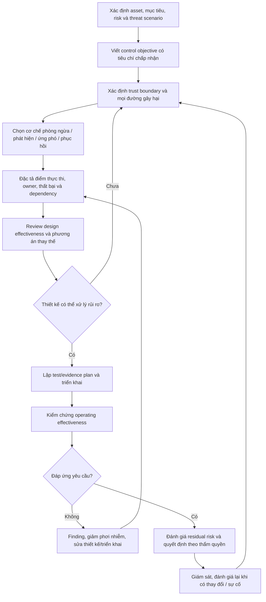
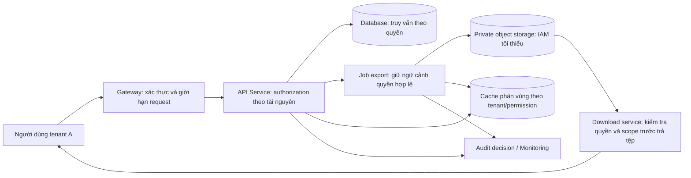

# Control design: Thiết kế security control có thể kiểm chứng

## 1. Vì sao thiết kế security control là một năng lực cốt lõi?

Một nhóm phát triển có thể cài đặt WAF, bật mã hóa, thêm xác thực và chạy security scanner nhưng vẫn để lộ dữ liệu của khách hàng này cho khách hàng khác. Nguyên nhân có thể không nằm ở việc thiếu công cụ, mà ở **thiết kế kiểm soát chưa gắn đúng đường gây hại và mục tiêu bảo mật**. WAF không tự hiểu người dùng tenant A có quyền đọc hồ sơ của tenant B hay không; mã hóa dữ liệu lưu trữ không ngăn ứng dụng giải mã rồi trả về cho người không đủ quyền.

**Control design (thiết kế biện pháp kiểm soát bảo mật)** là quá trình lựa chọn, định nghĩa và tích hợp một hoặc nhiều **security controls** để xử lý kịch bản rủi ro đã xác định, với **hành vi mong đợi, phạm vi, điểm thực thi, trách nhiệm và cách kiểm chứng** rõ ràng. Nó giải quyết câu hỏi: *Nếu kiểm soát được triển khai đúng, bằng cơ chế nào rủi ro sẽ bị ngăn, phát hiện, giới hạn hậu quả hoặc phục hồi?*

Trong chương **Security control** của module **SECURITY_SECURITY_ASSURANCE**, thiết kế controls là mắt xích nối **phân tích rủi ro → yêu cầu bảo mật → thiết kế kiểm soát → kiểm thử và audit → bằng chứng → khắc phục phát hiện → đánh giá lại rủi ro còn lại**. Mục tiêu học tập không chỉ là biết các loại công cụ bảo mật mà là **đánh giá có bằng chứng rằng hệ thống đáp ứng các mục tiêu bảo mật**, và duy trì assurance liên tục trong phát triển lẫn vận hành.

### Kết quả học tập

Sau bài này, người học có thể:

1. Phân biệt **control objective**, **control design**, **implementation** và **operating effectiveness**.
2. Chọn, kết hợp và đặc tả controls theo kịch bản rủi ro thay vì theo danh sách công nghệ có sẵn.
3. Thiết kế controls cho phòng ngừa, phát hiện, ứng phó và phục hồi; xét đường tấn công, trường hợp lỗi và tác động vận hành.
4. Viết **control specification** có điểm thực thi, owner, hành vi pass/fail, evidence và giới hạn áp dụng.
5. Lập kế hoạch xác minh thiết kế và kiểm thử hiệu lực hoạt động, kết nối kết quả với risk register và quyết định quản trị.

## 2. Hiểu đúng security control và các cấp độ bảo đảm

Một **security control** là biện pháp mang tính **kỹ thuật, quy trình, con người hoặc kết hợp** nhằm giảm khả năng xảy ra một sự kiện không mong muốn, giảm hậu quả, tăng khả năng phát hiện/ứng phó hoặc hỗ trợ phục hồi. Control có thể là kiểm tra quyền API, phân tách nhiệm vụ phê duyệt chuyển tiền, diễn tập khôi phục, kiểm tra nhà cung cấp hoặc quy trình rà soát quyền định kỳ.

| Thuật ngữ | Ý nghĩa | Ví dụ về truy cập hồ sơ nhân sự |
| --- | --- | --- |
| **Security objective** | Thuộc tính bảo vệ cần đạt. | Không tiết lộ dữ liệu giữa các tenant. |
| **Risk scenario** | Tình huống dẫn đến hậu quả có hại. | Người tenant A dùng ID của hồ sơ tenant B để yêu cầu export. |
| **Control objective** | Điều control cần bảo đảm ở mức mục tiêu. | Chỉ chủ thể đủ quyền mới đọc hoặc xuất được hồ sơ thuộc đúng tenant. |
| **Control design** | Cơ chế dự kiến và điều kiện hoạt động để đạt mục tiêu. | Service xác minh danh tính, tenant và quyền trên từng tài nguyên tại backend. |
| **Control implementation** | Mã nguồn, cấu hình, quy trình đã được triển khai. | Authorization service, database filter và quyền object storage. |
| **Design effectiveness** | Nếu thực hiện như thiết kế, cơ chế có **hợp lý và đủ khả năng** xử lý rủi ro trong phạm vi đã xác định không? | Review data flow cho thấy mọi đường đọc/xuất phải đi qua kiểm tra quyền. |
| **Operating effectiveness** | Control **thực sự được thực hiện/hoạt động nhất quán** tại thời điểm hoặc giai đoạn kiểm tra không? | Negative tests trên build triển khai và bằng chứng giám sát quyền. |
| **Residual risk** | Mức rủi ro còn lại sau khi xét controls thực có và hiệu lực có căn cứ. | Rủi ro BOLA còn lại sau triển khai, test và đánh giá đường chưa bao phủ. |

**Thiết kế đúng chưa đồng nghĩa vận hành đúng.** Một sơ đồ có kiểm tra quyền trước database có thể đạt review thiết kế, nhưng thực tế endpoint download mới lại truy cập storage trực tiếp. Ngược lại, một test pass ở endpoint đơn lẻ không chứng minh thiết kế bao phủ toàn bộ luồng dữ liệu.

### 2.1. Phân loại theo mục đích

| Loại control | Tác dụng chính | Ví dụ | Câu hỏi cần kiểm chứng |
| --- | --- | --- | --- |
| **Preventive – Phòng ngừa** | Ngăn hành vi/điều kiện gây rủi ro trước khi hậu quả xảy ra. | Kiểm tra quyền theo đối tượng, least privilege, validation. | Có đường nào bỏ qua control? Trường hợp bị từ chối có thật sự thất bại an toàn? |
| **Detective – Phát hiện** | Nhận biết hành vi/sai lệch đã hoặc đang xảy ra. | Cảnh báo xuất dữ liệu bất thường, audit log, drift detection. | Có ghi đủ tín hiệu, phát hiện kịp, có người nhận và phản ứng không? |
| **Corrective – Khắc phục** | Sửa trạng thái sau khi phát hiện sai lệch. | Thu hồi credential, khôi phục cấu hình, quy trình vá lỗi. | Có thể triển khai đúng tài sản, đúng hạn và xác minh đã sửa không? |
| **Recovery – Phục hồi** | Khôi phục dịch vụ/dữ liệu sau gián đoạn. | Backup/restore đã diễn tập, kế hoạch failover. | Thời gian/mức mất dữ liệu thực đo có đạt RTO/RPO đã được duyệt không? |
| **Deterrent – Răn đe** | Làm giảm động cơ hoặc khả năng chấp nhận thực hiện hành vi sai. | Quy định trách nhiệm truy cập và giám sát có thông báo. | Có áp dụng thực tế, công bằng và phù hợp chính sách không? |

Các nhóm có thể chồng lấn. Một audit trail vừa phục vụ phát hiện vừa hỗ trợ điều tra; giới hạn quyền và phê duyệt giao dịch có thể kết hợp ngăn ngừa với khả năng truy vết. **Không cộng điểm giảm rủi ro hai lần** chỉ vì cùng một cơ chế được ghi ở hai loại.

### 2.2. Phân loại theo cách thực thi

- **Technical:** authorization service, network policy, encryption, runtime configuration, rate limiting.
- **Administrative/organizational:** phê duyệt thay đổi, đào tạo, quy trình quản lý đặc quyền, phân cấp chấp nhận rủi ro.
- **Physical/environmental:** kiểm soát tiếp cận trung tâm dữ liệu và điều kiện thiết bị, khi thuộc phạm vi hệ thống.
- **Manual, automated hoặc hybrid:** kiểm tra quyền tự động; review quyền hàng quý do con người; cảnh báo tự động nhưng cần người điều tra.

Đối với control có con người tham gia, phải đặc tả **người được phân công, thời điểm, điều kiện kích hoạt, đầu ra, người thay thế và bằng chứng**. Một công cụ phát cảnh báo nhưng không ai trực xử lý có thể chỉ là một phần của control phát hiện, chưa phải một quy trình ứng phó có hiệu lực.

## 3. Đầu vào bắt buộc trước khi thiết kế

Đừng bắt đầu bằng câu “chúng ta nên cài công cụ X”. Bắt đầu bằng phạm vi và thông tin làm rõ đường gây hại:

| Nhóm đầu vào | Thông tin cần có | Lý do |
| --- | --- | --- |
| **Mục tiêu và tác động nghiệp vụ** | Bí mật, toàn vẹn, sẵn sàng, truy vết; nhóm người chịu ảnh hưởng và yêu cầu bắt buộc. | Xác định control phải đạt điều gì và hậu quả thất bại. |
| **Danh mục tài sản và dữ liệu** | Data classification, chủ sở hữu, API, tài khoản, kho tệp, backup và luồng qua bên thứ ba. | Không bảo vệ nhầm tài sản hoặc bỏ đường xuất dữ liệu. |
| **Threat model và attack paths** | Threat ID, actor/source, trust boundary, entry point, điều kiện khai thác. | Chỉ ra vị trí control phải chặn/phát hiện. |
| **Risk assessment** | Risk ID, impact, likelihood, mức hiện tại, ngưỡng và các giả định. | Quyết định độ mạnh, độ phủ và mức ưu tiên thiết kế. |
| **Security requirements** | Yêu cầu có tiêu chí chấp nhận đo được. | Chuyển mục tiêu thành hành vi phải kiểm chứng. |
| **Controls và evidence hiện có** | Code/cấu hình, manual procedure, kết quả test, audit, sự cố và finding. | Tránh lặp không hiệu quả và không dựa vào control thiếu bằng chứng. |
| **Ràng buộc vận hành** | Hiệu năng, khả năng phục hồi, hệ thống kế thừa, quyền triển khai, ngân sách và đội trực. | Control phải hoạt động trong môi trường thật và có người vận hành. |
| **Nghĩa vụ/phân cấp** | Chính sách, standard, hợp đồng, quyền chấp nhận rủi ro và trường hợp không được miễn trừ. | Không thiết kế giải pháp trái nghĩa vụ hoặc trao sai thẩm quyền. |

### 3.1. Cần ghi cả giả định và điều chưa biết

Ví dụ threat model ghi “Chỉ API gateway có thể truy cập service hồ sơ”. Đây là một **giả định cần xác minh**, vì job nền, service nội bộ hoặc cổng debug có thể gọi trực tiếp. Nếu thiết kế authorization chỉ ở gateway mà các đường khác bỏ qua gateway, cơ chế bị thiếu phạm vi.

Một bản thiết kế có thể hợp lệ với các giả định nhất định, nhưng phải ghi:

- Điều kiện nào khiến control có hiệu lực?
- Cái gì nằm ngoài phạm vi bảo vệ?
- Các bằng chứng nào cần thu thập để xác nhận giả định?
- Điều gì xảy ra nếu dependency hoặc điều kiện đó không còn đúng?

## 4. Các nguyên tắc thiết kế cần thể hiện trong control

### 4.1. Đúng rủi ro, đúng điểm kiểm soát

Control phải được đặt **tại nơi quyết định bảo mật có hiệu lực**, không chỉ tại nơi thuận tiện. Với BOLA/IDOR, ẩn nút trên giao diện không đủ vì client có thể gọi API trực tiếp. Cần thực thi quyền tại backend hoặc một thành phần bảo đảm mọi đường yêu cầu đi qua, và thường cần kiểm tra theo **từng đối tượng tài nguyên**.

### 4.2. Deny by default và fail securely

Nếu thiếu thông tin danh tính, quyền, tenant hoặc trạng thái phê duyệt, quyết định truy cập nhạy cảm nên **từ chối** thay vì mở quyền cho tiện. Không nên dùng fallback “nếu dịch vụ policy lỗi thì cho qua” đối với thao tác có rủi ro cao. Đồng thời cần thiết kế phương án duy trì dịch vụ hợp lệ, phản hồi rõ ràng, logging và xử lý lỗi phù hợp.

### 4.3. Least privilege và separation of duties

Chủ thể và tiến trình chỉ được cấp quyền cần thiết; quyền đặc biệt phải được quản lý. Đối với nghiệp vụ nhạy cảm, phân tách người tạo và người phê duyệt giao dịch, người viết code và người phê duyệt phát hành, người triển khai và người xác minh khi phù hợp. Tránh để một tài khoản có quyền **đọc dữ liệu, sửa chính sách và xóa audit log** không có kiểm soát bù đắp.

### 4.4. Defense in depth nhưng tránh chồng lấn giả

Xây dựng nhiều lớp kiểm soát **độc lập tương đối**: kiểm tra quyền server-side, giới hạn IAM tài khoản dịch vụ, quyền object storage và phát hiện truy cập bất thường. Nếu mọi lớp cùng phụ thuộc vào một tenant ID do client tự nhập mà không xác minh, chúng có **điểm lỗi chung** và không tạo được phòng thủ nhiều lớp thật sự.

### 4.5. Secure defaults và tối thiểu hóa bề mặt tấn công

Không mở quyền/cổng/chức năng mặc định ngoài nhu cầu đã duyệt. Giới hạn dữ liệu trả về, thời hạn tồn tại của tệp xuất, quyền đọc log và vòng đời secrets. Các đường phụ như batch job, cache, export, webhook, backup và tài khoản hỗ trợ phải được xem trong thiết kế, không chỉ “happy path” của UI.

### 4.6. Khả năng quan sát, kiểm chứng và khôi phục

Một control cần tạo được **tín hiệu** để xác minh có hoạt động đúng không, như log quyết định từ chối không chứa dữ liệu nhạy cảm, test âm, trạng thái cấu hình hiệu lực, khả năng phát cảnh báo hoặc kết quả diễn tập. Thiết kế phải tính cả trường hợp **control thất bại**: ai nhận biết, ứng phó thế nào, có rollback và khôi phục được không?

### 4.7. Phù hợp tác động nghiệp vụ

Một cơ chế quá phức tạp, thường xuyên chặn giao dịch hợp lệ hoặc làm mất tính sẵn sàng có thể bị vận hành tắt đi. Cần thiết kế trade-off có căn cứ giữa bảo mật, độ trễ, tính khả dụng, quyền riêng tư và khả năng bảo trì; không được loại bỏ yêu cầu bắt buộc chỉ vì bất tiện. Các quyết định đánh đổi phải được ghi và phê duyệt đúng thẩm quyền.

## 5. Quy trình thiết kế control từ đầu đến cuối



### Bước 1 — Chốt một kịch bản và kết quả cần bảo vệ

Ví dụ: “Người đã đăng nhập thuộc tenant A có thể yêu cầu dữ liệu xuất của tenant B bằng cách thay `exportId`; hậu quả là lộ dữ liệu nhân sự”. Ghi asset ID, threat/risk ID, yêu cầu bí mật, các đối tượng bị ảnh hưởng và ngưỡng cho phép.

### Bước 2 — Viết control objective tách khỏi giải pháp

**Objective:** “Không một chủ thể không đủ quyền nào có thể nhận tệp xuất của tenant khác, dù gọi trực tiếp API, dùng liên kết tải, đổi tham số hoặc truy cập storage”.

Objective này không ràng buộc trước vào một framework hay công cụ, nhưng đủ rõ để so sánh nhiều phương án. Nếu viết “Phải dùng middleware X” thì mới nói cách triển khai, chưa chứng minh mọi đường dữ liệu đạt mục tiêu.

### Bước 3 — Phân tích đường gây hại và điểm thực thi

Đi theo data flow và trust boundary: client → gateway → API/service → job tạo CSV → object storage → liên kết tải → cache/log. Với mỗi đường, hỏi:

- Có xác minh danh tính đáng tin cậy chưa?
- Thuộc tính tenant/role xuất phát từ đâu, có thể bị client thay đổi không?
- Quyết định quyền được thực hiện ở **đối tượng thực sự sẽ đọc/ghi** hay ở một màn hình khác?
- Có đường download trực tiếp bypass service không?
- Có race condition, cache dùng chung hoặc tác vụ nền dùng quyền rộng không?
- Nếu xác minh quyền lỗi hoặc policy service không khả dụng, hành vi là gì?

### Bước 4 — Chọn các control bổ trợ nhau

**Phòng ngừa:** xác thực token, kiểm tra quyền theo đối tượng tại service, phân vùng tenant ở data access, giới hạn quyền storage, link tải ngắn hạn có ràng buộc phù hợp.

**Phát hiện:** audit event không chứa dữ liệu nhạy cảm, cảnh báo hành vi export bất thường, đối chiếu các lần bị từ chối và thay quyền.

**Khắc phục/ứng phó:** thu hồi link/credential, tắt tính năng export theo quyền được ủy quyền, điều tra khả năng dữ liệu đã bị truy cập, sửa lỗi và retest.

**Phục hồi:** nếu hệ thống bị ảnh hưởng bởi xử lý khẩn, có phương án bật lại an toàn và kiểm tra tính toàn vẹn của dữ liệu/cấu hình.

### Bước 5 — Review tính đủ của thiết kế

Đối chiếu từng control với đường gây hại. Chỉ rõ **control chính** và **control bù đắp**, điểm lỗi chung, giới hạn, trường hợp lỗi, dữ liệu đi qua bên thứ ba và khả năng vận hành. Người phản biện nên gồm engineering, security, QA và chủ sở hữu nghiệp vụ theo mức rủi ro.

### Bước 6 — Định nghĩa phép thử ngay khi thiết kế

Nếu không mô tả được **điều gì sẽ làm control pass/fail**, thiết kế có thể quá mơ hồ. Tạo test case âm/dương, kiểm tra đường bypass, lỗi dependency, runtime configuration và bằng chứng cụ thể. Đừng chờ đến cuối phát triển mới nghĩ cách xác minh.

### Bước 7 — Triển khai, đánh giá lại và duy trì

Review code/IaC và test phải gắn build, môi trường và phiên bản. Nếu kết quả fail, không tự chấp nhận; ghi finding, owner, biện pháp giảm phơi nhiễm, retest. Sau khi có bằng chứng phù hợp, assessor/risk owner cập nhật **current residual risk**, rồi quyết định trong thẩm quyền. Kịch bản và control phải được xem lại khi xuất hiện endpoint, role, tenant hoặc nhà cung cấp mới.

## 6. Control specification: tài liệu thiết kế tối thiểu

Một **control specification** đủ tốt cho review và audit có thể trả lời toàn bộ các câu hỏi sau:

| Trường | Cần ghi | Ví dụ |
| --- | --- | --- |
| **Control ID và version** | Mã ổn định, phiên bản và trạng thái phê duyệt. | `CTRL-AUTH-EXPORT-01 / v1.2`. |
| **Control objective** | Kết quả bảo mật muốn đạt, đo được. | Từ chối export nếu chủ thể không có quyền trên tenant/tệp. |
| **Risk/threat refs** | Kịch bản và tác động được xử lý. | `RISK-R01`, `THREAT-T01`. |
| **Requirement refs** | Yêu cầu kiểm chứng và nghĩa vụ áp dụng. | `REQ-AUTH-01`. |
| **Scope và assets** | Hệ thống, môi trường, API, job, dữ liệu và chủ thể. | Production, detail/list/export/download, CSV và object storage. |
| **Trigger** | Khi nào control được gọi? | Mỗi yêu cầu xem/tạo/tải export; thay quyền liên quan. |
| **Enforcement point** | Vị trí ra quyết định và thực thi. | API/service + data-access boundary + quyền storage. |
| **Decision inputs** | Thuộc tính nào được tin cậy, nguồn nào xác minh? | Principal đã xác thực, tenant/role, owner của export, trạng thái quyền. |
| **Expected behavior** | Cho phép/từ chối, audit, xử lý lỗi; bao gồm fail-safe. | Nếu thiếu quyền hoặc policy không xác minh được: từ chối. |
| **Dependencies/assumptions** | Thành phần phụ thuộc và giả định cần xác minh. | Tính toàn vẹn identity claims, nhất quán quyền qua job/download. |
| **Control owner** | Ai triển khai, vận hành và theo dõi? | Engineering lead + Operations theo phân công. |
| **Verification plan** | Test/review nào chứng minh design và operating effectiveness? | Review kiến trúc, negative tests, runtime config checks. |
| **Evidence** | Kết quả, thời điểm, build, môi trường, asset và người kiểm chứng. | `TEST-AUTH-09`, `EVIDENCE-E21`. |
| **Failure response** | Fail/Unknown ảnh hưởng gate, finding và escalation thế nào? | Chặn/giới hạn release theo ngưỡng, giao action và retest. |
| **Residual risk và review** | Phần chưa xử lý, giới hạn và trigger đánh giá lại. | Rủi ro file đã chia sẻ, API mới, thay đổi tenant model. |

### 6.1. Tiêu chí chấp nhận không được chỉ là “đã bật”

“Bật authorization” là **đầu vào triển khai**. “Token của tenant A không thể truy cập tệp B ở mọi đường download thuộc phạm vi; token hợp lệ chỉ truy cập tệp được cấp quyền; lỗi policy dẫn đến từ chối và có tín hiệu giám sát” mới là **hành vi có thể kiểm chứng**.

Tương tự, “Backup enabled” không thể thay cho “Khôi phục dữ liệu/dịch vụ trong mục tiêu RTO/RPO đã được chủ sở hữu nghiệp vụ phê duyệt”. “Log enabled” không thay cho việc kiểm tra sự kiện đúng, không rò rỉ bí mật và có người phản ứng cảnh báo.

### 6.2. Mẫu YAML đặc tả thiết kế

Đây là **mẫu học tập**, không phải schema bắt buộc của một công cụ GRC hoặc cấu hình được áp dụng trực tiếp:

```yaml
control_id: "CTRL-AUTH-EXPORT-01"
version: "1.2"
name: "Kiểm soát truy cập tệp xuất theo tenant và đối tượng"
status: "design_approved_pending_implementation"
scope:
  service: "HR SaaS"
  environment: ["production"]
  assets: ["API export", "Export job", "Object storage"]
  entry_points: ["detail", "list", "export", "download"]
objective: "Không chủ thể nào tải dữ liệu không thuộc tenant/quyền của mình"
traceability:
  risks: ["RISK-R01"]
  threats: ["THREAT-T01"]
  requirements: ["REQ-AUTH-01"]
design:
  type: ["preventive", "detective"]
  enforcement: ["application_service", "storage_access_policy"]
  trusted_inputs: ["verified_principal", "authorized_tenant_context"]
  decision: "Kiểm tra quyền trên từng export và từng đối tượng dữ liệu"
  deny_conditions:
    - "Không xác thực hoặc không xác minh được tenant"
    - "Thiếu quyền hoặc export không thuộc phạm vi của chủ thể"
    - "Không thể lấy quyết định chính sách đủ tin cậy"
  dependencies: ["identity_provider", "authorization_service"]
  logging: "Ghi actor/action/resource/outcome, không ghi token hoặc hồ sơ"
  assumptions:
    - "Mọi đường tải dữ liệu đi qua enforcement được thiết kế"
    - "Quyền object storage không cho truy cập công khai trực tiếp"
verification:
  design_review: ["DFD", "attack_path_review", "bypass_review"]
  negative_tests:
    - "Tenant A không tải tệp tenant B"
    - "Sai role, sai owner, link hết hạn đều bị từ chối"
    - "Lỗi authorization dependency không mở quyền"
  positive_tests:
    - "Chủ thể được cấp quyền tải đúng tệp và phạm vi"
  evidence_required: ["test_report", "build_id", "runtime_policy", "review_decision"]
accountability:
  control_owner_role: "Engineering lead"
  verifier_role: "Security QA"
  risk_owner_role: "Product owner dữ liệu nhân sự"
failure_handling:
  decision: "block_or_escalate_according_to_policy"
  required_record: "finding_and_remediation_action"
review_triggers: ["API mới", "Thay đổi IAM", "Finding", "Incident"]
```

**Trạng thái `design_approved_pending_implementation` không có nghĩa control đã hoạt động.** Hồ sơ thực cần bổ sung định danh người nhận trách nhiệm, thời hạn, đường dẫn bằng chứng có phân quyền, kết quả kiểm thử ở đúng build/môi trường và lịch sử quyết định. Không đưa token, mật khẩu hoặc dữ liệu khách hàng thật vào specification hay evidence.

## 7. Case study: thiết kế kiểm soát export cho SaaS đa tenant

Giả sử một nền tảng quản lý hồ sơ nhân sự có các tenant độc lập. Mỗi tenant có người quản trị HR, người xem hồ sơ, nhân viên hỗ trợ và job tạo báo cáo. Hệ thống có API, database, hàng đợi tác vụ, storage cho CSV, bộ nhớ cache và log tập trung.

### 7.1. Threat scenario và mục tiêu

**RISK-R01:** người dùng đã xác thực thuộc tenant A có thể thay `exportId` hoặc resource ID và lấy dữ liệu nhân sự tenant B. Tác động chính là **mất tính bí mật và quyền riêng tư**; nếu API cũng cho phép sửa hồ sơ thì có thể mở thêm rủi ro toàn vẹn.

**Requirement REQ-AUTH-01:** “Một chủ thể chỉ được đọc/xuất hồ sơ của tenant và những đối tượng mà họ được cấp quyền, trên tất cả đường truy cập thuộc phạm vi, kể cả API, job, liên kết tải, cache và storage.”

### 7.2. Bản đồ điểm kiểm soát



Sơ đồ là **thiết kế tham khảo**, chưa phải bằng chứng vận hành. Điều cần kiểm tra là **mọi đường đọc dữ liệu có thực sự đi qua cơ chế cưỡng chế quyền** hay không. Nếu storage có public URL hoặc background job nhận tenant ID do client cung cấp mà không xác minh, control tại API chính có thể bị bypass.

### 7.3. Control layers và giới hạn riêng của từng lớp

| Lớp | Thiết kế cụ thể | Đường gây hại được giảm | Hạn chế cần xem |
| --- | --- | --- | --- |
| **Identity** | Token/session được xác minh; tenant, subject, role lấy từ ngữ cảnh danh tính tin cậy. | Giả danh hoặc tự đặt tenant trong request. | Token hợp lệ không đồng nghĩa có quyền trên từng export. |
| **Application authorization** | Kiểm tra tenant, owner, role và trạng thái tài nguyên ở backend trước đọc/tạo/tải. | BOLA/IDOR qua thay ID hoặc gọi trực tiếp API. | Mọi endpoint, batch và job phải sử dụng hoặc bảo đảm cùng policy. |
| **Data access** | Giới hạn truy vấn theo tenant/đối tượng; có thể dùng cơ chế DB bổ sung nếu phù hợp. | Lỗi truy vấn rộng hoặc bỏ bộ lọc ở một đường. | DB policy không tự bảo vệ tệp đã xuất hoặc cache. |
| **Export job** | Job chỉ nhận yêu cầu đã xác minh; lưu context tối thiểu và kiểm tra quyền theo mô hình được duyệt. | Job tạo nhầm CSV theo tenant từ input không tin cậy. | Quyền có thể thay đổi trong khi job chạy; cần quy tắc tái kiểm tra. |
| **Object storage** | Kho riêng tư; quyền IAM giới hạn; không cung cấp đường đọc công khai. | Tải trực tiếp tệp không qua ứng dụng. | Liên kết tạm hoặc policy sai vẫn có thể lộ dữ liệu. |
| **Cache** | Cache key và invalidation theo tenant, subject/permission khi cần. | Trả kết quả tenant/role khác từ cache. | Cần test cache hit/miss, thay quyền và hết hạn. |
| **Audit/monitoring** | Ghi quyết định xuất/tải và thất bại; cảnh báo hành vi bất thường. | Phát hiện abuse, hỗ trợ điều tra. | Detective không thay enforcement phòng ngừa. |

### 7.4. Ví dụ Java thể hiện ý tưởng kiểm tra quyền tại service

Đoạn mã sau **minh họa một điểm thực thi**, không phải thư viện production hoàn chỉnh. `AuthenticatedActor` phải được xây dựng từ ngữ cảnh xác thực đã kiểm chứng, **không** từ `tenantId` do client tự truyền; `permissionChecker` và `objectStore` cần được triển khai an toàn, có review và test.

```java
public byte[] downloadExport(UUID exportId, AuthenticatedActor actor) {
    ExportJob job = exportRepository.findById(exportId)
        .orElseThrow(() -> new NotFoundException("Resource not found"));

    // Kiểm tra tenant và quyền trên chính đối tượng sẽ đọc.
    boolean sameTenant = job.tenantId().equals(actor.tenantId());
    boolean allowed = sameTenant
        && permissionChecker.mayDownloadExport(actor, job);

    if (!allowed) {
        securityAudit.recordDenied(actor.subjectId(), "export.download", exportId);
        // Không tiết lộ sự tồn tại của tài nguyên tenant khác.
        throw new NotFoundException("Resource not found");
    }

    securityAudit.recordAllowed(actor.subjectId(), "export.download", exportId);
    return privateObjectStore.read(job.storageKey());
}
```

Đoạn code chỉ cho thấy **vị trí và ý định kiểm tra quyền**. Khi triển khai thật cần xét **tính nhất quán giữa quyền và thời điểm đọc (TOCTOU), quyền sở hữu tệp, kiểm soát storage, kích thước tải, bộ nhớ, audit không chứa dữ liệu nhạy cảm, lỗi phụ thuộc và khả năng thu hồi**. Không nên đọc toàn bộ tệp lớn vào `byte[]` nếu có nguy cơ cạn bộ nhớ; giải pháp streaming có kiểm soát có thể phù hợp hơn. Khi dùng signed URL cần thiết kế scope, TTL, quyền phát hành, khả năng vô hiệu và thử đường truy cập trực tiếp.

### 7.5. Kế hoạch kiểm chứng bắt buộc

| Test ID | Điều kiện | Kết quả mong đợi | Bằng chứng |
| --- | --- | --- | --- |
| **T-AUTH-01** | Actor tenant A tải export tenant A có quyền hợp lệ. | Cho phép đúng tệp và đúng trường dữ liệu. | Expected/actual, build, actor thử nghiệm. |
| **T-AUTH-02** | Actor tenant A dùng ID export tenant B. | Từ chối, không trả dữ liệu B, không tiết lộ metadata nhạy cảm. | HTTP/result, audit đã che dữ liệu. |
| **T-AUTH-03** | Cùng tenant nhưng role không có quyền export. | Từ chối ở backend dù UI hiển thị nút hoặc request được tự tạo. | Test role âm, response. |
| **T-AUTH-04** | Link tải hết hạn/đã thu hồi, hoặc request trực tiếp vào storage. | Không truy cập được dữ liệu ngoài điều kiện được cấp. | Kiểm tra runtime storage policy và negative test. |
| **T-AUTH-05** | Cache hit với key của tenant khác hoặc quyền đã thay. | Không trả dữ liệu chéo tenant/role. | Kết quả cache hit/miss, version. |
| **T-AUTH-06** | Job nền nhận yêu cầu giả định từ tenant A chứa resource của B. | Không xuất dữ liệu B; lưu trạng thái thất bại phù hợp. | Test tích hợp job và queue. |
| **T-AUTH-07** | Thành phần authorization không trả kết quả tin cậy. | Fail securely, không cho phép đọc dữ liệu nhạy cảm. | Fault-injection test trong môi trường kiểm soát. |
| **T-AUTH-08** | Nhiều lần export thất bại hoặc tăng đột biến. | Audit/cảnh báo hoạt động theo điều kiện đã thiết kế, không ghi token. | Event mẫu, kết quả alert và hành động của đội trực. |

**Quan trọng:** kết quả “test pass” chỉ xác minh những trường hợp, phiên bản và môi trường đã thử. Bằng chứng phải kèm phạm vi và giới hạn; khi thêm endpoint hoặc đổi mô hình tenant, cần cập nhật cả thiết kế và test.

## 8. Thiết kế detective control đúng nghĩa

Nhiều hệ thống bật log nhưng không xác định **phải nhận biết sự kiện nào, mức trễ chấp nhận và ai xử lý**. Một detective control có hiệu lực cần đủ chuỗi **signal → detection logic → alert/triage → response → evidence**.

Ví dụ với export dữ liệu:

1. **Signal:** server ghi actor, tenant, action, export ID, outcome, thời điểm, correlation ID và khối lượng tệp theo mức cần thiết, **không ghi hồ sơ hoặc token**.
2. **Rule:** phát hiện số lần export bất thường, nhiều lần bị từ chối, truy cập khác thường giữa tài khoản và phạm vi. Quy tắc ngưỡng là ví dụ phải được hiệu chỉnh theo lưu lượng thực.
3. **Alert:** cảnh báo tới đội trực kèm thông tin tối thiểu đủ điều tra, giảm trùng lặp và rò rỉ dữ liệu.
4. **Triage:** xác định cảnh báo thật/giả, người trực có quyền xem bằng chứng chi tiết trong kho bảo vệ.
5. **Response:** thu hồi quyền hoặc chặn tạm theo quy trình được ủy quyền; chuyển cấp khi có dấu hiệu sự cố.
6. **Verification:** thử sự kiện đã biết, xác nhận tín hiệu được ghi, cảnh báo phát ra và người trực nhận/ứng phó trong điều kiện kiểm tra.

| Tiêu chí thiết kế | Câu hỏi | Nếu không đạt |
| --- | --- | --- |
| **Detection coverage** | Những đường export API, job, storage nào có signal? | Có thể không phát hiện đường bypass. |
| **Timeliness** | Cảnh báo đến khi nào so với thời gian rủi ro có thể gây thiệt hại? | Phát hiện quá muộn để giới hạn hậu quả. |
| **Accuracy** | False positive/negative được đánh giá ra sao? | Báo động nhiễu hoặc bỏ sót hành vi nguy hiểm. |
| **Response ownership** | Ai trực, quyền gì, người thay thế và khi nào chuyển cấp? | Alert tồn tại nhưng không có hành động. |
| **Evidence integrity** | Log có đủ và được bảo vệ khỏi sửa/xóa trái quyền? | Không thể điều tra và chứng minh quyết định. |
| **Data minimization** | Log/alert có tiết lộ bí mật hoặc dữ liệu cá nhân không? | Chính control trở thành kênh rò rỉ. |

**Detective control không tự giảm khả năng hành vi trái phép xảy ra** nếu không kết hợp ngăn chặn. Nó có thể giảm **thời gian phát hiện hoặc hậu quả** nếu có hành động đáp ứng hiệu quả và đủ nhanh; phải có bằng chứng về chuỗi phát hiện–ứng phó trước khi kết luận mức rủi ro còn lại đã giảm.

## 9. Thiết kế control cho toàn vẹn và tính sẵn sàng

### 9.1. Toàn vẹn: thay đổi tài khoản nhận lương

**Threat:** nhân viên có quyền xem bảng lương nhưng không có quyền thay đổi tài khoản thụ hưởng tìm cách gửi yêu cầu sửa trực tiếp hoặc phê duyệt giao dịch của chính mình.

**Control objective:** chỉ người được phép mới tạo yêu cầu; thay đổi chỉ có hiệu lực sau các bước phê duyệt hợp lệ và có dấu vết đối soát.

**Thiết kế kiểm soát đề xuất:**

| Lớp | Cơ chế | Điều kiện kiểm chứng |
| --- | --- | --- |
| Authorization | Kiểm tra quyền ở server cho thao tác tạo, xem và duyệt thay đổi. | Role trái quyền không thể gửi API thành công. |
| Workflow integrity | State machine chỉ cho phép chuyển trạng thái đã duyệt; kiểm tra actor và bước trước đó. | Gọi trực tiếp API không thể bỏ qua bước hoặc phê duyệt sai thứ tự. |
| Segregation of duties | Người đề nghị không tự phê duyệt khi chính sách yêu cầu hai vai trò. | Negative test người tạo duyệt giao dịch của chính mình. |
| Transaction integrity | Cập nhật có điều kiện, chống xử lý lặp và tính nhất quán phù hợp. | Test retry, cạnh tranh cập nhật, xử lý idempotency và rollback. |
| Audit và đối soát | Ghi actor, thay đổi, quyết định, outcome; kiểm soát quyền log. | Đối chiếu giao dịch và audit, thử sửa/xóa log trái quyền. |
| Monitoring/response | Cảnh báo thay đổi nhạy cảm bất thường, quy trình xử lý. | Test tín hiệu và người trực tiếp nhận. |

**Không áp giả định rằng chỉ cần một bước phê duyệt là đủ**; thiết kế phải xét quyền thực, phạm vi tiền, nhiệm vụ, thời điểm và các điều kiện nghiệp vụ do tổ chức phê duyệt. Những điều kiện thanh toán không thể đảo ngược cần chú trọng hậu quả và phương án ứng phó.

### 9.2. Sẵn sàng: backup và khôi phục

**Threat:** trong kỳ trả lương, database hỏng và backup kho mới không thể khôi phục trong thời gian cần thiết.

**Control objective:** khôi phục dịch vụ và dữ liệu trong mục tiêu **RTO/RPO do chủ sở hữu nghiệp vụ xác lập, phê duyệt**.

**Thiết kế cần bao gồm:**

- Phạm vi dữ liệu và thành phần cấu hình nào được sao lưu; các bản sao được bảo vệ bởi quyền, khóa và các điều kiện không bị mất cùng một sự cố.
- Tần suất backup tương thích với RPO; phương án restore tương thích với RTO; kiểm tra dung lượng và phụ thuộc hệ thống.
- Quy trình thử phục hồi định kỳ và sau thay đổi đáng kể, với kịch bản đại diện.
- Người điều phối sự cố, thứ tự khôi phục và quyền truy cập backup trong tình huống khẩn cấp.
- Xác minh dữ liệu **có thể sử dụng và toàn vẹn** sau restore, không chỉ “job succeeded”.

**Evidence:** báo cáo diễn tập có môi trường, dữ liệu giả/được bảo vệ, thời gian thực đo, mức mất dữ liệu quan sát, tiêu chí được duyệt, finding và hành động nếu không đạt. Một ảnh chụp “Backup enabled” chỉ là bằng chứng cấu hình, **không chứng minh control phục hồi hoạt động**.

## 10. Phân tích điểm thất bại, đường bypass và phụ thuộc

Để review thiết kế, hãy chủ động tìm cách control có thể **không được gọi, trả lời sai, bị tắt hoặc gây hại khác**:

| Tình huống | Nguy cơ thiết kế | Kiểm chứng hoặc đối sách |
| --- | --- | --- |
| **Alternative path** | Download trực tiếp storage bỏ qua API authorization. | Đọc effective storage policy, thử URL trực tiếp và cơ chế link. |
| **Inconsistent policy** | API detail kiểm tra tenant nhưng batch/export không kiểm tra. | Inventory mọi entry point; test cùng policy trên đường đồng bộ/bất đồng bộ. |
| **Client-controlled input** | Tenant ID/role do client gửi được tin là danh tính. | Lấy thuộc tính từ danh tính đã xác minh; negative test thay tham số. |
| **TOCTOU** | Quyền được kiểm tra rồi đổi trước lúc dữ liệu được trả. | Thiết kế thời điểm kiểm tra phù hợp, token/permission revocation và consistency. |
| **Stale cache** | Dữ liệu từ quyền cũ được trả sau thay role hoặc giữa tenant. | Cache key theo phạm vi, invalidation và test khi thay quyền. |
| **Policy service down** | Fallback mở quyền để giữ availability. | Fail securely cho truy cập nhạy cảm; thiết kế suy giảm dịch vụ an toàn. |
| **Shared dependency** | Hai control độc lập trên giấy cùng phụ thuộc một claim giả. | Review nguồn tin cậy, phân tích common-mode failure. |
| **Overprivileged service** | Job có quyền đọc toàn bộ tenant, bỏ qua scope của yêu cầu. | Scope job, kiểm tra đầu vào, IAM tối thiểu, audit theo request. |
| **Audit overload** | Quá nhiều cảnh báo, đội trực bỏ qua tín hiệu quan trọng. | Hiệu chỉnh, phân mức, playbook và đo khả năng xử lý. |
| **Emergency bypass** | Quyền break-glass còn mở sau sự cố. | Phạm vi, thời hạn, phê duyệt, nhật ký, thu hồi và hậu kiểm. |
| **Bad recovery design** | Backup và khóa giải mã bị mất cùng hệ thống chính. | Thử restore độc lập, quản lý khóa/quyền, thiết kế bảo vệ bản sao. |

**Mẫu câu hỏi hữu ích trong design review:** “Nếu control X ngừng hoạt động, dữ liệu có bị trả về sai quyền không?”, “Ai có thể thay cấu hình mà không đi qua pipeline?”, “Nếu tenant mới được tạo tự động, test và chính sách vẫn áp dụng không?”, “Nếu auditor yêu cầu chứng minh một quyết định từ ba tháng trước, bằng chứng còn truy được không?”.

## 11. Đánh giá thiết kế và đánh giá vận hành phải tách bạch

### 11.1. Design effectiveness: kiểm tra tính hợp lý của giải pháp

Trong **design review**, assessor xem kịch bản rủi ro, data flow và control specification để đánh giá:

1. Control objective có tương ứng với mục tiêu và hậu quả đã xác định không?
2. Điểm thực thi có nằm ở mọi đường quan trọng không, có thể bypass không?
3. Decision inputs có đáng tin và đủ thuộc tính không?
4. Trạng thái lỗi có an toàn và có giám sát không?
5. Có tương thích vận hành, cơ chế khôi phục và trách nhiệm rõ không?
6. Có đủ điều kiện test hiệu lực sau khi triển khai không?

**Kết luận mẫu:** “Design adequate for the assessed scope, subject to verification of storage policy and asynchronous export path”. Điều này **không phải** kết luận “control đang vận hành đạt”.

### 11.2. Operating effectiveness: kiểm tra control hoạt động thật

Sau triển khai, cần bằng chứng:

- Mã nguồn, IaC hoặc policy đúng **commit, build và môi trường**.
- Kết quả positive/negative tests cho quyền, dữ liệu và đường bypass.
- Kiểm tra effective configuration, không chỉ trạng thái khai báo.
- Phép thử lỗi dependency, sự kiện phát hiện, phản ứng và quy trình thủ công nếu liên quan.
- Kết quả chạy qua **khoảng thời gian đại diện** khi yêu cầu đánh giá tính nhất quán; một snapshot đơn lẻ chỉ chứng minh tại thời điểm đó.
- Tình trạng finding, exception, biện pháp khắc phục và retest.

### 11.3. Ma trận assurance cho một control

| Mức chứng cứ | Nó chứng minh điều gì? | Không nên suy rộng thành |
| --- | --- | --- |
| Design specification được duyệt | Tổ chức đã xác định cơ chế dự kiến và tiêu chí. | Control đã được triển khai ở mọi nơi. |
| PR, commit, IaC review | Có thay đổi kỹ thuật đã review trong nguồn. | Runtime giống source hoặc không có đường bypass. |
| Test pass ở staging | Hành vi đạt trên build, dữ liệu và môi trường staging đã thử. | Tất cả production và endpoint đều đạt. |
| Runtime policy + test production-like | Phạm vi cấu hình và hành vi kiểm tra phù hợp hơn thực tế. | Control liên tục đúng trong mọi thời điểm. |
| Giám sát theo kỳ + retest sau thay đổi | Có căn cứ về hiệu lực trong giai đoạn/phạm vi theo dõi. | Rủi ro biến mất hoặc không còn nghĩa vụ đánh giá. |

Khi thiếu bằng chứng quan trọng, trạng thái nên là **unverified/unknown hoặc partially effective**, không tự chấm pass. Cần nêu giới hạn và giao công việc xác minh.

## 12. Liên kết control design với risk register, finding và decision

Một thiết kế cần tạo được chuỗi truy vết:

```text
ASSET-HR-01       Hồ sơ nhân viên nhiều tenant
  THREAT-T01      Token tenant A truy cập export tenant B
  RISK-R01        Lộ hồ sơ ngoài phạm vi được phép
  REQ-AUTH-01     Kiểm tra quyền trên tenant và đối tượng
  CTRL-AUTH-01    Authorization trong API/service và quyền storage
  CTRL-MON-02     Audit + phát hiện export bất thường
  TEST-AUTH-09    Ca âm sai tenant/sai role, có build và môi trường
  EVIDENCE-E21    Test report và runtime policy đã che dữ liệu
  FINDING-F07     Export thiếu kiểm tra tenant ở một đường
  ACTION-A14     Sửa, triển khai, retest, đánh giá lại control
  DECISION-D04   Risk owner/cấp có quyền quyết định phần còn lại
```

### 12.1. Control design và residual risk không thể tách rời

**Inherent risk** phản ánh kịch bản trước controls theo giả định đã nêu. **Current residual risk** chỉ có thể xét theo controls hiện có và hiệu lực có căn cứ. **Target residual risk** là mức kỳ vọng sau thiết kế/biện pháp chưa hoàn tất.

| Mốc | Control status | Current residual minh họa | Target residual minh họa |
| --- | --- | --- | --- |
| **Trước thiết kế sửa lỗi** | Xuất dữ liệu thiếu phân quyền ở một đường. | 5×4 = **20** | Chưa xác định. |
| **Có thiết kế mới** | `design_approved`, chưa triển khai. | **20**, theo thực trạng đã đánh giá. | 5×2 = **10**, dự kiến. |
| **Đã merge/deploy, chưa retest** | `implemented_unverified`. | **Không tự động giảm từ 20**. | **10**, nếu control hoạt động theo kỳ vọng. |
| **Retest và runtime checks đạt** | `verified_effective_in_scope`. | Có thể đánh giá lại, ví dụ **10**, nếu lý do/bằng chứng phù hợp. | Cập nhật theo phương án xử lý tiếp. |
| **API mới bỏ qua control** | Finding mới, phạm vi đổi. | Phải **đánh giá lại**, không mặc định vẫn 10. | Cập nhật kế hoạch và test. |

Các điểm chỉ **minh họa phương pháp** theo thang impact × likelihood 1–5 của một tổ chức giả định, không phải xác suất phần trăm, độ đo tuyệt đối hay công thức bắt buộc. Đối với rủi ro lớn, nghĩa vụ bắt buộc hoặc sự cố đang xảy ra, quy trình ứng phó/chuyển cấp có thể phải kích hoạt **bất kể điểm số**.

### 12.2. Control failure không phải chỉ là một ticket kỹ thuật

Khi test phát hiện BOLA:

1. QA ghi finding với bằng chứng tái hiện an toàn và phạm vi.
2. Security/assessor nối finding với control, yêu cầu và kịch bản rủi ro.
3. Risk owner xem hậu quả, có thể quyết định tạm giới hạn export theo quyền được ủy quyền.
4. Engineering sửa **nguyên nhân gốc**, kiểm tra đường tương tự và cập nhật design/test nếu cần.
5. QA retest trên bản triển khai phù hợp và xác nhận kết quả.
6. Người đánh giá cập nhật control effectiveness, risk register; người có thẩm quyền quyết định phần rủi ro còn lại.

**Không đóng finding chỉ vì PR đã merge hoặc ticket là Done.** Bản sửa phải được chứng minh đang hoạt động ở tài sản/môi trường tương ứng; các đường chưa được kiểm tra vẫn phải ghi rõ.

## 13. Chọn giữa các phương án và compensating controls

Control design thường có nhiều phương án:

| Phương án cho export | Ưu điểm | Hạn chế/rủi ro | Điều kiện sử dụng |
| --- | --- | --- | --- |
| **Chỉ ẩn nút export ở UI** | Đơn giản, cải thiện trải nghiệm. | Dễ bypass qua API trực tiếp; không đủ phòng ngừa. | Chỉ như lớp giao diện bổ sung, không thay authorization. |
| **Kiểm tra quyền tập trung ở API/service** | Quản lý rule nhất quán, gần quyết định nghiệp vụ. | Phải bảo đảm mọi entry point đều gọi cơ chế này. | Có inventory đường dữ liệu, review bypass, test âm. |
| **Giới hạn quyền database theo tenant** | Tăng lớp hạn chế trong truy vấn. | Không bảo vệ CSV đã xuất; cấu hình kết nối và job cần chú ý. | Có test quyền DB và kiểm chứng đường khác. |
| **Storage riêng tư + link có phạm vi/hạn** | Hạn chế đọc trực tiếp tệp xuất. | Link bị chia sẻ hoặc quyền storage drift; cần quản lý thu hồi. | Đối chiếu IAM hiệu lực và negative test. |
| **Giám sát xuất bất thường** | Hỗ trợ phát hiện/phản ứng và điều tra. | Có thể phát hiện sau khi dữ liệu đã lộ. | Kết hợp control ngăn ngừa và playbook ứng phó. |

### 13.1. Khi nào dùng compensating control?

**Compensating control** là biện pháp thay thế có khả năng đáp ứng một phần hoặc toàn bộ mục tiêu của control gốc trong phạm vi đã đánh giá, khi control ban đầu chưa thể triển khai hoặc không phù hợp. Không phải mọi biện pháp “tăng log” đều bù đắp được yêu cầu “chặn người không có quyền”.

Một đề xuất bù đắp phải trả lời:

- Control gốc cần đạt mục tiêu gì?
- Biện pháp thay thế giảm **đúng đường gây hại** đến mức nào?
- Có bằng chứng thiết kế và hiệu lực hoạt động không?
- Những rủi ro nào còn nguyên, có biện pháp giảm phơi nhiễm tạm thời không?
- Ai có quyền phê duyệt, giới hạn hiệu lực và yêu cầu retest/đánh giá lại?

Ví dụ, nếu hệ thống kế thừa chưa thể thêm authorization theo đối tượng đúng hạn, một phương án tạm có thể là **vô hiệu hóa export** cho nhóm bị ảnh hưởng hoặc giới hạn truy cập đã được phê duyệt và kiểm chứng. Tăng audit log đơn thuần **không tương đương** với việc ngăn lộ dữ liệu và không tự cho phép chấp nhận rủi ro.

## 14. Trách nhiệm thiết kế, triển khai và xác minh

Ma trận dưới đây dùng RACI: **R** trực tiếp thực hiện; **A** giải trình cuối cùng cho đúng hoạt động; **C** được tham vấn; **I** được thông báo. `A/R` nghĩa là một chức năng vừa thực hiện vừa chịu trách nhiệm cuối cùng. Ví dụ này cần điều chỉnh theo cơ cấu và thẩm quyền thật.

| Hoạt động | Lãnh đạo (LD) | Risk owner (PO) | Security/GRC (SEC) | Engineering (ENG) | QA/Assessor | Operations (OPS) |
| --- | :---: | :---: | :---: | :---: | :---: | :---: |
| Xác lập mục tiêu và mức rủi ro chấp nhận được | **A** | **R** | **R** | C | C | C |
| Xác định tài sản, tác động, threat/risk scope | I | **A** | **R** | R | C | C |
| Viết control objective và yêu cầu bảo mật | I | **A** | **R** | R | C | C |
| Thiết kế cơ chế kỹ thuật, điểm thực thi và lỗi | I | C | **R** | **A/R** | C | R |
| Review design effectiveness theo phạm vi | I | C | **A/R** | R | R | C |
| Triển khai code/IaC và vận hành control ứng dụng | I | I | C | **A/R** | C | R |
| Kiểm thử operating effectiveness và retest | I | I | C | R | **A/R** | R |
| Tổng hợp evidence/finding và assurance status | I | C | **A** | R | **R** | R |
| Xử lý rủi ro/chấp nhận phần còn lại trong thẩm quyền | I | **A** | **R** | C | C | C |
| Quyết định vượt thẩm quyền của chủ sở hữu sản phẩm | **A** | **R** | **R** | C | C | C |
| Giám sát drift, kiểm tra lại control theo kỳ | I | I | C | R | C | **A/R** |

**Một A cho mỗi hàng** là quy ước để tránh mơ hồ. Với control thuộc hạ tầng, OPS có thể là A của triển khai, trong khi ENG là R của phần ứng dụng; phải tách hàng khi trách nhiệm quyết định khác nhau. Kiểm toán độc lập, nếu có, sẽ đánh giá theo phạm vi của họ mà **không trở thành chủ sở hữu hoạt động bảo mật của hệ thống**.

Người thiết kế không tự cấp quyền chấp nhận rủi ro kinh doanh; người kiểm thử không tự phê duyệt release. Với hệ thống rủi ro cao, cần xem **phân tách nhiệm vụ và sự độc lập của reviewer/assessor**. Nếu đội nhỏ phải kiêm nhiệm, có thể áp dụng review chéo, test tái lập và phê duyệt bổ sung.

## 15. Từ design đến CI/CD, vận hành và cải tiến

### 15.1. Design review trước khi code

Một design review có thể dùng checklist:

- Risk/threat/requirement ID có đầy đủ, scope và trust boundary có đúng?
- Control objective có tiêu chí đạt/không đạt và điều kiện áp dụng?
- Điểm thực thi có bao phủ tất cả đường quan trọng, kể cả job, cache và storage?
- Decision inputs đến từ nguồn tin cậy? Có least privilege và fail securely?
- Có xử lý lỗi dependency, concurrency, timeout, rollback và recovery?
- Có logging phù hợp, không thêm rò rỉ dữ liệu hoặc bí mật?
- Có owner, reviewer, điều kiện chuyển cấp và tài liệu test/evidence?

### 15.2. Kiểm soát khi phát triển và phát hành

Chính sách phát triển có thể yêu cầu security-sensitive changes phải qua review và test phù hợp. CI/CD giúp tự động:

- Kiểm tra code/IaC, dependency/secrets và điều kiện cấu hình được quy định.
- Chạy positive/negative tests gắn commit, artifact và môi trường.
- Chặn hoặc chuyển cấp khi thiếu bằng chứng trọng yếu hoặc test bắt buộc không đạt.
- Lưu kết quả và quyết định release; hạn chế bypass và quản lý ngoại lệ.

**Pipeline xanh không chứng minh control đạt ở mọi nơi** nếu test thiếu đường cần bảo vệ hoặc runtime config khác staging. Kết quả nên mô tả **eligible for authorized release decision**, không tự coi mọi rủi ro đã được chấp nhận.

### 15.3. Sau phát hành: theo dõi control drift

Khi thêm API, đổi identity provider, thay mô hình tenant, tách microservice, nâng database hoặc thay storage policy, phải xem control có còn nằm đúng chỗ không. Theo dõi cấu hình thực, các chỉ số phát hiện, kết quả test tự động và feedback từ incident/audit. Review design khi bằng chứng cho thấy control **bị bypass, không thể vận hành hoặc không còn phù hợp**.

### 15.4. Quản lý phiên bản và lịch sử quyết định

Một control catalog nên lưu `control_id`, `design_version`, các bản release đã triển khai, các bằng chứng và finding, lịch sử thay đổi, người phê duyệt và trigger review. Khi cùng một control áp cho nhiều dịch vụ, lưu **trạng thái triển khai theo từng tài sản**: specification được duyệt ở cấp tổ chức không đồng nghĩa mọi instance đều đạt.

## 16. Đánh giá chất lượng thiết kế controls bằng số liệu

Chỉ số cần có **mẫu số, phạm vi, nguồn, kỳ và điều kiện kiểm chứng**, không chỉ đếm số controls đã khai báo:

| Chỉ số | Cách tính minh họa | Ý nghĩa và giới hạn |
| --- | --- | --- |
| **Risk-to-control coverage** | Kịch bản rủi ro thuộc phạm vi có control objective/owner được duyệt / tổng kịch bản thuộc phạm vi. | Không chứng minh control đã triển khai hoặc đủ hiệu lực. |
| **Requirement-to-test coverage** | Yêu cầu quan trọng có kế hoạch và ca test âm/dương phù hợp / tổng yêu cầu quan trọng. | Có test ID nhưng không chạy thì chưa đủ assurance. |
| **Design review completion** | Control design được review theo tiêu chí / tổng design đến hạn review. | Đo quy trình, không thay đánh giá chất lượng review. |
| **Operating evidence validity** | Control trọng yếu có evidence đúng build/phạm vi/thời hạn / tổng control trọng yếu cần xác minh. | Có bằng chứng từ staging không tự chứng minh production. |
| **Unverified controls** | Số control được triển khai nhưng chưa xác minh hiệu lực theo phạm vi. | Cần xem hậu quả, tuổi và chủ sở hữu, không chỉ tổng số. |
| **Control failure recurrence** | Số finding tái diễn cùng nguyên nhân sau khắc phục. | Cần xác định là lỗi thiết kế, triển khai hay giám sát. |
| **Control bypass findings** | Các đường dữ liệu bỏ qua điểm thực thi trên số đường đã đánh giá. | Phải nêu độ bao phủ data flow, tránh mẫu số thiếu. |
| **Exception aging** | Ngoại lệ quá hạn/không có review trong các control trọng yếu. | Ngoại lệ hợp lệ vẫn cần đánh giá rủi ro còn lại. |
| **Detection-to-response performance** | Thời gian nhận biết và phản ứng trên tập cảnh báo đã thử/xác nhận. | Phải xét false negative và sự kiện không được ghi. |

Ví dụ “95% controls đã triển khai” chưa đủ cho biết hệ thống có an toàn hơn nếu 5% còn thiếu là **authorization của endpoint xuất dữ liệu nhạy cảm**. Báo cáo phải kết hợp **tác động, phạm vi, chất lượng bằng chứng và phần rủi ro chưa xử lý**.

## 17. Những lỗi thiết kế control thường gặp

| Sai lầm | Tại sao không đủ assurance? | Cách cải thiện |
| --- | --- | --- |
| Chọn công cụ trước khi xác định rủi ro. | Có thể bảo vệ sai đường gây hại. | Viết threat, objective và điểm thực thi trước. |
| Gộp security control với tên sản phẩm. | “Đã có WAF/SIEM” không thể hiện hành vi bắt buộc. | Ghi condition, scope, owner, test và expected result. |
| Chỉ kiểm tra tại UI hoặc gateway nhưng đường job/storage bypass. | Người gọi trực tiếp vẫn vượt quyền. | Review tất cả entry point và trust boundaries. |
| Tin tenant/role do client cung cấp. | Thuộc tính có thể bị giả mạo. | Lấy từ ngữ cảnh xác thực và policy tin cậy; kiểm tra trên đối tượng. |
| Đếm nhiều controls dùng chung một dependency như độc lập. | Không thấy điểm lỗi chung. | Phân tích common-mode failure và kiểm tra giả định. |
| Bật log nhưng thiếu rule, owner hoặc hành động. | Không tạo thành detective–response control hữu hiệu. | Thiết kế từ signal đến response và thử end-to-end. |
| Chỉ test happy path. | Không thấy bypass, thiếu quyền, lỗi dependency và dữ liệu rò. | Thêm negative, abuse, fault và boundary tests. |
| Mã hóa/backup được coi là giải pháp cho mọi nguy cơ. | Chỉ giảm những kịch bản phù hợp, không thay authorization/restore. | Ánh xạ rủi ro đến control và bằng chứng riêng. |
| Hạ residual risk khi chỉ có thiết kế hoặc PR. | Nhầm target với current; không có evidence vận hành. | Giữ current, chỉ đánh giá lại sau verification phù hợp. |
| Thiết kế không xét hiệu năng và sự cố. | Dễ bị tắt vì gián đoạn hoặc fail-open. | Thiết kế fail-safe, độ trễ, rollback và mục tiêu availability. |
| Đóng finding khi ticket là Done. | Lỗi có thể còn ở runtime hoặc đường khác. | Retest, kiểm tra cấu hình và cập nhật risk assessment. |
| Ngoại lệ không có hạn, người duyệt hoặc biện pháp. | Rủi ro bị bỏ ngỏ không ai giải trình. | Gắn thẩm quyền, điều kiện, hạn, trigger và bằng chứng. |

## 18. Bài tập thực hành: thiết kế control cho dịch vụ thanh toán đa tenant

**Bối cảnh:** một nền tảng thanh toán đa tenant có API thay đổi tài khoản nhận tiền, dịch vụ webhook của đối tác, job xử lý lệnh, database, kho log và backup. Trước ngày phát hành, nhóm ghi nhận:

- Người có quyền xem thanh toán nhưng không được phép thay đổi tài khoản nhận có thể gọi API sửa trực tiếp.
- Webhook từ đối tác có thể được gửi lại nhiều lần; luồng xử lý chưa xác nhận cách tránh cập nhật trùng.
- Service account của job có quyền rộng hơn dữ liệu thuộc phạm vi công việc.
- Log của webhook chứa payload nhạy cảm; giám sát hiện chỉ cảnh báo theo tỷ lệ HTTP 500.
- Có backup nhưng chưa diễn tập restore sau khi thay nhà cung cấp.

**Nhiệm vụ:**

1. **Xác định mục tiêu và rủi ro:** nêu ít nhất năm kịch bản, tài sản/hậu quả và mục tiêu bảo mật của từng kịch bản. Tách rủi ro mất quyền, toàn vẹn giao dịch, bảo vệ log và khôi phục.
2. **Vẽ data flow/trust boundary:** client, gateway, service, job, webhook, database, log, backup. Chỉ ra những đường có thể bypass kiểm tra tại UI.
3. **Viết control objectives:** cho ít nhất năm kịch bản, diễn đạt bằng hành vi đo được, không chỉ tên công cụ.
4. **Thiết kế controls:** chọn preventive/detective/corrective/recovery, điểm thực thi, decision inputs, fail behavior, dependency, người sở hữu và giới hạn.
5. **Đặc tả ba controls trọng yếu:** sử dụng mẫu `control_id`, `risk_refs`, `requirement_refs`, scope, trigger, enforcement, acceptance, verification và evidence.
6. **Lập test plan:** thêm positive/negative tests, lỗi dependency, thao tác lặp, thay quyền trong khi job chạy, kiểm tra log và restore drill; ghi expected result, build/môi trường và người xác minh.
7. **Review design effectiveness:** đóng vai người phản biện, tìm ít nhất ba cách bypass hoặc common-mode failure và đề xuất cách sửa thiết kế.
8. **Đánh giá residual risk:** giả sử code sửa quyền đã merge nhưng QA chưa retest; ghi current/target riêng. Khi retest thất bại, nêu finding, phương án giảm phơi nhiễm và quy trình chuyển cấp.
9. **Trình quyết định:** xác định điều kiện release, người có thẩm quyền chấp nhận rủi ro, trường hợp phải dừng/giới hạn tính năng và trigger đánh giá lại sau phát hành.

**Tiêu chí đạt:** một người khác có thể theo dõi **kịch bản → objective → control design → thực thi → test → evidence → đánh giá hiệu lực → quyết định**, biết chính xác điều gì được chứng minh và điều gì vẫn chưa được xác minh.

## 19. Câu hỏi tự kiểm tra

**1. Control design đã được phê duyệt có nghĩa control đang hoạt động tốt trong production chưa?**  
Chưa. Phê duyệt thiết kế là đánh giá tính hợp lý của cơ chế dự kiến; cần bằng chứng triển khai và kiểm thử vận hành trên phạm vi phù hợp.

**2. Một WAF có thể thay thế authorization theo từng đối tượng không?**  
Không. WAF xử lý một số dạng request/luồng nhưng không mặc nhiên hiểu tenant và quyền nghiệp vụ; server vẫn phải kiểm tra quyền cho tài nguyên nhạy cảm.

**3. Vì sao phải thiết kế cả kiểm thử âm?**  
Vì control phân quyền có mục tiêu **từ chối** những chủ thể không được phép. Kiểm thử chỉ với người có quyền không chứng minh control ngăn hành vi trái quyền.

**4. Có thể hạ current residual ngay khi đã merge code sửa lỗi không?**  
Không tự động. Đó là bằng chứng thay đổi đã được tạo, chưa phải bằng chứng kiểm soát hiệu quả; mức kỳ vọng sau xử lý thuộc target residual cho đến khi có kiểm chứng phù hợp.

**5. Control ghi log có thể ngăn lộ dữ liệu không?**  
Không mặc nhiên. Log có vai trò phát hiện và điều tra; muốn giới hạn hậu quả phải có logic phát hiện, người phản ứng và hành động kịp thời, đồng thời không làm lộ dữ liệu trong chính log.

**6. Vì sao một database được mã hóa vẫn có thể lộ dữ liệu qua API?**  
Vì mã hóa lưu trữ bảo vệ một số kịch bản truy cập dữ liệu ở trạng thái lưu trữ, nhưng ứng dụng có thể giải mã và trả dữ liệu cho chủ thể không đủ quyền nếu authorization sai.

**7. Compensating control có phải cách miễn trừ mọi yêu cầu không?**  
Không. Biện pháp bù đắp phải giảm đúng rủi ro, có bằng chứng hiệu lực và được người có thẩm quyền chấp nhận trong điều kiện cho phép; không thể hợp thức hóa việc vi phạm nghĩa vụ không được miễn trừ.

**8. Khi một control pass ở staging, có thể kết luận mọi môi trường đều đạt không?**  
Không. Phải đối chiếu cấu hình, dữ liệu, quyền, bản build và các khác biệt quan trọng; evidence chỉ có giá trị trong phạm vi nó kiểm chứng.

**9. Vì sao control cần có owner, verifier và risk owner riêng?**  
Để phân biệt người chịu trách nhiệm triển khai, người xác minh hiệu lực và người có thẩm quyền quyết định phần rủi ro kinh doanh còn lại; tránh tự đánh giá và phê duyệt vượt quyền.

**10. Khi nào phải review thiết kế lại?**  
Khi thêm đường dữ liệu/endpoint, thay kiến trúc, danh tính hoặc nhà cung cấp, xuất hiện finding, kiểm thử thất bại, sự cố, nghĩa vụ mới hoặc bằng chứng cho thấy control không còn đạt mục tiêu.

## 20. Tổng kết

**Control design là thiết kế cơ chế giảm rủi ro có thể giải thích và kiểm chứng**, không phải việc liệt kê công nghệ hoặc bật một cấu hình. Một thiết kế tốt xuất phát từ **mục tiêu bảo mật và kịch bản rủi ro**, xác định control objective, điểm thực thi, điều kiện ra quyết định, cách fail an toàn, phạm vi đường dữ liệu, owner và tiêu chí kiểm thử. Nó phối hợp phòng ngừa, phát hiện, khắc phục và phục hồi nhưng phải chỉ rõ giới hạn cùng các phụ thuộc có thể tạo điểm lỗi chung.

Trong **SECURITY_SECURITY_ASSURANCE**, giá trị của thiết kế được chứng minh qua chuỗi **risk/threat → requirement → control design → implementation → design/operating effectiveness tests → evidence → finding/remediation → residual risk → quyết định và giám sát liên tục**. Giữ tách biệt **“đã thiết kế”, “đã triển khai” và “đã chứng minh có hiệu lực”** giúp tổ chức đưa ra quyết định đúng thẩm quyền, không hạ thấp rủi ro bằng giả định và cải thiện mức độ bảo đảm bảo mật xuyên suốt vòng đời hệ thống.
