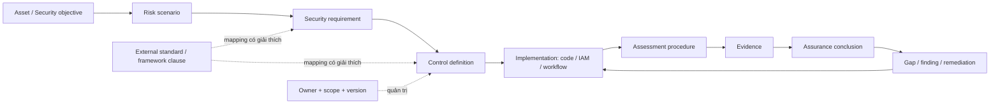
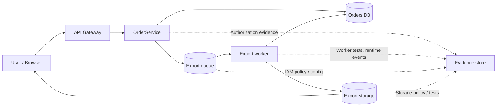
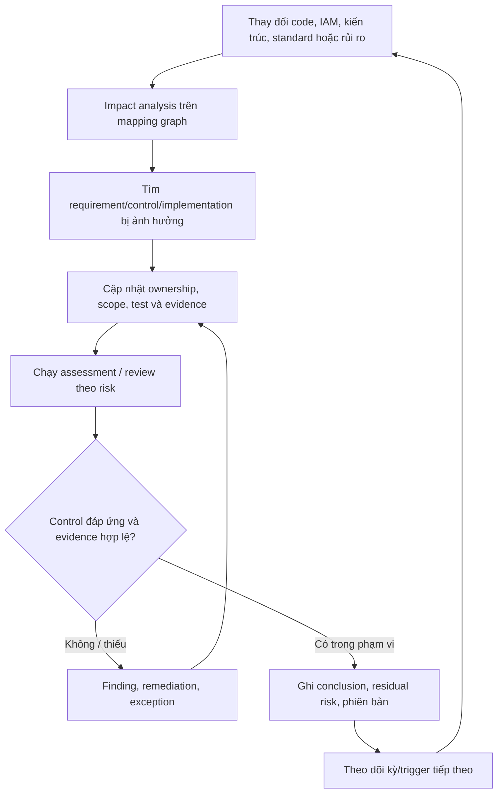

# Control mapping: ánh xạ security controls tới rủi ro, yêu cầu và bằng chứng

Một nền tảng bán hàng có API đọc đơn hàng, worker xuất báo cáo, hệ thống IAM và pipeline CI/CD. Nhóm phát triển báo rằng đã có kiểm tra quyền, Security báo rằng đã chọn controls theo bộ tiêu chuẩn, còn auditor hỏi: **“Control nào đáp ứng yêu cầu ngăn đọc dữ liệu chéo tenant, được thực thi ở những đường nào, đã kiểm thử trên bản nào và bằng chứng nằm ở đâu?”**

Nếu câu trả lời chỉ là bảng “đã có RBAC: Yes”, ta chưa biết một consumer đọc dữ liệu trực tiếp từ queue có được bảo vệ hay không. Nếu chỉ có kết quả unit test `PASS`, ta cũng chưa biết production đang chạy đúng bản code đó. Để trả lời có cơ sở, cần **control mapping**: kết nối từng mục tiêu và kịch bản rủi ro với yêu cầu, biện pháp kiểm soát cụ thể, hiện thực hóa, phép kiểm tra và bằng chứng tương ứng.

Bài học thuộc chương **Security control** của module `SECURITY_SECURITY_ASSURANCE`, nơi trọng tâm là **đánh giá có bằng chứng** rằng hệ thống đáp ứng mục tiêu bảo mật: từ phân tích rủi ro và security requirements, qua thiết kế controls, kiểm thử/audit đến khắc phục phát hiện. Control mapping giúp toàn bộ chuỗi này **truy vết được, đánh giá được và duy trì được** trong phát triển lẫn vận hành.

> **Cốt lõi:** Một ô “Mapped” chỉ cho biết **đã tạo liên kết**; nó không tự chứng minh yêu cầu đã được đáp ứng. Kết luận assurance cần thêm phạm vi, lập luận về cách control xử lý rủi ro, hiệu lực triển khai/vận hành, bằng chứng đủ tin cậy và giới hạn đã xác định.

## 1. Control mapping là gì?

**Control mapping (ánh xạ biện pháp kiểm soát)** là hoạt động xác định và duy trì **mối liên hệ có giải thích** giữa security controls với những đối tượng mà chúng hỗ trợ, thực thi hoặc cần được đánh giá.

Các liên hệ thường gặp gồm:

- **Risk → Requirement → Control:** một kịch bản rủi ro được xử lý bằng những yêu cầu và controls nào?
- **Control → Implementation:** biện pháp ấy đã được hiện thực bằng code, cấu hình, quy trình hay hạ tầng nào?
- **Control → Test/Assessment → Evidence:** kiểm tra gì, kết quả ra sao, nguồn bằng chứng nào chứng minh?
- **Control → Finding → Remediation:** điểm chưa đạt được ghi nhận và khắc phục ở đâu?
- **External standard → Internal requirement/control:** điều khoản từ tiêu chuẩn hoặc framework được lựa chọn có liên hệ với yêu cầu nội bộ nào?
- **Control → Owner → Scope → Lifecycle:** ai chịu trách nhiệm, ở môi trường nào, trong thời kỳ nào và khi nào phải đánh giá lại?

Một control có thể hỗ trợ **nhiều rủi ro**; một rủi ro có thể cần **nhiều controls**; một điều khoản bên ngoài có thể liên quan đến **nhiều yêu cầu nội bộ**. Do đó, mapping thường là đồ thị **nhiều–nhiều**, không phải danh sách một control tương ứng đúng một mục của tiêu chuẩn.

### Mapping không phải chỉ là bảng đối chiếu tên gọi

Bảng sau phân biệt các mức trưởng thành của liên kết:

| Mức | Ví dụ thông tin | Có thể kết luận gì? |
|---|---|---|
| **Name match** | “AC-xxx” ↔ “Authorization” | Hai tên có vẻ cùng chủ đề; chưa chứng minh cùng phạm vi/tiêu chí |
| **Semantic mapping** | Requirement yêu cầu kiểm tra tenant; control thực hiện owner/tenant authorization | Có lập luận control *có thể* xử lý điều khoản |
| **Implementation mapping** | Control nằm ở `OrderService` và `ExportWorker`, chỉ rõ các endpoint/queues | Có khả năng truy ra hiện thực hóa thực tế |
| **Assessment mapping** | Liên kết negative test, code/config review và kết quả kiểm toán | Có phương pháp kiểm tra sự đáp ứng |
| **Evidence-backed mapping** | Test/report gắn build, môi trường, thời gian; runtime được đối chiếu | Có cơ sở đưa kết luận trong phạm vi và kỳ đánh giá |
| **Continuously maintained mapping** | Có owner, trigger cập nhật, findings và kiểm chứng sau sửa | Mối liên kết được duy trì khi hệ thống thay đổi |

**Một mapping đẹp mắt chưa chắc là assurance tốt.** Ví dụ, cùng một test `HTTP 401 for anonymous` được gắn cho cả “xác thực người dùng” lẫn “ngăn truy cập dữ liệu tenant khác”. Test này có thể phù hợp với yêu cầu thứ nhất, nhưng **không chứng minh object-level authorization** khi người gọi đã đăng nhập.

## 2. Những đối tượng cần liên kết

Để tránh nhầm ý nghĩa từng cột, nên định nghĩa đối tượng trước khi tạo ma trận.

| Đối tượng | Ý nghĩa | Ví dụ ID |
|---|---|---|
| **Asset / security objective** | Tài sản và thuộc tính bảo mật cần bảo vệ | `ASSET-ORDERS`; confidentiality |
| **Threat / risk scenario** | Kịch bản có thể gây tác động bất lợi | `RISK-AC-01`: đọc đơn chéo tenant |
| **Policy / requirement** | Nguyên tắc và điều kiện có thể kiểm chứng | `REQ-AC-01`: kiểm tra quyền theo đối tượng |
| **Control definition** | Biện pháp được chọn để giảm rủi ro hoặc đáp ứng yêu cầu | `CTRL-AUTHZ-01` |
| **Control implementation** | Code/config/workflow thực tế chạy ở một nơi cụ thể | `OrderService.readOrder`, DB policy |
| **Assessment procedure** | Cách kiểm tra control, tiêu chí đạt và phạm vi | `TEST-AC-01`: cross-tenant denial |
| **Evidence** | Bản ghi nguồn của kết quả đánh giá/hoạt động | `EVD-IT-AC-01`: CI report theo release |
| **Finding / gap** | Sai lệch hoặc phần thiếu bằng chứng và ảnh hưởng | `FND-EXP-02`: worker bypass |
| **Risk treatment / exception** | Quyết định sửa, giảm thiểu hoặc chấp nhận rủi ro | `EXC-AC-01`, có owner và hạn |
| **External reference** | Điều khoản từ tiêu chuẩn/framework được áp dụng | `REF-ACCESS-01` + phiên bản và nguồn |

Ví dụ một sơ đồ liên hệ tổng quát:



**Luồng đi từ rủi ro tới bằng chứng là chiều giải thích “vì sao cần control”.** Chiều ngược lại cũng quan trọng: auditor bắt đầu từ bằng chứng phải truy ra được **điều gì đã được kiểm tra và claim nào được phép kết luận**.

## 3. Mapping để phục vụ những quyết định nào?

Control mapping có giá trị khi giúp giải quyết các câu hỏi thực tế:

1. **Coverage:** các mục tiêu/rủi ro/yêu cầu rủi ro cao đã có control phù hợp chưa?
2. **Gap analysis:** có requirement chưa có control, control chưa có implementation, hay implementation chưa có bằng chứng?
3. **Duplication/overlap:** nhiều công cụ làm cùng chức năng nhưng thiếu lớp khác, hoặc hai nhóm cùng giả định bên kia chịu trách nhiệm?
4. **Impact analysis:** đổi IdP, policy, service, nhà cung cấp hoặc tiêu chuẩn sẽ ảnh hưởng những control và evidence nào?
5. **Audit readiness:** phạm vi kiểm tra, nguồn chứng cứ, người sở hữu và ngoại lệ có truy xuất được không?
6. **Risk treatment:** một finding không đạt có tác động tới kịch bản rủi ro nào, có cần tạm hạn chế chức năng hoặc chấp nhận rủi ro không?
7. **Prioritization:** thiếu control ở đường dữ liệu nhạy cảm quan trọng hơn một ô “unmapped” của tài sản rủi ro thấp hay không?

Mapping **không phải** hoạt động lấy một checklist bên ngoài rồi tô màu xanh tất cả các dòng. Nếu một điều khoản được ghi “Not Applicable”, phải có **lý do phù hợp phạm vi và người có thẩm quyền xác nhận**, không phải lựa chọn để làm tỷ lệ đạt cao hơn.

## 4. Năm chiều mapping thường bị trộn lẫn

### 4.1. Mapping theo rủi ro: risk-to-control

Bắt đầu bằng kịch bản có thể gây tổn thất, xác định **đường tấn công hoặc sai phạm** và lý do chọn từng control.

Ví dụ `RISK-AC-01` là người dùng hợp lệ đọc đơn của tenant khác. Chỉ dùng MFA không xử lý trực tiếp lỗi phân quyền theo đối tượng; cần object-level authorization. MFA có thể hỗ trợ giảm một số rủi ro chiếm danh tính, nhưng không được ghi là control duy nhất “đã khắc phục BOLA”.

Một risk có thể cần nhiều controls thuộc các lớp **preventive, detective, corrective**. Các controls này bổ trợ nhau nhưng phải ghi **mục tiêu riêng**: chặn truy cập, phát hiện lạm dụng, thu hồi quyền hoặc hạn chế thiệt hại.

### 4.2. Mapping theo yêu cầu: requirement-to-control

Requirement phải xác định hành vi có thể kiểm tra. Nếu `REQ-AC-01` nói “mọi đường đọc đơn hàng phải kiểm tra đúng principal, tenant và owner”, cần mapping tới cả API đồng bộ **và** worker/export/batch có quyền đọc dữ liệu.

Nếu một control chỉ bao phủ `GET /api/orders/{id}`, liên kết tới requirement “mọi đường đọc” phải ghi **PARTIAL**, không được ghi “COVERED” cho toàn hệ thống.

### 4.3. Mapping theo tiêu chuẩn: framework-to-internal-control

Tổ chức có thể sử dụng các nguồn như ISO/IEC 27001, ISO/IEC 27002, NIST SP 800-53, NIST CSF hoặc OWASP ASVS tùy phạm vi và nhu cầu. Việc ánh xạ cần lưu:

- **Tên nguồn, phiên bản, điều khoản/control ID và nội dung tiêu chí áp dụng** theo bản chính thức được tổ chức chọn.
- **Applicability:** điều khoản có áp dụng cho tài sản, dữ liệu, môi trường và nghĩa vụ cụ thể không?
- **Ý nghĩa tương đồng:** control nội bộ đáp ứng **đầy đủ, một phần hay hỗ trợ gián tiếp** tiêu chí bên ngoài.
- **Phần thiếu:** nội dung nào của tiêu chí bên ngoài chưa được thực thi hay kiểm tra.
- **Evidence:** bằng chứng nào hỗ trợ kết luận; có được đánh giá trong đúng phạm vi không?
- **Thẩm quyền phê duyệt mapping và ngoại lệ:** ai chịu trách nhiệm cách diễn giải.

**Không giả định hai framework tương đương chỉ vì mô tả có từ “access control”.** Một nguồn có thể quan tâm tới quy trình phê duyệt và review định kỳ, còn control nội bộ chỉ kiểm tra quyền ở thời điểm request. Khi thay phiên bản tiêu chuẩn, phải đánh giá lại nội dung, không chỉ thay mã tham chiếu.

### 4.4. Mapping theo hiện thực hóa: control-to-implementation

Control definition “xác minh quyền trước khi đọc đơn” có thể được hiện thực ở nhiều vị trí:

- `OrderService` kiểm tra owner/tenant.
- Worker kiểm tra ngữ cảnh job và quyền khi xuất dữ liệu.
- Database áp dụng truy vấn giới hạn tenant hoặc row-level security (nếu thiết kế phù hợp).
- Object storage hạn chế quyền tải file xuất.
- Gateway kiểm tra xác thực đầu vào nhưng **không thay thế** quyền theo từng đối tượng.

Mapping cần ghi **đường xử lý, phiên bản và chủ sở hữu**. Chỉ gắn link tới một PR chưa xác định file nào/luồng nào được triển khai không đủ để chứng minh control có mặt ở mọi nơi cần thiết.

### 4.5. Mapping theo bảo đảm: control-to-test-to-evidence

Đây là điểm nối với **security assurance**. Mỗi liên kết cần chỉ ra:

- **Claim:** điều gì cần chứng minh (ví dụ “đơn của tenant B không trả cho user A”).
- **Assessment method:** code review, test âm tính, config check, audit sample, diễn tập...
- **Acceptance criteria:** thế nào là đạt, không đạt hoặc chưa đủ bằng chứng.
- **Evidence:** kết quả gốc, ngày giờ, người/công cụ, phạm vi, build/config, phương pháp tạo và bảo vệ evidence.
- **Limitations:** những đường/điều kiện chưa được kiểm tra và rủi ro còn lại.

**Bằng chứng của một lớp không thay thế bằng chứng của lớp khác:** PR review cho biết thiết kế/code đã thay; integration test cho biết hành vi ở môi trường test; deployment record giúp xác định bản được triển khai; bằng chứng vận hành trong quý mới hỗ trợ claim về operating effectiveness trong quý.

## 5. Đặc trưng many-to-many và mapping không hoàn toàn

Control mapping thường là liên hệ nhiều chiều; một dòng không nên giả định quan hệ một–một.

| Dạng | Ví dụ | Rủi ro khi xử lý sai |
|---|---|---|
| **Một risk → nhiều controls** | BOLA cần authorization, phân quyền storage và phát hiện truy cập trái phép | Tưởng MFA hoặc log đã giải quyết hoàn toàn risk |
| **Một control → nhiều requirements** | Kiểm soát workload identity hỗ trợ cả authentication và least privilege | Tự ghi PASS cho mọi requirement dù chỉ test một hành vi |
| **Một requirement → nhiều implementations** | Cấm đọc chéo tenant áp dụng cả HTTP, queue và export | Bỏ sót consumer không qua gateway |
| **Một test → nhiều claims** | Test phân quyền có thể cung cấp bằng chứng cho nhiều yêu cầu tương ứng | Kết luận vượt quá hành vi test thực sự quan sát |
| **Một evidence → nhiều mapping links** | Cùng build report liên kết với nhiều test IDs | Đếm nhiều link thành nhiều bằng chứng độc lập |
| **Nhiều framework clauses → một internal control** | Các nguồn đều đề cập quản lý quyền | Nhầm sự tương đồng chủ đề với đạt toàn bộ tiêu chí |

Có thể đánh dấu **DIRECT** (control trực tiếp đáp ứng), **SUPPORTING** (hỗ trợ nhưng không đủ một mình) hoặc **NOT_RELEVANT** với một liên kết cụ thể. Để kết luận coverage, cần tiêu chí riêng như **FULL, PARTIAL, GAP, UNKNOWN**, thay vì gộp thành một ô `Y/N`.

**Một control có thể đạt một requirement nhưng chỉ hỗ trợ một requirement khác.** Ví dụ audit log là control trực tiếp cho yêu cầu “ghi sự kiện cấp quyền”, nhưng chỉ là control hỗ trợ đối với yêu cầu “ngăn truy cập trái phép”. Việc ánh xạ phải chỉ rõ ý nghĩa này.

## 6. Phương pháp xây control mapping theo từng bước

### Bước 1 — Xác lập phạm vi và mục tiêu quyết định

Ghi rõ hệ thống, môi trường, dữ liệu, ranh giới tin cậy, khoảng thời gian và đối tượng báo cáo. Ví dụ:

- **Hệ thống:** `order-service`, `export-worker`, `order-db` và kho file xuất.
- **Môi trường:** production; bản phát hành `release-2026-11` (giả định).
- **Tài sản:** đơn hàng và dữ liệu khách hàng được phân tách theo tenant.
- **Kỳ đánh giá:** kiểm tra thiết kế/triển khai tại bản phát hành và vận hành trong một kỳ xác định.
- **Mục tiêu:** chứng minh các đường đọc/xuất dữ liệu có chính sách phân quyền đúng đối tượng.
- **Ngoài phạm vi:** ví dụ một hệ thanh toán độc lập, cần ghi rõ.

Không áp dụng cùng một kết luận cho toàn tổ chức nếu evidence chỉ đến từ một service. **Scope là một phần của nghĩa claim**, không phải ghi chú tùy chọn.

### Bước 2 — Chuẩn hóa nguồn yêu cầu và risk register

Thu thập yêu cầu từ policy, tiêu chuẩn nội bộ, nghĩa vụ liên quan, threat model, risk register, thiết kế và findings cũ. Mỗi requirement có ID ổn định, mô tả điều kiện đạt, owner, mức ưu tiên và phạm vi.

Ví dụ cần phân biệt:

- `REQ-AC-01`: truy cập đơn hàng phải kiểm tra đúng user/tenant.
- `REQ-EXP-01`: mọi job export phải được phê duyệt và ràng buộc nguồn đáng tin.
- `REQ-LOG-01`: mọi lần export thành công/thất bại phải có audit event phù hợp.

Ba yêu cầu khác bản chất, do đó không nên gộp thành “ACCESS-SECURE: Yes”.

### Bước 3 — Chọn controls theo kịch bản và cơ chế tác động

Với mỗi requirement, phân tích **rủi ro sẽ thay đổi thế nào** nếu control hoạt động đúng. Ví dụ:

| Requirement | Control phù hợp | Tác dụng dự kiến |
|---|---|---|
| `REQ-AC-01` | `CTRL-AUTHZ-01`: kiểm tra tenant/owner trước truy xuất | Preventive: chặn đọc sai quyền |
| `REQ-EXP-01` | `CTRL-EXPORT-01`: worker xác minh job/approval | Preventive: chặn export giả hoặc vượt quyền |
| `REQ-LOG-01` | `CTRL-AUDIT-01`: audit event và bảo vệ log | Detective/supporting: truy vết và phát hiện |
| `REQ-REV-01` | `CTRL-REVIEW-01`: rà soát entitlement | Detective/corrective: phát hiện và thu hồi quyền dư |

Đừng gắn control chỉ vì cùng từ khóa. Trong mô tả liên kết phải ghi **lập luận**: kiểm tra owner và tenant trước khi trả đơn làm mất khả năng truy cập trái phép bằng cách thay `orderId`.

### Bước 4 — Ghi vị trí triển khai, phụ thuộc và owner

Một định nghĩa control có thể có nhiều implementation:

| Control | Implementation / điểm thực thi | Owner | Giả định cần đánh giá |
|---|---|---|---|
| `CTRL-AUTHZ-01` | Service policy và query ràng buộc tenant | Order team | Principal đến từ nguồn xác thực đáng tin |
| `CTRL-EXPORT-01` | Export worker kiểm tra job và approval | Export team | Queue IAM và approval store đúng, job không bị giả mạo |
| `CTRL-AUDIT-01` | API/worker events tới log pipeline | Platform + App team | Log có phạm vi/retention, không bị sửa/xóa tùy tiện |
| `CTRL-REVIEW-01` | IAM review campaign và luồng thu hồi | Identity team | Entitlement population đầy đủ, kể cả quyền kế thừa |

Khi nhiều nhóm cùng tham gia, phân biệt **control owner**, **implementation owner**, **evidence producer** và **người đánh giá**. Với shared control từ nền tảng hoặc nhà cung cấp, cần xác định **phần nào được kế thừa và phần nào khách hàng/đội ứng dụng vẫn phải thực thi**.

### Bước 5 — Thiết kế thủ tục và tiêu chí đánh giá

Đặt test ở **đúng nơi yêu cầu cần được thực hiện**, không chỉ ở nơi dễ chạy test. Các test có thể gồm:

- Positive: đúng principal và tenant được phép.
- Negative: user cùng role nhưng khác tenant bị chặn, không lộ dữ liệu.
- Missing attribute: thiếu identity/owner/approval bị từ chối đúng.
- Bypass: queue, cache, export, endpoint nội bộ hoặc direct service call không bypass control.
- Failure: policy source/IdP/approval service lỗi và hệ thống xử lý an toàn.
- Operational: quyền được cấp/thu hồi, log hoặc review được thực hiện trong kỳ.

### Bước 6 — Liên kết bằng chứng có thể truy vết

Evidence cần gắn với **chính test/assessment**: tên phép thử, môi trường, ngày giờ, commit/build, người/công cụ, kết quả và nguồn gốc. Không gắn `EVD-XX` nếu file thực tế không tồn tại hoặc không rõ đã kiểm tra điều gì.

Với claim về hoạt động liên tục trong quý, cần bằng chứng **trong kỳ**, không chỉ kết quả một lần trên staging. Nếu dữ liệu chưa có, ghi **PENDING / INCONCLUSIVE**, không điền `PASS` mặc định.

### Bước 7 — Đánh giá coverage, lập finding và residual risk

Nhóm assurance đánh giá liệu mọi điều kiện của requirement có được đáp ứng hay không. Khi phát hiện:

- **Unmapped requirement:** chưa có control phù hợp.
- **Unimplemented control:** có mô tả nhưng chưa có cơ chế thực thi.
- **Unassessed implementation:** có code/config nhưng chưa được kiểm tra.
- **Partial coverage:** chỉ bao phủ HTTP API, chưa bao phủ worker/export.
- **Failed assessment:** test cho thấy truy cập trái quyền vẫn xảy ra.
- **Stale evidence:** evidence thuộc bản khác hoặc hết thời gian hiệu lực theo tiêu chí.
- **Unsupported external claim:** mapping tới chuẩn ngoài thiếu điều khoản, phiên bản hoặc bằng chứng.

Mỗi khoảng trống đáng kể cần có owner, mức rủi ro, thời hạn và quyết định xử lý. **Không dùng risk acceptance để biến một control chưa đạt thành control đã kiểm chứng.**

### Bước 8 — Review hai chiều và duy trì khi thay đổi

Kiểm tra từ **requirement tới evidence** để tìm phần thiếu; từ **evidence ngược về requirement** để ngăn dùng chứng cứ ngoài phạm vi; từ **finding về risk/asset** để ưu tiên khắc phục. Khi thêm endpoint, đổi IAM, thay tiêu chuẩn hoặc phát hiện incident, liên kết và kết luận cần được đánh giá lại.

## 7. Ví dụ xuyên suốt: mapping cho API và worker xuất dữ liệu

Giả sử ứng dụng cung cấp:

- `GET /api/orders/{id}`: đọc một đơn hàng.
- `POST /api/exports`: yêu cầu xuất dữ liệu.
- `export-worker`: đọc job từ queue, truy xuất dữ liệu và ghi file vào object storage.
- IAM/IdP: nguồn danh tính và quyền; approval workflow: nguồn xác nhận quyền xuất dữ liệu.

Trong mô hình đe dọa, người dùng có tài khoản hợp lệ vẫn có thể đoán `orderId`, thay `tenantId` trong payload hoặc giả lập job qua queue nếu kiểm soát không đầy đủ.

### 7.1. Ma trận mapping ban đầu

**Dữ liệu trong bảng hoàn toàn giả định để học**, các mã evidence thể hiện những loại hồ sơ *cần có*, không khẳng định đã được thu thập trong thực tế.

| Risk | Requirement | Control và vị trí | Test/evidence kỳ vọng | Tình trạng mapping minh họa |
|---|---|---|---|---|
| `RISK-AC-01` đọc chéo tenant | `REQ-AC-01` kiểm tra quyền từng đơn | `CTRL-AUTHZ-01` tại `OrderService` | `TEST-AC-01`: owner/cross-tenant; PR + integration report | **PARTIAL** — API chính đã mô tả, đường export cần kiểm tra riêng |
| `RISK-EXP-01` xuất dữ liệu trái quyền | `REQ-EXP-01` ràng buộc job và approval | `CTRL-EXPORT-01` tại worker | `TEST-EXP-01`: giả job/sai tenant/approval hết hạn | **GAP** — worker chưa xác minh nguồn job |
| `RISK-EXP-01` | `REQ-LOG-01` audit export | `CTRL-AUDIT-01` tại API/worker | `TEST-LOG-01`: event có actor, job, kết quả, thời gian | **PENDING** — chưa xác minh pipeline log production |
| `RISK-PRIV-01` quyền dư | `REQ-REV-01` rà soát quyền theo kỳ | `CTRL-REVIEW-01` tại IAM | Population, quyết định review, revoke evidence | **PENDING** — chưa có evidence của kỳ kiểm toán |
| `RISK-EXP-01` lộ file | `REQ-DOWNLOAD-01` giới hạn tải file | `CTRL-STORAGE-01` tại object storage | Test khác tenant, link hết hạn, policy review | **UNKNOWN** — chưa xác định đủ các đường tải |

**PARTIAL** nghĩa là có một số thành phần liên quan nhưng chưa đạt độ bao phủ claim. **GAP** nghĩa là phát hiện một thiếu sót cụ thể. **PENDING** nghĩa là thủ tục/evidence chưa hoàn tất. **UNKNOWN** nghĩa là chưa có đủ dữ liệu để xác định. Không gộp các trạng thái thành `PASS`.

### 7.2. Phân tích đúng boundary và đường đi



Đường `User → Gateway → OrderService` có thể sử dụng `CTRL-AUTHZ-01`, nhưng **worker không đi qua gateway**. Do đó, `CTRL-EXPORT-01` phải kiểm tra **job, tenant, người yêu cầu và approval từ nguồn đáng tin** trước khi đọc hoặc ghi file. Sau đó, `CTRL-STORAGE-01` phải bảo vệ **quyền tải file**. Đây là các điểm đánh giá riêng dù cùng nằm trong một luồng nghiệp vụ.

### 7.3. Claim đúng và claim sai

**Claim quá rộng, chưa có cơ sở:** “Tất cả hoạt động đọc và xuất dữ liệu được bảo vệ vì API đã dùng authentication và test xanh.”

**Claim có giới hạn phù hợp:** “Trong phiên bản `release-X`, đường HTTP đọc đơn đã được kiểm tra theo principal và tenant trong các trường hợp đã nêu. Luồng export bất đồng bộ chưa có bằng chứng đáp ứng `REQ-EXP-01` nên còn finding/rủi ro cần xử lý.”

Mục tiêu của mapping không phải làm bảng luôn xanh, mà là **phát hiện những chỗ thiếu trước khi chúng trở thành sự cố** và mô tả đúng mức bảo đảm hiện có.

## 8. Mẫu control mapping register bằng YAML

Một hệ thống quản lý mapping nên phân biệt **định nghĩa control**, **liên kết**, **bằng chứng** và **kết quả đánh giá**. YAML sau chỉ minh họa cấu trúc cho một đường đọc đơn và một đường export; các placeholder không phải evidence đã tồn tại:

```yaml
mapping_id: "MAP-ORD-2026-01"
revision: "1.0"
module: "SECURITY_SECURITY_ASSURANCE"
scope:
  system: "order-platform"
  environments: ["production"]
  assessed_release: "release-X"
  boundaries: ["HTTP order read", "async export", "download"]
  assessment_period: "<start-and-end-dates>"
source_references:
  - id: "REF-AC-01"
    source: "<adopted-standard-or-internal-policy>"
    version: "<exact-version>"
    clause: "<specific-clause>"
    applicability: "APPLICABLE"
    rationale: "Addresses access to customer data"
risks:
  - id: "RISK-AC-01"
    scenario: "Authenticated caller reads another tenant's order"
  - id: "RISK-EXP-01"
    scenario: "Export job bypasses tenant or approval rules"
requirements:
  - id: "REQ-AC-01"
    text: "Object-level and tenant-aware authorization"
    mandatory: true
  - id: "REQ-EXP-01"
    text: "Trusted job and approval check before export"
    mandatory: true
controls:
  - id: "CTRL-AUTHZ-01"
    type: "preventive"
    owner: "<order-team>"
    implementations: ["OrderService authorization + database query"]
  - id: "CTRL-EXPORT-01"
    type: "preventive"
    owner: "<export-team>"
    implementations: ["ExportWorker job validation"]
links:
  - id: "LINK-AC-01"
    risk_ids: ["RISK-AC-01"]
    requirement_ids: ["REQ-AC-01"]
    control_id: "CTRL-AUTHZ-01"
    relationship: "DIRECT"
    scope: "HTTP order read"
    coverage: "PARTIAL"
    assessment: "PENDING"
    test_ids: ["TEST-AC-01"]
    evidence_refs: ["<release-linked-integration-test>"]
    limitations: ["Async export evaluated separately"]
  - id: "LINK-EXP-01"
    risk_ids: ["RISK-EXP-01"]
    requirement_ids: ["REQ-EXP-01"]
    control_id: "CTRL-EXPORT-01"
    relationship: "DIRECT"
    scope: "Async export worker"
    coverage: "GAP"
    assessment: "FAILED"
    test_ids: ["TEST-EXP-01"]
    evidence_refs: ["<authorized-review-and-test-reference>"]
    finding_ids: ["FND-EXP-02"]
findings:
  - id: "FND-EXP-02"
    description: "Worker trusts unverified tenant data from queue"
    owner: "<export-team>"
    treatment: "Fix and re-test; interim restrictions"
    target_date: "<agreed-date>"
    verification: "NOT_VERIFIED"
residual_risk:
  owner: "<authorized-risk-owner>"
  decision_ref: "<decision-or-pending>"
reassessment_triggers:
  - "New export route or tenant identity mapping"
  - "Release, IAM policy, control or source standard changes"
```

**Ý nghĩa các trường quan trọng:**

- `source_references` không phải bằng chứng đạt chuẩn; đó là **nguồn tiêu chí** cần xác minh phiên bản/điều khoản.
- `links` có ID riêng vì **cùng một control** có thể bao phủ requirement này nhưng chỉ hỗ trợ requirement khác.
- `coverage` thể hiện phạm vi control theo thiết kế/hiện thực; `assessment` thể hiện **kết quả đánh giá**. Hai khái niệm không đồng nhất.
- `evidence_refs` phải dẫn đến chứng cứ có thật khi đưa vào sử dụng. Placeholder không được xem là bằng chứng.
- `findings` và `residual_risk` không biến mất khi chuyển bản phát hành nếu chưa có xác minh và quyết định rõ ràng.

Khi tự động hóa, có thể chia cấu trúc thành nhiều bảng/đối tượng, nhưng phải bảo đảm **ID ổn định, quan hệ nhất quán, phạm vi có phiên bản và kiểm soát truy cập tới evidence nhạy cảm**.

## 9. Kiểm tra tính nhất quán của mapping bằng Java 17

Ngoài việc review nội dung và hiệu lực control, có thể dùng mã để bắt các lỗi **tham chiếu dữ liệu mapping** như requirement chưa được gắn, control không tồn tại hoặc evidence thuộc bản release khác.

Ví dụ dưới đây **không đánh giá bảo mật hệ thống**; nó chỉ kiểm tra tính toàn vẹn *một phần* của quan hệ giữa `Requirement`, `Control`, `Evidence` và `Link` trong bộ dữ liệu đã được cung cấp.

```java
import java.util.ArrayList;
import java.util.HashMap;
import java.util.HashSet;
import java.util.List;
import java.util.Map;
import java.util.Set;

public final class ControlMappingValidator {
    private ControlMappingValidator() {}

    public record Requirement(String id, boolean mandatory) {}
    public record Control(String id, String owner) {}
    public record Evidence(
            String id, String controlId,
            String releaseId, boolean passed) {}
    public record Link(
            String requirementId, String controlId, String evidenceId) {}

    public static List<String> check(
            List<Requirement> requirements,
            List<Control> controls,
            List<Evidence> evidences,
            List<Link> links,
            String targetRelease) {

        Map<String, Control> controlsById = new HashMap<>();
        for (Control control : controls) {
            controlsById.put(control.id(), control);
        }

        Map<String, Evidence> evidenceById = new HashMap<>();
        for (Evidence evidence : evidences) {
            evidenceById.put(evidence.id(), evidence);
        }

        Set<String> requirementIds = new HashSet<>();
        Set<String> linkedRequirementIds = new HashSet<>();
        for (Requirement requirement : requirements) {
            requirementIds.add(requirement.id());
        }

        List<String> issues = new ArrayList<>();

        for (Link link : links) {
            if (!requirementIds.contains(link.requirementId())) {
                issues.add("UNKNOWN_REQUIREMENT: " + link.requirementId());
            } else {
                linkedRequirementIds.add(link.requirementId());
            }

            if (!controlsById.containsKey(link.controlId())) {
                issues.add("UNKNOWN_CONTROL: " + link.controlId());
            }

            Evidence evidence = evidenceById.get(link.evidenceId());
            if (evidence == null) {
                issues.add("MISSING_EVIDENCE: " + link.evidenceId());
                continue;
            }
            if (!evidence.controlId().equals(link.controlId())) {
                issues.add("CONTROL_MISMATCH: " + evidence.id());
            }
            if (!evidence.releaseId().equals(targetRelease)) {
                issues.add("RELEASE_MISMATCH: " + evidence.id());
            }
            if (!evidence.passed()) {
                issues.add("FAILED_EVIDENCE: " + evidence.id());
            }
        }

        for (Requirement requirement : requirements) {
            if (requirement.mandatory()
                    && !linkedRequirementIds.contains(requirement.id())) {
                issues.add("UNMAPPED_REQUIREMENT: " + requirement.id());
            }
        }
        return issues;
    }
}
```

Đây là ví dụ Java 17 cho các record dữ liệu đơn giản, **giả định danh sách/ID không null và không trùng**. Trong hệ thống thực tế cần kiểm tra định dạng/uniqueness, nguồn dữ liệu, quyền sửa evidence, trùng liên kết, scope, khoảng thời gian và tính mới trước khi dùng để phục vụ audit. Một `evidence.passed() == true` chỉ là **trường dữ liệu đầu vào**, chưa chứng minh test thực sự chạy hoặc tiêu chí đã đúng.

### Kiểm thử JUnit 5 cho validator

```java
import static org.junit.jupiter.api.Assertions.assertTrue;
import java.util.List;
import org.junit.jupiter.api.Test;

class ControlMappingValidatorTest {
    @Test
    void acceptsConsistentReferencesForSameRelease() {
        var requirements = List.of(
                new ControlMappingValidator.Requirement(
                        "REQ-AC-01", true));
        var controls = List.of(
                new ControlMappingValidator.Control(
                        "CTRL-AUTHZ-01", "order-team"));
        var evidence = List.of(
                new ControlMappingValidator.Evidence(
                        "EVD-AC-01", "CTRL-AUTHZ-01",
                        "release-X", true));
        var links = List.of(
                new ControlMappingValidator.Link(
                        "REQ-AC-01", "CTRL-AUTHZ-01", "EVD-AC-01"));

        var issues = ControlMappingValidator.check(
                requirements, controls, evidence, links, "release-X");

        assertTrue(issues.isEmpty());
    }

    @Test
    void flagsUnmappedRequirementAndOldReleaseEvidence() {
        var requirements = List.of(
                new ControlMappingValidator.Requirement(
                        "REQ-AC-01", true),
                new ControlMappingValidator.Requirement(
                        "REQ-EXP-01", true));
        var controls = List.of(
                new ControlMappingValidator.Control(
                        "CTRL-AUTHZ-01", "order-team"));
        var evidence = List.of(
                new ControlMappingValidator.Evidence(
                        "EVD-AC-01", "CTRL-AUTHZ-01",
                        "release-old", true));
        var links = List.of(
                new ControlMappingValidator.Link(
                        "REQ-AC-01", "CTRL-AUTHZ-01", "EVD-AC-01"));

        var issues = ControlMappingValidator.check(
                requirements, controls, evidence, links, "release-X");

        assertTrue(issues.stream().anyMatch(
                issue -> issue.contains("UNMAPPED_REQUIREMENT")));
        assertTrue(issues.stream().anyMatch(
                issue -> issue.contains("RELEASE_MISMATCH")));
    }
}
```

**Giới hạn quan trọng của validator:** Mã có thể thấy “evidence đúng release” nhưng không đọc được bản chất test đó đã kiểm tra đúng requirement không, đã thực thi trên production chưa, dữ liệu có bị sửa không hay có đường bypass nào chưa được kiểm tra. Đó là trách nhiệm **assessment/assurance**, không thể suy ra chỉ từ quan hệ ID.

Có thể nâng cấp validator theo hướng kiểm tra `scope`, `environment`, `valid_until`, `assessment_result`, owner và trạng thái finding. Nhưng mỗi quy tắc bổ sung phải có **định nghĩa nghiệp vụ rõ**, tránh biến “không thấy lỗi metadata” thành “control security PASS”.

## 10. Ánh xạ tiêu chuẩn ngoài: crosswalk và giới hạn

**Crosswalk** là bảng diễn giải liên hệ giữa các điều khoản của nhiều framework/standard và control nội bộ. Nó có ích khi cùng hệ thống phải báo cáo cho nhiều bên, nhưng dễ tạo sai lệch nếu quá chú trọng tên control.

Một bảng tham khảo dạng **mẫu trống**, không khẳng định các điều khoản thực tế tương đương:

| Nguồn yêu cầu được chọn | Mục tiêu yêu cầu | Internal requirement | Internal control | Mapping note | Evidence cần đánh giá |
|---|---|---|---|---|---|
| `<ISO clause + version>` | Quản lý quyền truy cập | `REQ-AC-01` | `CTRL-AUTHZ-01` | Chỉ liên quan kiểm soát quyền ở ứng dụng; các yêu cầu quản trị khác xem riêng | Review policy và test |
| `<NIST control ID + revision>` | Bảo vệ truy cập tới tài nguyên | `REQ-AC-01` | `CTRL-AUTHZ-01` | Kiểm tra scope/parameter và trách nhiệm shared/inherited | Test, IAM, runtime |
| `<OWASP ASVS requirement + version>` | Xác minh phân quyền ứng dụng | `REQ-AC-01` | `CTRL-AUTHZ-01` | Cần negative tests theo đúng yêu cầu áp dụng | Test và review |
| `<internal policy clause>` | Đảm bảo mỗi export có approval | `REQ-EXP-01` | `CTRL-EXPORT-01` | Ngoài object-level read cần xác minh workflow | Approval và worker test |

Không nên tự suy luận các số hiệu điều khoản chỉ từ ví dụ trong tài liệu khác. Mỗi nguồn cần **phiên bản, nội dung gốc có thẩm quyền, phạm vi và kết luận mapping được rà soát**. Nếu một source control yêu cầu đồng thời phê duyệt, ghi log và rà soát định kỳ, nhưng internal control chỉ làm phê duyệt, trạng thái tương ứng phải là **PARTIAL**.

### Common controls, inherited controls và shared responsibility

Một nền tảng có thể cung cấp controls dùng chung như IdP, network segmentation, secrets manager, SIEM hoặc backup. Những controls đó có thể **được kế thừa** bởi nhiều ứng dụng, nhưng phải phân biệt:

- **Provider/Platform chịu trách nhiệm:** vận hành hạ tầng và phần được cam kết.
- **Application chịu trách nhiệm:** cấu hình và tích hợp đúng, quản lý danh tính/role, kiểm tra quyền nghiệp vụ, không bypass đường tin cậy.
- **Evidence provider:** ai lưu được chứng cứ về cấu hình, kiểm tra, thời kỳ và giới hạn của phần được kế thừa?
- **Residual gap:** có phần nào của tiêu chí không được nhà cung cấp bao phủ không?

Ví dụ IdP xác thực người dùng không tự thay `order-service` xác định người này có quyền với `order-42`. Khi mapping phải tách rõ **authentication control được kế thừa** và **authorization control ứng dụng phải thực hiện**.

## 11. Cách tính coverage không đánh lừa người đọc

Mapping coverage hữu ích nếu **mẫu số và tiêu chí “được bao phủ”** được định nghĩa đúng.

Giả sử một hệ thống có **8 yêu cầu bắt buộc** thuộc phạm vi:

- 6 yêu cầu đã có liên kết tới control liên quan.
- Trong 6 yêu cầu ấy, 4 có bằng chứng phù hợp và kết luận `VERIFIED` cho phạm vi được chọn.
- 2 yêu cầu đã mapping nhưng còn thiếu assessment/evidence.
- 2 yêu cầu chưa có control phù hợp.

Khi đó:

```text
Mapping coverage = 6 / 8 × 100 = 75%

Verified requirement coverage = 4 / 8 × 100 = 50%
```

**75%** phản ánh việc tạo liên kết; **50%** mới phản ánh số yêu cầu đã có cơ sở kết luận đạt theo tiêu chí của ví dụ. Hai chỉ số trả lời hai câu hỏi khác nhau.

| Chỉ số | Tử số | Mẫu số | Giới hạn |
|---|---|---|---|
| **Requirement mapping coverage** | Requirement áp dụng có ít nhất một mapping phù hợp | Tất cả requirement áp dụng trong phạm vi | Chưa chứng minh control triển khai/hoạt động |
| **Verified requirement coverage** | Requirement áp dụng được đánh giá đáp ứng đầy đủ trong phạm vi | Tất cả requirement áp dụng | Phụ thuộc chất lượng và tính mới của evidence |
| **Evidence freshness** | Liên kết có chứng cứ còn hiệu lực theo tiêu chí | Các liên kết phải có evidence | Chưa chứng minh bằng chứng kiểm tra đúng yêu cầu |
| **Control assessment completion** | Control được đánh giá trong kỳ theo kế hoạch | Các control cần đánh giá trong kỳ | “Đã đánh giá” không đồng nghĩa “đạt” |
| **Open high-risk gaps** | Số gap/finding trọng yếu chưa khắc phục/được xử lý | Không nhất thiết là tỷ lệ | Cần xem tác động và môi trường |
| **Mapping change latency** | Thời gian từ thay đổi có ảnh hưởng tới khi mapping được cập nhật | Các thay đổi thuộc phạm vi | Chỉ đo tốc độ quản trị, không đo an toàn trực tiếp |

**Không đếm một requirement nhiều lần** chỉ vì nó có ba controls. **Không đếm ba lần cùng một report** được dùng ở ba mapping links như ba phép đánh giá độc lập. Khi tính tỷ lệ, phải xử lý rõ trường hợp `NOT_APPLICABLE`, `PARTIAL`, `UNKNOWN`, `FAILED`, `EXCEPTION` và `STALE`.

Một chỉ số risk-weighted coverage có thể giúp ưu tiên, nhưng **trọng số, thang rủi ro, phép tổng hợp và ý nghĩa** cần công bố. Không báo “89% an toàn” chỉ vì spreadsheet ra một phần trăm có vẻ chính xác.

## 12. Design effectiveness, implementation và operating effectiveness

Control mapping đóng vai trò “bản đồ” tới bằng chứng, nhưng vẫn phải hiểu **loại claim** mà bằng chứng hỗ trợ.

### Design effectiveness

Câu hỏi: **Control có giải quyết đúng kịch bản rủi ro nếu thực hiện như thiết kế không?**

Với `CTRL-EXPORT-01`, thiết kế phải đề cập nguồn job đáng tin, người yêu cầu, tenant, approval, hết hạn, xử lý replay và thời điểm kiểm tra trước khi tạo file. DFD và threat model có thể hỗ trợ, nhưng chưa chứng minh code đã làm đúng.

### Implementation effectiveness

Câu hỏi: **Control được triển khai đúng và đủ ở những thành phần cần thiết chưa?**

Code review, test tích hợp, policy config, IAM, cấu hình queue và storage cần được mapping tới **đúng đường xử lý**. Nếu chỉ API kiểm tra quyền nhưng worker không có control, không thể kết luận toàn bộ yêu cầu đạt.

### Operating effectiveness

Câu hỏi: **Trong một kỳ đánh giá, control đã thực sự hoạt động đúng và nhất quán không?**

Ví dụ kiểm toán việc phê duyệt export trong một quý cần xác minh *population* tất cả lần export, kiểm tra approval trước export, người duyệt đúng thẩm quyền và trường hợp cấp quyền khẩn cấp. Một ảnh chụp cấu hình tại thời điểm cuối quý không chứng minh cả quý đã hoạt động đúng.

| Cấp đánh giá | Evidence phù hợp | Không đủ để tự kết luận |
|---|---|---|
| **Design** | Threat model, design review, control spec | Chính sách được ký ≠ hiệu lực vận hành |
| **Implementation** | Code/config, integration tests, build/deployment | Test unit xanh ≠ mọi đường đều được thực thi |
| **Operating** | Log, approvals, access review, kết quả quan sát trong kỳ | Cấu hình hôm nay ≠ hoạt động suốt kỳ |
| **Remediation verification** | Test hồi quy, bản deploy, xác minh đường lỗi cũ | PR merge/ticket `Done` ≠ đã sửa trên production |

Mapping phải lưu **loại đánh giá**, **mục tiêu**, **phạm vi** và **thời điểm**. Nếu thiếu evidence cho một cấp, hãy đánh dấu rõ giới hạn, không dùng chứng cứ của cấp khác để lấp.

## 13. Claim – Argument – Evidence: ánh xạ để lập luận được

Một mapping tốt có thể được đọc như một **assurance case**.

| Thành phần | Ví dụ `RISK-EXP-01` |
|---|---|
| **Claim** | Với phạm vi `release-X` đã kiểm tra, lệnh export không chạy khi người gọi/job không có quyền phù hợp |
| **Argument** | Mọi đường export đi qua PEP, principal và approval lấy từ nguồn tin cậy, worker kiểm tra lại ngữ cảnh và storage không cho tải sai tenant |
| **Controls** | `CTRL-AUTHZ-01`, `CTRL-EXPORT-01`, `CTRL-STORAGE-01`; log hỗ trợ phát hiện |
| **Assessment procedures** | Negative API/queue tests, code/config review, storage download tests, kiểm tra deployment |
| **Evidence** | CI result theo commit, config với phiên bản, release record, runtime events phù hợp |
| **Assumptions** | Token được xác minh, IAM queue đáng tin, approval store không bị giả mạo, đồng hồ phù hợp |
| **Limitations** | Một đường export legacy chưa được kiểm tra hoặc audit log chưa đủ thời kỳ |
| **Conclusion** | Đạt/chưa đạt/chưa đủ bằng chứng **theo phạm vi và tiêu chí**; residual risk được nêu rõ |

Điểm quan trọng là **argument phải giải thích cơ chế nhân quả**: kiểm tra quyền trước khi đọc hoặc xuất dữ liệu ngăn được điều gì; audit log phát hiện điều gì; approval khống chế việc nào. Nếu không giải thích, một ma trận có nhiều ô `X` vẫn có thể bỏ sót rủi ro cốt lõi.

Một evidence item được phép hỗ trợ nhiều claim **nếu nội dung thật sự liên quan tới từng claim**, nhưng cùng một bằng chứng không nên được coi là nhiều chứng cứ độc lập để nâng độ tin cậy nhân tạo.

## 14. Mapping gaps, findings, ngoại lệ và sửa lỗi

Khi mapping cho thấy yêu cầu chưa được đáp ứng, hãy phân biệt bản chất vấn đề:

| Tình trạng | Ví dụ | Xử lý đúng |
|---|---|---|
| **Mapping gap** | Requirement chưa liên kết tới control | Xem lại thiết kế hoặc catalog, chỉ định owner |
| **Design gap** | Chỉ kiểm tra role, không kiểm tra tenant | Sửa yêu cầu/thiết kế control, bổ sung threat model |
| **Implementation gap** | Worker có thể bypass policy từ API | Sửa worker, tạo integration tests, kiểm tra triển khai |
| **Operating gap** | Approval workflow bị bỏ qua trong vài lần export | Xác minh sự kiện, tìm nguyên nhân và áp dụng corrective actions |
| **Assessment gap** | Có control nhưng test không đủ negative cases | Cải thiện thủ tục đánh giá, không tự đánh dấu PASS |
| **Evidence gap** | CI report không gắn build hoặc thiếu log kỳ đánh giá | Thu evidence đúng nguồn và nêu giới hạn |
| **Reference gap** | Chỉ ghi “ISO compliant” nhưng không có điều khoản/phiên bản | Làm rõ nguồn, tính áp dụng và mapping semantic |
| **Accepted residual risk** | Owner chấp nhận tạm thời một thiếu sót theo thẩm quyền | Ghi decision, hạn và biện pháp; không chuyển finding thành đạt |

### Ví dụ finding `FND-EXP-02`

**Criteria:** `REQ-EXP-01` yêu cầu mọi job xuất dữ liệu phải được xác minh quyền và approval từ nguồn đáng tin.

**Condition:** `export-worker` dùng trực tiếp `tenantId` từ queue payload mà không đối chiếu với job/approval hợp lệ.

**Evidence:** review code, kiểm tra quyền producer IAM và thử nghiệm payload sai tenant trong môi trường được phép, với kết quả lưu đúng phiên bản.

**Risk:** người có thể gửi job có nguy cơ yêu cầu export dữ liệu tenant khác.

**Remediation:** ràng buộc job với bản ghi được phê duyệt trong kho tin cậy; kiểm tra quyền ở consumer; hạn chế producer IAM; bổ sung test cross-tenant/replay; kiểm tra quyền trên file xuất.

**Verification:** retest đường lỗi trên bản deploy, kiểm tra không có job/file trái phép và cập nhật trạng thái mapping cho các luồng liên quan.

**Không kết luận từ việc PR được merge:** control phải được xác minh trên release/môi trường bị ảnh hưởng. Nếu chưa đủ dữ liệu hậu khắc phục, ghi `RETEST_PENDING` hoặc `EFFECTIVENESS_PENDING`, không ghi `VERIFIED`.

Khi control bù đắp tạm thời được áp dụng, mapping có thể bổ sung một liên kết `COMPENSATING` cùng giới hạn. Điều này **không làm mất lỗ hổng gốc**; cần cập nhật mức rủi ro còn lại và quyết định của risk owner.

## 15. Trách nhiệm và governance của mapping

Không ai một mình nắm đủ thông tin về rủi ro, code, hạ tầng, nghĩa vụ và bằng chứng. Vì vậy phải phân công rõ trách nhiệm.

| Vai trò | Trách nhiệm mapping |
|---|---|
| **Risk / asset owner** | Xác định risk scenario, phạm vi, tác động và phê duyệt xử lý rủi ro còn lại |
| **Security governance / control catalog owner** | Quản lý ID/taxonomy, phiên bản, nguồn chuẩn, định nghĩa liên kết và quy trình ngoại lệ |
| **AppSec / Security architect** | Kiểm tra tính phù hợp risk→requirement→control, threat modeling và điểm còn hở |
| **Developer / Tech Lead** | Ghi implementation, test, release context; sửa logic và cung cấp evidence cho ứng dụng |
| **Platform / Operations** | Ghi controls dùng chung, IAM, logging, pipeline, runtime evidence, phần trách nhiệm được kế thừa |
| **Product / Data owner** | Xác định phân loại dữ liệu, quyền nghiệp vụ và tác động của finding |
| **Auditor / Independent assessor** | Đánh giá mapping semantic, độ đầy đủ/phù hợp evidence, giới hạn kết luận và hiệu lực remediation |
| **Compliance / Legal khi liên quan** | Giải thích nghĩa vụ nguồn ngoài, phạm vi điều khoản và yêu cầu báo cáo |

Một cách phân công thực tế là có **một owner chịu trách nhiệm chính cho từng control**, nhưng có thể nhiều implementation owners. Người tạo mapping nên có cơ chế **review độc lập** khi linking tới yêu cầu rủi ro cao hoặc kết luận tuân thủ bên ngoài.

### Những trường tối thiểu để quản lý thay đổi

- `mapping_id`, `revision`, người sửa và thời điểm.
- `risk_id`, `requirement_id`, `control_id`, `implementation_id`.
- `relationship` và **lý do liên quan**; scope, môi trường và kỳ đánh giá.
- `owner`, assessor và người có quyền phê duyệt quyết định.
- `assessment_method`, `evidence_refs`, `assessment_result`, `limitations`.
- `finding_id`, `residual_risk`, `exception_ref`, `next_review`.
- `source_standard_version` và logic applicability/tailoring khi dùng nguồn ngoài.

## 16. Duy trì mapping trong DevSecOps và vận hành

Một mapping đúng hôm nay có thể sai sau lần deploy kế tiếp. Control mapping cần **lifecycle** và trigger thay đổi thay vì chỉ lập một lần trước audit.



### Gắn với SDLC

| Giai đoạn | Mapping cần cập nhật | Bằng chứng có thể thu |
|---|---|---|
| **Thiết kế** | Risk→requirement→control, trust boundary, applicability | Threat model, architecture review, decision record |
| **PR / Coding** | Control→implementation và negative tests | PR/review, test cases, code diff |
| **CI / Build** | Evidence theo commit/build, kiểm tra policy và dependency | CI reports, scan results, artefact provenance |
| **Pre-release** | Đánh giá coverage, finding, ngoại lệ và release scope | Integration tests, approvals, risk decisions |
| **Production** | Operating evidence, changes, telemetry, access reviews | IAM/monitoring/log records và kiểm tra mẫu |
| **Incident / audit follow-up** | Reassess risk/control, remediation và mapping conclusion | Incident report, root cause, retest evidence |

### Trigger quan trọng

1. Thêm một API, worker, queue, storage hoặc luồng xuất dữ liệu.
2. Thay đổi `tenantId`, role, identity provider, trust anchor hoặc IAM policy.
3. Thêm nhà cung cấp làm thay đổi inherited/shared controls.
4. Thay security requirements, standard nội bộ hoặc phiên bản nguồn bên ngoài.
5. Có finding mới, incident hoặc evidence cho thấy control đang suy giảm.
6. Đổi release, môi trường, owner hoặc phạm vi kiểm toán.
7. Test bị tắt, pipeline thay đổi hoặc nguồn evidence mất tính tin cậy.

Không phải mọi bản build cần kiểm toán lại toàn bộ chương trình từ đầu. Nên dùng **impact analysis dựa trên mapping** để biết những liên kết và chứng cứ nào phải làm mới theo mức rủi ro.

## 17. Những ngộ nhận thường gặp khi mapping

| Ngộ nhận | Vì sao sai | Cách khắc phục |
|---|---|---|
| “Có một ô `X` tức tiêu chí đã đạt.” | Chỉ cho thấy liên kết được khai báo | Thêm lý do, scope, thủ tục, evidence và kết luận |
| “Một control giải quyết mọi yêu cầu cùng tên.” | Các tiêu chí có thể khác về hành vi và phạm vi | Map theo từng điều kiện kiểm chứng, ghi FULL/PARTIAL |
| “Framework A tương đương framework B.” | Có khác biệt mục tiêu, cách diễn đạt, version và applicability | Crosswalk có review semantic và gap notes |
| “IdP xác thực nên ứng dụng không cần authorization.” | Xác thực không thay kiểm tra quyền theo tài nguyên | Tách controls kế thừa và controls ứng dụng |
| “Có nhiều mapping links thì bảo vệ càng mạnh.” | Links có thể cùng trỏ tới một control/test và không độc lập | Đếm theo requirement/control và xem cơ chế thực |
| “Một unit test `PASS` hỗ trợ mọi claim.” | Có thể chỉ kiểm tra một hàm, chưa bao phủ runtime | Evidence phải gắn đúng tiêu chí, đường và release |
| “Đã triển khai code nghĩa là operating effectiveness đạt.” | Không có bằng chứng trong kỳ vận hành | Đánh giá riêng design/implementation/operating |
| “Ngoại lệ được duyệt là compliance PASS.” | Chấp nhận rủi ro không biến điều khoản chưa đạt thành đã đạt | Lưu exception và finding/limitation rõ |
| “`NOT_APPLICABLE` có thể chọn để cải thiện coverage.” | Làm méo phạm vi và kết luận | Bắt buộc justification và approval |
| “Bằng chứng của release cũ vẫn luôn hợp lệ.” | Hệ thống, policy, identity và data flow có thể đổi | Ghi version, expiry/reassessment trigger và làm mới |
| “Ánh xạ một lần trước audit là đủ.” | Mapping drift khi thay hệ thống hoặc tiêu chuẩn | Tích hợp cập nhật vào PR, release, incident và review |
| “Báo 100% coverage nghĩa là an toàn 100%.” | Coverage chỉ phản ánh tiêu chí và evidence trong phạm vi | Báo tách mapping/verified coverage và residual risk |

## 18. Bài tập áp dụng nhanh

Một hệ thống tài chính có ba đường tạo giao dịch: REST API, batch job và service-to-service request. Policy yêu cầu **người tạo giao dịch không được tự duyệt giao dịch nhạy cảm**. Đội phát triển có unit test cho REST API; batch job và service-to-service chưa được đánh giá. Nhóm quản trị đã map requirement này vào “Workflow Approval Control” và đánh dấu `COVERED`.

Hãy thực hiện:

1. Viết **risk scenario** và một **requirement có acceptance criteria**.
2. Phân tách những **control implementations** cần được xác định cho cả ba đường tạo/duyệt.
3. Đề xuất ít nhất ba **negative tests**: self-approval, role/tenant mismatch và đường bypass qua batch/service.
4. Chọn loại **evidence** chứng minh thiết kế, triển khai và hiệu lực vận hành theo kỳ.
5. Xác định **coverage/assessment status** hiện tại cho requirement và lập finding/gap nếu cần.
6. Giải thích vì sao một unit test REST `PASS` **không đủ để kết luận mọi đường giao dịch đã được kiểm soát**.

**Gợi ý đối chiếu:** risk là một chủ thể tự tạo và phê duyệt giao dịch khi lạm dụng đường batch/service. Requirement áp dụng cho **mọi đường có khả năng phê duyệt**. Control mapping cần ghi PEP ở REST, batch và service-to-service; approval identity/role đến từ nguồn đáng tin; test âm tính kiểm tra **không có giao dịch được phê duyệt trái quyền**. Nếu chỉ có REST test, trạng thái nên là `PARTIAL` hoặc `INCONCLUSIVE` tùy cách định nghĩa status, chứ không phải `VERIFIED` cho cả hệ thống.

## 19. Checklist lập và kiểm tra control mapping

- [ ] **Scope rõ:** hệ thống, tài sản, môi trường, data flow, release và kỳ đánh giá đã xác định.
- [ ] **Nguồn chuẩn rõ:** chỉ dùng phiên bản và điều khoản áp dụng được xác nhận; có rationale cho `NOT_APPLICABLE`.
- [ ] **Risk/requirement rõ:** mỗi kịch bản và điều khoản có ID, owner, tiêu chí kiểm chứng.
- [ ] **Controls phù hợp:** giải thích vì sao từng control giảm rủi ro/đáp ứng yêu cầu; phân biệt DIRECT và SUPPORTING.
- [ ] **Mapping hai chiều:** từ requirement tới control/evidence và từ evidence ngược tới claim.
- [ ] **Many-to-many đúng:** không tự coi một test/control hỗ trợ mọi tiêu chí liên quan.
- [ ] **Implementation đủ:** mọi API, worker, queue, admin path, storage và inherited control trong phạm vi được xem xét.
- [ ] **Owners rõ:** control, implementation, assessment và risk decision không bị nhập nhằng.
- [ ] **Bằng chứng đúng:** loại test, nguồn, build/config, môi trường, thời gian và giới hạn được lưu.
- [ ] **Assessment tách bạch:** design, implementation, operating effectiveness không được suy diễn lẫn nhau.
- [ ] **Trạng thái có nghĩa:** FULL/PARTIAL/GAP/UNKNOWN và VERIFIED/FAILED/INCONCLUSIVE/STALE được định nghĩa riêng.
- [ ] **Metrics minh bạch:** mẫu số, cách tính, `NOT_APPLICABLE`, trùng evidence và yêu cầu rủi ro cao được xử lý rõ.
- [ ] **Finding/exception không bị che:** thiếu hụt có owner, risk treatment, thời hạn và kiểm chứng lại.
- [ ] **Review khi thay đổi:** code, IAM, dữ liệu, service, standard, incident hoặc owner thay đổi có trigger cập nhật.
- [ ] **Claim có giới hạn:** kết luận chỉ bao phủ những tài sản, thời điểm và đường xử lý đã có chứng cứ phù hợp.

**Ghi nhớ:** **Control mapping** không phải bài tập ghép tên controls với một checklist. Đó là **bản đồ có thể kiểm toán** nối **rủi ro → yêu cầu → security controls → hiện thực hóa → kiểm thử/audit → bằng chứng → finding → khắc phục → đánh giá lại**. Mapping tốt cho biết **vì sao có control, control bảo vệ ở đâu, đánh giá được gì, còn thiếu gì và ai chịu trách nhiệm**. Nhờ vậy, security assurance trở thành một quá trình dựa trên chứng cứ và cải tiến liên tục, thay vì một tập hợp ô đánh dấu “đã tuân thủ”.
