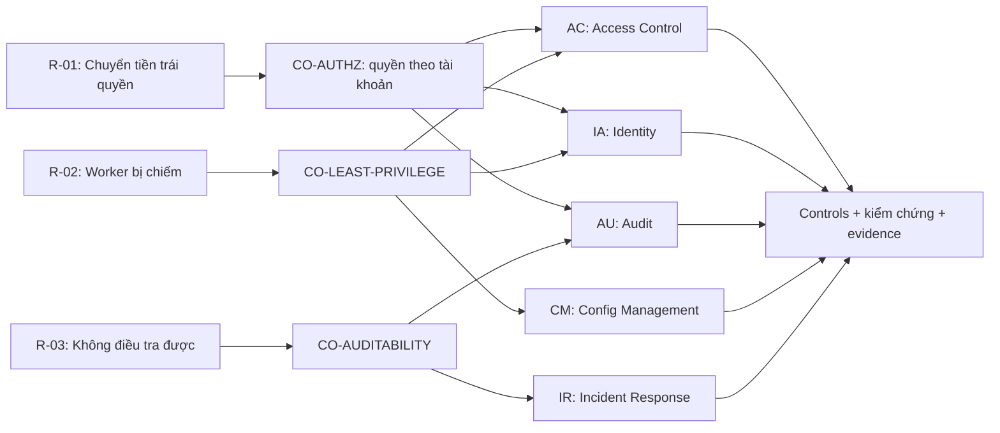
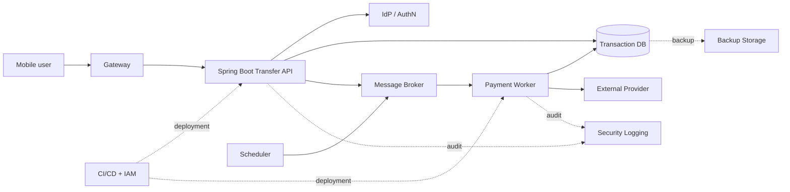
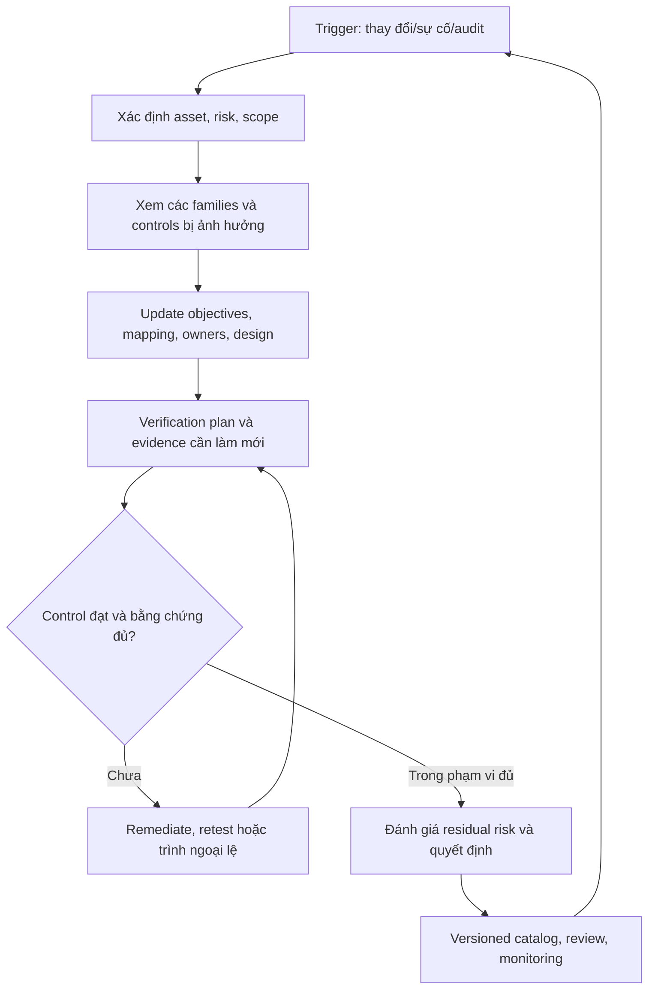

# Control family: Nhóm kiểm soát trong control framework và security assurance

## 1. Mục tiêu học tập

Sau bài học, người học có thể:

1. Định nghĩa **control family** (nhóm/họ kiểm soát) trong một *control framework* và phân biệt nó với framework, lĩnh vực (*domain*), mục tiêu kiểm soát, control cụ thể, quy trình và bằng chứng.
2. Giải thích vì sao cần tổ chức các biện pháp kiểm soát thành nhóm để **bao phủ rủi ro, phân công trách nhiệm, quản lý trùng lặp và xác định bằng chứng assurance**.
3. Nhận biết các họ kiểm soát thường gặp, như access control, identification and authentication, audit, configuration management, incident response, contingency planning và supply-chain risk.
4. Đọc hiểu cách những khung như **NIST SP 800-53**, **ISO/IEC 27002**, **NIST Cybersecurity Framework (CSF)**, **CIS Controls** và **OWASP ASVS** tổ chức nội dung mà không giả định chúng có cấu trúc tương đương.
5. Lựa chọn, điều chỉnh (*tailor*), kết hợp và kế thừa controls theo **tài sản, kịch bản rủi ro, phạm vi, trách nhiệm và nghĩa vụ áp dụng**.
6. Xây dựng bảng liên kết **risk → family → control objective → control → verification → evidence → finding/residual risk**.
7. Đánh giá sự phù hợp của thiết kế và hiệu quả vận hành của các controls theo từng family, đồng thời tổ chức chương trình assurance liên tục.
8. Thực hành xây một danh mục control families và kiểm chứng trên hệ thống Java/Spring Boot có API, database, broker, worker và nhà cung cấp thanh toán.

Bài thuộc chương **Control framework** của module **SECURITY_SECURITY_ASSURANCE**. Mục tiêu module là phát triển cách **đánh giá có bằng chứng** rằng hệ thống đáp ứng mục tiêu bảo mật, từ phân tích rủi ro, yêu cầu, controls đến kiểm thử, audit và khắc phục phát hiện trong cả phát triển lẫn vận hành. **Control family** giúp sắp xếp công việc đó có hệ thống, nhưng bản thân nhãn family không chứng minh một rủi ro đã được xử lý.

## 2. Control family là gì?

Một **control family** là cách **tập hợp các kiểm soát có chủ đề, mục đích, quy trình hoặc loại năng lực bảo mật liên quan** trong một khung hoặc thư viện kiểm soát. Ví dụ:

- **Access Control (AC):** quản lý quyền truy cập và sử dụng tài nguyên.
- **Identification and Authentication (IA):** nhận diện và xác minh danh tính.
- **Audit and Accountability (AU):** tạo, bảo vệ và sử dụng dấu vết trách nhiệm.
- **Configuration Management (CM):** quản lý cấu hình/baseline và những thay đổi.
- **Incident Response (IR):** chuẩn bị, phát hiện, xử lý và rút kinh nghiệm sự cố.
- **Contingency Planning (CP):** chuẩn bị hoạt động và khôi phục khi có gián đoạn.
- **Supply Chain Risk Management (SR):** quản lý rủi ro từ phần mềm, dịch vụ và nhà cung cấp.

Tên và mã trên tương ứng với các chủ đề thường gặp trong NIST SP 800-53. **Không phải mọi control framework đều có những family với tên gọi và ranh giới giống nhau.**

### 2.1. Phân biệt các tầng khái niệm

| Khái niệm | Câu hỏi nó trả lời | Ví dụ |
| --- | --- | --- |
| **Control framework** | Tập quy tắc/cấu trúc nào dùng để tổ chức hoặc quản lý kiểm soát? | NIST SP 800-53, thư viện kiểm soát nội bộ dựa trên rủi ro |
| **Function/domain/theme** | Lĩnh vực hoặc kết quả ở mức tổng thể nào đang được xem xét? | Govern/Protect/Detect trong NIST CSF; Organizational/Technological trong ISO/IEC 27002 |
| **Control family** | Những controls có cùng chủ đề được gom thành họ nào? | Access Control, Audit and Accountability |
| **Control objective** | Kết quả kiểm soát nào cần đạt? | Chỉ người có quyền mới sửa lịch chuyển tiền |
| **Control** | Cơ chế/quy trình cụ thể nào được áp dụng để đạt objective? | Backend object-level authorization ở service layer |
| **Control implementation** | Ai đã triển khai ra sao, trên hệ thống nào? | Policy + Spring Security + kiểm tra chủ tài khoản |
| **Test/assessment procedure** | Làm thế nào để kiểm tra control? | Negative test user B sửa lịch của user A |
| **Evidence** | Dữ kiện nào chứng minh/giới hạn kết quả kiểm tra? | Test report gắn build, config IAM, log và thời điểm |
| **Residual risk** | Sau khi xét controls có bằng chứng, rủi ro nào vẫn còn? | Đường worker chưa kiểm chứng có thể bypass API policy |

Ví dụ, “access control” vừa có thể dùng như **tên family** trong một framework, vừa dùng như **cách nói chung về loại biện pháp**. Khi làm báo cáo, nên chỉ rõ đang nói ở tầng nào.

### 2.2. Family không phải control riêng lẻ

“Ứng dụng có nhóm Access Control” không chứng minh ứng dụng đã chống được **BOLA/IDOR**. Cần biết:

1. Họ này bao gồm những controls và yêu cầu cụ thể nào?
2. Controls nào áp dụng cho dịch vụ hoặc giao dịch?
3. Có kiểm tra quyền ở tất cả đường HTTP, batch, worker, admin hay không?
4. Bằng chứng nào cho thấy quyền được thực thi đúng, trên phiên bản nào?
5. Phạm vi nào chưa kiểm chứng, rủi ro còn lại được xử lý thế nào?

Như vậy, **family là công cụ cấu trúc và điều phối**, còn assurance phải dựa trên **control thực tế và kết quả kiểm chứng**.

## 3. Tại sao phải tổ chức controls thành các family?

Một ứng dụng có thể cần hàng trăm yêu cầu/biện pháp khác nhau. Nếu ghi tất cả trong một danh sách không cấu trúc, nhóm dễ bỏ qua các chủ đề quan trọng hoặc triển khai nhiều cơ chế nhưng không giải quyết được rủi ro.

Phân nhóm giúp:

| Giá trị | Ý nghĩa thực tế |
| --- | --- |
| **Kiểm tra độ phủ** | Dễ phát hiện những vùng chưa có owner, control hoặc bằng chứng, ví dụ backup/recovery và đặc quyền vận hành |
| **Phân chia trách nhiệm** | IAM team chăm nhóm identity; AppSec/Engineering chăm controls ứng dụng; SRE chăm phục hồi và monitoring |
| **Thiết kế thư viện chung** | Tái sử dụng controls cho nhiều sản phẩm, giảm trùng lặp định nghĩa và kiểm thử |
| **So sánh framework** | Ánh xạ các yêu cầu từ nhiều chuẩn vào một catalog nội bộ, giữ khác biệt về phạm vi |
| **Đánh giá assurance** | Lập kế hoạch kiểm chứng, sampling, audit và chất lượng evidence theo chủ đề |
| **Theo dõi findings** | Biết các điểm yếu tập trung ở nhóm nào, từ đó ưu tiên giải quyết nguyên nhân hệ thống |
| **Báo cáo và giám sát** | Nêu rủi ro trọng yếu, mức độ trưởng thành, owners, gaps và xu hướng theo family |

Ví dụ, nếu nhiều dịch vụ có finding “service account quá quyền”, vấn đề không chỉ thuộc một microservice. Tổng hợp theo nhóm **Access Control / Identification and Authentication** có thể cho thấy cần sửa cách cấp quyền workload trong nền tảng.

Tuy nhiên, **family coverage không đồng nghĩa risk coverage**. Một tổ chức có controls ở mọi family vẫn có thể bỏ sót lỗ hổng logic nghiệp vụ làm giao dịch thanh toán bị xử lý trùng.

## 4. Framework khác nhau tổ chức nhóm kiểm soát khác nhau

Các khung có **mục đích và cấu trúc riêng**. Cần hiểu chúng trước khi lập danh mục kiểm soát hợp nhất.

| Framework hoặc tài liệu | Cách tổ chức liên quan | Điểm cần nhớ |
| --- | --- | --- |
| **NIST SP 800-53** | Danh mục security/privacy controls được nhóm thành các **control families** với mã như AC, IA, AU, CM... | Đây là ví dụ điển hình về thuật ngữ *control family*. Phải ghi ấn bản và phạm vi lựa chọn/tailoring |
| **ISO/IEC 27002:2022** | Các controls được sắp xếp theo bốn **themes**: Organizational, People, Physical, Technological | Theme không nên được coi là cùng cấp chi tiết hoặc tương đương 1:1 với family của NIST |
| **ISO/IEC 27001** | Yêu cầu hệ thống quản lý an toàn thông tin; lựa chọn controls theo kết quả xử lý rủi ro và nghĩa vụ; Annex A liên quan catalog tham chiếu | Statement of Applicability ghi căn cứ chọn/loại controls, không tự chứng minh hiệu quả |
| **NIST CSF 2.0** | Functions như Govern, Identify, Protect, Detect, Respond, Recover; categories/subcategories mô tả outcomes | Là cấu trúc kết quả an ninh mạng, không phải danh sách NIST 800-53 control families |
| **CIS Controls** | Tập biện pháp ưu tiên gồm các nhóm *Controls* và *Safeguards* | Các nhóm không tự ánh xạ 1:1 với họ NIST; cần kiểm tra nội dung và phạm vi |
| **OWASP ASVS** | Nhóm yêu cầu xác minh an toàn ứng dụng theo các chủ đề và phiên bản | Phục vụ verification ở mức ứng dụng, bổ sung chứ không thay thế mọi control tổ chức/vận hành |
| **Control library nội bộ** | Nhóm theo khả năng/cách quản trị do tổ chức xác định | Có thể gộp hoặc tách, nhưng phải bảo toàn yêu cầu và minh bạch mapping |

Các tên chuẩn ở đây là **định hướng học thuật**, không phải chứng nhận, cam kết tuân thủ hay mapping chính thức. Trong dự án thật, cần kiểm tra tài liệu chính thức **đúng phiên bản/ấn bản** và các nghĩa vụ áp dụng. Không áp đặt mã kiểm soát hoặc threshold khi chưa có căn cứ.

### 4.1. Vì sao không sao chép nguyên cấu trúc framework thành kiến trúc hệ thống?

Một framework có thể nhóm controls vì quản trị tiện lợi, nhưng hệ thống thực tế hoạt động theo **data flows, trust boundaries và business operations**. Ví dụ việc “chỉ chủ tài khoản mới chuyển tiền” có thể cần nhiều họ:

- **IA:** xác minh caller.
- **AC:** kiểm tra quyền trên tài khoản và giao dịch.
- **SC:** bảo vệ liên lạc và phân đoạn kết nối.
- **AU:** ghi dấu vết hành động và từ chối.
- **CM:** kiểm soát thay đổi policy.
- **SI:** xử lý integrity và các trạng thái lỗi.
- **IR:** ứng phó khi phát hiện hành vi trái quyền.

**Không nên tổ chức implementation thành silo** chỉ vì framework có các family riêng. Một objective thường cần kết hợp controls xuyên family.

## 5. Các control families thường gặp trong NIST SP 800-53

Một ví dụ có hệ thống là các family trong **NIST SP 800-53 Revision 5**. Bảng sau trình bày **mã/tên family và ý nghĩa định hướng**, không phải danh sách yêu cầu bắt buộc cho mọi sản phẩm hoặc bản sao nguyên văn nội dung chuẩn.

| Mã | Family | Chủ đề và ví dụ câu hỏi assurance |
| --- | --- | --- |
| **AC** | Access Control | Quyền truy cập, sử dụng hệ thống/tài nguyên có được quản lý và thực thi đúng? |
| **AT** | Awareness and Training | Người giữ các vai trò quan trọng có được hướng dẫn/đào tạo phù hợp trách nhiệm? |
| **AU** | Audit and Accountability | Sự kiện liên quan có được ghi, bảo vệ, xem xét và truy vết? |
| **CA** | Assessment, Authorization, and Monitoring | Việc đánh giá controls, quyết định ủy quyền và giám sát có được quản trị? |
| **CM** | Configuration Management | Baseline cấu hình, thay đổi và trạng thái thực có được kiểm soát? |
| **CP** | Contingency Planning | Dịch vụ và dữ liệu trọng yếu có phương án dự phòng/khôi phục được kiểm tra? |
| **IA** | Identification and Authentication | Danh tính người dùng và hệ thống có được xác minh thích hợp? |
| **IR** | Incident Response | Có năng lực xử lý, phối hợp, học và cải thiện sau sự cố? |
| **MA** | Maintenance | Hoạt động bảo trì và quyền liên quan có được kiểm soát an toàn? |
| **MP** | Media Protection | Phương tiện lưu trữ và dữ liệu trên đó được bảo vệ, vận chuyển, xử lý và hủy phù hợp? |
| **PE** | Physical and Environmental Protection | Truy cập vật lý, môi trường và tài nguyên vật chất có được bảo vệ? |
| **PL** | Planning | Kế hoạch và những tài liệu bảo mật liên quan có được xác định/quản lý? |
| **PM** | Program Management | Chương trình quản trị bảo mật cấp tổ chức có cơ chế quản lý và giám sát? |
| **PS** | Personnel Security | Quyền truy cập liên quan nhân sự/nhà thầu và vòng đời nhân sự có được kiểm soát? |
| **PT** | PII Processing and Transparency | Các hoạt động xử lý thông tin định danh cá nhân và tính minh bạch có được quản trị? |
| **RA** | Risk Assessment | Rủi ro, lỗ hổng và thay đổi mức phơi nhiễm có được đánh giá phù hợp? |
| **SA** | System and Services Acquisition | Việc phát triển, mua sắm và sử dụng dịch vụ/hệ thống có quản lý yêu cầu bảo mật? |
| **SC** | System and Communications Protection | Ranh giới truyền thông, dữ liệu và cơ chế bảo vệ hệ thống có phù hợp? |
| **SI** | System and Information Integrity | Lỗi, lỗ hổng, dữ liệu/hoạt động mất toàn vẹn có được phòng ngừa hoặc phát hiện/xử lý? |
| **SR** | Supply Chain Risk Management | Rủi ro chuỗi cung ứng và phụ thuộc nhà cung cấp có được nhận diện/quản lý? |

**Lưu ý:** Bảng giúp học về **cấu trúc family**; không nên suy ra mỗi family có số lượng controls giống nhau hoặc mỗi family chỉ có một owner. Các controls thực tế trong NIST SP 800-53 có mã và nội dung chi tiết riêng; selection và control enhancements phụ thuộc baseline, hệ thống, điều kiện tổ chức và phương pháp tailoring.

### 5.1. Hai family dễ nhầm: AC và IA

- **IA** tập trung vào việc xác định và xác thực **chủ thể là ai**.
- **AC** tập trung vào **chủ thể đã được xác minh được làm gì với tài nguyên nào**.

Một access token hợp lệ theo các yêu cầu xác thực chưa đủ để cho người dùng B sửa lịch chuyển của A. Bài toán thứ hai là **authorization ở mức tài nguyên/nghiệp vụ**, thuộc vùng mục tiêu mà family AC thường bao phủ.

### 5.2. Hai family khác dễ nhầm: AU và IR

- **AU:** tạo, bảo vệ, phân tích hoặc sử dụng bằng chứng hoạt động, accountability.
- **IR:** chuẩn bị và thực hiện phản ứng khi có sự cố.

Ghi log là điều kiện hỗ trợ incident response, nhưng **có log không đồng nghĩa đội vận hành có playbook, quyền xử lý và diễn tập**. Ngược lại, một quy trình ứng phó không thể bù hoàn toàn cho log thiếu tính toàn vẹn hoặc không có dữ liệu cần điều tra.

### 5.3. CM khác với SI thế nào?

- **CM:** kiểm soát cấu hình hệ thống, baseline và những thay đổi được phép.
- **SI:** bảo vệ và duy trì tính toàn vẹn của hệ thống/thông tin, xử lý các sai lệch hoặc điểm yếu liên quan.

Ví dụ, policy cấm thay IAM ngoài IaC chủ yếu liên quan CM và AC; việc phát hiện phiên bản package có lỗ hổng và quản lý sửa chữa có thể liên quan SI và RA. Một sự cố có thể đi qua cả nhiều family.

## 6. Cách xem nhóm kiểm soát trong ISO/IEC 27002

Với ISO/IEC 27002:2022, có thể tiếp cận qua bốn **themes**:

| Theme | Chủ đề khái quát | Ví dụ loại hoạt động |
| --- | --- | --- |
| **Organizational** | Chính sách, tổ chức, sở hữu, quản lý tài sản, nhà cung cấp, quy trình | Phân định trách nhiệm, quản lý truy cập, xử lý sự cố, continuity |
| **People** | Những yếu tố an toàn thông tin liên quan con người | Trách nhiệm nhân sự, nhận thức/đào tạo, hoạt động khi thay đổi vai trò |
| **Physical** | Bảo vệ khu vực, thiết bị và môi trường vật lý | Kiểm soát lối vào, vị trí/thiết bị, bảo vệ môi trường |
| **Technological** | Công nghệ dùng để bảo vệ hệ thống và dữ liệu | Endpoint, quyền kỹ thuật, logging, bảo vệ mạng, secure coding, mật mã |

Một control nội bộ như **quy trình offboarding** có thể cần biện pháp con người/tổ chức và đồng thời cần IAM automation công nghệ. Bởi vậy, không nên xem mỗi theme là một đội độc lập hoặc loại trừ nhau về trách nhiệm.

### 6.1. Ví dụ đối chiếu không tương đương 1:1

Objective nội bộ: “Khi nhân sự nghỉ, quyền truy cập hệ thống thanh toán bị thu hồi đúng thời hạn.”

- Có thành phần thuộc **People/Organizational**: phát hiện sự kiện nghỉ việc, phân định trách nhiệm, phê duyệt và bàn giao.
- Có thành phần thuộc **Technological**: IAM deprovisioning, session/token handling, access review.
- Trong NIST SP 800-53, những phần này có thể liên quan **PS, AC, IA, AU** và các family khác.

Đây là **quan hệ nhiều–nhiều**, không thể chỉ chuyển nhãn “People = PS” rồi khẳng định đã đáp ứng mọi yêu cầu.

## 7. NIST CSF và CIS Controls không nên đồng nhất với family

Một lỗi thường gặp là coi mọi cách nhóm trong mọi framework đều cùng một cấp.

**NIST CSF** diễn đạt các kết quả mong muốn để quản trị an ninh mạng. Các Functions như **Govern, Identify, Protect, Detect, Respond, Recover** giúp tổ chức nhìn toàn cảnh, lựa chọn ưu tiên và đánh giá trạng thái mục tiêu. Chúng không phải sáu family thay thế toàn bộ danh mục NIST SP 800-53.

**CIS Controls** đưa ra các nhóm biện pháp thực hành được ưu tiên và các safeguards. Một CIS Control có thể trùng chủ đề với một hoặc nhiều NIST families, nhưng không tự bảo đảm cùng phạm vi yêu cầu hoặc cùng tiêu chí kiểm chứng.

**OWASP ASVS** thích hợp chi tiết hóa những hành vi bảo mật cần kiểm chứng của ứng dụng. Ví dụ mục tiêu authorization có thể lấy các yêu cầu kiểm chứng ứng dụng làm tiêu chí, còn các hoạt động risk acceptance, vendor management hoặc continuity ở cấp tổ chức cần được quản trị theo nguồn phù hợp khác.

### 7.1. Sử dụng khung nào làm “xương sống”?

Không có câu trả lời giống nhau cho mọi tổ chức. Một cách tiếp cận:

- Tổ chức cần catalog control chi tiết theo từng họ: có thể lấy NIST SP 800-53 hoặc thư viện có cấu trúc tương đương làm điểm xuất phát.
- Tổ chức áp dụng ISMS: dùng chính sách/risk treatment và các controls được lựa chọn trong phạm vi ISO/IEC 27001/27002.
- Ban lãnh đạo cần bản đồ outcome: dùng NIST CSF để nói về năng lực/mức ưu tiên, liên kết ngược đến catalog cụ thể.
- AppSec cần test ứng dụng: dùng các yêu cầu kiểm chứng phù hợp, bổ sung kỹ thuật và evidence.
- Muốn tối ưu hóa năng lực trước các tấn công phổ biến: tham khảo CIS Controls và ngữ cảnh phơi nhiễm.

Có thể sử dụng **nhiều khung cùng lúc**, nhưng phải chọn một nguồn định danh chuẩn cho catalog nội bộ và giữ **crosswalk có kiểm chứng**, nếu không các báo cáo sẽ đếm trùng controls hoặc công bố coverage sai.

## 8. Phân loại control theo family khác với phân loại theo chức năng

Một control có ít nhất hai thuộc tính phân loại độc lập:

1. **Family:** chủ đề hoặc năng lực quản trị, ví dụ AC, AU, CM.
2. **Chức năng xử lý rủi ro:** preventive, detective, corrective, responsive hoặc recovery.

Ví dụ:

| Control cụ thể | Family có thể liên quan | Chức năng chủ yếu |
| --- | --- | --- |
| Object-level authorization | AC | Preventive |
| Review quyền định kỳ | AC, CA/AU tùy cách quản lý | Detective/governance và có thể preventive qua chỉnh quyền |
| MFA cho đặc quyền | IA, AC | Preventive |
| Lưu và bảo vệ audit log | AU | Detective/enabling accountability |
| Cảnh báo truy cập nhạy cảm bất thường | AU, SI hoặc IR theo cách phân loại | Detective |
| Thu hồi token sau incident | IA, IR | Responsive/corrective |
| Branch protection và deploy approval | CM, SA, AC | Preventive |
| Restore backup có kiểm chứng | CP, SI | Recovery |
| Review nhà cung cấp trước tích hợp | SR, SA, RA | Preventive/governance |
| Thay secret bị lộ | IA, SC, IR tùy tình huống | Responsive/corrective |

**Không áp đặt quy tắc “AC luôn preventive”, “AU luôn detective”.** Một family có thể chứa nhiều loại control; một control có thể đóng vai trò ở nhiều family tùy cấu trúc catalog và mục tiêu sử dụng.

### 8.1. Các chiều phân loại bổ sung

Ngoài family và chức năng, catalog có thể ghi:

- **Tầng thực thi:** tổ chức, con người, ứng dụng, platform, network, data, physical, supplier.
- **Vòng đời:** thiết kế, triển khai, giám sát, khắc phục, ngừng hoạt động.
- **Phương pháp vận hành:** tự động, thủ công hoặc kết hợp.
- **Phạm vi:** toàn doanh nghiệp, nền tảng chung, dịch vụ riêng, tenant hoặc môi trường.
- **Người sở hữu:** risk owner, control owner, evidence owner, assessor.
- **Nguồn yêu cầu:** chính sách, hợp đồng, tiêu chuẩn, threat model hoặc đánh giá rủi ro.

Những chiều này giúp tìm đúng controls khi quản lý rủi ro, chứ không nhằm làm một bản ghi trở nên quá phức tạp.

## 9. Từ rủi ro đến lựa chọn family và control

Bắt đầu từ **hậu quả cần ngăn**, không bắt đầu từ nhãn family yêu thích.

Quy trình:

1. Xác định **tài sản và mục tiêu bảo mật**: bí mật, toàn vẹn, sẵn sàng hoặc các thuộc tính liên quan.
2. Viết **risk scenario**: tác nhân/sự kiện → entry point → điều kiện/điểm yếu → hậu quả nghiệp vụ.
3. Xác định **control objectives**: trạng thái bảo vệ nào phải đạt.
4. Tìm **những families liên quan** để không bỏ sót lớp bảo vệ, quản trị và phục hồi.
5. Chọn **controls cụ thể**, phân định nơi thực thi, owner và hành vi khi lỗi.
6. Đặt **yêu cầu kiểm chứng** và evidence cần thu thập cho các controls.
7. Đánh giá **current/residual risk** bằng controls thực sự hoạt động, không bằng kế hoạch.
8. Theo dõi **thay đổi, findings và ngoại lệ** để đánh giá lại family coverage.

Ví dụ:

| Thành phần | Nội dung |
| --- | --- |
| Asset | Tính toàn vẹn của giao dịch chuyển tiền |
| Risk scenario | Người dùng hợp lệ đoán `accountId` của người khác và tạo lệnh trái quyền |
| Objective | Chỉ người được ủy quyền có thể thực hiện giao dịch trên tài khoản nguồn |
| Families cần xem | IA, AC, AU, CM, SC; IR khi đánh giá khả năng xử lý sự cố |
| Controls chính | Xác thực caller, object-level AuthZ, least privilege, audit trail |
| Verification | Positive/negative AuthZ tests, IAM/config review, log verification |
| Evidence | Report theo release, phiên bản policy, thông tin người/công cụ test, giới hạn |
| Residual risk | Đường worker hoặc batch chưa kiểm chứng, sai lệch quyền theo thời gian nếu có |

Với kịch bản trên, **đánh giá đạt family IA** vì token hợp lệ vẫn không bảo đảm family AC giải quyết quyền theo tài nguyên. Family được chọn để **soát đủ các điểm kiểm soát**, không thay cho phân tích riêng từng threat.

## 10. Quan hệ nhiều–nhiều và khả năng tái sử dụng

Một rủi ro có thể cần nhiều controls thuộc nhiều family; một control có thể giảm nhiều kịch bản rủi ro; một family có thể có hàng chục controls ở nhiều tầng.



Lợi ích của mô hình nhiều–nhiều:

- Tránh triển khai ba hệ thống phân quyền khác nhau chỉ vì chúng nằm trong ba bộ tiêu chuẩn.
- Có thể dùng **một lần kiểm chứng phù hợp** hỗ trợ nhiều requirement, nhưng phải kiểm tra thật sự cùng điều kiện và scope.
- Phát hiện điểm đơn lẻ có **blast radius lớn**: một IAM control chung sai có thể ảnh hưởng nhiều sản phẩm.
- Tách rõ **catalog control** với **risk register**: không nhân bản 5 bản ghi control cho cùng một cơ chế, nhưng vẫn ghi 5 rủi ro phụ thuộc cơ chế đó.

Tuy nhiên, tái sử dụng quá mức cũng nguy hiểm. Ví dụ một scan SAST không thể thay tất cả evidence cho object-level authorization, idempotency và restore, dù đều được gắn vào một “security testing family”.

## 11. Xây control library nội bộ theo cấu trúc family

Một cách tổ chức có thể là:

```text
Control Framework / Catalog
  Family: Identity & Access
    Objective: Chỉ chủ thể có quyền được truy cập
      CTRL-IA-001: Authentication và xác minh token
      CTRL-AC-001: Object-level authorization
      CTRL-AC-002: Least privilege cho workload
  Family: Change & Configuration
    Objective: Thay đổi production được kiểm soát
      CTRL-CM-001: Protected branch + review
      CTRL-CM-002: IAM/deploy approval
  Family: Audit & Monitoring
    Objective: Hành động trọng yếu được truy vết
      CTRL-AU-001: Security event và correlation
      CTRL-AU-002: Log integrity/retention
  Family: Resilience & Recovery
    Objective: Có thể khôi phục đúng dữ liệu và dịch vụ
      CTRL-CP-001: Backup/restore rehearsal
```

Đây chỉ là **cấu trúc minh họa**; các tên mã nội bộ cần có namespace để không bị nhầm là mã chuẩn chính thức.

### 11.1. Một bản ghi family có thể chứa gì?

| Trường | Nội dung |
| --- | --- |
| Family ID/name | Định danh, tên hiển thị, mô tả năng lực |
| Framework source | Tên/ấn bản chuẩn hoặc quy định nội bộ dùng để tổ chức |
| Objectives | Những kết quả kiểm soát được family hỗ trợ |
| Applicable scope | Hệ thống, data class, environment, tài sản hoặc quy trình |
| Parent/related families | Các nhóm liên quan và quan hệ phụ thuộc |
| Control list | Controls được lựa chọn, status và bản chất trách nhiệm |
| Owner/custodian | Người quản lý nội dung family và các control owners |
| Verification strategy | Các cách kiểm chứng thiết kế/hiệu lực hoạt động |
| Evidence index | Link có quyền truy cập, version, freshness, limitations |
| Findings/exceptions | Vấn đề còn tồn tại, rủi ro còn lại và người phê duyệt |
| Review triggers | Thay đổi công nghệ, nghĩa vụ, dữ liệu hoặc sự cố |

Một bản ghi **family** không nhất thiết lưu chi tiết của mọi test. Nên giữ các ID/link tới **bản ghi control và evidence**, tránh dữ liệu trùng lặp không đồng bộ.

## 12. Lựa chọn (*selection*) và điều chỉnh (*tailoring*) controls

Khung kiểm soát là **nguồn cấu trúc**, không phải bằng chứng mọi mục đều áp dụng nguyên trạng.

Cần xét:

1. **Mục tiêu và mức rủi ro:** tài sản nào quan trọng, hậu quả nào cần giảm.
2. **Phạm vi hệ thống:** workload, application, production, tenant, region, bên thứ ba.
3. **Nghĩa vụ bắt buộc:** quy định và cam kết áp dụng thực sự, không tự gắn một chuẩn vào hệ thống chưa thuộc phạm vi.
4. **Kiến trúc và data flow:** entry points, trust boundaries, service identities, backup, log, CI/CD.
5. **Controls đang có:** nguồn thừa hưởng (*inherited*) và controls trực tiếp của dịch vụ.
6. **Khả năng triển khai/kiểm chứng:** thiết kế, công cụ, đội sở hữu, môi trường, chi phí, trade-off.
7. **Rủi ro còn lại:** treatment và ngoại lệ phải được phê duyệt đúng thẩm quyền.

### 12.1. Không áp dụng khác với chưa triển khai

| Trạng thái | Ý nghĩa | Ghi nhận cần thiết |
| --- | --- | --- |
| **Applicable / selected** | Control cần thiết theo rủi ro, nghĩa vụ hoặc chính sách | Căn cứ, scope, owner, yêu cầu kiểm chứng |
| **Not applicable** | Có cơ sở chứng minh điều kiện áp dụng không tồn tại trong scope | Lý do, người review và trigger xem lại |
| **Planned** | Control cần nhưng mới được lập kế hoạch | Owner, hạn, mức rủi ro hiện tại |
| **Implemented** | Control đã triển khai | Bằng chứng triển khai, cần đánh giá hiệu quả |
| **Verified** | Có bằng chứng đạt trong phạm vi và kỳ đánh giá | Phương pháp, kết quả, giới hạn, version |
| **Failed / deficient** | Có finding vi phạm hoặc control không đủ | Kế hoạch sửa, rủi ro, retest |
| **Inherited** | Service sử dụng control chung được bên khác quản lý | Control provider, evidence chung và phần trách nhiệm còn lại |
| **Accepted exception** | Chưa đáp ứng hoàn toàn nhưng được chấp nhận trong thẩm quyền | Residual risk, bù trừ, người duyệt, expiry |

Không được chuyển một control cần thiết thành **Not applicable** chỉ vì thiếu thời gian hoặc ngân sách. Trường hợp đó cần risk treatment/ngoại lệ theo quy trình.

## 13. Common controls và inherited controls

Một hệ thống Java/Spring Boot có thể dùng các kiểm soát chung do nền tảng hoặc bộ phận trung tâm cung cấp:

- Central Identity Provider, authentication và chính sách credential.
- Secrets manager/KMS, network baselines, managed database.
- CI/CD workflow bảo vệ nhánh, artifact và deployment.
- Central logging, SIEM, vulnerability management.
- Backup infrastructure, monitoring và incident escalation.
- Quy trình HR, vendor assessment, awareness và chính sách tổ chức.

Gọi đây là **shared/common controls** nếu chúng được thiết kế phục vụ nhiều hệ thống. Một dịch vụ có thể **kế thừa** hiệu quả một phần từ các controls đó, nhưng không thể chỉ nói “nền tảng đã làm”.

### 13.1. Shared responsibility theo từng control

Ví dụ đối với IdP:

| Trách nhiệm | Đơn vị cung cấp control chung | Ứng dụng sử dụng control |
| --- | --- | --- |
| Dịch vụ phát hành/xác thực danh tính theo thiết kế | Identity/Platform team | Tích hợp giao thức đúng |
| Bảo vệ khóa và cấu hình IdP | Identity team | Kiểm tra issuer, audience, signature/expiry |
| Cấp/thu hồi người dùng và role | IAM/HR và owner theo chính sách | Kiểm tra authorization nghiệp vụ riêng |
| Bằng chứng uptime, config và policy IdP | Identity/Platform | Lưu bản tham chiếu và giới hạn |
| User A không sửa tài khoản user B | Không thể kết luận chỉ từ IdP | **Application owner** phải thực thi object-level AuthZ |

**Kế thừa control xác thực không đồng nghĩa kế thừa control phân quyền nghiệp vụ**. Báo cáo assurance phải giữ hai phần trách nhiệm.

### 13.2. Evidence của control chung có thể hết hiệu lực

Một control chung được kiểm toán ở tháng trước có thể đã đổi cấu hình trong tháng này. Người sử dụng cần xem:

- Kỳ và phạm vi của bằng chứng.
- Hệ thống/tài khoản/vùng có thực sự sử dụng control được kiểm tra không.
- Những exceptions và findings của control provider.
- Những phần phụ thuộc ở phía ứng dụng chưa được kiểm tra.
- Trigger đánh giá lại khi cloud, IdP, policy hoặc nhà cung cấp đổi.

Inherited control tốt giúp giảm lặp đánh giá, nhưng không thể tạo **assurance giả** bằng cách nhân rộng một bằng chứng không phù hợp cho nhiều ứng dụng.

## 14. Family AC: Access Control trong ứng dụng

Với hệ thống xử lý tiền hoặc dữ liệu cá nhân, family Access Control đặc biệt quan trọng.

Các mục tiêu có thể gồm:

- Chỉ người được phép mới truy cập dữ liệu/tài nguyên và thực hiện hành động.
- Quyền được cấp theo nhiệm vụ, phạm vi, thời gian và được thu hồi khi cần.
- Những quyền đặc biệt có kiểm soát và khả năng truy vết.
- Mọi entry point quan trọng đều thực thi cùng chính sách quyền.

### 14.1. Ví dụ thiếu object-level authorization

Alice sở hữu tài khoản A; Bob có token hợp lệ nhưng không được ủy quyền. Bob gọi `PATCH /api/schedules/{id}` với ID lịch của Alice.

Nếu API chỉ kiểm tra “Bob đã đăng nhập”, control thuộc IA có thể hoạt động nhưng **AC không đạt mục tiêu**.

Các câu hỏi kiểm chứng AC:

1. Quyền trên tài nguyên được xác minh ở backend, không tin thông tin client tự khai?
2. Kiểm tra nằm trước mọi ghi DB, phát event hoặc gọi provider?
3. Có kiểm tra cả bulk API, worker, batch và admin path?
4. Trong trường hợp authority source lỗi, hệ thống có cho phép trái quyền không?
5. Có negative tests cho caller hợp lệ nhưng không sở hữu tài nguyên?
6. Service accounts được giới hạn quyền tới những tài nguyên cần thiết?

### 14.2. Minh họa Java/Spring Boot

Đoạn mã sau là **pseudocode định hướng**, không phải cấu hình Spring Security hoàn chỉnh hoặc bằng chứng control đã đạt:

```java
public ScheduleResponse updateSchedule(
        AuthenticatedPrincipal caller,
        String scheduleId,
        ScheduleUpdateCommand command) {

    Schedule schedule = scheduleRepository.getRequired(scheduleId);

    if (!authorizationPolicy.mayEdit(
            caller.subjectId(),
            schedule.accountId(),
            schedule.id())) {
        securityEvents.recordDeniedAction(
                caller.subjectId(), schedule.id(), "UPDATE_SCHEDULE");
        throw new AccessDeniedException("Not authorized");
    }

    // Cần bảo đảm kiểm tra và side effect nhất quán
    // trong transaction/domain workflow phù hợp.
    return scheduleService.updateAuthorized(schedule, command);
}
```

Một testcase trả HTTP `403` **chưa đủ** nếu Bob dùng token hết hạn. Phải có Bob đã xác thực hợp lệ, tài nguyên thực sự thuộc Alice, positive test Alice được phép và kiểm tra không có side effects sau từ chối.

## 15. Family IA: Identity and Authentication

Family IA liên quan danh tính và xác minh chủ thể; cần bao gồm cả **người dùng, workload, service và tài khoản đặc quyền**.

| Rủi ro | Ví dụ kiểm soát | Bằng chứng cần xem |
| --- | --- | --- |
| Token giả hoặc dùng sai dịch vụ | Xác minh signature/issuer/audience/expiry theo trust model | Validator config và negative tests |
| Đặc quyền bị chiếm từ credential lộ | MFA phù hợp, quản lý credential, step-up khi cần | Policy, test/assessment, hồ sơ ngoại lệ |
| Worker giả mạo service khác | Workload identity, broker/API authentication | IAM/policy review, test caller không được phép |
| Tài khoản không còn chủ sở hữu | Joiner–mover–leaver và credential revocation | Access review, offboarding records |
| Role không được cấp theo thẩm quyền | Provisioning workflow và approval | Quy trình, audit log và quyền thực tế |

Một finding thuộc IA có thể ảnh hưởng nhiều rủi ro thuộc AC, AU hoặc SC. Việc phân biệt gia đình giúp biết **đội nào sửa nguyên nhân**, còn bảng truy vết giúp biết **rủi ro nghiệp vụ nào bị ảnh hưởng**.

## 16. Family AU: Audit and Accountability

Một hệ thống có controls phòng ngừa tốt vẫn cần quan sát những điều xảy ra và chứng minh trạng thái kiểm soát.

Các mục tiêu ví dụ:

- Những sự kiện trọng yếu được ghi nhận với ngữ cảnh đủ để truy vết.
- Log không làm lộ secrets hoặc dữ liệu nhạy cảm ngoài phạm vi.
- Quyền sửa/xóa log được hạn chế, có retention và integrity phù hợp.
- Đội điều tra có thể liên kết hành động từ user/API đến worker và provider.

### 16.1. Từ mục tiêu đến evidence

| Yêu cầu | Kiểm tra | Dữ liệu evidence |
| --- | --- | --- |
| Mọi thay đổi lịch có audit event phù hợp | Tạo/sửa/hủy lịch với các vai trò thử | Log/events gắn transaction, timestamp, actor |
| Có thể truy vết end-to-end | Cho một lệnh qua API → broker → worker → provider | Correlation IDs và nhật ký theo chuỗi |
| Không lộ bí mật trong log | Thử đường lỗi, payload bất thường và debug | Log sample đã hạn chế dữ liệu nhạy cảm |
| Log có bảo vệ toàn vẹn | Review write/delete permissions và đường lưu | IAM config, storage policy, test quyền có kiểm soát |
| Log dùng được khi sự cố | Thử truy xuất trong tình huống giả định | Runbook và kết quả diễn tập |

Chỉ bật “application logging” không chứng minh family AU đã đáp ứng objective về khả năng điều tra. Ngoài ra, **bằng chứng assurance (test reports, risk decisions)** cũng cần bảo vệ tính toàn vẹn và provenance.

## 17. Family CM: Configuration Management và change control

CM giúp bảo đảm cấu hình hệ thống có **baseline, quá trình thay đổi và khả năng phát hiện lệch**.

Ví dụ đối với Java/Spring Boot trên cloud:

- Baseline cho IAM, network, database, secret store và application security configuration.
- Infrastructure as Code với review và quyền triển khai.
- Quy trình đổi policy JWT, feature flag, deployment topology hoặc quyền admin.
- Đối chiếu runtime production với cấu hình đã phê duyệt.
- Quản lý exception khi thay đổi khẩn cấp.
- Kiểm tra drift sau release hoặc sau can thiệp thủ công.

### 17.1. Một bài học assurance điển hình

Repository IaC quy định rằng worker chỉ đọc một secret. Nhưng IAM policy ở production được chỉnh tay cho phép đọc toàn bộ secret store.

- **Design evidence:** IaC mô tả least privilege.
- **Operating evidence:** IAM thực tế không khớp; control CM hoặc AC chưa hiệu quả.
- **Risk:** worker bị xâm nhập có thể làm lộ thêm credentials.
- **Action:** khôi phục policy, kiểm tra quyền, chặn/giám sát đường bypass.
- **Retest:** so sánh IAM thực tế và thử quyền theo phạm vi.
- **Residual risk:** chỉ đánh giá lại sau bằng chứng kiểm chứng.

Một file YAML đẹp trong repo **không chứng minh production đang chạy theo đúng YAML đó**.

## 18. Các family về continuity, incident và integrity

Ba mảng có quan hệ chặt chẽ nhưng cần kết quả và bằng chứng riêng.

### 18.1. Contingency Planning (CP)

Hướng vào khả năng duy trì và phục hồi khi có gián đoạn:

- Những dịch vụ/dữ liệu nào quan trọng; RTO/RPO được chủ nghiệp vụ phê duyệt?
- Backup, khóa giải mã, quyền truy cập và bản sao được bảo vệ ra sao?
- Có runbook khôi phục và diễn tập restore thực sự không?
- Khi database phục hồi, message broker còn event cũ thì integrity giao dịch có được giữ không?

**Backup job báo success không đủ để chứng minh khả năng restore.** Cần diễn tập phù hợp, đánh giá dữ liệu khôi phục và giới hạn.

### 18.2. Incident Response (IR)

Hướng vào nhận diện, ứng phó, điều tra và học sau sự cố:

- Có ai nhận alert và phân loại mức nghiêm trọng?
- Người trực có thẩm quyền thu hồi token, cô lập workload, chặn đường thanh toán không?
- Có playbook và phối hợp với nhà cung cấp không?
- Bằng chứng điều tra có được bảo quản và sử dụng phù hợp?
- Bài học incident có được đưa trở lại threat model, risk register và control library không?

IR không thay thế các controls preventive thuộc AC/IA hoặc detector thuộc AU/SI.

### 18.3. System and Information Integrity (SI)

Hướng vào duy trì tính toàn vẹn và xử lý điểm yếu:

- Hệ thống có phát hiện/giảm lỗ hổng liên quan?
- Những trạng thái dữ liệu quan trọng có bất biến được thực thi?
- Có ngăn duplicate transaction, cập nhật sai hoặc xử lý input không tin cậy?
- Bằng chứng nào từ test, monitoring hoặc kiểm tra dữ liệu cho thấy bất biến vẫn đúng?

Trong nghiệp vụ thanh toán, **idempotency và transaction consistency** là ví dụ quan trọng cần được phân tích theo kịch bản mất toàn vẹn, không chỉ theo vulnerability scanner.

## 19. Nhóm controls về rủi ro nhà cung cấp và chuỗi cung ứng

Các family như **SR** và những controls liên quan **SA, RA, CM** giúp kiểm soát các phụ thuộc phần mềm/dịch vụ:

| Nguồn rủi ro | Yêu cầu/biện pháp có thể cần | Bằng chứng phù hợp |
| --- | --- | --- |
| Third-party API thay semantics | Integration contracts, failure-mode design, reassessment | Hợp đồng và test timeout/retry/đối soát |
| Dependency chứa lỗ hổng | Dependency inventory, vulnerability management, update process | SCA report, quyết định xử lý theo release |
| Build artifact bị thay đổi | Controlled build/deploy, provenance hoặc integrity checks | Build logs, artifact metadata, deploy audit |
| Nhà cung cấp lưu dữ liệu nhạy cảm | Data-sharing policy, trách nhiệm và giới hạn, exit plan | Vendor assessment, contract, data-flow map |
| Cloud shared responsibility không rõ | Responsibility matrix và owner cho từng control | Service architecture, IAM/config review |
| Nhà cung cấp bị sự cố | Incident contact, notification, recovery integration | Runbook/tabletop, bằng chứng phối hợp |

**Báo cáo chứng nhận nhà cung cấp không chứng minh tất cả controls của hệ thống khách hàng đã đạt.** Cần xem scope, kỳ kiểm toán, ngoại lệ và những trách nhiệm ở phía mình.

## 20. Privacy controls và phân loại dữ liệu

Một hệ thống không chỉ bảo vệ khỏi tấn công; nó còn phải quản lý **cách thu thập, sử dụng, chia sẻ, lưu giữ và xóa dữ liệu** theo mục đích/những nghĩa vụ áp dụng.

Trong NIST SP 800-53 Rev. 5 có family **PT — PII Processing and Transparency**. Khi liên kết với các family AC, AU, SC và PM, các câu hỏi có thể gồm:

- Mục đích xử lý thông tin cá nhân được xác định và quản lý ra sao?
- Dữ liệu nào thực sự cần thu thập, xuất, giữ hoặc gửi đối tác?
- Những người/nhóm nào có quyền truy cập, sửa hoặc xóa?
- Các bản sao trong log, cache, backup và dữ liệu thử được quản lý thế nào?
- Có quy trình và hồ sơ thích hợp để thực hiện các nghĩa vụ liên quan?
- Evidence về việc thực thi có đủ đại diện cho sản phẩm và thời điểm không?

Không được suy luận “đã mã hóa database” là đã xử lý toàn bộ mục tiêu liên quan tới quyền riêng tư. **Encryption** và **governance của vòng đời dữ liệu** giải quyết các khía cạnh khác nhau.

## 21. Chuyển family catalog thành ma trận assurance

Mục tiêu là có thể trả lời: **“Tại sao controls trong family này là cần thiết cho hệ thống, và chúng đã được chứng minh hiệu quả đến đâu?”**

Một bảng truy vết mẫu:

| Risk / asset | Family | Control objective | Control | Verification | Evidence/limit |
| --- | --- | --- | --- | --- | --- |
| R-01: user sửa lịch trái quyền | AC, IA | Chỉ chủ thể có quyền sửa lịch | AuthN + object-level AuthZ | Negative tests A/B, path review | Test report theo build; đường admin/worker chưa thử phải nêu |
| R-02: worker quá quyền | AC, IA, CM | Worker có least privilege | Runtime IAM + secret scoping | IAM review, permission tests | Policy snapshot; phải khớp production |
| R-03: transaction bị xử lý trùng | SI, SC/SA tùy phạm vi | Một business operation không có tác động trùng | Idempotency + state management | Concurrent retry/failure tests | Kết quả và giới hạn provider |
| R-04: không truy vết được | AU, IR | Có audit end-to-end | Correlation + log integrity | Event chain tests và log review | Chỉ rõ những sự kiện đã kiểm chứng |
| R-05: mất dữ liệu không phục hồi | CP, SI | Restore theo mục tiêu | Backup + restore procedure | Restore exercise | RTO/RPO/giới hạn thử |
| R-06: phát hành code trái phép | CM, SA, AC | Chỉ artifact được duyệt vào production | Branch/deploy protection | Pipeline/config review | Artifact provenance, quyền bypass |
| R-07: provider sai lệch | SR, RA, SA | Rủi ro phụ thuộc được quản lý | Contract, scoped identity, integration rules | Vendor evidence + integration tests | Không pentest hạ tầng ngoài quyền |

Tên family ở đây là **gợi ý phân tích**, không phải mapping chuẩn tắc. Một control có thể cần được ghi ở hơn một family tùy cách tổ chức catalog.

### 21.1. Khi nào một hàng được coi “covered”?

Cần phân biệt:

- **Mapped:** đã có liên kết risk ↔ family/control.
- **Designed:** phương án control đủ về mặt kiến trúc theo review.
- **Implemented:** code/config/quy trình đã triển khai.
- **Verified:** có evidence kiểm chứng theo phạm vi, phiên bản, thời điểm.
- **Operating:** có bằng chứng control tiếp tục hoạt động trong kỳ liên quan.
- **Not verified / failed:** chưa có kiểm chứng đủ tin cậy hoặc đã có finding.
- **Exception:** rủi ro chưa xử lý được chấp nhận theo thẩm quyền và điều kiện.

Một ma trận có đủ link nhưng thiếu tests **không có nghĩa mọi rủi ro đã được kiểm soát**.

## 22. Design effectiveness và operating effectiveness theo family

Có hai câu hỏi độc lập:

1. **Design effectiveness:** Nếu các controls được triển khai theo thiết kế, chúng có khả năng đạt mục tiêu bảo vệ đối với những threat scenarios trong phạm vi không?
2. **Operating effectiveness:** Trong hệ thống/kỳ thực tế, các controls có hoạt động đúng và liên tục như thiết kế không?

Ví dụ:

| Family | Review thiết kế | Review vận hành / evidence |
| --- | --- | --- |
| AC | Mô hình phân quyền, least privilege, các entry point | Tests trái quyền, IAM snapshots, access reviews |
| IA | Trust model, token/session policy, workload identity | Config validation, negative token tests, lifecycle records |
| AU | Audit event schema, quyền và retention theo nhu cầu | Log-chain tests, quyền xóa/sửa, alert exercises |
| CM | Baseline, approval workflow, rollback/drift strategy | Change samples, deployed config, drift checks |
| CP | Backup architecture, phục hồi và RTO/RPO | Restore/failover exercises với dữ liệu đúng |
| IR | Incident playbooks, escalation và trách nhiệm | Tabletop, alert triage records, post-incident actions |
| SI | State invariants, vulnerability strategy, integrity controls | Concurrency tests, vulnerability review, data integrity checks |
| SR | Supplier assessment process và shared responsibilities | Hợp đồng/evidence đúng phạm vi, integration failure tests |

**Một family có design reviewed chưa có nghĩa operating effectiveness đạt.** Chẳng hạn, sơ đồ phân quyền đúng nhưng worker production đang dùng service account có quyền rộng; hoặc backup plan đầy đủ nhưng chưa có restore test.

### 22.1. Evidence đủ chất lượng cần có gì?

- Objective/risk/control ID tương ứng.
- Phiên bản ứng dụng/artefact, cấu hình hoặc kỳ kiểm toán.
- Môi trường, account, tenant, data scope và điều kiện test.
- Phương pháp đánh giá, test cases hoặc mẫu chọn.
- Kết quả nguyên gốc, người/công cụ đánh giá, ngày thực hiện.
- Giới hạn và những đường chưa thử.
- Nơi lưu có phân quyền, tính toàn vẹn và provenance phù hợp.
- Findings, retest, decision record và thời hạn hiệu lực.

Một câu “family AC pass” mà không có những thông tin cần thiết **không đủ làm kết luận assurance đáng tin**.

## 23. Case study: Control families cho nền tảng chuyển tiền Java/Spring Boot

### 23.1. Bối cảnh giả định

Một hệ thống gồm:

- Mobile app và API Gateway.
- **Transfer API** viết bằng Java/Spring Boot.
- Identity Provider phát token.
- Database lưu tài khoản, số dư, giao dịch và lịch chuyển.
- Message broker, scheduler và worker xử lý chuyển tiền định kỳ.
- Payment provider bên ngoài.
- Cloud IAM, secrets/KMS, CI/CD và hệ thống logging.
- Backup và playbook khôi phục.

Các mục tiêu nghiệp vụ:

- Chỉ chủ thể có quyền được tạo, sửa, hủy hoặc thực thi lệnh.
- Không tạo tác động tài chính trùng do retry/race.
- Dữ liệu khách hàng được bảo vệ và luồng xử lý có thể điều tra.
- Production chỉ nhận những thay đổi đã kiểm soát.
- Dịch vụ có khả năng xử lý sự cố và phục hồi phù hợp yêu cầu.

### 23.2. Kiến trúc và ranh giới



Family labels trong sơ đồ **không nhất thiết gắn vào đúng một node**. Ví dụ, AC được kiểm tra tại API, IAM của worker và thao tác dữ liệu; AU trải qua API/worker/log storage; CP bao gồm backup, khóa và quy trình khôi phục.

### 23.3. Lập catalog kiểm soát theo family

| Family | Control gợi ý | Owner thực thi | Risk liên quan |
| --- | --- | --- | --- |
| IA | Token validation và workload identity | Identity/Platform + Backend | Token giả, service identity bị lạm dụng |
| AC | Object-level AuthZ, tenant scoping, IAM least privilege | Backend + Platform | Lệnh trái quyền, vượt quyền worker |
| SI | State transitions, idempotency và xử lý dữ liệu lỗi | Backend/DB/Worker | Giao dịch lặp, sai số dư |
| AU | Audit events, correlation, bảo vệ log | Backend + SecOps/Platform | Không điều tra được giao dịch |
| CM | IaC/policy baseline, kiểm soát deploy | Platform/Engineering | Cấu hình yếu, artifact chưa duyệt |
| SC | TLS/peer validation, network boundaries | Platform + Backend | Đường kết nối bị khai thác |
| CP | Backup/restore và phương án phục hồi | SRE/DB + Service Owner | Mất dữ liệu, gián đoạn kéo dài |
| IR | Alert triage, thu hồi token, phản ứng lạm dụng | Security Operations | Không ngăn được sự cố lan rộng |
| SR/SA | Đánh giá và quản lý tích hợp payment provider | Service Owner/Procurement/Engineering | Phụ thuộc sai, thay API, điều kiện retry |
| RA/CA | Risk reviews, test plans, assessment/monitoring | Risk Owner + Assessor | Không nhận diện hoặc không kiểm chứng rủi ro |

Đây là catalog **minh họa**, chưa phải tập controls được phê duyệt hoặc đã kiểm thử.

### 23.4. Kịch bản A: Người dùng B sửa lịch của người dùng A

**Risk scenario:** Bob có token hợp lệ, đoán schedule ID của Alice, gọi API để sửa lịch khiến tiền bị chuyển theo lịch khác.

**Chọn family:**

- **IA:** caller có được xác thực hợp lệ?
- **AC:** caller có quyền với lịch/tài khoản thật?
- **AU:** thao tác bị từ chối/cho phép có dấu vết đủ để điều tra?
- **CM:** policy/kiểm tra quyền có bị thay đổi ngoài quy trình không?
- **IR:** khi phát hiện truy cập trái quyền hàng loạt, có khả năng phản ứng không?

**Control chính:** object-level authorization ở service/domain boundary, kiểm tra trước side effect. Worker/batch phải tuân theo ngữ nghĩa quyền được duyệt.

**Evidence:** Test Bob token hợp lệ sửa lịch Alice bị từ chối, không thay đổi database, không phát event; test Alice được phép; review mọi entry point và chính sách IAM.

**Kết luận đúng:** có thể xác nhận AC đạt **trong phạm vi các đường, role và release đã kiểm chứng**; chưa được coi là đạt toàn bộ nếu một bulk endpoint hoặc worker chưa được đánh giá.

### 23.5. Kịch bản B: Hai worker nhận cùng một event

**Risk scenario:** Broker redelivery hoặc worker race dẫn tới hai lệnh gửi provider cho một business operation.

Phân tích theo family:

- **SI:** bất biến nghiệp vụ và idempotency.
- **AC/IA:** chỉ workload đúng danh tính/quyền được đọc và xử lý event.
- **AU:** khả năng truy vết duplicate và đối soát.
- **CP:** khi restore database/queue, trạng thái không bị xử lý sai.
- **SR/SA:** điều kiện provider idempotency, timeout và reconciliation.

**Verification:** concurrent delivery, retry, crash/restart, timeout và restore theo phạm vi; kiểm tra provider side effect/đối soát. Một scan không có CVE **không chứng minh được bất biến xử lý giao dịch**.

### 23.6. Kịch bản C: Workload IAM thay đổi sau release

Cloud team thêm quyền cho worker để đọc secrets phục vụ tích hợp khác, đồng thời mở rộng quyền hơn dự kiến.

- **CM:** cấu hình drift khỏi baseline.
- **AC/IA:** quyền workload lớn hơn nhu cầu.
- **SC:** đường kết nối/outbound exposure có thể thay đổi.
- **RA:** đánh giá lại kịch bản bị chiếm workload.
- **AU/IR:** có thể phát hiện truy cập hoặc hành vi đáng ngờ và ứng phó không?

Bằng chứng review tháng trước về least privilege **không tự áp dụng cho policy mới**. Phải chụp và kiểm tra IAM thực tế, cập nhật risk-control mapping, test quyền và quyết định xử lý.

### 23.7. Kết quả của case study

Nếu báo cáo có 10 family đã được liệt kê nhưng chưa có test idempotency, chưa có review workload IAM production và chưa restore được database theo mục tiêu, thì tình trạng đúng là:

> **Catalog family đã được xác định và nhiều controls đã được thiết kế, nhưng assurance đối với tính toàn vẹn giao dịch, quyền workload và khả năng khôi phục còn thiếu bằng chứng.**

Đây là nhận định trung thực hơn “đã đạt 10/10 family”.

## 24. Mẫu YAML cho control family và các controls

Đây là **mẫu học tập**, không phải cấu hình bắt buộc hoặc kết quả kiểm toán đã được thực hiện:

```yaml
control_family:
  id: "FAMILY-ACCESS"
  name: "Identity and Access Control"
  canonical_framework: "internal-control-catalog"
  source_mappings:
    - framework: "NIST SP 800-53"
      edition: "<applicable-revision>"
      families: ["AC", "IA"]
      mapping_status: "requires-detail-validation"

  purpose: >
    Bảo đảm các chủ thể được xác thực và chỉ thực hiện
    những thao tác được ủy quyền trên tài nguyên liên quan.

  scope:
    service: "scheduled-transfer-platform"
    environment: "<target-environment>"
    release: "<target-build>"
    assets: ["transaction-integrity", "customer-account-data"]
    entry_points: ["REST API", "worker", "approved admin paths"]

  objectives:
    - "CO-ACCESS-01: ngăn giao dịch trái quyền"
    - "CO-ACCESS-02: workload có quyền tối thiểu"

  risks: ["R-BOLA-01", "R-WORKLOAD-PRIVILEGE-01"]

  controls:
    - id: "CTRL-OBJECT-AUTHZ-01"
      description: "Kiểm tra quyền theo chủ thể, tài khoản và hành động"
      implementation_owner: "<backend-team>"
      assessment_owner: "<assessor-role>"
      source_requirements: ["REQ-OBJECT-AUTHZ-01"]
      design_status: reviewed
      deployment_status: "<planned-or-implemented>"
      operating_effectiveness: not_assessed
      evidence:
        - id: "EV-AUTHZ-TEST"
          artifact: "<protected-link>"
          build: "<build-id>"
          environment: "<environment>"
          status: pending
          limitations: ["<untested-paths>"]

    - id: "CTRL-WORKLOAD-IAM-01"
      description: "Giới hạn quyền runtime theo workload"
      implementation_owner: "<platform-team>"
      provider: "shared-platform"
      inherited_by: ["transfer-api", "payment-worker"]
      shared_responsibility:
        platform: "Provision và vận hành workload IAM"
        application: "Chọn scope quyền cần thiết"
      evidence:
        - id: "EV-IAM-REVIEW"
          artifact: "<policy-review-link>"
          status: pending

  family_assurance:
    conclusion: "not_yet_verified"
    open_findings: ["<finding-ids>"]
    residual_risk_owner: "<authorized-role>"
    evidence_limitations: ["<missing-production-evidence>"]

  governance:
    catalog_owner: "<security-governance-team>"
    approved_at: "<date-or-pending>"
    next_review_at: "<date>"
    reassessment_triggers:
      - "Thay đổi actor, role, token hoặc tenant model"
      - "Thêm worker, admin path hoặc boundary"
      - "Kết quả test fail hoặc IAM drift"
```

### 24.1. Tách mã family, control và bằng chứng

- `FAMILY-ACCESS` là **nhóm quản lý**.
- `CO-ACCESS-01` là **kết quả mong đợi**.
- `CTRL-OBJECT-AUTHZ-01` là **biện pháp cụ thể**.
- `REQ-OBJECT-AUTHZ-01` là **yêu cầu có thể kiểm thử**.
- `EV-AUTHZ-TEST` là **định danh bằng chứng**, cần có artifact thực tế để có giá trị.
- `R-BOLA-01` là **kịch bản rủi ro**.

Không dùng một ID duy nhất cho tất cả đối tượng. Việc tách ID giúp **mapping nhiều–nhiều** và giữ lịch sử khi thay một control mà vẫn giữ nguyên mục tiêu.

## 25. Lập kế hoạch assessment theo family

Đánh giá không nên chỉ đếm số controls được liệt kê. Cần chọn phương pháp dựa trên **tác động, tính chất control, mức rủi ro và giới hạn bằng chứng**.

| Family | Mức độ ưu tiên có thể cao khi | Phương pháp/nguồn bằng chứng |
| --- | --- | --- |
| AC/IA | Hệ thống có giao dịch, dữ liệu nhạy cảm, đặc quyền rộng | IAM review, negative authorization tests, account lifecycle sampling |
| AU/IR | Sự cố khó điều tra, nghĩa vụ truy vết cao | Log/correlation tests, alert simulation, tabletop |
| CM/SA | Thay đổi thường xuyên, production có đường deploy rủi ro | IaC/pipeline review, change samples, deployment parity |
| SI | Xử lý đồng thời, giao dịch/logic quan trọng, vulnerability exposure | Secure review, concurrency tests, vulnerability assessment |
| SC | Giao tiếp qua nhiều trust boundaries, external integration | TLS/auth config, egress policy, integration tests |
| CP | Dịch vụ có RTO/RPO quan trọng hoặc backup chưa được kiểm chứng | Restore exercise, failover tests, integrity comparison |
| SR | Phụ thuộc provider chi phối chức năng trọng yếu | Contract/responsibility review, vendor assurance và failure tests |
| AT/PS/PM | Nhiều người/nhóm có trách nhiệm bảo mật, thay đổi nhân sự | Training/access review records, policy và governance evidence |

### 25.1. Lấy mẫu cho controls thủ công

Một control như “mọi thay đổi quyền production cần phê duyệt” có thể được kiểm tra qua:

1. Chính sách/quy trình được phê duyệt và định nghĩa phạm vi.
2. Tổng thể các thay đổi quyền trong kỳ đánh giá.
3. Phương pháp chọn mẫu phù hợp với rủi ro và điều kiện.
4. Hồ sơ phê duyệt và quyền thực tế trước/sau thay đổi.
5. Các đường bypass (cloud console, break-glass, service account).
6. Findings, giới hạn mẫu và kết luận có thể suy ra.

Không được suy ra “mọi thay đổi trong năm đều được phê duyệt” chỉ từ **một mẫu thuận lợi** nếu phương pháp và độ phủ không đủ.

### 25.2. Tự động hóa không thay thế kết luận chuyên môn

Có thể tự động thu:

- IAM policies và drift.
- Deployment/pipeline approvals, artifact metadata.
- Unit/integration/security test results.
- SAST/SCA/secret/IaC scan results.
- Runtime logs, backup status và restore test records.
- Asset inventory và dependency updates.

Nhưng công cụ thường không biết **một đối tượng có quyền nghiệp vụ nào**, hoặc việc một giao dịch bị thực hiện hai lần gây hậu quả gì. Cần assessor hiểu hệ thống đánh giá sufficiency của evidence đối với risk scenarios.

## 26. Báo cáo độ phủ theo family mà không gây hiểu nhầm

Có thể theo dõi các chỉ số:

| Chỉ số | Ý nghĩa | Giới hạn |
| --- | --- | --- |
| Số controls được chọn theo family | Quy mô catalog và phạm vi | Không đo hiệu quả |
| Controls có owner được xác nhận | Trách nhiệm và khả năng vận hành | Owner có tên không đồng nghĩa đã thực hiện |
| Controls đã thiết kế/triển khai/kiểm chứng | Theo dõi vòng đời và evidence gap | Không nên gộp các trạng thái thành “đạt” |
| Objectives trọng yếu có bằng chứng hợp lệ | Khả năng hỗ trợ kết luận assurance | Danh sách objectives có thể thiếu hoặc phân loại sai |
| Evidence freshness theo family | Bằng chứng có còn áp dụng? | Mới không đồng nghĩa đầy đủ |
| Findings mở/quá hạn theo family | Nơi cần remediation hoặc đầu tư | Số phát hiện tăng có thể do kiểm thử tốt hơn |
| Shared control failures | Blast radius trên nhiều sản phẩm | Cần phân tích tài sản bị ảnh hưởng, không chỉ đếm |
| Risk exceptions theo owner/expiry | Rủi ro chưa xử lý đang được quản trị? | Không được xóa ngoại lệ khỏi dashboard để làm đẹp |
| Coverage of high-risk scenarios | Những rủi ro quan trọng được gắn controls + verification? | Phụ thuộc quality của threat model và data flow |

Một chỉ số đơn giản:

\[
Coverage = \frac{\text{số control objectives trọng yếu có evidence đủ theo tiêu chí}}{\text{tổng control objectives trọng yếu đã xác định trong phạm vi}}
\]

Chỉ dùng như **chỉ báo độ phủ theo phạm vi**, không diễn giải thành xác suất hệ thống an toàn. Nếu kiểm kê thiếu rủi ro, độ phủ 100% cũng có thể là ảo tưởng.

### 26.1. Các trạng thái báo cáo cần tách

- **Selected, design reviewed, implemented, verified, operating**.
- **Failed, partial, not assessed, insufficient evidence**.
- **Inherited with evidence, inherited without sufficient evidence**.
- **Exemption/accepted exception** có scope, owner và expiry.

“Family đạt” không nên là trạng thái duy nhất nếu các controls quan trọng trong family có kết quả trái nhau.

## 27. Duy trì catalog theo vòng đời và thay đổi

Control library phải sống cùng kiến trúc và môi trường đe dọa. Trigger đánh giá lại có thể đến từ:

- Thêm nghiệp vụ, API, role, tenant, data flow, event, batch hoặc admin path.
- Thay Identity Provider, mô hình token, authorization hoặc cloud IAM.
- Chuyển database, broker, vùng cloud, môi trường DR hoặc nhà cung cấp.
- Lỗ hổng mới, sự cố, thông tin tình báo đe dọa hoặc findings audit/pentest.
- Thay luật/hợp đồng, tiêu chí risk appetite hoặc phiên bản framework áp dụng.
- Thay pipeline, artifact/provenance hoặc mạng production.
- Controls chung đổi owner, config, phạm vi hoặc không còn được kiểm chứng.
- Bằng chứng quá cũ, những ngoại lệ hết hạn hoặc service ngừng vận hành.

Một quy trình:



Không nhất thiết đánh giá lại mọi family khi một endpoint marketing đổi giao diện. Nhưng **thay đổi ranh giới quyền, dữ liệu, tài sản trọng yếu hoặc quyền workload** phải được sàng lọc kỹ trước khi kết luận không ảnh hưởng.

## 28. Những sai lầm thường gặp

| Sai lầm | Hậu quả | Cách cải thiện |
| --- | --- | --- |
| Coi family là một control cụ thể | Không thấy hành vi/người thực thi thực tế | Tách family → objective → control → implementation |
| Đếm có đủ family rồi tuyên bố an toàn | Bỏ qua hiệu quả, gaps và rủi ro nghiệp vụ | Traceability theo scenario và bằng chứng |
| Giả định framework A tương đương framework B | Mapping sai, có thể bỏ yêu cầu áp dụng | Kiểm tra ý nghĩa/ấn bản/phạm vi từng mục |
| Coi NIST CSF Functions là NIST 800-53 families | Nhầm mục tiêu outcome với catalog controls | Giữ tầng mapping riêng biệt |
| Sao chép tất cả controls mà không tailoring | Quá tải quản trị nhưng vẫn thiếu điểm thiết yếu | Risk-based selection và justification |
| Ghi “not applicable” vì không đủ budget | Che rủi ro chưa xử lý | Treatment plan/exception theo thẩm quyền |
| Gán một control chỉ cho một family một cách máy móc | Mất quan hệ nhiều–nhiều và hiệu lực shared controls | Dùng canonical ID và nhiều mappings |
| Tái sử dụng evidence không khớp scope | Assurance giả cho môi trường hoặc ứng dụng khác | Kiểm tra version, config, tenant, dependency |
| Nhầm IA với AC | Token hợp lệ vẫn cho thao tác tài sản người khác | Test object-level authorization |
| “Có logging” là coi IR đạt | Không có triage/escalation/recovery | Đánh giá AU và IR theo mục tiêu riêng |
| “Backup success” là coi CP đạt | Restore có thể thất bại, dữ liệu không toàn vẹn | Diễn tập phục hồi và integrity check |
| Chỉ kiểm thử scanner | Bỏ qua business logic, worker, race, recovery | Kết hợp review, integration/failure tests |
| Không phân trách nhiệm shared control | Ai cũng tưởng nhóm khác đã làm | Responsibility matrix và inherited evidence |
| Không quản lý version của catalog | Kết quả cũ dùng cho chính sách/release mới | Source/version/change log và trigger |
| Không gắn findings tới family và risk | Khó ưu tiên đầu tư sửa nguyên nhân hệ thống | Mapping finding → control → risk → owner |
| Giấu “insufficient evidence” trong nhóm pass | Quyết định sai về mức assurance | Báo trạng thái riêng, bổ sung evidence plan |
| Chỉ quản lý controls kỹ thuật | Bỏ quên nhân sự, nhà cung cấp, quy trình | Soát organizational/people/physical và technical |
| Người xây control tự chấp nhận mọi residual risk | Vượt thẩm quyền quản trị | Tách implementation, assessment, risk decision |

## 29. Checklist xây dựng và vận hành control families

- [ ] Đã chọn rõ **framework/catalog nguồn** cùng ấn bản/phiên bản và scope?
- [ ] Đã phân biệt family, theme, function, objective, control và evidence?
- [ ] Đã xuất phát từ **tài sản và kịch bản rủi ro**, không chỉ từ danh sách framework?
- [ ] Có cách xác định applicability, selection/tailoring và lý do loại trừ?
- [ ] Mỗi family có mục đích, owner quản lý và danh sách controls liên quan?
- [ ] Mỗi control quan trọng có implementation owner và assessment owner?
- [ ] Đã ghi trách nhiệm shared/inherited controls và phần ứng dụng vẫn phải làm?
- [ ] Mapping nhiều–nhiều tới risks/objectives và các yêu cầu từ tiêu chuẩn được bảo toàn?
- [ ] Có mô tả phạm vi theo hệ thống, tài sản, role, version, môi trường và trust boundaries?
- [ ] Có requirement/acceptance criteria và test plan phù hợp cho từng control trọng yếu?
- [ ] Đã xem cả API, worker, batch, admin, CI/CD, secrets, backups và supplier dependencies?
- [ ] Có đánh giá **design effectiveness** và **operating effectiveness** riêng?
- [ ] Evidence có nguồn, ngày, build/config, phương pháp, kết quả, phạm vi và giới hạn?
- [ ] Trạng thái planned/implemented/verified/failed/not assessed được phân biệt?
- [ ] Những findings và evidence gaps có risk owner, action owner, hạn, retest và escalation?
- [ ] Ngoại lệ có thẩm quyền, biện pháp bù trừ, hạn và trigger đánh giá lại?
- [ ] Không dùng “family coverage 100%” như chứng minh hệ thống không còn rủi ro?
- [ ] Có cách cập nhật catalog và bằng chứng khi threat model, production hoặc chuẩn thay đổi?

Checklist giúp **kiểm tra chất lượng chương trình quản trị controls**; không thay thế việc đọc nội dung tiêu chuẩn áp dụng hoặc kiểm chứng kỹ thuật trên hệ thống cụ thể.

## 30. Bài tập vận dụng

**Bài 1 — Nhận diện tầng khái niệm.** Phân loại các phát biểu: “NIST SP 800-53”, “Access Control”, “người dùng B không được sửa lịch A”, “object-level authorization ở backend”, “negative integration test pass”, “risk owner chấp nhận ngoại lệ”. Nêu mối liên kết đúng giữa chúng.

**Bài 2 — So sánh framework.** Tạo sơ đồ khái niệm giữa NIST 800-53 families, ISO/IEC 27002 themes và NIST CSF Functions. Giải thích vì sao không thể suy ra ánh xạ 1:1, rồi chọn một objective thực tế để minh họa mapping nhiều–nhiều.

**Bài 3 — Access Control và Identity.** Một API kiểm tra chữ ký token nhưng cho Bob sửa dữ liệu của Alice. Hãy xác định family nào có thể đạt một phần, family nào có gap, requirement cần bổ sung và test đúng.

**Bài 4 — Audit không thay thế Incident Response.** Hệ thống lưu đủ log nhưng không có ai được phân công nhận alert/thu hồi quyền khi bị xâm nhập. Hãy phân tích thiếu hụt AU/IR và những bằng chứng phải có.

**Bài 5 — Inherited controls.** Nền tảng cloud quản lý IdP, secrets và CI/CD chung. Hãy lập ma trận trách nhiệm platform vs ứng dụng, chỉ ra controls được kế thừa và controls ứng dụng vẫn phải thực thi/test.

**Bài 6 — Idempotency và nhiều family.** Worker nhận event lặp từ broker, payment provider có thể timeout sau khi thực thi lệnh. Hãy viết risk scenario, chọn ít nhất bốn families liên quan, đề xuất controls, test và giới hạn evidence.

**Bài 7 — Catalog nội bộ.** Thiết kế cấu trúc dữ liệu cho ba family AC, AU, CP với tối thiểu hai controls mỗi family. Gắn owner, status, risk, evidence ID và trigger review.

**Bài 8 — SoA và selection.** Một nhóm đánh dấu “không áp dụng” cho thử nghiệm backup/restore vì thiếu ngân sách. Hãy giải thích sự khác nhau giữa không áp dụng và chưa triển khai, phương án quản trị rủi ro và người có thẩm quyền.

**Bài 9 — Báo cáo độ phủ.** Có 10 control families, 40 controls và 36 mục “pass”, nhưng 4 mục còn lại thuộc bảo vệ giao dịch và khôi phục. Hãy viết executive summary trung thực, chỉ rõ rủi ro và quyết định cần trình.

**Bài 10 — Đánh giá sau thay đổi.** Trước release, IAM policy của worker được review; một tuần sau, Cloud team mở rộng quyền tới tất cả secrets. Hãy nêu những families/controls/evidence cần đánh giá lại và cách báo cáo residual risk.

**Bài 11 — Tự xây ma trận assurance.** Với một ứng dụng hồ sơ bệnh viện có web API, database, log, backup và tích hợp SaaS, hãy xác định tài sản quan trọng, lựa chọn control families, thiết lập objective/control/evidence, nêu những khoảng trống dễ bị bỏ sót.

## 31. Kết luận

**Control family** là cách **tổ chức những biện pháp kiểm soát cùng lĩnh vực** trong một control framework, giúp quản lý độ phủ, trách nhiệm, controls chung, công việc kiểm chứng và rủi ro có liên quan. Các framework có cấu trúc khác nhau; **NIST SP 800-53 control families, ISO/IEC 27002 themes và NIST CSF Functions không phải các đơn vị có thể hoán đổi một-một**.

Trong **SECURITY_SECURITY_ASSURANCE**, giá trị của một family chỉ được hiện thực hóa khi có thể truy vết **tài sản → risk scenario → control objective → family và các controls được chọn → triển khai → kiểm thử/audit → bằng chứng → kết luận và residual risk**. Sự hiện diện của một family trong checklist không đủ để kết luận bảo mật: tổ chức phải chứng minh **những controls cụ thể thực sự phù hợp, đang vận hành và còn hiệu lực trong phạm vi được đánh giá**, đồng thời nêu rõ những giới hạn, findings và trách nhiệm cập nhật liên tục.
