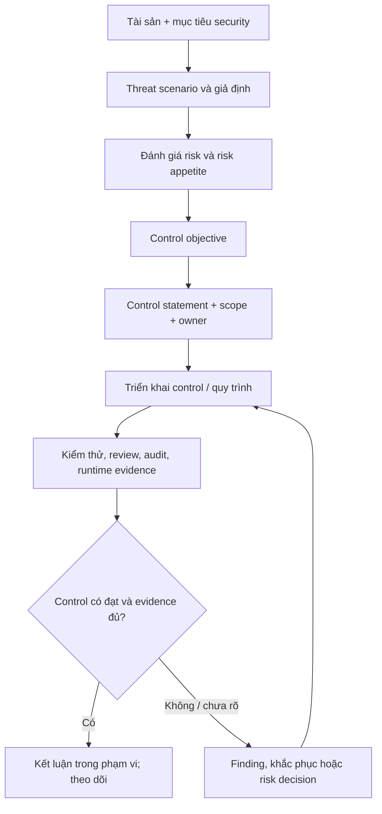
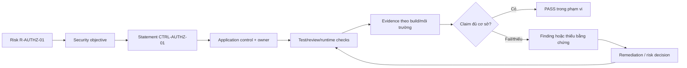

# Control statement

## Mục tiêu học tập

Sau bài học, bạn có thể:

- Giải thích **control statement** trong một **control framework** và phân biệt nó với mục tiêu bảo mật, policy, security requirement, control objective, quy trình thực thi và test case.
- Viết phát biểu kiểm soát có **đối tượng, phạm vi, hành động/kết quả bắt buộc, điều kiện kích hoạt, vai trò chịu trách nhiệm và tiêu chí kiểm chứng** rõ ràng.
- Ánh xạ **rủi ro → yêu cầu → control statement → cách triển khai → phép kiểm → bằng chứng → quyết định rủi ro còn lại**.
- Phân biệt **design effectiveness**, **implementation** và **operating effectiveness** để không nhầm việc “đã mô tả control” với “control đã hoạt động”.
- Thiết kế một tập control statements cho ứng dụng Java/Spring Boot và đánh giá mức bao phủ bằng chứng qua CI/CD, vận hành, audit và quản lý ngoại lệ.
- Nhận biết phát biểu mơ hồ, thiếu phạm vi, khó đo, trùng lặp hoặc có khả năng che giấu sai lệch.

## 1. Control statement là gì?

Trong quản trị và **security assurance**, một **control framework** là cấu trúc dùng để tổ chức các mục tiêu kiểm soát, nhóm biện pháp, trách nhiệm và cơ chế đánh giá. **Control statement (phát biểu kiểm soát)** là câu hoặc tập câu mô tả một **biện pháp kiểm soát cần được thực hiện hoặc một trạng thái bảo vệ cần được duy trì** trong phạm vi cụ thể, để xử lý một hoặc nhiều rủi ro.

Ví dụ, câu **“Dữ liệu học viên phải an toàn”** nêu mục tiêu nhưng chưa cho biết kiểm soát nào thực thi được. Một control statement hữu ích hơn:

> **CTRL-AUTHZ-01:** Với mọi API trả dữ liệu tiến độ của học viên, ứng dụng **phải** kiểm tra quyền đối với **học viên được yêu cầu** tại server trước khi trả dữ liệu; yêu cầu của chủ thể không có quyền phải bị từ chối và đường truy cập mới phải được kiểm chứng trước khi phát hành.

Câu này không tự chứng minh an toàn. Nó tạo **đối tượng và tiêu chí** để kiến trúc sư, developer, Operator và reviewer hỏi: có kiểm tra đúng tài nguyên không; có endpoint phụ bỏ sót không; test có đi qua ứng dụng thật không; bản production đang chạy là bản nào?

Trong module **SECURITY_SECURITY_ASSURANCE**, control statement là một **mắt xích giữa rủi ro và bằng chứng**. Một chương trình assurance phải đánh giá được rằng control được yêu cầu, được triển khai và hoạt động hiệu quả trong phạm vi, phiên bản và thời điểm đã xác định.

### 1.1. Phân biệt các tầng khái niệm

| Khái niệm | Câu hỏi trả lời | Ví dụ |
| --- | --- | --- |
| **Security objective** | Muốn bảo vệ thuộc tính nào? | Chỉ người được phép mới xem được dữ liệu tiến độ. |
| **Risk scenario** | Điều gì có thể gây hại? | Người dùng thay `learnerId` để đọc tiến độ người khác. |
| **Policy** | Tổ chức đặt nguyên tắc và nghĩa vụ nào? | Mọi truy cập dữ liệu cá nhân phải được kiểm soát theo quyền hợp lệ. |
| **Control objective** | Kiểm soát nhằm đạt kết quả bảo vệ gì? | Ngăn truy cập trái phép vào từng hồ sơ học viên. |
| **Control statement** | Trong phạm vi này, **điều gì phải được thực hiện hoặc duy trì**? | Kiểm tra quyền phía server cho từng `learnerId` trước khi trả dữ liệu. |
| **Implementation** | Biện pháp được triển khai cụ thể ra sao? | Service Java dùng policy `canReadProgress(principal, learnerId)`, kiểm tra bằng dữ liệu tin cậy. |
| **Procedure/runbook** | Nhân sự thực hiện, giám sát và xử lý tình huống thế nào? | Review thay đổi quyền; phản ứng khi phát hiện bypass authorization. |
| **Test/audit procedure** | Cần làm gì để kiểm chứng control? | Dùng hai tài khoản và kiểm tra truy cập chéo bị từ chối. |
| **Evidence** | Có dữ kiện gì hỗ trợ kết luận? | Kết quả integration test theo build, review các endpoint, runtime evidence. |

**Control statement không phải test case**: một statement có thể cần nhiều phép kiểm; một phép kiểm có thể hỗ trợ nhiều control. **Control statement cũng không nhất thiết là chi tiết của một sản phẩm**: điều kiện “phải kiểm tra quyền theo tài nguyên tại server” thường bền vững hơn câu “phải gọi chính xác hàm X trong thư viện Y”, trừ khi công nghệ cụ thể được tổ chức phê duyệt làm yêu cầu bắt buộc.

## 2. Cấu trúc một control statement tốt

Một cấu trúc thực dụng:

```text
ĐỐI VỚI [đối tượng/tài sản/phạm vi],
[vai trò hoặc hệ thống chịu trách nhiệm]
PHẢI [thực hiện hành động hoặc duy trì trạng thái bắt buộc]
KHI [sự kiện, thời điểm hoặc tần suất liên quan],
NHẰM [mục tiêu bảo vệ hoặc rủi ro cần giảm].

ĐẠT khi [tiêu chí có thể quan sát và kiểm tra].
ĐƯỢC chứng minh bằng [nguồn bằng chứng và điều kiện].
SAI LỆCH được [ghi nhận, chuyển cấp, khắc phục hoặc xử lý ngoại lệ].
```

Không cần nhồi mọi thành phần vào **một câu dài**. Có thể đặt câu quy định ngắn trong `statement` và dùng trường bổ sung cho `scope`, `frequency`, `owner`, `verification` và `evidence`. Quan trọng là chúng được quản lý **cùng một control ID và phiên bản**.

### 2.1. Những trường tối thiểu

| Trường | Ý nghĩa | Ví dụ |
| --- | --- | --- |
| **Control ID** | Định danh bền vững để liên kết rủi ro, yêu cầu, test và findings. | `CTRL-AUTHZ-01` |
| **Statement** | Hành động hoặc trạng thái **bắt buộc**, diễn đạt không mơ hồ. | “API phải kiểm tra quyền theo từng tài nguyên ở server.” |
| **Scope/applicability** | Ứng dụng, tài sản, loại dữ liệu, môi trường và đường truy cập liên quan. | Các API đọc tiến độ trong `learning-progress-api`. |
| **Purpose/risk link** | Mục tiêu hoặc threat scenario mà control giúp xử lý. | Ngăn truy cập chéo giữa học viên. |
| **Trigger/frequency** | Khi nào control được thực hiện hoặc phải được kiểm tra lại? | Mỗi request; test trước release và sau thay đổi authorization. |
| **Owner/performer** | Ai chịu trách nhiệm kết quả và ai thực thi? | Service owner; developer triển khai; Operator vận hành. |
| **Acceptance criteria** | Trạng thái đạt/không đạt có thể kiểm chứng. | Chủ sở hữu được đọc, người khác bị từ chối trên mọi đường đã kiểm kê. |
| **Verification method** | Test/review/quan sát runtime theo phạm vi nào? | Integration test, review flow và kiểm tra deploy. |
| **Evidence expectation** | Bằng chứng cần có nguồn gốc và độ mới nào? | CI run, build ID, code review, config/runtime snapshot. |
| **Failure handling** | Sai lệch, thiếu bằng chứng hoặc ngoại lệ xử lý thế nào? | Mở finding, chặn gate nếu thuộc ngưỡng, re-test trước khi đóng. |

### 2.2. Sử dụng từ ngữ có thể đánh giá

Một tổ chức có thể quy định **PHẢI/MUST**, **KHÔNG ĐƯỢC/MUST NOT**, **NÊN/SHOULD** và **CÓ THỂ/MAY**. Nếu dùng `SHOULD`, cần định nghĩa cách tài liệu hóa việc không áp dụng; đừng mặc định yêu cầu khuyến nghị là điều kiện `PASS/FAIL` bắt buộc như `MUST`.

So sánh:

| Phát biểu yếu | Vấn đề | Phát biểu có thể kiểm chứng hơn |
| --- | --- | --- |
| “Hệ thống phải an toàn.” | Không rõ threat, hành động và tiêu chí. | “Mỗi API đọc hồ sơ phải kiểm quyền đối với hồ sơ ở server trước khi trả dữ liệu.” |
| “Kiểm tra quyền thường xuyên.” | Không biết điều kiện và tần suất. | “Thực hiện kiểm tra quyền mỗi request và kiểm thử hồi quy khi thay logic phân quyền.” |
| “Nhân viên cần tuân thủ least privilege.” | Không xác định tài khoản, cách duyệt và kiểm tra. | “Quyền production phải được cấp theo yêu cầu có phê duyệt và đối soát với quyền runtime theo chu kỳ đã định.” |
| “Log đầy đủ các hoạt động.” | Mơ hồ, có nguy cơ thu thập dữ liệu nhạy cảm quá mức. | “Các thao tác thay đổi quyền quản trị phải sinh audit event có chủ thể, hành động, kết quả và correlation ID; không ghi credential.” |
| “Phải vá lỗ hổng nhanh.” | Không rõ phạm vi, risk rating hay cách xác minh. | “Finding đã được xác nhận phải có owner, mức ưu tiên, hạn xử lý theo chính sách và evidence re-test trước khi đóng.” |
| “Đã bật backup là đạt.” | Không chứng minh khả năng phục hồi. | “Bản sao lưu thuộc phạm vi phải được phục hồi thử theo lịch; kết quả được đối chiếu với RPO/RTO đã phê duyệt.” |

Ngưỡng thời gian, định kỳ và phân loại mức độ cần được tổ chức **xác định theo rủi ro, năng lực, cam kết và nghĩa vụ áp dụng**. Không nên gán những giá trị “chuẩn ngành” không có cơ sở vào control statement.

## 3. Từ risk scenario đến control statement

Một statement có giá trị khi trả lời được **rủi ro nào đang được giảm** và **control tác động vào phần nào của đường gây hại**.



### 3.1. Ví dụ: lỗi phân quyền API

**Tài sản:** dữ liệu điểm và tiến độ học viên.

**Threat:** một người dùng đã đăng nhập thay `learnerId` để đọc dữ liệu không thuộc quyền; API chỉ kiểm tra authenticated mà không kiểm tra chủ thể có quyền trên hồ sơ được yêu cầu.

**Control objective:** ngăn chủ thể không được phép truy cập tiến độ của người khác.

**Control statement:**

> `CTRL-AUTHZ-01` – Mọi endpoint đọc hoặc xuất dữ liệu tiến độ thuộc phạm vi nền tảng phải xác minh quyền của **chủ thể đã xác thực đối với từng tài nguyên yêu cầu** tại phía server trước khi xử lý dữ liệu; các yêu cầu ngoài quyền phải bị từ chối và được ghi nhận sự kiện theo chính sách logging.

**Thực thi:** sử dụng quan hệ chủ sở hữu hoặc giáo viên được phân công do server kiểm soát; không tin ID, `role` hoặc `ownerId` do client tự khai.

**Kiểm chứng:** test các tài khoản đúng/sai quyền trên từng đường đọc và export; review đường bypass, cấu hình security và phiên bản triển khai.

**Evidence:** kết quả test có fixture và commit, review service policy, danh mục endpoint liên quan, artifact build, kết quả post-deploy check.

**Residual risk:** còn endpoint hoặc cơ chế xuất dữ liệu chưa được đánh giá thì kết luận phải ghi rõ **khoảng trống**, không thể khẳng định control đạt cho toàn hệ thống.

### 3.2. Một threat có thể cần nhiều controls

Đối với rủi ro lộ dữ liệu tiến độ, phân quyền ở API là **preventive** nhưng có thể cần thêm:

- **Identity/authentication:** bảo đảm biết chủ thể và mức tin cậy danh tính.
- **Object-level authorization:** quyết định quyền trên từng hồ sơ hoặc lớp.
- **Storage/IAM:** worker và kho tệp chỉ có quyền cần thiết.
- **Data minimization:** chỉ trả trường dữ liệu cần cho chức năng.
- **Audit/monitoring:** ghi và phát hiện việc truy cập bất thường.
- **Response:** cơ chế thu hồi credential, giới hạn ảnh hưởng và điều tra khi có dấu hiệu khai thác.

Không nên tạo một control statement khổng lồ “phải làm tất cả bảo mật” rồi coi một test đã bao phủ hết. Nên chia theo **mục tiêu kiểm soát và chủ trách nhiệm hợp lý**, liên kết chúng qua risk ID, đồng thời tránh nhân bản các yêu cầu gần như giống nhau.

## 4. Phân nhóm control statements trong framework

Một control framework có thể tổ chức các statements theo **mục đích bảo vệ**, **phạm vi công nghệ**, **trách nhiệm** hoặc **giai đoạn hoạt động**. Những cách phân nhóm này hỗ trợ lập danh mục và đánh giá; không phải điều kiện bắt buộc để statement hợp lệ.

| Nhóm | Mục đích | Control statement ví dụ |
| --- | --- | --- |
| **Preventive** | Ngăn đường khai thác hoặc sai sót trước khi xảy ra hậu quả. | “Mọi thao tác sửa điểm phải được kiểm quyền theo học viên, lớp và chức năng ở server.” |
| **Detective** | Phát hiện sai lệch hoặc hành động đáng ngờ kịp thời. | “Thay đổi IAM production ngoài change được duyệt phải sinh alert tới đầu mối trực.” |
| **Corrective** | Khôi phục trạng thái phù hợp sau phát hiện. | “Finding đã xác minh phải có owner và re-test trước khi đóng.” |
| **Recovery** | Phục hồi dữ liệu, dịch vụ, tính toàn vẹn sau gián đoạn. | “Restore từ backup phải được kiểm thử và so với mục tiêu RPO/RTO được duyệt.” |
| **Directive/governance** | Định nghĩa trách nhiệm, quyết định và hành vi bắt buộc. | “Ngoại lệ control trọng yếu phải do vai trò có thẩm quyền duyệt với phạm vi và hạn.” |
| **Monitoring/assurance** | Giữ bằng chứng hiệu lực và phát hiện control mất hiệu lực. | “Sau thay đổi ingress, phải đối chiếu đường mạng thực với exposure baseline.” |

**Một control có thể phục vụ nhiều nhóm.** Ví dụ access review định kỳ là detective khi tìm quyền thừa và corrective khi khởi tạo việc thu hồi; việc cấp quyền có phê duyệt trước là preventive. Nên mô tả cụ thể từng bước cần kiểm chứng thay vì dùng nhãn phân loại thay thế yêu cầu.

### 4.1. Dạng kỹ thuật, thủ công và kết hợp

| Dạng | Ví dụ control statement | Cách đánh giá đặc thù |
| --- | --- | --- |
| **Automated** | “Hệ thống từ chối request đọc tiến độ không có quyền theo tài nguyên.” | Unit/integration/security test, config/runtime, kiểm tra bypass. |
| **Manual** | “Người sở hữu dịch vụ phải review và ký quyết định cho quyền đặc biệt trước khi cấp.” | Population, nội dung review, thẩm quyền, dấu thời gian, kết quả. |
| **IT-dependent manual/hybrid** | “Chủ dịch vụ rà soát báo cáo quyền đặc quyền do IAM xuất theo lịch.” | **Cả** chất lượng dữ liệu đầu vào lẫn chất lượng đánh giá, kết quả thu hồi. |

Đừng suy ra rằng nhiều automation luôn tạo assurance mạnh hơn. Một rule tự động sai hoặc dữ liệu nguồn thiếu vẫn có thể tạo `PASS` giả. Ngược lại, manual review có chữ ký nhưng không đối chiếu dữ liệu cũng không phải bằng chứng đủ mạnh.

## 5. Biến statement thành tiêu chí chấp nhận và phép kiểm

Control statement diễn đạt **điều cần đạt**, còn **verification procedure** chỉ rõ cách kiểm tra điều đó. Một bộ thủ tục kiểm tra thường có nhiều tầng:

1. **Review thiết kế:** control đặt ở đâu, có xử lý đúng threat, có đường bypass hoặc điểm lỗi chung nào?
2. **Kiểm tra implementation:** mã, chính sách, cấu hình, quyền và nguồn dữ liệu có phản ánh statement?
3. **Kiểm tra hoạt động:** test hành vi thực tế trên bản build và môi trường liên quan; có diễn ra đúng khi control được kích hoạt không?
4. **Kiểm tra vận hành liên tục:** có drift, chủ theo dõi, cảnh báo và bằng chứng sau thay đổi không?

### 5.1. Bảng test mapping

| Control | Acceptance criteria | Phương pháp test/review | Evidence cần giữ |
| --- | --- | --- | --- |
| `CTRL-AUTHZ-01` | Chủ thể hợp lệ được đọc; không có quyền bị từ chối; không có đường đọc chéo thuộc phạm vi. | Integration test nhiều identity và resource, review service + export. | CI run/build, fixture, review record, post-deploy check. |
| `CTRL-IAM-02` | Không có quyền đặc quyền ngoài danh sách được phê duyệt; quyền quá hạn được thu hồi. | Đối chiếu IAM runtime, review quyền và test thu hồi. | Snapshot nguồn, approval, review quyết định, revoke evidence. |
| `CTRL-LOG-03` | Sự kiện thay quyền quản trị sinh ra, được chuyển tới sink và tra cứu được, không chứa bí mật. | Test log end-to-end, kiểm tra access/retention. | Correlation ID, kết quả query, log pipeline status. |
| `CTRL-CHG-04` | Thay đổi security liên quan có approval phù hợp trước deploy và post-deploy check. | Đối chiếu population change/deploy với hồ sơ. | Change ticket, gate logs, runtime snapshot. |
| `CTRL-BACKUP-05` | Phục hồi đúng dữ liệu trong giới hạn RPO/RTO đã duyệt cho phạm vi thử. | Restore drill, đối chiếu kết quả và đo thời gian. | Restore report, mục tiêu, số đo, lỗi và remediation. |
| `CTRL-EXC-06` | Ngoại lệ chỉ hiệu lực trong phạm vi, thời gian, thẩm quyền và điều kiện đã duyệt. | Test ngoại lệ hết hạn/sai scope, audit approvals, review residual risk. | Exception record, risk decision, test gate và expiry. |

Không nên xem số lượng test pass là **đại diện đầy đủ** cho một control. Ví dụ một test `403` có thể pass vì route không tồn tại hoặc authentication bị lỗi, chứ không chứng minh object-level authorization. Cần có **đối chứng tích cực** và xác nhận test đi qua đúng đường kiểm soát.

### 5.2. Ba kết quả đánh giá cần minh bạch

| Trạng thái | Ý nghĩa | Quyết định tiếp theo |
| --- | --- | --- |
| **PASS trong phạm vi** | Bằng chứng phù hợp và còn hiệu lực hỗ trợ tiêu chí đã chọn. | Duy trì giám sát, ghi rõ build, môi trường, thời điểm và giới hạn. |
| **FAIL** | Test/review có bằng chứng cho thấy control không đạt yêu cầu. | Tạo finding, đánh giá rủi ro, khắc phục và re-test. |
| **INSUFFICIENT_EVIDENCE** | Không có kết quả kiểm tra hợp lệ hoặc chưa đủ phạm vi/độ tin cậy. | Bổ sung evidence; không tự đánh dấu pass. |

Nếu một ngoại lệ chính sách được phê duyệt đúng thẩm quyền, trạng thái riêng như `EXCEPTION_APPLIED` có thể mô tả **quyết định cho phép sai khác**. Nó không biến một yêu cầu đang `FAIL` thành `PASS`, và phải còn thấy risk owner, hiệu lực, hạn và biện pháp bù trừ.

## 6. Ví dụ Java/Spring Boot: control statement phân quyền theo đối tượng

### 6.1. Bối cảnh

Nền tảng học tập có `GET /api/learners/{learnerId}/progress`. Học viên được xem hồ sơ của mình; giáo viên được xem hồ sơ của học viên trong lớp mình phụ trách; người khác không được xem. Rủi ro là **BOLA/IDOR**: kẻ có tài khoản hợp lệ thay ID để truy cập tài nguyên khác.

**Control statement `CTRL-AUTHZ-01`:**

> Mọi yêu cầu đọc tiến độ học viên phải được kiểm tra quyền theo **chủ thể và `learnerId`** bằng nguồn phân quyền tin cậy ở server trước khi trả dữ liệu; các đường API đọc hoặc xuất dữ liệu tiến độ phải áp dụng quy tắc tương đương trong phạm vi được duyệt.

**Các điều kiện kiểm chứng:**

- Chủ học viên được phép đọc hồ sơ của mình.
- Giáo viên được phân công mới được xem học viên thuộc phạm vi phân công.
- Học viên khác và giáo viên không được phân công bị từ chối.
- Truy cập chưa xác thực không được trả dữ liệu được bảo vệ.
- Các đường tải/export hoặc batch tương ứng được kiểm tra riêng.
- Thay đổi logic authorization phải kích hoạt test/regression và cập nhật bằng chứng.

### 6.2. Triển khai control minh họa

Ứng dụng có thể triển khai kiểm tra ở tầng service với Spring Security:

```java
@Configuration
@EnableMethodSecurity
class MethodSecurityConfig {}

@Service
class ProgressService {
    private final ProgressRepository progressRepository;

    ProgressService(ProgressRepository progressRepository) {
        this.progressRepository = progressRepository;
    }

    @PreAuthorize("@progressAccess.canRead(authentication, #learnerId)")
    public ProgressView readProgress(long learnerId) {
        return progressRepository.loadView(learnerId);
    }
}
```

Đây là **mã minh họa**, giả định `progressAccess` là bean chính sách đọc quan hệ sở hữu/phân công từ dữ liệu tin cậy. Cần lưu ý:

- Đã bật method security và đường gọi đi qua proxy/điểm kiểm soát thực, không có self-invocation hoặc luồng khác bypass.
- Phép kiểm dùng **authentication thực** từ security context; không tin `ownerId` hay `role` do request tự khai.
- Nếu hệ thống có endpoint `export`, batch, worker hoặc truy vấn trực tiếp khác, chúng cần được kiểm tra trong phạm vi control.
- Không đánh đồng `@PreAuthorize` xuất hiện trong code với **hiệu lực triển khai**: phải có test và kiểm tra bản phát hành.

### 6.3. Kiểm chứng bằng MockMvc

Ví dụ dưới đây giả định ứng dụng đã cấu hình `MockMvc` cùng security filters và fixture: `learnerId=42` thuộc `student-a`, còn `student-b` không có quyền đối với tài nguyên đó.

```java
@SpringBootTest
@AutoConfigureMockMvc
class ProgressAuthorizationIT {
    @Autowired
    MockMvc mockMvc;

    @Test
    @WithMockUser(username = "student-a", roles = "STUDENT")
    void ownerCanReadProgress() throws Exception {
        mockMvc.perform(get("/api/learners/42/progress"))
            .andExpect(status().isOk());
    }

    @Test
    @WithMockUser(username = "student-b", roles = "STUDENT")
    void otherStudentCannotReadProgress() throws Exception {
        mockMvc.perform(get("/api/learners/42/progress"))
            .andExpect(status().isForbidden());
    }
}
```

Test phải kiểm tra đúng policy thực thay vì mock bypass `progressAccess`; mã này không đủ để chứng minh quyền giáo viên, endpoint export hay trạng thái production. Với trường hợp chưa xác thực, tùy cơ chế xác thực, hệ thống có thể trả `401` hoặc redirect/response khác **được thiết kế rõ**; tiêu chí bảo mật quan trọng là **không trả dữ liệu trái phép**.

### 6.4. Từ code/test đến assurance

| Thành phần | Ví dụ dữ liệu/bằng chứng | Giới hạn |
| --- | --- | --- |
| Statement | `CTRL-AUTHZ-01` và scope các API. | Nếu thiếu danh mục endpoint, có thể bỏ sót đường truy cập. |
| Design argument | Quyền gắn chủ thể–học viên hoặc giáo viên–lớp tại server. | Design đúng chưa chứng minh triển khai đúng. |
| Implementation review | Code review của `ProgressService` và toàn bộ callers. | Không bao phủ code hoặc cấu hình ngoài phạm vi review. |
| Behavior tests | MockMvc tích cực/tiêu cực cho từng quan hệ quyền. | Fixture và test path phải phản ánh thật; không bao phủ mọi trường hợp chưa viết. |
| Release evidence | Build/commit, cấu hình active, kết quả CI và review findings. | CI pass không chứng minh môi trường production khớp staging. |
| Operating evidence | Kiểm tra deploy, audit log/alert, incident/finding nếu có. | Một snapshot chỉ phản ánh thời điểm quan sát. |

**Kết luận đúng:** “Control đạt các tiêu chí đã thử trên build X trong môi trường Y, còn thiếu/chưa đánh giá các đường Z”, thay vì “nền tảng không có lỗ hổng authorization”.

## 7. Ví dụ control statement vận hành và thủ công

Control framework cần bao phủ cả **hành vi ứng dụng** lẫn **quy trình quản trị và vận hành**, không chỉ API kỹ thuật.

### 7.1. Quản lý quyền production

**Statement `CTRL-IAM-02`:**

> Mọi quyền đặc quyền đối với hệ thống production thuộc phạm vi phải có yêu cầu được phê duyệt trước khi cấp, được gán theo mức quyền tối thiểu và được chủ tài sản rà soát theo lịch; các quyền bị xác định là không còn hợp lệ phải được thu hồi và kiểm chứng tại nguồn IAM.

**Thực thi:** workflow cấp quyền, giới hạn người phê duyệt, nguồn IAM đáng tin, đối chiếu quyền thực tế.

**Test:** chọn mẫu cấp quyền, kiểm tra approval trước grant, so sánh với role mapping; kiểm tra kết quả revoke ở IAM nguồn.

**Evidence:** population đầy đủ, quyết định từng quyền, timestamp, người review, grant/revoke events, kết quả đối soát.

**Độ không chắc chắn:** một bảng CSV thiếu tài khoản dịch vụ hoặc quyền kế thừa **không đủ** chứng minh tất cả quyền đã được review. Manual approval có chữ ký không đồng nghĩa quyền thực tế đã đúng.

### 7.2. Ghi nhật ký quản trị

**Statement `CTRL-LOG-03`:**

> Khi thay đổi quyền quản trị trong ứng dụng thuộc phạm vi, hệ thống phải ghi audit event gồm định danh chủ thể, hành động, đối tượng, kết quả và dấu thời gian, chuyển tới hệ thống log được phê duyệt; nội dung không được chứa credential hoặc dữ liệu không cần thiết.

**Test:** tạo một thay đổi quyền trong môi trường kiểm thử được phép; xác minh sự kiện sinh ra, đến log sink, truy vấn được và không chứa secret.

**Evidence:** test run, correlation ID, bản ghi ở sink đã bảo vệ, log pipeline health, quyền đọc và retention theo chính sách.

**Giới hạn:** chỉ “bật logging” chưa chứng minh event thực sự được phát, gửi, lưu và có thể truy vấn. Logging cũng không thay thế authorization.

### 7.3. Đánh giá và phê duyệt ngoại lệ

**Statement `CTRL-EXC-06`:**

> Mọi trường hợp tạm không đáp ứng security standard được phép có ngoại lệ phải có hồ sơ chỉ rõ điều khoản, tài sản, risk assessment, biện pháp bù trừ và hạn hiệu lực; người có thẩm quyền phải phê duyệt trước khi áp dụng, đồng thời điều kiện ngoại lệ phải được theo dõi và xác minh lại khi thay đổi phạm vi hoặc hết hạn.

**Test:** kiểm tra ngoại lệ đúng/sai ID, tài sản, version, người duyệt và thời hạn; đối chiếu bằng chứng bù trừ với trạng thái runtime.

**Evidence:** exception register, risk owner decision, reviewer record, policy revision, test gate và trạng thái khắc phục.

**Giới hạn:** phê duyệt đúng thủ tục là bằng chứng về **quyết định**, không tự chứng minh điểm yếu đã được sửa hoặc control thay thế có hiệu lực.

## 8. Ánh xạ framework, tránh trùng lặp và giữ khả năng truy vết

Tổ chức có thể tham chiếu những control frameworks như **ISO/IEC 27001 và ISO/IEC 27002**, **NIST SP 800-53** hoặc **CIS Controls**, tùy mục tiêu và phạm vi. Các bộ này không có cùng cấu trúc, mục tiêu hay yêu cầu đánh giá. Tài liệu học này dùng **control IDs tự đặt để minh họa**, không gán mã điều khoản cụ thể của một chuẩn bên ngoài.

Mục tiêu của mapping là quản trị **nhiều-to-nhiều**:

- **Một rủi ro** có thể cần nhiều statements (authorization, logging, recovery).
- **Một statement** có thể hỗ trợ nhiều mục tiêu và nhiều yêu cầu chính sách.
- **Một control triển khai** có thể đáp ứng một phần của nhiều statements.
- **Một loại evidence** có thể hỗ trợ nhiều statements, nhưng phải đúng phạm vi và tiêu chí từng statement.

### 8.1. Bảng mapping minh họa

| Risk/scenario | Internal control statement | Implementation | Verification | Trạng thái |
| --- | --- | --- | --- | --- |
| `R-AUTHZ-01`: đọc tiến độ trái quyền | `CTRL-AUTHZ-01` | Service-level object authorization. | Test chủ sở hữu/không sở hữu, review API. | Chờ bằng chứng build mới. |
| `R-PRIV-02`: dữ liệu cá nhân trong audit logs | `CTRL-LOG-03` | Audit event allowlist và log sink. | Kiểm tra payload/retention/quyền log. | Cần xác minh runtime. |
| `R-IAM-03`: quyền production quá rộng | `CTRL-IAM-02` | IAM approval + access review. | Population, approval/revoke và đối soát. | Có finding chưa đóng. |
| `R-GOV-04`: ngoại lệ mất kiểm soát | `CTRL-EXC-06` | Exception workflow có expiry. | Audit hồ sơ/gate/revocation. | Đang đánh giá. |

Không tự chuyển các nhãn trạng thái minh họa thành `PASS` nếu chưa thực thi kiểm tra. Bảng cần liên kết đến **version của framework mapping và control statement** để có thể trả lời vì sao một chứng cứ từng đủ nhưng hiện đã mất hiệu lực.

### 8.2. Nguyên tắc mapping chất lượng

1. **Không tương đương hóa bằng tên:** hai control cùng chứa từ “access control” chưa chắc có cùng điều kiện, scope hoặc mục tiêu.
2. **Map từng điều kiện:** nếu chuẩn A yêu cầu review quyền theo định kỳ còn statement nội bộ chỉ kiểm lúc cấp mới, mapping chỉ có thể là **một phần**.
3. **Giữ provenance:** nguồn yêu cầu, phiên bản, thời gian và cách diễn giải mapping.
4. **Tách requirement và evidence:** một artifact không được tái sử dụng như bằng chứng cho điều nó không chứng minh.
5. **Phân công người chịu trách nhiệm:** nếu một control được dùng cho nhiều nghĩa vụ, cần rõ ai sở hữu triển khai và ai xác minh theo từng phạm vi.
6. **Đánh giá lại khi thay đổi:** cập nhật framework, kiến trúc, nhà cung cấp, môi trường hoặc rủi ro có thể làm mapping cũ không còn hợp lệ.

## 9. Claim – Argument – Evidence ở cấp control statement

**Claim – Argument – Evidence (CAE)** là cấu trúc giúp giải thích **điều gì được khẳng định, tại sao và chứng minh bằng gì**. Control statement là điểm tham chiếu để lựa chọn claim và điều kiện chấp nhận.

### 9.1. Ví dụ CAE

**Control statement:** `CTRL-AUTHZ-01` – kiểm quyền theo từng học viên ở server.

**Claim:** “Trên bản `release-R` trong phạm vi API đọc tiến độ đã kiểm kê, những chủ thể không có quyền đối với học viên được yêu cầu không được nhận dữ liệu.”

**Argument:**

1. Danh mục API và luồng đọc/xuất dữ liệu trong phạm vi đã được xác định.
2. Mọi đường đọc trong phạm vi đều gọi enforcement point dùng quan hệ quyền tin cậy của server.
3. Các test tích cực/tiêu cực sử dụng identity và fixture khác nhau chứng minh hành vi được phép/từ chối.
4. Review code và post-deploy checks liên kết kết quả với bản build/config thực đang chạy.
5. Findings, exceptions và những trường hợp chưa thử được hiển thị độc lập trong đánh giá.

**Evidence:** API inventory, data-flow/threat model, code review, integration security test report, commit/build ID, runtime revision, kết quả kiểm tra ngoài ứng dụng nếu liên quan, finding tracker.

**Giới hạn:** một test thành công trên staging không chứng minh mọi endpoint chưa kiểm kê đều được bảo vệ hoặc cấu hình production giống staging. Claim chỉ đúng trong phạm vi và thời điểm được chứng minh.

### 9.2. Hình dung bằng sơ đồ



Đường đi này phải tồn tại dưới dạng **liên kết thật** trong hồ sơ: ID rủi ro, control, tests, artifact và kết quả đánh giá; không chỉ là một sơ đồ trình bày.

## 10. Design effectiveness và operating effectiveness

Hai lớp đánh giá thường bị nhầm lẫn:

| Góc nhìn | Câu hỏi | Ví dụ chứng cứ | Giới hạn |
| --- | --- | --- | --- |
| **Thiết kế (design effectiveness)** | Nếu hoạt động như thiết kế, control có thể giảm đúng rủi ro không? | Threat model, policy logic, architecture review. | Thiết kế hợp lý không chứng minh code/config đúng. |
| **Triển khai (implementation)** | Biện pháp đã thực sự được đặt đúng nơi, đủ phạm vi chưa? | Code review, IaC/config, role mapping, change record. | Source code/config có thể khác trạng thái chạy thật. |
| **Vận hành (operating effectiveness)** | Control có vận hành đúng, đúng lúc và ổn định trong kỳ/môi trường được xét không? | Behavioral tests, runtime snapshots, log end-to-end, audit sample. | Kết quả giới hạn theo thời điểm, mẫu và điều kiện kiểm tra. |

Ví dụ, phát biểu “tất cả quyền production được review định kỳ” có thể có thiết kế tốt và quy trình đủ bước, nhưng báo cáo IAM thực tế thiếu service accounts. Người quản lý ký tên đầy đủ trên một tập không đầy đủ thì **chưa chứng minh** hoạt động kiểm soát đạt toàn bộ scope.

### 10.1. Dấu hiệu assurance yếu

- Chỉ có một checklist “Control implemented = Yes”, không có dữ liệu thực thi.
- Statement và test không cùng scope: statement yêu cầu **mọi API export**, nhưng test chỉ kiểm một endpoint.
- Không ghi build/version, môi trường hoặc nguồn quyền; khó tái hiện kết quả.
- Test “403” không có đối chứng “200”, chưa biết từ chối do control nào.
- Kết quả CI của tháng trước vẫn hiển thị `PASS` sau khi thay authentication hoặc ingress.
- Finding được đóng do có commit sửa nhưng chưa có re-test trên bản triển khai.
- Một ngoại lệ hợp lệ bị gộp thành “control đã đạt”, làm sai báo cáo rủi ro còn lại.

## 11. Mẫu control statement có thể quản lý như dữ liệu

Một tổ chức có thể lưu catalog theo YAML/JSON/database để quản lý phiên bản, owners, mapping, phép kiểm và trạng thái assurance. Ví dụ **không phải định dạng chuẩn**:

```yaml
control_id: "CTRL-AUTHZ-01"
catalog_revision: "example-2026-r1"
title: "Object-level authorization for learner progress"
objective: "Prevent unauthorized disclosure of learner progress"
threat_refs:
  - "R-AUTHZ-01"
statement: >-
  Every in-scope API reading or exporting learner progress
  must verify the authenticated subject's authorization
  for the requested learner resource on the server.
scope:
  system: "learning-progress-api"
  data: "learner-progress"
  environments: ["production"]
  interfaces:
    - "GET /api/learners/{learnerId}/progress"
    - "related export/download endpoints"
owner_role: "learning-service-owner"
implementer_roles:
  - "backend-engineering"
  - "platform-operator"
trigger:
  runtime: "Each data access request"
  reassessment: "API, role, ownership or identity-provider change"
acceptance_criteria:
  - "Allowed user can access an authorized learner record"
  - "Unassigned user cannot access another learner's record"
  - "All in-scope routes are assessed"
verification:
  - "Integration authorization tests with real policy behavior"
  - "Code and route inventory review"
  - "Relevant deployment/configuration check"
evidence_refs:
  - "<actual-ci-artifact>"
  - "<approved-code-review>"
  - "<runtime-verification-artifact>"
assurance:
  status: "INSUFFICIENT_EVIDENCE"
  reason: "Export route has not yet been tested"
  assessed_build: "<build-id>"
  assessed_at: "<timestamp>"
open_findings:
  - "<finding-reference-if-any>"
exception_refs: []
```

Đây là **mẫu để hình dung quan hệ dữ liệu**, không phải kết quả đánh giá thực tế và không tự tương thích với một công cụ nào. Đừng ghi `PASS` chỉ vì các trường có giá trị văn bản; evidence phải trỏ tới **artifact tồn tại**, đúng scope, có nguồn gốc, timestamp, phiên bản và người xác minh thích hợp.

### 11.1. Quản lý phiên bản và tính bất biến của kết luận

Khi thay statement, scope hoặc acceptance criteria, phải có version hoặc lịch sử thay đổi và đánh giá tác động tới:

- Bằng chứng của bản phát hành trước có còn hỗ trợ statement mới không?
- Test cases, manual controls và runbook nào cần cập nhật?
- Các findings và ngoại lệ có liên kết tới phiên bản đã hết hiệu lực không?
- Báo cáo audit có được so sánh giữa các kỳ trên cùng định nghĩa không?
- Ai phê duyệt thay đổi của catalog, và khi nào hiệu lực bắt đầu?

Không nên **sửa âm thầm** một statement từ “mọi API” thành “một số API” để làm KPI xanh. Nếu phạm vi cần thay đổi vì lý do hợp lệ, phải quản lý quyết định, thời điểm và lý do.

## 12. Chuyển control statement thành công việc và trách nhiệm

Một statement muốn được thực hiện cần rõ người sở hữu và tuyến trách nhiệm. Ví dụ với `CTRL-AUTHZ-01`:

| Vai trò | Trách nhiệm |
| --- | --- |
| **Risk owner** | Quyết định xử lý residual risk thuộc thẩm quyền theo appetite/limits. |
| **Service owner** | Chịu trách nhiệm control được triển khai ở dịch vụ và kế hoạch khắc phục có nguồn lực. |
| **Security architect/control designer** | Xác định mục tiêu, scope, threat, tiêu chí kiểm chứng; review logic thiết kế. |
| **Backend developer** | Thực thi authorization ở server, cập nhật tests và sửa finding liên quan. |
| **Operator/platform** | Triển khai đúng build/config, giám sát drift, cung cấp evidence vận hành. |
| **Assurance reviewer** | Đánh giá chất lượng evidence và kết luận phạm vi đạt/chưa đạt. |
| **Auditor độc lập (nếu có)** | Đánh giá thiết kế/quy trình/bằng chứng theo phạm vi audit; báo cáo findings. |

**RACI** có thể phân định `Responsible`, `Accountable`, `Consulted`, `Informed` cho từng bước; không nên chỉ gán “Security team” làm owner của tất cả controls. Quyền **thiết kế**, **thực thi**, **chấp nhận rủi ro** và **đánh giá độc lập** không mặc nhiên thuộc cùng một người.

### 12.1. Quy trình xử lý khi không đạt

1. Tạo finding có control ID, test/evidence, build/môi trường, ảnh hưởng và các giả định.
2. Triage severity dựa trên threat và hậu quả, không chỉ tên scanner.
3. Giao chủ xử lý và hạn theo risk limit; chuyển cấp khi rủi ro vượt ngưỡng.
4. Sửa control hoặc đưa ra biện pháp giảm thiểu phù hợp; nếu xin ngoại lệ, cần quyết định đúng thẩm quyền với phạm vi và hạn.
5. Kiểm chứng lại bằng cùng attack path và các biến thể cần thiết.
6. Reviewer xác nhận bằng chứng trước khi đóng; cập nhật residual risk, claim và mapping.
7. Đưa bài học vào tests, runbook, catalog hoặc guardrail để giảm tái diễn.

Không nên dùng `Risk Accepted` như trạng thái đồng nghĩa `Remediated`; quyết định giữ rủi ro phải được theo dõi riêng.

## 13. Continuous assurance ở cấp control statement

Một control statement không nên chỉ được xem trong đợt audit cuối năm. Cần giữ **bằng chứng hiệu lực** theo thay đổi và theo thời gian:

| Sự kiện | Vì sao phải đánh giá lại? | Bằng chứng hoặc hành động |
| --- | --- | --- |
| Thêm endpoint hoặc luồng export | Tăng diện truy cập dữ liệu ngoài API cũ. | Cập nhật scope, threat model, test rights, claim. |
| Thay role/SSO/JWT issuer | Nguồn và cách diễn giải quyền có thể thay đổi. | Test identity, token claims, authorization. |
| Đổi ingress hoặc cloud IAM | Runtime exposure, quyền service có thể khác. | IaC/runtime review, test đường mạng, quyền thực tế. |
| Nâng Spring Boot/Security | Filter chain, route hoặc cấu hình có thể có tác động. | Regression tests, config comparison, post-deploy verification. |
| Có finding audit hoặc incident | Lộ điểm yếu của control hoặc giả định. | Triage, root cause, remediation và re-test. |
| Evidence cũ hết hạn hoặc mất nguồn | Không còn đủ cơ sở cho kết luận gần hiện tại. | Thu thập mới; báo trạng thái chưa đủ evidence nếu cần. |
| Control owner hoặc chuẩn thay đổi | Trách nhiệm và acceptance criteria có thể khác. | Review catalog, version mapping, quyết định mới. |

### 13.1. Những chỉ số hữu ích

| Chỉ số | Câu hỏi trả lời được | Lưu ý |
| --- | --- | --- |
| Tỷ lệ statements trọng yếu có owner và scope rõ | Có ai chịu trách nhiệm cho từng control cần thiết? | Đủ metadata chưa chứng minh hiệu lực. |
| Tỷ lệ statements có verification mapping | Có phương pháp kiểm tra được kết luận không? | Một test mapping hình thức có thể chưa đủ phạm vi. |
| Tỷ lệ statements có evidence còn hiệu lực | Mức độ assurance hiện tại tới đâu? | Phải xét nguồn, scope và chất lượng, không chỉ file tồn tại. |
| Số control failures và findings quá hạn | Rủi ro nào còn ngoài giới hạn? | Đánh giá theo severity/ngữ cảnh, không chỉ số tuyệt đối. |
| Số statements ở `INSUFFICIENT_EVIDENCE` | Khoảng trống chứng minh đang ở đâu? | Không coi trạng thái này là pass. |
| Tỷ lệ ngoại lệ gần hết hạn/đã quá hạn | Sai khác tạm có được quản trị thực sự? | Ngoại lệ hợp lệ vẫn là một loại residual risk. |
| Tỷ lệ changes trigger re-verification | Bằng chứng có được làm mới khi kiến trúc đổi? | Trigger thiếu có thể làm KPI đẹp giả. |

Một dashboard assurance hữu ích liên kết **mỗi control statement** tới requirement, risk, asset, evidence hiện hành, finding và owner; người xem có thể hiểu **vì sao trạng thái được đánh giá là đạt hoặc chưa đạt**.

## 14. Bài tập tình huống: viết và kiểm chứng control statements

### Bối cảnh

Nền tảng học tập Java/Spring Boot chuẩn bị phát hành ba thay đổi:

1. Thêm `POST /api/courses/{courseId}/grades/exports` để giáo viên xuất điểm của cả lớp vào object storage.
2. Chuyển xác thực API sang JWT từ IdP mới; một số token cũ tiếp tục có hiệu lực trong giai đoạn chuyển đổi.
3. Thay cấu hình logging: ứng dụng vẫn ghi event cục bộ nhưng kênh chuyển audit log lên hệ thống tập trung đôi khi thất bại.

Tổ chức mới viết ba control statements:

- **S1:** “API phải an toàn.”
- **S2:** “Thường xuyên review quyền.”
- **S3:** “Luôn ghi log đầy đủ.”

Nhóm phát triển thông báo CI xanh, reviewer đã ký checklist và muốn khẳng định tất cả ba control đều `PASS`.

### 14.1. Yêu cầu thực hành

1. Chỉ ra **ít nhất ba điểm mơ hồ** của mỗi statement S1–S3: phạm vi, hành động, điều kiện, dữ liệu, vai trò hoặc bằng chứng.
2. Viết lại thành **ba control statements có ID, scope, owner, trigger và acceptance criteria**: (a) phân quyền tạo/tải export, (b) xác minh token và quyền khi đổi IdP, (c) audit log end-to-end.
3. Với chức năng export, nêu các **đường tấn công** khi thay `courseId` hoặc `exportId`. Tại sao một test role `TEACHER` thành công chưa chứng minh object-level authorization?
4. Viết **claim, argument và ít nhất bốn evidence** cho statement phân quyền; tách bằng chứng code, test, IAM/storage và runtime.
5. Với thay IdP, đề xuất test token sai issuer, sai audience, hết hạn và role/permission không hợp lệ; xác định những giả định cần kiểm tra khi token cũ còn hiệu lực.
6. Với logging, thiết kế test tạo một sự kiện thay quyền giả định, theo dõi từ ứng dụng tới log sink, kiểm tra quyền và bảo mật nội dung.
7. Chọn `PASS`, `FAIL` hoặc `INSUFFICIENT_EVIDENCE` cho từng control **dựa trên dữ kiện hiện có**; nêu bằng chứng cần bổ sung để thay đổi kết luận.
8. Đề xuất cách hiển thị một ngoại lệ đã được phê duyệt trong dashboard mà **không làm sai** tỷ lệ controls thực sự đã đạt.

### 14.2. Gợi ý tự đối chiếu

- S1 cần chia rõ **quyền tạo job** và **quyền tải tệp**; cả hai phải xét lớp học hoặc quyền theo tài nguyên, không chỉ role chung.
- S2 phải ghi ai review, đối tượng quyền nào, trước/sau sự kiện gì và bằng chứng xác nhận quyết định, đặc biệt khi đổi IdP.
- S3 phải xác định event quan trọng, đường chuyển, nơi lưu, khả năng truy vấn và điều kiện không ghi dữ liệu bí mật.
- **CI xanh** chỉ chứng minh những test đã thực chạy trong môi trường và phạm vi tương ứng. Checklist có chữ ký không chứng minh runtime và nguồn log có hoạt động đầy đủ.
- Khi chưa có evidence hợp lệ, chọn **`INSUFFICIENT_EVIDENCE`**. Nếu phép kiểm đã xác nhận audit log không tới nơi nhận theo requirement, trạng thái tương ứng là **`FAIL`**, phải tạo finding và xử lý.
- Một exception hợp lệ được gắn riêng với **risk owner, scope, expiry và compensating controls**, không thay thế kết luận về hiệu lực control.

## 15. Những ngộ nhận thường gặp

| Ngộ nhận | Cách hiểu đúng |
| --- | --- |
| “Có danh sách controls là đạt framework.” | Danh sách chỉ mô tả mong đợi; phải chứng minh design, implementation và operating effectiveness. |
| “Statement là tên công cụ.” | Statement nên xác định mục tiêu và hành vi kiểm soát; công cụ là một cách triển khai cụ thể. |
| “Một test pass có thể chứng minh toàn bộ statement.” | Cần xem scope, các đường vào, dữ liệu, điều kiện và môi trường được kiểm tra. |
| “Càng nhiều statements càng bảo mật.” | Trùng lặp, mơ hồ hoặc không ai sở hữu có thể làm giảm khả năng quản trị. |
| “Một control có đúng một risk.” | Risk và controls thường quan hệ nhiều-to-nhiều; phải quản lý mapping và điều kiện cụ thể. |
| “Thiếu bằng chứng có nghĩa đã phát sinh incident.” | Thiếu bằng chứng làm giảm độ tin cậy kết luận, không tự xác nhận một sự cố. |
| “Có phê duyệt ngoại lệ thì control trở thành PASS.” | Ngoại lệ là quyết định rủi ro riêng; finding và control status phải giữ minh bạch. |
| “Đã sửa code là finding đóng được.” | Cần triển khai, kiểm tra đúng đường tấn công và re-test trên phiên bản liên quan. |
| “Statement không cần cập nhật khi hệ thống thay đổi.” | Scope, risk, trust boundary và evidence có thể mất hiệu lực; phải quản lý version và reassessment. |
| “Map hai frameworks theo tên điều khoản là đủ.” | Cần kiểm tra từng yêu cầu, scope và bằng chứng; mapping có thể chỉ đáp ứng một phần. |

## Tổng kết

**Control statement** chuyển một **mục tiêu kiểm soát** thành yêu cầu có thể giao việc, triển khai và kiểm chứng trong **control framework**. Một statement tốt nêu rõ **đối tượng, trạng thái/hành động bắt buộc, phạm vi, điều kiện kích hoạt, chủ trách nhiệm và tiêu chí đạt**. Trong security assurance, kết luận đáng tin phải nối được **risk → control statement → implementation → test/audit → evidence theo bản build và môi trường → finding/remediation → residual risk và tái đánh giá**. Điều quan trọng không chỉ là viết một phát biểu đúng, mà còn chứng minh biện pháp mà phát biểu mô tả **thực sự hoạt động trong phạm vi đã công bố**.
