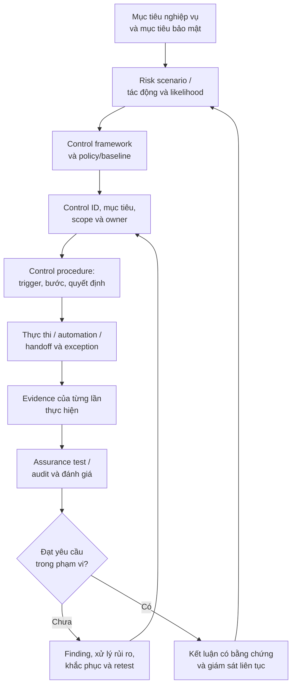
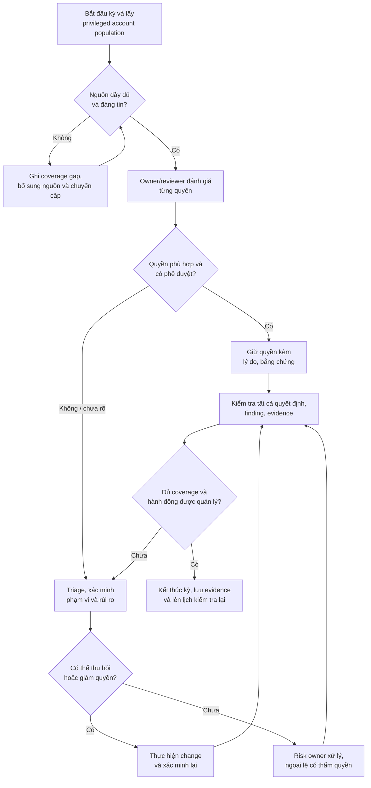
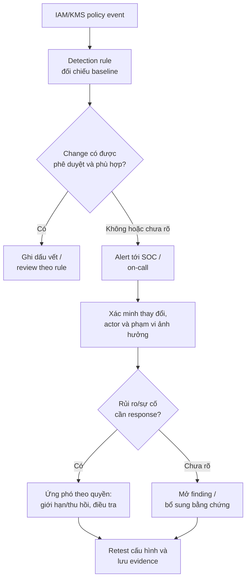
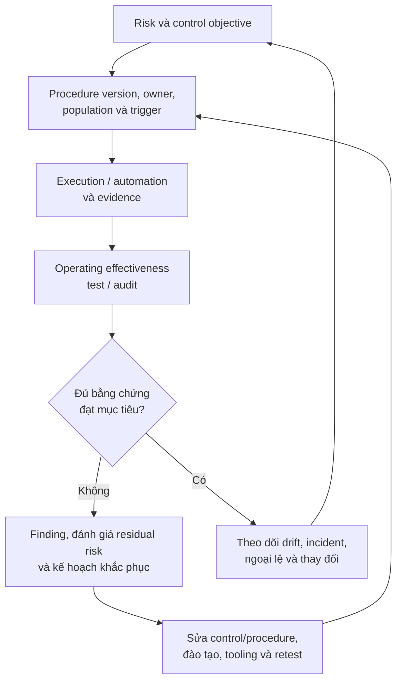

# Control procedure: quy trình thực thi và kiểm chứng security controls

## Mục tiêu học tập

Sau bài học, người học có thể:

1. Giải thích **control procedure** (quy trình thực hiện kiểm soát) và phân biệt với **control framework, chính sách, tiêu chuẩn, control objective, thiết kế kiểm soát, runbook, test procedure và bằng chứng**.
2. Chuyển một security control trong control framework thành **các bước vận hành có thể thực hiện lặp lại**, có phạm vi, đầu vào, điều kiện kích hoạt, người chịu trách nhiệm, tiêu chí quyết định, kết quả và phương án xử lý ngoại lệ.
3. Thiết kế quy trình tương ứng cho kiểm soát **phòng ngừa (preventive), phát hiện (detective), khắc phục (corrective)** và phục hồi; lựa chọn kết hợp bước thủ công, tự động và kiểm tra độc lập.
4. Viết quy trình kiểm soát có **phân tách nhiệm vụ, giám sát, bảo vệ dữ liệu nhạy cảm**, quản lý sai lệch, phê duyệt và lưu bằng chứng có thể kiểm tra.
5. Phân biệt đánh giá **thiết kế**, **đã triển khai** và **hiệu quả vận hành**; kiểm tra chất lượng tổng thể của một tập sự kiện (*population*) và lấy mẫu có căn cứ.
6. Lập hồ sơ **truy vết mục tiêu bảo mật → rủi ro → yêu cầu → kiểm soát → procedure → lượt thực thi → evidence → finding → retest**, phục vụ security assurance liên tục.
7. Tổ chức cải tiến khi quy trình không vận hành, công cụ thay đổi, trách nhiệm không rõ hoặc ngoại lệ hết hạn.

Trong module **SECURITY_SECURITY_ASSURANCE**, việc lựa chọn security controls từ một control framework mới chỉ là điểm khởi đầu. Để chứng minh hệ thống đáp ứng mục tiêu bảo mật, tổ chức cần biết **kiểm soát được thực hiện ở đâu, khi nào, bởi ai, theo quyết định nào và kết quả có thể kiểm chứng ra sao**. Control procedure biến yêu cầu trên giấy thành hành động vận hành, giúp hoạt động kiểm thử, audit, xử lý findings và tái đánh giá rủi ro có điểm tựa.

## 1. Control procedure là gì?

**Control procedure** là mô tả được quản lý về **trình tự thực hiện, điều kiện và trách nhiệm** để một kiểm soát bảo mật được triển khai hoặc vận hành đúng mục tiêu trong phạm vi xác định. Quy trình có thể là một loạt thao tác của nhân viên, một luồng workflow tự động, hoặc kết hợp cả hai.

Ví dụ mục tiêu bảo mật:

> Chỉ những người và dịch vụ có nhu cầu công việc hợp lệ mới được giữ quyền quản trị production.

Một control đáp ứng mục tiêu có thể là **rà soát quyền đặc quyền theo chu kỳ và sau thay đổi quan trọng**. Nhưng câu “có kiểm soát rà soát quyền” chưa đủ. Control procedure phải nói rõ:

- Lấy **danh sách tài khoản và quyền** từ nguồn nào, bao gồm human accounts, service accounts, emergency accounts, vendor identities.
- So với **danh mục người sở hữu, nhiệm vụ, phê duyệt và chính sách quyền** nào.
- Ai **rà soát**, ai **quyết định**, ai **thu hồi**, ai **kiểm tra lại**, có tách nhiệm vụ không.
- Khi phát hiện tài khoản không rõ owner, quyền quá rộng hoặc tài khoản không hoạt động, phải **xử lý/chuyển cấp** thế nào.
- Bằng chứng gồm **danh sách population, nhận định của reviewer, ticket khắc phục, IAM state sau thay đổi** và thời điểm hoàn thành.
- Điều gì xảy ra nếu **API trích xuất thất bại, dữ liệu không đầy đủ hoặc reviewer vắng mặt**.

Chính tính **có thể lặp lại và kiểm chứng** phân biệt một procedure hiệu quả với lời hứa “đội vận hành sẽ kiểm tra khi cần”.

### 1.1. Các khái niệm liên quan nhưng không đồng nghĩa

| Khái niệm | Vai trò | Ví dụ |
|---|---|---|
| **Control framework** | Hệ thống nhóm mục tiêu và kiểm soát để tổ chức lựa chọn, quản trị | Danh mục nhóm quản lý truy cập, thay đổi, nhật ký, khôi phục |
| **Policy** | Tuyên bố nghĩa vụ và nguyên tắc cấp tổ chức | Quyền production phải phù hợp công việc và được rà soát |
| **Standard / baseline** | Yêu cầu tối thiểu có thể kiểm tra theo hệ thống/công nghệ | Tài khoản quản trị phải có owner và phê duyệt; ngoại lệ có thời hạn |
| **Control objective** | Kết quả bảo vệ cần đạt | Hạn chế quyền quản trị trái nhu cầu |
| **Control activity / control** | Cơ chế được thiết kế để đạt mục tiêu | Rà soát và thu hồi quyền đặc quyền |
| **Control procedure / SOP** | Ai làm gì, khi nào, bằng đầu vào nào, xử lý sai lệch và lưu gì | Trích xuất IAM → xác minh owner → quyết định → thu hồi → retest |
| **Runbook / work instruction** | Hướng dẫn thao tác chi tiết cho một bước hay tình huống | Cách xuất báo cáo IAM, kiểm tra một permission cụ thể |
| **Test procedure** | Cách người kiểm thử/auditor đánh giá control có vận hành không | Chọn kỳ rà soát và xác minh bằng chứng thu hồi quyền |
| **Evidence / record** | Dấu vết đã thực hiện và kết quả, không chỉ hướng dẫn | Bản xuất IAM, quyết định duyệt, change log, test result |
| **Finding / remediation** | Khoảng trống được phát hiện và cách xử lý | Service account quá quyền chưa bị thu hồi; có owner và hạn xử lý |

Đặc biệt, **quy trình thực hiện kiểm soát** và **quy trình kiểm thử kiểm soát** khác nhau. Nhóm vận hành thực hiện access review; nhóm assurance có thể kiểm tra việc thực hiện đó thông qua hồ sơ, đối chiếu nguồn và thử lại một số trường hợp. Một người viết test procedure tốt chưa đồng nghĩa control đã được thực hiện đúng.

### 1.2. Quy trình không đồng nghĩa tài liệu dài

Một số control được thực thi tự động, ví dụ API từ chối truy cập ngoài tenant ở mọi request. Procedure khi đó vẫn cần quy định:

- Rule/policy được **định nghĩa và phê duyệt** thế nào.
- Ai có quyền **triển khai và thay đổi**.
- Làm sao xác nhận đúng rule hoạt động trên production.
- Trường hợp nào cần **test hồi quy, kiểm tra drift và xử lý khi phát hiện bypass**.
- Tập bằng chứng và giới hạn kết luận là gì.

Không nên thêm thao tác thủ công giả tạo cho một control đã được triển khai hoàn toàn bằng code. **Quy trình cần quản lý những hoạt động mà control phụ thuộc**, bao gồm bảo trì và xác minh.

## 2. Từ control framework đến procedure cho một hệ thống

Control framework đưa ra cấu trúc; tổ chức phải chọn, diễn giải và điều chỉnh controls theo **mục tiêu, hệ thống và rủi ro thực tế**. Các tài liệu tham chiếu thường dùng trong thực hành gồm các họ tiêu chuẩn và khuôn khổ quản trị như ISO/IEC 27001/27002, NIST SP 800-53, CIS Controls hoặc COBIT, tùy mục đích. Không nên coi việc “map” một control ID tới bất kỳ bộ tham chiếu nào là **chứng nhận** hay bằng chứng rằng control đang hoạt động.

### 2.1. Chuỗi truy vết



**Ví dụ truy vết:**

| Lớp | Ví dụ cho quyền quản trị |
|---|---|
| **Risk scenario** | Tài khoản còn quyền không cần thiết bị lạm dụng để đọc/sửa dữ liệu production |
| **Control objective** | Quyền đặc quyền chỉ được cấp và duy trì khi có lý do hợp lệ |
| **Control ID** | `CTRL-IAM-PRIV-REVIEW` |
| **Control procedure ID** | `PROC-IAM-PRIV-REVIEW` |
| **Control owner** | Identity & Access Management Lead |
| **Input** | Danh sách quyền từ hệ thống IAM/cloud/DB, danh sách owner và phê duyệt |
| **Activity** | Soát tính đầy đủ, xác minh quyền, xử lý quyền dư và kiểm chứng sau sửa |
| **Evidence** | Snapshot population, quyết định reviewer, ticket và kết quả kiểm tra IAM |
| **Assurance test** | Xác minh có rà soát đúng kỳ và quyền dư được xử lý đến kết quả cuối |
| **Finding** | Tài khoản service dùng chung không có owner, chưa được rà soát |

### 2.2. Chọn đúng mức quy trình

Một control có thể được thực hiện bởi nhiều procedure hoặc một procedure vận hành nhiều controls, nhưng cần tránh hai cực đoan:

- **Quá chung:** “Thực hiện rà soát bảo mật định kỳ” không cho biết đối tượng, bước và tiêu chí.
- **Quá chi tiết vào một nút bấm:** “Nhấp nút Export, sau đó Save” có thể lỗi thời khi giao diện đổi và không mô tả mục tiêu kiểm soát.

Tách **procedure ổn định về trách nhiệm/điều kiện** khỏi **work instruction phụ thuộc công cụ**, và quản lý phiên bản/các liên kết giữa chúng.

### 2.3. Mối liên hệ với control types

| Control type | Procedure phải đặc biệt làm rõ | Ví dụ |
|---|---|---|
| **Preventive** | Điều kiện trước khi cho phép, cách từ chối và bypass | Phê duyệt quyền trước khi cấp; kiểm soát deploy |
| **Detective** | Nguồn event, logic, độ trễ, alert routing, triage và mất telemetry | Phát hiện thay đổi IAM trái phép |
| **Corrective** | Tiêu chí kích hoạt, xác nhận phạm vi, sửa và kiểm tra kết quả | Thu hồi quyền thừa sau access review |
| **Recovery** | Điểm kích hoạt, điều kiện an toàn, phục hồi, xác nhận dữ liệu và quyền | Restore dữ liệu giao dịch và đối soát |
| **Compensating** | Khi control chính không khả dụng, thay thế giảm rủi ro gì và kéo dài bao lâu | Cô lập hệ thống legacy và tăng giám sát |

Phân loại có thể chồng lấn. Một workflow IAM vừa **phòng ngừa quyền không được cấp**, vừa **phát hiện quyền dư** và **khắc phục bằng thu hồi**. Nên định nghĩa tiêu chí riêng cho từng mục tiêu thay vì đánh dấu “đã có IAM control” chung chung.

## 3. Bộ thành phần bắt buộc của một control procedure

Một procedure tốt cần hỗ trợ cả **người thực hiện** và **người đánh giá độc lập**. Những trường sau tạo thành mẫu tham khảo.

| Trường | Câu hỏi cần trả lời |
|---|---|
| **Procedure ID, version, hiệu lực** | Quy trình nào, bản nào đang được dùng từ khi nào? |
| **Control/Risk/Requirement IDs** | Quy trình phục vụ mục tiêu và kịch bản rủi ro nào? |
| **Scope** | Hệ thống, môi trường, dữ liệu, tenant, nhóm vai trò, vendor nào trong phạm vi? |
| **Control owner / procedure owner** | Ai giải trình về thiết kế và vận hành procedure? |
| **Performers và reviewers** | Ai thực hiện, ai xác minh, ai quyết định ngoại lệ? |
| **Trigger và frequency** | Kích hoạt theo lịch, event, release, incident hay đổi cấu hình? |
| **Prerequisites** | Cần quyền công cụ, danh mục tài sản, chính sách, nguồn dữ liệu nào? |
| **Inputs và kiểm tra chất lượng** | Nguồn dữ liệu có đúng kỳ, đủ và không bị sửa ngoài quyền? |
| **Steps và decision points** | Thứ tự thao tác, tiêu chí cho phép/từ chối, đường rẽ khi sai lệch |
| **Handoffs và escalation** | Khi công việc chuyển sang đội khác, ai nhận và trong giới hạn nào? |
| **Outputs** | Kết quả xác minh, quyền thu hồi, ticket, alert, bản ghi khôi phục... |
| **Evidence requirements** | Phải lưu ID nào, timestamp, phiên bản, kết quả, người thực hiện và nguồn? |
| **Error/exception handling** | Nếu thiếu nguồn, công cụ lỗi, reviewer nghỉ, control không thể thực thi? |
| **Quality check và retest** | Ai kiểm chứng kết quả khắc phục? Khi nào coi hoàn tất? |
| **Review triggers** | Thay policy, kiến trúc, rủi ro, nhà cung cấp hoặc incident nào buộc sửa procedure? |

### 3.1. Nguyên tắc 5W1H cộng bằng chứng

- **Why:** Kịch bản và mục tiêu bảo mật nào khiến procedure cần tồn tại?
- **What:** Kiểm soát điều gì, đối tượng đầy đủ được xác định bằng cách nào?
- **Who:** Người thực hiện, người kiểm tra, risk owner, người ra quyết định là ai?
- **When:** Theo kỳ hay theo event? Một kỳ được tính từ mốc nào?
- **Where:** Môi trường, vùng cloud, tenant, DB, hệ thống ngoài và nơi lưu bằng chứng nào?
- **How:** Trình tự, điều kiện rẽ nhánh, kiểm soát lỗi và tiêu chí đạt?
- **Evidence:** Dữ liệu và dấu vết nào chứng minh đã làm, làm đúng và có kết quả?

Nếu một trong những câu hỏi này không trả lời được cho **control trọng yếu**, tổ chức có nguy cơ chỉ có bản hướng dẫn trên giấy thay vì hoạt động có thể đánh giá.

### 3.2. Phân biệt đầu ra và hiệu quả

Ví dụ:

- **Đầu ra hoạt động:** Có file Excel chứa danh sách quyền và chữ ký reviewer.
- **Hiệu quả mong muốn:** Tài khoản ngoài phạm vi, không có owner hoặc quyền dư **được xác định và xử lý phù hợp**.

File Excel được ký không chứng minh danh sách đầu vào **đầy đủ** hoặc quyền dư **đã bị thu hồi**. Procedure phải bao gồm cách kiểm tra **completeness và accuracy** của dữ liệu đầu vào lẫn bước xác minh kết quả cuối.

## 4. Thiết kế procedure theo từng bước

### Bước 1 — Định nghĩa một kết quả có thể quan sát

Viết phát biểu dạng:

> Khi **[trigger]** xảy ra, đối với **[population/scope]**, **[vai trò]** phải thực hiện **[kiểm soát]** theo **[tiêu chí]**, tạo **[kết quả]** và lưu **[bằng chứng]** trước **[thời hạn theo quy định]**.

Đừng ấn định thời hạn chỉ vì mẫu tài liệu có cột deadline. Lựa chọn thời gian cần dựa trên mức rủi ro, nghĩa vụ thực tế và năng lực vận hành; nếu chưa có ngưỡng được phê duyệt, ghi rõ **quyết định còn cần đưa ra**.

### Bước 2 — Xác định population đầy đủ

*Population* là **tập tất cả những trường hợp đáng lẽ control phải áp dụng trong một kỳ hoặc một event class**, ví dụ:

- Tất cả privileged identities có hiệu lực tại thời điểm chốt kỳ.
- Mọi production deployment trong tháng.
- Mọi security alert đạt tiêu chí phải triage.
- Mọi ticket yêu cầu cấp quyền đặc biệt.
- Mọi backup thuộc chính sách phải được thử khôi phục theo lịch.

Cần định nghĩa **mẫu số và tiêu chí bao gồm/loại trừ**. Nếu export IAM chỉ trả user accounts mà không có service accounts, procedure có thể luôn “hoàn tất 100%” trên **một tập sai**.

### Bước 3 — Xác định inputs và nguồn đáng tin

Đối với mỗi input, ghi **nguồn authoritative**, người quản lý, thời điểm chụp, phiên bản schema, độ đầy đủ và cách đối chiếu:

| Input | Nguồn ví dụ | Kiểm tra chất lượng |
|---|---|---|
| Danh sách privileged accounts | IdP, cloud IAM, DB admin roles | Khớp inventory; gồm human, service, emergency, vendor accounts |
| Quyền được phê duyệt | Ticket có owner/approver, role catalog | Còn hiệu lực, đúng mục đích và scope |
| Risk/asset classification | System/data inventory, risk register | Đúng phiên bản, có owner và ngày review |
| Production changes | Deployment/change records | Bao gồm hotfix, rollback, manual changes và automation |
| Alerts/incidents | Detection engine, ticketing, incident log | Không bỏ thiếu kênh, nguồn bị mất, event bị trùng |

Không nên dựa độc quyền vào **danh sách do chính người đang bị kiểm tra chuẩn bị** khi tổ chức có thể lấy xác nhận độc lập từ nguồn hệ thống.

### Bước 4 — Tách vai trò và bước kiểm tra

Phân công:

1. Ai trích xuất nguồn.
2. Ai đối chiếu và đưa ra khuyến nghị.
3. Ai phê duyệt giữ/thu hồi quyền hoặc một ngoại lệ.
4. Ai thực thi thay đổi trên production.
5. Ai xác minh lại trạng thái độc lập ở mức phù hợp.
6. Ai chịu trách nhiệm xử lý ticket quá hạn.

Trong đội nhỏ, không phải mọi bước đều có người độc lập, nhưng khi thiếu phân tách nhiệm vụ cần đánh giá **kiểm soát bù trừ**, ví dụ review của system owner, log không thể tự xóa hoặc kiểm tra định kỳ độc lập.

### Bước 5 — Viết decision points rõ ràng

Ví dụ:

- **Nếu** tài khoản có owner, quyền trong baseline và phê duyệt hợp lệ → ghi “giữ” kèm căn cứ.
- **Nếu** quyền không còn phù hợp → mở hành động thu hồi, xác nhận ảnh hưởng và theo dõi tới khi hoàn tất.
- **Nếu** không xác định được owner → tạm phân loại cần xác minh/chuyển cấp, không tự đánh dấu “hợp lệ”.
- **Nếu** tài khoản khẩn cấp cần tồn tại → kiểm tra quy định break-glass, phạm vi, giám sát và người phê duyệt.
- **Nếu** dữ liệu export không đủ → không ký hoàn tất; đánh dấu coverage degraded và yêu cầu bổ sung.

Điểm rẽ nhánh làm procedure dễ kiểm tra hơn câu “reviewer tự đánh giá theo kinh nghiệm”.

### Bước 6 — Định nghĩa kết thúc và retest

“Đã gửi ticket” khác “quyền đã bị thu hồi”. Một quy trình hiệu quả phải nêu **trạng thái hoàn tất** cho mỗi loại sai lệch, cách xác minh trên nguồn authoritative và đường xử lý khi chưa thể sửa ngay.

### Bước 7 — Gắn review trigger

Kiểm soát cần rà soát sau **đổi kiến trúc, hệ thống IAM mới, role model, automation, vendor, incident, audit finding hoặc thay đổi scope**. Một procedure cũ có thể vẫn được làm đúng thao tác nhưng **không bao phủ những đối tượng mới**.

## 5. Ví dụ xuyên suốt: procedure rà soát quyền đặc quyền production

Phần này trình bày mẫu **quy trình nội bộ giả lập** cho ứng dụng xử lý dữ liệu khách hàng và lệnh thanh toán. Những mốc thời gian/phân quyền phải được tổ chức quy định; đây **không phải** chính sách có hiệu lực của hệ thống thực tế.

### 5.1. Bối cảnh và mục tiêu

**Rủi ro:** Một tài khoản admin hoặc service account giữ quyền production không còn cần thiết có thể bị lạm dụng để đọc hoặc thay đổi dữ liệu nhạy cảm.

**Control objective:** Phát hiện, loại bỏ hoặc quản lý có phê duyệt các quyền không còn phù hợp.

**Control ID:** `CTRL-IAM-PRIV-REVIEW`.

**Procedure ID:** `PROC-IAM-PRIV-REVIEW`.

**Scope:** Đặc quyền trên IdP, cloud account, production database, secret/KMS, hệ thống triển khai và emergency accounts; bao gồm tài khoản của nhân viên, tự động, vendor.

**Trigger:** Theo chu kỳ do chính sách quy định, sau thay đổi tổ chức lớn, khi có sự cố liên quan quyền hoặc phát hiện chênh lệch quan trọng.

**Thành công:** Mọi tài khoản thuộc population được xem xét; quyền không hợp lệ được thu hồi/giới hạn và xác minh, hoặc rủi ro còn lại có quyết định hợp lệ có thời hạn. Evidence package phải đủ để kiểm tra.

### 5.2. Quy trình thực hiện chi tiết

| Bước | Người thực hiện chính | Hành động và điểm quyết định | Kết quả/bằng chứng |
|---|---|---|---|
| **1. Khởi động kỳ** | Control coordinator | Xác định kỳ, phạm vi và snapshot time, liên kết bản policy/role catalog | Review run ID, scope, owner, ngày |
| **2. Trích xuất population** | IAM/platform owner | Lấy danh sách privileged identities/permissions từ các nguồn nằm trong scope | Export có nguồn, thời điểm, phạm vi |
| **3. Kiểm tra tính đầy đủ** | Control coordinator + system owner | Đối chiếu account inventory, cloud regions, DB roles, vendor/service accounts và change records | Coverage reconciliation, gap list |
| **4. Gán người rà soát** | System owner | Chuyển từng nhóm quyền cho owner hiểu mục đích, tránh self-approval không phù hợp | Assignment log, deadline theo chính sách |
| **5. Đánh giá từng quyền** | Reviewer / application owner | Xác minh nhu cầu công việc, least privilege, lý do, owner và phê duyệt còn hiệu lực | Decision: retain/revoke/change/investigate |
| **6. Triage ngoại lệ** | Risk owner và cấp có thẩm quyền | Quyền không thể thu hồi ngay: đánh giá likelihood/impact, giới hạn, biện pháp bù trừ | Risk/exception record có expiry |
| **7. Thực hiện thay đổi** | IAM/platform operator | Thu hồi hoặc điều chỉnh quyền theo change approval; theo dõi lỗi | Change/ticket, execution log |
| **8. Xác minh lại** | Reviewer khác hoặc system owner | Đọc lại IAM state, thử truy cập ở mức có phép và đối chiếu quyền đã sửa | Retest, authoritative state |
| **9. Kết thúc kỳ** | Control owner | Kiểm tra toàn bộ population, open items và bằng chứng; chuyển cấp mục quá hạn | Signed review, outstanding findings |
| **10. Theo dõi liên tục** | Assurance/control owner | So kỳ sau, kiểm tra drift, kiểm thử procedure và cập nhật risk register | Metrics, re-assessment trigger |

### 5.3. Sơ đồ rẽ nhánh



### 5.4. Xử lý các tình huống đặc biệt

**Service account không rõ owner:** Không tự coi “tài khoản hệ thống” là hợp lệ. Phải tìm workflow phụ thuộc, service owner, quyền thực tế và xem có thể giới hạn/rotate/revoke mà không làm gián đoạn hệ thống. Nếu chưa thể thu hồi, ghi risk owner và biện pháp bù trừ.

**Break-glass account:** Có thể cần đặc quyền thường trực cho khẩn cấp. Procedure phải xác định điều kiện sử dụng, người quản trị, kiểm soát chứng thực, logging và review mỗi lần sử dụng theo chính sách. Tồn tại break-glass account không tự là vi phạm, nhưng **không có quản trị** có thể là gap.

**Tài khoản vendor:** Cần phân biệt trách nhiệm của nhà cung cấp và của tổ chức; xác định quyền, ngày hết hạn, hợp đồng, cách thu hồi khi đổi người hoặc kết thúc dự án. Một báo cáo audit vendor không chứng minh account cấp bởi ứng dụng của tổ chức đã được rà soát.

**Trích xuất IAM không đủ dữ liệu:** Không đánh dấu kỳ review hoàn tất rồi bổ sung sau mà không ghi gap. Cần tạo finding về completeness, xác định vùng bị ảnh hưởng, thời hạn khắc phục và đánh giá rủi ro.

**Review chưa trả lời:** Có cơ chế reminder/escalation và thời hạn theo quy định; **im lặng không được mặc định là phê duyệt**.

### 5.5. Hồ sơ evidence của một kỳ rà soát

Một kỳ cần có:

- **Review run ID**, ngày bắt đầu/chốt dữ liệu/kết thúc, scope và phiên bản procedure.
- Nguồn **population export** từ IAM/DB/cloud và kết quả đối chiếu tính đầy đủ.
- Phân công reviewer, quyết định từng quyền, căn cứ và thời điểm.
- Tập **exception/finding/change ticket**, người phụ trách, hạn và trạng thái.
- Bằng chứng **sau thu hồi** lấy lại từ nguồn authoritative.
- Danh sách những trường hợp **còn mở**, lý do, rủi ro và cơ chế chuyển cấp.
- Xác nhận của control owner; link tới kết quả kiểm tra độc lập nếu đã có.

Không chép mật khẩu, token thực hoặc dữ liệu nhạy cảm không cần thiết vào hồ sơ. Bằng chứng phải được kiểm soát quyền đọc/sửa và lưu theo chính sách.

## 6. Mẫu procedure có cấu trúc để sử dụng lại

Ví dụ YAML sau là **mẫu nghiệp vụ giáo dục**, không phải cấu hình có thể triển khai trực tiếp trên IAM, GRC hoặc workflow engine.

```yaml
procedure:
  id: PROC-IAM-PRIV-REVIEW
  version: "1.0"
  title: Review privileged production access
  status: illustrative
  controlIds:
    - CTRL-IAM-PRIV-REVIEW
  riskScenarioIds:
    - RSK-PRIVILEGE-MISUSE
  objective: Identify and address unnecessary privileged access

  scope:
    environments:
      - production
    identityTypes:
      - human
      - service
      - emergency
      - vendor
    sources:
      - identity-provider
      - cloud-iam
      - database-admin-roles
      - deployment-system

  trigger:
    type: scheduled-and-event-driven
    scheduleReference: IAM-ACCESS-REVIEW-POLICY
    extraEvents:
      - major-organization-change
      - privileged-account-incident
      - high-risk-access-finding

  roles:
    controlOwner: IAM Control Owner
    systemOwner: Payments System Owner
    reviewer: Authorized System Access Reviewer
    changeOperator: IAM Operations
    riskOwner: Payments Risk Owner
    independentVerifier: Security Assurance Reviewer

  prerequisites:
    - Current identity and asset inventory
    - Approved roles and access request records
    - Read access to authoritative entitlement sources

  steps:
    - id: S1
      action: Capture review population and source metadata
      requiredEvidence: population-export-and-scope
    - id: S2
      action: Reconcile against all in-scope identity sources
      onIncomplete: Record coverage failure and escalate
      requiredEvidence: completeness-reconciliation
    - id: S3
      action: Reviewer classifies each entitlement
      possibleDecisions:
        - retain-with-reason
        - revoke
        - change
        - investigate
      requiredEvidence: documented-review-decisions
    - id: S4
      action: Execute authorized changes
      requiredEvidence: approved-change-records
    - id: S5
      action: Independently verify changed entitlements
      requiredEvidence: post-change-iam-state
    - id: S6
      action: Review exceptions, unresolved gaps and completeness
      requiredEvidence: exception-and-open-findings-register

  completionCriteria:
    - Entire in-scope population has a documented disposition
    - Unauthorized access is removed or risk-managed by authority
    - Corrective changes have verified results
    - Open gaps are visible to their owners

  assurance:
    testMethods:
      - population-completeness-check
      - sample-decision-verification
      - revocation-retest
      - reviewer-independence-check
    evidencePackageId: EV-IAM-PRIV-REVIEW-RUN
  reviewTriggers:
    - Changes to identity sources or role model
    - Changes to approval or access workflow
    - Significant audit finding or incident
```

**Phân biệt:** Mã `requiredEvidence` mới chỉ nói **bằng chứng cần có**. Một bản ghi khi thực thi thực tế phải kèm **giá trị, đường dẫn tới kết quả, timestamps, phiên bản, danh sách được bao phủ và quyết định**, chứ không chỉ copy mẫu YAML này.

### 6.1. Bộ trường để liên kết các lần thực thi

Ví dụ một bản ghi thực thi có thể chứa:

| Trường | Ý nghĩa |
|---|---|
| `procedureId` / `procedureVersion` | Procedure nào đang có hiệu lực |
| `executionId` | Lượt chạy riêng biệt để đối chiếu |
| `triggerType` | Scheduled, change, incident hoặc event |
| `scopeSnapshotId` | Phạm vi/tập đối tượng được kiểm tra |
| `startedAt` / `completedAt` | Theo dõi thời gian thực hiện |
| `performer` / `reviewer` | Trách nhiệm và kiểm tra chéo |
| `stepResults` | Kết quả từng bước và nhánh quyết định |
| `populationCount` / `coveredCount` | Độ đầy đủ cần giải thích |
| `exceptions` / `findings` | Những trường hợp ngoài tiêu chí được quản trị |
| `evidenceReferences` | Liên kết tới chứng cứ đã lưu, không chép secrets |
| `finalDisposition` | PASS, FAIL, DEGRADED, IN_PROGRESS hoặc ngoại lệ |

**Độ hoàn chỉnh của thủ tục** phải dựa trên nội dung và kết quả thực hiện, không chỉ có giá trị `completedAt`.

## 7. Viết procedure cho detective control

Đối với kiểm soát phát hiện, procedure phải xác định **đường xử lý sau khi một rule phát hiện tạo alert**, không dừng ở cấu hình SIEM.

### 7.1. Ví dụ: phát hiện quyền giải mã bị mở rộng

**Risk scenario:** Một tài khoản ứng dụng được cấp thêm quyền `decrypt` cho khóa của nhiều tenant; nếu bị lạm dụng, dữ liệu có thể bị tiết lộ.

**Detective control:** Phát hiện thay đổi IAM/KMS policy làm tăng phạm vi decrypt hoặc đưa quyền tới chủ thể ngoài baseline.

**Procedure cần quy định:**

1. **Nguồn:** IAM/KMS audit events, cloud config change log và baseline quyền được phê duyệt.
2. **Trigger:** Thay đổi quyền decrypt, grant mới, policy sửa hoặc cấu hình thay đổi thuộc scope.
3. **Rule:** Đối chiếu actor, target, key ID, quyền trước/sau và change approval; không chỉ đếm sự kiện.
4. **Routing:** Alert đến đúng on-call; nếu kênh không nhận, có escalation.
5. **Triage:** Xác nhận thay đổi có hiệu lực, phạm vi dữ liệu, người thực hiện và dấu vết sử dụng khóa.
6. **Response:** Nếu trái phép hoặc nghi lộ khóa, kích hoạt runbook phù hợp, cô lập hoặc thu hồi theo quyền.
7. **Evidence:** Event ID, rule version, cấu hình trước/sau, ticket, timestamps, người xử lý và kết quả khắc phục.
8. **Health:** Kiểm tra dữ liệu không bị mất, rule không bị tắt ngoài quy trình và event schema không đổi bất ngờ.

### 7.2. Quy trình alert → hành động



**Cẩn trọng:** Một alert là **dấu hiệu**, không tự chứng minh vi phạm; cần xác minh đúng chủ thể và thay đổi. Ngược lại, một thay đổi có ticket không mặc nhiên an toàn nếu ticket sai phạm vi hoặc cấp quyền vượt yêu cầu. Khi phát hiện diễn ra sau thay đổi quyền, control không phòng ngừa chính thay đổi đó, trừ khi có cơ chế **chặn hoặc giữ phê duyệt trước hiệu lực**.

### 7.3. Thử procedure, không chỉ rule

Cần kiểm chứng tối thiểu:

- Tạo **thay đổi có phép trong môi trường thử**, xem rule nhận và định tuyến đúng.
- Tạo trường hợp **thay đổi hợp lệ** để kiểm tra false positive.
- Tạo trường hợp **mất collector, thiếu field hoặc rule bị tắt** để kiểm tra alert về sức khỏe giám sát.
- Xem người trực có **nhận, xác nhận, phân loại** và biết runbook không.
- Đối chiếu **thời gian event → alert → ack → hành động** với ngưỡng đã phê duyệt.
- Liên kết **kết quả thực tế** của việc thu hồi/sửa IAM state sau response.

Nếu chỉ có screenshot “rule enabled”, chưa thể kết luận procedure phát hiện/ứng phó đã hoạt động hiệu quả.

## 8. Procedure cho kiểm soát phòng ngừa, thay đổi và phục hồi

Không nên dùng cùng một mẫu thao tác cho mọi loại kiểm soát. Dưới đây là các biến thể quan trọng.

### 8.1. Quy trình phê duyệt thay đổi production

**Control objective:** Chỉ artifact/cấu hình có nguồn gốc, kiểm thử và chấp thuận phù hợp được triển khai.

Một procedure có thể gồm:

1. Nhận change request có **system, risk, phạm vi, rollback plan và người yêu cầu**.
2. Kiểm tra **người phê duyệt khác người triển khai** ở mức phù hợp chính sách.
3. Xác minh **build digest, nguồn code, policy checks, kết quả security tests** và phạm vi ngoại lệ.
4. Release gate chỉ cho phép triển khai **artifact khớp với bản phê duyệt**.
5. Đối chiếu **production deployment record** sau khi release, bao gồm hotfix và rollback.
6. Chạy các **kiểm tra hậu triển khai** cho những security controls trọng yếu.
7. Ghi kết quả, incident/finding nếu có bất thường và kiểm soát rollback theo thẩm quyền.

Một pipeline cho phép merge chỉ chứng minh **code đã qua một bước**, chưa chứng minh đúng artifact đang chạy hoặc mọi feature flag cấu hình giống môi trường test.

### 8.2. Procedure sao lưu và thử phục hồi

**Control objective:** Dữ liệu và trạng thái hệ thống có thể phục hồi phù hợp RPO/RTO đã được tổ chức phê duyệt.

Procedure nên chỉ rõ:

- **Trigger/lịch:** Kỳ thử restore theo chính sách và các thay đổi storage/key/DB quan trọng.
- **Population:** Loại dữ liệu/bản backup, khóa và vùng phục hồi thuộc scope; không chỉ một file mẫu.
- **Thao tác:** Chọn bản sao, chuẩn bị môi trường an toàn, khôi phục theo runbook, mở khóa/giải mã đúng quyền.
- **Kiểm chứng:** RPO/RTO thực đo, tính nhất quán nghiệp vụ, quan hệ với queue/outbox, trạng thái thanh toán và bản ghi kiểm toán.
- **Kết quả:** PASS/FAIL theo tiêu chí đã được phê duyệt; không coi “restore command exited 0” là đủ.
- **Thất bại:** Dừng/sửa theo mức rủi ro; lập finding, khắc phục và retest, báo đúng người chịu trách nhiệm.
- **Chứng cứ:** Backup ID, key version, timestamps, dữ liệu đối soát đã che thông tin nhạy cảm, người thực hiện và kết quả.

Nếu khôi phục được DB nhưng **không có quyền hoặc key version để giải mã dữ liệu**, mục tiêu vẫn có thể không đạt. Tương tự, file mở được không đảm bảo sổ kế toán không bị sai.

### 8.3. Procedure xử lý finding

Một finding do pentest, audit, monitoring hoặc kiểm tra hiệu quả control cần:

1. **Xác minh phạm vi và mức ảnh hưởng** của phát hiện.
2. Gắn **risk ID, control ID, owner, mức ưu tiên và hạn** theo phương pháp tổ chức.
3. Quyết định xử lý: sửa, loại bỏ đường rủi ro, giảm tác động, hoặc chuyển cấp/chấp nhận trong phạm vi quyền.
4. Giao action owner, yêu cầu kết quả và **test criteria**.
5. Theo dõi triển khai, cấu hình và thay đổi thực tế.
6. **Retest** đúng đường bị phát hiện và các đường tương tự theo rủi ro.
7. Cập nhật **residual risk, evidence package, trạng thái và review trigger**.

Không đánh dấu finding đã đóng chỉ vì pull request được merge. “Risk accepted” cũng là **trạng thái quản trị rủi ro**, không biến finding thành “control passed”.

## 9. Thiết kế automation trong procedure

Tự động hóa có thể tăng tính nhất quán, giảm lỗi thủ công và để lại dấu vết tốt hơn, nhưng không tự đảm bảo control đúng mục tiêu.

### 9.1. Cần phân biệt ba lớp

| Lớp | Ví dụ | Câu hỏi assurance |
|---|---|---|
| **Procedure orchestration** | Workflow gửi request tới reviewer, chờ quyết định, tạo ticket | Có đúng owner, deadline và đường escalation không? |
| **Control implementation** | IAM API thu hồi quyền; policy as code chặn cấu hình | Có thực sự thay trạng thái sản xuất và chặn điều sai? |
| **Verification/monitoring** | Lấy lại IAM state; kiểm tra người dùng không còn quyền | Có chứng minh kết quả cuối hoặc chỉ xác nhận API trả thành công? |

Một script gọi IAM API trả `200 OK` không tự chứng minh mọi phiên, token và cache quyền đã bị thu hồi theo yêu cầu. Cần kiểm tra **ngữ nghĩa thu hồi** và đường còn hiệu lực.

### 9.2. Nguyên tắc thiết kế workflow tự động

- **Idempotency:** Gọi lại một hành động không tạo tác dụng trái ý; thay đổi IAM nhiều lần phải có định danh.
- **Retry có kiểm soát:** Phân biệt lỗi tạm thời và lỗi không thể tiếp tục; không lặp vô hạn.
- **Phân quyền tối thiểu:** Automation chỉ có quyền cần thiết, tách quyền phê duyệt khỏi quyền thực thi nếu yêu cầu.
- **Auditability:** Lưu input/output metadata, bản rule, actor/workflow identity, quyết định và kết quả.
- **Error path:** Khi một API hoặc collector thất bại phải có alert, rollback hoặc chuyển người phù hợp.
- **Bảo vệ dữ liệu:** Không đưa secrets hoặc thông tin cá nhân không cần thiết vào log, CI job hay ticket.
- **Versioning:** Workflow, rule và cách kiểm tra có version gắn với thời điểm thực thi.
- **Fallback:** Có phương án thủ công được phê duyệt, giới hạn thời gian và lưu bằng chứng khi automation hỏng.
- **Separation of duties:** Không để một automation vừa tự yêu cầu vừa tự phê duyệt ngoại lệ không kiểm soát.

### 9.3. Pseudocode: rà soát quyền với các nhánh lỗi

```text
run = begin_review(scope, procedure_version)

population = collect_privileged_accounts(scope)
if not reconcile_completeness(population, authoritative_sources):
    record_finding(run, "INCOMPLETE_POPULATION")
    escalate_to_control_owner(run)
    mark_run("DEGRADED")
    stop_automatic_completion()

for entitlement in population:
    decision = request_review_from_authorized_owner(entitlement)

    if decision == "RETAIN":
        require_justification_and_valid_approval(entitlement)
    else if decision in ["REVOKE", "REDUCE"]:
        change = execute_authorized_change(entitlement, decision)
        verify_current_state_after_change(change)
    else:
        open_investigation_or_risk_exception(entitlement)

if unresolved_items_exist(run):
    escalate_per_policy(run)

publish_review_summary_with_evidence(run)
# Không tự tuyên bố PASS khi coverage hoặc action còn thiếu.
```

Pseudocode chỉ mô tả **logic quản trị**, không phải chương trình có thể kết nối production IAM. Trong triển khai phải có cơ chế quyền, bảo vệ thông tin, xử lý đồng thời, thay đổi trạng thái ngoài hệ thống, kiểm soát lỗi và xác nhận tính toàn vẹn evidence.

## 10. Kiểm thử control procedure như thế nào?

Trong security assurance cần phân biệt **control hoạt động không** và **procedure có quy định đầy đủ để điều đó xảy ra không**.

### 10.1. Ba góc nhìn của đánh giá

| Góc nhìn | Câu hỏi chính | Bằng chứng |
|---|---|---|
| **Design effectiveness** | Procedure có thể đạt mục tiêu nếu vận hành như thiết kế? Trình tự, nguồn, owner, rẽ nhánh và ngoại lệ có đúng? | Tài liệu versioned, process walkthrough, risk/control mapping, reviewer analysis |
| **Implementation** | Procedure và công cụ/đường xử lý đã được ban hành, triển khai cho scope thật chưa? | Quyền công cụ, workflow config, giao nhiệm vụ, đào tạo, release record |
| **Operating effectiveness** | Trong kỳ đánh giá, các lượt thực thi có diễn ra đúng hạn, trên population đủ và tạo kết quả phù hợp? | Review runs, authoritative extracts, decisions, tickets, post-change states, retest |

**Ví dụ:** Procedure được viết tốt nhưng chưa có ai thực hiện thì có thể **đạt đánh giá thiết kế**, không thể kết luận hiệu quả vận hành. Một workflow chạy thường xuyên nhưng thiếu service accounts trong population có thể được triển khai thành công nhưng **không đạt phạm vi yêu cầu**.

### 10.2. Quy trình kiểm thử cho assurance reviewer

1. **Lấy bản control và procedure đang có hiệu lực**, xác định thời kỳ, system, môi trường và các thay đổi quan trọng.
2. **Walkthrough** với control owner để hiểu đúng nguồn dữ liệu, trách nhiệm, điểm kiểm soát và đường lỗi; quan sát một lượt nếu khả thi.
3. Xác định **population của tất cả lượt thực thi phải có**, không chỉ những lượt đã được lưu. Đối chiếu lịch/event triggers với execution log.
4. Kiểm tra **completeness và accuracy** của population/trích xuất; nếu không tin cậy, mọi phép chọn mẫu phía sau bị hạn chế.
5. Chọn các **mẫu có căn cứ** theo tần suất, tính chất, rủi ro, độ biến động và mục tiêu đánh giá.
6. Với từng mẫu, kiểm tra **đúng người, đúng thời gian, đúng dữ liệu, đúng tiêu chí quyết định, xử lý ngoại lệ và xác minh đầu ra**.
7. Khi có failure, xác định **nguyên nhân, phạm vi bị ảnh hưởng, mức độ lan rộng** và cân nhắc mở rộng mẫu hoặc đánh giá toàn bộ population.
8. Lưu kết quả **PASS/FAIL/không đủ bằng chứng** đúng scope, ghi limitation và finding; retest khi có sửa.

**Lưu ý:** Không có một kích thước mẫu “10%, 25 mẫu” đúng cho mọi control. Kế hoạch lấy mẫu phải phù hợp **phương pháp đánh giá, mức rủi ro, tần suất, dữ liệu và mục đích kết luận**; nếu có yêu cầu audit chuyên ngành bắt buộc thì phải theo yêu cầu đó.

### 10.3. Những phương pháp kiểm tra

| Phương pháp | Khi phù hợp | Hạn chế |
|---|---|---|
| **Inquiry/phỏng vấn** | Hiểu cách thực hiện, điểm khó và trách nhiệm | Lời kể không tự chứng minh từng lượt đã xảy ra |
| **Inspection** | Xem evidence package, quyết định, log và ticket | Có thể bỏ qua dữ liệu đã thiếu từ đầu |
| **Observation** | Quan sát người vận hành thực hiện procedure | Một lần quan sát không tự đại diện cả kỳ |
| **Reperformance** | Người kiểm tra tái thực hiện phép đối chiếu hoặc tính toán | Cần dữ liệu đáng tin và tránh gây tác dụng trên production |
| **Automated test** | Kiểm tra logic, trạng thái hiện hành, sự kiện giả lập có phép | Không bao phủ tự động mọi quyết định và tình huống ngoại lệ |
| **End-to-end simulation** | Thử trigger → workflow → response → evidence | Cần môi trường/an toàn vận hành và hiểu giới hạn test |

Không cần đưa mật khẩu, token hoặc dữ liệu khách hàng thô vào bộ test để chứng minh procedure; nên dùng **mẫu đã làm sạch, đối tượng test có phép hoặc định danh thay thế** và lưu dấu vết phù hợp.

### 10.4. Kịch bản Gherkin kiểm tra procedure

```gherkin
Feature: Privileged access review procedure

  Scenario: An obsolete privileged permission is removed and verified
    Given the review population includes service account S1
    And S1 has a production permission no longer required
    When the authorized reviewer marks that permission as revoke
    And the change operator removes the permission
    Then the current authoritative IAM state must show it absent
    And the review evidence links decision, change and verification

  Scenario: A service account missing from the export is discovered
    Given account S2 has privileged access in production
    But the initial review export does not include S2
    When the completeness reconciliation runs
    Then the review must not be marked fully completed
    And the control owner must receive a coverage finding

  Scenario: An exception requires approval and expiry
    Given a privileged account cannot be reduced immediately
    When a reviewer requests an exception
    Then the request records risk, owner, conditions and expiry
    And an authorized decision is required before acceptance
    And the exception remains subject to review
```

Các tình huống nêu tiêu chí hành vi; chúng **không đòi thao tác nguy hiểm trên IAM production**. Có thể thử bằng nguồn giả lập và xác minh độc lập ở môi trường được phép, nêu rõ đâu là simulated và đâu là live evidence.

## 11. Evidence: kiểm tra được nội dung và nguồn gốc

Một bằng chứng tốt không chỉ xác nhận “có tệp”; nó phải cho phép bên khác **truy lại kết quả của control procedure**.

### 11.1. Tiêu chí chất lượng

| Thuộc tính | Câu hỏi để xác minh |
|---|---|
| **Relevance** | Bằng chứng chứng minh điều khoản hoặc bước nào, thuộc risk/control ID nào? |
| **Completeness** | Bao trùm population, đường API, tài khoản, vùng, tenant và kỳ đánh giá chưa? |
| **Accuracy** | Nguồn authoritative có chính xác và phù hợp với trạng thái thật không? |
| **Timeliness** | Bằng chứng đúng thời kỳ và có sau thay đổi quan trọng không? |
| **Traceability** | Có execution ID, timestamp, người làm, version và liên kết tài liệu không? |
| **Integrity** | Có cơ chế ngăn/ghi nhận sửa hoặc xóa bằng chứng trái quyền không? |
| **Independence** | Có người kiểm tra phù hợp, không chỉ người làm tự đánh dấu pass? |
| **Reproducibility** | Có đủ input/method/expected/actual để kiểm tra lại không? |
| **Limitation** | Phần nào chưa kiểm tra hoặc chỉ dựa vào giả định? |

### 11.2. Những “bằng chứng” dễ gây hiểu nhầm

- Email “Đã rà soát xong” **không chứng minh population đầy đủ**.
- Ảnh chụp dashboard “100% compliant” **không mô tả mẫu số và các ngoại lệ**.
- Ticket đánh dấu “fixed” **không chứng minh quyền production đã đổi**.
- File cấu hình “log enabled” **không chứng minh sự kiện tới đội on-call**.
- Báo cáo của vendor **không bao phủ tự động** cấu hình thuộc trách nhiệm khách hàng.
- Kết quả kiểm tra staging **không chứng minh** production dùng cùng quyền/cấu hình nếu chưa đối chiếu.
- Một review có chữ ký **không bảo đảm quyết định** được đưa ra bởi người có thẩm quyền và có dữ liệu đầy đủ.

### 11.3. Retention, privacy và quyền truy cập

Hồ sơ control procedure có thể chứa danh sách tài khoản, quyền đặc quyền, kết quả điều tra, dữ liệu giao dịch hoặc thông tin vendor. Phải áp dụng **phân loại, hạn chế quyền, retention và khả năng truy xuất** theo chính sách. Khi chia sẻ cho auditor, nên che dữ liệu không cần thiết mà vẫn giữ khả năng đối chiếu **ID, decision, timestamp và nguồn**.

Một nhóm không nên vừa có quyền **gây ra thay đổi rủi ro cao** vừa dễ dàng **sửa/xóa mọi dấu vết kiểm chứng**, trừ khi có kiểm soát bù trừ được đánh giá và có bằng chứng.

## 12. Roles, RACI và handoff

### 12.1. Phân biệt trách nhiệm

| Vai trò | Trách nhiệm chính |
|---|---|
| **Policy/standard owner** | Xác định mức bắt buộc và nguyên tắc phê duyệt |
| **Control owner** | Chịu trách nhiệm thiết kế, vận hành và chứng cứ hiệu quả control |
| **Procedure owner** | Giữ tài liệu procedure đúng hiện trạng, điều phối đào tạo và review |
| **System owner** | Xác định hệ thống, population, phụ thuộc và bảo đảm đội có người thực hiện |
| **Data/business owner** | Đánh giá giá trị dữ liệu, hậu quả và nhu cầu quyền nghiệp vụ |
| **Risk owner** | Chịu trách nhiệm rủi ro liên quan, phương án xử lý và quyết định/chuyển cấp |
| **Performer/operator** | Thực hiện bước được giao, ghi nhận kết quả và lỗi |
| **Reviewer/approver** | Kiểm tra hoặc phê duyệt quyết định theo đúng ủy quyền |
| **Security assurance / QA** | Đánh giá thiết kế, kiểm tra bằng chứng và operating effectiveness |
| **Internal audit** | Kiểm tra độc lập theo nhiệm vụ được giao |
| **Action owner** | Khắc phục finding theo hạn và tiêu chí retest |

Một người có thể kiêm nhiều vai trò, nhưng cần xác định **xung đột lợi ích**, thẩm quyền và biện pháp kiểm tra phù hợp. *Control owner* và *risk owner* không mặc nhiên là cùng một người.

### 12.2. RACI minh họa cho access review

RACI: **R** – thực hiện; **A** – chịu trách nhiệm cuối cùng cho hoạt động; **C** – tham vấn; **I** – được thông báo.

| Hoạt động | System owner | IAM/control owner | Business reviewer | Risk owner | Assurance |
|---|---|---|---|---|---|
| Xác định scope/population | **A** | R | C | C | I |
| Lấy IAM snapshot và đối chiếu nguồn | C | **A/R** | I | I | C |
| Xác nhận nhu cầu từng quyền | C | C | **A/R** | I | I |
| Thu hồi quyền đã quyết định | I | **A/R** | C | I | I |
| Chấp nhận rủi ro còn lại trong giới hạn được ủy quyền | C | C | C | **A/R** | C |
| Đánh giá độc lập kết quả procedure | I | C | I | C | **A/R** |

Ma trận chỉ là **minh họa**, không quy định cơ cấu tổ chức thực tế. Quyết định chấp nhận rủi ro vượt ủy quyền của risk owner phải trình **cấp có thẩm quyền**; không vì là system owner hoặc reviewer mà có quyền miễn trừ yêu cầu bắt buộc.

### 12.3. Hand-off khi có nhiều đội

Một procedure xuyên nhiều nhóm phải nói rõ:

- **Điểm bàn giao:** Điều kiện nào coi phần việc của bên gửi đã hoàn thành?
- **Thông tin kèm theo:** ID, mức ưu tiên, dữ liệu tối thiểu, scope và evidence.
- **Người nhận:** Vai trò hoặc đội có on-call/backup rõ; không chỉ một mailbox chung.
- **Xác nhận tiếp nhận:** Có trạng thái ack và escalation nếu không nhận trong hạn được quy định.
- **Trả kết quả:** Bên nào xác nhận trạng thái cuối cùng trên hệ thống và gửi lại bằng chứng?
- **Đường lỗi:** Nếu vendor, IAM API hay pipeline không sẵn sàng, ai chịu trách nhiệm điều phối?

Không nên tạo **khoảng trống trách nhiệm** nơi control owner nghĩ application team đã kiểm tra còn application team nghĩ nền tảng đã bao phủ.

## 13. Shared services, vendor và inherited controls

Trong cloud, một procedure có thể được thực hiện bởi **bên cung cấp dịch vụ**, nhưng hệ thống sử dụng dịch vụ vẫn phải xác nhận **mức kế thừa có áp dụng đúng**.

| Kiểm soát phụ thuộc | Nhà cung cấp/đội nền tảng có thể cung cấp | Hệ thống sử dụng còn phải làm gì? |
|---|---|---|
| **Managed DB backup** | Lịch, cấu hình và báo cáo backup | Chứng minh restore dữ liệu ứng dụng, khóa và tính nhất quán nghiệp vụ |
| **Corporate IAM** | Chính sách MFA, event thay quyền, access review toàn tổ chức | Bảo đảm mọi service accounts và quyền hệ thống cụ thể đều trong population |
| **Centralized logging** | Pipeline, lưu trữ và cảnh báo sức khỏe nền tảng | Gửi đủ event nghiệp vụ, xác minh schema, coverage và routing |
| **Cloud encryption/KMS** | Bảo vệ vật lý và dịch vụ quản lý khóa trong scope | Đánh giá quyền giải mã của tài khoản ứng dụng và vòng đời key version |
| **CI/CD platform** | Pipeline checks, artifact registry và audit events | Xác minh artifact production là bản được duyệt/scan và không bypass |

Một chứng nhận hoặc báo cáo từ nhà cung cấp chỉ có giá trị trong **phạm vi và thời hạn được nêu**. Nó không tự chứng minh phần **client configuration hoặc application controls** đã đáp ứng. Control procedure cần mô tả ai thu báo cáo vendor, ai đánh giá phạm vi, ai theo dõi gaps và biện pháp thay thế.

## 14. Quản lý ngoại lệ và lỗi thực hiện procedure

### 14.1. Ba tình huống khác nhau

| Trường hợp | Ví dụ | Cách quản lý |
|---|---|---|
| **Control failure** | Quyền thừa đã được xác định nhưng vẫn có hiệu lực | Finding, khắc phục và retest, đánh giá rủi ro |
| **Procedure execution failure** | Kỳ access review không được làm hoặc thiếu nguồn IAM | Finding về coverage/hoạt động, xác minh phạm vi và bù trừ |
| **Approved exception** | Tài khoản tạm cần quyền rộng hơn trong thời hạn được phê duyệt | Risk assessment, thẩm quyền, điều kiện, expiry và kiểm tra định kỳ |

Ngoại lệ **không làm control đạt tiêu chí kỹ thuật**. Khi báo cáo, cần phân biệt `PASS`, `FAIL`, `NOT_ASSESSED`, `EXCEPTION_ACTIVE`, `IN_PROGRESS` và `NOT_APPLICABLE` nếu có căn cứ.

### 14.2. Một ngoại lệ có chất lượng cần có

1. ID yêu cầu/kiểm soát/procedure, tài sản và phạm vi bị ảnh hưởng.
2. Lý do không đáp ứng và **bằng chứng** về điều kiện thực tế.
3. Kịch bản rủi ro, likelihood/impact theo phương pháp của tổ chức và mức độ bất định.
4. Phương án thay thế/kiểm soát bù trừ, người phụ trách và cách kiểm tra hiệu quả.
5. Người có **thẩm quyền chấp nhận**, ngày quyết định và ngày hết hạn.
6. Kế hoạch khắc phục, target state, action owner và cách retest.
7. Trigger xem lại: incident, thay hệ thống, tăng phạm vi, mất bù trừ hoặc kỳ hết hạn.

Không thể viện dẫn ngoại lệ nội bộ để bỏ qua yêu cầu pháp lý/hợp đồng bắt buộc nếu tổ chức không có quyền miễn trừ.

### 14.3. Khi procedure không được thực thi vì công cụ lỗi

**Ví dụ:** API xuất privileged accounts thất bại trong kỳ review.

Hành động đúng nên bao gồm:

- Ghi run đang ở trạng thái **degraded/not completed**, không tạo PASS giả.
- Xác định nguồn bị mất, tài sản/tài khoản có thể nằm ngoài population.
- Bổ sung dữ liệu bằng nguồn được phê duyệt hoặc áp dụng quy trình dự phòng.
- Thông báo control owner, system owner và risk owner theo ngưỡng rủi ro.
- Lưu cả **lỗi ban đầu, phương án khắc phục, timestamp và kết quả kiểm tra lại**.

Nếu nhân viên không có quyền chạy thủ tục dự phòng, cần **xin quyền hợp lệ hoặc chuyển người có quyền**, không né phân tách nhiệm vụ bằng cách lấy tài khoản quản trị dùng chung.

## 15. Đo hiệu quả procedure và đưa vào continuous assurance

### 15.1. Chỉ số có ý nghĩa

| Chỉ số | Cách diễn giải đúng | Rủi ro đo sai |
|---|---|---|
| **Execution coverage** | Tỷ lệ lượt phải thực hiện đã có kết quả theo tiêu chí | Mẫu số thiếu event triggers hoặc population ngoài scope |
| **Timeliness** | Lượt hoàn thành trong hạn theo chính sách | Đánh dấu hoàn tất khi chỉ mới mở ticket |
| **Population completeness** | Tỷ lệ đối tượng thuộc scope được đưa vào hoạt động | Nguồn export thiếu service accounts/vùng |
| **Exception backlog** | Ngoại lệ đang hiệu lực, sắp hết hạn, quá hạn | Gộp ngoại lệ với PASS |
| **Remediation verification** | Tỷ lệ findings đã có retest và xác nhận trạng thái | Đóng ticket khi chưa kiểm chứng |
| **Evidence freshness** | Chứng cứ còn phản ánh bản chạy/kỳ kiểm tra hiện tại | Chụp màn hình cũ cho cấu hình mới |
| **Automation failure rate** | Workflow thất bại/không hoàn tất trên các lượt chạy | Im lặng khi job lỗi khiến tỷ lệ đẹp giả |
| **Repeat findings** | Khoảng trống tái diễn dù đã khắc phục | Chỉ đếm số finding, không phân tích nguyên nhân |

### 15.2. Ví dụ cách tính coverage

Trong một kỳ giả định, có **120 privileged identities** thuộc scope và 110 danh tính được reviewer đánh giá có ghi nhận hợp lệ:

```text
Object coverage = 110 / 120 = 91,7% (làm tròn)
```

Con số này **không chứng minh 110 quyết định đúng** hay quyền dư đã bị thu hồi. Muốn nói procedure vận hành hiệu quả, còn cần xét chất lượng quyết định, kết quả thực thi, phản hồi của bên nhận và độ tin cậy của nguồn tạo mẫu số 120.

Nếu danh sách ban đầu chỉ có 100 account và bỏ sót 20 service accounts, dashboard có thể hiển thị **100/100 = 100%** dù coverage thật của toàn scope chỉ là **100/120 ≈ 83,3%**. Vì thế, việc **đối chiếu population** là điều kiện nền cho mọi tỷ lệ.

### 15.3. Chu trình cải tiến



Chu trình phải được kích hoạt bởi **release, thay đổi quyền, tích hợp vendor, đổi phương pháp nghiệp vụ, phát hiện kiểm thử, incident và audit**, không chỉ theo lịch rà soát tài liệu. Một procedure hoàn chỉnh khi viết ra có thể mất hiệu lực ngay khi hệ thống thêm queue mới hoặc đổi nguồn IAM.

## 16. Tình huống tổng hợp: access review “đạt” nhưng quyền dư vẫn tồn tại

Một nền tảng thanh toán báo cáo: “Đã hoàn thành 100% quarterly privileged access reviews”. Mỗi quý, nhóm IAM gửi spreadsheet cho trưởng bộ phận ký xác nhận. Tài liệu SOP chỉ có ba bước: *xuất danh sách → xin chữ ký → lưu file*.

Khi kiểm tra, security assurance phát hiện:

1. File trích xuất chỉ có **tài khoản nhân viên**, không gồm **service accounts, tài khoản vendor và DB local administrators**.
2. Một service account cũ có quyền decrypt trên nhiều tenant nhưng không có người sở hữu.
3. Reviewer ký nhận nhưng không ghi **quyết định từng entitlement** hoặc lý do giữ quyền.
4. Hai quyền dư đã có ticket thu hồi, nhưng **ticket đóng không kèm trạng thái IAM sau thay đổi**.
5. Các kỳ review không lưu version của role catalog, nên không thể đối chiếu tiêu chí đã được áp dụng.
6. Báo cáo dashboard tính “đạt 100%” từ **số file có chữ ký**, không phải từ population hay kết quả kiểm soát.

### 16.1. Phân tích gốc rễ

| Phát hiện | Loại khoảng trống | Hậu quả đối với kết luận |
|---|---|---|
| Thiếu service/vendor/DB accounts | **Population completeness** | Không biết quyền trọng yếu đã được rà soát chưa |
| Không có quyết định trên từng quyền | **Procedure design/implementation** | Chữ ký không chứng minh đánh giá thật |
| Ticket không có IAM state sau sửa | **Operating effectiveness** | Không chứng minh quyền dư đã biến mất |
| Role catalog không có version | **Evidence reproducibility** | Không xác minh được căn cứ giữ/thu hồi |
| Tỷ lệ dựa trên file ký | **Metric definition** | “100%” che giấu scope và thất bại của control |

### 16.2. Sửa procedure theo thứ tự

**Ngay khi phát hiện:** Xác định scope quyền dư còn hiệu lực và rủi ro, tránh giả định chỉ có một service account sai. Nếu có dấu hiệu lạm dụng, kích hoạt đánh giá sự cố và bảo vệ evidence theo chính sách.

**Sửa nguồn dữ liệu:** Kết nối privileged identity inventory từ IdP, cloud, DB, service accounts và vendor. Định nghĩa **population completeness checks** có nguồn authoritative.

**Sửa bước rà soát:** Mỗi entitlement cần owner/reviewer, lý do, quyết định và trạng thái. Ràng buộc reviewer với role catalog và policy version.

**Sửa luồng khắc phục:** Ticket thu hồi phải có xác minh trạng thái IAM sau change, không chỉ một yêu cầu gửi cho đội khác.

**Sửa dashboard:** Báo cáo coverage thật, quyền đang chờ thu hồi, exception active/quá hạn, tình trạng evidence và tuổi của những trường hợp chưa được xử lý.

**Retest độc lập:** Security assurance chọn population và những lượt review có rủi ro cao, kiểm tra **tính đầy đủ, quyết định và hiệu quả thu hồi**, sau đó ghi những giới hạn chưa thể xác minh.

### 16.3. Kết luận assurance đúng phạm vi

Một kết luận trước khi sửa có thể là:

> **Claim có căn cứ:** Các tài khoản nhân viên trong danh sách được trích xuất của những kỳ được kiểm tra đã có hồ sơ ký xác nhận.
>
> **Giới hạn:** Chưa chứng minh control rà soát quyền đặc quyền có hiệu quả trên toàn production vì population thiếu service/vendor/DB accounts, quyết định không đủ chi tiết và thiếu xác minh thu hồi.
>
> **Hành động:** Ghi findings cho population, procedure và bằng chứng; risk owner xử lý rủi ro còn lại; control owner sửa quy trình/nguồn; assurance retest trên kỳ và scope mới.

Không nên viết “đã đạt yêu cầu vì bảng được ký đủ”, cũng không suy ra mọi quyền đều bị lạm dụng. Kết luận phải tách **sự thật được chứng minh**, **khoảng trống** và **rủi ro cần đánh giá**.

## 17. Các sai lầm thường gặp

| Sai lầm | Vì sao sai? | Hướng khắc phục |
|---|---|---|
| Ghi “control exists” và cho là đủ | Không chứng minh cách vận hành và kết quả | Viết procedure với owner, trigger, bước và evidence |
| Đánh đồng procedure với test checklist | Người kiểm tra biết cách test nhưng không rõ ai vận hành | Tách hai tài liệu/liên kết và trách nhiệm |
| Không xác định population | Có thể hoàn tất trên tập dữ liệu thiếu | Định nghĩa scope, nguồn authoritative và completeness test |
| Ghi bước quá mơ hồ | Người khác không thể lặp lại hay audit | Viết điều kiện, expected outcome và đường lỗi |
| Quy trình chỉ có happy path | Khi tool lỗi hoặc reviewer vắng thì control không hoạt động | Xây nhánh exception, escalation, fallback và timeout |
| Chỉ đánh dấu “ticket done” | Chưa có bằng chứng control state thay đổi | Post-change verification, retest và record |
| Bỏ qua SoD/thẩm quyền | Người thực hiện tự duyệt và tự xóa evidence | RACI, phê duyệt hợp lệ và kiểm tra bù trừ |
| Chỉ lưu ảnh dashboard | Không biết dữ liệu đủ, kỳ nào, version nào | Evidence package có population, input/output, metadata |
| Dùng vendor report như câu trả lời cho cả hệ thống | Có phần khách hàng còn chịu trách nhiệm | Kiểm tra inherited controls và consumer-side gap |
| Tự đặt cùng một thời hạn cho mọi rủi ro | Không phù hợp hậu quả hoặc nghĩa vụ | Thiết lập mức thời gian theo chính sách/risk |
| Đánh dấu ngoại lệ thành PASS | Che giấu control chưa đạt | Tách technical status và risk decision |
| Lấy số lần thực hiện làm thước đo duy nhất | “Đã làm” không đồng nghĩa “làm đúng” | Đánh giá chất lượng quyết định và outcome |
| Không sửa procedure sau thay đổi | Luồng/tài khoản mới nằm ngoài scope | Review triggers tích hợp release/change/incident |
| Automation thất bại im lặng | Hệ thống tưởng mọi thứ khỏe dù job không chạy | Heartbeat, failure alert và điều kiện dừng tự đánh dấu PASS |

## 18. Bài tập thực hành

### Bài tập 1 — Viết procedure từ một control objective

Hệ thống đặt hàng có **Order API, admin console, background worker và object storage**. Control objective: “Chỉ người có quyền nghiệp vụ hợp lệ được tải báo cáo chứa dữ liệu nhạy cảm”.

**Yêu cầu:** Viết procedure có **Control ID, Procedure ID, scope, population, trigger, nguồn, owner, các bước kiểm tra quyền, decision points, handling khi dữ liệu thiếu, evidence và cách retest**. Nêu riêng đường API trực tiếp và file export được lưu lâu ngày.

**Gợi ý:** Chú ý phân biệt kiểm tra quyền khi **tạo báo cáo** với kiểm tra quyền khi **tải file**; một link tải có thể tồn tại sau khi người dùng mất quyền.

### Bài tập 2 — Tách control procedure và test procedure

Đội vận hành có SOP “Kiểm tra backup hằng tuần” với các bước: xem dashboard backup xanh, lưu screenshot. Người đánh giá muốn chứng minh khả năng restore dữ liệu giao dịch trong mục tiêu RPO/RTO.

**Yêu cầu:** Chỉ ra thiếu sót của SOP, đề xuất **procedure thực thi backup/restore có kiểm tra dữ liệu**, rồi viết **test procedure** mà assurance reviewer có thể dùng để kiểm tra việc thực thi trong kỳ.

**Gợi ý:** Restore thật, khóa giải mã, đối soát trạng thái DB/queue và kết quả đo RPO/RTO mới có thể hỗ trợ kết luận về khả năng phục hồi.

### Bài tập 3 — Đánh giá population và dashboard

Một tổ chức có **80 nhân viên có đặc quyền, 25 service accounts, 5 vendor accounts** trong phạm vi review. Báo cáo IAM chỉ xuất 80 người dùng và reviewer đã xác nhận 80/80.

**Yêu cầu:** Tính tỷ lệ theo dashboard và tỷ lệ coverage thực khi chưa rà soát service/vendor accounts; giải thích vì sao cả hai tỷ lệ chưa chứng minh quyền của 80 nhân viên hợp lệ. Đề xuất tối thiểu ba biện pháp kiểm tra completeness và accuracy.

**Gợi ý:**

```text
Dashboard rate = 80 / 80 = 100%
Actual known coverage = 80 / (80 + 25 + 5) ≈ 72,7%
```

Đây mới là mức coverage theo số đối tượng đã biết; nếu còn các nguồn chưa được kiểm kê, mẫu số thật có thể khác.

### Bài tập 4 — Review ngoại lệ và rủi ro còn lại

Trong đợt review, một service account dùng bởi hệ thống legacy có quyền ghi DB rộng hơn chính sách và chưa thể giảm quyền vì nguy cơ gián đoạn. System owner đề nghị giữ quyền vô thời hạn và đóng finding.

**Yêu cầu:** Xác định các bước **risk assessment, kiểm soát bù trừ, thẩm quyền phê duyệt, giới hạn thời gian, owner, test và điều kiện tái đánh giá**. Viết trạng thái báo cáo đúng: PASS, FAIL, IN_PROGRESS hay EXCEPTION_ACTIVE.

**Gợi ý:** Ngoại lệ có thể được quản trị nhưng không biến technical requirement chưa đạt thành PASS.

### Bài tập 5 — Kiểm thử detective-control procedure

SOC có rule phát hiện cấp quyền admin bất thường. Rule bật ở production nhưng không có bằng chứng tuyến alert tới on-call và chưa thử tình huống collector mất log.

**Yêu cầu:** Viết bốn test cases cho: event cần alert, event không cần alert, mất telemetry và escalation. Với mỗi case, nêu **đầu vào, expected/actual, evidence, người chịu trách nhiệm và finding khi thất bại**.

**Gợi ý:** Rule enabled chỉ là một bằng chứng triển khai; operating effectiveness còn phụ thuộc thu thập, routing, triage và response.

### Bài tập 6 — Viết kết luận assurance có giới hạn

Một nhóm có đầy đủ tài liệu SOP, checklist có chữ ký và dashboard 100% “reviewed”, nhưng không có dữ liệu nguồn chứng minh scope và không có kết quả kiểm chứng sau các ticket thu hồi quyền.

**Yêu cầu:** Viết ngắn gọn **Claim–Argument–Evidence–Limitations** phù hợp; phân biệt điều có thể kết luận và điều phải để mở finding. Giải thích cần làm gì trước khi đánh giá lại residual risk.

## 19. Checklist trước khi công bố một control procedure

- **Objective:** Procedure gắn với risk scenario, control objective, policy/standard và control ID chưa?
- **Scope:** Hệ thống, môi trường, tenant, vendor, người dùng, service accounts và đường xử lý trong phạm vi đã rõ chưa?
- **Population:** Có định nghĩa đầy đủ các lượt/đối tượng phải kiểm soát và cách đối chiếu nguồn không?
- **Trigger:** Theo lịch/event/release/incident; có xác định hạn theo chính sách không?
- **Owner:** Control owner, performer, reviewer, system owner, risk owner và người phê duyệt có phân biệt không?
- **Steps:** Có thứ tự, tiền điều kiện, input, decision points và expected output cho mọi nhánh quan trọng không?
- **Error path:** Tool lỗi, thiếu log, dữ liệu chưa đủ, handoff thất bại và reviewer vắng mặt sẽ xử lý thế nào?
- **SoD:** Có tách nhiệm vụ và kiểm tra xung đột lợi ích phù hợp mức rủi ro không?
- **Outcome:** Có xác minh trạng thái hệ thống sau thay đổi, không chỉ đóng ticket hoặc ký checklist không?
- **Evidence:** Có execution ID, population, timestamp, version, người thực hiện, kết quả và liên kết tới nguồn đáng tin không?
- **Assurance test:** Có phương pháp kiểm tra design/implementation/operating effectiveness và giới hạn kết luận rõ không?
- **Exception:** Có risk decision đúng quyền, phạm vi, điều kiện, hạn và retest không?
- **Shared responsibility:** Với control do nền tảng/vendor cung cấp, bên sử dụng còn phải kiểm tra phần nào?
- **Continuous assurance:** Có đo coverage, timeliness, open gaps, evidence freshness và trigger cập nhật sau thay đổi không?

**Điều cần ghi nhớ:** Một **control framework** mô tả những nhóm kiểm soát tổ chức nên xem xét; **control procedure** xác định **cách kiểm soát đó được thực hiện thật trong hệ thống, bởi ai, khi nào và được chứng minh bằng gì**. Trong **security assurance**, giá trị của procedure không nằm ở số trang SOP hay số checklist được ký mà ở **tính đầy đủ của phạm vi, chất lượng quyết định, kết quả kiểm soát, bằng chứng có thể truy vết và việc đóng vòng phát hiện–khắc phục–kiểm thử lại**.
