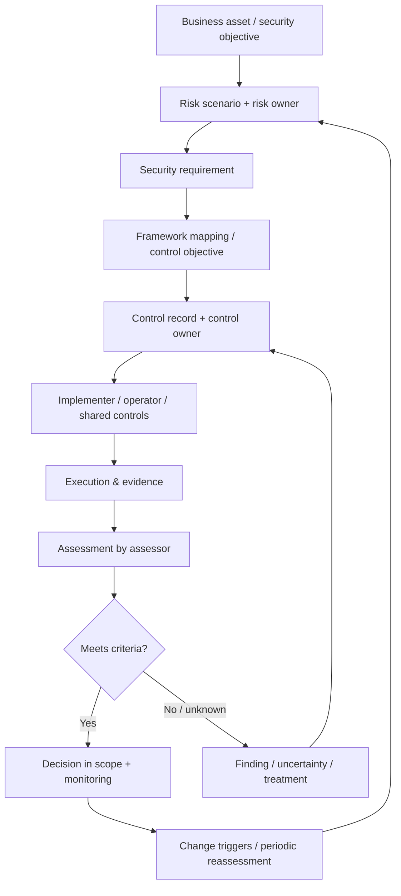
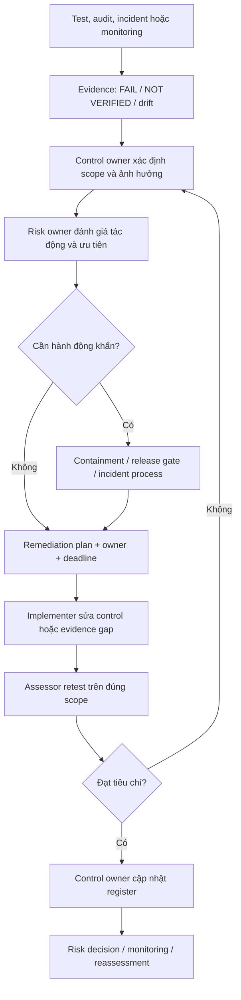

# Chủ sở hữu control trong Control Framework và Security Assurance

## 1. Chủ sở hữu control là ai?

**Control owner (chủ sở hữu kiểm soát)** là cá nhân hoặc **vai trò được tổ chức chỉ định chịu trách nhiệm giải trình** về một **security control** trong phạm vi đã xác định: control có mục tiêu và yêu cầu rõ ràng, được triển khai bởi đúng bên, được vận hành/duy trì, có người xử lý khi không đạt, và có **bằng chứng** để người đánh giá kiểm chứng.

Trong chương **Control framework** của module **SECURITY_SECURITY_ASSURANCE**, vấn đề không chỉ là lập danh sách các kiểm soát từ một tiêu chuẩn. Chương trình assurance cần giải thích một chuỗi có thể truy vết:

> **Mục tiêu bảo mật → rủi ro → yêu cầu → control → control owner → hoạt động kiểm soát → đánh giá → bằng chứng → finding/khắc phục → quyết định rủi ro còn lại.**

Control owner là mắt xích bảo đảm một kiểm soát **không trở thành dòng chữ vô chủ trong bảng compliance**. Ví dụ:

- Với `grade-service` viết bằng Java/Spring Boot, ai chịu trách nhiệm rằng quyền **sửa điểm theo từng lớp và từng bản ghi** được kiểm tra ở mọi đường API, kể cả batch import?
- Với hệ thống đăng nhập qua IdP, ai chịu trách nhiệm control **MFA cho tài khoản quản trị**, dù IdP do nhà cung cấp vận hành?
- Với CI/CD, ai duy trì rule ngăn deploy manifest có đặc quyền vượt mức, xử lý rule bị bỏ qua và cung cấp evidence?
- Khi kiểm toán phát hiện log mất sự kiện sửa điểm, ai chịu trách nhiệm **sửa control**, ai **đánh giá bằng chứng**, và ai được **chấp nhận rủi ro** nếu chưa sửa kịp?

**Điểm cốt lõi:** Control owner **không nhất thiết là người trực tiếp viết code, chạy script, vận hành công cụ hoặc tự kiểm toán công việc của mình**. Tổ chức phải xác định phần nào owner chịu trách nhiệm, phần nào do operator/implementer thực hiện và phần nào do assessor xác minh.

### Kết quả học tập

Sau bài này, người học có thể:

1. Phân biệt control owner với risk owner, system owner, process owner, implementer, operator, assessor và auditor.
2. Chỉ định ownership phù hợp cho manual, automated, shared, inherited và third-party controls.
3. Thiết kế control record, RACI, tiêu chí hiệu lực, lịch kiểm tra và bằng chứng cần có.
4. Xử lý thay đổi ownership, control failure, exception, remediation và đánh giá rủi ro.
5. Áp dụng vào tình huống Java/Spring Boot, IAM, CI/CD và vận hành thực tế.
6. Vận hành chương trình **continuous security assurance** có trách nhiệm rõ ràng và kết luận có giới hạn.

## 2. Tại sao một control framework cần owner?

**Control framework** là cấu trúc để xác định, tổ chức, quản lý và đánh giá các kiểm soát nhằm đáp ứng mục tiêu của tổ chức. Một framework có thể xuất phát từ nhiều nguồn như **NIST SP 800-53, ISO/IEC 27001/27002, CIS Controls, NIST CSF, OWASP ASVS**, hoặc là tập control nội bộ được xây dựng theo rủi ro. Mỗi nguồn có **mục đích, mức chi tiết và cách đánh giá khác nhau**; không nên hiểu mọi mục trong các nguồn đều tương đương một control có cùng owner.

Một framework có danh mục control nhưng **không xác định trách nhiệm** dễ gây ra:

| Khoảng trống | Hệ quả | Câu hỏi ownership cần làm rõ |
| --- | --- | --- |
| “Đội security chịu trách nhiệm mọi thứ.” | Security đề xuất chính sách nhưng không vận hành được hệ thống của team sản phẩm. | Ai **thực sự** có quyền triển khai và duy trì control? |
| “Cloud provider đã làm rồi.” | Bỏ sót cấu hình tenant, IAM, dữ liệu và integration phía khách hàng. | Kiểm soát nào thuộc provider; kiểm soát nào còn thuộc tổ chức? |
| “Control đã có trong tài liệu.” | Không có phép kiểm tra hiệu lực thực tế. | Ai cung cấp evidence và ai đánh giá? |
| “Script chạy hằng ngày.” | Script thất bại/bị tắt nhưng không ai xử lý. | Ai chịu trách nhiệm kết quả, sensor health và escalation? |
| “Finding thuộc team từng chạy scan.” | Không ai sở hữu nguyên nhân và deadline khắc phục. | Ai sửa control, ai phê duyệt và ai retest? |
| “Ai cũng là owner.” | Khi lỗi xảy ra, không có trách nhiệm cuối cùng. | Ai **accountable** trong scope đã chốt? |

Một hệ thống có thể có **nhiều người tham gia triển khai** một control. Tuy nhiên, trong một **phạm vi vận hành và bản ghi control cụ thể**, cần có một **đầu mối chịu trách nhiệm cuối cùng** được chỉ định theo cơ cấu quản trị. Với control dùng chung nhiều hệ thống, có thể phân tách thành **framework control owner** và **service-level control owner**; không được mặc định một người chịu mọi khía cạnh mà không có quyền cần thiết.

### Owner không phải “người bảo đảm rủi ro bằng không”

Một control có owner đầy đủ nhưng vẫn có thể FAIL, NOT VERIFIED hoặc để lại residual risk. Owner phải **làm rõ trạng thái thực tế, tổ chức xử lý và báo cáo**, không có nghĩa luôn được quyền tự tuyên bố PASS hoặc tự chấp nhận mọi rủi ro.

## 3. Phân biệt những vai trò dễ nhầm

| Vai trò | Trách nhiệm điển hình | Không nên suy diễn |
| --- | --- | --- |
| **Control owner** | Chịu trách nhiệm control đáp ứng mục tiêu, có người thực thi, được theo dõi và có bằng chứng phù hợp trong scope. | Không nhất thiết tự viết code, tự chạy mọi test hoặc tự chấp nhận rủi ro. |
| **Control operator** | Thực hiện hoạt động lặp lại: review quyền, xử lý cảnh báo, vận hành job, xoay khóa. | Người chạy công việc không mặc nhiên chịu trách nhiệm phê duyệt thay chuẩn. |
| **Control implementer** | Xây dựng/cấu hình kỹ thuật hoặc quy trình nhằm thực thi control. | Viết xong code không chứng minh operating effectiveness. |
| **Control designer / standard owner** | Định nghĩa yêu cầu, thiết kế và cách áp dụng control cho nhiều hệ thống. | Thiết kế chung không thay ownership ở mỗi môi trường thực tế. |
| **Risk owner** | Quản lý rủi ro cụ thể, chọn/đề xuất phương án xử lý, chấp nhận rủi ro **trong thẩm quyền**. | Quyền chấp nhận rủi ro không tự sinh từ vai trò kiểm soát. |
| **Asset/system/service owner** | Chịu trách nhiệm tài sản/hệ thống và mức dịch vụ; phân công control cần thiết. | Có thể kiêm control owner nếu được ghi rõ, nhưng không đồng nhất ở mọi tổ chức. |
| **Process/business owner** | Sở hữu quy trình nghiệp vụ và các outcome cần bảo vệ. | Không nhất thiết có quyền chỉnh cloud IAM, code hay policy engine. |
| **Third-party owner** | Quản lý quan hệ nhà cung cấp, yêu cầu bằng chứng và xử lý phụ thuộc. | Không thể mặc định các control của provider đã đạt chỉ vì có hợp đồng. |
| **Evidence custodian** | Quản lý nơi lưu, phiên bản, phân quyền và vòng đời bằng chứng. | Lưu evidence không có nghĩa đánh giá evidence đủ hoặc control đạt. |
| **Security assessor / GRC** | Thiết kế hoặc thực hiện đánh giá, phân tích evidence, báo finding, mức bất định và phạm vi kết luận. | Assessor không tự chịu trách nhiệm khắc phục mọi lỗi của hệ thống. |
| **Internal auditor / independent reviewer** | Đánh giá độc lập theo phạm vi, phương pháp và chuẩn được giao. | Không nên tự kiểm toán chính control mà bản thân đang vận hành nếu yêu cầu độc lập áp dụng. |
| **Release/incident authority** | Quyết định phát hành hoặc điều phối sự cố theo quyền đã giao. | Không tự thay thế risk acceptance hay kết luận kiểm chứng. |

**Kiêm nhiệm có thể hợp lệ** ở tổ chức nhỏ, nhưng cần kiểm soát xung đột lợi ích: người thiết kế/vận hành control rủi ro cao không nên là người **duy nhất tự xác nhận** hiệu lực khi quy trình yêu cầu review độc lập.

### Ví dụ: vì sao “risk owner = control owner” có thể sai?

Trong hệ thống thi trực tuyến, **risk owner** có thể là người phụ trách vận hành chương trình thi, chịu hậu quả khi mất dữ liệu. **Control owner của backup/restore** có thể là Platform/SRE vì đội đó thiết kế, duy trì và kiểm chứng khả năng phục hồi. Risk owner xác định **RTO/RPO cần đạt và mức rủi ro chấp nhận**, còn control owner bảo đảm quy trình sao lưu/phục hồi có khả năng đáp ứng và báo cáo sai lệch. Cả hai phối hợp nhưng trách nhiệm không trùng.

## 4. Ba lớp ownership trong một control framework

Ở tổ chức nhiều dịch vụ, một yêu cầu thường được triển khai qua **nhiều lớp trách nhiệm**:

| Lớp | Owner điển hình | Họ chịu trách nhiệm gì? | Ví dụ |
| --- | --- | --- | --- |
| **Framework/policy level** | Security governance hoặc standard owner | Định nghĩa control objective, minimum baseline, đánh giá áp dụng, yêu cầu evidence và cách xử lý exception. | “Mọi thao tác ghi dữ liệu nhạy cảm phải có authorization phù hợp.” |
| **Shared platform / common control level** | IAM/Platform/SRE owner | Duy trì control chung được nhiều hệ thống sử dụng; cung cấp evidence về hiệu lực trong phạm vi platform. | IdP, cloud logging, secrets management, ingress policy. |
| **System/service level** | Service/product/engineering control owner | Áp dụng control vào hệ thống cụ thể, xử lý phần trách nhiệm riêng và chứng minh không có bypass. | `grade-service` kiểm tra quyền theo bản ghi và phân công giáo viên. |

Đừng gộp ba lớp thành một dòng “owner: Security team”. Security governance có thể **sở hữu chuẩn** nhưng không vận hành endpoint. Một team platform có thể **sở hữu IdP** nhưng không biết tất cả các luồng khôi phục tài khoản do một ứng dụng tự viết.

### Hai mô hình phân công hợp lệ

**Mô hình 1 – Một control record cho mỗi service:** `CTRL-GRADE-AUTHZ` do backend service owner chịu trách nhiệm, tham chiếu chuẩn authorization chung. Đơn giản khi phạm vi service rõ.

**Mô hình 2 – Common control và consumer inheritance:** `CTRL-IDP-MFA-CORE` do IAM owner vận hành; `CTRL-GRADE-ADMIN-MFA-INTEGRATION` do owner `grade-service` bảo đảm luồng admin của ứng dụng thực sự yêu cầu MFA và không có bypass. Hai control records liên kết với nhau. Phù hợp khi nhiều hệ thống thừa hưởng cùng một service.

Mô hình nào cũng cần **phân biệt control nguồn với điều kiện kế thừa**, không tái sử dụng evidence của provider/platform để chứng minh những cấu hình riêng chưa được kiểm tra.

## 5. Thiết lập phạm vi và nguyên tắc chọn control owner

Chọn một owner chỉ dựa vào sơ đồ tổ chức chưa đủ. Hãy xác định **quyền kiểm soát, trách nhiệm và khả năng tạo ra evidence**.

### Câu hỏi để quyết định owner

1. **Control bảo vệ điều gì?** Tài sản, security objective, risk scenario và requirement cụ thể là gì?
2. **Nằm ở đâu?** Backend code, IAM tenant, cloud account, pipeline, database, vận hành hay quy trình thủ công?
3. **Ai có quyền thay đổi?** Đội nào thực sự có thể sửa logic/cấu hình, rollout và rollback?
4. **Ai chịu trách nhiệm hoạt động liên tục?** Có trực vận hành, cảnh báo, kế hoạch thay thế khi nhân sự vắng mặt?
5. **Ai sở hữu dữ liệu/evidence?** Bằng chứng nằm trong tool nào, ai có quyền trích xuất an toàn?
6. **Ai có quyền xử lý sai lệch?** Có thể giao remediation, escalations và phối hợp third party?
7. **Có xung đột lợi ích không?** Người chịu trách nhiệm đánh giá có đủ độc lập trong trường hợp control rủi ro cao?
8. **Control dùng chung hay riêng?** Nếu dùng chung, phân công owner nền tảng và những người sở hữu **consumer responsibilities**.

### Tiêu chí phân công tốt

| Tiêu chí | Tốt | Chưa tốt |
| --- | --- | --- |
| **Định danh** | Vai trò và người/nhóm nhận trách nhiệm cụ thể, có người thay thế. | “Dev team” hoặc “Security” không rõ cá nhân/đầu mối. |
| **Scope** | Xác định service, tenant, region, control ID, lifecycle. | “Tất cả hệ thống” nhưng không có inventory. |
| **Thẩm quyền** | Có khả năng thay control hoặc điều phối người có quyền. | Owner chỉ được đọc dashboard, không có quyền giao khắc phục. |
| **Nguồn lực** | Có lịch review, nguồn lực vận hành và escalation path. | Chỉ ghi tên owner khi audit sắp tới. |
| **Bằng chứng** | Biết evidence cần có, cách thu, lưu và kiểm tra thời hạn. | Tập hợp screenshot không biết version/thời điểm. |
| **Kế thừa** | Biết phần provider/platform chịu và phần service phải làm. | Giả định chứng nhận vendor giải quyết toàn bộ control. |
| **Thay đổi** | Có cơ chế bàn giao khi team/architecture thay đổi. | Owner cũ rời tổ chức nhưng hồ sơ vẫn ghi PASS. |

**Nguyên tắc phạm vi:** Có thể có **nhiều owner ở nhiều cấp**, nhưng phải chỉ rõ **ai chịu trách nhiệm cuối cùng cho một control record cụ thể**. Tránh cả hai cực đoan: “nhiều owner nên không ai chịu trách nhiệm” và “một người chịu mọi thứ dù không có thẩm quyền”.

## 6. Liên kết ownership với risk assessment và control framework

Việc gán owner phải xuất phát từ **control objective**, không chỉ từ tên công cụ.



### Ví dụ về traceability

| Mắt xích | Bản ghi minh họa |
| --- | --- |
| **Objective** | `OBJ-GRADE-01`: chỉ người được ủy quyền mới sửa điểm thi. |
| **Risk** | `RISK-GRADE-01`: giáo viên lớp A sửa điểm của lớp B. |
| **Requirement** | `REQ-GRADE-01`: kiểm tra quyền theo principal và đối tượng trước mọi thao tác ghi. |
| **Framework mapping** | Nhóm Access Control theo NIST/ISO/ASVS tùy yêu cầu áp dụng; ghi **phiên bản và điều khoản cụ thể khi phê duyệt**. |
| **Implemented control** | `CTRL-GRADE-OBJECT-AUTHZ`: backend server-side policy. |
| **Owner** | `grade-service-control-owner` thuộc backend team, với quyền thay code/policy. |
| **Operator** | Runtime `grade-service` tự thực thi; team SRE quan sát health/audit. |
| **Assessor** | Application security assessor có quyền thiết kế negative tests. |
| **Evidence** | Build R, role/class test matrix, DB assertions, route inventory. |
| **Decision** | PASS trong scope đã kiểm tra; hoặc finding và risk decision nếu có gap. |

Một dòng mapping “đáp ứng NIST/ISO” **không phải bằng chứng**. Người phụ trách phải chỉ ra control cụ thể, nội dung yêu cầu trong **phiên bản thực sự áp dụng**, sự tương ứng có căn cứ và **phép kiểm tra** hỗ trợ claim.

## 7. Một control record cần lưu những gì?

Để ownership có thể thực thi và kiểm toán, tạo **control inventory/register** với các trường:

| Nhóm trường | Nội dung tối thiểu | Mục đích |
| --- | --- | --- |
| **Identity** | Control ID, tên, phiên bản, control family, framework references. | Truy vết và quản lý thay đổi. |
| **Objective/risk** | Security objective, requirement ID, risk scenario IDs. | Chứng minh vì sao cần control. |
| **Scope/applicability** | Asset, service, environment, region, tenant, user/operation, N/A rules. | Không đưa ra claim vượt phạm vi. |
| **Control design** | Điều kiện/trigger, input đáng tin, logic, hành động, failure mode, tần suất. | Đánh giá tính phù hợp thiết kế. |
| **Ownership** | Accountable control owner, operator/implementer, evidence custodian, assessor, risk owner. | Không bỏ trống trách nhiệm. |
| **Dependencies** | IAM, database, provider, CI runner, logging, shared controls. | Xác định rủi ro thừa hưởng và ranh giới phụ thuộc. |
| **Assessment** | Kiểm tra cần chạy, expected result, sample/coverage, kỳ đánh giá. | Kết luận PASS/FAIL/NOT VERIFIED có căn cứ. |
| **Evidence** | Link nội bộ được phân quyền, build/config, timestamp, method, reviewer, limitations. | Audit có thể kiểm chứng. |
| **Finding/treatment** | Sai lệch, owner khắc phục, deadline, risk rating, retest, exception. | Theo dõi cho tới khi đóng có chứng cứ. |
| **Lifecycle** | Ngày hiệu lực, lịch review, trigger thay đổi, version, owner handover. | Continuous assurance. |

### Control owner cần “cam kết” điều gì?

Không phải cam kết một điều không thể chứng minh như “không bao giờ có lỗ hổng”. Trách nhiệm cần đo được:

1. Duy trì **control specification** rõ, phù hợp yêu cầu và risk scope.
2. Đảm bảo có **người và quy trình triển khai/vận hành**; không mặc nhiên tất cả do owner tự làm.
3. Bảo đảm **đánh giá theo cadence/trigger**, xử lý evidence thiếu hoặc lỗi.
4. Tiếp nhận **finding**, phân công sửa, theo dõi hạn và phối hợp retest.
5. **Escalate** khi control thất bại, ảnh hưởng người dùng hoặc vượt thẩm quyền.
6. **Đánh giá lại** khi API, role, dữ liệu, provider, baseline hoặc threat model đổi.
7. Tạo điều kiện cho assessor/audit **kiểm tra độc lập** ở mức phù hợp.

## 8. Manual, automated và hybrid controls: owner phải quản lý khác nhau

| Loại control | Ví dụ | Trách nhiệm vận hành của owner | Bằng chứng quan trọng |
| --- | --- | --- | --- |
| **Manual preventive** | Quản lý phê duyệt thay đổi quyền admin. | Định nghĩa người duyệt, quy trình kiểm tra, hạn xử lý và trường hợp khẩn cấp. | Approval records, mẫu yêu cầu/đối soát, review quyền. |
| **Automated preventive** | API từ chối sửa điểm trái quyền. | Bảo đảm policy đúng, bao phủ entry points, không bypass và test mỗi thay đổi. | Code/config review, negative tests, DB assertions, build. |
| **Automated detective** | SIEM cảnh báo sự kiện privilege escalation. | Bảo vệ telemetry, detector version, sensor health, route alert. | Synthetic alert test, alert delivery, triage evidence. |
| **Hybrid corrective** | SIEM mở ticket; SOC phê duyệt thu hồi token. | Định nghĩa trigger, SLA, thẩm quyền, hành động và cách xác minh outcome. | Incident ticket, approval, revocation and retest. |
| **Automated recovery** | Workflow restore/failover khi điều kiện được thỏa. | Xác định RTO/RPO, nguồn backup, an toàn rollout, diễn tập. | Restore test, integrity reconciliation, failover timing. |
| **Third-party/shared** | SaaS IdP vận hành xác thực; tổ chức cấu hình MFA/role. | Xác định ranh giới hợp đồng, phần tổ chức phải tự kiểm và evidence provider. | Provider artifact có scope + tenant config + integration tests. |

**Control operator là một máy không có nghĩa không cần human owner.** Nếu SIEM rule chạy 24/7, con người vẫn phải chịu trách nhiệm khi log pipeline dừng, threshold bị thay đổi, alert không tới nơi, hoặc detector gây false positives.

### Độ sâu trách nhiệm theo automation

- **Preventive inline:** phải kiểm đường bypass và tác động khi dependency fail; latency và availability quan trọng.
- **Detective:** phải kiểm coverage, health, detection latency và người nhận cảnh báo.
- **Corrective/remediation:** phải kiểm blast radius, quyền bot, idempotency, rollback và phê duyệt.
- **Manual:** phải kiểm kỹ năng, tính nhất quán, bằng chứng thực hiện, người thay thế và separation of duties.

Không nên dùng cùng một checklist “script running = PASS” cho tất cả các loại.

## 9. Vai trò trong vòng đời một control

Control ownership là quá trình, không chỉ là một lần điền form.

| Giai đoạn | Control owner làm gì? | Người phối hợp | Đầu ra có thể kiểm chứng |
| --- | --- | --- | --- |
| **Design** | Nắm risk, mục tiêu, tiêu chí, scope và ranh giới. | Risk owner, architect, standard owner, security. | Control specification và acceptance criteria. |
| **Implement** | Giao người triển khai, kiểm soát chất lượng, bảo đảm đường thực thi phù hợp. | Engineering, SRE, IAM, third party. | Code/config/IaC, architecture, test plan. |
| **Operate** | Theo dõi lịch hoạt động, sensor health, quyền và sự kiện. | Operator, SOC, platform. | Operational logs, review notes, evidence schedule. |
| **Assess** | Hỗ trợ và cung cấp bằng chứng; giải thích giới hạn/gaps. | Security assessor, GRC, audit. | Assessment results với scope, methods và evidence. |
| **Remediate** | Nhận finding, giao/ưu tiên sửa, nêu deadline và retest. | Implementer, risk owner, release authority. | Remediation plan, retest evidence. |
| **Monitor** | Rà soát drift, metric, vulnerability, incident, provider changes. | Operations, SOC, third-party owner. | Updated control register và reassessment. |
| **Retire/transfer** | Gỡ hoặc thay control có quản trị, bàn giao ownership, giữ evidence cần thiết. | System owner, standard owner, risk owner. | Decommission record, new owner confirmation. |

### Hai thời điểm cần ngăn “bàn giao trên giấy”

**Trước vận hành:** Team phát triển bàn giao control cho SRE nhưng không có runbook, dashboard, hạn xử lý và quyền thao tác. Việc ghi “SRE owner” trong spreadsheet **không chứng minh** SRE có thể vận hành control. Cần xác nhận tiếp nhận, tài liệu, quyền và buổi chuyển giao khi phù hợp.

**Khi thay kiến trúc:** Dịch vụ chuyển từ local authentication sang IdP. Người sở hữu password hashing local có thể không còn phù hợp, nhưng control mới về SSO token verification và tenant MFA vẫn cần owner. Không được đóng control cũ trước khi đánh giá **tính đầy đủ của control thay thế**.

## 10. RACI minh họa cho một control kỹ thuật

**RACI**: **R** – Responsible (thực hiện), **A** – Accountable (chịu trách nhiệm cuối cùng theo thẩm quyền), **C** – Consulted (tham vấn), **I** – Informed (được thông báo). Đây là phân công **minh họa**, tổ chức cần điều chỉnh theo quyền thực tế.

| Hoạt động | Control owner | Implementer/operator | Security assessor | Risk owner | Standard owner |
| --- | :---: | :---: | :---: | :---: | :---: |
| Xác định scope, thiết kế control trong service | **A/R** | R | C | C | C |
| Đặt baseline/tiêu chí dùng chung | C | C | C | C | **A/R** |
| Triển khai code/config và kiểm tra nội bộ | **A** | **R** | C | I | I |
| Vận hành định kỳ, monitor control health | **A** | **R** | C | I | I |
| Thiết kế/tiến hành assessment độc lập phù hợp | C | C | **A/R** | I | C |
| Xử lý finding ở control/service | **A** | **R** | C | C | I |
| Chấp nhận residual risk nếu policy cho phép | C | C | C | **A/R** | C |
| Duy trì framework mapping/control references | C | I | R | C | **A** |
| Chuyển giao owner khi team thay đổi | **R** | C | C | C | **A** đối với việc phê duyệt danh mục |

**Lưu ý:** Ở hàng “phê duyệt chuyển giao”, standard owner chỉ **A** nếu governance của tổ chức giao quyền đó. Nhiều nơi system owner hoặc service director mới chịu trách nhiệm phê duyệt chuyển giao. **Không có một RACI phổ quát** áp dụng mọi tổ chức. Đối với release và incident, cần bổ sung **release authority/incident commander** để không nhầm owner của control với người có quyền quyết định phát hành hoặc điều phối sự cố.

### Định nghĩa ownership khi nhiều team cùng thực hiện

Một control `CTRL-AUDIT-01` yêu cầu ghi và lưu sự kiện sửa điểm:

- **Backend implementer** phát sự kiện với principal, object, action, outcome, timestamp.
- **Platform operator** vận hành queue, storage, retention và quyền xem.
- **SOC** định nghĩa detector/alert cho hành vi bất thường, nếu control có phạm vi đó.
- **Control owner** của end-to-end audit flow được chỉ định theo thẩm quyền; đồng thời có **sub-control owners** cho event generation, transport và retention.
- **Assessor** kiểm tra từ hành vi API đến event nhận và thời hạn lưu, không chỉ đọc đoạn code gọi logger.

Nếu một control end-to-end có nhiều lớp, tách thành **sub-controls có ID và owners riêng** có thể rõ ràng hơn cố gộp vào một ô RACI.

## 11. Kiểm soát dùng chung, kế thừa và trách nhiệm với nhà cung cấp

Trong framework, một control có thể được **inherited** từ một nền tảng hoặc nhà cung cấp; tuy nhiên **kế thừa có điều kiện**.

### Ví dụ IdP và MFA

| Control/điều kiện | Ai vận hành hoặc thực thi? | Ai chịu trách nhiệm kiểm chứng phía tổ chức? |
| --- | --- | --- |
| Nhà cung cấp vận hành dịch vụ IdP theo hợp đồng. | Provider. | Third-party owner điều phối provider assurance; IAM/security đánh giá scope. |
| Tenant tổ chức yêu cầu MFA cho nhóm admin. | IAM/platform team cấu hình chính sách tenant. | IAM control owner chứng minh policy và enrollment/coverage. |
| Ứng dụng Spring Boot xác minh token, issuer/audience và mapping role. | Application team. | Application auth control owner cung cấp test/config. |
| Luồng legacy login hoặc recovery không bypass MFA. | Tùy architecture, IAM/IdP và app cùng tham gia. | Owner của end-to-end authentication cùng các sub-control owners. |
| Khi admin rời tổ chức, quyền và phiên liên quan bị thu hồi. | IAM/operator + app session owner. | Kiểm tra kết quả offboarding ở phạm vi hệ thống. |

Một báo cáo SOC 2 hoặc chứng chỉ ISO/IEC 27001 **chỉ có giá trị trong scope/kỳ đánh giá của tài liệu**, không tự chứng minh tenant MFA của khách hàng hoặc authorization trong app. Phải xem **complementary user entity controls (CUECs)** hoặc trách nhiệm phía khách hàng khi tài liệu áp dụng nêu ra.

### Ownership matrix cho shared controls

| Mục | Provider owner | Customer platform owner | Application owner | Evidence |
| --- | --- | --- | --- | --- |
| Bảo mật nền tảng IdP trong scope hợp đồng | Vận hành những control đã cam kết | Review provider assurances | Theo dõi tác động tích hợp | Provider report có scope/exception. |
| Chính sách MFA tenant | Cung cấp tính năng | Thiết lập, duy trì và kiểm policy | Kiểm không có đường bypass trong app | Tenant configuration + negative tests. |
| Token validation | Công bố giao thức, keys/metadata | Có thể vận hành gateway chung | Kiểm signature/claims/audience theo ứng dụng | App/gateway tests, config. |
| Access review | Cung cấp log/tính năng nếu hợp đồng cho phép | Vận hành quy trình review | Xác minh vai trò nghiệp vụ đúng đối tượng | Review record, user list được bảo vệ. |
| Sự cố provider | Phát hiện/thông báo theo nghĩa vụ đã cam kết | Điều phối ứng cứu và phụ thuộc | Đánh giá dữ liệu và session bị ảnh hưởng | Incident timeline, action/retest. |

**Owner nội bộ không có nghĩa kiểm soát toàn bộ provider.** Họ cần chủ động đánh giá phần bằng chứng nhận được và quản trị **độ bất định**, không viết “provider chịu trách nhiệm nên PASS” khi thực tế không có đủ bằng chứng.

## 12. Ví dụ kỹ thuật xuyên suốt: owner của kiểm soát sửa điểm Spring Boot

### 12.1. Scope, risk và ownership

Giả sử nền tảng học tập có `grade-service`, dữ liệu điểm nằm trong database. Giáo viên được phân công mới có quyền sửa điểm thuộc lớp mình; học viên không có quyền sửa. Có các đường:

- `PATCH /api/grades/{gradeId}` – cập nhật một điểm.
- `POST /api/grades/import` – nhập hàng loạt.
- Event consumer nhận yêu cầu điều chỉnh điểm đã phê duyệt từ hệ thống nội bộ.

**Objective – `OBJ-GRADE-INTEGRITY`:** Điểm thi không bị thay đổi trái quyền; thay đổi hợp lệ có thể truy vết.

**Risk – `RISK-GRADE-BOLA`:** Tài khoản giáo viên lớp A gửi ID của bản ghi lớp B; backend kiểm tra `ROLE_TEACHER` nhưng thiếu chính sách theo object nên sửa sai dữ liệu.

**Requirement – `REQ-GRADE-AUTHZ`:** Tất cả các đường ghi điểm phải đánh giá principal đã xác thực, role và quan hệ phân công theo **bản ghi thực tế** trước khi thay đổi.

**Control – `CTRL-GRADE-AUTHZ`:** Kiểm tra authorization phía server trên mọi thao tác ghi.

**Control owner:** Vai trò `grade-service-security-control-owner`; **implementers:** backend team; **operator:** runtime service và đội platform; **assessor:** application security; **risk owner:** chủ sở hữu rủi ro nghiệp vụ điểm thi được phân công.

### 12.2. Logic Java/Spring Boot minh họa

```java
// Pseudocode: actor phải được lấy từ server-side security context.
@Service
public class GradeMutationService {
    private final GradeRepository grades;
    private final GradeEditPolicy editPolicy;
    private final GradeAuditOutbox auditOutbox;

    @Transactional
    public void updateGrade(UUID gradeId, BigDecimal newScore,
                            VerifiedPrincipal actor) {
        Grade grade = grades.findByIdForUpdate(gradeId)
            .orElseThrow(() -> new NotFoundException("Grade not found"));

        // Authorization theo chính object và principal đã xác thực.
        if (!editPolicy.canEdit(actor, grade)) {
            throw new AccessDeniedException("Grade update not allowed");
        }

        grade.checkScoreIsValid(newScore);
        BigDecimal oldScore = grade.getScore();
        grade.setScore(newScore);
        grades.save(grade);

        // Mô hình outbox trong cùng transaction cho event đã thay đổi.
        auditOutbox.appendGradeChanged(
            actor.id(), gradeId, oldScore, newScore);
    }
}
```

Đây là **pseudocode có kiểu/interface giả định**, không phải đoạn code production hoàn chỉnh. Nó chủ ý minh họa kiểm quyền **trước ghi** và outbox cho sự kiện thay đổi. Một sự kiện **bị từ chối** cần được ghi bằng cơ chế thích hợp **ngoài transaction có thể rollback** nếu policy yêu cầu giữ audit denial; không giả định gọi logger trong cùng transaction rồi ném exception sẽ luôn tồn tại. Đối với event đã thay đổi, outbox chỉ đáng tin khi có thiết kế giao hàng, retry, idempotency và giám sát queue phù hợp. **Control owner** phải bảo đảm những giả định này được đánh giá.

Những điểm chưa được chứng minh chỉ bằng mã:

1. `VerifiedPrincipal` có được xây từ security context ở server hay do request tự gửi?
2. `canEdit(...)` có kiểm role, tenant, teacher assignment, trạng thái kỳ thi và quyền ủy quyền đúng nghiệp vụ?
3. Các đường **import, batch, queue consumer, admin override** có dùng cùng policy hoặc control tương đương?
4. Có nguy cơ **TOCTOU/race condition** khi assignment hoặc bản ghi thay đổi đồng thời?
5. Cấu hình production, grants database và quyền service account có gây bypass không?
6. Audit có chứa actor, object, action và outcome, đồng thời tránh ghi secrets/PII không cần thiết?
7. Khi lookup policy thất bại, service **không mặc nhiên cho phép** thao tác nhạy cảm?

### 12.3. Ma trận kiểm thử và bằng chứng

| Test ID | Điều kiện | Kết quả mong đợi | Người chịu trách nhiệm chính |
| --- | --- | --- | --- |
| `TC-GRADE-01` | Giáo viên được phân công sửa điểm trong lớp mình. | Thành công; điểm đúng, audit hợp lệ. | Implementer viết test; control owner bảo đảm coverage. |
| `TC-GRADE-02` | Giáo viên A sửa điểm của lớp B. | Bị từ chối; **DB không đổi**. | Assessor xác minh case và evidence. |
| `TC-GRADE-03` | Học viên hoặc người không xác thực gọi route ghi. | Không có quyền, không có side effect. | Backend + assessor. |
| `TC-GRADE-04` | Giáo viên bị thu hồi phân công rồi thử sửa. | Quyền cũ không được chấp nhận ngoài điều kiện cho phép. | IAM/business policy + backend. |
| `TC-GRADE-05` | Ghi điểm qua import/batch/event consumer. | Không có đường bỏ qua kiểm quyền hoặc approval process. | Control owner kiểm inventory, assessor test. |
| `TC-GRADE-06` | Policy lookup hoặc data store lỗi. | Không tự cấp quyền; lỗi được quản lý và giám sát. | Backend/SRE cùng owner. |
| `TC-GRADE-07` | Event store/queue không hoạt động. | Audit không bị giả định là đã ghi; có detection/recovery phù hợp. | Audit control owner + platform. |
| `TC-GRADE-08` | Bản build mới thêm một role hoặc route ghi. | Negative tests và scope control được cập nhật. | Service control owner. |

Để kết luận `CTRL-GRADE-AUTHZ` đạt, assessment cần kiểm **đúng bản build, tập role và route thực sự thuộc scope**. Một unit test `403` chưa đủ nếu update database xảy ra **trước khi trả lỗi**; phải có assertion trạng thái dữ liệu. Mỗi test và review cần lưu report có tên, thời điểm, môi trường, kết quả và giới hạn.

### 12.4. Khi finding xuất hiện

Assessor phát hiện import API không gọi `GradeEditPolicy`. Khi đó:

1. Ghi **finding** với route, điều kiện, bước tái hiện an toàn, expected/actual, build và evidence.
2. **Control owner** xác nhận scope, tìm các đường tương tự, phân công remediation.
3. **Risk owner** xem tác động, phương án tạm dừng import hoặc hạn chế quyền và quyết định trong thẩm quyền.
4. **Engineering** sửa code, bổ sung negative/batch tests và tạo build mới.
5. **Assessor** kiểm lại hành vi và DB invariants trên build mới, ghi evidence.
6. **Control owner** cập nhật control record, findings, exception nếu cần, review triggers và thông tin cho release authority.

Không được ghi `PASS` khi ticket mới ở trạng thái “merged”. Nếu có evidence lỗi tương tự đã ảnh hưởng production, phải kích hoạt **incident/change response** thích hợp, không chỉ chờ kỳ audit.

## 13. Ví dụ control owner của quyền truy cập và tài khoản đặc quyền

Một control IAM có thể được nhiều bên cùng vận hành:

| Hoạt động | IAM control owner | Product/service owner | Operator / assessor |
| --- | --- | --- | --- |
| Đặt phương pháp MFA và privileged-access baseline | Chịu trách nhiệm baseline và vận hành IAM chung. | Xác định nhóm chức năng nhạy cảm cần bảo vệ. | Assessor tham vấn/kiểm chứng. |
| Cấp quyền giáo viên vào đúng lớp | Cung cấp IAM/role infrastructure theo scope. | Quyết định quyền nghiệp vụ theo dữ liệu phân công. | Operator thực hiện, assessor test truy cập trái quyền. |
| Review tài khoản admin hằng kỳ | Bảo đảm quy trình, nhắc review, xử lý stale access. | Xác nhận nhu cầu nghiệp vụ của người dùng. | Evidence access review; assessor đánh giá mẫu. |
| Offboarding nhân sự | Thu hồi IdP/tenant membership và credential phù hợp. | Thu hồi quyền nội bộ/phiên nếu không tự động kế thừa. | Revocation tests và ticket được bảo vệ. |

**Cảnh báo:** “IdP xác thực thành công” chỉ giải quyết một phần **authentication**, không chứng minh user được phép xem hoặc sửa **đúng dữ liệu**. Phải giao control owner cho object/tenant authorization ở tầng ứng dụng.

### Kiểm soát quyền admin có hai chiều bằng chứng

**Configuration evidence:** IAM policy, required MFA, role assignment, identity lifecycle.

**Behavior evidence:** negative test với tài khoản không đủ quyền, reauthentication với thao tác nhạy cảm, kiểm tra bypass qua API legacy và service account. Hai loại evidence bổ trợ nhau; chỉ có bảng cấu hình quyền chưa chắc chỉ ra hành vi runtime.

## 14. Control owner và bằng chứng assurance

Control owner **có trách nhiệm đảm bảo evidence được cung cấp và đầy đủ**, nhưng **không nên tự quyết rằng evidence của chính mình luôn đủ**. Người đánh giá cần cân nhắc độc lập theo phương pháp đã được duyệt.

### Phân biệt trách nhiệm

| Công việc | Control owner | Evidence custodian | Assessor / auditor |
| --- | --- | --- | --- |
| Xác định control cần chứng minh điều gì | Accountable trong scope, phối hợp standard/risk owner. | Consulted khi cần. | Review tiêu chí/assessment design. |
| Tạo hoặc thu thập evidence thực hiện control | Điều phối, bảo đảm người vận hành cung cấp. | Lưu/định danh/phân quyền artifact. | Có thể tự tạo independent test evidence. |
| Đánh giá scope, độ đủ và độ tin cậy | Giải thích bối cảnh và giới hạn, sửa khoảng trống. | Cung cấp provenance/retention. | Kết luận theo tiêu chí và chỉ ra bất định. |
| Xử lý evidence thiếu hoặc lỗi thời | Lập action bổ sung và deadline. | Đánh dấu missing/expired và thông báo. | Kết luận NOT VERIFIED khi không đủ. |
| Quyết định có chấp nhận residual risk | Tham vấn, cung cấp facts. | Không quyết định. | Kiến nghị; **risk owner có thẩm quyền** quyết định. |

### Evidence quality checklist

1. **Relevance:** Tài liệu có nói đúng control objective và threat scenario không?
2. **Scope:** Service nào, tenant/region nào, environment nào, đường API và account population nào?
3. **Version:** Build/commit, framework config, IAM policy và scanner/rule version là gì?
4. **Time:** Evidence được tạo lúc nào, còn đúng kỳ đánh giá hoặc sau thay đổi gần nhất không?
5. **Source & integrity:** Ai/công cụ nào tạo, có thể xác minh nguồn, tránh bị chỉnh sửa không có dấu vết?
6. **Coverage:** Có happy path, negative path, control failure, privileged/batch/legacy routes?
7. **Operating effectiveness:** Control có chạy đều và các sai lệch đã được xử lý trong khoảng quan sát?
8. **Limitations:** Phần nào chỉ dựa trên tự khai, staging, sample hoặc chưa đánh giá?
9. **Confidentiality:** Evidence có bị lộ token, credential, dữ liệu cá nhân hoặc báo cáo bên thứ ba bị hạn chế chia sẻ?

**Ví dụ:** Một ảnh chụp IAM console cho thấy MFA đã bật ở một thời điểm không chứng minh mọi admin accounts đều được bao phủ, không có legacy login bypass, hoặc chính sách không đổi sau đó. Control owner phải điều phối **effective policy inventory, negative tests và change monitoring** phù hợp.

## 15. Thiết kế assurance plan theo chu kỳ và sự kiện

Không phải control nào cũng cần được đánh giá với cùng một chu kỳ. Tần suất và độ sâu nên dựa trên **criticality, failure impact, thay đổi kiến trúc, quyền truy cập và nghĩa vụ áp dụng**.

| Control | Độ sâu gợi ý | Trigger ngoài lịch | Ví dụ evidence |
| --- | --- | --- | --- |
| Authorization trên dữ liệu điểm | API integration tests, code review, role/tenant matrix, production-relevant review. | API mới, role mới, incident, finding quyền. | Negative tests + DB assertion + build. |
| MFA tài khoản đặc quyền | Tenant policy, user coverage, bypass/recovery tests. | Thay IdP, thêm nhóm admin, tài khoản khẩn cấp, incident. | Policy export, access review, test login. |
| Secret management | Code/IaC scanning, IAM review, rotation/revocation exercise. | Credential lộ, service account scope đổi, provider migration. | Scanner, secret-store policy, rotation record. |
| Logging/audit | Sinh sự kiện, transport, retention, alert coverage và incident drill. | Queue/log pipeline đổi, mất sự kiện, thay schema. | End-to-end audit test, sensor health. |
| Backup/recovery | Restore exercise, data reconciliation và thời gian RTO/RPO. | Data store đổi, region move, volume tăng, incident. | Restore report, integrity results. |
| Vulnerability management | Inventory và SCA triage theo risk; remediation/retest. | Advisory áp dụng được, dependency mới, release lớn. | SBOM, assessment, finding record. |

**Các chu kỳ trên là gợi ý cách quyết định**, không quy định tần suất bắt buộc chung. Một tổ chức có thể yêu cầu review quyền mỗi quý, mỗi tháng hoặc theo sự kiện; control owner phải tuân thủ **standard và risk appetite đã được tổ chức phê duyệt**.

### Ba trạng thái cần phân biệt trong lập lịch

- **Control đang hoạt động:** chạy được và có đầu ra kỹ thuật.
- **Control đã được đánh giá:** có assessment với scope/time/criteria.
- **Evidence còn sử dụng được:** kết quả assessment vẫn tương ứng với build/config/risk hiện tại.

Một tác vụ chạy hằng đêm có thể thuộc trạng thái thứ nhất nhưng thiếu bằng chứng thứ hai và thứ ba. Ngược lại, một assessment tháng trước vẫn có giá trị cho những phần không đổi, nếu có **impact assessment** hỗ trợ.

## 16. Control failure, finding và remediation ownership

Khi control thất bại, phải phân biệt **ai chịu trách nhiệm vận hành**, **ai sửa**, **ai đánh giá lại**, **ai quyết định rủi ro**.

### Luồng xử lý chuẩn



### Mẫu finding record

| Trường | Ví dụ |
| --- | --- |
| Finding ID | `FIND-GRADE-004` |
| Control ID | `CTRL-GRADE-AUTHZ` |
| Scope | `grade-service` build R, endpoint import điểm |
| Criteria | Người không đủ quyền không thể sửa điểm ngoài lớp. |
| Observed behavior | Test giáo viên A import sửa điểm lớp B thành công; có DB delta xác minh. |
| Evidence | Test report có dữ liệu giả, build, timestamp, reviewer. |
| Impact | Có nguy cơ sửa điểm trái quyền, ảnh hưởng toàn vẹn và audit. |
| Control owner | `grade-service-security-control-owner` |
| Remediation implementer | Backend team |
| Risk owner | `grade-risk-owner` |
| Due date | Theo severity/risk policy, không tự bịa ngưỡng chung. |
| Closure criteria | Test trái quyền và batch routes PASS, DB không đổi, code/config review đủ phạm vi. |
| Approval | Risk/release authority theo quy trình. |

**Finding owner không nhất thiết là control owner:** một tổ chức có thể có remediation coordinator quản lý ticket. Nhưng **control owner không được bỏ trách nhiệm về hiệu lực cuối** chỉ vì ticket đã được giao cho một team khác.

### Không sửa nguyên nhân bằng cách “đóng dấu accepted”

Nếu control FAIL, trạng thái thực vẫn là **gap**. Risk acceptance, nếu được policy cho phép, chỉ ghi nhận người có thẩm quyền chấp nhận **rủi ro còn lại** trong phạm vi và thời gian xác định; nó **không** biến FAIL thành PASS. Nếu nghĩa vụ bắt buộc không cho phép ngoại lệ, phải có phương án đáp ứng hoặc escalation theo quy định.

## 17. Quản lý exception, compensating controls và residual risk

Một ngoại lệ cần phân biệt **control requirement chưa đáp ứng** với **phương án xử lý và thẩm quyền**:

| Trường ngoại lệ | Nội dung cần có |
| --- | --- |
| **Control/requirement** | Control ID, điều kiện thiếu, baseline/framework reference chính xác. |
| **Scope** | System, environment, dữ liệu, đối tượng, thời điểm và những đường áp dụng. |
| **Evidence** | Kết quả đánh giá, điều chưa biết, nguồn và giới hạn. |
| **Risk** | Scenario, likelihood/impact theo phương pháp, residual risk và điều kiện ngưỡng. |
| **Compensating control** | Biện pháp bù trừ, control owner và test chứng minh tác dụng thực tế. |
| **Remediation** | Người sửa, nhiệm vụ, deadline và retest criteria. |
| **Approver** | Risk owner/cấp đúng thẩm quyền; security assessor tham vấn. |
| **Expiry/review** | Ngày hết hạn, trigger thu hồi và mốc xem lại. |

**Ví dụ:** Authorization ở batch import chưa được sửa nhưng có thể tạm **vô hiệu hóa chức năng batch** bằng feature gate đã kiểm chứng, chỉ cho thao tác cập nhật từng bản ghi đã có object-level authorization. Việc tắt batch là một **phương án tránh/giảm rủi ro có thể kiểm tra**, không phải chứng minh control batch đã đạt. Nếu quy trình cho phép tạm vận hành với điều kiện, hồ sơ phải ghi rõ scope, owner, evidence và người chấp thuận.

**Compensating control** không mặc nhiên tương đương control chính. Audit logging có thể giúp phát hiện sửa điểm trái quyền nhưng **không ngăn dữ liệu đã bị sửa**; vì vậy không được tuyên bố “log đã thay authorization” mà không xét yêu cầu và rủi ro.

## 18. Continuous monitoring: control owner phải xem gì sau khi PASS?

Một lần assessment PASS chỉ hỗ trợ một kết luận **trong scope/thời điểm**. Control owner cần nhận diện những thay đổi làm kết luận hết hiệu lực.

| Thay đổi/trigger | Điều có thể mất hiệu lực | Hành động của owner |
| --- | --- | --- |
| API/route mới, batch job mới | Authorization tests trước đây không bao phủ. | Cập nhật route inventory và test matrix. |
| Thêm role/tenant hoặc đổi teacher assignment | Access control policy khác. | Cập nhật requirement, kiểm negative cases và revocation. |
| Spring Security/IdP upgrade | Token verification/session/MFA config đổi. | Impact analysis, config review và integration tests. |
| Cloud IAM/ingress thay đổi | Least privilege hoặc network boundaries khác. | So effective permissions, drift assessment. |
| Audit pipeline/queue đổi | Event mất hoặc đến trễ, log retention không đúng. | Test end-to-end audit và sensor health. |
| Provider thay data region/subprocessor | Shared responsibility, evidence scope, nghĩa vụ dữ liệu đổi. | Third-party review và risk reassessment. |
| Sự cố hoặc finding mới | Giả định về control effectiveness bị bác bỏ. | Containment, investigate, retest, update residual risk. |
| Owner/team thay đổi | Không còn người xử lý event, duy trì chứng cứ. | Handover, kiểm quyền, cập nhật register và escalation. |

### Các trạng thái cần quản lý riêng

- **Designed:** control có specification.
- **Implemented:** control đã được triển khai theo phạm vi.
- **Operating:** control đang có hoạt động và telemetry.
- **Assessed – PASS/FAIL:** có đánh giá, tiêu chí và evidence.
- **NOT VERIFIED:** không đủ bằng chứng để kết luận.
- **Exception:** có gap và quyết định quản trị phù hợp.
- **Retired/replaced:** control kết thúc hoặc được thay thế, phải đánh giá rủi ro chuyển tiếp.

Không nên rút gọn thành một trạng thái “Active” rồi dùng để khẳng định compliance.

## 19. KPI/KRI và cách đánh giá hiệu quả của control owner

**KPI** có thể đo mức hoàn thành công việc quản trị; **KRI** đo nguy cơ phơi lộ hoặc xu hướng thất bại. Cần có mẫu số và định nghĩa rõ để tránh thưởng cho hành vi che finding.

| Chỉ số | Điều muốn biết | Bẫy diễn giải |
| --- | --- | --- |
| Tỷ lệ control áp dụng có owner được xác nhận | Mức bao phủ trách nhiệm. | Tên owner có trong bảng không bảo đảm quyền vận hành. |
| Tỷ lệ control trọng yếu có evidence trong đúng kỳ, đúng scope | Độ phủ assurance. | Bằng chứng “mới” có thể vẫn thiếu đường quan trọng. |
| Tỷ lệ findings quá hạn theo criticality | Nợ kiểm soát và rủi ro. | Đếm findings không đủ thể hiện ảnh hưởng thực tế. |
| Thời gian từ phát hiện failure đến triage/escalation | Khả năng phản ứng của owner. | Thời gian nhanh không có nghĩa quyết định đúng. |
| Tỷ lệ remediation đã **retest thành công** | Hiệu lực khắc phục. | Ticket closed không phải retest PASS. |
| Số controls có exception quá hạn/thiếu approver | Rủi ro được giữ lại không được quản trị. | Không vì “đã chấp nhận” mà bỏ monitor. |
| Số drift events và thời gian tồn tại | Phát hiện cấu hình lệch baseline. | Detector thiếu coverage có thể báo “0 drift”. |
| Tỷ lệ shared controls có consumer responsibility được kiểm tra | Mức rõ ràng của kế thừa control. | Chỉ có provider assurance không đủ. |
| Tỷ lệ chuyển giao ownership có xác nhận | Tránh orphan controls sau đổi team. | Ký bàn giao chưa đủ nếu runbook/permissions thiếu. |
| Số control failures dẫn đến incident/release block | Tín hiệu tác động thực tế. | Không nên cố giảm báo cáo incident để làm đẹp KPI. |

**Tuyệt đối tránh KPI kiểu “không có finding” làm mục tiêu duy nhất**: nó có thể khuyến khích giảm kiểm thử hoặc trì hoãn phát hiện. Đánh giá owner tốt cần xem **khả năng phát hiện sớm, tính trung thực của báo cáo, chất lượng khắc phục và độ vững của control**.

## 20. Mẫu YAML cho control register và ownership

Mẫu dưới là **schema minh họa phục vụ học tập**, không phải định dạng chính thức của NIST, ISO hoặc dự án:

```yaml
controlId: CTRL-GRADE-AUTHZ
title: "Object-level authorization for grade modifications"
controlVersion: "3.0-example"

governance:
  frameworkVersionReference: "<approved-control-catalog-version>"
  frameworkMappings:
    - "<source-framework>:<version>:<control-reference>"
  securityObjectiveIds:
    - OBJ-GRADE-INTEGRITY
  riskIds:
    - RISK-GRADE-BOLA
  requirementIds:
    - REQ-GRADE-AUTHZ
  controlType: PREVENTIVE
  automation: INLINE_AUTOMATED

scope:
  service: grade-service
  environment: production
  protectedData: "grade-records"
  operations:
    - "PATCH /api/grades/{gradeId}"
    - "POST /api/grades/import"
    - "grade-adjustment-event-consumer"
  exclusions: []

ownership:
  accountableControlOwnerRole: "grade-service-security-control-owner"
  implementationOwnerRole: "grade-backend-team"
  operationalOwnerRole: "grade-platform-operator"
  riskOwnerRole: "grade-business-risk-owner"
  assessorRole: "application-security-assessor"
  evidenceCustodianRole: "security-evidence-custodian"
  backupOwnerRole: "<delegated-backup-role>"
  escalationReference: "<internal-escalation-record>"

design:
  trigger: "Before every grade data mutation"
  trustedInputs:
    - "authenticated-principal"
    - "grade-record-and-class-assignment"
  passCriterion: >-
    Only authorized principals can modify authorized grades;
    all unauthorized attempts leave stored grades unchanged.
  failureBehavior: "DENY_WHEN_AUTHORIZATION_CANNOT_BE_VERIFIED"
  sharedDependencies:
    - "authenticated-principal-from-IAM"
    - "grade-database"
    - "audit-event-pipeline"

assessment:
  methodologyReference: "<assessment-plan-version>"
  requiredTests:
    - TC-GRADE-01
    - TC-GRADE-02
    - TC-GRADE-05
    - TC-GRADE-06
  requiredEvidence:
    - "test-report-with-build-id-and-db-assertions"
    - "route-inventory-and-authorization-review"
    - "runtime-config-review"
  currentState: NOT_VERIFIED
  lastAssessedAt: null
  evidenceReferences: []
  limitations:
    - "Consumer and batch paths need explicit coverage."

findings: []
exceptions: []
review:
  dueAt: "<ISO-8601-date>"
  triggers:
    - "Role/class/tenant mapping changes"
    - "New grade write API, batch or event consumer"
    - "Control failure, incident or audit finding"
handover:
  lastConfirmedAt: "<ISO-8601-date>"
  nextOwnerRole: null
```

**Giải thích:** `accountableControlOwnerRole` chỉ người **chịu trách nhiệm về control trong scope**; `riskOwnerRole` là người quản lý residual risk; `assessorRole` là người đánh giá. `currentState: NOT_VERIFIED` cho biết **chưa có bằng chứng đủ**, mặc dù control có mô tả và owner. Không tự chuyển sang `PASS` trước khi đánh giá.

**Lưu ý bảo vệ bằng chứng:** Không nhét token thực, file điểm thật, thông tin cá nhân hoặc báo cáo bị hạn chế chia sẻ vào YAML chung. Lưu qua **reference đã được phân quyền**, kèm metadata scope và thời hạn giữ theo yêu cầu.

## 21. Cách dùng control frameworks mà không mất đi ownership thực tế

Các framework có thể bổ trợ nhau nhưng không thể map theo từ khóa rồi tuyên bố tương đương 100%.

| Nguồn tham khảo | Mục đích liên quan | Control owner cần làm gì? |
| --- | --- | --- |
| **NIST SP 800-53** | Catalog các security/privacy controls theo nhóm; gồm Access Control, Audit, Configuration, Incident Response, v.v. | Chọn control trong phiên bản phù hợp, tailor, giao người thực hiện và ghi evidence. |
| **NIST SP 800-53A** | Các phương pháp assessment để xem control đạt yêu cầu theo đối tượng/phạm vi. | Chuẩn bị artifact, trả lời test/inspect/interview, xử lý gaps. |
| **NIST CSF** | Cấu trúc kết quả quản trị rủi ro và an ninh mạng ở cấp tổ chức. | Liên kết outcome với implemented controls và owner, không coi outcome chung là test case hoàn chỉnh. |
| **ISO/IEC 27001** | Yêu cầu hệ thống quản lý an toàn thông tin và quản trị rủi ro. | Gắn control với ISMS scope, policy, SoA và đánh giá theo quy trình được phê duyệt. |
| **ISO/IEC 27002** | Hướng dẫn triển khai/diễn giải các biện pháp kiểm soát. | Chuyển hướng dẫn phù hợp thành control record và trách nhiệm cụ thể. |
| **CIS Controls/Benchmarks** | Các thực hành bảo vệ và khuyến nghị cấu hình theo loại công nghệ. | Giao owner cho control chung và cấu hình workload, kiểm applicability/version. |
| **OWASP ASVS** | Các yêu cầu xác minh bảo mật ứng dụng, phù hợp để xây test/acceptance criteria. | Bổ sung test trong backend, mapping risk/role/data, không chỉ scan cấu hình. |
| **SOC 2 / báo cáo service organization** | Bằng chứng độc lập về một số kiểm soát của provider trong phạm vi/kỳ báo cáo. | Đọc scope, exceptions, CUECs; xác minh phần trách nhiệm phía khách hàng. |

### Ví dụ mapping cần tránh

Không nên ghi “NIST Access Control = ISO Access Control = OWASP ASVS authorization = control PASS”. Đó là ba nguồn có **mức trừu tượng, cách diễn đạt và phạm vi khác nhau**. Một mapping có chất lượng cần ghi:

- **Framework/standard name và phiên bản cụ thể**.
- **Control/outcome/reference** của nguồn, không suy từ nhãn chung.
- **Nội dung tương ứng** và phần **không tương ứng**.
- **Control implementation** trong hệ thống, scope và ownership.
- **Phương pháp và evidence** cho phần đã kiểm.
- **Những yêu cầu bổ sung**, ví dụ business authorization theo role/class không có trong thiết lập chung của cloud.

Owner của framework catalog có thể quản lý mapping; **system control owner** vẫn chịu trách nhiệm cung cấp bằng chứng cho implementation thuộc hệ thống.

## 22. Thay đổi control owner, nghỉ việc và chuyển giao hệ thống

Một control có thể trở thành “orphan” khi công ty tái tổ chức, team chuyển từ Java monolith sang microservices, SRE tiếp nhận runtime hoặc hợp đồng vendor kết thúc.

### Quy trình bàn giao có kiểm chứng

| Bước | Cần xác minh | Output |
| --- | --- | --- |
| **1. Inventory** | Những control IDs nào thuộc owner cũ, bao gồm shared/inherited/sub-controls? | Danh sách control cần chuyển. |
| **2. Scope review** | Service/API/tenant/region và risk scenarios còn nguyên không? | Updated control applicability. |
| **3. Ownership agreement** | Owner mới có đồng ý, hiểu trách nhiệm, có thẩm quyền và backup owner? | Approval/handover record. |
| **4. Operational access** | Quyền vào monitoring, IAM, code, pipeline, evidence store và incident channel đã cấp tối thiểu? | Access review, revoke quyền không cần của owner cũ. |
| **5. Knowledge transfer** | Runbook, alerts, known issues, findings, exceptions, provider contacts? | Handover checklist và walkthrough. |
| **6. Assessment status** | Evidence nào còn phù hợp, finding nào tồn đọng, trigger nào đang đến hạn? | Reassessment schedule, owner deadlines. |
| **7. Confirm** | Người mới có thể chạy kiểm tra, nhận alert và xử lý sự cố? | Drill/test hoặc xác nhận có bằng chứng phù hợp. |

**Nếu control bị retired:** phải nêu rõ control mới thay thế, rủi ro khi gỡ và thời điểm bằng chứng cũ không còn áp dụng; không xóa bản ghi để làm sạch dashboard. Cần giữ audit trail theo retention policy.

## 23. Những sai lầm thường gặp và cách khắc phục

| Sai lầm | Tác hại | Cách sửa |
| --- | --- | --- |
| “Đội security sở hữu tất cả security controls.” | Team security thiếu quyền và hiểu biết vận hành từng hệ thống. | Giao control owner theo nơi có quyền thực thi, security hỗ trợ governance và assessment. |
| “Control owner là người ký chấp nhận rủi ro.” | Dễ có quyết định vượt thẩm quyền. | Phân biệt risk owner; ghi RACI và approval. |
| “Một người làm mọi bước, tự test rồi tự audit.” | Xung đột lợi ích hoặc bỏ sót lỗi thiết kế. | Review chéo/independent assessment theo criticality. |
| “Có tên owner là đủ.” | Thiếu quyền, lịch, bằng chứng và cơ chế escalation. | Bổ sung charter/control record, owner confirmation và operational access. |
| “Automation tự chạy nên không có operator.” | Rule, sensor, queue hoặc credential hỏng mà không ai phản ứng. | Giao human owner, on-call/backup và kiểm sensor health. |
| “Có hợp đồng provider, coi control đã kế thừa.” | Thiếu customer responsibilities hoặc evidence chưa đúng scope. | Shared responsibility matrix và verify tenant/integration. |
| “Unit test PASS là control đạt trên production.” | Phạm vi build/config và runtime khác nhau. | Assessment theo scope, config và đường integration cần thiết. |
| “Đóng ticket là finding đã được sửa.” | Không có retest/evidence về control effectiveness. | Thiết lập closure criteria và người retest. |
| “Finding được accepted thì đổi thành PASS.” | Che residual risk và exception hết hạn. | Giữ gap minh bạch, lưu approval, review và hạn. |
| “Một framework mapping đủ cho mọi chuẩn.” | Nhầm mục tiêu/ký pháp, false compliance. | Ghi version, intent, khác biệt và assessment evidence. |
| “Control vẫn PASS sau mọi thay đổi API/IdP.” | Bằng chứng cũ không bao phủ đường mới. | Change impact assessment và trigger-based retest. |
| “Owner nghỉ việc thì tên cũ vẫn dùng.” | Không có người xử lý failure hoặc cung cấp evidence. | Handover có xác nhận và kiểm operational readiness. |

## 24. Bài tập tình huống và gợi ý trả lời

### Tình huống 1 – Ai sở hữu MFA cho admin?

Ứng dụng Spring Boot dùng IdP SaaS. Vendor vận hành hạ tầng IdP, Platform cấu hình tenant, Product quản lý role, và một legacy endpoint vẫn nhận mật khẩu nội bộ.

**Câu hỏi:** Có thể ghi “Vendor là control owner duy nhất cho MFA” không?

**Định hướng:** Không. Cần tách provider control, tenant policy owner và application control owner; xem cả legacy endpoint và recovery. Third-party owner quản lý quan hệ/evidence; IAM owner kiểm tenant; app owner kiểm không bypass; assessor kiểm chứng theo scope.

### Tình huống 2 – Một automated control ngừng chạy

Job kiểm tra quyền admin hằng ngày thất bại suốt một tuần vì token tích hợp hết hạn. Dashboard vẫn hiển thị bản scan PASS cuối cùng.

**Câu hỏi:** Control owner phải báo trạng thái gì?

**Định hướng:** Phân biệt evidence cũ PASS với **operating effectiveness hiện tại chưa được xác minh**. Ghi monitoring failure/gap, xử lý credential, điều tra thời gian mất dữ liệu, rerun assessment, đánh giá rủi ro và cập nhật trạng thái. Không nói “tuần này PASS” khi job không chạy.

### Tình huống 3 – Control owner có được tự chấp nhận finding?

Backend owner phát hiện một API import điểm bỏ qua kiểm quyền và muốn tạm cho release vì business deadline. Owner ký “accepted” trên ticket.

**Câu hỏi:** Có đủ thẩm quyền không?

**Định hướng:** Không thể mặc định. Control owner có thể đề xuất giảm rủi ro/tắt import, nhưng risk owner và release authority phải quyết định theo thẩm quyền, dựa trên assessment, mandatory gates và nghĩa vụ; nếu không thể chấp nhận rủi ro theo policy, phải sửa hoặc hạn chế tính năng.

### Tình huống 4 – Evidence tốt nhưng khác scope

Cloud provider có báo cáo kiểm toán không có ngoại lệ đáng kể, nhưng production bucket của nền tảng học tập cho phép đọc public ngoài ý muốn.

**Câu hỏi:** Báo cáo provider có chứng minh cloud storage control đạt không?

**Định hướng:** Không. Báo cáo có phạm vi riêng; customer IAM/storage policy nằm trong shared responsibility. Control owner phía khách hàng phải kiểm effective bucket access và remediation, assess rủi ro rò dữ liệu, xử lý sự cố nếu đã có truy cập trái quyền.

### Tình huống 5 – Ai xử lý khi audit event bị mất?

Backend ghi audit event vào queue. Platform vận hành queue. SOC đọc log. Assessor phát hiện nhiều thao tác đổi điểm không có audit event cuối.

**Câu hỏi:** Giao finding cho ai?

**Định hướng:** Cần một owner của control end-to-end hoặc tách sub-controls: event generation, transport/retry, storage/retention, detector nếu có. Điều tra điểm rơi thực tế; implementer theo nguyên nhân sửa, control owner chịu trách nhiệm closure và evidence; risk owner đánh giá hậu quả.

### Tình huống 6 – Đổi team nhưng không đổi access

Owner của access review chuyển dự án; người kế nhiệm nhận spreadsheet nhưng không thể xem IAM console, không có on-call hay quyền mở ticket.

**Câu hỏi:** Ownership chuyển giao hoàn tất chưa?

**Định hướng:** Chưa. Cần xác nhận thẩm quyền, quyền truy cập theo nguyên tắc tối thiểu, runbook, alert routing, open findings, evidence và test khả năng vận hành; đồng thời thu hồi quyền cũ phù hợp.

### Tình huống 7 – Hai framework cùng yêu cầu một mục tiêu

Một hệ thống phải chứng minh yêu cầu authorization từ ASVS và mục tiêu access control từ framework quản trị. Team tạo hai ticket giống nhau, hai owner và hai kết luận trái ngược.

**Câu hỏi:** Tổ chức lại như thế nào?

**Định hướng:** Có thể duy trì **một implemented control** với owner rõ, rồi map tới các yêu cầu nguồn theo version/intent. Nhưng phải đánh giá **những khác biệt** giữa yêu cầu, bổ sung test/evidence tương ứng. Không ép hai nguồn thành tương đương hoàn toàn.

## 25. Checklist đánh giá chủ sở hữu control

Trước khi công bố control “có owner, hoạt động và có bằng chứng”, hãy kiểm tra:

1. **Objective:** Security objective và risk scenario được gắn với control ID?
2. **Framework mapping:** Nguồn và version được ghi, phần không tương ứng đã được giải thích?
3. **Scope:** System, service, environment, tenant, dữ liệu, role, API và trust boundary rõ?
4. **Accountability:** Có một người/vai trò accountable cho control record, người thay thế và escalation?
5. **Role boundaries:** Tách risk owner, control owner, implementer, operator, assessor, evidence custodian và release authority?
6. **Authority:** Owner có quyền điều phối triển khai/khắc phục, nguồn lực và quyền truy cập cần thiết?
7. **Control design:** Trigger, input đáng tin, logic, action và failure behavior rõ?
8. **Shared/inherited controls:** Platform/provider làm gì, ứng dụng/tổ chức vẫn phải làm gì?
9. **Implementation:** Mọi đường trong scope, bao gồm batch/admin/legacy, đều có kiểm soát hoặc giải trình?
10. **Operating effectiveness:** Control có vận hành đúng tần suất, có monitoring và người xử lý thất bại?
11. **Evidence:** Test/config/log/audit đủ scope, version, time, provenance, coverage và limitations?
12. **Assessment independence:** Có người đánh giá và mức độc lập phù hợp criticality?
13. **Findings:** Lỗi có impact, owner khắc phục, deadline, retest và báo cáo trung thực?
14. **Residual risk:** Chấp nhận/ngoại lệ do người có thẩm quyền, có hạn và điều kiện monitoring?
15. **Changes:** Có trigger khi API/role/provider/policy/CI/runtime thay đổi và evidence cũ hết phù hợp?
16. **Handover:** Có xác nhận bàn giao khi team/owner chuyển đổi, không còn control vô chủ?

**Ghi nhớ:** “Chủ sở hữu control” là **trách nhiệm bảo đảm kiểm soát được thiết kế, triển khai, vận hành, đánh giá và cải tiến trong một phạm vi xác định**, không phải chỉ một cái tên bên cạnh checkbox. Một **control framework đáng tin** giúp phân định ownership từ chuẩn chung đến hệ thống triển khai, từ vendor đến khách hàng, từ người làm đến người đánh giá. **Security assurance liên tục** chỉ có nền tảng khi mỗi kết luận có **control owner, bằng chứng, giới hạn, người xử lý finding và thẩm quyền quyết định rủi ro** rõ ràng.

### Tài liệu tham khảo định hướng

- **NIST SP 800-53:** danh mục security/privacy controls; có thể hỗ trợ tổ chức control theo nhóm, xác định mục tiêu và cách áp dụng.
- **NIST SP 800-53A:** phương pháp đánh giá control (examine, interview, test) và yêu cầu về đối tượng/phạm vi đánh giá.
- **NIST SP 800-37:** Risk Management Framework, lựa chọn, triển khai, đánh giá, cấp thẩm quyền và giám sát control liên tục.
- **NIST Cybersecurity Framework:** cấu trúc outcomes ở mức quản trị rủi ro để lập trách nhiệm và gắn các control thực tế.
- **ISO/IEC 27001:** các yêu cầu hệ thống quản lý an toàn thông tin, kiểm soát tài liệu, áp dụng và đánh giá rủi ro; dùng Statement of Applicability theo phạm vi.
- **ISO/IEC 27002:** hướng dẫn kiểm soát an toàn thông tin, hỗ trợ chuyển yêu cầu quản trị thành điều kiện vận hành.
- **CIS Controls/CIS Benchmarks:** các thực hành và baseline cấu hình có thể quy trách nhiệm theo hệ thống và công nghệ.
- **OWASP ASVS và Web Security Testing Guide:** yêu cầu và phương pháp kiểm thử application-level controls, đặc biệt authentication/authorization.
- **SOC 2 reporting:** nguồn bằng chứng về một số kiểm soát của service organization trong scope/kỳ báo cáo, cần xem ngoại lệ và trách nhiệm phía khách hàng.

Khi sử dụng tài liệu chính thức, phải kiểm tra **phiên bản, phạm vi, yêu cầu pháp lý/hợp đồng, cách phân công trong tổ chức và độ tin cậy của evidence**. Các mẫu RACI, YAML, tên vai trò, control IDs và ví dụ Java trong bài là **minh họa cho học tập**, không tự xác nhận một hệ thống production đã đạt kiểm soát hay chuẩn tuân thủ.
