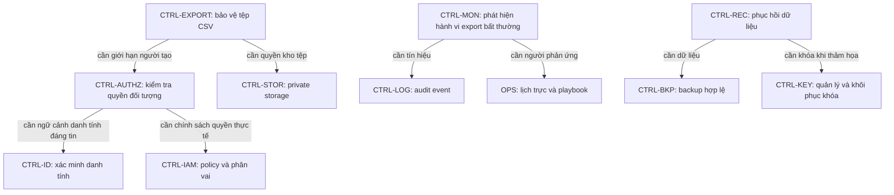
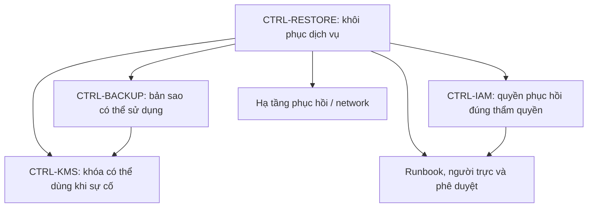

# Control dependency: Phụ thuộc giữa các security controls trong chương trình Security Assurance

## 1. Tại sao cần hiểu phụ thuộc giữa các control?

Một hệ thống có thể liệt kê nhiều security controls: xác thực danh tính, kiểm tra quyền, mã hóa, phân vùng dữ liệu, audit log, cảnh báo, backup và quy trình ứng phó. Tuy nhiên, **sự hiện diện của từng control riêng lẻ chưa chứng minh hệ thống an toàn**. Hiệu lực của một control thường phụ thuộc vào danh tính, cấu hình, dịch vụ, dữ liệu, con người hoặc một control khác. Nếu điều kiện nền tảng hỏng, các lớp bảo vệ tưởng như độc lập có thể cùng mất tác dụng.

Ví dụ trong hệ thống SaaS nhiều tenant:

- API gọi authorization service để quyết định quyền đọc hồ sơ. Nếu service không trả lời, ứng dụng **cho phép truy cập mặc định**, control phân quyền mất mục đích.
- Database được mã hóa nhưng dịch vụ ứng dụng sử dụng một khóa có quyền quá rộng; mất an toàn danh tính dịch vụ có thể làm suy yếu cả biện pháp mã hóa và giới hạn quyền dữ liệu.
- Hệ thống ghi audit log nhưng không gửi sự kiện cho công cụ giám sát hoặc không có người trực, nên control **phát hiện và phản ứng** không hoạt động dù cấu hình logging được bật.
- Backup được tạo hằng ngày, nhưng khóa giải mã cần để phục hồi chỉ tồn tại trong hệ thống đã mất; control **khôi phục** không thể đạt mục tiêu khi thực sự xảy ra sự cố.

**Control dependency (phụ thuộc giữa các biện pháp kiểm soát)** là quan hệ trong đó **khả năng hoạt động, hiệu lực bảo mật hoặc khả năng chứng minh hiệu lực** của control này cần một điều kiện hoặc control khác. Phân tích phụ thuộc giúp phát hiện **điểm lỗi chung, đường bỏ qua, chuỗi thất bại, kiểm soát cần ưu tiên kiểm chứng và giới hạn của kết luận assurance**.

Trong chương **Control framework** của module **SECURITY_SECURITY_ASSURANCE**, chủ đề này hỗ trợ mục tiêu học tập: xây dựng cách **đánh giá có bằng chứng rằng hệ thống đáp ứng các mục tiêu bảo mật**, từ phân tích rủi ro, yêu cầu, controls đến kiểm thử, audit, khắc phục phát hiện và quản trị liên tục trong phát triển, vận hành.

**Sau bài này, người học có thể:**

1. Mô tả đúng hướng và loại phụ thuộc giữa hai security controls.
2. Lập **control dependency graph** liên kết tài sản, rủi ro, requirements, controls, điều kiện nền tảng và chủ sở hữu.
3. Tìm **single point of failure, common-mode failure**, điều kiện fail-open/fail-closed, vòng phụ thuộc và phụ thuộc nhà cung cấp.
4. Thiết kế kiểm thử cho cả control và những giả định/phụ thuộc quyết định hiệu lực của nó.
5. Đưa kết quả kiểm chứng phụ thuộc vào risk register, control catalog, audit, quyết định phát hành và kế hoạch khắc phục.

## 2. Định nghĩa quan hệ phụ thuộc cho rõ ràng

Giả sử có hai control:

- **CTRL-AUTH-02**: authorization ở backend từ chối người thuộc tenant A đọc hồ sơ tenant B.
- **CTRL-ID-01**: xác thực và cung cấp ngữ cảnh danh tính/tenant đáng tin cậy cho backend.

Ta nói **AUTH phụ thuộc vào ID** khi authorization cần dữ liệu danh tính tin cậy do ID cung cấp. Quy ước mũi tên sử dụng xuyên suốt bài:

> **A → B nghĩa là “A phụ thuộc vào B”.** A là *control tiêu thụ phụ thuộc*; B là *điều kiện hoặc control nền*. Khi B thất bại, phải xem A còn đáp ứng mục tiêu hay không.

Lưu ý quy ước mũi tên trong những tài liệu khác có thể ngược. Trong dự án thực, cần ghi chú chiều mũi tên trên sơ đồ và trong schema, không suy từ hình vẽ.

### 2.1. Phụ thuộc không nhất thiết là gọi API trực tiếp

| Loại quan hệ | Ý nghĩa | Ví dụ | Điều cần xác minh |
| --- | --- | --- | --- |
| **Functional/runtime** | Control cần dịch vụ/thành phần chạy đúng. | Authorization cần identity provider hoặc kho policy. | Khi dependency timeout/lỗi, hành vi có an toàn không? |
| **Trust/data** | Control dựa vào dữ liệu đầu vào đáng tin. | Phân quyền dựa trên tenant claim đã xác minh. | Có dùng tenant ID do client tự đặt hoặc claim hết hạn không? |
| **Configuration/enforcement** | Control cần cấu hình được triển khai và thực thi. | Private storage cần IAM policy và public-access setting đúng. | Effective policy có khác IaC không? |
| **Cryptographic/key** | Bảo vệ hoặc phục hồi dữ liệu cần quản lý khóa/chứng thư. | Restore backup mã hóa cần khóa có thể truy cập theo quyền. | Có thể giải mã khi hạ tầng chính hỏng không? |
| **Monitoring/response** | Khả năng phát hiện/phản ứng cần tín hiệu, hệ thống nhận và người xử lý. | Alert cần log, rule, đường gửi và đội trực. | Sự kiện có đến người trực đúng lúc và đủ ngữ cảnh? |
| **Process/governance** | Control cần người duyệt, nguồn lực hoặc điều kiện quy trình. | Quy trình phê duyệt thay đổi nhạy cảm cần phân cấp và người thay thế. | Ai được quyết định ngoài giờ? Có dấu vết hợp lệ không? |
| **Assurance/evidence** | Kết luận về control cần bằng chứng của thành phần khác. | Đánh giá authorization cần test token và bản policy đang chạy. | Evidence có đúng build/môi trường/phạm vi và còn hiệu lực không? |
| **External/supplier** | Control phụ thuộc bên thứ ba hoặc dịch vụ chia sẻ. | Dịch vụ OTP, quản lý khóa cloud, log storage của đối tác. | Cam kết, giới hạn trách nhiệm, tình trạng hoạt động và phương án dự phòng? |

Đối với **phụ thuộc bằng chứng**, cần phân biệt: thiếu báo cáo test có thể khiến **chưa thể kết luận** control đạt, nhưng không nhất thiết khiến control kỹ thuật hỏng. Ngược lại, identity provider mất khả năng xác minh token có thể làm control thực sự **không còn nhận được dữ liệu đáng tin**. Hai tình huống cần hai cách xử lý và nhãn trạng thái khác nhau.

### 2.2. Phân biệt dependency với quan hệ liên quan đơn thuần

- **Phụ thuộc:** authorization cần quyết định danh tính đã xác minh; mất điều kiện đó có thể khiến authorization không vận hành đúng.
- **Bổ trợ (complementary):** authorization ngăn truy cập; audit/monitoring giúp phát hiện và điều tra. Hai biện pháp hỗ trợ mục tiêu chung nhưng không phải mọi lần authorization đều cần logging thành công để quyết định từ chối.
- **Dự phòng (redundant/alternative):** hai cơ chế có thể phục vụ cùng mục tiêu khi một cơ chế hỏng, **nếu** đã chứng minh hoạt động thay thế và không dùng chung điểm lỗi.
- **Kế tiếp trong quy trình:** deploy xảy ra sau code review; đây là quan hệ workflow, cần mô tả rõ nếu việc deploy **bị chặn** khi review không đạt.
- **Tham chiếu chuẩn:** hai control cùng xuất hiện trong một control framework không tự chứng minh có quan hệ phụ thuộc kỹ thuật.

Không vẽ tất cả control thành một mạng liên kết hoàn chỉnh. Mỗi cạnh cần **một lý do kiểm chứng được**: B cung cấp điều kiện thiết yếu nào cho A, và khi B hỏng thì điều gì xảy ra?

## 3. Control framework, control catalog và dependency map

Một **control framework** giúp tổ chức chuẩn hóa phạm vi kiểm soát, mục tiêu và cách quản lý. Ví dụ các tổ chức có thể tham khảo **ISO/IEC 27001 và ISO/IEC 27002**, **NIST SP 800-53**, các yêu cầu theo ngành hoặc bộ chuẩn nội bộ. Các tài liệu đó không thay thế việc hiểu **kiến trúc thực tế của hệ thống**.

Ba lớp thông tin có vai trò khác nhau:

| Lớp | Trả lời câu hỏi | Đầu ra |
| --- | --- | --- |
| **Control framework** | Những nhóm mục tiêu và kiểm soát nào cần được quản lý, cân nhắc lựa chọn? | Danh mục lĩnh vực, mục tiêu, điều kiện áp dụng và yêu cầu tổ chức. |
| **Control catalog / implementation register** | Control cụ thể nào đang được thiết kế, triển khai, sở hữu và kiểm tra? | Control ID, risk/requirement refs, owner, trạng thái, evidence. |
| **Control dependency map** | Hiệu lực hoặc việc kiểm chứng của từng control phụ thuộc thành phần nào, lỗi có lan ra đâu? | Đồ thị có hướng, loại cạnh, điều kiện lỗi, test và người chịu trách nhiệm. |

**Không ngầm khẳng định một chuẩn cụ thể bắt buộc vẽ dependency graph** nếu chưa kiểm tra điều khoản có hiệu lực. Đồ thị là công cụ kỹ thuật/quản trị hữu ích để hiểu kiến trúc và tổ chức kiểm chứng. Tổ chức vẫn phải xác định phiên bản chuẩn, yêu cầu áp dụng thực sự và chứng cứ tương ứng.

### 3.1. Vì sao mapping theo framework chưa đủ?

Một bảng có “authentication = implemented, authorization = implemented, logging = implemented, backup = implemented” có thể tạo cảm giác đầy đủ. Nhưng bảng đó không cho biết:

1. Authorization có tin cậy thuộc tính tenant từ token không?
2. Nếu authorization service timeout, API cho qua hay từ chối?
3. Logging có thực sự đến cơ chế cảnh báo, và ai nhận?
4. Nếu hệ thống khóa hỏng, có giải mã được backup để restore không?
5. Nếu một pipeline bị xâm phạm, bao nhiêu controls dựa trên artifact do pipeline đó tạo ra?

Dependency map bổ sung **quan hệ giữa controls** vào danh sách controls; nó không thay cho kiểm thử hoặc rủi ro.

## 4. Các mẫu quan hệ phụ thuộc cần nhận diện

### 4.1. Chuỗi tuần tự (chain)

Một control phụ thuộc control khác và tạo chuỗi:

```text
CTRL-APP-AUTHZ -> CTRL-IDENTITY -> CTRL-TOKEN-VALIDATION -> KEY-TRUST

Quy ước: phía trái cần phía phải. Authorization cần danh tính đáng tin;
identity cần xác minh token; xác minh token cần khóa/chứng thư tin cậy.
```

Không có nghĩa **mất một thành phần luôn tự động gây lộ dữ liệu**. Ví dụ khi xác minh token thất bại, API có thể từ chối an toàn, khiến bí mật vẫn được bảo vệ nhưng tính sẵn sàng giảm. Phải xem **failure behavior** trước khi quyết định rủi ro nào bị tác động.

### 4.2. Nhiều điều kiện đồng thời (AND)

Một kho CSV nhạy cảm chỉ đạt mục tiêu khi **(a)** private IAM policy hoạt động, **(b)** cơ chế tạo tệp giữ đúng tenant, **(c)** đường download kiểm tra quyền. Nếu tất cả đều cần thiết, mất bất kỳ điều kiện nào có thể làm hở một đường rò rỉ.

Với quan hệ AND, không được kết luận “2/3 điều kiện đã đạt nên control đạt 67%”. Kết quả phụ thuộc vào **hành vi và điều kiện chấp nhận cụ thể**.

### 4.3. Cơ chế thay thế (OR) có điều kiện

Ví dụ một hệ thống xác minh danh tính có hai nguồn khóa công khai đáng tin theo quy trình chuyển khóa được duyệt. Một nguồn không hoạt động có thể vẫn xác minh được khi nguồn còn lại hợp lệ. Tuy nhiên, phải kiểm tra chúng **thật sự độc lập**, không dùng chung cùng DNS, quyền quản trị, khóa gốc hoặc kênh phân phối có thể bị lỗi đồng thời.

**Không tự coi hai dịch vụ khác tên là hai lớp dự phòng độc lập.** Cần có thiết kế failover, negative test, quyền quản trị và bằng chứng diễn tập.

### 4.4. Phụ thuộc theo điều kiện (conditional)

Một control chỉ cần dependency trong chế độ nhất định. Chẳng hạn, bước xác minh bổ sung có thể áp dụng khi đăng nhập từ thiết bị mới hoặc khi người dùng thực hiện thao tác tài chính nhạy cảm. Dependency graph phải ghi **điều kiện kích hoạt**, nếu không sẽ gây nhầm lẫn khi kiểm tra thông thường thấy control không chạy.

### 4.5. Điểm lỗi chung (common-mode failure)

Hai controls độc lập về chức năng có thể cùng phụ thuộc vào một yếu tố:

- Cả **application authorization** và **storage policy** dùng cùng một tenant claim do client cung cấp, không được xác minh.
- Cả **backup và audit log** đều dùng chung khóa trong kho khóa mất quyền truy cập khi sự cố diễn ra.
- Cả **code scanning và deployment attestation** phụ thuộc cùng runner với quyền quản trị quá rộng.
- Hai đường nhận alert cùng phụ thuộc một cấu hình gửi thông báo không còn hoạt động.

Nếu yếu tố chung bị lỗi hoặc bị chiếm quyền, **nhiều lớp bảo vệ có thể suy yếu cùng lúc**. Đây là lý do không tính “số control” như những hàng rào độc lập khi đánh giá rủi ro còn lại.

### 4.6. Phụ thuộc vòng (cycle)

Ví dụ một dịch vụ cấp khóa cần xác thực từ identity service, trong khi identity service cần giải mã bí mật bằng chính dịch vụ cấp khóa đó lúc khởi động. Vòng này có thể gây **bootstrapping deadlock**, không thể phục hồi khi cả hai cùng khởi động lại.

Không phải mọi vòng đều sai (một số hệ thống được thiết kế bootstrap có kiểm soát), nhưng phải có **đường khởi tạo, quyền khẩn, runbook và thử nghiệm phục hồi**. Không âm thầm phá vòng bằng cách cho phép bỏ qua xác thực.

### 4.7. Phụ thuộc xuyên cấp

Một quyết định release có thể phụ thuộc **kiểm thử CI**, CI phụ thuộc **tài khoản runner**, runner phụ thuộc **IAM**, và evidence của release phụ thuộc **kho lưu log/artifact**. Phụ thuộc không chỉ nằm trong một microservice; có thể đi qua tổ chức, nhà cung cấp và quy trình phê duyệt.

## 5. Cách biểu diễn control dependency graph

Một đồ thị có hướng có thể gồm **control nodes**, **dependency nodes** (như dịch vụ/nhân sự/khóa), **risk/requirement references** và các cạnh mô tả điều kiện.



**Đọc sơ đồ:** mỗi mũi tên đi từ control *đang cần* đến thành phần *cung cấp điều kiện*. Ví dụ **CTRL-REC → CTRL-KEY** nghĩa là phục hồi phụ thuộc quản lý/khả dụng của khóa. Sơ đồ là **giả định thiết kế**, không phải bằng chứng những dependency đã hoạt động.

### 5.1. Một cạnh tốt cần metadata

| Thuộc tính cạnh | Ví dụ | Giá trị khi kiểm chứng |
| --- | --- | --- |
| **From / To** | §CTRL-EXPORT -> CTRL-STOR§ | Xác định bên phụ thuộc và bên cung cấp. |
| **Relation type** | §runtime_enforcement§ | Cho biết thiếu dependency ảnh hưởng vận hành hay chỉ evidence. |
| **Why/contract** | “Đường tải tệp không được đọc công khai”. | Nêu điều kiện thiết kế có thể kiểm thử. |
| **Condition** | “Khi xuất CSV chứa dữ liệu nhạy cảm”. | Tránh đánh giá sai trường hợp không áp dụng. |
| **Failure mode** | Storage policy bị nới quyền ngoài IaC. | Nêu cách dependency có thể hỏng thực tế. |
| **Impact if failed** | Có thể đọc CSV không đủ quyền. | Kết nối lại risk scenario và mức tác động. |
| **Fallback/mitigation** | Tạm tắt export; chặn truy cập trực tiếp. | Biện pháp giảm phơi nhiễm được phê duyệt. |
| **Verification** | Kiểm tra effective IAM + negative download test. | Bằng chứng bắt buộc của cạnh, không chỉ của nút. |
| **Owner / review trigger** | Cloud owner; thay đổi policy hoặc endpoint tải. | Có người duy trì và kiểm tra lại khi ngữ cảnh đổi. |

Không phải mọi cạnh cần hàng chục trường. Với hệ thống nhỏ, có thể ghi tối thiểu **from, to, lý do, failure behavior, owner và test/evidence**. Với rủi ro cao, bổ sung điều kiện, phụ thuộc chuyển tiếp, ngưỡng giám sát và phương án sự cố.

## 6. Các bước xây dựng dependency map thực tế

### Bước 1 — Chốt phạm vi và mục tiêu assurance

Xác định sản phẩm, môi trường, phiên bản, tài sản, dữ liệu, mục tiêu bảo mật và risk ID. Ví dụ “Đánh giá khả năng **từ chối truy cập chéo tenant** ở API export trong bản phát hành X”, cụ thể hơn “Lập dependency map cho toàn bộ security”.

### Bước 2 — Kiểm kê các controls đang được kỳ vọng

Đối chiếu control catalog, chính sách, kiến trúc và runtime. Với mỗi control ghi **ID, control objective, loại phòng ngừa/phát hiện/khôi phục, owner, tình trạng thiết kế, triển khai và bằng chứng**.

Chú ý cả **controls quy trình** như review thay đổi, phân quyền người duyệt, quy trình chuyển khóa, ứng phó sự cố, yêu cầu xác minh nhà cung cấp. Những controls này thường bị bỏ sót khi chỉ phân tích code.

### Bước 3 — Hỏi “Control này cần điều kiện nào để có hiệu lực?”

Với từng control, lần ngược:

1. Dữ liệu đầu vào nào phải đáng tin, lấy từ đâu?
2. Dịch vụ, khóa, cấu hình, mạng và quyền nào phải khả dụng?
3. Có đường thay thế hoặc bypass control không?
4. Có người/vai trò nào cần hành động trong thời hạn nhất định không?
5. Bằng chứng kết luận pass phụ thuộc công cụ và phạm vi kiểm tra nào?
6. Nếu dependency mất, control **fail-open**, **fail-closed**, suy giảm có kiểm soát hay không xác định?

### Bước 4 — Vẽ cạnh và kiểm tra cả phụ thuộc gián tiếp

Tạo cạnh A → B cùng lý do. Lần theo B để xem B lại phụ thuộc C, D nào. Cần đặc biệt chú ý **các nút có nhiều controls cùng dựa vào**, như identity provider, KMS, CI runner, runtime policy hoặc kênh giám sát.

Không nhất thiết vẽ mọi package/hàm nội bộ. Chọn mức chi tiết đủ để hiểu **đường gây hại và quyết định bảo mật**. Những liên kết không liên quan đến hiệu lực hoặc bằng chứng của control có thể giữ ở sơ đồ vận hành khác.

### Bước 5 — Review failure propagation và tính độc lập

Lập bảng: dependency hỏng **theo cách nào**, control bị ảnh hưởng **ra sao**, hậu quả với bí mật/toàn vẹn/sẵn sàng/truy vết, có fallback không, khả năng phát hiện và phục hồi. Hai control phòng ngừa có thể cùng thất bại nếu dựa vào một danh tính sai; hai backup có thể cùng vô dụng nếu phụ thuộc một khóa mất.

### Bước 6 — Thiết kế verification plan cho cạnh quan trọng

Chọn test **đúng cơ chế phụ thuộc**: token sai tenant, policy service timeout, IAM mất quyền, key unavailable, log event không được gửi, on-call không nhận alert, restore không có quyền giải mã. Thử trong môi trường **được kiểm soát và có quyền**, không gây gián đoạn production ngoài kế hoạch được duyệt.

### Bước 7 — Liên kết risk, finding, decision và vận hành liên tục

Khi dependency được chứng minh hỏng, cập nhật affected controls, risk register, finding, action, bằng chứng và người có thẩm quyền ra quyết định. Khi sửa, **retest cả dependency và các control phía trên**: chỉ xác nhận IdP hoạt động không chứng minh authorization đã xử lý đúng token.

## 7. Case study: chuỗi kiểm soát của SaaS nhân sự đa tenant

**Bối cảnh học tập:** dịch vụ HR SaaS quản lý hồ sơ, bảng lương, API export, tệp CSV trên object storage và hệ thống audit. Tenant A và tenant B phải được tách dữ liệu; người dùng có các quyền HR, người xem và người hỗ trợ. Backend sử dụng identity provider, authorization service, database, job nền, cache và storage.

### 7.1. Các rủi ro và control objectives

| Risk ID | Kịch bản | Mục tiêu bảo mật | Control objective |
| --- | --- | --- | --- |
| **R-01** | Người tenant A truy cập CSV thuộc tenant B. | Bí mật dữ liệu và giới hạn truy cập. | Chỉ chủ thể có quyền trên đúng tenant/đối tượng được tạo và tải export. |
| **R-02** | Người không đủ quyền thay đổi tài khoản nhận lương. | Toàn vẹn giao dịch. | Mọi thay đổi quan trọng phải kiểm tra quyền và trạng thái phê duyệt tại backend. |
| **R-03** | Hành vi export trái phép không được phát hiện kịp. | Truy vết và giảm hậu quả. | Có audit signal, rule phát hiện, người xử lý và hành động theo playbook. |
| **R-04** | Không khôi phục được database sau sự cố. | Sẵn sàng và khả năng phục hồi. | Restore đạt RTO/RPO do nghiệp vụ duyệt trong điều kiện đại diện. |

### 7.2. Danh mục controls và phụ thuộc then chốt

| Control ID | Control thực thi mục tiêu gì? | Phụ thuộc trực tiếp cần quản lý | Bằng chứng phù hợp |
| --- | --- | --- | --- |
| **C-ID** | Xác minh danh tính và claims đáng tin. | Khóa/chứng thư tin cậy, cấu hình verifier, vòng đời token. | Token hợp lệ/sai/giả lập, kiểm tra signature/issuer/audience theo ngữ cảnh và build. |
| **C-AUTHZ** | Quyết định quyền theo tenant và đối tượng. | C-ID, nguồn policy có hiệu lực, thuộc tính tài nguyên đáng tin. | Test sai tenant/role, lỗi dependency và mọi endpoint. |
| **C-DB** | Giới hạn truy vấn và quyền dữ liệu. | Ngữ cảnh tenant đáng tin, policy/role DB, cấu hình kết nối. | Truy vấn thử sai tenant, effective grants và test application path. |
| **C-EXPORT** | Không tạo/tải CSV ngoài quyền. | C-AUTHZ, C-DB, C-STORE, ngữ cảnh job và đường download. | Test job, URL/download, quyền storage, tệp giả định. |
| **C-STORE** | Kho CSV không công khai và chỉ danh tính cho phép đọc. | IAM, effective resource policy, cấu hình cấp link. | Policy thực tế và negative access test. |
| **C-CACHE** | Không trả dữ liệu tenant/role khác từ cache. | Tenant/role context đáng tin, cache key/invalidation. | Test cache hit/miss, thay quyền và dữ liệu chéo tenant. |
| **C-AUDIT** | Ghi sự kiện đủ truy vết, không làm lộ dữ liệu. | Tín hiệu nguồn, vận chuyển log, quyền lưu và giữ log. | Event giả định và kết quả trong kho log có kiểm soát. |
| **C-DETECT** | Phát hiện và xử lý hành vi export bất thường. | C-AUDIT, rule/cảnh báo, đội trực và quyền hành động. | Test end-to-end alert đến người nhận, triage và response. |
| **C-WORKFLOW** | Phê duyệt thay đổi tài khoản nhận lương đúng quyền. | C-ID, C-AUTHZ, state machine và audit. | Test bỏ qua bước, tự phê duyệt, cạnh tranh và giao dịch lặp. |
| **C-BACKUP** | Bảo vệ bản sao dữ liệu có thể phục hồi. | Storage, scheduler, quyền, khóa, cấu hình và giám sát. | Backup report và khả năng truy cập bản sao hợp lệ. |
| **C-RESTORE** | Khôi phục theo RTO/RPO. | C-BACKUP, KMS/khóa, runbook, tài khoản khẩn và hạ tầng phục hồi. | Diễn tập restore có thời gian/mất dữ liệu thực đo. |
| **C-RELEASE** | Chỉ cho phép phát hành khi đủ điều kiện bảo mật. | Test/report, CI artifact integrity, thông tin finding, thẩm quyền phê duyệt. | Gate report, build ID và quyết định phát hành. |

**Bảng này không xác nhận các control đã đạt**. Nó là giả thuyết cần kiểm chứng trong một hệ thống giả định. Trong thực tế, việc dùng chung service không tự biến mọi tính năng thành control tương đương; mỗi control cần một mục tiêu và tiêu chí riêng.

### 7.3. Phân tích một cạnh quyết định: C-EXPORT → C-AUTHZ

Giả sử C-EXPORT tạo tệp khi API trả lời “được phép”. Nếu quyền được kiểm tra **chỉ lúc tạo job** nhưng người dùng bị thu hồi quyền trước khi tải, thiết kế cần quyết định **tái kiểm tra khi download**, hay ràng buộc link đủ ngắn/hạn chế và có cơ chế thu hồi phù hợp. Không có một câu trả lời chung cho mọi sản phẩm; phải dựa vào mô hình dữ liệu, hậu quả và yêu cầu.

Các trường hợp kiểm thử:

1. Chủ thể tenant A tạo export của mình, được tải đúng tệp (positive).
2. Chủ thể tenant A yêu cầu tệp tenant B, phải bị từ chối (negative).
3. Cùng tenant nhưng thiếu quyền, phải bị từ chối tại backend.
4. Quyền được thu hồi giữa lúc tạo và tải; kết quả phải tuân theo quy tắc quyền đã phê duyệt.
5. Authorization dependency timeout hoặc trả dữ liệu không thể xác minh; không được mở quyền cho tệp nhạy cảm.
6. URL storage bị truy cập trực tiếp ngoài ứng dụng; không được lộ dữ liệu trái phép.

### 7.4. Phân tích điểm lỗi chung: C-DB và C-EXPORT

Giả sử database query và export job đều dùng §tenantId§ lấy từ tham số request. C-DB có thể lọc theo tenant và C-EXPORT có thể kiểm tra tenant trong payload, nhưng cả hai cùng tin thuộc tính **do người gọi tự chọn**. Hai controls trên bảng không tạo hai rào cản độc lập.

**Thiết kế tốt hơn:** lấy tenant từ danh tính được xác minh, đối chiếu quyền trên đối tượng và phạm vi dữ liệu; job nhận ngữ cảnh được kiểm chứng thay vì tham số tùy ý; lưu test cho đường đồng bộ/bất đồng bộ. Với database, có thể cân nhắc cơ chế phân vùng bổ trợ phù hợp công nghệ và kiểm chứng các đường bypass.

### 7.5. Phân tích phụ thuộc detective: C-DETECT → C-AUDIT → hệ thống log

Nếu API phát ra sự kiện nhưng bộ chuyển log ngừng hoạt động, C-DETECT có thể không nhận đủ signal. Nếu alert được gửi đến một hộp thư không còn người trực, **khả năng phát hiện–phản ứng** vẫn thất bại. Cần kiểm thử end-to-end bằng sự kiện có dấu mốc với dữ liệu thử, kiểm tra thời gian đến cảnh báo, người nhận và hành động xử lý.

**Không suy rằng ghi log chính là đã phát hiện.** Logging là điều kiện nền; detection và response là các control có đầu ra khác nhau.

## 8. Phân tích phụ thuộc khi có sự cố và failure mode

Một dependency lỗi có thể ảnh hưởng **các mục tiêu bảo mật khác nhau theo cách khác nhau**. Chẳng hạn, khi identity provider mất kết nối:

| Thiết kế khi dependency lỗi | Bí mật/toàn vẹn | Sẵn sàng | Đánh giá assurance |
| --- | --- | --- | --- |
| **Fail-open:** bỏ kiểm tra quyền cho request nhạy cảm. | Có thể bị vi phạm nghiêm trọng. | Có thể tiếp tục xử lý request. | Không đạt control objective cho truy cập nhạy cảm. |
| **Fail-closed:** từ chối khi không có quyết định tin cậy. | Thường giữ ranh giới quyền tốt hơn. | Có thể gián đoạn chức năng. | Cần test cả security và hậu quả availability. |
| **Graceful degradation đã thiết kế:** dùng ngữ cảnh/policy còn hợp lệ trong giới hạn, hạn thời gian và quyền. | Phụ thuộc mức độ bảo đảm chống stale/revoked permissions. | Có thể cải thiện một phần availability. | Cần tiêu chí ràng buộc, test expiry/revocation và phê duyệt phù hợp. |
| **Không rõ hành vi:** tùy lỗi hoặc nhánh code. | Không thể kết luận đáng tin. | Không thể dự đoán. | Ghi unverified, ưu tiên kiểm thử và review. |

**Fail-closed không đồng nghĩa không cần xem xét.** Với một hệ thống liên quan an toàn con người hoặc chức năng đặc biệt quan trọng, từ chối toàn bộ dịch vụ cũng có thể gây hậu quả nghiêm trọng. Cần thiết kế chế độ suy giảm an toàn **với các quyền/điều kiện đã được quản trị chấp thuận**, không dùng “availability” như lý do tự mở quyền bí mật.

### 8.1. Kỹ thuật phân tích hữu ích

- **Failure Mode and Effects Analysis (FMEA) định tính:** điều gì hỏng, hậu quả tại control và hệ thống, cách phát hiện, khắc phục.
- **Fault tree / attack path:** điều kiện AND/OR nào dẫn đến hậu quả, có điểm lỗi chung không?
- **Dependency walk:** chọn một control trọng yếu và lần theo các phụ thuộc trực tiếp/gián tiếp.
- **Tabletop exercise:** giả lập mất IAM, KMS, monitoring hoặc nhà cung cấp, kiểm tra người ra quyết định và phương án vận hành.
- **Controlled fault injection:** trong môi trường được phép, gây timeout/lỗi phụ thuộc có kiểm soát để chứng minh control phản ứng đúng.

Không cần tính xác suất thất bại bằng cách **nhân xác suất của các controls** nếu chưa có dữ liệu đáng tin và không chứng minh được tính độc lập. Cấu trúc phụ thuộc, điều kiện lỗi và evidence thường có giá trị quản trị hơn một số thập phân có vẻ chính xác.

### 8.2. Bảng failure mode cho case study

| Dependency/failure mode | Controls bị ảnh hưởng | Hậu quả có thể xảy ra | Kiểm thử và biện pháp cần xem |
| --- | --- | --- | --- |
| Identity claim tenant không đáng tin. | C-AUTHZ, C-DB, C-EXPORT, C-CACHE. | Lộ dữ liệu chéo tenant, sai phạm vi quyền. | Negative tests với claim sai; xác minh nguồn thuộc tính và quyền đối tượng. |
| Authorization service timeout. | C-AUTHZ, C-EXPORT, C-WORKFLOW. | Fail-open có thể gây lộ/sửa dữ liệu, fail-closed có thể gián đoạn. | Fault injection được phép; kiểm tra fallback, log, chỉ tiêu availability. |
| Storage policy drift thành public. | C-STORE, C-EXPORT. | Đọc CSV ngoài quyền. | Runtime effective policy, negative download, phát hiện drift. |
| Kênh chuyển log ngừng hoạt động. | C-AUDIT, C-DETECT. | Không phát hiện kịp, thiếu bằng chứng điều tra. | Event-to-alert end-to-end, giám sát health của log pipeline. |
| KMS/khóa không khả dụng khi thảm họa. | C-BACKUP, C-RESTORE và dịch vụ phụ thuộc khóa. | Không đọc backup, không phục hồi kịp. | Diễn tập restore cùng điều kiện mất hạ tầng, kiểm tra quyền khẩn. |
| CI runner hoặc artifact registry bị sai quyền. | C-RELEASE, bằng chứng từ test, thành phần triển khai. | Artifact không đáng tin, gate bị vượt. | Quyền runner, provenance, phê duyệt thay đổi, đối chiếu artifact. |

## 9. Kiểm chứng dependency trong Security Assurance

### 9.1. Kiểm chứng ba tầng: thiết kế, triển khai, vận hành

| Tầng | Câu hỏi | Bằng chứng |
| --- | --- | --- |
| **Design effectiveness** | Mối quan hệ A → B được hiểu đúng chưa? Khi B hỏng, A có giải pháp an toàn và đáp ứng risk scenario không? | Architecture/DFD, control specification, design review, bảng failure modes. |
| **Implementation** | Cơ chế phụ thuộc và fallback đã được triển khai đúng phiên bản chưa? | Code/IaC review, cấu hình, artifact, đường phụ thuộc và phiên bản library/service. |
| **Operating effectiveness** | Tại thời điểm/giai đoạn kiểm tra, A có thực sự hoạt động khi B đúng, sai hoặc không khả dụng không? | Negative/integration/fault tests, runtime policy, monitoring, diễn tập và người xác minh. |

Một sơ đồ dependency được duyệt **không chứng minh** các điều kiện đã được triển khai. Một test pass ở staging cũng không tự động chứng minh production có cùng policy, khóa hoặc quyền.

### 9.2. Control pass nhưng dependency unknown: kết luận thế nào?

Ví dụ C-AUTHZ có một ca test pass ở endpoint detail, nhưng tính tin cậy của tenant claim từ tác vụ export chưa được xác minh. Kết luận đúng phải là **“Pass trong phạm vi test detail, chưa xác minh export dependency”**, không phải “Authorization của hệ thống Pass”.

Có thể lưu các trạng thái:

| Trạng thái | Cách dùng |
| --- | --- |
| **Verified effective in scope** | Có bằng chứng đủ để kết luận hiệu lực trong phạm vi và giai đoạn đã kiểm tra. |
| **Partially effective** | Có đường/điều kiện đã đạt, phần khác không đạt hoặc chưa được bao phủ. |
| **Implemented, unverified** | Có code/cấu hình nhưng chưa xác minh hành vi cần thiết. |
| **Failed** | Có evidence cho thấy control hoặc dependency không đáp ứng tiêu chí. |
| **Unknown/insufficient evidence** | Thiếu thông tin đáng tin để kết luận; cần owner và kế hoạch xác minh. |
| **Not applicable with reason** | Quan hệ không áp dụng với tài sản/điều kiện cụ thể, có căn cứ. |

**N/A không phải cách che bằng chứng thiếu.** Nếu dependency có áp dụng nhưng tool không có quyền đọc hoặc report đã hết giá trị sau thay đổi, phải đánh dấu unverified/unknown, không tự cho pass.

### 9.3. Ma trận test dependency

| Test ID | Tình huống kiểm tra | Kết quả mong đợi | Evidence quan trọng |
| --- | --- | --- | --- |
| **DEP-T01** | Người tenant A truy xuất export của tenant B. | Từ chối, không trả dữ liệu/metadata nhạy cảm. | Build, tenant thử, API path, expected/actual. |
| **DEP-T02** | Claim tenant sai hoặc chưa được xác minh. | Không tin thuộc tính client; từ chối khi không có identity context tin cậy. | Token/test fixture an toàn, verifier behavior. |
| **DEP-T03** | Authorization dependency timeout. | Từ chối request nhạy cảm hoặc chế độ suy giảm có phê duyệt; có tín hiệu vận hành. | Fault scenario, kết quả, alert, phạm vi. |
| **DEP-T04** | Download storage bằng danh tính không được cấp quyền. | Không thể tải CSV ngoài quyền, kể cả bypass API. | Effective policy, negative access test với tệp giả. |
| **DEP-T05** | Chuyển log/alert ngừng hoạt động. | Hệ thống phát hiện lỗi kênh giám sát và phản ứng theo playbook. | Sự kiện dấu mốc, latency, người nhận. |
| **DEP-T06** | Restore backup khi điều kiện truy cập khóa chính mất. | Kịch bản phục hồi đáp ứng RTO/RPO hoặc ghi finding và xử lý. | Diễn tập, quyền/khóa thử, thời gian/mất dữ liệu. |
| **DEP-T07** | Quyền user bị thu hồi trong lúc job export đang chạy. | Hành vi theo chính sách revocation đã được duyệt, không lộ dữ liệu ngoài quyền. | Timeline thay đổi quyền, kết quả job/download. |
| **DEP-T08** | IaC đúng nhưng runtime policy bị thay ngoài pipeline. | Drift được phát hiện và đánh giá rủi ro/khắc phục. | Snapshot trước/sau, kết quả kiểm tra, alert và action. |

Các phép thử gây lỗi phải chạy trong **môi trường có kiểm soát** và được phép, tránh gây gián đoạn sản xuất trái kế hoạch. Nếu cần diễn tập production, phải có phương án rollback, người có thẩm quyền và cơ chế giám sát an toàn.

## 10. Dependency và khả năng khôi phục: trường hợp backup–KMS–IAM

**Rủi ro R-RESTORE-01:** dịch vụ trả lương ngừng hoạt động khi database hỏng; backup có sẵn nhưng không đọc được do mất khóa hoặc quyền giải mã khi phục hồi.

Các dependency thường gặp:



Đường **CTRL-RESTORE → CTRL-KMS** và **CTRL-BACKUP → CTRL-KMS** cho thấy hai phần của chương trình phục hồi có thể cùng phụ thuộc vào quản lý khóa. Nếu khóa giải mã chỉ được lưu ở database bị mất, backup sẽ không có giá trị phục hồi dù có nhiều bản sao.

### 10.1. Các điều kiện cần kiểm chứng

1. **Độ đầy đủ và khả dụng của backup:** bản sao chứa dữ liệu/metadata cần thiết và có thể lấy từ môi trường phục hồi.
2. **Quản lý khóa:** quyền giải mã và vật liệu khóa có thể phục hồi an toàn; không lạm dụng bản sao không được bảo vệ.
3. **IAM khẩn:** danh tính phục hồi chỉ có quyền cần thiết, có khả năng tiếp cận khi các dịch vụ chính hỏng và được audit.
4. **Hạ tầng dự phòng:** dịch vụ, network, DNS, secrets và cấu hình phụ thuộc có thể thiết lập theo runbook.
5. **Con người/quy trình:** có người được đào tạo, liên hệ được và có quyền thực hiện/duyệt các bước phục hồi trong khung thời gian mục tiêu.
6. **Bằng chứng:** restore drill đo thời gian khôi phục và mức mất dữ liệu, so với RTO/RPO **do nghiệp vụ phê duyệt**.

### 10.2. Kết luận đúng phạm vi

“Backup job thành công” chỉ chứng minh bản sao được tạo theo cách kiểm tra của job. “Restore drill đạt trong môi trường đại diện” chứng minh tốt hơn khả năng phục hồi **theo điều kiện diễn tập**, nhưng chưa khẳng định mọi kịch bản thảm họa. Cần ghi những điều kiện **chưa thử** như mất toàn vùng, khóa không truy cập được hoặc người có quyền vắng mặt.

## 11. Đánh giá tầm ảnh hưởng của dependency và ưu tiên xử lý

Một dependency ảnh hưởng nhiều controls có thể cần ưu tiên cao, nhưng **số cạnh nối** không đủ để đánh giá mức nguy hiểm.

### 11.1. Các câu hỏi ưu tiên

- Dependency ảnh hưởng những **risk scenarios và mục tiêu bảo mật** nào? Hậu quả lớn nhất?
- Nếu hỏng, control sẽ **fail-open, fail-closed hay suy giảm**? Hậu quả với bí mật, toàn vẹn và sẵn sàng có khác nhau không?
- Bao nhiêu dịch vụ/tenant/phần chức năng thực sự phụ thuộc? Có **blast radius** lan rộng không?
- Có fallback **độc lập đã được kiểm thử** hay chỉ được mô tả?
- Điều kiện hỏng có thể được phát hiện và khắc phục trong bao lâu?
- Hiệu lực và độ tin cậy của bằng chứng đã được kiểm tra ở **phiên bản/môi trường** nào?
- Có nghĩa vụ bắt buộc, sự cố đang diễn ra hoặc thời điểm nghiệp vụ làm tăng ưu tiên không?

### 11.2. Bảng minh họa ưu tiên

| Dependency | Phạm vi ảnh hưởng | Hiệu ứng khi hỏng | Độ tin cậy | Hành động ưu tiên |
| --- | --- | --- | --- | --- |
| **Verified tenant claims** | Authorization, DB filtering, export và cache nhiều tenant. | Có thể vi phạm bí mật hàng loạt nếu các lớp cùng tin claim giả. | Chưa có negative test đầy đủ. | Kiểm thử và sửa nguồn tin cậy ngay theo ngưỡng rủi ro; rà soát các đường dữ liệu. |
| **Private object storage** | Đường tải CSV. | Có thể lộ file nếu policy công khai. | Runtime test cho thấy sai lệch. | Giảm phơi nhiễm, điều tra dấu hiệu truy cập, sửa và retest. |
| **Monitoring pipeline** | Cảnh báo và điều tra hoạt động export. | Phát hiện/ứng phó chậm, thiếu chứng cứ. | Có log nhưng chưa test alert end-to-end. | Kiểm tra kênh tín hiệu, người trực và thời gian phản ứng. |
| **KMS khả dụng khi DR** | Backup/restore, một số dịch vụ dùng khóa. | Không khôi phục kịp khi thảm họa. | Chưa diễn tập trong điều kiện mất vùng. | Thiết kế/diễn tập phục hồi đúng nhu cầu, có phương án quyền khẩn. |

Trong ví dụ, việc **runtime policy đang cho phép public access** cần hành động nhanh theo hậu quả, dù dependency đó có ít cạnh hơn identity provider. Ngược lại, một node có nhiều cạnh nhưng đã có fallback độc lập và bằng chứng mạnh không nhất thiết là ưu tiên số một.

### 11.3. Không chấm giảm rủi ro nhiều lần vì control phụ thuộc chung

Giả sử nhóm ghi:

- C-AUTHZ giảm likelihood từ 4 xuống 3.
- C-DB giảm tiếp từ 3 xuống 2.
- C-EXPORT giảm tiếp xuống 1.

Nếu cả ba dùng **cùng tenant claim không được xác minh**, phép hạ điểm tuần tự không có căn cứ độc lập. Phải phân tích **đường gây hại tổng thể và common-mode failure**, không nhân mức giảm của các controls như những xác suất độc lập.

Với cách chấm định tính hoặc bán định lượng, giải thích bằng chứng và giới hạn quan trọng hơn một số điểm đẹp. **Current residual risk** phản ánh hiệu lực hiện tại có căn cứ; **target residual risk** là mức kỳ vọng sau thiết kế/sửa lỗi chưa được kiểm chứng.

## 12. Mẫu dependency register có thể dùng cho dự án

Đồ thị trực quan hữu ích để trao đổi; **dependency register** giúp quản lý phiên bản, owner, test và finding. Dưới đây là mẫu YAML minh họa **không phải schema tiêu chuẩn bắt buộc**. Các mã, điểm và tên dịch vụ chỉ nhằm học tập:

```yaml
dependency_id: "DEP-HR-EXPORT-01"
model_version: "2026-Q4-v1"
service: "HR SaaS"
environment: "production"
relation_direction: "consumer_depends_on_provider"
consumer_control:
  id: "CTRL-EXPORT"
  objective: "Chỉ chủ thể đúng quyền được nhận tệp xuất"
provider_control:
  id: "CTRL-AUTHZ"
  objective: "Xác minh quyền theo tenant và đối tượng"
relation:
  type: "runtime_enforcement"
  required_when: "Tạo hoặc tải tệp CSV chứa dữ liệu nhân sự"
  contract: "Authorization decision phải dựa trên identity đã xác minh"
  assumptions:
    - "Mọi đường export/download đi qua enforcement đã được duyệt"
    - "Policy data thực tế nhất quán với quyền sử dụng"
  failure_modes:
    - id: "F-01"
      cause: "Authorization service timeout"
      expected_behavior: "Từ chối khi không thể xác minh quyền"
      impact: "Có thể gián đoạn export nhưng không tự mở quyền"
    - id: "F-02"
      cause: "Tenant claim không đáng tin"
      expected_behavior: "Từ chối và tạo tín hiệu điều tra phù hợp"
      impact: "Nếu bỏ qua điều kiện, có nguy cơ lộ chéo tenant"
risk_refs: ["R-01"]
requirement_refs: ["REQ-AUTH-01"]
verification:
  design_review_ref: "DESIGN-REVIEW-11"
  tests: ["DEP-T01", "DEP-T02", "DEP-T03", "DEP-T07"]
  evidence_refs: ["EVIDENCE-AUTHZ-18"]
  scope: "API export, download và job ở build được xác định"
  result: "pending_verification"
  confidence: "low"
ownership:
  consumer_owner_role: "Engineering lead"
  provider_owner_role: "Identity/authorization team"
  assurance_verifier_role: "Security QA"
  risk_owner_role: "Product risk owner"
governance:
  next_review: "Theo kỳ được phê duyệt"
  event_triggers:
    - "Thay đổi identity provider hoặc policy"
    - "Thêm API export"
    - "Finding về BOLA hoặc sự cố"
  finding_refs: []
  decision_ref: "DECISION-HR-12"
```

### 12.1. Tách trạng thái control và trạng thái dependency

Một control catalog có thể ghi §CTRL-AUTHZ = implemented§; dependency record §DEP-HR-EXPORT-01 = pending_verification§ vì chưa có bằng chứng rằng **job export** luôn gọi authorization đúng. Không được tự đồng bộ hai trạng thái thành “đạt”.

Với mỗi lần cập nhật, lưu **ai**, **khi nào**, **đổi điều gì**, **bằng chứng nào** và **đường kết luận nào bị ảnh hưởng**. Những tài liệu chứa kiến trúc nhạy cảm, đường truy cập, lỗi chưa sửa hoặc secret phải được phân quyền và tránh sao chép dữ liệu khách hàng thật.

### 12.2. Chuỗi truy vết

```text
THREAT-T01   Người tenant A cố tải export tenant B
  RISK-R01   Lộ hồ sơ giữa tenant
  REQ-01     Kiểm tra quyền theo tenant + đối tượng
  CTRL-EXP   Control bảo vệ export
    DEP-01   CTRL-EXP -> CTRL-AUTHZ
    DEP-02   CTRL-EXP -> CTRL-STORE
    DEP-03   CTRL-AUTHZ -> CTRL-ID
  TEST-01    Negative access chéo tenant
  TEST-02    Timeout policy dependency
  EVID-01    Build, môi trường, kết quả test, effective policy
  FIND-01    Export bypass authorization ở một đường
  ACTION-01  Sửa đường bypass và retest
  DEC-01     Risk owner quyết định theo thẩm quyền
```

Chuỗi này cho phép reviewer đi từ **mục tiêu bảo mật** tới **phụ thuộc và bằng chứng**, không chỉ hỏi “đã bật control chưa?”.

## 13. Quản trị trách nhiệm và phụ thuộc bên thứ ba

### 13.1. Ai phải chịu trách nhiệm cho một dependency?

Không nên giả định owner của control phía trên là người có quyền sửa toàn bộ dependency phía dưới. Ví dụ engineering sở hữu code export, nhưng **identity team** sở hữu token validation và **cloud platform team** sở hữu storage policy.

| Hoạt động | Risk owner/PO | Security/GRC | Engineering | Platform/Ops | QA/Assessor | Lãnh đạo |
| --- | :---: | :---: | :---: | :---: | :---: | :---: |
| Xác lập rủi ro và yêu cầu cho hệ thống | **A** | **R** | R | C | C | I |
| Lập control catalog, dependency map và giới hạn phạm vi | C | **A/R** | R | R | C | I |
| Thiết kế điểm thực thi control ứng dụng | C | C | **A/R** | R | C | I |
| Thiết kế và duy trì shared IAM/KMS/logging control | C | C | R | **A/R** | C | I |
| Kiểm chứng dependency và failure behavior | I | C | R | R | **A/R** | I |
| Cập nhật finding và assurance conclusion | C | **A** | R | R | **R** | I |
| Chấp nhận residual risk trong thẩm quyền | **A** | **R** | C | C | C | I |
| Quyết định vượt thẩm quyền product risk owner | **R** | **R** | C | C | C | **A** |
| Rà soát nguồn lực và các điểm lỗi chung toàn chương trình | **R** | **R** | C | C | C | **A** |

**RACI trên chỉ là ví dụ**; tổ chức cần gán người/nhóm thực tế và phân cấp đúng quyền. Với mỗi hoạt động nên có một A rõ ràng, ít nhất một R; có thể tách hàng theo control nếu các đội có thẩm quyền khác nhau. Người kiểm thử không mặc nhiên chấp nhận rủi ro kinh doanh; nhà cung cấp thực hiện control không làm tổ chức mất trách nhiệm giám sát rủi ro của mình.

### 13.2. Nhà cung cấp là một dependency quan trọng

Ví dụ tổ chức dùng identity provider bên ngoài:

- **Provider** chịu trách nhiệm vận hành các dịch vụ theo hợp đồng và công bố/đáp ứng các điều khoản đã cam kết.
- **Đội tích hợp** chịu trách nhiệm xác minh token, issuer/audience, thay đổi khóa, timeout/fallback và kiểm thử tương thích.
- **Security/GRC** đánh giá evidence từ provider, các giả định chưa chứng minh và phương án sự cố.
- **Risk owner** quyết định xử lý rủi ro còn lại theo thẩm quyền, không tự coi hợp đồng hoặc chứng chỉ của provider là bằng chứng mọi tích hợp đã an toàn.

Một báo cáo audit hoặc attestation của bên thứ ba có thể hỗ trợ assurance **trong phạm vi, thời điểm và loại dịch vụ được đánh giá**, nhưng không chứng minh cấu hình tích hợp riêng của tổ chức. Khi thay nhà cung cấp, đổi API hoặc trách nhiệm chung, phải cập nhật dependency map và verification plan.

### 13.3. Phụ thuộc quy trình và con người

Nếu một control đòi hỏi đội trực phản hồi trong khoảng thời gian mục tiêu, cần **người thay thế ngoài giờ, lịch trực thực tế, quyền ứng phó và drill**. Một email “đã gửi cảnh báo” không chứng minh hành động đã diễn ra. Tương tự, quy trình chấp nhận ngoại lệ cần người phê duyệt có quyền, điều kiện, hạn và phương án khi vắng mặt.

## 14. Quản lý thay đổi và dependency drift

Dependency graph là **mô hình sống**. Một cạnh có thể mất hiệu lực khi cấu hình, phiên bản, cấu trúc quyền hoặc con đường dữ liệu thay đổi.

### 14.1. Các sự kiện kích hoạt review

| Trigger | Dependency nào có thể thay đổi? | Đầu ra cần cập nhật |
| --- | --- | --- |
| Thêm endpoint export, cache hoặc batch job. | Bypass authorization và storage permission. | Data flow, edge mới, test phân quyền. |
| Đổi identity provider, claim mapping hoặc key rotation. | C-ID, C-AUTHZ, C-WORKFLOW. | Trust assumptions, fallback, token tests. |
| Cập nhật Kubernetes/IaC/cloud policy. | IAM/network/storage enforcement. | Declared/effective state, drift evidence, risk. |
| Thay hệ thống log/SIEM hoặc đội trực. | C-AUDIT, C-DETECT, response. | End-to-end alert test, runbook, owner. |
| Thay kho backup/KMS hoặc vùng DR. | C-BACKUP, C-RESTORE. | Restore drill, quyền/khóa và mục tiêu RTO/RPO. |
| Kết quả audit, pentest, incident hoặc test fail. | Có thể lộ dependency chưa ghi hoặc giả định sai. | Finding, root cause, revised graph và retest. |
| Release gate đổi nguồn artifact hoặc CI runner. | C-RELEASE và độ tin cậy evidence pipeline. | Supply-chain control, quyền và provenance. |

### 14.2. Tích hợp với CI/CD và Change Management

Quy trình thực tế có thể yêu cầu:

1. Các PR ảnh hưởng tới authentication/authorization, IAM, storage, logging, KMS, backup và pipeline phải **đánh giá tác động dependency**.
2. Nếu thêm/sửa đường dữ liệu, cập nhật graph hoặc ghi rõ vì sao không đổi.
3. Chạy test cần thiết cho cả **control trực tiếp** và **downstream consumers** có thể chịu ảnh hưởng từ dependency vừa thay.
4. Lưu artifact/build, evidence, reviewer, thay đổi và các điều kiện còn chưa xác minh.
5. Người có thẩm quyền quyết định release trong phạm vi của họ; không cho phép bỏ qua điều kiện bắt buộc chỉ vì gate xanh ở một phần scope.
6. Sau deploy, kiểm tra effective state, theo dõi drift và đánh giá lại khi phát sinh cảnh báo hoặc sự cố.

### 14.3. Đánh giá tác động một thay đổi nhỏ

Giả sử đội identity thay logic ánh xạ tenant claim. Đối với họ, đây có thể chỉ là một sửa đổi nhỏ. Dependency map cho thấy **C-AUTHZ, C-DB, C-EXPORT và C-CACHE** đều dựa trên claim đó. Vì vậy test hồi quy cần mở rộng đến **đường truy cập chéo tenant và cache/export**, không chỉ unit test của identity service.

Ngược lại, nếu sửa một cảnh báo không dùng tenant claim, không cần tự động kiểm thử lại mọi control của hệ thống; chọn phạm vi theo **quan hệ thực sự và hậu quả**.

## 15. Chỉ số để đánh giá quản lý phụ thuộc

Các chỉ số chỉ có giá trị khi ghi rõ **mẫu số, phạm vi, nguồn, thời điểm và chất lượng bằng chứng**:

| KPI/KRI minh họa | Cách tính hoặc quan sát | Điều không nên suy ra |
| --- | --- | --- |
| **Dependency coverage** | Các control trọng yếu có map dependency được review / tổng control trọng yếu trong phạm vi. | Có đồ thị không có nghĩa các cạnh đã được kiểm chứng. |
| **Edge verification coverage** | Quan hệ quan trọng có test/evidence hiệu lực / tổng quan hệ quan trọng cần kiểm tra. | Bằng chứng cũ hoặc sai môi trường không chứng minh trạng thái hiện tại. |
| **Unknown dependencies** | Quan hệ có impact lớn nhưng loại, owner hoặc failure behavior chưa rõ. | Ít dòng Unknown có thể do thiếu kiểm kê chứ không phải hệ thống an toàn. |
| **Common-mode findings** | Các điểm lỗi chung chưa có biện pháp/kiểm chứng / tổng điểm đã nhận diện. | Số điểm lỗi tăng có thể do phân tích tốt hơn. |
| **Dependency change review** | Thay đổi có ảnh hưởng quan trọng đã review/retest / tổng thay đổi thuộc phạm vi. | PR được gắn nhãn review nhưng không chạy test cần thiết. |
| **Cascading failure recovery** | Kết quả diễn tập khi một dependency quan trọng hỏng so với mục tiêu. | Một lần diễn tập đạt không chứng minh mọi điều kiện thảm họa. |
| **Finding closure by verification** | Finding dependency được retest đúng phạm vi / tổng finding đến hạn đóng. | Ticket “Done” không bằng verified effective. |
| **Supplier evidence freshness** | Dependency ngoài tổ chức có bằng chứng còn phù hợp theo kỳ / tổng dependency thuộc phạm vi. | Báo cáo provider không chứng minh cấu hình tích hợp của khách hàng. |

Ví dụ, “100% controls có owner” không nói lên khả năng bảo vệ dữ liệu nếu **control xuất CSV đang phụ thuộc claim giả**. Đánh giá chất lượng phải kết hợp **mức tác động của những đường phụ thuộc chưa được kiểm chứng** thay vì chỉ đếm hàng/cạnh.

## 16. Các lỗi thường gặp khi phân tích dependency

| Sai lầm | Vì sao gây kết luận sai? | Hướng cải thiện |
| --- | --- | --- |
| Xem controls là các checkbox độc lập. | Bỏ qua sự phụ thuộc chung và đường bypass. | Lập graph theo rủi ro, kiểm chứng các cạnh trọng yếu. |
| Vẽ mọi thứ liên quan thành dependency. | Đồ thị nhiễu, khó ưu tiên. | Mỗi cạnh có lý do, điều kiện và failure behavior. |
| Không ghi chiều mũi tên. | Người đọc hiểu sai ai phụ thuộc ai. | Ghi quy ước A → B ở mọi sơ đồ và schema. |
| Nhầm evidence dependency với runtime dependency. | Thiếu report bị coi là control hỏng hoặc ngược lại. | Gắn loại cạnh, phân biệt unknown với failed. |
| Coi hai control dùng chung identity claim là hai lớp độc lập. | Đánh giá thấp common-mode failure. | Kiểm tra nguồn tin cậy và phụ thuộc bắc cầu. |
| Chỉ xét fail-open, bỏ qua availability của fail-closed. | Giải pháp có thể gây gián đoạn nghiêm trọng. | Review các mục tiêu CIA và chế độ suy giảm an toàn. |
| Chỉ test control khi dependency bình thường. | Không thấy timeout, data stale, quyền lỗi, mất khóa. | Test điều kiện lỗi được phép, có rollback và monitoring. |
| Đóng finding của dependency mà không retest consumers. | Các đường sử dụng vẫn có thể bypass hoặc xử lý sai. | Regress các control phía trên theo scope tác động. |
| Tin backup khi chưa kiểm tra KMS và quyền DR. | Backup không thể giải mã/restore khi sự cố. | Diễn tập với điều kiện phụ thuộc và đánh giá RTO/RPO. |
| Đánh giá nhà cung cấp qua chứng chỉ chung, không xét tích hợp. | Bỏ sót phần trách nhiệm của tổ chức. | Mapping trách nhiệm và test hành vi tích hợp. |
| Hạ current residual vì có kế hoạch fallback. | Thiết kế dự kiến chưa chứng minh hiệu lực. | Tách target và current, retest trước kết luận. |
| Để graph và evidence chứa token/dữ liệu thật. | Hồ sơ kiểm soát trở thành nguồn rò rỉ. | Phân quyền, ẩn dữ liệu, dùng evidence ref. |

## 17. Bài tập thực hành: phân tích phụ thuộc cho nền tảng thanh toán

**Tình huống:** một nền tảng thanh toán đa tenant có API tạo giao dịch, thay tài khoản nhận tiền, webhook đối tác, job xử lý, database, secrets manager, log, backup và CI/CD. Các cơ chế hiện có gồm xác thực token, authorization, quy trình hai bước phê duyệt, audit event, cảnh báo gian lận, backup mã hóa và restore runbook.

Trong đợt review, nhóm phát hiện:

- Một service lấy tenant ID từ header do client gửi rồi truyền sang cả query database và job tạo báo cáo.
- Dịch vụ xác minh danh tính thỉnh thoảng timeout; chưa rõ endpoint thay tài khoản nhận tiền phản hồi thế nào.
- Webhook checker và audit processor dùng chung một credential có quyền rộng.
- Kho log ghi sự kiện nhưng chưa có bài test alert đến đội trực.
- Backup và dữ liệu phục hồi cần khóa trong cùng vùng hạ tầng vừa được thay đổi, chưa diễn tập DR.
- Gate CI chạy test ứng dụng nhưng không đối chiếu cấu hình IAM đang hoạt động.

**Hãy thực hiện theo thứ tự:**

1. **Xác định mục tiêu và kịch bản rủi ro:** liệt kê tài sản, mục tiêu bí mật/toàn vẹn/sẵn sàng/truy vết và ít nhất năm risk scenarios.
2. **Lập control catalog:** định nghĩa ít nhất tám control IDs, objectives, owner, trạng thái thiết kế/triển khai/evidence hiện tại.
3. **Vẽ đồ thị phụ thuộc:** dùng quy ước A → B, ít nhất mười cạnh; ghi loại runtime/data/evidence/governance và một câu giải thích mỗi cạnh.
4. **Tìm common-mode failure:** ít nhất ba điểm lỗi chung hoặc phụ thuộc bắc cầu có thể khiến nhiều controls suy yếu.
5. **Phân tích failure behavior:** với IdP timeout, mất quyền KMS, log pipeline lỗi, đánh giá fail-open/fail-closed và hậu quả lên các mục tiêu CIA; nêu chế độ suy giảm được phép.
6. **Thiết kế test:** ít nhất sáu ca âm/positive/fault-injection hoặc restore drill với expected result, evidence, phạm vi, thời điểm và người xác minh.
7. **Phân loại trạng thái:** control đã triển khai nhưng chưa test, dependency được test nhưng sai môi trường, control thất bại thực tế; phân biệt Partial/Unknown/Failed.
8. **Chọn ưu tiên khắc phục:** giải thích theo hậu quả, blast radius, độ tin cậy và điều kiện khẩn; không chỉ theo số cạnh hoặc chi phí sửa.
9. **Quyết định:** xác định control/action owner, risk owner, cấp phê duyệt, điều kiện release, retest và trigger đánh giá lại.
10. **Cập nhật sau thay đổi:** giả sử identity team thay cách ký token; mô tả những consumers cần test hồi quy và lý do.

**Tiêu chí đạt:** người khác có thể lần theo **risk → control objective → dependency → failure mode → test/evidence → finding → action → residual risk → decision**, hiểu vì sao một control tuy được bật vẫn có thể không còn hiệu lực nếu điều kiện nền thất bại.

## 18. Câu hỏi tự kiểm tra

**1. Có ba controls khác nhau thì có thể coi rủi ro giảm ba lần độc lập không?**  
Không. Chúng có thể dùng chung cùng một identity claim, IAM policy hoặc KMS. Phải xác minh sự độc lập tương đối và hiệu lực theo đường gây hại, không cộng hoặc nhân mức giảm một cách cơ học.

**2. C-AUTHZ phụ thuộc C-ID nghĩa là hướng mũi tên nào trong bài?**  
§C-AUTHZ → C-ID§, nghĩa là control phía trái cần điều kiện của control phía phải. Luôn ghi quy ước vì tài liệu khác có thể dùng hướng ngược.

**3. Thiếu log kiểm thử của dependency chứng minh control kỹ thuật đã thất bại không?**  
Không nhất thiết. Đây có thể là **thiếu bằng chứng assurance**. Cần phân biệt với bằng chứng runtime cho thấy control thực sự không hoạt động.

**4. Khi identity provider mất kết nối, fail-closed có giải quyết mọi mục tiêu không?**  
Không. Fail-closed có thể bảo vệ bí mật/toàn vẹn nhưng giảm sẵn sàng. Cần thiết kế chế độ suy giảm phù hợp rủi ro và nghĩa vụ, có kiểm thử, không tự cho qua request nhạy cảm.

**5. Hai nguồn cảnh báo khác nhau nhưng cùng dùng một mail gateway có hoàn toàn độc lập không?**  
Không. Gateway là điểm lỗi chung; cần xem điều kiện fallback, giám sát lỗi và khả năng người trực nhận cảnh báo.

**6. Vì sao phải test restore cùng quyền và khóa khôi phục?**  
Vì backup có thể tồn tại nhưng không giải mã hoặc truy xuất được trong sự cố. Control restore phụ thuộc dữ liệu, KMS, IAM, hạ tầng và con người.

**7. Sau khi sửa identity provider và test token hợp lệ đạt, có thể kết luận mọi consumer an toàn không?**  
Không. Các consumer như API, batch job, cache và export có thể xử lý tenant/role khác nhau. Cần retest theo dependency map và phạm vi thay đổi.

**8. Báo cáo kiểm toán của nhà cung cấp có thay được kiểm thử tích hợp riêng không?**  
Không. Báo cáo có thể cung cấp bằng chứng trong phạm vi của nhà cung cấp nhưng không tự xác minh cấu hình, quyền và failure behavior ở hệ thống tích hợp.

**9. Khi nào phải cập nhật dependency map?**  
Theo chu kỳ đã phê duyệt và khi có thay đổi architecture, API, quyền, secrets/KMS, cấu hình cloud, nhà cung cấp, findings, incident hoặc evidence làm thay đổi giả định.

**10. Dấu hiệu một dependency map tốt là gì?**  
Mỗi cạnh có lý do kiểm chứng được, hướng rõ, owner, failure mode, test/evidence và liên kết với risk/decision; đồ thị đủ chi tiết để xác định điểm lỗi chung nhưng không chứa các quan hệ không có ý nghĩa.

## 19. Ghi nhớ

**Control dependency là quan hệ điều kiện quyết định hiệu lực hoặc khả năng chứng minh một security control.** Hiểu phụ thuộc đòi hỏi không chỉ biết control nào đã được triển khai, mà còn phải biết **nó tin vào dữ liệu gì, cần thành phần/con người nào, khi dependency hỏng sẽ fail ra sao, có điểm lỗi chung hay đường dự phòng được kiểm chứng không**.

Trong **SECURITY_SECURITY_ASSURANCE**, dependency graph và dependency register tạo cầu nối từ **risk/threat → control framework → control implementation → dependency → verification → evidence → finding/remediation → residual risk → quyết định quản trị**. Khi mỗi quan hệ quan trọng có người sở hữu, phạm vi và kết quả kiểm chứng, tổ chức mới có thể đánh giá hiệu lực **của cả hệ thống kiểm soát** thay vì chỉ cộng các checkbox “đã bật”. Phải xem lại chuỗi phụ thuộc khi thay đổi thiết kế, phát hành, nhà cung cấp hoặc xuất hiện sự cố để duy trì assurance liên tục.
