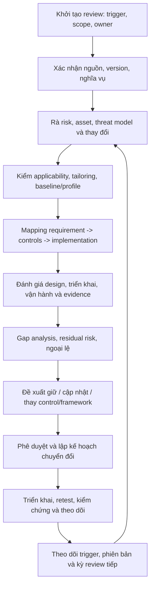
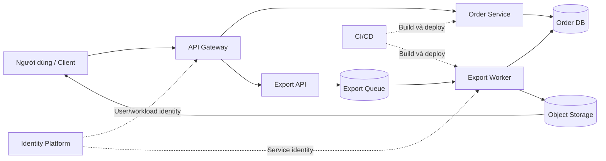
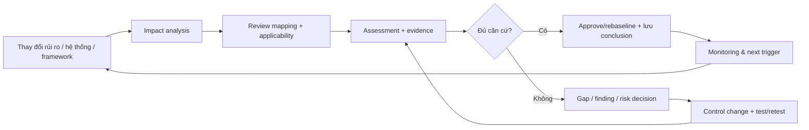

# Rà soát framework trong security assurance

Một doanh nghiệp áp dụng một **control framework** để quản lý an toàn hệ thống Java. Hai năm trước, nhóm Security đã lựa chọn các controls, lập bảng mapping và thông qua baseline. Đến nay, kiến trúc đã có thêm API đa tenant, queue xử lý xuất dữ liệu và pipeline CI/CD trên môi trường mới; một số controls vẫn được đánh dấu “đã đáp ứng” vì bản đánh giá cũ chưa bị sửa. Audit gần đây phát hiện một worker có thể đọc dữ liệu khách hàng mà không kiểm tra quyền theo tenant.

Vấn đề không chỉ là một control bị thiếu. Doanh nghiệp còn phải hỏi: **Framework hiện tại có chọn đúng mục tiêu và controls không? Những điều khoản nào còn áp dụng? Những bằng chứng nào đã cũ? Quy trình nào có trách nhiệm phát hiện sự thay đổi? Ai được phê duyệt cập nhật và chấp nhận rủi ro còn lại?**

**Rà soát framework (framework review)** là hoạt động đánh giá có hệ thống **tính phù hợp, tính đầy đủ, độ cập nhật, cách triển khai, kết quả đánh giá và cơ chế quản trị** của một framework kiểm soát đã được tổ chức lựa chọn, để quyết định **giữ nguyên, điều chỉnh, mở rộng, thay thế hoặc ngừng áp dụng** các phần tương ứng.

Trong module `SECURITY_SECURITY_ASSURANCE`, công việc này phục vụ mục tiêu **đánh giá có bằng chứng** rằng hệ thống đáp ứng mục tiêu bảo mật: đi từ phân tích rủi ro, yêu cầu và security controls đến kiểm thử, audit, khắc phục phát hiện và assurance liên tục trong phát triển, vận hành.

> **Nguyên tắc:** Rà soát framework không phải việc tô lại bảng compliance cho đẹp. Nó phải trả lời được **framework áp dụng cho ai, vì sao, theo phiên bản nào, controls có thực sự xử lý rủi ro không, bằng chứng còn hiệu lực đến đâu và những khoảng trống được xử lý như thế nào**.

## 1. Framework là gì và tại sao cần rà soát?

Một **security control framework** là cấu trúc tổ chức các mục tiêu, nhóm yêu cầu hoặc biện pháp kiểm soát giúp quản trị rủi ro và đánh giá mức bảo vệ của một tổ chức/hệ thống. Framework có thể cung cấp danh mục controls, kết quả cần đạt, phương pháp tổ chức chương trình hoặc cách đánh giá.

Trong thực tế, doanh nghiệp có thể tham khảo và áp dụng các nguồn như:

| Nguồn tham khảo | Vai trò chính trong một chương trình assurance | Lưu ý khi rà soát |
|---|---|---|
| **ISO/IEC 27001** | Yêu cầu của hệ thống quản lý an toàn thông tin (ISMS), bao gồm đánh giá và xử lý rủi ro, quản trị, cải tiến | Kiểm tra phạm vi ISMS, các yêu cầu và quyết định áp dụng; không đồng nhất một hệ thống ứng dụng với chứng nhận ISMS |
| **ISO/IEC 27002** | Hướng dẫn về những biện pháp kiểm soát an toàn thông tin | Đánh giá cách dùng làm tài liệu tham chiếu cho thiết kế/triển khai, không tự coi mọi hướng dẫn là nghĩa vụ độc lập |
| **NIST Cybersecurity Framework (CSF)** | Cấu trúc kết quả quản lý rủi ro an ninh mạng và cách nhìn trạng thái hiện tại/mục tiêu | Kiểm tra profile, kết quả kỳ vọng, khoảng trống và nguồn bằng chứng; CSF không tự là chứng nhận |
| **NIST SP 800-53** | Danh mục controls về bảo mật và quyền riêng tư cho hệ thống/tổ chức | Xác định revision, baseline, phần điều chỉnh và trách nhiệm theo môi trường |
| **NIST SP 800-53A** | Hỗ trợ đánh giá các controls bằng những phương pháp và đối tượng kiểm tra | Phải điều chỉnh thủ tục đánh giá theo hệ thống, phạm vi và rủi ro |
| **CIS Controls** | Bộ thực hành ưu tiên giúp tổ chức quản lý một số rủi ro an ninh mạng phổ biến | Chọn đúng phiên bản, mức/phần phù hợp và xác minh thực tế triển khai |
| **OWASP ASVS** | Các yêu cầu xác minh bảo mật ứng dụng có thể dùng cho kiểm thử/review | Chọn phiên bản, điều khoản và phạm vi ứng dụng; không suy luận chứng nhận từ bảng tick |
| **Framework hoặc baseline nội bộ** | Bộ controls và tiêu chí được doanh nghiệp ban hành cho tài sản, sản phẩm hoặc hạ tầng của mình | Xác định owner, cách cập nhật, thẩm quyền và bằng chứng vận hành |

Tên gọi *framework*, *standard*, *catalog* hay *guideline* **không tự quyết định tính bắt buộc**. Một yêu cầu có thể trở nên bắt buộc khi được ban hành nội bộ, luật/quy định áp dụng hoặc hợp đồng viện dẫn. Khi rà soát phải làm rõ **nguồn nghĩa vụ và phiên bản thực tế đã được chọn**, không tự giả định mọi nguồn cùng có hiệu lực.

### Phân biệt năm hoạt động liên quan

| Hoạt động | Câu hỏi chính | Đầu ra |
|---|---|---|
| **Framework selection** | Nên tham khảo/chọn framework nào cho mục tiêu và bối cảnh? | Quyết định lựa chọn và phạm vi dự kiến |
| **Framework adoption / tailoring** | Điều khoản/controls nào áp dụng, bổ sung hoặc loại trừ theo quy trình? | Baseline, profile, Statement of Applicability hoặc danh mục áp dụng |
| **Control assessment** | Control cụ thể có được thiết kế, triển khai và vận hành hiệu quả? | Test/audit evidence và finding |
| **Framework review** | Cả cách lựa chọn, áp dụng, mapping, đánh giá và quản trị framework còn phù hợp/đủ tin cậy không? | Gap analysis, quyết định giữ/sửa/thay, backlog và lịch đánh giá lại |
| **Audit / certification assessment** | Có thể đưa kết luận theo tiêu chí, phạm vi và quy tắc đánh giá đã xác định? | Báo cáo/ý kiến có giới hạn, finding, quyết định có thẩm quyền |

**Rà soát framework bao gồm việc xem xét kết quả control assessment, nhưng không thay thế việc test từng control.** Ngược lại, vài control test đạt cũng chưa chứng minh framework được lựa chọn đúng và đủ cho các rủi ro của tổ chức.

## 2. Đối tượng thực sự phải được rà soát

Một framework review tốt nhìn vào nhiều lớp cùng lúc.

| Lớp đánh giá | Câu hỏi | Dấu hiệu cần xem |
|---|---|---|
| **Mục đích và mục tiêu** | Framework có còn phù hợp những mục tiêu bảo mật, nghĩa vụ và khẩu vị rủi ro? | Risk register, phân loại dữ liệu, yêu cầu khách hàng |
| **Phạm vi và tài sản** | Tài sản/tenant/cloud/đối tác/luồng dữ liệu có được bao phủ? | Inventory, DFD, service catalog, shared responsibility |
| **Phiên bản và nguồn** | Điều khoản, revision, tài liệu dẫn chiếu có còn đúng phiên bản được áp dụng? | Version manifest, change history, văn bản có hiệu lực |
| **Applicability / tailoring** | Điều gì áp dụng, không áp dụng, được thay thế và vì sao? | SoA, baseline tailoring, profile, approval |
| **Tính đầy đủ của controls** | Có thiếu control đối với kịch bản rủi ro mới, đường phụ hay tài sản trọng yếu? | Risk-to-control mapping, gap analysis |
| **Thiết kế/triển khai** | Control đã được đặt đúng trust boundary và hoạt động như thiết kế? | Architecture/code/config review, test |
| **Hiệu lực vận hành** | Trong kỳ cần đánh giá, control có hoạt động nhất quán không? | Access reviews, logs, incident records, samples |
| **Bằng chứng** | Evidence có còn hiệu lực, đầy đủ, đáng tin, gắn đúng release? | CI/test report, deployment, audit trail |
| **Findings, ngoại lệ** | Phần chưa đạt có owner, rủi ro, thời hạn và khắc phục đúng không? | Ticket, approval, retest, residual risk |
| **Governance và cải tiến** | Ai rà soát, ai phê duyệt và điều gì kích hoạt rà soát tiếp? | RACI, policy lifecycle, committee minutes |

Nếu chỉ xem “framework đã cập nhật thành phiên bản mới nhất chưa?”, nhóm có thể bỏ qua câu hỏi lớn hơn: **khung hiện tại có bao phủ hệ thống thật không?** Ngược lại, nếu chỉ rà các test của ứng dụng, sẽ khó phát hiện những điểm thiếu ở governance, phân loại tài sản, trách nhiệm hoặc điều chỉnh baseline.

## 3. Khi nào cần rà soát framework?

Framework review thường có **chu kỳ định kỳ** do tổ chức chọn dựa trên rủi ro và nghĩa vụ, và **đợt phát sinh theo trigger** khi có thay đổi đáng kể. Không nên tự coi một chu kỳ “mỗi năm một lần” là chuẩn phổ quát cho mọi hệ thống.

### Trigger thường gặp

1. **Thay đổi kinh doanh/tài sản:** thêm sản phẩm, thị trường, loại dữ liệu nhạy cảm, khách hàng hoặc yêu cầu hợp đồng.
2. **Thay đổi kiến trúc:** thêm API, queue, cache, tenant, cloud service, IdP, CI/CD, nhà cung cấp hoặc môi trường production.
3. **Phiên bản framework/nguồn thay đổi:** xuất hiện revision, yêu cầu mới, thay đổi hướng dẫn hoặc tiêu chí đánh giá.
4. **Threat landscape đổi:** hình thức tấn công, lỗ hổng đang bị khai thác hoặc một điểm yếu logic trước đây chưa được xét.
5. **Incident / audit finding:** sự cố hoặc kiểm toán cho thấy control bị bypass, bằng chứng sai hoặc cơ chế quản trị thiếu.
6. **Control performance đổi:** tăng ngoại lệ, nhiều alert bị bỏ qua, access review không hoàn tất, tỷ lệ retest thấp hoặc scanner không chạy.
7. **Tổ chức/quyền sở hữu đổi:** đội tiếp nhận sản phẩm, nhà cung cấp thay trách nhiệm, role/risk owner hoặc phạm vi ISMS thay đổi.
8. **Kết quả risk assessment đổi:** tác động, tần suất đe dọa hoặc mức chịu đựng rủi ro thay đổi.

**Thay phiên bản tài liệu ngoài chưa chắc đồng nghĩa cần sửa mọi control ngay.** Trước hết phải xác định **delta** giữa bản đang áp dụng và bản được đề xuất, nghĩa vụ áp dụng và tác động tới hệ thống; sau đó có quyết định chuyển đổi, ngoại lệ hoặc lộ trình phù hợp.

### Mức độ và ưu tiên rà soát

| Sự kiện | Phạm vi review có thể chọn | Lý do |
|---|---|---|
| Thêm endpoint đọc dữ liệu khách hàng | Rà soát nhóm access control, audit logging, API security và data boundary | Có thêm đường truy cập và xử lý PII |
| Đổi nền tảng CI/CD | Rà nhóm supply chain, change management, identity/secrets và evidence provenance | Quyền release và nguồn bằng chứng thay đổi |
| Sự cố do thiếu phân quyền tenant | Review chuyên sâu access control ở API, worker, storage và profile/baseline | Control/coverage có thể thiếu hệ thống |
| Cập nhật bản framework ngoài | Review source version, delta, applicability, mapping và lộ trình | Không để reference và tiêu chí lỗi thời |
| Chu kỳ governance đã đến hạn | Review toàn cảnh mục tiêu, scope, risk coverage, evidence, findings và quyết định | Duy trì chương trình assurance có hệ thống |

**Kết hợp full review và targeted review** giúp tập trung nguồn lực. Tuy nhiên, targeted review phải ghi rõ điều gì **không** được đánh giá, tránh suy diễn toàn chương trình vẫn đạt.

## 4. Preflight của một đợt framework review

Trước khi đánh giá một control, cần xác lập **đơn vị đánh giá và tiêu chí**. Một bài toán chưa rõ phạm vi dễ cho kết quả tuân thủ sai.

### 4.1. Xác định nguồn và thứ bậc nghĩa vụ

Tạo danh sách có xác minh:

- Tài liệu nguồn nào được áp dụng: phiên bản, số hiệu/revision, phạm vi và nơi tra cứu bản gốc có thẩm quyền.
- Vì sao áp dụng: luật, hợp đồng, chính sách được ban hành, mục tiêu quản trị tự nguyện hay yêu cầu bên thứ ba.
- Quan hệ với các nguồn khác: tiêu chí trùng lặp, bổ sung hoặc có xung đột cần giải thích.
- Ai có quyền diễn giải/ban hành tiêu chí nội bộ; quy trình xử lý khi thay đổi.
- Các yêu cầu không được phép miễn qua cơ chế nội bộ nếu xuất phát từ nghĩa vụ ngoài.

**Không tuyên bố tổ chức “ISO/NIST/OWASP compliant” chỉ vì tham chiếu các tên này.** Mọi kết luận phải chỉ rõ nguồn, yêu cầu, phạm vi, phương pháp và cơ sở đánh giá; chứng nhận hoặc thẩm định từ bên ngoài là quy trình riêng khi áp dụng.

### 4.2. Khóa phạm vi hệ thống

Ghi ít nhất:

| Thông tin | Ví dụ minh họa |
|---|---|
| **Review ID** | `FR-2026-04` |
| **Business objective** | Bảo vệ dữ liệu đơn hàng đa tenant |
| **Asset / system** | `order-service`, `export-worker`, `order-db`, object storage |
| **Môi trường** | Production, cùng các môi trường test hỗ trợ kiểm chứng |
| **Trust boundaries** | Client/gateway, gateway/service, service/queue/worker, worker/storage/tenant |
| **Kỳ đánh giá** | Kỳ vận hành xác định và release đang triển khai |
| **Reference baseline** | Các phiên bản nguồn và baseline nội bộ đã được phê duyệt |
| **Out of scope** | Hệ thống thanh toán độc lập, nếu thực sự chưa thuộc scope |
| **Owner và assessor** | Framework owner, control owners, người review và risk owner |
| **Deliverable** | Báo cáo gap, mapping cập nhật, danh sách quyết định/hành động và bằng chứng |

Một bảng asset thiếu worker hoặc kho file xuất có thể khiến kết luận sai ngay cả khi mọi test HTTP đều đạt. **Inventory và DFD là đầu vào của framework review, không phải phụ lục trang trí.**

### 4.3. Chọn tiêu chí đánh giá trước khi nhìn kết quả

Một review không nên thay điều kiện PASS/FAIL sau khi thấy bằng chứng yếu. Ví dụ nếu mục tiêu yêu cầu **mọi đường đọc đơn phải kiểm tra tenant**, cần định nghĩa population gồm HTTP API, export, batch và các consumer liên quan **trước** khi thống kê coverage.

Cần thống nhất trạng thái:

- `APPLICABLE` / `NOT_APPLICABLE` / `TO_BE_DETERMINED`: trạng thái **tính áp dụng**.
- `FULL` / `PARTIAL` / `GAP` / `UNKNOWN`: mức **bao phủ bởi control**.
- `PASS` / `FAIL` / `INCONCLUSIVE` / `NOT_TESTED`: **kết quả assessment**.
- `OPEN` / `FIX_IN_PROGRESS` / `RETEST_PENDING` / `VERIFIED_CLOSED`: **trạng thái finding**.
- `APPROVED_EXCEPTION`: **quyết định rủi ro**, không phải `PASS`.

Không gộp các loại trạng thái này vào một cột `COMPLIANT=YES/NO`, vì sẽ mất thông tin quan trọng về tính áp dụng, mức thực thi và độ tin cậy của kết luận.

## 5. Quy trình rà soát framework theo vòng lặp



### Bước 1 — Xác định mục tiêu và thẩm quyền review

Đặt câu hỏi cụ thể: “Chương trình có còn đáp ứng các mục tiêu bảo vệ dữ liệu đa tenant không?” hoặc “Phiên bản baseline đang áp dụng có cần thay khi CI/CD chuyển nền tảng không?”

Phân công **review sponsor**, người quản lý framework, assessor, subject-matter experts, control owner và risk owner. Người đề xuất cập nhật control không mặc nhiên có thẩm quyền phê duyệt **chấp nhận rủi ro còn lại**.

### Bước 2 — Xác nhận bản nguồn, thay đổi và nghĩa vụ

Đối chiếu danh sách tài liệu đã lựa chọn với phiên bản dùng trong mapping; ghi nội dung thay đổi có liên quan. Không sửa reference bằng cách thay số phiên bản rồi giữ nguyên kết luận cũ: **cùng mã control chưa chắc cùng ngữ nghĩa, phạm vi, tham số và thủ tục đánh giá** qua các revision.

Nếu có bản mới, lập **delta assessment** theo từng thay đổi quan trọng:

| Delta | Câu hỏi | Quyết định có thể có |
|---|---|---|
| Điều khoản mới | Điều khoản có áp dụng với hệ thống/nghĩa vụ không? | Thêm requirement, control, test/evidence |
| Nội dung yêu cầu chặt hơn | Control hiện hành còn đáp ứng không? | Bổ sung điều kiện và kiểm thử |
| Điều khoản tái cấu trúc/đổi mã | Chỉ đổi nhãn hay thay cả ý nghĩa? | Cập nhật mapping cùng rationale |
| Điều khoản được bỏ hoặc gộp | Có rủi ro nội bộ vẫn cần kiểm soát không? | Giữ internal control nếu còn cần, không tự xóa |
| Guidance kỹ thuật mới | Có giúp khắc phục điểm yếu hiện tại không? | Điều chỉnh guideline/implementation |
| Thủ tục assessment thay đổi | Evidence hiện có còn phù hợp không? | Cập nhật test plan và làm mới evidence |

### Bước 3 — Đánh giá bối cảnh rủi ro và tính đầy đủ của framework

So sánh framework/baseline với **risk register, threat model, tài sản, nghĩa vụ mới và phát hiện thực tế**. Các câu hỏi:

1. Có kịch bản rủi ro mới không được bất kỳ requirement/control nào xử lý?
2. Có control được chọn chỉ vì “mẫu baseline có sẵn”, nhưng thực chất không xử lý đường khai thác chính?
3. Có rủi ro bị đánh giá thấp vì asset inventory hoặc dữ liệu tác động đã lỗi thời?
4. Một yêu cầu chỉ áp dụng cho một service hay cần áp dụng ở mọi shared service/tenant?
5. Biện pháp phòng ngừa, phát hiện, khắc phục và phục hồi có bổ sung nhau không?
6. Những controls nào phụ thuộc vào cùng IdP, workflow, IAM hay nguồn log nên có thể cùng thất bại?

Ví dụ, MFA có thể giảm rủi ro giả mạo danh tính, nhưng **không thay** object-level authorization với người dùng hợp lệ. Nếu framework review đánh dấu MFA là giải pháp duy nhất cho rủi ro BOLA, cần sửa **logic mapping**.

### Bước 4 — Rà applicability và tailoring

Một framework cung cấp mục tiêu hoặc tập controls; tổ chức cần xác định **điều khoản nào áp dụng, vì sao và theo phạm vi nào**. Tùy nguồn, kết quả có thể được thể hiện qua **Statement of Applicability (SoA)**, **CSF profiles**, **security control baseline/tailoring records** hoặc một register nội bộ tương đương.

Những bản ghi này không hoàn toàn giống nhau. Chúng có chung giá trị là **giải thích việc lựa chọn và áp dụng**. Khi review:

- Không xem `NOT_APPLICABLE` là cách đơn giản để tăng tỷ lệ đạt; cần rationale gắn với tài sản, điều khoản và nghĩa vụ.
- Một control có thể `APPLICABLE` nhưng **chưa triển khai**, chưa kiểm chứng hoặc được xử lý tạm bằng biện pháp khác.
- Một yêu cầu bên ngoài có thể không cho phép miễn chỉ bằng quyết định nội bộ; phải hỏi bên phụ trách tuân thủ/pháp lý khi cần.
- Nếu legacy system cần lộ trình, phải có thời hạn, owner, biện pháp bù đắp và quyết định theo thẩm quyền.
- Một control nội bộ không còn trong danh mục của framework mới **vẫn có thể cần giữ** nếu rủi ro hiện tại đòi hỏi.

### Bước 5 — Kiểm tra mapping và coverage

Xây liên kết hai chiều:

```text
Risk / security objective
   -> Requirement / selected framework outcome
   -> Internal control
   -> Implementation / owner / scope
   -> Test & assessment procedure
   -> Evidence / finding / residual risk
```

Review cần phát hiện cả:

- Requirement **không có control**.
- Control có mô tả nhưng **không có implementation** ở đường xử lý cần thiết.
- Implementation có nhưng **không có test**.
- Test có nhưng **không kiểm tra đúng mục tiêu/đúng phạm vi**.
- Evidence có nhưng **thuộc release cũ**, sai môi trường hoặc ngoài kỳ đánh giá.
- Control được **kế thừa** từ platform/provider nhưng chưa chứng minh phần trách nhiệm của ứng dụng.
- Mapping giữa hai framework là `SUPPORTING` hoặc `PARTIAL` nhưng được báo cáo như `FULL`.

### Bước 6 — Đánh giá chất lượng và hiệu lực controls

Rà soát từng nhóm control quan trọng theo ba mức:

| Mức | Câu hỏi | Bằng chứng |
|---|---|---|
| **Design effectiveness** | Khi hoạt động đúng thiết kế, control có giảm kịch bản rủi ro? | Threat model, policy, standard, architecture review |
| **Implementation effectiveness** | Control đã được thực thi đúng trong code/cấu hình/quy trình thuộc phạm vi? | PR, IAM/policy config, negative tests, deploy record |
| **Operating effectiveness** | Trong kỳ, control có vận hành đúng và nhất quán? | Audit log, access review, incident/alert records, mẫu giao dịch |
| **Remediation effectiveness** | Sau sửa, root cause và đường lỗi gốc có còn tái hiện không? | Fix review, regression/retest và bằng chứng release |

**Bằng chứng thiếu không tự động là bằng chứng control thất bại.** Cần ghi `INCONCLUSIVE` nếu chưa đủ chứng cứ; có thể mở finding về **evidence/process gap**. Nếu kiểm thử thực tế cho thấy control cho phép truy cập trái quyền, đó là **control failure** cần xử lý theo mức rủi ro.

### Bước 7 — Phân tích gaps và residual risk

Xếp sai lệch theo mức tác động và tính khẩn cấp; không chỉ đếm số ô chưa hoàn thành. Một gap ở quyền production hoặc dữ liệu khách hàng có thể quan trọng hơn nhiều gap tài liệu rủi ro thấp.

Với mỗi finding, ghi **criteria, condition, evidence, cause (nếu đã xác minh), impact, owner, recommendation, hạn, trạng thái và phương pháp retest**. Không gọi mọi thiếu sót là `HIGH` theo cảm tính; phải tham chiếu phương pháp đánh giá rủi ro và bối cảnh.

### Bước 8 — Đề xuất giữ, sửa, mở rộng hoặc thay framework

Một đợt review phải dẫn tới **quyết định có thể hành động**, không chỉ kết thúc bằng điểm số. Các lựa chọn:

| Quyết định | Khi nào phù hợp | Bằng chứng/ràng buộc |
|---|---|---|
| **Retain** — giữ | Framework/baseline vẫn phù hợp, sai lệch không đáng kể hoặc đã quản lý | Kết luận có scope và bằng chứng đủ |
| **Tailor** — điều chỉnh | Một số điều khoản không áp dụng hoặc cần tăng yêu cầu theo bối cảnh | Rationale, nghĩa vụ, phê duyệt và mapping mới |
| **Extend** — bổ sung | Phát sinh risk scenario, API, công nghệ hoặc nghĩa vụ chưa có control | Risk/requirement mới, control và test plan |
| **Replace** — thay thế | Khung hiện tại không còn phù hợp mục tiêu hoặc nguồn mới được lựa chọn theo thẩm quyền | Impact analysis, mapping chuyển tiếp, kế hoạch đào tạo/evidence |
| **Retire** — ngừng áp dụng phần cụ thể | Control/tài sản không còn, hoặc được thay thế hợp lệ | Xác minh không còn nghĩa vụ/rủi ro chưa xử lý |
| **Defer with exception** — hoãn có kiểm soát | Chưa thể thay ngay nhưng rủi ro tạm được quản lý có thẩm quyền | Owner, compensating controls, hạn và review triggers |

**Không thay framework chỉ vì mới hơn hoặc được quảng bá tốt hơn.** Phải đánh giá giá trị, nghĩa vụ, hiệu quả controls hiện có, rủi ro chuyển đổi và khả năng thu thập bằng chứng.

### Bước 9 — Phê duyệt, triển khai và kiểm chứng chuyển đổi

Quyết định được phê duyệt phải tạo thành **action plan**: việc làm, owner, nguồn lực, ngày hoàn tất, tiêu chí đạt, evidence và phương án rollback nếu thay đổi gây gián đoạn.

Sau khi sửa controls, update mapping/SoA/profile và test, cần **retest** trên đúng bản/môi trường trước khi đóng finding. Đừng “đóng” gap chỉ vì quyết định nâng version framework được thông qua.

## 6. Tình huống xuyên suốt: framework review cho Java platform đa tenant

Giả định hệ thống phục vụ nhiều tenant:

- `order-service` cung cấp `GET /api/orders/{id}`.
- `export-api` nhận yêu cầu tạo bản xuất dữ liệu khách hàng.
- `export-worker` đọc thông điệp từ queue, truy vấn database và tạo file ở object storage.
- `identity-platform` cấp danh tính người dùng/workload.
- `ci-cd` build, kiểm thử và triển khai artefact production.

### 6.1. Sơ đồ và nơi framework phải bao phủ



**Đường sai dễ bị bỏ sót:** Gateway xác minh user token, nhưng worker chạy ngoài HTTP route. Nếu worker tin `tenantId` lấy trực tiếp từ message, người có quyền publish queue hoặc hệ thống bị chiếm quyền có thể khai thác đường export. Framework review phải kiểm tra **trust boundary ở queue/worker và quyền tải file**, không chỉ test `GET` qua gateway.

### 6.2. Ma trận rà soát framework

Bảng dưới là **tình huống giả định**, không phải bằng chứng một doanh nghiệp thật đã đạt/chưa đạt.

| Framework objective / nhóm yêu cầu | Rủi ro và control được chọn | Scope cần đánh giá | Evidence cần có | Kết quả review minh họa |
|---|---|---|---|---|
| **Identity & authentication** | Xác thực token và workload | Gateway, service, worker | IdP config, token validation tests, workload IAM | `PARTIAL`: chưa kiểm chứng danh tính worker |
| **Access control / tenant isolation** | Object-level authorization; row scope | HTTP order read, export worker, DB, storage | Cross-tenant negative tests, review luồng dữ liệu | `FAIL`: worker tin tenant ID trong message |
| **Privileged access** | Least privilege, JIT/approval và access review | IAM, DB roles, admin, CI runners | Entitlement inventory, approvals, samples trong kỳ | `INCONCLUSIVE`: inventory CI thiếu |
| **Audit logging & monitoring** | Audit event và alert export nhạy cảm | API, worker, export download, SIEM | Log samples, rule tests, alert triage | `PARTIAL`: thiếu worker events |
| **Secure development** | SAST/SCA, security tests, policy gates | Build pipeline, source, release | CI reports gắn commit, test failure gates | `PASS` trong phạm vi pipeline được kiểm |
| **Data protection** | Restrict object access/retention | Storage, signed links, exports | Storage policy, cross-tenant download test | `NOT_TESTED` cho đường link cũ |
| **Incident readiness** | Runbook thu hồi link/secret, điều tra | Export, identity, SOC/Operations | Exercise, escalation records | `PENDING`: chưa diễn tập kịch bản |

Không có căn cứ để suy ra tỷ lệ “6/7 controls đáp ứng” từ bảng, bởi nhiều hàng **chưa được kiểm tra**, một số là **mục tiêu tổng hợp** chứ không phải cùng đơn vị, và một thất bại nghiêm trọng về phân quyền có thể làm claim bảo vệ dữ liệu khách hàng không đạt.

### 6.3. Một finding có thể truy vết

| Trường | Giá trị minh họa |
|---|---|
| **Finding ID** | `FR-FND-002` |
| **Criteria** | Yêu cầu nội bộ `REQ-AC-TENANT`: mọi luồng đọc/xuất dữ liệu phải kiểm tra đúng tenant và người được phép |
| **Condition** | `export-worker` dùng `tenantId` từ payload mà không xác minh ngữ cảnh job |
| **Evidence** | Review source code, quyền publish queue và negative integration test trong môi trường được phép |
| **Risk** | Rò rỉ dữ liệu giữa các tenant qua file export |
| **Root cause** | Giả định queue nội bộ đáng tin; cần xác minh cụ thể với đội sở hữu |
| **Owner** | Export team, phối hợp IAM/Platform |
| **Remediation** | Đối chiếu job và quyền từ nguồn đáng tin; giới hạn producer; chặn tải sai tenant |
| **Verification** | Test job giả/sai tenant/approval hết hạn; xác minh artefact production |
| **Residual risk** | Các đường export legacy chưa được kiểm tra và rủi ro danh tính bị chiếm |

Rà soát framework cần **tìm nguyên nhân ở mức chương trình** ngoài việc sửa code: tại sao baseline, risk mapping, test plan hoặc audit scope không phát hiện đường queue? Có cần bổ sung một yêu cầu chung “consumer xử lý dữ liệu nhạy cảm phải xác minh quyền tại nơi sử dụng” vào framework nội bộ không?

### 6.4. Bản đề xuất sau review

Một đề xuất có thể gồm:

1. **Giữ** nhóm controls IAM hiện tại nhưng bổ sung phạm vi workload và CI runner.
2. **Mở rộng** yêu cầu authorization cho mọi đường HTTP/queue/batch/export, gắn từng luồng với owner.
3. **Sửa** `export-worker` và `object storage`, thêm negative tests theo tenant.
4. **Tăng** kiểm tra tính đầy đủ của log và exercise thu hồi export.
5. **Cập nhật** risk register, internal baseline, mapping, evidence criteria và checklist review kiến trúc.
6. **Giao** người chịu trách nhiệm, ngày hoàn thành, review/approval và retest có phiên bản.
7. **Ghi giới hạn** đối với các phần chưa có bằng chứng; không báo “framework fully compliant” trước khi đánh giá lại.

## 7. Rà soát phiên bản framework mà không làm mất traceability

Một rủi ro riêng là **framework version drift**: tài liệu nguồn đã đổi, nội bộ đã đổi tên control, nhưng hệ thống và evidence vẫn mang mapping cũ.

### Delta review cần so sánh điều gì?

Khi chuyển từ `baseline-v1` sang `baseline-v2`, hãy tách:

- **Changed wording:** câu chữ đổi nhưng kết quả cần đạt có đổi không?
- **New requirement:** yêu cầu mới hoặc tách nhỏ, có cần control/test/evidence mới không?
- **Removed/merged requirement:** điều khoản không còn nhưng rủi ro nội bộ vẫn tồn tại không?
- **Changed applicability:** phạm vi, loại hệ thống hoặc điều kiện được áp dụng có đổi?
- **Changed assessment method:** kiểm thử/đối tượng bằng chứng có cần cập nhật?
- **Changed owner/responsibility:** control đã được kế thừa từ platform/vendor hay chuyển về application?
- **Changed evidence freshness:** test của bản release cũ có còn phù hợp không?

Có thể lập bảng:

| Old reference | New reference | Delta type | Impact | Hành động |
|---|---|---|---|---|
| `INT-AC-01-v1` | `INT-AC-01-v2` | Scope expanded | Có thêm async worker | Thêm control/test cho queue và export |
| `INT-IAM-02-v1` | `INT-IAM-02-v2` | Parameter changed | Quyền tạm thời cần kiểm tra hạn | Review PAM workflow và log |
| `INT-LOG-03-v1` | `INT-LOG-03-v2` | Measurement clarified | Evidence thiếu correlation ID | Cập nhật log schema, test và retention |
| `INT-DOC-04-v1` | Không còn | Retired | Cần xác minh rủi ro và nghĩa vụ | Ghi rationale, không xóa chứng cứ lịch sử |

**Các mã `INT-...` là ví dụ nội bộ tự tạo**, không phải số hiệu được trích từ ISO/NIST/OWASP. Khi rà soát tiêu chuẩn bên ngoài, chỉ sử dụng ID và nội dung đã xác minh theo bản được tổ chức áp dụng.

### Không ghi đè lịch sử

Cần giữ:

- Phiên bản trước, ngày hiệu lực, scope và quyết định gốc.
- Những findings và evidence từng hỗ trợ/không hỗ trợ kết luận cũ.
- Mapping giữa phiên bản cũ và mới kèm giải thích semantic.
- Ngày chuyển đổi, phương án cho legacy, ngoại lệ và người phê duyệt.
- Mốc cần làm lại test/assessment hoặc cập nhật SOP.

Nếu chỉ thay cột `framework_version` trong spreadsheet, một audit sau này sẽ khó biết **tại thời điểm release trước** hệ thống được đánh giá theo yêu cầu nào.

## 8. Tiêu chí chất lượng cho bằng chứng trong framework review

Rà framework là một hoạt động assurance. Cần chứng minh cả **quy trình review** lẫn **những claim về control effectiveness**.

| Thuộc tính evidence | Câu hỏi kiểm tra | Ví dụ |
|---|---|---|
| **Relevance** | Có hỗ trợ đúng requirement và risk scenario? | Test cross-tenant cho authorization; không dùng test 401 thay thế |
| **Sufficiency / coverage** | Có đủ đường xử lý, thời kỳ và các trường hợp âm tính? | HTTP + queue + storage, không chỉ controller |
| **Provenance** | Ai/công cụ nào tạo, theo build/config và thời điểm nào? | CI run ID, commit SHA, image digest |
| **Reliability / integrity** | Bằng chứng có thể bị sửa hoặc thiếu population không? | Access control, logging retention, snapshot nguồn |
| **Freshness** | Evidence còn phù hợp với release/điều khoản đang đánh giá? | Test mới chạy sau thay policy |
| **Repeatability** | Có tiêu chí và cách tái kiểm tra phù hợp? | Test procedure, expected outcomes, fixtures |
| **Independence** | Người đánh giá có đủ khách quan ở chỗ cần review độc lập? | Review/audit không tự phê duyệt ngoại lệ của mình |
| **Confidentiality** | Evidence có lộ token, mật khẩu hoặc PII không? | Masking, role restriction, lưu giữ phù hợp |

**Thiếu evidence** có thể do control chưa hoạt động, do hệ thống thu thập log không đầy đủ hoặc do quy trình review không bao phủ. Phải xác minh nguyên nhân trước khi kết luận. Không thay thế bằng bằng chứng “gần giống” để đóng ô `PASS`.

### Phân biệt các claim

- **Control exists:** có mô tả/cấu hình.
- **Control implemented:** code, IAM, workflow được triển khai đúng nơi.
- **Control tested:** được đánh giá theo test/điều kiện định nghĩa.
- **Control operated during period:** vận hành nhất quán trong kỳ.
- **Control effective for risk:** hiệu quả giảm rủi ro trong phạm vi được định nghĩa, có lập luận và bằng chứng.
- **Framework adequate:** tập controls và governance đủ phù hợp với bối cảnh, rủi ro và nghĩa vụ đã xác định.

**Claim cuối không tự suy ra từ các claim đầu.** Ví dụ mọi test đã viết đều PASS nhưng framework bỏ quên chức năng export là vấn đề **framework adequacy/coverage**, không phải lỗi “test case không xanh”.

## 9. Claim – Argument – Evidence cho một cuộc review

Một framework review có thể được trình bày như một **assurance case** thay vì chỉ là danh sách compliance.

| Thành phần | Minh họa |
|---|---|
| **Claim** | Framework nội bộ đối với dịch vụ đơn hàng bảo vệ quyền truy cập dữ liệu trong phạm vi đã rà và có cơ chế cập nhật khi thay đổi |
| **Argument** | Risk/asset đã được cập nhật; requirement bao phủ các luồng; controls đặt ở đúng trust boundary; các kiểm tra xác thực; có owner và xử lý findings |
| **Evidence về governance** | Framework version, scope/SoA/profile, review minutes, approvals, mapping và change log |
| **Evidence về controls** | Code/config review, integration tests, IAM, log và vận hành trong kỳ |
| **Assumptions** | Asset inventory đầy đủ, danh tính/tenant mapping đúng, nhà cung cấp shared control hoạt động theo trách nhiệm đã quy định |
| **Limitations** | Đường legacy chưa kiểm tra, evidence vận hành thiếu trong một số kỳ |
| **Conclusion** | Đạt một phần/không đạt/chưa đủ bằng chứng theo phạm vi, có backlog và residual risk rõ |

Trong tình huống worker chưa kiểm tra tenant, **không thể đưa claim “mọi đường đọc/xuất dữ liệu đã được bảo vệ”**. Có thể kết luận “một số đường HTTP đã được kiểm chứng; nhóm export còn gap có kế hoạch xử lý”. Sự rõ ràng của phạm vi **tăng độ tin cậy**, không làm report yếu đi.

## 10. Mẫu hồ sơ review có cấu trúc

Đây là YAML **minh họa** cho review `FR-2026-04`, không phải dữ liệu kiểm toán đã diễn ra. Tổ chức có thể dùng GRC, spreadsheet hoặc cấu trúc dữ liệu khác, miễn là liên kết và bằng chứng được bảo quản phù hợp.

```yaml
review_id: "FR-2026-04"
title: "Order platform control framework review"
module: "SECURITY_SECURITY_ASSURANCE"
purpose: "Validate adequacy and evidence of controls for tenant data"
review_type: "TRIGGERED"
trigger: "New asynchronous export route and authorization finding"
scope:
  systems: ["order-service", "export-worker", "order-db", "storage"]
  environment: "production"
  assessed_release: "<release-id>"
  assessment_period: "<start-to-end>"
out_of_scope:
  - "Independent payment platform"
framework_sources:
  - source_id: "INTERNAL-BASELINE"
    selected_version: "<approved-version>"
    source_owner: "<framework-owner>"
    obligation: "INTERNAL"
  - source_id: "EXTERNAL-REFERENCE"
    selected_version: "<exact-version>"
    clause: "<verified-clause>"
    obligation: "<contract-regulation-or-voluntary>"
review_roles:
  framework_owner: "<security-governance-owner>"
  reviewer: "<assigned-reviewer>"
  risk_owner: "<authorized-risk-owner>"
applicability:
  - requirement_id: "REQ-AC-TENANT"
    state: "APPLICABLE"
    rationale: "Order data segregated by tenant"
control_reviews:
  - control_id: "CTRL-ORDER-AUTHZ"
    scope: "HTTP order read"
    coverage: "PARTIAL"
    assessment: "INCONCLUSIVE"
    evidence_refs:
      - "<linked-api-test-and-review>"
    limitations:
      - "Async export requires independent verification"
  - control_id: "CTRL-EXPORT-AUTHZ"
    scope: "Queue consumer / file export"
    coverage: "GAP"
    assessment: "FAIL"
    finding_ids: ["FR-FND-002"]
findings:
  - id: "FR-FND-002"
    risk_id: "RISK-CROSS-TENANT"
    owner: "<export-team>"
    action: "Verify job ownership and tenant before export"
    verification: "RETEST_PENDING"
    due: "<agreed-date>"
decision:
  proposed: "EXTEND_BASELINE_AND_REMEDIATE"
  approval: "PENDING"
  approver: "<authorized-approver>"
  residual_risk_owner: "<risk-owner>"
follow_up:
  required_evidence:
    - "Cross-tenant worker integration tests"
    - "Deployment-linked retest"
    - "Review of all export routes"
  next_review: "<date>"
  triggers:
    - "New tenant-sensitive flow"
    - "Framework revision, incident or control failure"
```

**Cần phân biệt ba loại số liệu trong hồ sơ:** `coverage` nói về phạm vi kiểm soát, `assessment` nói về kết quả đánh giá, còn `decision.approval` nói về trạng thái phê duyệt. Một rủi ro đã được chấp nhận không làm `FAIL` trở thành `PASS`.

Không nên nhúng secret, token, PII hoặc thông tin khai thác nhạy cảm vào tài liệu review phổ biến rộng. Dẫn tới evidence gốc bằng tham chiếu được phân quyền, lưu theo retention thích hợp.

## 11. Kiểm tra tính nhất quán hồ sơ review bằng Java 17

Tự động kiểm tra dữ liệu **không thay thế đánh giá học thuật hoặc audit**, nhưng có thể phát hiện lỗi quản trị như **review dùng reference version cũ**, kết luận PASS khi evidence chưa có, hoặc đóng review dù finding chưa kiểm chứng.

Ví dụ Java 17 sau xử lý các record đơn giản. Nó chỉ là **kiểm tra tính nhất quán của metadata**, không quyết định hệ thống có tuân thủ luật hay không.

```java
import java.util.ArrayList;
import java.util.List;
import java.util.Objects;

public final class FrameworkReviewGuard {
    private FrameworkReviewGuard() {}

    public record ControlReview(
            String controlId,
            boolean applicable,
            String assessedFrameworkVersion,
            String assessedRelease,
            String result,
            boolean evidencePresent,
            boolean openHighRiskFinding) {}

    public static List<String> validate(
            List<ControlReview> controls,
            String expectedFrameworkVersion,
            String expectedRelease) {
        Objects.requireNonNull(controls);
        Objects.requireNonNull(expectedFrameworkVersion);
        Objects.requireNonNull(expectedRelease);

        List<String> issues = new ArrayList<>();

        for (ControlReview control : controls) {
            if (!control.applicable()) {
                continue; // Applicability rationale kiểm tra riêng.
            }

            String id = control.controlId();
            if (!Objects.equals(
                    control.assessedFrameworkVersion(),
                    expectedFrameworkVersion)) {
                issues.add(id + ": FRAMEWORK_VERSION_MISMATCH");
            }
            if (!Objects.equals(
                    control.assessedRelease(), expectedRelease)) {
                issues.add(id + ": RELEASE_MISMATCH");
            }
            if ("PASS".equals(control.result())
                    && !control.evidencePresent()) {
                issues.add(id + ": PASS_WITHOUT_EVIDENCE");
            }
            if ("PASS".equals(control.result())
                    && control.openHighRiskFinding()) {
                issues.add(id + ": PASS_WITH_OPEN_HIGH_RISK_FINDING");
            }
        }
        return issues;
    }
}
```

Ở ví dụ này, `evidencePresent` được cung cấp như **đầu vào**, không tự xác minh tính phù hợp hoặc độ tin cậy của bằng chứng. Một review thực tế phải kiểm tra **evidence type, date, environment, control scope, thực thể phát hành và điều kiện áp dụng**. Trạng thái `NOT_APPLICABLE` cũng cần justification và approval riêng, chứ không được bỏ qua ngoài quy trình.

### Kiểm thử JUnit 5

```java
import static org.junit.jupiter.api.Assertions.assertTrue;
import java.util.List;
import org.junit.jupiter.api.Test;

class FrameworkReviewGuardTest {
    @Test
    void flagsStaleVersionAndUnsubstantiatedPass() {
        var rows = List.of(new FrameworkReviewGuard.ControlReview(
                "CTRL-EXPORT-AUTHZ",
                true,
                "baseline-old",
                "release-1",
                "PASS",
                false,
                true));

        var issues = FrameworkReviewGuard.validate(
                rows, "baseline-new", "release-2");

        assertTrue(issues.stream().anyMatch(
                s -> s.contains("FRAMEWORK_VERSION_MISMATCH")));
        assertTrue(issues.stream().anyMatch(
                s -> s.contains("RELEASE_MISMATCH")));
        assertTrue(issues.stream().anyMatch(
                s -> s.contains("PASS_WITHOUT_EVIDENCE")));
        assertTrue(issues.stream().anyMatch(
                s -> s.contains("PASS_WITH_OPEN_HIGH_RISK_FINDING")));
    }

    @Test
    void consistentMetadataDoesNotProduceIssues() {
        var rows = List.of(new FrameworkReviewGuard.ControlReview(
                "CTRL-ORDER-AUTHZ",
                true,
                "baseline-new",
                "release-2",
                "PASS",
                true,
                false));

        assertTrue(FrameworkReviewGuard.validate(
                rows, "baseline-new", "release-2").isEmpty());
    }
}
```

**“Không có issue metadata” không đồng nghĩa control an toàn hay framework review đã đạt.** Điều đó chỉ chứng minh dữ liệu minh họa vượt qua vài quy tắc nhất quán. Cần review ngữ nghĩa mapping, tính đầy đủ population, test đúng kịch bản và bằng chứng vận hành thực tế.

### Những guardrail tự động có thể bổ sung

- Chặn một review báo `APPROVED` nếu thiếu owner/approver hoặc phạm vi.
- Phát hiện requirement áp dụng nhưng chưa có control hoặc assessment.
- Cảnh báo evidence hết hiệu lực theo tiêu chí đã ban hành hoặc không cùng release.
- Phát hiện finding quá hạn, exception đã hết hạn, `NOT_APPLICABLE` thiếu rationale.
- Đối chiếu control owner không còn tồn tại và nguồn framework đã đổi revision.
- Yêu cầu review lại khi một thay đổi CI/CD hoặc API ảnh hưởng các controls quan trọng.

Đây là **cơ chế hỗ trợ quản trị**. Không tự động ghi compliance PASS chỉ vì metadata “đủ trường”.

## 12. Metrics cho framework review: đo phạm vi, chất lượng và tiến độ

Metrics hữu ích phải hỗ trợ quyết định, đồng thời không tạo ấn tượng hệ thống “an toàn X%”.

| Chỉ số | Công thức hoặc định nghĩa | Đọc như thế nào |
|---|---|---|
| **Review scope coverage** | Assets trong phạm vi được review / tổng assets thuộc phạm vi đã xác định | Đo độ bao phủ inventory, phụ thuộc mẫu số đúng |
| **Applicability decision coverage** | Điều khoản đã có quyết định áp dụng và rationale / tổng điều khoản cần xem | Không chứng minh các controls đã hoạt động |
| **Control implementation coverage** | Requirements áp dụng có implementation liên quan / tổng requirements áp dụng | Có implementation chưa chắc test đạt |
| **Verified requirement coverage** | Requirements đáp ứng đầy đủ theo evidence phù hợp / tổng requirements áp dụng | Phản ánh bằng chứng trong phạm vi, không phải 100% an toàn |
| **Evidence freshness rate** | Đánh giá có evidence còn phù hợp kỳ/release / tổng assessment yêu cầu evidence | Đo độ mới, cần xem cả chất lượng |
| **Open high-risk gap count** | Số finding/gap rủi ro cao đang mở | Cần giải thích độ nghiêm trọng, không chỉ số lượng |
| **Remediation validation rate** | Findings sửa xong và đã retest đạt / findings đã đề nghị đóng | Đánh giá hiệu lực xác minh khắc phục |
| **Framework change lead time** | Từ trigger/thông báo thay đổi đến quyết định update được phê duyệt | Tốc độ phản ứng chương trình |

Ví dụ minh họa: có 20 yêu cầu áp dụng, 18 đã được map tới implementation, 15 có test/evidence hợp lệ và đạt đủ phạm vi. Khi đó:

```text
Implementation coverage = 18 / 20 = 90%
Verified requirement coverage = 15 / 20 = 75%
```

**Không thể kết luận “hệ thống bảo mật 75%”.** Những yêu cầu chưa đạt có thể liên quan tới tài sản trọng yếu hoặc một điểm yếu dẫn tới rò rỉ dữ liệu hàng loạt; hai tỷ lệ chỉ nói về việc triển khai và đánh giá **trên tập yêu cầu được xác định**.

Để metrics đáng tin, phải ghi cách xác định **mẫu số, trạng thái applicability, cách xử lý exception, evidence trùng, rủi ro cao và thời kỳ đo**. Đếm control theo số dòng trong framework có thể sai vì một mục tiêu gồm nhiều điều kiện; cần dùng đơn vị so sánh nhất quán.

## 13. Quản trị quyết định và xử lý xung đột

Review có thể đề xuất thay baseline hoặc bỏ một control, nhưng cần người có thẩm quyền quyết định. Với rủi ro lớn, nên có biên bản giải thích **rationale, bằng chứng, phương án khác, tác động và residual risk**.

### Những quyết định không được nhầm lẫn

| Quyết định | Ai thường có vai trò chính | Điều cần lưu |
|---|---|---|
| Chọn/đổi nguồn framework nội bộ | Security governance và cấp phê duyệt theo tổ chức | Version, scope, căn cứ và lộ trình |
| Chọn technical control | Control owner, architect, AppSec | Risk/requirement, design trade-offs |
| Phê duyệt ngoại lệ | Risk owner/cấp có thẩm quyền theo chính sách | Risk assessment, thời hạn, compensating measures |
| Đánh giá control hiệu quả | Người đánh giá/auditor có nhiệm vụ phù hợp | Assessment method, evidence, kết luận có giới hạn |
| Phát hành bản ứng dụng | Người có thẩm quyền release | Gate conditions, findings và approvals |
| Đóng finding | Người được giao verification theo quy trình | Retest và bản deploy/cấu hình mục tiêu |

Một kỹ sư không tự thay đổi `NOT_APPLICABLE` để bỏ một điều khoản rủi ro cao chỉ vì cần phát hành nhanh. Tương tự, auditor không nên tự biến đánh giá kỹ thuật thành phê duyệt chấp nhận rủi ro, trừ khi tổ chức đã phân công thẩm quyền rõ ràng.

### Khi requirements xung đột

Nếu hai nguồn yêu cầu khác nhau:

1. Xác minh **nghĩa vụ và thứ bậc nguồn**, thay vì chọn mục dễ nhất.
2. Xác định tiêu chí thực sự mâu thuẫn hay chỉ khác mức độ chi tiết.
3. Đánh giá risk/operations impact của từng cách đáp ứng.
4. Tham vấn Security, owner và bên tuân thủ/pháp lý khi liên quan.
5. Ghi quyết định diễn giải, ngày hiệu lực và controls/assessment cần đổi.
6. Không đưa ngoại lệ nội bộ vượt quyền miễn nghĩa vụ bên ngoài.

## 14. Lập kế hoạch hành động sau review

Một báo cáo review có giá trị phải đủ cụ thể để được giao triển khai và kiểm chứng.

| Work item | Ưu tiên theo ví dụ | Owner | Definition of done | Evidence |
|---|---|---|---|---|
| Sửa kiểm tra tenant ở worker | Cao do rủi ro lộ dữ liệu | Export team | Cross-tenant/replay job bị từ chối, không tạo file | Integration tests + deployment retest |
| Hoàn thiện workload IAM inventory | Theo mức phơi lộ | Platform/Identity | Mọi workload production có owner, scope và quyền thực tế | IAM export, review record |
| Thêm audit event của export worker | Theo mức rủi ro phát hiện | Export + SOC | Event đủ trường, test alert và retention theo yêu cầu | Log mẫu, alert test |
| Cập nhật baseline và mapping | Theo kế hoạch governance | Framework owner | Requirement và control owner rõ; mapping đúng version | Approved baseline, change log |
| Review đường export legacy | Theo impact/data sensitivity | AppSec + owner | Scope rõ và kết quả assessment có bằng chứng | Test plan, findings hoặc verified conclusion |
| Diễn tập thu hồi export | Theo khả năng ứng phó | Operations/SOC | Có kết quả, thời điểm và hành động cải tiến | Exercise report |

**Definition of done phải kiểm chứng được.** “Đã cập nhật tài liệu” chưa đủ nếu mục tiêu là giảm rủi ro sai tenant; “đã merge PR” cũng chưa đủ nếu chưa xác minh bản deploy.

Sau hành động, cập nhật **risk register**, **applicability/baseline**, **mapping**, **evidence**, **exception status** và **assurance conclusions**. Nếu một gap chưa khắc phục được, phải ghi rủi ro còn lại và quyết định đúng thẩm quyền, không âm thầm gán `PASS`.

## 15. Continuous framework review trong phát triển và vận hành

Framework review có thể được tổ chức như một chương trình **theo dõi thay đổi + tái đánh giá theo rủi ro**.

| Điểm trong SDLC/vận hành | Trigger/rà soát | Dữ liệu và bằng chứng cần liên kết |
|---|---|---|
| **Architecture review** | Thêm trust boundary, tenant, dữ liệu/đối tác mới | DFD, risk assessment, applicability decisions |
| **Pull request** | Thay authz, authn, secrets, policy engine | Code review, linked requirements/tests |
| **CI/CD** | Thay pipeline, runner rights, dependency, scanner | Build provenance, policy tests, pipeline config |
| **Release** | Đổi service, route, IAM/config hoặc finding | Release ID, validation, exception approvals |
| **Operations** | Access review, log drift, control degradation, incident | Runtime inventory, audit events, incident report |
| **Periodic governance** | Đến hạn review, thay văn bản nguồn, ownership | Baseline version, review record, approvals |
| **Post-remediation** | Finding được sửa hoặc control bù đắp thay đổi | Retest theo release và residual risk update |

Một số nguyên tắc vận hành:

- **Một nguồn tham chiếu kiểm soát:** framework version, requirement/control ID và mapping được quản lý có phiên bản.
- **Đơn vị đánh giá rõ:** control implementation theo asset/release/kỳ; không gom mọi tình huống thành “đã đạt”.
- **Impact-based refresh:** thay đổi nào làm evidence cũ không còn hỗ trợ claim thì tự động hoặc thủ công đánh dấu cần đánh giá lại.
- **Evidence retention/access:** bảo quản bằng chứng đủ an toàn, có thể truy xuất khi audit nhưng không làm lộ dữ liệu nhạy cảm.
- **Không tự kết luận từ scanner:** scan là nguồn tín hiệu, logic nghiệp vụ và tổ chức cần thêm review/test.
- **Người chịu trách nhiệm rõ:** theo dõi action, quyết định risk và kết thúc review có thẩm quyền.

### Mô hình vòng đời thông tin



## 16. Những ngộ nhận và lỗi thường gặp

| Ngộ nhận | Vấn đề | Cách khắc phục |
|---|---|---|
| “Framework mới hơn luôn tốt hơn.” | Version mới có thể cần chuyển đổi/không thay hết nghĩa vụ | Đánh giá delta, risk, phạm vi và lộ trình |
| “Có mapping ISO/NIST tức compliant.” | Mapping chỉ biểu diễn quan hệ, không tự là evidence | Kiểm tra điều khoản, implementation, test và phạm vi |
| “Có SoA/profile rồi không cần review.” | Applicability và rủi ro thay đổi theo hệ thống | Rà lại khi asset, nghĩa vụ hoặc data flow thay đổi |
| “100% controls được đánh dấu nghĩa là 100% an toàn.” | Test có thể thiếu, nhiều mục chỉ review thiết kế | Tách coverage, effectiveness, residual risk |
| “Chọn `NOT_APPLICABLE` để bỏ yêu cầu khó.” | Bỏ rủi ro và có thể trái nghĩa vụ | Rationale, reviewer và approval |
| “Test pass ở API chứng minh worker an toàn.” | Worker có trust boundary và quyền riêng | Review từng đường HTTP/queue/batch/export |
| “Cập nhật ID framework không ảnh hưởng evidence.” | Yêu cầu/assessment đã có thể đổi nghĩa | Delta mapping và làm mới evidence đúng phiên bản |
| “Có screenshot ngày hôm nay là đã hoạt động cả năm.” | Không chứng minh operating effectiveness trong kỳ | Chọn population/timeframe và mẫu vận hành phù hợp |
| “Phê duyệt exception tức control đạt.” | Chấp nhận rủi ro không sửa failure | Giữ finding/limitation, monitor hạn và retest |
| “Review càng nhiều điểm số càng khách quan.” | Điểm số không có định nghĩa tạo cảm giác chính xác giả | Công bố phương pháp, scope, thang đo và chất lượng evidence |
| “Rà soát chỉ do Security tự làm.” | Owner nghiệp vụ, data/IT vận hành có thông tin quan trọng | Có vai trò, review độc lập và quyết định đúng thẩm quyền |
| “Đã fix ticket nên framework review xong.” | Cần xác minh production và cập nhật baseline/mapping | Retest, approval, residual risk và lịch review tiếp |
| “Không có incident nghĩa là framework phù hợp.” | Chưa xảy ra sự cố không chứng minh đã kiểm soát rủi ro | Threat modeling, test tiêu cực và evidence chủ động |

## 17. Bài tập tình huống

Một công ty có framework bảo vệ dữ liệu được phê duyệt từ năm trước. Năm nay xuất hiện ba thay đổi:

- Dịch vụ quản lý hồ sơ chuyển từ một tenant sang mô hình nhiều tenant.
- Team dữ liệu tạo worker chạy qua queue có quyền đọc dữ liệu của mọi tenant.
- Một nguồn framework bên ngoài được tổ chức tham khảo đã phát hành phiên bản cập nhật; internal baseline chưa xác định có cần đổi.

Audit hiện có chỉ gồm kết quả test login của gateway, một screenshot IAM và access review của quý trước. Security dashboard vẫn báo “Access control: PASS”.

Hãy trả lời:

1. **Trigger nào** buộc thực hiện framework review, và phạm vi review cần bao gồm các thành phần nào?
2. Dữ liệu/evidence hiện tại **chứng minh được gì** và **chưa chứng minh được gì**?
3. Tại sao cần tách `applicability`, `coverage`, `assessment result` và `exception`?
4. Hãy lập ít nhất **ba gap/assessment procedure** cho cross-tenant API, worker queue và object storage.
5. Những thay đổi nào phải cập nhật trong **risk register, requirement, control mapping, baseline/profile/SoA**?
6. Tại sao không thể tự chuyển sang bản framework mới mà không **delta review**, và ai cần phê duyệt chuyển đổi?
7. Nếu phát hiện worker xuất được dữ liệu sai tenant, nêu **điều kiện đóng finding** và thông tin residual risk cần lưu.

**Gợi ý tự kiểm:** login test chỉ hỗ trợ claim xác thực tại một đường; không chứng minh tenant isolation. IAM screenshot phản ánh trạng thái ở một thời điểm, không thay evidence vận hành trong kỳ. Cần kiểm tra điều kiện `tenantId` ở API/worker/DB, quyền queue/storage, các đường bypass và negative tests; sau sửa phải xác minh bản deploy, không chỉ PR. Một framework delta có thể đòi cập nhật tiêu chí, mapping, control hoặc test plan, nhưng phải dựa trên nội dung nguồn thật và quyết định áp dụng.

## 18. Checklist rà soát framework

- [ ] **Review trigger, mục tiêu, scope và kỳ đánh giá** được xác định trước khi xem kết quả.
- [ ] Có **framework owner, review owner, control owners, assessor và risk owner** với trách nhiệm/thẩm quyền rõ.
- [ ] Nguồn framework, **phiên bản, nghĩa vụ, phạm vi áp dụng** và điều khoản được xác minh.
- [ ] Có inventory tài sản, system boundaries, DFD, data classifications và thay đổi kiến trúc gần đây.
- [ ] Risk register/threat modeling phản ánh các kịch bản và tài sản hiện tại.
- [ ] SoA/profile/baseline và trạng thái `APPLICABLE`/`NOT_APPLICABLE` có rationale, approval hợp lệ.
- [ ] Đã đánh giá semantic mapping nhiều chiều giữa requirement, controls, implementation và evidence.
- [ ] Đã rà **control coverage** ở tất cả đường HTTP, worker, queue, data store, storage, IAM và CI/CD thuộc phạm vi.
- [ ] Đã đánh giá riêng **design, implementation và operating effectiveness** theo phương pháp phù hợp.
- [ ] Evidence có nguồn, thời gian, bản release, môi trường, độ bao phủ và giới hạn; bảo vệ dữ liệu nhạy cảm.
- [ ] `PASS`, `FAIL`, `PARTIAL`, `UNKNOWN`, `INCONCLUSIVE`, `EXCEPTION` không bị dùng lẫn nghĩa.
- [ ] Có **version delta assessment**, tác động và kế hoạch chuyển đổi nếu nguồn/baseline thay đổi.
- [ ] Gaps/findings có criteria, condition, risk, owner, action, target date và retest phù hợp.
- [ ] Ngoại lệ được quyết định đúng thẩm quyền, có biện pháp bù đắp, thời hạn và residual risk.
- [ ] Kết quả review đưa ra quyết định **retain/tailor/extend/replace/retire** có căn cứ.
- [ ] Hồ sơ lưu bản review, quyết định, người phê duyệt, phiên bản, mapping/evidence và lịch đánh giá tiếp.
- [ ] PR, CI/CD, incident, audit và thay đổi dữ liệu/kiến trúc có trigger đánh giá lại đúng phạm vi.
- [ ] Báo cáo kết luận chỉ tuyên bố điều **đã được chứng minh**, không suy diễn từ ô mapping hoặc số phần trăm.

**Ghi nhớ:** **Rà soát framework** là kiểm tra không chỉ danh mục controls, mà cả **sự phù hợp với rủi ro, tính áp dụng, phiên bản, phạm vi, trách nhiệm, implementation, assessment và chất lượng bằng chứng**. Một chương trình `SECURITY_SECURITY_ASSURANCE` đáng tin cần giải thích được **vì sao chọn framework, chỗ nào còn gap, cần làm gì tiếp và dựa vào bằng chứng nào để kết luận**. Chuỗi **thay đổi → review → mapping → kiểm thử/audit → evidence → quyết định → khắc phục/retest → đánh giá lại** tạo ra assurance liên tục thay vì một lần báo cáo compliance.
