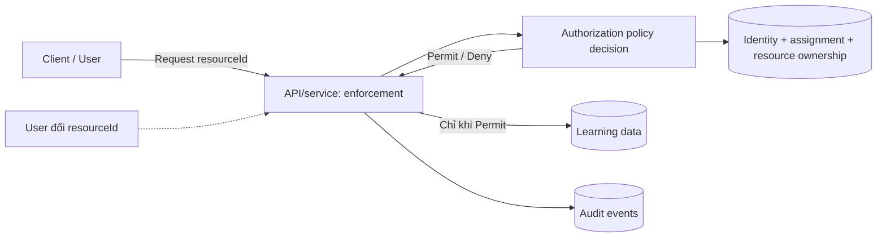
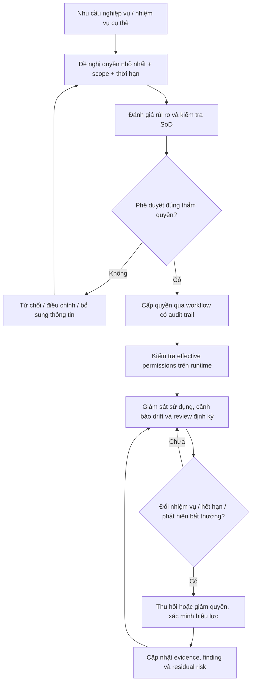

# Least privilege

## Mục tiêu học tập

Sau bài học này, bạn có thể:

- Giải thích **least privilege (đặc quyền tối thiểu)** trong kiểm soát truy cập và phân biệt với xác thực, phân quyền, **need-to-know**, **default deny** và **separation of duties**.
- Xác định **chủ thể (subject/principal)**, **tài nguyên (resource)**, **hành động (action)**, **phạm vi (scope)** và **điều kiện (context)** để thiết kế quyền tối thiểu cho con người, tài khoản dịch vụ và workload.
- Vận dụng RBAC, ABAC, quan hệ đối tượng, giới hạn thời gian và cơ chế **just-in-time access (JIT)** mà không nhầm vai trò chung với quyền trên tài nguyên cụ thể.
- Thiết kế các security controls và yêu cầu kiểm chứng được cho ứng dụng **Java/Spring Boot**, dữ liệu, IAM và hạ tầng triển khai.
- Tổ chức vòng đời **yêu cầu → phê duyệt → cấp → sử dụng → giám sát → rà soát → thu hồi** quyền truy cập, kể cả quyền khẩn cấp và ngoại lệ.
- Xây dựng **Claim – Argument – Evidence** để đánh giá hiệu lực least privilege bằng test, quyền runtime, log, review/audit và xác minh khắc phục.

## 1. Least privilege là gì?

**Principle of Least Privilege (PoLP)** yêu cầu một chủ thể chỉ được cấp **những quyền thực sự cần thiết để thực hiện nhiệm vụ được ủy quyền, đối với đúng tài nguyên, đúng phạm vi và trong khoảng thời gian cần thiết**. Khi mục đích công việc thay đổi hoặc kết thúc, quyền phải được điều chỉnh hoặc thu hồi.

Ví dụ, một giáo viên được phân công lớp A có thể xem tiến độ học viên của lớp A phục vụ giảng dạy. Việc giáo viên có vai trò `TEACHER` **không** có nghĩa họ được đọc dữ liệu mọi lớp, xuất dữ liệu toàn trường hay chỉnh sửa điểm ngoài thẩm quyền. Một export worker chỉ cần đọc dữ liệu thuộc job hợp lệ và ghi tệp đến vị trí đích đã phê duyệt; nó không mặc nhiên cần quyền quản trị cơ sở dữ liệu hay mọi bucket của tổ chức.

Trong module **SECURITY_SECURITY_ASSURANCE**, least privilege là **security control phải chứng minh được**, không chỉ là một khẩu hiệu trong policy. Chương trình assurance cần trả lời:

1. **Ai hoặc thành phần nào** có quyền?
2. **Quyền cho phép hành động gì**, trên tài nguyên nào, trong môi trường và điều kiện nào?
3. **Vì sao** những quyền đó cần thiết cho nhiệm vụ hợp lệ?
4. **Ai có thẩm quyền** cấp và kiểm tra chúng?
5. **Bằng chứng nào** chứng minh các quyền đã cấp và quyền thực thi ở runtime đúng như thiết kế?
6. **Điều gì xảy ra** khi chủ thể đổi nhiệm vụ, quyền hết hạn, cấu hình drift hoặc có tín hiệu lạm dụng?

### 1.1. Những thuật ngữ liên quan nhưng khác nhau

| Khái niệm | Câu hỏi chính | Liên hệ với least privilege |
| --- | --- | --- |
| **Authentication (xác thực)** | Chủ thể là ai, danh tính được chứng minh thế nào? | Xác thực đúng là điều kiện đầu vào, không tự xác định được quyền. |
| **Authorization (phân quyền)** | Chủ thể được thực hiện hành động này với tài nguyên này không? | Là cơ chế thực thi giới hạn quyền tại điểm truy cập. |
| **Least privilege** | Tập quyền được cấp có đúng mức **tối thiểu cần thiết** không? | Nguyên tắc giới hạn mức quyền trên toàn vòng đời. |
| **Need-to-know** | Người dùng có cần biết thông tin cụ thể để làm nhiệm vụ không? | Đặc biệt hữu ích với dữ liệu nhạy cảm; bổ trợ việc cấp quyền. |
| **Default deny / deny by default** | Khi không có căn cứ cho phép rõ ràng, xử lý thế nào? | Từ chối thay vì mặc định cấp quyền; giúp tránh mở rộng quyền vô ý. |
| **Separation of duties (SoD)** | Một người có đang nắm những quyền xung đột cần tách biệt không? | Giảm rủi ro lạm dụng dù từng quyền riêng lẻ có lý do. |
| **Just-in-time / time-bound access** | Quyền có cần tồn tại thường trực không? | Chỉ cấp trong khoảng cần thiết, tự hết hạn hoặc thu hồi sau tác vụ. |
| **Privilege escalation** | Chủ thể có thể đạt quyền cao hơn ngoài thẩm quyền không? | Một threat cần ngăn, phát hiện và kiểm chứng. |

**MFA** giúp giảm nguy cơ người khác giả mạo tài khoản, nhưng không chữa được tài khoản **được cấp quá nhiều quyền**. Tương tự, TLS mã hóa đường truyền chứ không quyết định giáo viên nào có quyền xem một lớp học.

### 1.2. Công thức tư duy: quyền theo ngữ cảnh

Thay vì chỉ hỏi “user có role nào?”, hãy biểu diễn quyết định:

```text
Decision = Permit(subject, action, resource, context, policy)

subject  : người dùng / workload / service account được xác thực
action   : read, create, update, delete, export, approve, administer...
resource : hồ sơ học viên, lớp học, tệp xuất, secret, database, bucket...
context  : môi trường, tổ chức/tenant, quan hệ phân công, thời gian,
           trạng thái phiên, yêu cầu phê duyệt và điều kiện rủi ro
policy   : quy tắc do chủ thể có thẩm quyền phê duyệt
```

Đây là **mô hình tư duy**, không phải hàm chuẩn của framework. Một quyết định `Permit` chỉ có ý nghĩa khi **danh tính, thuộc tính và quan hệ được lấy từ nguồn đáng tin**, được đánh giá tại điểm thực thi thích hợp và những đường truy cập khác không bypass cùng chính sách.

## 2. Tại sao quyền tối thiểu giảm rủi ro?

Quyền vượt nhu cầu làm tăng **blast radius** khi có lỗi ứng dụng, token bị đánh cắp, tài khoản bị chiếm quyền hoặc thao tác nhầm. Hạn quyền không nhất thiết loại bỏ khả năng xảy ra sự cố, nhưng có thể hạn chế **tài nguyên bị truy cập**, **hành động có thể thực hiện** và **thời gian có thể lạm dụng**.

| Threat scenario | Cấp quyền quá rộng | Thiết kế least privilege |
| --- | --- | --- |
| Giáo viên thay `classId` trên URL | Vai trò `TEACHER` có thể xuất mọi lớp. | Phải kiểm tra giáo viên **đang được phân công** với lớp cụ thể. |
| Token export worker bị lộ | Workload có quyền đọc mọi bảng và xóa mọi tệp. | Quyền đọc đúng tập dữ liệu/job và chỉ ghi/xóa trong vùng được cấp. |
| Nhân viên đổi bộ phận | Quyền quản trị cũ tồn tại vô thời hạn. | Cơ chế joiner–mover–leaver thu hồi quyền không còn cần. |
| Thao tác deploy nhầm | Tài khoản CI có quyền quản trị tất cả môi trường. | Tách quyền theo pipeline/environment, giới hạn thay đổi đúng resource. |
| Tài khoản hỗ trợ bị chiếm đoạt | Có quyền sửa điểm và tải dữ liệu hàng loạt. | Chỉ đọc dữ liệu tối thiểu phục vụ hỗ trợ, thao tác nhạy cảm phải được duyệt riêng. |
| Kỹ sư dùng break-glass | Quyền đặc biệt tồn tại lâu sau khi khôi phục dịch vụ. | Nâng quyền có lý do, thời hạn, log và hậu kiểm độc lập. |

**Least privilege không đảm bảo mọi lệnh hợp lệ đều vô hại.** Một người có quyền đúng vẫn có thể thực hiện hành vi sai mục đích; cần bổ trợ bằng giám sát, quy trình phê duyệt hành động nhạy cảm, phân tách nhiệm vụ, quản trị dữ liệu và ứng phó sự cố.

## 3. Xác định quyền tối thiểu từ nhiệm vụ thực tế

Quyền tối thiểu không phải “cấp ít nhất có thể cho hệ thống còn chạy”. Nếu quyền quá hẹp khiến tác vụ hợp pháp liên tục thất bại, người vận hành có thể tìm cách bypass kiểm soát. Mục tiêu là **tập quyền nhỏ nhất đáp ứng đầy đủ hành động đã được phê duyệt** và có bằng chứng cho lý do cấp quyền.

### 3.1. Quy trình xác định quyền

1. **Liệt kê chủ thể:** học viên, giáo viên, quản trị viên, support, export worker, CI/CD, database migration và Operator. Tài khoản dịch vụ cũng là chủ thể.
2. **Liệt kê nhiệm vụ hợp lệ:** xem tiến độ của mình, chấm điểm của lớp được phân công, xuất báo cáo hợp lệ, xử lý backup, deploy phiên bản đã duyệt.
3. **Xác định tài nguyên:** học viên cụ thể, lớp học, tenant, bảng hoặc view, secret, API, storage prefix và môi trường.
4. **Phân rã hành động:** `read`, `update`, `export`, `approve`, `delete`, `administer` là các quyền khác nhau; `read` không ngầm bao gồm `export all`.
5. **Xác định điều kiện:** phân công lớp còn hiệu lực, mục đích công việc, loại tài khoản, thời gian, phê duyệt đặc biệt và giới hạn dữ liệu.
6. **Ghi phép truy cập dự kiến được phép/từ chối:** xây access matrix cùng test fixtures trước khi hiện thực.
7. **Triển khai ở nhiều tầng hợp lý:** business authorization tại API/service, quyền DB và IAM, network và storage.
8. **Kiểm chứng lại trên runtime:** so sánh quyền được cấp, hành vi thực và task đã được phê duyệt; làm mới khi nghiệp vụ đổi.

### 3.2. Ma trận truy cập mẫu

Giả sử nền tảng học tập có các đối tượng `LearnerProgress`, `CourseGrades` và `ExportJob`:

| Chủ thể | Xem tiến độ | Sửa điểm | Yêu cầu export | Tải export | Quản trị quyền |
| --- | --- | --- | --- | --- | --- |
| Học viên | Chỉ hồ sơ của mình. | Không. | Không, trừ tính năng được phép rõ. | Chỉ bản xuất của mình nếu có tính năng. | Không. |
| Giáo viên | Chỉ học viên thuộc lớp **đang được phân công**. | Chỉ điểm được giao phụ trách theo quy trình. | Chỉ lớp được phân công. | Chỉ job/tệp trong phạm vi quyền còn hiệu lực. | Không. |
| Bộ phận hỗ trợ | Chỉ dữ liệu tối thiểu và trường hợp được giao. | Không mặc định. | Không mặc định. | Không mặc định. | Không. |
| Quản trị đào tạo | Theo thẩm quyền nghiệp vụ, có dấu vết. | Theo chức năng và quy trình được phê duyệt. | Không nhất thiết mặc định toàn trường. | Theo scope được phê duyệt. | Không tự cấp mọi quyền nếu cần SoD. |
| Export worker | Không truy cập qua giao diện người dùng. | Không. | Chỉ xử lý job hợp lệ được giao. | Chỉ ghi/đọc tệp cần cho job. | Không. |
| CI/CD service | Không đọc dữ liệu học viên. | Không. | Không. | Không. | Chỉ quyền deploy/config phục vụ pipeline được duyệt. |

Đây là **thiết kế minh họa**, không phải chính sách mặc định của mọi hệ thống giáo dục. Ma trận thực tế cần làm rõ **tenant, trạng thái học kỳ, quan hệ phân công, dữ liệu nhạy cảm, các trường thông tin** và trách nhiệm phê duyệt. “Giáo viên” là một vai trò rộng; quyền trên một bản ghi phụ thuộc **quan hệ của giáo viên với bản ghi**.

### 3.3. Các chiều của “tối thiểu”

Một quyền cần nhỏ phù hợp trên nhiều chiều:

- **Hành động:** chỉ đọc thay vì sửa/xóa; tách `EXPORT` khỏi `VIEW`.
- **Tài nguyên:** một lớp hoặc nhóm dữ liệu được giao thay vì toàn hệ thống.
- **Môi trường:** staging không mặc định có quyền production; CI deploy không có quyền đọc DB production.
- **Thời gian:** quyền có hạn cho nhiệm vụ ngắn hoặc tình huống khẩn.
- **Dữ liệu:** chỉ các trường cần thiết; export có thể chứa nhiều dữ liệu hơn việc đọc màn hình.
- **Độ nhạy:** quyền quản trị IAM, thay đổi chính sách và thu hồi audit log cần kiểm soát chặt hơn quyền đọc thông thường.
- **Nguồn truy cập:** có thể bổ sung điều kiện thiết bị, mạng và mức xác thực theo rủi ro; nhưng không thay quyền theo tài nguyên.

## 4. Cơ chế thực thi least privilege

### 4.1. RBAC, ABAC và phân quyền theo quan hệ

| Mô hình | Quyết định dựa trên | Phù hợp | Điểm cần thận trọng |
| --- | --- | --- | --- |
| **RBAC** | Vai trò được cấp và quyền của vai trò. | Nhóm chức năng như `STUDENT`, `TEACHER`, `PLATFORM_OPERATOR`. | Role `TEACHER` không cho biết lớp nào; dễ mở rộng quyền khi vai trò quá chung. |
| **ABAC** | Thuộc tính của subject, resource, action và context. | Tenant, độ nhạy dữ liệu, điều kiện thời gian hoặc môi trường. | Nguồn thuộc tính phải đáng tin, đúng thời điểm; rule phức tạp khó kiểm. |
| **Relationship-based / ReBAC** | Quan hệ giữa chủ thể và tài nguyên. | Giáo viên được phân công lớp; chủ sở hữu hồ sơ; thành viên tổ chức. | Phải kiểm soát vòng đời quan hệ, kế thừa và thay đổi quyền. |
| **ACL** | Danh sách chủ thể/nhóm có quyền trên một tài nguyên. | Tệp riêng, đối tượng có chia sẻ cụ thể. | Danh sách có thể phình to, khó kiểm tra và thu hồi. |
| **Policy-based access** | Quyết định từ chính sách kết hợp nhiều điều kiện. | Hệ thống nhiều dịch vụ và mức độ nhạy khác nhau. | Cần điểm thực thi nhất quán, phiên bản rule, test và giám sát. |

Thực tế thường **kết hợp**: RBAC xác định loại chức năng có thể sử dụng; ABAC hoặc quan hệ xác định chủ thể **có quyền trên bản ghi cụ thể hay không**; IAM giới hạn service account; các điều kiện bổ sung giảm rủi ro với thao tác nhạy cảm.

### 4.2. Điểm quyết định và điểm thực thi

Một hệ thống có thể tách:

- **Policy Administration Point (PAP):** nơi quản trị chính sách và phiên bản.
- **Policy Decision Point (PDP):** nơi đánh giá subject, action, resource và điều kiện để cho phép/từ chối.
- **Policy Enforcement Point (PEP):** nơi chặn yêu cầu nếu quyết định không cho phép.
- **Policy Information Point (PIP):** nơi cung cấp thuộc tính và quan hệ đáng tin để ra quyết định.

Đây là **mô hình kiến trúc tham khảo**, không yêu cầu mỗi hệ thống phải có bốn sản phẩm riêng biệt. Trong ứng dụng Spring Boot, controller/service có thể đóng vai trò enforcement; một method của domain policy thực hiện quyết định bằng quan hệ lưu trong DB. Quan trọng nhất: **mọi đường truy cập nhạy cảm phải đi qua kiểm soát phù hợp** và nguồn dữ liệu cấp quyền phải đáng tin.



**Không tin client**: ẩn nút “Export” trong frontend giúp trải nghiệm nhưng không thay thế kiểm tra tại server. Client có thể tự thay URL, request body, query parameter hoặc gửi request trực tiếp.

### 4.3. Deny by default và quyền kế thừa

Quy tắc mặc định nên là **không có quyền cho đến khi có căn cứ cho phép rõ ràng**. Nhưng `denyAll` ở một endpoint không chứng minh các đường truy cập phụ, job nền hoặc storage đã được bảo vệ. Một role có thể kế thừa quyền từ nhiều nhóm, hoặc policy cloud có nhiều nguồn cấp quyền; phải tính **effective permissions** chứ không chỉ một dòng cấu hình.

Khi thiết kế, nên kiểm tra những “quyền mở rộng ẩn” như:

- Role `EDITOR` mặc nhiên được `DELETE` hoặc `EXPORT`.
- Group kế thừa quyền quản trị từ nhóm cha.
- Một service account dùng chung giữa nhiều microservices.
- Quyền `*` hoặc thao tác quản trị được gán ở cấp toàn account/project.
- Tài khoản trong môi trường test sử dụng credential production.
- Tệp export có URL tải hoặc bucket policy vượt khỏi quyền cấp ở API.

## 5. Least privilege trong Java/Spring Boot

### 5.1. Tình huống nghiệp vụ

Dịch vụ `learning-progress-api` cung cấp endpoint:

```text
GET  /api/learners/{learnerId}/progress
POST /api/courses/{courseId}/grades/exports
GET  /api/exports/{exportId}/download
```

Một học viên được đọc tiến độ của mình. Giáo viên được phân công lớp có thể xem và xuất dữ liệu trong lớp đó. Export worker tạo file theo job được phê duyệt. Một lỗi thường gặp là API chỉ kiểm tra `hasRole('TEACHER')` mà không xem **quan hệ giữa giáo viên và lớp được yêu cầu**.

**Security requirement `SEC-LP-01`:** Mọi đường đọc/xuất dữ liệu cá nhân phải thực thi quyền theo chủ thể, hành động và tài nguyên ở server; chủ thể không có quyền phải bị từ chối trước khi dữ liệu được trả hoặc job có hiệu lực.

### 5.2. Bảo vệ ở service layer với method security

Một ví dụ minh họa sử dụng Spring Security:

```java
@Configuration
@EnableMethodSecurity
class MethodSecurityConfiguration {}

@Service
class ProgressService {
    private final ProgressRepository progressRepository;

    ProgressService(ProgressRepository progressRepository) {
        this.progressRepository = progressRepository;
    }

    @PreAuthorize("@progressAccess.canRead(authentication, #learnerId)")
    public ProgressView getProgress(long learnerId) {
        return progressRepository.loadView(learnerId);
    }
}

@Service
class CourseExportService {
    private final ExportJobRepository exportJobs;

    CourseExportService(ExportJobRepository exportJobs) {
        this.exportJobs = exportJobs;
    }

    @PreAuthorize("@courseAccess.canExport(authentication, #courseId)")
    public ExportJobId requestExport(long courseId) {
        return exportJobs.enqueue(courseId);
    }
}
```

Trong ví dụ, `progressAccess` và `courseAccess` là **các bean chính sách giả định** phải đối chiếu quyền với nguồn server đáng tin. `ExportJobRepository`, `ProgressRepository` và các kiểu DTO cũng là thành phần ứng dụng minh họa, không phải API sẵn có của Spring Boot. Để production an toàn còn cần:

- Đảm bảo method security **thực sự được bật và áp dụng qua Spring proxy**; đường self-invocation hoặc đường truy cập bỏ qua service cần được xem xét.
- Policy cần phân biệt học viên, giáo viên, lớp và trạng thái phân công; không chỉ `hasRole('TEACHER')`.
- Tránh đưa `role`, `ownerId` hoặc `tenantId` từ request vào policy như thuộc tính tin cậy; lấy từ danh tính và nguồn sở hữu được kiểm soát.
- Kiểm soát **quyền tải file xuất** tách khỏi quyền tạo job; URL tạm có thời hạn không tự chứng minh người nhận có quyền.
- Áp dụng phân quyền và lọc bản ghi tại các đường truy cập khác, kể cả batch jobs, endpoint admin và export.
- Xem xét race condition nếu quyền thay đổi giữa thời điểm kiểm tra và sử dụng; quyết định lúc tải có thể cần kiểm lại.

### 5.3. Mẫu policy decision ở domain layer

Để tránh chỉ nhìn role chung, một phương thức quyết định có thể biểu diễn rõ dữ liệu đầu vào tin cậy:

```java
@Component("courseAccess")
class CourseAccessPolicy {
    private final CourseAssignmentRepository assignments;

    CourseAccessPolicy(CourseAssignmentRepository assignments) {
        this.assignments = assignments;
    }

    public boolean canExport(Authentication auth, long courseId) {
        if (auth == null || !auth.isAuthenticated()
                || auth instanceof AnonymousAuthenticationToken) {
            return false;
        }
        String subjectId = auth.getName();
        return assignments.isActiveTeacherOfCourse(subjectId, courseId);
    }
}
```

Đây là **mã giảng dạy**, giả định `Authentication.getName()` là subject ID đã được hệ thống ánh xạ an toàn, `assignments` truy vấn quan hệ phân công còn hiệu lực, và không có quyền export đặc biệt ngoài chính sách này. Ứng dụng có thể cần thêm role hợp lệ, kiểm tra tenant, thời điểm, trạng thái khóa tài khoản và loại dữ liệu. **Không áp dụng nguyên xi** nếu nguồn danh tính dùng username có thể thay đổi hoặc có nhiều tenant; phải dùng định danh ổn định trong phạm vi.

### 5.4. Kiểm thử quyền thực, không mock bỏ policy

Giả sử integration test đã có fixture: `student-a` là chủ hồ sơ `learnerId=42`; `student-b` không có quyền với hồ sơ đó; `teacher-a` được phân công lớp `courseId=7`, còn `teacher-b` không được phân công.

```java
@SpringBootTest
@AutoConfigureMockMvc
class LeastPrivilegeAuthorizationIT {
    @Autowired
    MockMvc mockMvc;

    @Test
    @WithMockUser(username = "student-a", roles = "STUDENT")
    void ownerCanReadOwnProgress() throws Exception {
        mockMvc.perform(get("/api/learners/42/progress"))
               .andExpect(status().isOk());
    }

    @Test
    @WithMockUser(username = "student-b", roles = "STUDENT")
    void anotherStudentCannotReadProgress() throws Exception {
        mockMvc.perform(get("/api/learners/42/progress"))
               .andExpect(status().isForbidden());
    }

    @Test
    @WithMockUser(username = "teacher-b", roles = "TEACHER")
    void teacherNotAssignedToCourseCannotRequestExport() throws Exception {
        mockMvc.perform(post("/api/courses/7/grades/exports")
                .with(csrf()))
               .andExpect(status().isForbidden());
    }
}
```

Các ca thử trên **chỉ minh họa** cấu trúc; cần cấu hình Spring Security test support, MockMvc, route, fixture, data access và CSRF theo cơ chế thực. `csrf()` cần khi bảo vệ CSRF được áp dụng cho request; không nên tắt security filter để test pass. Cũng cần kiểm thử `teacher-a` được phép, tài khoản chưa xác thực, vai trò sai, quyền bị thu hồi, tenant khác, URL download và quyền đối với tệp export.

**Phân biệt kết quả `403` đúng lý do:** request có thể thất bại do CSRF, route không tồn tại hoặc cấu hình test sai chứ không phải bởi kiểm tra least privilege. Cần đối chứng tích cực, kiểm tra đường policy thực thi và xác nhận nghiệp vụ không tạo job/đọc dữ liệu khi bị từ chối.

### 5.5. Kiểm tra quyền ngay tại dữ liệu

Khi dữ liệu được truy vấn từ DB hoặc cache, cần tránh **đọc toàn bộ rồi mới lọc tại frontend**. Một API nên truy vấn theo **ID và điều kiện quyền từ server**, hoặc áp dụng cơ chế row-level security của DB nếu thiết kế sử dụng và kiểm chứng được. Phân quyền ở ứng dụng và quyền DB có thể là **các lớp bổ sung**, không mặc định một lớp thay thế lớp còn lại.

Ví dụ một truy vấn có điều kiện quyền theo lớp cần bind tham số an toàn và bảo đảm nguồn `teacherId` thuộc danh tính đã xác thực; còn quyền truy cập trực tiếp tới DB của service account phải được giới hạn độc lập. Đừng coi bộ lọc `WHERE teacher_id = ?` tự nó chứng minh quyền nếu mã truyền giá trị từ client hoặc đường query phụ bỏ qua điều kiện.

## 6. Least privilege cho workload và hạ tầng

Ứng dụng có thể kiểm soát quyền người dùng rất tốt nhưng vẫn rủi ro nếu **tài khoản chạy ứng dụng** có quyền quản trị cả hạ tầng, database hay kho tệp.

### 6.1. Tài khoản dịch vụ và danh tính máy

Áp dụng các nguyên tắc:

- **Một danh tính cho một mục đích chịu trách nhiệm rõ**, tránh dùng chung service account cho export worker, API và CI khi nhu cầu quyền khác nhau.
- Quyền đọc, ghi, xóa, quản trị và cấp lại quyền phải được tách phù hợp; không gán `ADMIN` nếu chỉ cần `READ`.
- Chỉ cấp truy cập resource cụ thể, tài khoản cloud/project hoặc namespace phù hợp; tránh `*` nếu có thể định danh hẹp hơn.
- Tránh **credential tĩnh tồn tại lâu** nếu hạ tầng hỗ trợ workload identity, token ngắn hạn và cơ chế xoay/thu hồi thích hợp.
- Đừng đưa secrets vào image, repository, ticket hoặc log; kiểm tra quyền của kho secret và đường triển khai.
- Theo dõi tài khoản không còn sử dụng, quyền tạm và service bị ngừng hoạt động.

**Quyền tối thiểu phải dựa trên các thao tác hợp lệ đã được thiết kế**, không dựa duy nhất vào thống kê sử dụng gần đây. Một quyền chỉ dùng khi phục hồi sự cố có thể hợp lệ dù chưa xuất hiện trong log một tháng; cần gắn nhiệm vụ và điều kiện rõ.

### 6.2. Ví dụ Kubernetes RBAC có phạm vi

Giả sử một workload chỉ cần **đọc một ConfigMap** trong namespace của nó, không cần danh sách toàn namespace. Ví dụ:

```yaml
apiVersion: v1
kind: ServiceAccount
metadata:
  name: config-reader
  namespace: learning-prod
---
apiVersion: rbac.authorization.k8s.io/v1
kind: Role
metadata:
  name: read-export-settings
  namespace: learning-prod
rules:
  - apiGroups: [""]
    resources: ["configmaps"]
    resourceNames: ["progress-export-settings"]
    verbs: ["get"]
---
apiVersion: rbac.authorization.k8s.io/v1
kind: RoleBinding
metadata:
  name: config-reader-binding
  namespace: learning-prod
subjects:
  - kind: ServiceAccount
    name: config-reader
    namespace: learning-prod
roleRef:
  kind: Role
  name: read-export-settings
  apiGroup: rbac.authorization.k8s.io
```

Trong ví dụ, **Role** được giới hạn namespace, resource `configmaps`, tên `progress-export-settings` và động từ `get`; không cấp `list`, `watch`, `update`, `delete` hoặc quyền ở namespace khác. Deployment thực tế cần gán đúng `serviceAccountName`, định nghĩa nhu cầu token truy cập Kubernetes API, và kiểm tra quyền hiệu lực. Workload **không cần gọi Kubernetes API** thường không cần tự động mount API token.

**Giới hạn quan trọng:** Kubernetes RBAC trên ConfigMap không tự giới hạn quyền truy cập database, object storage, network hoặc cloud IAM. Các quyền ấy nằm ở những cơ chế khác và phải được đánh giá riêng. Một `RoleBinding` cũng không chứng minh workload thực tế sử dụng đúng ServiceAccount nếu chưa đối chiếu deployment.

### 6.3. Dữ liệu và storage

Với export worker, nên xem:

| Tầng | Câu hỏi least privilege | Bằng chứng |
| --- | --- | --- |
| **DB** | Worker có chỉ đọc bảng/view hoặc truy vấn cần thiết? Có quyền DDL/DROP không cần thiết? | Grants của DB role đang chạy, test quyền bị từ chối, review query. |
| **Object storage** | Worker chỉ ghi vào bucket/prefix được duyệt, có bị cấp quyền đọc/xóa mọi object không? | IAM/bucket policy thực, test thao tác cho phép/từ chối. |
| **Queue** | Chỉ đọc job queue của dịch vụ và ghi kết quả thuộc phạm vi? | Queue policy, runtime principal, tests. |
| **Kubernetes/cloud** | Có cần API token, quyền chỉnh deployment hoặc xem secrets toàn namespace không? | ServiceAccount/RoleBinding, workload identity, effective permissions. |
| **Logging/telemetry** | Có thể gửi audit events mà không thể sửa/xóa log tập trung? | Quyền log sink, test event end-to-end, cấu hình retention. |

Đối với dịch vụ chạy qua nhiều môi trường, quyền production không nên tự cấp cho tài khoản local developer chỉ vì thuận tiện debug. Phương án support cần **đường truy cập được ủy quyền, có hạn, có dấu vết và biện pháp bảo vệ dữ liệu**.

## 7. Vòng đời quyền truy cập có thể kiểm chứng

Least privilege là **trạng thái phải được duy trì**, không chỉ thao tác cấp quyền ban đầu.



### 7.1. Joiner–Mover–Leaver (JML)

- **Joiner:** tài khoản mới chỉ nhận các quyền cần cho vị trí và nhiệm vụ đã phê duyệt; không cấp mặc định bộ quyền quản trị “cho tiện”.
- **Mover:** khi giáo viên chuyển lớp hoặc nhân viên đổi vai trò, cần **thu hồi quyền cũ** và xác định quyền mới, không chỉ cộng thêm vai trò mới.
- **Leaver:** vô hiệu quyền, session/token và đường truy cập liên quan theo quy trình; lưu bằng chứng hiệu lực ở hệ thống nguồn, kể cả hệ thống thứ cấp.

Nếu quyền được cache hoặc token vẫn còn hiệu lực sau khi thu hồi quan hệ, cần định nghĩa rõ yêu cầu về **độ trễ thu hồi**. Thao tác xóa group trên IAM không tự chứng minh token đã phát không còn được chấp nhận; cần kiểm tra cơ chế token TTL, revocation và risk limits.

### 7.2. Access review định kỳ

Một review có giá trị phải:

1. Lấy **population** đầy đủ: human users, service accounts, quyền trực tiếp, kế thừa, tạm và đặc quyền.
2. Đối chiếu với tài sản, owner, nhiệm vụ, ngày cấp, ngày hết hạn và nguồn phê duyệt.
3. Yêu cầu reviewer có thẩm quyền ra quyết định `KEEP`, `REVOKE` hoặc `INVESTIGATE` với lý do.
4. Ngăn tự duyệt quyền nhạy cảm hoặc dùng kiểm soát bù trừ độc lập khi đội nhỏ.
5. Thực thi thu hồi tại **hệ thống nguồn**, sau đó kiểm tra lại quyền thực tế và cập nhật hồ sơ.
6. Ghi finding và chuyển cấp đối với quyền thừa, thiếu dữ liệu hoặc quá hạn.

**Review hoàn tất không đồng nghĩa quyền đã được thu hồi.** Dashboard “100% reviews completed” chỉ có ý nghĩa khi biết cả phạm vi, chất lượng quyết định, phần quyền bị bỏ sót và trạng thái thực thi.

### 7.3. Quyền tạm thời, JIT và break-glass

Quyền đặc biệt chỉ cần khi deploy/điều tra sự cố có thể được cấp qua **JIT**, có request, lý do, phê duyệt phù hợp, TTL và audit. Khi xảy ra khẩn cấp, **break-glass** có thể có cơ chế phê duyệt rút gọn theo playbook, nhưng cần kiểm soát hành vi sau khi sử dụng:

- Giới hạn chủ thể, chức năng, tài sản, môi trường và **thời hạn** càng chặt càng hợp lý.
- Xác thực mạnh phù hợp và giữ nguồn danh tính đáng tin.
- Tạo alert khi sử dụng quyền đặc biệt và bảo toàn audit log.
- Thu hồi hoặc hết hạn sau tác vụ, kiểm chứng không có quyền kéo dài ngoài ý định.
- Đánh giá hậu kiểm: ai kích hoạt, vì sao, đã làm gì, có đổi control/secret nào không.

Không nên bật quyền quản trị vĩnh viễn chỉ vì “thỉnh thoảng cần cấp cứu”. Tuy nhiên, cơ chế JIT cũng phải bảo đảm **khả năng truy cập trong khẩn cấp** theo mục tiêu sẵn sàng; cần thử quy trình và người dự phòng.

## 8. Separation of duties và việc không tự phê duyệt

**Least privilege** giới hạn từng quyền; **separation of duties** tránh một chủ thể có tổ hợp quyền xung đột dẫn đến gian lận hoặc sửa dấu vết. Một cá nhân có thể hợp lý khi được làm **một** hành động, nhưng không nên được **đề xuất, phê duyệt, thực thi và tự kiểm chứng** cùng một thay đổi rủi ro cao.

| Hoạt động | Xung đột cần xem xét | Cách kiểm soát |
| --- | --- | --- |
| Tạo thay đổi quyền và phê duyệt quyền | Người yêu cầu tự cấp đặc quyền. | Hai người hoặc reviewer độc lập có thẩm quyền; log và kiểm tra workflow. |
| Sửa điểm và xóa audit logs | Có thể sửa dữ liệu rồi xóa dấu vết. | Tách quyền ghi điểm, quản trị log và chính sách lưu trữ. |
| Deploy code và chấp nhận rủi ro vượt chuẩn | Có thể bypass gate vì áp lực release. | Risk owner/policy owner quyết định, gate không cho tự sửa trạng thái. |
| Quản lý backup và xóa mọi bản sao | Có thể khiến dữ liệu không còn khả năng phục hồi. | Giới hạn quyền xóa, lưu giữ độc lập và kiểm tra restore. |
| Quản trị IAM và review quyền của chính mình | Chất lượng rà soát thiếu độc lập. | Reviewer khác, audit trail và kiểm soát bù trừ. |

SoD không nhất thiết phải tách thành nhiều bộ phận trong đội nhỏ. Có thể dùng phê duyệt độc lập theo lịch, logging khó chỉnh sửa, kiểm tra hậu kiểm hoặc tự động xác nhận điều kiện. Tuy nhiên, biện pháp bù trừ phải **được đánh giá theo rủi ro**, không dùng vì thuận tiện mà mặc định tương đương.

## 9. Đo lường, phát hiện drift và đánh giá rủi ro còn lại

### 9.1. Control statements có thể kiểm chứng

| Control ID | Phát biểu kiểm soát | Verification | Evidence |
| --- | --- | --- | --- |
| `LP-APP-01` | API đọc/xuất dữ liệu học viên phải kiểm quyền theo tài nguyên ở server. | Test identity/resource tích cực/tiêu cực; review các đường truy cập. | CI run theo build, review policy, runtime verification. |
| `LP-IAM-02` | Mọi quyền đặc biệt production phải có owner, lý do, phê duyệt và scope. | Đối soát IAM grants với hồ sơ duyệt, kể cả quyền kế thừa. | IAM export nguồn, approval/audit record. |
| `LP-JIT-03` | Quyền tạm hết hạn hoặc được thu hồi khi nhiệm vụ kết thúc. | Test hết hạn và quyền không còn có hiệu lực. | TTL metadata, event revoke, kết quả kiểm tra effective permissions. |
| `LP-SVC-04` | Workload chỉ có quyền API/DB/storage cần cho nhiệm vụ được phê duyệt. | Role/IAM review, test thao tác không được phép. | ServiceAccount, cloud/DB grants, runtime identity. |
| `LP-REV-05` | Quyền thuộc phạm vi được rà soát theo trigger/lịch, kết quả thu hồi phải xác minh. | Đối soát population, lấy mẫu quyết định, test IAM sau revoke. | Snapshot, quyết định từng quyền, ticket và test. |
| `LP-SOD-06` | Tổ hợp quyền xung đột bị ngăn hoặc có kiểm soát bù trừ được phê duyệt. | Test không tự duyệt, review quyền xung đột. | Workflow logs, approval matrix, exception records. |

Một control statement tốt nêu **đúng phạm vi, trạng thái cần duy trì, tiêu chí chấp nhận, người chịu trách nhiệm và trigger kiểm chứng**. Không gộp mọi hành vi vào một mục “least privilege = yes” rồi coi một ảnh chụp IAM là đã chứng minh toàn bộ.

### 9.2. Inherent risk và residual risk

Giả sử export worker có quyền quản trị bucket và quyền `DELETE` toàn bộ object. Inherent risk có thể bao gồm **lộ hoặc mất dữ liệu hàng loạt** nếu credential bị lộ hoặc job chạy sai. Sau khi chỉ còn quyền đọc nguồn được giao và ghi object vào prefix cụ thể, rủi ro có thể giảm. Nhưng **rủi ro còn lại** vẫn gồm đường tải file sai quyền, cấu hình bucket ngoài ý muốn hoặc tài khoản phụ có quyền rộng.

Không nên định lượng rủi ro giảm bằng cách trừ một con số cố định cho mỗi control. Cần đánh giá threat path, khả năng khai thác, mức ảnh hưởng, hiệu lực controls đã kiểm chứng và **độ không chắc chắn**. Đặc biệt, quyền “trông hẹp” trong IaC chưa chắc hẹp ở runtime nếu có RoleBinding, IAM policy hoặc group khác đang cấp thêm quyền.

### 9.3. Chỉ số hữu ích

| KRI/KPI | Câu hỏi | Giới hạn cần tránh |
| --- | --- | --- |
| Số danh tính có quyền quản trị thường trực | Những quyền nào có thể chuyển sang JIT hoặc giảm scope? | Ít account không đảm bảo mỗi account ít quyền. |
| Tỷ lệ grants có approval và owner hợp lệ | Cấp quyền có theo quy trình? | Approval không chứng minh quyền cần thiết hoặc đã được thu hồi. |
| Quyền tạm quá hạn | JIT và access expiry có hoạt động? | Metadata hết hạn chưa chứng minh token/session bị vô hiệu. |
| Tỷ lệ quyền được review theo population đầy đủ | Quyền thừa có được phát hiện? | Chỉ tính ticket hoàn tất có thể bỏ sót service accounts. |
| Thời gian từ quyết định revoke đến xác minh quyền thực tế không còn | Việc thu hồi có kịp thời? | Cần tính trên nguồn IAM/DB và token policy liên quan. |
| Số lần phát hiện privilege drift hoặc policy bypass | Quyền runtime có còn khớp baseline? | Số 0 có thể do coverage giám sát kém. |
| Tỷ lệ negative authorization tests theo các đường nhạy cảm | Có kiểm tra “không được phép” đúng phạm vi? | Test pass không chứng minh endpoint chưa kiểm kê. |

Một báo cáo assurance cần hiển thị riêng **quyền không rõ owner**, **chưa kiểm chứng**, **ngoại lệ hợp lệ** và **thực sự đã giảm quyền**, thay vì tổng hợp tất cả thành một tỷ lệ xanh.

## 10. Claim – Argument – Evidence cho least privilege

### 10.1. Xây lập luận có phạm vi rõ

**Claim:** “Trong bản phát hành R và phạm vi API tiến độ đã kiểm kê, người dùng không có quyền trên một hồ sơ học viên không thể đọc hoặc xuất dữ liệu của hồ sơ đó; các service accounts liên quan chỉ có những quyền tài nguyên cần thiết đã được phê duyệt ở production.”

Đây là một **claim nhiều thành phần**. Nếu không đủ evidence cho cả hành vi ứng dụng và quyền hạ tầng, cần tách thành claims hẹp hơn thay vì đánh dấu toàn bộ `PASS`.

**Argument:**

1. Vai trò/nghiệp vụ, đối tượng và các trường hợp quyền trên từng hồ sơ đã được xác định rõ; client không là nguồn của quyền được tin cậy.
2. Tất cả các đường API đọc, tải và xuất thuộc phạm vi đều kiểm quyền tại server theo quan hệ dữ liệu hiện hành.
3. Test cho phép/từ chối và review code hỗ trợ kết luận về hiệu lực logic phân quyền trong build được xét.
4. Service accounts, quyền DB/storage và runtime identity được đối chiếu với baseline và các hành động tối thiểu cần thiết.
5. Quyền đặc biệt và ngoại lệ có thẩm quyền, hạn hiệu lực, dấu vết; việc thay đổi quyền phải trigger đánh giá lại.

**Evidence:**

| Lập luận | Loại bằng chứng | Phạm vi và giới hạn |
| --- | --- | --- |
| Quan hệ quyền hợp lệ | Access matrix, dữ liệu phân công, chính sách quyền theo tài nguyên. | Quan hệ có thể thay đổi sau thời điểm lấy mẫu. |
| Server enforcement | Code/policy review, integration security tests và negative tests. | Test phải đi qua security chain thật; xem các endpoint phụ. |
| Tài khoản dịch vụ hẹp | IAM/DB grants, K8s Role/RoleBinding, xác minh identity đang chạy. | Nhiều policy có thể cộng quyền; cần effective permissions. |
| Quyền được phê duyệt đúng | Request, approval, role mapping, SoD policy, audit trail. | Phê duyệt chưa chứng minh quyền runtime khớp. |
| Thu hồi và quyền tạm | Event revoke, thử truy cập sau hạn, session/token behavior. | Xóa group chưa chắc token đã mất hiệu lực ngay. |
| Giám sát và drift | IAM change alerts, review kết quả, finding và re-test. | Không có alert không chứng minh không có quyền thừa. |

**Giới hạn claim:** Một số quyền có thể bị cấp qua group kế thừa hoặc tài khoản cloud ngoài hệ thống được kiểm tra. Một test trên staging không chứng minh production. Vì vậy, kết luận phải ghi phiên bản, môi trường, phạm vi IAM, thời điểm quan sát và những đường còn thiếu.

### 10.2. Bản ghi kiểm chứng minh họa

```yaml
control_id: "LP-APP-01"
related_controls: ["LP-IAM-02", "LP-SVC-04", "LP-REV-05"]
system: "learning-platform"
scope:
  service: "learning-progress-api"
  environment: "production"
  release: "<deployed-release-id>"
  data: "learner-progress"
threats:
  - "Cross-account progress disclosure"
  - "Excessive privilege of export worker"
requirements:
  - "Object-level authorization for all relevant API paths"
  - "Runtime workload privileges match approved minimum"
owners:
  service_owner: "<role>"
  platform_operator: "<role>"
  assurance_reviewer: "<role>"
verification:
  - check: "Cross-account read and export denied"
    status: "INSUFFICIENT_EVIDENCE"
    evidence_ref: "<actual-test-run>"
  - check: "Effective permissions of export worker"
    status: "INSUFFICIENT_EVIDENCE"
    evidence_ref: "<actual-runtime-iam-check>"
  - check: "Access review and revocation"
    status: "INSUFFICIENT_EVIDENCE"
    evidence_ref: "<actual-approval-and-revoke-record>"
residual_risk: "UNDER_REVIEW"
uncertainties:
  - "Related download endpoint has not been assessed"
  - "Inherited cloud IAM grants not yet reconciled"
reassess_on:
  - "Change in role mapping, API, workload identity or IAM"
```

Đây là **mẫu hồ sơ**, không phải kiểm chứng thực tế. Nếu không có artifact thật, trạng thái `INSUFFICIENT_EVIDENCE` phải giữ nguyên. Đặc biệt, không đính kèm credential, token thật hay dữ liệu cá nhân thô vào báo cáo kiểm toán chia sẻ rộng; bằng chứng cần được quản lý truy cập và lưu giữ phù hợp.

## 11. Tiếp nhận phát hiện, ngoại lệ và khắc phục

Khi một security test chỉ ra học viên có thể đọc dữ liệu người khác, đó là bằng chứng **control FAIL** trong điều kiện đã kiểm tra; có thể cần chặn release và đánh giá dấu hiệu incident nếu phát hiện trên môi trường thật. Khi chưa xác định được quyền hiệu lực của export worker vì công cụ kiểm tra lỗi, đó là **khoảng trống bằng chứng**, không tự chứng minh quyền đúng hoặc sai.

### 11.1. Ba trạng thái đánh giá

| Trạng thái | Ý nghĩa | Hành động |
| --- | --- | --- |
| **PASS trong phạm vi** | Yêu cầu và các trường hợp liên quan đã kiểm chứng đủ ở phiên bản/môi trường xác định. | Ghi kết luận có giới hạn, tiếp tục giám sát và tái đánh giá theo thay đổi. |
| **FAIL** | Thực tế vi phạm quyền tối thiểu hoặc test bắt buộc không đạt. | Tạo finding, phân loại rủi ro, thu hẹp quyền/sửa authorization và re-test. |
| **INSUFFICIENT_EVIDENCE** | Chưa có kết quả hợp lệ hoặc nguồn IAM/test không đủ bao phủ. | Bổ sung bằng chứng, tạm chưa kết luận đạt; chuyển cấp khi ảnh hưởng release/risk limit. |

**Ngoại lệ chính sách** chỉ có thể được áp dụng khi policy cho phép và người có thẩm quyền phê duyệt đúng scope, residual risk, biện pháp bù trừ, hạn và điều kiện xem lại. Nó không có nghĩa mọi quyền thừa hoặc lỗ hổng phân quyền đều có thể chấp nhận được. Phê duyệt ngoại lệ cũng **không biến test FAIL thành PASS**.

### 11.2. Cách khắc phục quyền vượt phạm vi

1. **Ghi nhận:** subject, tài nguyên, hành động bị cấp thừa, nguồn cấp quyền, môi trường, mốc thời gian và evidence được bảo vệ.
2. **Triage:** xem dữ liệu và hoạt động có thể bị ảnh hưởng, có dấu hiệu lạm dụng không, cần ứng phó incident không.
3. **Giảm ảnh hưởng theo thẩm quyền:** giảm scope, tắt đường truy cập hoặc thu hồi token theo runbook khi cần; tránh phá chứng cứ.
4. **Sửa nguyên nhân:** role mapping, policy, IAM inheritance, code authorization, account lifecycle hoặc process phê duyệt.
5. **Kiểm chứng:** test quyền được phép vẫn hoạt động và quyền không được phép đã bị từ chối; kiểm tra effective permissions sau khi sửa.
6. **Xác minh độc lập:** reviewer xem kết quả phù hợp với threat path, không đóng finding chỉ vì pull request đã merge.
7. **Ngăn tái diễn:** bổ sung negative tests, baseline, policy-as-code, đối soát IAM và trigger review.

## 12. Các sai lầm thường gặp

| Sai lầm | Hậu quả | Cách làm đúng |
| --- | --- | --- |
| “Đã đăng nhập nghĩa là được truy cập.” | BOLA/IDOR làm lộ hồ sơ khác. | Authorization theo subject, action và resource trên server. |
| “Role TEACHER đủ để xem mọi lớp.” | Mở rộng quyền từ vai trò sang dữ liệu không được phân công. | Kiểm tra quan hệ giáo viên–lớp còn hiệu lực. |
| “Ẩn nút trên frontend là đã cấm.” | Người dùng có thể gọi API trực tiếp. | PEP ở server, test request trái quyền. |
| “Service account nội bộ nên có quyền admin cho tiện.” | Credential lộ hoặc bug có blast radius lớn. | Quyền hẹp theo workload/resource/action; test quyền bị từ chối. |
| “Dùng chung một service account đơn giản hơn.” | Không phân biệt chức năng và không truy trách nhiệm từng workload. | Tách danh tính theo nhiệm vụ và owner khi phù hợp. |
| “Đã xóa role trên IAM là revoke hoàn tất.” | Token/cache/session có thể còn quyền trong một khoảng thời gian. | Kiểm tra effective permissions và cơ chế thu hồi/TTL. |
| “Báo cáo IAM có đủ vì tải được CSV.” | Bỏ sót quyền kế thừa, service accounts hoặc nguồn khác. | Đối soát population và các lớp cấp quyền. |
| “Tắt mọi quyền đặc biệt sẽ an toàn nhất.” | Mất khả năng phục hồi/ứng phó, dễ dẫn tới workaround thiếu kiểm soát. | JIT/break-glass có hạn, logging, thử quy trình và hậu kiểm. |
| “Một test 403 chứng minh authorization đúng.” | Request có thể fail vì CSRF, route hoặc cấu hình khác. | Có đối chứng tích cực và kiểm tra policy path thật. |
| “Không có alert tức không có privilege drift.” | Hệ thống giám sát có thể thiếu bao phủ hoặc bị vô hiệu. | Kiểm tra độc lập cấu hình và chất lượng cảnh báo. |
| “Ngoại lệ duyệt rồi tức least privilege đạt.” | Quyền thừa vẫn tồn tại, báo cáo rủi ro sai. | Theo dõi residual risk và điều kiện ngoại lệ riêng. |
| “Đã sửa source code thì production đã an toàn.” | Production có thể chạy phiên bản hoặc IAM config cũ. | Kiểm tra build, identity và quyền thực tế sau deploy. |

## 13. Tình huống thực hành: quyền vượt phạm vi trong nền tảng học tập

**Bối cảnh:** hệ thống `learning-progress-api` chạy Spring Boot và một export worker trên Kubernetes. Một đợt review phát hiện:

- Controller chỉ dùng `hasRole('TEACHER')` để cho phép export; không kiểm quan hệ giáo viên–lớp.
- Export worker chạy với một service account dùng chung cùng service deploy; tài khoản này có quyền sửa ConfigMaps và đọc Secrets trong nhiều namespace.
- Worker sử dụng credential cloud có quyền đọc, ghi và xóa mọi bucket của project, dù job chỉ cần ghi tệp vào một prefix riêng.
- Giáo viên `teacher-a` vừa thôi phụ trách lớp 42, nhưng token đã cấp từ trước vẫn được chấp nhận và quan hệ phân công trong cache chưa được làm mới.
- Bảng access review tháng trước hiển thị `100% Completed`, nhưng không bao gồm tài khoản dịch vụ và không có chứng cứ đối soát những quyền được yêu cầu thu hồi.

### 13.1. Bài tập

1. Viết ít nhất **bốn threat scenarios** khác nhau, nêu chủ thể, quyền vượt phạm vi, tài sản và hậu quả. Phân biệt điểm yếu ở ứng dụng với điểm yếu IAM/workload.
2. Thiết kế **ma trận subject–action–resource–context** cho học viên, giáo viên được/không được phân công, export worker, CI/CD và Operator.
3. Nêu cách sửa authorization của chức năng export. Vì sao chỉ có role `TEACHER` và token đã xác thực không đủ?
4. Viết **control statement** cho quyền export theo lớp, giới hạn IAM của worker, quyền tạm và review/thu hồi.
5. Liệt kê các **positive và negative tests** cho API, bao gồm khi giáo viên mất quyền và khi tải file xuất từ job cũ.
6. Đề xuất phương án **chia service account** và giới hạn quyền DB, object storage, Kubernetes cho worker. Làm sao chứng minh quyền hiệu lực đúng sau deploy?
7. Tạo **Claim – Argument – Evidence** cho một control; chỉ ra những assumptions cần test và cách thể hiện thiếu bằng chứng.
8. Xác định điều kiện phải mở incident, chuyển cấp risk owner, điều kiện nào có thể xem xét ngoại lệ và bằng chứng cần có trước khi đóng finding.

### 13.2. Gợi ý tự đối chiếu

Việc giáo viên có role `TEACHER` không chứng minh quyền trên lớp 42. Cần kiểm tra quan hệ phân công đáng tin và cân nhắc thời điểm thu hồi quyền/token/cache, không chỉ `hasRole`. Worker không nên dùng chung danh tính deploy nếu nhiệm vụ không cần quyền deploy; tài khoản cloud cần hạn đúng tài nguyên/hành động mà job sử dụng. K8s RBAC, database grants và bucket IAM phải được kiểm tra riêng vì chúng không tự thay thế nhau.

Những điểm chưa có bằng chứng như quyền kế thừa hoặc các instance chưa kiểm tra cần giữ trạng thái **`INSUFFICIENT_EVIDENCE`**; các trường hợp đã tái hiện truy cập trái phép là **`FAIL`** trong phạm vi kiểm thử. Không kết luận đã có rò rỉ thực tế chỉ vì lỗi tồn tại; cần xem log, thời gian phơi bày và dữ liệu liên quan theo quy trình ứng phó. Review đã tick “hoàn tất” không phải bằng chứng tất cả quyền đã được thu hồi và kiểm chứng.

## Tổng kết

**Least privilege** yêu cầu cấp và duy trì **đúng quyền, đúng hành động, đúng tài nguyên, đúng môi trường và đúng thời gian** cho từng con người hoặc workload, không chỉ đặt tên role hợp lý. Trong chương trình **security assurance**, phải nối được **rủi ro → yêu cầu phân quyền → access policy và điểm thực thi → cấp quyền runtime → test tích cực/tiêu cực → evidence → review/thu hồi → rủi ro còn lại**. Hiệu quả thực tế của least privilege phụ thuộc cả **thiết kế quyền theo nghiệp vụ, tính nhất quán của các lớp hạ tầng, chất lượng bằng chứng và cơ chế tái kiểm tra khi bối cảnh thay đổi**.
