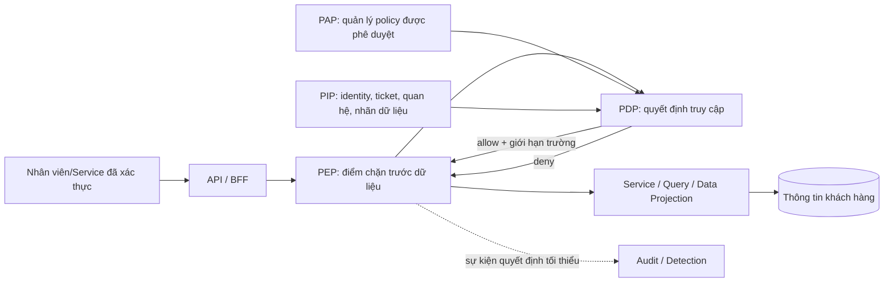
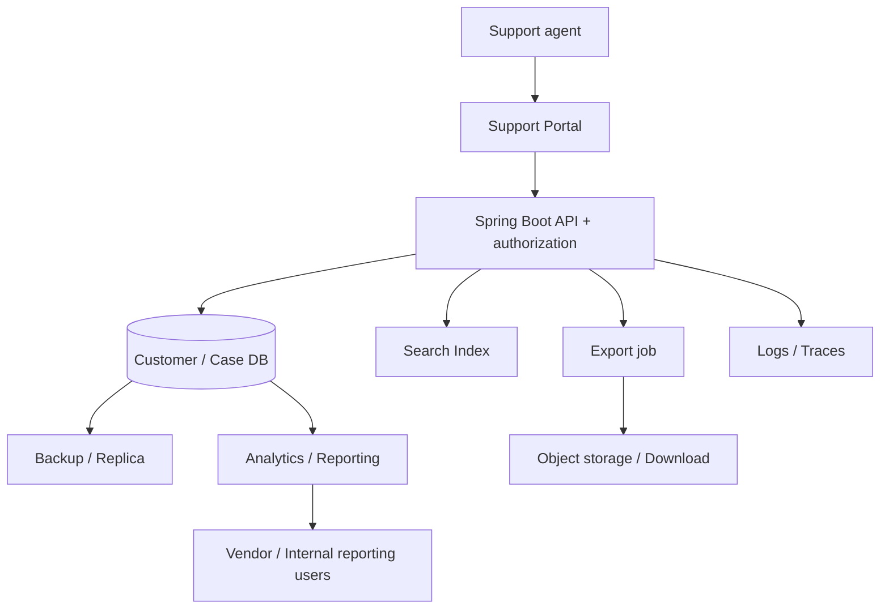
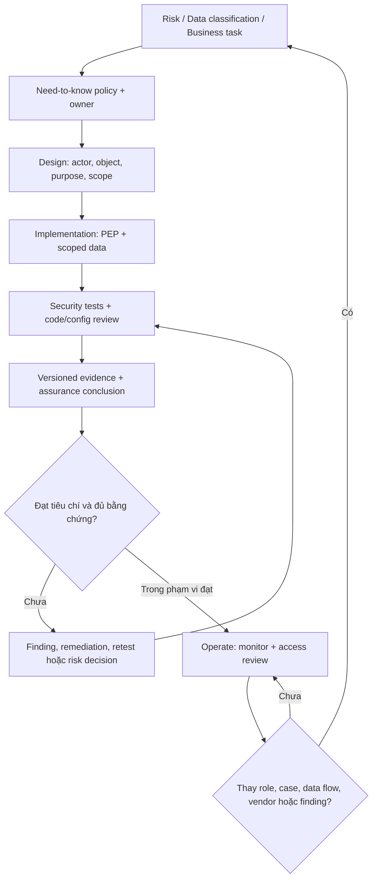

# Need to know: Chỉ truy cập thông tin thực sự cần biết

## 1. Mục tiêu học tập

Sau bài học, người học có thể:

1. Giải thích nguyên tắc **need to know** (cần biết để thực hiện nhiệm vụ) trong **kiểm soát truy cập**, và phân biệt nó với **least privilege**, **clearance**, **need to use**, **data minimization** và xác thực danh tính.
2. Xác định **ai cần dữ liệu nào, cho mục đích nghiệp vụ nào, trong khoảng thời gian nào**, dựa trên tài sản, mức phân loại dữ liệu, quan hệ với đối tượng và trách nhiệm được phê duyệt.
3. Thiết kế kiểm soát truy cập theo vai trò (RBAC), thuộc tính (ABAC), quan hệ (ReBAC) hoặc kết hợp; áp dụng ở **backend và tầng dữ liệu**, không chỉ ở giao diện.
4. Nhận biết các đường làm lộ thông tin dù API chính đã kiểm tra quyền: tìm kiếm, export, batch, queue, cache, log, backup, analytics và quyền dịch vụ.
5. Lập yêu cầu bảo mật, tình huống thử dương tính/âm tính và bằng chứng đủ để chứng minh quyền truy cập được giới hạn theo **need to know**.
6. Xử lý các trường hợp khó: **quyền khẩn cấp (*break-glass*)**, chia sẻ giữa nhóm, nhân viên chuyển vai trò, hỗ trợ khách hàng và nhà cung cấp bên ngoài.
7. Tổ chức giám sát, rà soát và thu hồi quyền, liên kết **rủi ro → kiểm soát → kiểm thử/audit → bằng chứng → rủi ro còn lại** theo phương pháp security assurance liên tục.

Bài thuộc chương **Kiểm soát truy cập** của module **SECURITY_SECURITY_ASSURANCE**. Mục đích module là xây dựng cách **đánh giá có bằng chứng** rằng hệ thống đạt mục tiêu bảo mật, từ phân tích rủi ro và các security controls đến kiểm thử, audit, khắc phục phát hiện và giám sát xuyên suốt phát triển/vận hành. Với **need to know**, câu hỏi không chỉ là “người dùng đã đăng nhập hay chưa?”, mà là: **“Tại sao chủ thể này cần biết chính xác thông tin này ngay lúc này, và bằng chứng nào cho thấy mọi đường truy cập được giới hạn đúng?”**

## 2. Need to know là gì?

**Need to know** là nguyên tắc chỉ cho phép một người hoặc chủ thể được truy cập **thông tin cần thiết để thực hiện nhiệm vụ, chức năng hoặc mục đích đã được ủy quyền**, chứ không phải mọi thông tin mà họ có thể truy cập về mặt kỹ thuật.

Ví dụ:

- Nhân viên chăm sóc khách hàng được giao giải quyết một yêu cầu hỗ trợ thanh toán có thể cần xem **mã giao dịch, trạng thái và thông tin liên hệ tối thiểu**; họ không mặc nhiên cần xem toàn bộ số tài khoản, khóa API hoặc lịch sử giao dịch của mọi khách hàng.
- Kỹ sư ứng dụng cần xem **log kỹ thuật được giảm dữ liệu nhạy cảm** để xử lý lỗi; không tự động cần truy cập bản sao nguyên vẹn của dữ liệu cá nhân trong production.
- Nhân viên kiểm toán được phân công một kỳ đánh giá có thể cần xem **bằng chứng controls, quyết định và các mẫu hồ sơ được phê duyệt**; không tự động cần quyền chỉnh sửa giao dịch.
- Worker thực hiện đối soát có thể cần nhận **mã operation, trạng thái và thông tin đã giảm thiểu**; nó không cần mọi trường trong hồ sơ khách hàng.

Cùng một người có thể **đủ điều kiện được cấp quyền** nhưng **không có nhu cầu chính đáng đối với một bản ghi cụ thể**. Chẳng hạn, nhân viên hỗ trợ thuộc nhóm “Customer Support” không có lý do xem hồ sơ của khách hàng không có yêu cầu hỗ trợ liên quan.

### 2.1. Công thức tư duy

Đối với một yêu cầu đọc thông tin, hãy xét:

> **Ai** muốn biết **dữ liệu nào**, **để thực hiện nhiệm vụ gì**, **với quan hệ/ủy quyền nào**, **trong điều kiện và thời gian nào**, **ở mức chi tiết bao nhiêu**, và **ai có thể kiểm tra lại quyết định?**

Nếu không có nhu cầu hợp lệ hoặc không đủ dữ kiện xác minh, thao tác nhạy cảm cần được **từ chối theo chính sách an toàn đã thiết kế**.

### 2.2. “Có quyền truy cập hệ thống” không đồng nghĩa “cần biết mọi dữ liệu”

Một nhân viên có quyền đăng nhập portal nội bộ và vai trò `SUPPORT_AGENT` chỉ mới chứng minh một phần điều kiện. Quyết định truy cập bản ghi phải xét tiếp:

- Có một **ticket/case được giao** và còn hiệu lực không?
- Dữ liệu đang xin đọc có cần cho **loại công việc** đó không?
- Có giới hạn theo **khách hàng, tenant, khu vực, nhóm phụ trách** không?
- Dữ liệu có **mức phân loại** hoặc hạn chế đặc biệt không?
- Yêu cầu là xem, sửa, tải xuống, chia sẻ hay truy vấn hàng loạt?
- Có cần **phê duyệt bổ sung** hoặc quyền tạm thời cho hành động nhạy cảm?

Need to know là **quy tắc cấp quyền theo nhu cầu công việc đã được xác nhận**, không phải một lời giải thích tùy ý do người xin quyền tự điền.

## 3. Phân biệt need to know với các nguyên tắc liên quan

| Khái niệm | Trọng tâm | Ví dụ |
| --- | --- | --- |
| **Authentication — xác thực** | Chủ thể là ai? | Token hợp lệ cho nhân viên hỗ trợ Alice |
| **Authorization — phân quyền** | Chủ thể được làm hành động nào với tài nguyên nào? | Alice có thể xem case được giao |
| **Least privilege — quyền tối thiểu** | Chỉ cấp quyền cần thiết để thực hiện chức năng | Alice không được sửa ledger hoặc cấp quyền admin |
| **Need to know — cần biết** | Chỉ truy cập **nội dung thông tin cần cho nhiệm vụ cụ thể** | Alice chỉ xem dữ liệu của case đang xử lý |
| **Need to use / need to do** | Chỉ có khả năng sử dụng chức năng/hành động cần thiết | Alice được ghi chú ticket, không được thực hiện hoàn tiền |
| **Data minimization** | Chỉ thu thập, xử lý và xuất dữ liệu cần thiết theo mục đích | API hỗ trợ trả thông tin đã che bớt thay vì cả hồ sơ |
| **Data classification** | Gắn mức nhạy cảm và quy tắc xử lý cho dữ liệu | Public, Internal, Confidential, Restricted theo chính sách |
| **Clearance/eligibility** | Chủ thể có đủ điều kiện tiếp cận một mức thông tin? | Nhân viên được cấp mức truy cập dữ liệu nhạy cảm |
| **Separation of duties** | Phân tách quyền để hạn chế lạm dụng | Người duyệt hoàn tiền khác người đề xuất |

**Need to know thường bổ sung cho least privilege**, nhưng hai nguyên tắc không đồng nhất. Least privilege nói về **phạm vi khả năng/đặc quyền**; need to know nhấn mạnh **thông tin cụ thể có thực sự cần cho công việc không**. Cả hai cần thiết.

### 3.1. Clearance là điều kiện cần nhưng không đủ

Trong các môi trường có phân loại thông tin chặt chẽ, một người có thể được phép xử lý mức “Restricted” nhưng không vì thế được xem **mọi tài liệu Restricted**. Họ còn phải được chỉ định nhiệm vụ hoặc có quan hệ hợp lệ với tập dữ liệu.

Có thể biểu diễn theo logic khái niệm:

\[
Allow = IdentityValid \land AuthorizedPurpose \land NeedToKnow \land ScopeAllowed \land PolicyConditions
\]

Đây là **biểu thức giải thích**, không phải một thuật toán bắt buộc. Các thuộc tính và điều kiện cần được định nghĩa theo chính sách; khi không thể xác minh một điều kiện thiết yếu, quyết định phải theo hành vi lỗi được phê duyệt.

### 3.2. Need to know không tự thay thế nghĩa vụ quyền riêng tư

Việc một nhân viên cần dữ liệu để làm việc **không tự chứng minh mọi hoạt động xử lý dữ liệu là hợp pháp**. Các nghĩa vụ liên quan mục đích sử dụng, cơ sở xử lý, thông báo, thời hạn lưu, chia sẻ và quyền của chủ thể dữ liệu có thể áp dụng riêng theo bối cảnh pháp lý/hợp đồng.

Thiết kế tốt phải **đồng thời** thỏa yêu cầu truy cập nội bộ và nghĩa vụ quản trị dữ liệu; không dùng “need to know” để hợp thức hóa việc thu thập hoặc chia sẻ thông tin nằm ngoài mục đích đã được phép.

## 4. Vì sao need to know quan trọng đối với security assurance?

Nếu hệ thống chỉ áp dụng quyền theo vai trò rộng, mỗi tài khoản hợp lệ có thể đọc số lượng bản ghi lớn hơn rất nhiều so với nhu cầu thực tế. Khi xảy ra lộ thông tin xác thực hoặc sai sót của nhân viên, **blast radius** sẽ lớn.

Need to know hướng tới giảm:

1. **Lộ dữ liệu nội bộ:** nhân viên tự ý xem hồ sơ không liên quan nhiệm vụ.
2. **Lạm dụng tài khoản hợp lệ:** chủ thể có quyền truy cập rộng bị chiếm và khai thác.
3. **Lỗi phân quyền mức đối tượng:** BOLA/IDOR, truy cập xuyên khách hàng/tenant.
4. **Tiết lộ quá mức:** API, báo cáo hoặc log xuất nhiều trường hơn người nhận cần.
5. **Lan truyền dữ liệu ngoài dự kiến:** export, kho phân tích, tập dữ liệu thử và chia sẻ đối tác.
6. **Tích lũy quyền:** chuyển nhóm hoặc kết thúc dự án nhưng quyền cũ vẫn còn.
7. **Phụ thuộc quá quyền:** service account hoặc công cụ hỗ trợ có thể lấy toàn bộ dữ liệu thay vì tập con.

Để **đánh giá có bằng chứng**, cần kiểm tra không chỉ “chính sách có ghi need to know”, mà còn **các cơ chế thực tế có ngăn thành công thao tác ngoài nhu cầu không**, từ request đến dữ liệu được đọc và các bản sao của nó.

## 5. Bắt đầu từ tài sản, mức nhạy cảm và nhiệm vụ nghiệp vụ

Không thể thiết kế need to know chỉ bằng cách hỏi “vai trò nào được xem màn hình nào”. Nên xuất phát từ **tài sản và dữ liệu thực sự tồn tại**, cùng mục đích xử lý.

Bảng minh họa cho hệ thống hỗ trợ thanh toán:

| Loại thông tin | Mức nhạy cảm minh họa | Ai có thể cần biết? | Khi nào và bao nhiêu? |
| --- | --- | --- | --- |
| Mã giao dịch, trạng thái, thời điểm | Nội bộ / tùy chính sách | Nhân viên được giao ticket, khách hàng sở hữu giao dịch | Đúng các giao dịch của case/tài khoản được phép |
| Họ tên và kênh liên hệ | Dữ liệu cá nhân | Nhân viên được giao xử lý liên hệ | Trường cần thiết, có thể che bớt |
| Số tài khoản đầy đủ | Nhạy cảm | Một số chức năng được phê duyệt rõ ràng | Chỉ khi nghiệp vụ thật sự cần, có kiểm soát tăng cường |
| Hồ sơ định danh khách hàng | Rất nhạy cảm theo chính sách | Nhóm chuyên trách có nhiệm vụ hợp lệ | Giới hạn case, thời gian và trường |
| Số dư và toàn bộ lịch sử | Nhạy cảm | Chủ tài khoản hoặc vai trò nghiệp vụ được phép | Theo tài khoản, mục đích và mức cần thiết |
| Token/API key/private key | Bí mật kỹ thuật | Workload và nhóm quản lý khóa được ủy quyền | Không hiển thị đại trà; chỉ chức năng sử dụng thích hợp |
| Kết quả audit và findings | Có thể nhạy cảm | Assessor, control owner, risk owner, audit được phân công | Đúng phạm vi audit và quyền xem bằng chứng |
| Bản sao logs/backup | Có thể chứa nhiều loại dữ liệu | SRE/SecOps theo nhiệm vụ | Quyền giới hạn, giảm dữ liệu và cơ chế phê duyệt phù hợp |

Mức phân loại ở bảng chỉ mang tính **giảng dạy**. Tổ chức phải có data classification và obligations riêng; không mặc định mọi dữ liệu giao dịch của mọi hệ thống có cùng mức.

### 5.1. Dùng “đơn vị công việc” làm căn cứ

Một **đơn vị công việc có thể xác minh** thường tốt hơn lời khai chung chung:

- Ticket hỗ trợ được giao và còn hoạt động.
- Ca xử lý sự cố có mã incident và người trực được ủy quyền.
- Yêu cầu kiểm toán có phạm vi, kỳ và danh sách mẫu được duyệt.
- Nhiệm vụ xử lý thanh toán đã được phê duyệt theo workflow.
- Đề nghị xuất dữ liệu được data owner chấp thuận cho một mục đích xác định.

Nhưng sự tồn tại của ticket cũng **không tự động cấp mọi quyền**. Ticket phải liên kết được đúng đối tượng, mục đích, người được giao và loại dữ liệu tối thiểu.

## 6. Từ chính sách tổng quát đến điều kiện truy cập cụ thể

Một chính sách không đủ cụ thể:

> “Nhân viên chăm sóc khách hàng được xem dữ liệu khách hàng.”

Một chính sách theo need to know tốt hơn:

> “Nhân viên hỗ trợ chỉ được xem những trường thông tin được phê duyệt của khách hàng liên kết với ticket đang được giao cho họ, trong thời gian ticket có hiệu lực; truy cập thông tin nhạy cảm bổ sung phải có nhiệm vụ, phê duyệt và ghi dấu vết theo chính sách.”

Từ đó cần định nghĩa:

| Chiều chính sách | Câu hỏi thiết kế |
| --- | --- |
| **Subject** | Người/ứng dụng nào, danh tính và role có được xác minh không? |
| **Object/resource** | Ticket, customer, account, transaction hoặc document nào? |
| **Action** | Xem tóm tắt, xem chi tiết, tìm kiếm, sửa, xuất, tải xuống, chia sẻ? |
| **Purpose** | Xử lý ticket, điều tra sự cố, kiểm toán hay tác vụ nào? |
| **Relationship** | Người dùng có được giao case, là chủ tài khoản hoặc được ủy quyền không? |
| **Classification** | Dữ liệu thuộc mức nào, có trường cực kỳ nhạy cảm không? |
| **Context** | Thời gian, môi trường, trạng thái case, tenant, thiết bị hoặc mức xác thực? |
| **Result** | Allow, deny, trả về tập trường bị giới hạn hoặc yêu cầu phê duyệt bổ sung? |
| **Audit** | Cần lưu dấu vết gì mà không tự làm lộ dữ liệu nhạy cảm? |

**Trường “purpose” do client tự gõ không phải bằng chứng nhu cầu chính đáng.** Mục đích phải có căn cứ từ quy trình/nhóm nhiệm vụ, ticket và các nguồn thuộc tính đáng tin.

## 7. Quyết định truy cập: đầy đủ thuộc tính và nguồn đáng tin

Một quyết định có thể được biểu diễn:

\[
Decision = f(Subject, Action, Resource, Purpose, Relationship, Context, Policy)
\]

Trong đó:

- `Subject`: danh tính đã xác thực và quyền liên quan.
- `Action`: thao tác cụ thể như `VIEW_SUMMARY`, `VIEW_FULL_RECORD` hoặc `EXPORT`.
- `Resource`: đối tượng, chủ sở hữu, tenant và nhãn phân loại.
- `Purpose`: mục đích nghiệp vụ đã được xác nhận từ nguồn được quản lý.
- `Relationship`: quan hệ giữa chủ thể và tài nguyên, ví dụ người xử lý case.
- `Context`: trạng thái case, phiên làm việc, thời gian hoặc tín hiệu rủi ro.
- `Policy`: quy tắc được phê duyệt, phiên bản và các ngoại lệ hợp lệ.

Một số hệ thống còn phân biệt **allow với obligation**: được xem tóm tắt nhưng phải che trường nhạy cảm, ghi access event hoặc chỉ cho xuất dữ liệu sau phê duyệt.

### 7.1. Những thuộc tính không nên tin nếu chỉ do client cung cấp

- `tenantId`, `customerId` hoặc `role` lấy nguyên từ request body.
- `purpose = "support"` do người dùng nhập tùy ý.
- `assignedAgentId` do client tự khai.
- `classification` do hệ thống không có quyền gắn nhãn tự đặt.
- `isAdmin=true` từ header không được xác minh.
- `approvedBy` không có bản ghi approval đáng tin.

Các giá trị này có thể là **tham số truy vấn**, nhưng quyết định cuối cần **đối chiếu nguồn dữ liệu và identity context tin cậy**. Có token hợp lệ cũng không chứng minh mối quan hệ với tài nguyên cụ thể.

## 8. Kiến trúc thực thi: PAP, PDP, PEP và PIP

Khi ứng dụng có nhiều luồng truy cập, tách vai trò chính sách và thực thi giúp giảm đường bypass.



Khái niệm thường dùng:

- **PAP — Policy Administration Point:** nơi tạo, xem xét, phê duyệt và cập nhật policy.
- **PDP — Policy Decision Point:** nơi đánh giá dữ kiện và đưa ra quyết định cho phép/từ chối.
- **PEP — Policy Enforcement Point:** nơi chặn thao tác và bắt buộc tuân thủ kết quả, trước khi trả hoặc làm lộ dữ liệu.
- **PIP — Policy Information Point:** nguồn thuộc tính đáng tin như quyền, assignment, trạng thái ticket, tenant, nhãn dữ liệu.

Đây là **mô hình khái niệm**, không bắt buộc mỗi thành phần phải là một microservice riêng. Một ứng dụng Spring Boot có thể thực thi phần lớn trong service layer kết hợp authorization policy và repository; hệ thống lớn có thể dùng policy service trung tâm.

### 8.1. Điều kiện để một PEP có giá trị

1. Mọi entry point cần bảo vệ phải đi qua nó hoặc có cơ chế tương đương.
2. Enforcement xảy ra **trước khi nội dung nhạy cảm được trả ra** hoặc thực hiện tác động trái quyền.
3. Khi thiếu dữ kiện thiết yếu, quyết định không được tự mặc định cho phép.
4. PDP/PIP không được nhận quyền/mục đích chỉ từ nguồn dễ giả mạo.
5. Không có đường export, GraphQL, batch, direct database hoặc debug API vượt kiểm soát.
6. Kết quả quyết định và policy version có dấu vết phù hợp mà không lộ dữ liệu.

Một PEP ở frontend chỉ ẩn nút hoặc mục menu **không bảo vệ được request trực tiếp**.

## 9. RBAC, ABAC và ReBAC trong need to know

Không có một mô hình phân quyền duy nhất tốt cho mọi hệ thống.

| Mô hình | Dựa trên | Ưu điểm | Giới hạn đối với need to know |
| --- | --- | --- | --- |
| **RBAC** | Vai trò và quyền của vai trò | Dễ tổ chức quyền cơ bản, phù hợp nhiều nghiệp vụ | Vai trò rộng không cho biết ticket/tài khoản cụ thể có liên quan nhiệm vụ không |
| **ABAC** | Thuộc tính chủ thể, tài nguyên, hành động và ngữ cảnh | Diễn đạt điều kiện thời gian, loại dữ liệu, trạng thái, phạm vi | Chính sách và nguồn thuộc tính có thể phức tạp, lỗi dữ liệu ảnh hưởng quyết định |
| **ReBAC** | Quan hệ được xác minh giữa chủ thể và đối tượng | Phù hợp chủ tài khoản, thành viên nhóm, case được giao | Cần đồ thị quan hệ chính xác và vòng đời cập nhật |
| **PBAC / policy-based** | Các chính sách quyết định tập trung hoặc phân tán | Kiểm soát thống nhất, dễ review nếu thiết kế tốt | Phải quản lý consistency, bypass và vận hành |
| **Kết hợp** | Role + quan hệ + thuộc tính + purpose | Bao phủ nhu cầu công việc thực tế hơn | Cần tiêu chí rõ và kiểm thử đa chiều |

Ví dụ:

- **RBAC** kiểm tra Alice có vai trò `SUPPORT_AGENT`.
- **ReBAC** kiểm tra Alice đang được giao ticket `CASE-104` và ticket liên quan khách hàng `C-55`.
- **ABAC** kiểm tra ticket còn `OPEN`, hành động `VIEW_CONTACT_SUMMARY`, thuộc tính phân loại được phép và yêu cầu phát sinh trong ca xử lý có hiệu lực.
- **Field-level projection** chỉ trả tên rút gọn, kênh liên hệ và giao dịch liên quan, không tự động trả mọi trường hồ sơ.

**Gắn RBAC vào ABAC không tự đảm bảo need to know.** Cần xác minh chính sách có thực sự phản ánh “nhiệm vụ và dữ liệu cần biết” và thực thi ở đúng điểm.

## 10. Quyền truy cập theo đối tượng, hàng và trường dữ liệu

Need to know thường đòi hỏi kiểm soát sâu hơn “có quyền gọi endpoint”.

Ba mức:

| Mức | Câu hỏi | Ví dụ |
| --- | --- | --- |
| **Function/API-level** | Có được dùng chức năng không? | Agent được gọi API hỗ trợ |
| **Object/row-level** | Có được xem bản ghi cụ thể không? | Agent chỉ xem case được giao |
| **Field/column-level** | Trong bản ghi đó, những trường nào cần hiển thị? | Chỉ trạng thái và số tài khoản được che |

Thêm **action-level**: cùng một bản ghi, quyền xem tóm tắt không đồng nghĩa quyền xem toàn bộ, export hoặc chỉnh sửa.

### 10.1. Ví dụ sai: trả cả entity rồi ẩn ở giao diện

Nếu backend trả toàn bộ entity chứa tên, số tài khoản, số dư, dữ liệu định danh và secret metadata, rồi frontend chỉ hiển thị ba trường, dữ liệu thừa **đã rời backend** và có thể xuất hiện trong network response, devtools, cache hoặc logs.

**Giải pháp:** áp dụng authorization ở backend, rồi tạo **DTO/projection có trường được cho phép** theo nhiệm vụ. Chỉ ẩn bằng CSS hoặc bỏ field ở UI không phải data minimization.

### 10.2. Trường liên quan có thể khác nhau theo hành động

| Hành động | Nhóm dữ liệu cho agent được giao ticket | Điều kiện |
| --- | --- | --- |
| `VIEW_CASE_SUMMARY` | Mã case, trạng thái, loại vấn đề, giao dịch liên quan | Case được giao và còn hợp lệ |
| `VIEW_CONTACT_DETAILS` | Kênh liên hệ cần để xử lý | Mục đích liên hệ được phê duyệt |
| `VIEW_IDENTITY_DOCUMENT` | Dữ liệu định danh nhạy cảm | Vai trò chuyên trách, case phù hợp, phê duyệt tăng cường nếu chính sách yêu cầu |
| `EXPORT_CASES` | Chỉ tập case và trường được chấp thuận | Quyền export riêng, mục đích và giới hạn rõ |
| `ADJUST_BALANCE` | Thao tác tài chính, không chỉ xem | Quyền nghiệp vụ và separation of duties riêng |

Cùng một người có thể được phép **xem summary** nhưng bị từ chối **export toàn bộ dữ liệu**.

## 11. Dùng phân loại và compartment để giới hạn thông tin

**Data classification** giúp nhận diện mức bảo vệ yêu cầu; **compartment** hoặc phân vùng thông tin tách dữ liệu theo dự án, khách hàng, loại hồ sơ hoặc phạm vi trách nhiệm.

Ví dụ:

- Phòng tài chính có báo cáo chi phí theo đơn vị, không mặc định xem hồ sơ nhân sự nhạy cảm.
- Nhóm hỗ trợ A được giao khách hàng của nhóm A, không xem được ticket của nhóm B nếu không có quan hệ/ủy quyền.
- Nhóm điều tra sự cố có thể được cấp quyền đọc logs của một incident trong thời hạn xử lý, không có quyền mặc định tìm kiếm toàn bộ lịch sử khách hàng.
- Dịch vụ đối soát xử lý mã giao dịch và số tiền cần thiết, không cần toàn bộ hồ sơ định danh cá nhân.

### 11.1. Không đồng nhất phân loại với quyết định cuối

Giả sử Alice có quyền truy cập dữ liệu ở mức “Confidential”. Một bản ghi Confidential vẫn có thể **ngoài dự án hoặc ngoài mục đích công việc của Alice**. Điều kiện phân loại có thể đạt nhưng **need to know chưa đạt**.

Cần đánh giá: **classification eligibility AND business relationship/purpose AND resource scope AND policy conditions**.

### 11.2. Gắn nhãn không nhất quán tạo đường rò rỉ

Nếu dữ liệu bị phân loại cao trong database nhưng mất nhãn khi gửi qua queue hoặc export, một luồng phụ có thể xử lý nó như dữ liệu thông thường. Thiết kế phải làm rõ:

- Ai được phân loại và thay đổi nhãn?
- Nhãn có theo dữ liệu khi sao chép/xuất không?
- Các field mới có được gắn chính sách đúng không?
- Khi nhãn hoặc quan hệ không biết rõ, xử lý theo mặc định nào?
- Có kiểm tra tính nhất quán giữa API, data store và downstream không?

## 12. Theo dõi luồng dữ liệu từ nguồn tới mọi bản sao

Một chính sách need to know chỉ triển khai ở ứng dụng chính có thể bị vô hiệu bởi **đường dữ liệu phụ**.



Các câu hỏi phải trả lời:

1. Search index có kiểm tra quyền tương ứng khi tìm và khi trả kết quả không?
2. Export job chạy bằng service account có truy xuất dữ liệu vượt quyền của người tạo export không?
3. Log và trace có chứa nội dung quá mức, bị đọc bởi quá nhiều kỹ sư không?
4. Backup/replica có phân quyền và điều kiện khôi phục khác database chính không?
5. Báo cáo phân tích có tiết lộ dữ liệu chi tiết cá nhân khi chỉ cần thống kê?
6. File export được lưu bao lâu, ai tải lại, link được chia sẻ thế nào?
7. Khi ticket bị đóng hoặc phân công đổi, bản sao/cached authorization có cập nhật quyền không?

**Need to know áp dụng theo vòng đời dữ liệu**, không chỉ tại thời điểm người dùng bấm “View”.

## 13. Thiết kế API Spring Boot: quyết định quyền dựa trên case thực

Một tình huống: **nhân viên hỗ trợ chỉ được xem thông tin cần thiết cho ticket đang được giao**.

### 13.1. Nguyên tắc thiết kế

- Principal được tạo từ authentication context đã xác minh; không lấy `agentId` tự khai từ request.
- Case, khách hàng, trạng thái và assignee được đọc từ nguồn authoritative.
- Chính sách kiểm tra `action` và quan hệ với case.
- API chỉ tạo response từ **các trường được phép**; không trả entity đầy đủ rồi ẩn ở client.
- Khi kiểm tra không thành công, không trả nội dung, không phát side effect nhạy cảm.
- Khi quyền thay đổi, phải xem vấn đề cache, phiên đã mở và các truy cập tiếp theo.

### 13.2. Pseudocode service

Mẫu Java dưới đây mang tính **giảng dạy, chưa phải một Spring Boot implementation hoàn chỉnh**:

```java
public CaseSummaryDto viewAssignedCase(
        AuthenticatedActor actor,
        UUID caseId) {

    // Chỉ lấy metadata cần thiết để đánh giá quyền.
    CaseMetadata metadata = caseRepository.findMetadata(caseId)
            .orElseThrow(() -> new NotFoundException("Case not found"));

    AccessDecision decision = caseAccessPolicy.evaluate(
            actor,
            Action.VIEW_CASE_SUMMARY,
            metadata,          // customer, assignee, tenant, status, class
            Clock.systemUTC().instant());

    if (!decision.isAllowed()) {
        auditEvents.recordDeniedAccess(
                actor.subjectId(), caseId, Action.VIEW_CASE_SUMMARY);
        throw new AccessDeniedException("Access not permitted");
    }

    // Projection chỉ chứa trường dành cho hành động này.
    CaseSummaryDto summary =
            caseRepository.loadAuthorizedSummary(caseId, actor.tenantId());

    auditEvents.recordAllowedAccess(
            actor.subjectId(), caseId, Action.VIEW_CASE_SUMMARY);

    return summary;
}
```

**Lưu ý kỹ thuật:**

- `CaseMetadata` phải lấy từ nguồn đáng tin; quan hệ `assignee` và trạng thái ticket không được quyết định bởi client.
- `loadAuthorizedSummary` phải thực sự giới hạn **cột dữ liệu và tenant/row**; tên hàm không tự tạo bảo vệ.
- Với thay đổi quyền đồng thời, cần cơ chế nhất quán/snapshot/đối chiếu lại phù hợp để tránh *time-of-check to time-of-use* (TOCTOU).
- Một chính sách chỉ kiểm tra tenant mà bỏ qua việc **case có được giao cho agent không** chưa đầy đủ.
- Pseudocode không minh họa đầy đủ các biện pháp kiểm tra session, auditing và quản lý transaction cần thiết.

### 13.3. Logic policy phải kiểm chứng được

Một mô hình quyết định ví dụ:

```text
allow VIEW_CASE_SUMMARY when
  actor.authenticated == true
  and actor.active == true
  and actor.role contains SUPPORT_AGENT
  and actor.tenant == case.tenant
  and case.status in {OPEN, IN_PROGRESS}
  and case.assignedAgent == actor.subject
  and case.purpose == CUSTOMER_SUPPORT
  and case.classification is allowed for this action

otherwise deny
```

Chính sách chỉ minh họa. Trong hệ thống thật có thể có trường hợp chủ ticket chuyển nhóm, trưởng nhóm hỗ trợ truy cập giám sát được phê duyệt hoặc quyền tạm thời có điều kiện. **Mọi ngoại lệ phải được mô hình hóa minh bạch**, không giải quyết bằng việc bỏ qua policy.

## 14. Row-level filtering và data projection

Có hai lớp nên phối hợp:

1. **Authorization trước hành vi:** kiểm tra người dùng, mục đích và tài nguyên.
2. **Truy vấn được giới hạn:** chỉ đọc đúng rows và fields được phép, ngăn lộ dữ liệu do tìm kiếm/hàng loạt hoặc serialization.

Ví dụ truy vấn minh họa:

```sql
SELECT
    c.id,
    c.status,
    c.issue_type,
    c.last_updated_at,
    t.public_reference,
    t.processing_status
FROM support_case c
LEFT JOIN transaction_summary t
    ON t.id = c.related_transaction_id
   AND t.tenant_id = c.tenant_id
WHERE c.id = :caseId
  AND c.tenant_id = :trustedTenantId
  AND c.assigned_agent_id = :authenticatedAgentId
  AND c.status IN ('OPEN', 'IN_PROGRESS');
```

Truy vấn chỉ trả **các trường cần cho summary**, không tự lấy toàn bộ bản ghi định danh. Các tham số như `trustedTenantId`, `authenticatedAgentId` phải lấy từ identity và nguồn thuộc tính đáng tin, không lấy nguyên từ client.

Một truy vấn như trên vẫn phải được kiểm tra với **mọi trường hợp hợp lệ** của nghiệp vụ. Nếu hệ thống có supervisor access được phê duyệt, nên thiết kế policy và truy vấn có chủ đích thay vì thêm một điều kiện `OR is_admin = true` quá rộng không qua review.

### 14.1. Dùng RLS và database permissions có đủ không?

Row-Level Security (RLS) hoặc cơ chế tương đương có thể giúp thực thi ranh giới hàng dữ liệu ở database, nhưng:

- Ứng dụng cần truyền **đúng identity/tenant context đáng tin**.
- Quyền của database role, bypass/admin và connection pooling phải được cấu hình đúng.
- Phải bảo vệ **views, joins, stored procedures, exports và background jobs**.
- Database khó biết đầy đủ purpose nghiệp vụ nếu ứng dụng không truyền/đối chiếu thuộc tính được tin cậy.
- Cần kiểm thử với chính sách và cấu hình **runtime**, không chỉ đọc migration SQL.

RLS nên là một lớp hỗ trợ khi phù hợp, **không thay thế hoàn toàn policy nghiệp vụ ở ứng dụng**.

## 15. Kiểm soát tìm kiếm, phân trang và lọc dữ liệu hàng loạt

Một endpoint chi tiết có thể được bảo vệ nhưng endpoint **search/list** lại trả mọi bản ghi do chỉ kiểm tra role.

Các yêu cầu:

- Lọc theo phạm vi quyền **trước** khi phân trang, sắp xếp và tổng hợp.
- Không trả bản ghi/tên/tổng số thuộc phạm vi người dùng không được phép nếu metadata đó cũng nhạy cảm.
- Không tin mỗi bộ lọc `agentId` hoặc `tenantId` trong query string; phải ràng buộc vào context đã xác minh.
- Cẩn trọng với autocomplete, GraphQL nested resolvers, batch getters và API tìm kiếm nâng cao.
- Mỗi truy vấn phải có giới hạn phạm vi, kích thước và mức chi tiết phù hợp.
- Kiểm tra chính sách khi **đổi assignment** giữa các trang hoặc phiên dài.
- Đánh giá nguy cơ inference: tổng số bản ghi, thời điểm, tên tập dữ liệu hoặc mẫu lỗi có thể tiết lộ thông tin.

### 15.1. Phân trang sau khi lọc quyền

Không nên:

1. Query 100 bản ghi toàn tổ chức.
2. Trả 100 bản ghi tới frontend.
3. Frontend ẩn những bản ghi không được phép.

Thay vào đó:

1. Xác định scope quyền từ nguồn đáng tin.
2. Áp dụng điều kiện tại backend/database/search engine.
3. Chỉ lấy các fields được phép.
4. Phân trang trên tập dữ liệu hợp lệ.
5. Đánh giá số lượng và metadata trả ra có phù hợp chính sách không.

Đây là khác biệt giữa **“giao diện chỉ hiển thị điều cần biết”** và **“hệ thống chỉ tiết lộ điều được biết”**.

## 16. Export, báo cáo và dữ liệu ngoại tuyến

**Export** thường có mức rủi ro cao hơn “xem một bản ghi” vì tạo bản sao có thể tồn tại lâu, được tải về hoặc chia sẻ ngoài ứng dụng.

Một thiết kế theo need to know có thể yêu cầu:

- Quyền `EXPORT` tách biệt quyền `VIEW`, dựa trên mục đích và tác vụ cụ thể.
- Giới hạn dữ liệu theo đúng assignments, tenant và trường được phê duyệt.
- Xác nhận/approval ở mức phù hợp với khối lượng và độ nhạy cảm.
- Ghi dấu vết ai export, mục đích, số lượng, thời gian và nơi lưu, không ghi nội dung nhạy cảm vào audit log.
- Link tải xuống chỉ có hiệu lực phù hợp, kiểm soát người nhận, không công khai mặc định.
- Retention/xóa file xuất và xử lý khi quyền của người tạo export bị thu hồi.
- Hạn chế dữ liệu vào spreadsheet/email/đối tác nếu không nằm trong mục đích được phép.

### 16.1. Rủi ro “kiểm tra quyền lúc đặt job, không kiểm tra lúc thực thi”

Giả sử Alice được giao ticket lúc 10:00, gửi yêu cầu export, sau đó ticket được chuyển sang Bob. Job chạy lúc 11:00 với service account rộng và export dữ liệu Alice **không còn được phép xem**.

Hệ thống phải có chính sách nhất quán về **thời điểm kiểm tra quyền, thời gian hiệu lực, cách hủy job hoặc kiểm chứng lại khi chạy**. Không thể mặc định quyền tại lúc enqueue có hiệu lực mãi mãi.

Một cách tiếp cận an toàn là định nghĩa **bản ghi yêu cầu xuất** gắn chủ thể, mục đích, tập dữ liệu và expiry; job đánh giá điều kiện theo chính sách được duyệt tại thời điểm cần thiết, hoặc dùng một snapshot quyền có thời hạn/điều kiện rõ ràng. Lựa chọn cụ thể phụ thuộc nghiệp vụ và rủi ro.

## 17. Cache, log, trace và telemetry

Need to know phải được giữ ngay cả khi dữ liệu được sao chép nhằm tăng hiệu năng hoặc điều tra.

### 17.1. Cache

- Cache key phải phân biệt tài nguyên và phạm vi quyền khi response phụ thuộc chủ thể.
- Tránh cache chung một response chứa dữ liệu nhạy cảm rồi trả cho người dùng khác.
- Định nghĩa TTL và cơ chế invalidation khi assignment/permission thay đổi.
- Hạn chế dữ liệu nhạy cảm được cache, mã hóa/phân quyền nếu cần và có expiry.
- Không coi cache hit là lý do bỏ qua authorization khi chính sách yêu cầu đánh giá lại.

### 17.2. Log và trace

- Log các sự kiện truy cập nhạy cảm đủ để điều tra: actor, action, resource ID/nhóm tài nguyên, kết quả, policy version, case/purpose reference khi phù hợp.
- Không đưa nguyên payload định danh, token hoặc dữ liệu tài chính không cần thiết vào log.
- Phân quyền người đọc log theo mục đích vận hành/điều tra, không cho mọi developer xem toàn bộ.
- Kiểm tra hệ thống APM, error tracking, crash dump và debug traces có giữ dữ liệu thật không.
- Bảo vệ quyền sửa/xóa log và retention theo chính sách.

### 17.3. Công cụ phân tích và dashboard

Một dashboard thống kê cần **xu hướng lỗi theo dịch vụ** không nhất thiết phải có tên hay toàn bộ lịch sử giao dịch cá nhân. Chọn dữ liệu tổng hợp, che/mã hóa định danh khi phù hợp, giới hạn drill-down và quyền xuất dữ liệu.

**Nguy cơ suy luận từ nhóm quá nhỏ** cũng cần xem xét: một dashboard “ẩn tên” nhưng chỉ có một khách hàng trong một nhóm có thể vẫn tiết lộ thông tin riêng.

## 18. Worker, service account và quyền đọc máy–máy

Need to know không chỉ áp dụng cho con người. **Service identity** là chủ thể truy cập thông tin và cũng phải tuân thủ nguyên tắc phạm vi cần thiết.

| Workload | Nhiệm vụ | Dữ liệu tối thiểu gợi ý | Không nên cấp mặc định |
| --- | --- | --- | --- |
| Transfer worker | Xử lý operation đã được duyệt | Operation ID, thông tin thanh toán cần thực thi, trạng thái | Toàn bộ hồ sơ định danh khách hàng |
| Notification service | Gửi thông báo kết quả | Kênh liên lạc đã được phép, thông báo có nội dung tối thiểu | Toàn bộ số dư và lịch sử giao dịch |
| Reconciliation job | Đối soát trạng thái với provider | Reference, số tiền, trạng thái, metadata đối soát | Credential quản trị dữ liệu khách hàng |
| Support search indexer | Lập chỉ mục thông tin cần tìm | Các trường được duyệt để tìm kiếm | Secret, hồ sơ cực nhạy cảm ngoài nhiệm vụ |
| Monitoring agent | Thu số đo/trace cần thiết | Metrics, event metadata | Quyền đọc mọi bảng dữ liệu nghiệp vụ |
| CI/CD deploy job | Triển khai bản build | Quyền deploy đúng dịch vụ/môi trường | Quyền xem/export thông tin khách hàng |

Lưu ý: service account có quyền **đọc từ database** không đồng nghĩa mọi người dùng gọi qua service ấy được phép nhận toàn bộ dữ liệu. Service phải **giữ context và cưỡng chế chính sách của người yêu cầu hoặc nhiệm vụ máy được phê duyệt**.

### 18.1. “Confused deputy” và truy cập thay mặt

Một dịch vụ có quyền rộng có thể bị lạm dụng như *confused deputy*: caller quyền thấp yêu cầu service đọc tài nguyên mà caller không được phép, nhưng service dùng quyền cao của chính mình để làm việc đó.

Biện pháp có thể gồm:

1. Xác thực caller/workload ở boundary.
2. Xác minh **hành động, tài nguyên, mục đích** của caller, không chỉ xác thực service.
3. Giới hạn scope được ủy quyền/delegation.
4. Sử dụng token/claims đáng tin phù hợp mô hình truy cập thay mặt, tránh tin ID tự khai.
5. Kiểm tra authorization trước khi service truy vấn hoặc trả dữ liệu.
6. Audit nguồn yêu cầu và service thực thi để truy trách nhiệm.

Không tự coi request từ mạng nội bộ hoặc message broker là đủ tin cậy.

## 19. Người quản trị, nhân sự hỗ trợ và phân tách nhiệm vụ

Các tài khoản có quyền kỹ thuật cao thường dễ làm mất nguyên tắc need to know nếu không có kiểm soát riêng.

Ví dụ:

- DBA có thể cần **vận hành database** nhưng không nhất thiết được đọc plaintext mọi hồ sơ khách hàng.
- SRE có thể cần **xem hiệu năng và trạng thái** nhưng không cần xuất số liệu cá nhân theo từng tài khoản.
- Support supervisor có thể cần **kiểm tra chất lượng xử lý** nhưng không mặc định mở mọi tài liệu định danh.
- Security analyst có thể cần **điều tra truy cập trái quyền** nhưng quyền xem log chi tiết cần được ràng buộc case incident.

Các biện pháp có thể phối hợp:

- Phân tách quyền vận hành với quyền đọc dữ liệu nghiệp vụ khi nền tảng cho phép.
- Cấp quyền tạm thời theo nhiệm vụ, approval hoặc access request.
- Session recording/audit phù hợp đối với hành động đặc quyền.
- Bảo vệ khả năng thay policy và tự cấp quyền cho chính mình.
- Chính sách xử lý dữ liệu trong môi trường thử/debug và quyền truy cập backup.
- Kiểm tra định kỳ những quyền đặc biệt và dấu vết sử dụng.

**Role “Administrator” không tự tạo need to know vô hạn.** Hệ thống phải quy định những ngoại lệ chính đáng và cơ chế kiểm soát tương xứng, tránh gây trở ngại không quản lý được đối với vận hành an toàn.

## 20. Break-glass: truy cập khẩn cấp có kiểm soát

Có những tình huống khẩn cấp cần truy cập ngoài phạm vi thông thường, ví dụ để xử lý sự cố hệ thống thanh toán hoặc bảo vệ khách hàng.

**Break-glass** là quy trình cấp quyền ngoại lệ được quản trị cho trường hợp xác định, không phải một đường vòng bí mật cho các chủ thể đặc quyền.

Một thiết kế nên bao gồm:

1. **Điều kiện kích hoạt:** tình huống nào được xem là khẩn cấp, không dùng cho công việc tiện lợi thông thường.
2. **Danh tính và lý do:** xác thực mạnh phù hợp, mã incident/case và lý do có thể kiểm tra.
3. **Phạm vi:** dữ liệu, hệ thống, hành động và thời lượng cấp quyền tối thiểu.
4. **Phê duyệt:** trước hoặc sau hành động theo chính sách khẩn cấp, không tự cho phép không kiểm soát.
5. **Giám sát:** ghi audit event, thông báo cho người/nhóm chịu trách nhiệm, bảo vệ bằng chứng.
6. **Thu hồi:** thời hạn hết hiệu lực tự động khi có thể, đóng sau khi nhiệm vụ hoàn tất.
7. **Đánh giá hậu kiểm:** xác minh tính chính đáng, dữ liệu đã truy cập, hành động và rủi ro còn lại.

### 20.1. Break-glass khác với “bỏ qua mọi quyền”

Quyền khẩn cấp vẫn nên có **ranh giới rõ**. Ví dụ nhóm điều tra sự cố có thể được xem log cần thiết trong incident, nhưng không có lý do tự động được sửa ledger hoặc xuất toàn bộ hồ sơ ngoài phạm vi.

Việc một nhân viên bấm “Emergency Access” không tự tạo bằng chứng tình huống khẩn cấp. Cần **quy trình và dữ kiện có thể đánh giá lại**.

## 21. Quản lý vòng đời quyền truy cập

Need to know có tính **thời điểm**: quyền phù hợp hôm nay có thể sai ngày mai.

Các sự kiện phải xem xét:

- Gia nhập nhóm hoặc nhận nhiệm vụ mới.
- Được phân công hoặc chuyển giao ticket/case.
- Đổi vai trò, dự án, bộ phận hoặc cấp thẩm quyền.
- Hoàn tất case, kết thúc incident/audit, hết hợp đồng nhà thầu.
- Chuyển tenant, thay data owner hoặc classification.
- Tạm nghỉ, chấm dứt hợp tác, phát hiện credential bị lộ.
- Thêm API, worker, tập dữ liệu hoặc nhà cung cấp mới.

### 21.1. Cấp quyền trong thời hạn cần thiết

Có thể áp dụng:

- **Just-in-time access:** cấp quyền khi có nhiệm vụ hợp lệ, thu hồi khi hết điều kiện.
- **Time-bound grant:** quyền có ngày bắt đầu/kết thúc rõ.
- **Approval workflow:** người đúng thẩm quyền xem xét khi cần dữ liệu nhạy cảm hơn.
- **Entitlement review:** chủ dữ liệu hoặc người quản lý kiểm tra quyền còn cần không.
- **Automated deprovisioning:** gắn với trạng thái assignment, HR và ticket khi phù hợp.
- **Continuous reevaluation:** xem xét quyền khi thay đổi quan hệ/case và trong các session dài.

Đừng cho rằng **xóa người dùng khỏi nhóm UI** đã thu hồi mọi quyền: token còn hiệu lực, cached permission, file export đã tải và service credentials có thể đòi hỏi biện pháp riêng.

### 21.2. Cách chứng minh thu hồi quyền

Một testcase tốt:

1. Alice đang được giao ticket T và xem summary hợp lệ.
2. Ticket chuyển cho Bob hoặc đóng.
3. Alice thực hiện lại yêu cầu với session/token còn hợp lệ.
4. Hệ thống từ chối theo chính sách, không trả dữ liệu.
5. Kiểm tra các API phụ, search/export và cache nếu nằm trong phạm vi.
6. Lưu artifact kèm trạng thái assignment và thời điểm thay đổi.

Nếu sau chuyển giao Alice vẫn xem được qua URL cũ hoặc cache, need to know chưa được duy trì đúng vòng đời.

## 22. Mô hình đe dọa: các cách need to know bị phá vỡ

Việc nhận diện rủi ro nên xuất phát từ **thao tác trái quyền nhưng có thể đi qua tài khoản hợp lệ**.

| Threat scenario | Điểm yếu | Tài sản/hậu quả | Cách giảm rủi ro |
| --- | --- | --- | --- |
| Agent xem case khách hàng không liên quan | RBAC quá rộng, không kiểm tra assignment | Lộ dữ liệu khách hàng | Quan hệ case/assignee, deny mặc định, review |
| User truy cập đối tượng tenant khác | BOLA/IDOR hoặc tenant ID tin client | Rò rỉ dữ liệu xuyên tenant | Object/tenant authorization ở backend và query |
| Nhân viên tải hàng loạt dữ liệu | `VIEW` mặc định bao gồm `EXPORT` | Bản sao khó thu hồi | Export scope, approval và retention |
| Worker xuất dữ liệu hộ người dùng quá quyền | Confused deputy | Rò rỉ dữ liệu vượt mục đích | Delegation, scope-bound policy, service IAM |
| Log/debug chứa plaintext nhạy cảm | Logging quá mức, quyền đọc log rộng | Lộ thông tin qua observability | Redaction, structured logging, log access policy |
| Search index trả kết quả không được phép | Chỉ check quyền ở endpoint detail | Lộ tên, ID, số lượng và metadata | Search authorization trước query/return |
| Cache dùng chung user/tenant | Cache key không phân phạm vi quyền | Trả dữ liệu của người khác | Context-aware caching và invalidation |
| Nhân viên giữ quyền sau khi chuyển nhóm | Không có deprovisioning | Truy cập không còn cần thiết | Time-bound access, periodic review, revocation |
| Admin tự cấp quyền đọc hồ sơ | Separation of duties thiếu | Lạm dụng đặc quyền | Approval, hạn quyền, audit, independent review |
| Nhà cung cấp phân tích nhận quá nhiều dữ liệu | Data flow và hợp đồng thiếu giới hạn | Chia sẻ ngoài mục đích | Data minimization, vendor review và controls tích hợp |

Threat model cần xem cả **khả năng xảy ra và tác động**, mức độ phơi nhiễm, controls hiện tại, bằng chứng và rủi ro còn lại. Không coi có nhiều bản ghi “role granted” là chứng minh quyền đã đúng.

## 23. Chuyển need to know thành control objectives và requirements

Một mục tiêu kiểm soát minh họa:

> Đối với hệ thống hỗ trợ giao dịch, người và service chỉ có thể truy cập **những bản ghi và trường thông tin cần cho một nhiệm vụ được phê duyệt, trong phạm vi và thời gian có hiệu lực**; truy cập không đủ điều kiện bị từ chối trước khi tiết lộ dữ liệu và có bằng chứng truy vết phù hợp.

Các yêu cầu triển khai có thể kiểm thử:

| Requirement ID | Yêu cầu | Tiêu chí chấp nhận |
| --- | --- | --- |
| REQ-NTK-01 | Backend xác minh identity và quan hệ với case | Agent không được giao case bị từ chối dù token hợp lệ |
| REQ-NTK-02 | Trả trường dữ liệu theo action/purpose | Response summary không chứa trường định danh nhạy cảm ngoài danh mục |
| REQ-NTK-03 | Search/list áp dụng cùng scope quyền | Không tìm thấy/nhận metadata từ case ngoài phạm vi |
| REQ-NTK-04 | Export kiểm tra quyền riêng và phạm vi | View permission không tự cấp export; file chỉ chứa tập dữ liệu hợp lệ |
| REQ-NTK-05 | Quyền hết hiệu lực khi assignment kết thúc | Sau reassignment, agent cũ không đọc được qua session còn hiệu lực |
| REQ-NTK-06 | Worker giữ giới hạn dữ liệu và delegated scope | Service account không thể trả dữ liệu cho caller ngoài policy |
| REQ-NTK-07 | Log/trace tránh tiết lộ thông tin dư thừa | Audit event đủ điều tra nhưng không chứa token hoặc raw PII không cần |
| REQ-NTK-08 | Emergency access có kiểm soát | Đúng điều kiện, phạm vi, expiry, approval và hậu kiểm |
| REQ-NTK-09 | Mọi thất bại policy thiết yếu được xử lý an toàn | Không có fallback cho phép truy cập khi thiếu thông tin quyền |
| REQ-NTK-10 | Dữ liệu không còn cần thiết không tiếp tục chia sẻ | Có kiểm soát retention, xóa/thu hồi và quản lý bản sao theo chính sách |

**Ngưỡng cụ thể** như thời hạn quyền, loại trường được xem và những case được supervisor xem phải được xác định theo nghiệp vụ và chính sách áp dụng, không tự đoán từ mẫu.

## 24. Thiết kế positive/negative tests và evidence

Để chứng minh need to know, cần kiểm tra **người được phép và không được phép**, **đúng case và case khác**, **đúng trường và trường không cần thiết**, **trước và sau khi thay đổi quyền**.

### 24.1. Ma trận kiểm thử minh họa

| Test ID | Chủ thể, ngữ cảnh | Hành động | Kết quả kỳ vọng |
| --- | --- | --- | --- |
| NTK-01 | Alice là agent được giao case T đang mở | Xem case summary | Chỉ các trường summary được phép |
| NTK-02 | Bob là agent hợp lệ nhưng không được giao T | Xem case T | Bị từ chối, không có dữ liệu nhạy cảm |
| NTK-03 | Alice được giao T, không có quyền xem hồ sơ định danh | Xem identity document | Bị từ chối hoặc có approval theo policy |
| NTK-04 | Alice được giao T | Xem case U của cùng tenant nhưng không được giao | Bị từ chối |
| NTK-05 | Alice được giao T thuộc tenant X | Xem case tenant Y | Bị từ chối và không lộ metadata |
| NTK-06 | Alice có quyền xem tóm tắt | Export toàn bộ case | Bị từ chối nếu không có quyền export riêng |
| NTK-07 | Case T chuyển từ Alice sang Bob | Alice đọc T với session còn hợp lệ | Không còn được phép theo policy |
| NTK-08 | Alice là agent được giao, policy service unavailable | Đọc dữ liệu nhạy cảm | Không cho phép khi thiếu quyết định hợp lệ |
| NTK-09 | Worker service identity đọc secret/data ngoài chức năng | Truy cập dữ liệu không cần | Bị từ chối |
| NTK-10 | Nhân viên xem log kỹ thuật | Truy cập trace có thông tin định danh | Không thấy dữ liệu raw ngoài quyền |
| NTK-11 | Người có quyền được cấp break-glass hợp lệ | Xem tập dữ liệu khẩn cấp trong thời hạn | Chỉ phạm vi đã duyệt, có audit và expiry |
| NTK-12 | Break-glass đã hết hạn | Lặp lại truy cập | Bị từ chối và ghi dấu vết phù hợp |

### 24.2. Ví dụ Gherkin

```gherkin
Feature: Need-to-know access for support cases

  Scenario: Assigned agent views only approved case details
    Given Alice has a valid authenticated support session
    And case T is active and assigned to Alice
    When Alice views the summary of case T
    Then the request succeeds
    And only the approved summary fields are returned

  Scenario: Another authenticated agent cannot view the case
    Given Bob has a valid authenticated support session
    And case T is assigned to Alice, not Bob
    When Bob requests the summary of case T
    Then the request is denied
    And no protected case data is returned

  Scenario: The old assignee loses access
    Given case T was assigned to Alice
    And case T is reassigned to Bob
    When Alice requests case T using her still-valid session
    Then the request is denied

  Scenario: Summary permission does not grant export
    Given Alice is assigned to case T
    And Alice has no approved export entitlement
    When Alice requests export of all cases
    Then the export is rejected
    And no protected file is produced
```

Kịch bản là **đặc tả kỳ vọng**, không phải bằng chứng đã chạy. Bằng chứng thực tế cần kết quả trên phiên bản, môi trường và policy tương ứng.

### 24.3. Test cần xem side effects và metadata

Khi request bị từ chối, không chỉ kiểm tra status code. Hãy xác minh:

- Response body/headers không tiết lộ nội dung nhạy cảm.
- Không có file export, event hoặc bản sao bất hợp lệ được tạo.
- Không có truy vấn hay dữ liệu được trả đến một downstream không được phép.
- Log không ghi nội dung nhạy cảm ngoài mục đích.
- Không có thông tin về sự tồn tại của tài nguyên bị tiết lộ ngoài chính sách khi lỗi `403`/`404` khác nhau.
- Với quyền tạm thời, phiên dài hoặc cached policy, quyết định còn đúng sau thay đổi.

## 25. Đánh giá design effectiveness và operating effectiveness

**Design effectiveness:** nếu triển khai đúng như mô hình, cơ chế có ngăn truy cập thông tin vượt nhu cầu không?

Bằng chứng hỗ trợ gồm:

- Data inventory/classification, purpose mapping và business workflow.
- Threat model, DFD, trust boundaries và điểm enforcement.
- Role/attribute/relationship model, policy rules và exception design.
- Ma trận endpoints/actions/fields và các kịch bản failure.
- Review policy source-of-truth, khả năng bypass và data propagation.

**Operating effectiveness:** trong hệ thống và giai đoạn được đánh giá, kiểm soát có thực sự hoạt động không?

Bằng chứng gồm:

- Integration/negative tests theo role, case, tenant, purpose và trạng thái.
- Runtime policy/config, IAM/role và repository filters đúng môi trường.
- Access review, approval samples, case-assignment records, deprovisioning logs.
- Security events về truy cập nhạy cảm, break-glass và export.
- Kết quả retest sau sửa findings và evidence version mới.

### 25.1. Các trạng thái cần phân biệt

| Trạng thái | Ý nghĩa |
| --- | --- |
| **Planned** | Đã có ý tưởng/yêu cầu, chưa thể coi control có hiệu lực |
| **Designed/reviewed** | Thiết kế đã được xem xét, chưa chứng minh bản chạy |
| **Implemented** | Code/config/quy trình đã triển khai, cần kiểm chứng |
| **Verified in scope** | Có bằng chứng đạt trong những case/phiên bản đã kiểm tra |
| **Partially verified** | Chỉ một số đường hoặc hành động có đủ bằng chứng |
| **Failed** | Quan sát cho thấy vi phạm need to know |
| **Insufficient evidence** | Chưa đủ thông tin để kết luận |
| **Accepted exception** | Rủi ro chưa khắc phục hoàn toàn nhưng được phê duyệt theo điều kiện/thẩm quyền |

**Không ghi “need to know achieved” chỉ vì hệ thống có RBAC hoặc một policy PDF.**

## 26. Ma trận assurance: risk → control → evidence

Bảng sau giúp chuyển ý định chính sách thành kết luận có thể kiểm toán:

| Risk ID | Control objective | Security controls | Bằng chứng phải có | Khoảng trống phổ biến |
| --- | --- | --- | --- | --- |
| R-NTK-01: agent xem case không liên quan | Chỉ người được giao xem case hợp lệ | Assignment-based AuthZ, default deny | Negative tests A/B, review policy và assignment | Role chung cho phép mọi agent xem mọi case |
| R-NTK-02: lộ dữ liệu quá mức | Chỉ trả trường cần cho nhiệm vụ | DTO/projection, data minimization | Response schema/tests và log inspection | Entity được trả đầy đủ rồi UI ẩn |
| R-NTK-03: export ngoài quyền | File chỉ chứa dữ liệu được duyệt | Export authorization, scoped query, expiry | Tests quyền export, file contents, access record | Job chạy với quyền hệ thống và không recheck |
| R-NTK-04: thông tin lộ qua search | Search chỉ thấy phạm vi được phép | Search filtering, index policy | Search/metadata tests, config review | Detail API bảo vệ nhưng search index mở |
| R-NTK-05: quyền vẫn còn sau chuyển case | Quyền gắn nhiệm vụ hiện tại | Entitlement lifecycle, cache invalidation | Reassignment tests, audit và policy snapshots | Token/cache còn quyền cũ |
| R-NTK-06: kỹ sư đọc dữ liệu qua logs | Operational access không làm lộ PII ngoài nhiệm vụ | Redaction, log IAM, retention | Log samples, permission tests | Debug tracing chứa raw payload |
| R-NTK-07: nhà cung cấp nhận dữ liệu thừa | Chia sẻ theo mục đích/contract | Data mapping, vendor access controls | Data-flow review, payload tests, hợp đồng | Integration gửi full customer object |
| R-NTK-08: đặc quyền khẩn cấp bị lạm dụng | Emergency access có phạm vi/hạn và hậu kiểm | Time-bound grant, approval, audit | Grant/revoke tests, sampling, incident record | “Break-glass” là tài khoản chia sẻ vô hạn |

Kết luận phải dựa trên **bằng chứng đã thu được**, không phải các cột kế hoạch. Nếu một rủi ro trọng yếu chưa có evidence, cần chỉ rõ **độ bất định và người chịu trách nhiệm bổ sung**.

## 27. Case study: Need to know trong nền tảng hỗ trợ giao dịch

### 27.1. Bối cảnh

Một ngân hàng giả định vận hành:

- **Transfer API** bằng Java/Spring Boot, database giao dịch, scheduler/broker và worker.
- **Support Portal** dùng để xử lý ticket về giao dịch.
- **Identity Provider** phát danh tính nhân viên và workload.
- **Customer/Case Database** lưu hồ sơ, liên kết case với giao dịch và người xử lý.
- **Search Index**, export service, centralized logs và analytics.
- **Payment Provider** là phụ thuộc bên ngoài.

Nhóm cần bảo đảm nhân viên chăm sóc khách hàng **chỉ xem dữ liệu đủ để hỗ trợ giao dịch**, không có quyền truy cập tùy ý toàn bộ khách hàng.

### 27.2. Tài sản và mục tiêu

| Tài sản | Mục tiêu | Hậu quả nếu vi phạm |
| --- | --- | --- |
| Hồ sơ và dữ liệu liên hệ khách hàng | Bí mật, sử dụng đúng mục đích | Lộ dữ liệu cá nhân, mất niềm tin |
| Lịch sử giao dịch | Bí mật, toàn vẹn | Truy cập trái quyền hoặc suy luận hành vi tài chính |
| Ticket và assignment | Toàn vẹn quyết định quyền | Gán nhầm hoặc giả assignment để đọc dữ liệu |
| Search index và export | Giới hạn bản sao/khối lượng | Rò rỉ dữ liệu hàng loạt |
| Logs, traces và backups | Bảo vệ thông tin được sao chép | Rò rỉ qua vận hành |
| Credential và quyền service | Least privilege | Lộ dữ liệu hàng loạt nếu service bị chiếm |
| Evidence, audit và quyết định | Toàn vẹn/khả năng kiểm tra | Không chứng minh được ai đã truy cập vì mục đích gì |

### 27.3. Chính sách của case study

**P1 — Agent thường:** được xem summary và những trường liên hệ cần cho ticket đang được giao, còn hiệu lực, đúng tenant và loại nghiệp vụ được phép.

**P2 — Agent không được giao:** không được xem case hoặc metadata nhạy cảm dù có role Support và token hợp lệ.

**P3 — Xem dữ liệu định danh chi tiết:** yêu cầu vai trò/nhiệm vụ chuyên trách, điều kiện và approval theo chính sách; role Support thông thường không tự có.

**P4 — Export:** quyền riêng, chỉ trong scope nghiệp vụ được duyệt, ghi audit, giới hạn retention và người nhận.

**P5 — Giám sát kỹ thuật:** kỹ sư được xem metadata vận hành đã giảm nhạy cảm; truy cập dữ liệu thô chỉ qua quy trình phù hợp.

**P6 — Emergency:** access theo incident/case, thời gian, phạm vi, phê duyệt và hậu kiểm; không có quyền vô hạn.

### 27.4. Những trường hợp phải thử

1. Alice được giao ticket T có giao dịch của khách hàng C và chỉ xem đúng summary.
2. Bob thuộc cùng team nhưng không được giao T; Bob bị từ chối.
3. Alice truy vấn trực tiếp URL tài liệu định danh của C; bị từ chối nếu không có nhiệm vụ/approval.
4. Alice dùng search query lấy case của C khác; search không tiết lộ thông tin ngoài quyền.
5. Alice có quyền xem T nhưng không thể export mọi case trong tenant.
6. Ticket T được đóng hoặc chuyển sang Bob; Alice mất quyền ngay theo chính sách/giới hạn thời hiệu được phê duyệt.
7. Export job bắt đầu sau khi assignment đổi; không xuất dữ liệu vượt scope.
8. Support API trả DTO tối thiểu; browser không nhận raw hồ sơ.
9. Log lỗi với payload bất thường không in số tài khoản/PII không cần thiết.
10. Worker/service account không lấy được dữ liệu khách hàng ngoài nghiệp vụ.
11. Emergency grant hết hạn; người giữ quyền không còn xem được dữ liệu.
12. Các trường hợp policy nguồn quyền bị lỗi phải theo hành vi an toàn đã thiết kế.

### 27.5. Finding giả định và cách phản ứng

Trong kiểm thử, phát hiện endpoint `GET /support/search?q=...` có kiểm tra role `SUPPORT_AGENT` nhưng không lọc assignment. Agent hợp lệ có thể tìm thấy mã, tên và giao dịch của khách hàng khác.

**Phân tích:**

- **Finding:** search endpoint tiết lộ metadata ngoài phạm vi cần biết.
- **Risk:** lộ dữ liệu quy mô lớn hoặc dò thông tin khách hàng qua tài khoản nhân viên hợp lệ/bị chiếm.
- **Objective không đạt:** chỉ thông tin liên quan nhiệm vụ được hiển thị.
- **Nguyên nhân:** authorization theo role không kèm row/relationship constraints.
- **Treatment:** bổ sung scoped search dựa trên assignment/case; giảm fields; kiểm tra cache và pagination.
- **Verification:** positive/negative tests với agents, tenant khác, case đổi owner, nhiều trang và API phụ.
- **Evidence:** kết quả build mới, policy/config/index mappings, response samples an toàn.
- **Decision:** risk owner đánh giá rủi ro hiện tại và release gate theo thẩm quyền.

Không nên ghi “đã khắc phục” ngay sau khi merge code. **Retest phải chứng minh search thật sự không trả dữ liệu ngoài quyền** trên môi trường/phiên bản liên quan.

### 27.6. Thay đổi sau phát hành

Giả sử sản phẩm cho phép supervisor xem case của cả nhóm. Đây không chỉ là thay đổi UI; cần:

- Xác định mục đích giám sát và trường dữ liệu supervisor cần.
- Kiểm tra quan hệ với team và phạm vi khu vực/tenant.
- Phân biệt quyền xem summary với quyền xem định danh và export.
- Bổ sung policy, negative tests và audit.
- Đánh giá ảnh hưởng tới search, cache, batch/reporting và hệ thống bên ngoài.
- Cập nhật risk register, threat model và evidence theo release mới.

Không nên biến role “Supervisor” thành bypass toàn bộ need to know chỉ vì muốn triển khai nhanh.

## 28. Governance: owner, phê duyệt và review

Need to know là một **chính sách nghiệp vụ được thực thi bằng công nghệ**, nên phải có cả người chịu trách nhiệm dữ liệu và người chịu trách nhiệm hệ thống.

| Vai trò | Trách nhiệm chính |
| --- | --- |
| **Data Owner** | Xác định loại thông tin, mục đích chính đáng, mức chi tiết và điều kiện chia sẻ |
| **Business/Service Owner** | Mô tả nhiệm vụ, workflow, tác động và trường hợp ngoại lệ |
| **Risk Owner** | Chịu trách nhiệm phương án xử lý/chấp nhận rủi ro trong thẩm quyền |
| **Security Architect** | Thiết kế trust boundaries, policy và biện pháp chống bypass |
| **IAM/Identity Team** | Cung cấp danh tính, roles, quyền, vòng đời và nguồn thuộc tính phù hợp |
| **Engineering** | Thực thi PEP, resource-level policy, scoped query, DTO và kiểm tra đường phụ |
| **Platform/SRE** | Quản lý service IAM, logs, backups, cache, export/storage và cấu hình |
| **AppSec/QA/Assessor** | Kiểm chứng bằng negative tests, evidence, limitations và kết luận assurance |
| **Privacy/Compliance/Legal** | Làm rõ nghĩa vụ xử lý/chia sẻ dữ liệu, khi áp dụng |
| **Audit/Security Operations** | Đánh giá hồ sơ, giám sát truy cập bất thường và xử lý sự cố |

### 28.1. Phân biệt quyền ban hành policy và quyền xin truy cập

- **Data owner** có thể xác định dữ liệu nào được dùng cho nhiệm vụ nào.
- **System owner/engineering** chuyển quy tắc thành triển khai có thể kiểm chứng.
- **Approver được ủy quyền** xét các yêu cầu vượt quyền thông thường.
- **Assessor** kiểm tra hiệu lực và ghi giới hạn.
- **Risk owner/người có thẩm quyền** quyết định xử lý hoặc chấp nhận rủi ro còn lại.

Người xin truy cập không nên tự phê duyệt mở rộng phạm vi cho chính mình chỉ vì có vai trò cấp cao.

## 29. Vận hành need to know theo mô hình assurance liên tục

Một chương trình thực hành có thể gắn chính sách với vòng đời phát triển:



### 29.1. Trong thiết kế và phát triển

- Gắn requirement về need to know với user story có dữ liệu nhạy cảm.
- Review dữ liệu request/response, roles, relationships và điểm enforcement.
- Đối chiếu API schema, search/export và định danh workload.
- Viết security tests cho user cùng role nhưng khác assignment.
- Kiểm tra bất kỳ luồng mới có thể bypass policy hoặc đưa dữ liệu vào logs/caches.

### 29.2. Trong release

- Xác nhận scope của build, endpoint, chính sách, data schema và configuration.
- Chạy negative tests, field-level checks, revoke/reassignment tests.
- Xác định evidence gaps và rủi ro vượt ngưỡng.
- Đảm bảo quyết định go/no-go hoặc ngoại lệ do đúng người có thẩm quyền.

### 29.3. Trong vận hành

- Giám sát truy vấn bất thường, export quy mô lớn, break-glass và entitlement drift.
- Rà soát quyền theo nhiệm vụ, case, nhóm, dự án và dịch vụ.
- Xử lý findings, thay đổi policy hoặc data sensitivity.
- Làm mới bằng chứng khi code, data flow, IAM, hệ thống analytics hoặc nhà cung cấp thay đổi.

Một dashboard có chỉ số “100% nhân viên có role hợp lệ” không chứng minh need to know nếu **relationship/purpose checks** không được đánh giá.

## 30. Đo hiệu quả và hạn chế của các chỉ số

Có thể theo dõi:

| Chỉ số | Giá trị sử dụng | Cảnh báo |
| --- | --- | --- |
| Tỷ lệ API nhạy cảm có row/field-level authorization review | Độ phủ thiết kế | API inventory có thể thiếu đường phụ |
| Số negative tests theo role × assignment × tenant × action | Độ phủ kiểm chứng | Nhiều test trùng kịch bản không đồng nghĩa kiểm chứng đầy đủ |
| Số quyền không còn liên kết nhiệm vụ hợp lệ | Phát hiện tích lũy quyền | Nguồn task/assignment có thể lỗi hoặc cập nhật chậm |
| Thời gian thu hồi sau kết thúc nhiệm vụ | Kiểm soát vòng đời truy cập | Cần tính cả token, cache, export và bản sao |
| Số lần export và tổng dữ liệu xuất ngoài mức thông thường | Nhận diện rủi ro exfiltration | Hoạt động lớn có thể hợp lệ; cần ngữ cảnh |
| Break-glass có lý do và hậu kiểm hợp lệ | Quản lý ngoại lệ | Có lý do không đồng nghĩa lý do đúng |
| Tỷ lệ evidence còn hiệu lực theo release | Chất lượng assurance | Bằng chứng mới vẫn có thể kiểm tra sai điều kiện |
| Access-denied events có context phù hợp | Theo dõi việc policy thực thi | Tăng số deny có thể do tấn công hoặc do thay chính sách |
| Findings chưa retest/đã quá hạn | Ưu tiên khắc phục | Đóng ticket không có nghĩa đã giảm rủi ro |

**Không biến số lượng “deny” thành KPI duy nhất.** Một hệ thống từ chối mọi người sẽ có nhiều truy cập bị chặn nhưng không phục vụ nghiệp vụ. Need to know cần **bảo vệ dữ liệu ngoài nhiệm vụ trong khi cho phép nhiệm vụ hợp lệ được thực hiện**.

## 31. Những sai lầm thường gặp

| Sai lầm | Vì sao nguy hiểm | Cách cải thiện |
| --- | --- | --- |
| “Ai có role Support thì xem mọi khách hàng” | Role không chứng minh nhu cầu theo case | Check assignment, purpose và object-level scope |
| Chỉ ẩn thông tin ở frontend | Dữ liệu vẫn có trong response | DTO/projection và backend enforcement |
| Chỉ bảo vệ detail API | Search, autocomplete và export còn rò rỉ | Review mọi data flow/entry point |
| Tin `purpose` từ request | Người dùng tự khai mục đích hợp lệ | Gắn purpose với workflow/ticket được xác nhận |
| Dùng tenant ID do client gửi | Có thể vượt tenant boundary | Lấy tenant/context từ identity và authoritative source |
| Coi clearance cao là được đọc tất cả | Thiếu điều kiện need-to-know | Kết hợp classification với quan hệ/nhiệm vụ |
| Cho service account đọc mọi dữ liệu | Confused deputy và blast radius lớn | Workload IAM least privilege, delegated scope |
| Export dùng quyền view | Tạo bản sao nhạy cảm quy mô lớn | Tách quyền export và controls phân phối |
| Không re-evaluate sau đổi assignment | Người cũ còn xem được dữ liệu | Revoke/cache invalidation và tests |
| Để log chứa raw PII | Vượt qua toàn bộ policy của app | Redaction, access policy và kiểm tra log |
| “Break-glass” không expiry hoặc review | Trở thành backdoor đặc quyền | Time-bound access, approval, audit/hậu kiểm |
| Không quản lý quyền tại backups/replicas | Bản sao truy cập ngoài policy chính | Data-flow mapping và quyền riêng cho bản sao |
| Chỉ test một người không có token | Kiểm tra xác thực, không phải need to know | Test hai người đã xác thực, khác quan hệ quyền |
| Dùng HTTP `403` làm bằng chứng duy nhất | Có thể từ chối vì lý do không liên quan | Kiểm tra đúng nguyên nhân và không lộ data/side effect |
| Không ghi version/config của test | Test cũ bị suy diễn sang production mới | Versioned evidence và environment checks |
| Đánh dấu “đã khắc phục” khi merge code | Lỗi vẫn có thể tồn tại sau deploy | Retest, kiểm tra config/runtime và risk review |
| Không phân quyền người quản trị dữ liệu | DBA/SRE có thể truy cập ngoài nhiệm vụ | Tách quyền vận hành và data-read khi phù hợp |
| Ghi “need to know satisfied” vì có policy PDF | Không biết control runtime có hiệu quả | Design/operating effectiveness assessment |

## 32. Checklist kiểm tra need to know

- [ ] Đã nhận diện tài sản, dữ liệu và mức nhạy cảm cùng nguồn owner?
- [ ] Đã mô tả **nhiệm vụ/mục đích được phép** cho từng loại thông tin?
- [ ] Đã xác định chủ thể, action, object, relationship, scope và điều kiện quyết định?
- [ ] Role và clearance có được phân biệt với **nhu cầu biết thông tin cụ thể**?
- [ ] Không tin role/tenant/purpose/assignment do client tự khai?
- [ ] Điểm enforcement nằm tại backend hoặc boundary đáng tin trước khi dữ liệu bị tiết lộ?
- [ ] Đã kiểm tra object-level, row-level và field-level theo nghiệp vụ?
- [ ] Dữ liệu trả về chỉ gồm những trường được phép, không serialize toàn bộ entity?
- [ ] Search, pagination, bulk/GraphQL, autocomplete, export và download cùng tuân chính sách?
- [ ] Cache, logs, traces, search index, analytics, backup và replica có được xem xét?
- [ ] Worker/service accounts không có quyền hoặc khả năng tiết lộ dữ liệu ngoài nhiệm vụ?
- [ ] Quyền được đánh giá lại khi case/role/tenant/purpose thay đổi hoặc hết hạn?
- [ ] Break-glass có điều kiện, thời hạn, audit, phê duyệt và hậu kiểm phù hợp?
- [ ] Có positive/negative tests với hai chủ thể **đều đã xác thực hợp lệ** nhưng khác nhu cầu?
- [ ] Có test field-level exposure, metadata leaks và side effects sau từ chối?
- [ ] Bằng chứng ghi build/config, môi trường, policy revision, test data/role và giới hạn?
- [ ] Findings và evidence gaps có owner, deadline, retest và residual risk?
- [ ] Có trigger review khi hệ thống thêm luồng dữ liệu, nhà cung cấp hoặc workflow?
- [ ] Kết luận assurance không vượt quá phạm vi đã kiểm chứng?

Checklist hỗ trợ thiết kế và đánh giá, **không thay thế** chính sách, nghĩa vụ dữ liệu và security review của hệ thống cụ thể.

## 33. Bài tập vận dụng

**Bài 1 — Phân biệt nguyên tắc.** Một nhân viên có vai trò Support, đã đăng nhập và được cấp mức Confidential. Người đó yêu cầu xem toàn bộ dữ liệu định danh của khách hàng bất kỳ. Hãy phân biệt authentication, authorization, least privilege, clearance và need to know trong tình huống.

**Bài 2 — Xây policy.** Với case hỗ trợ thanh toán, hãy viết quy tắc cho `VIEW_SUMMARY`, `VIEW_CONTACT`, `VIEW_IDENTITY_DOCUMENT` và `EXPORT` theo actor, assignment, tenant, purpose, trạng thái, phê duyệt và giới hạn trường.

**Bài 3 — Thiết kế tests.** Alice và Bob đều có role Support. Ticket T được giao Alice. Lập tối thiểu tám trường hợp positive/negative bao phủ detail, search, export, reassignment và trường nhạy cảm.

**Bài 4 — Dữ liệu quá mức.** Backend trả entity đầy đủ nhưng UI chỉ hiển thị ba trường. Hãy mô tả đường rò rỉ, thiết kế DTO/projection và test kiểm tra response không chứa dữ liệu không cần.

**Bài 5 — Export bất đồng bộ.** Alice đặt job export khi còn được giao ticket, nhưng job chạy sau khi ticket chuyển cho Bob. Hãy xác định chính sách về thời hiệu, quyền worker, dữ liệu xuất và bằng chứng cần có.

**Bài 6 — Cached authorization.** Hệ thống cache phản hồi theo `caseId` nhưng không theo quyền. Thiết kế test chứng minh nguy cơ cross-user disclosure và đề xuất cách xử lý caching/invalidations.

**Bài 7 — Confused deputy.** Worker có quyền đọc tất cả khách hàng; agent quyền thấp gửi message yêu cầu export một customer không liên quan. Hãy thiết kế nguồn identity/purpose, authorization và audit để ngăn lạm dụng.

**Bài 8 — Break-glass.** Khi hệ thống gián đoạn, SRE cần đọc một tập dữ liệu để khôi phục. Hãy đề xuất điều kiện, phạm vi, hạn, approval, giám sát, thu hồi và hậu kiểm; phân biệt với quyền admin thường trực.

**Bài 9 — Mở rộng supervisor.** Tổ chức cho trưởng nhóm xem case của thành viên. Hãy viết policy tránh quyền toàn tổ chức, bổ sung requirements và đánh giá những đường data flow phải cập nhật.

**Bài 10 — Audit và assurance.** Một báo cáo ghi “All support access is need-to-know” nhưng bằng chứng chỉ có IAM role list. Hãy nêu vì sao kết luận chưa đủ và thiết kế evidence plan kèm scope, version, tests, access review và findings.

**Bài 11 — Data lifecycle.** Dịch vụ giao dịch chuyển một phần dữ liệu sang search index, data warehouse, vendor analytics và backup. Hãy vẽ DFD và xây ma trận những ai cần thông tin nào, khi nào, các bản sao phải xóa hoặc bảo vệ ra sao.

**Bài 12 — Release decision.** Trong 20 test đều pass trừ trường hợp agent hợp lệ xem case không được giao qua search endpoint. Hãy viết nhận định assurance, mức rủi ro cần đánh giá, treatment và điều kiện retest trước khi phê duyệt release.

## 34. Kết luận

**Need to know** giới hạn việc tiếp cận **thông tin thực sự cần cho nhiệm vụ đã được ủy quyền** trong một phạm vi, mục đích và thời gian cụ thể. Nó bổ sung cho least privilege, authentication, authorization và data minimization nhưng không thể thay thế các nguyên tắc đó. Việc có vai trò, clearance hoặc kết nối mạng phù hợp **chưa đủ** để chứng minh nhu cầu đọc một bản ghi hay một trường dữ liệu cụ thể.

Trong **SECURITY_SECURITY_ASSURANCE**, nguyên tắc này trở thành kiểm soát có thể đánh giá khi nối được **tài sản và dữ liệu → nhiệm vụ chính đáng → chính sách quyền → enforcement theo đối tượng/trường → kiểm thử và audit → bằng chứng có phiên bản → rủi ro còn lại và quyết định**. Nếu các đường search, export, worker, cache, log hoặc backup vẫn tiết lộ dữ liệu ngoài phạm vi, hệ thống chưa đạt kết quả mong muốn dù màn hình chính đã ẩn đúng. **Kết luận assurance đáng tin cần chứng minh người đúng nhiệm vụ nhận đúng thông tin, người không có nhu cầu bị chặn, và quyền được xem lại khi công việc hoặc hệ thống thay đổi.**
