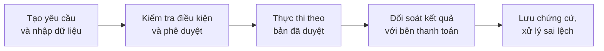
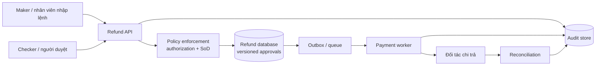
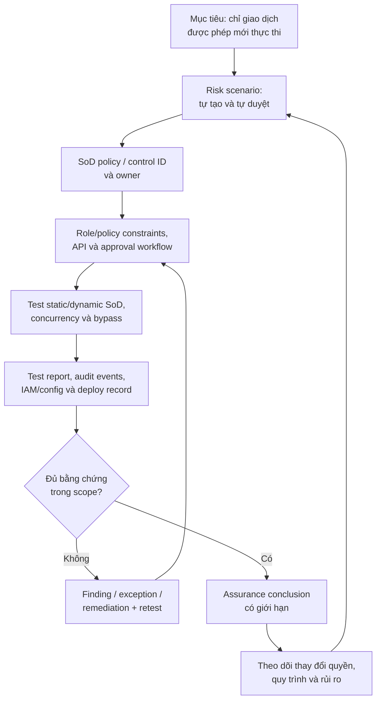
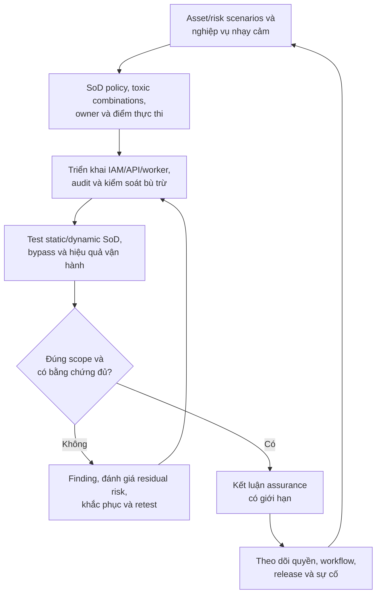

# Separation of duties: phân tách nhiệm vụ trong kiểm soát truy cập và security assurance

## Mục tiêu học tập

Sau bài học, người học có thể:

1. Giải thích **Separation of Duties (SoD)** — *phân tách nhiệm vụ* — và lý do một người hoặc một danh tính không nên tự thực hiện trọn vẹn một chuỗi hành động có rủi ro cao.
2. Phân biệt SoD với **least privilege, role-based access control (RBAC), approval workflow, dual control, four-eyes principle, peer review** và kiểm soát độc lập.
3. Nhận diện **xung đột quyền hạn (toxic combinations)**, thiết kế ràng buộc **static SoD** và **dynamic SoD** phù hợp với từng quy trình.
4. Xác định SoD ở các luồng **tạo–duyệt–thực thi giao dịch, cấp quyền đặc quyền, thay đổi production, quản lý khóa và bằng chứng kiểm toán**.
5. Thiết kế chính sách và thực thi kỹ thuật cho SoD trong ứng dụng phân tán, bao gồm **danh tính người thực hiện, phiên bản nội dung được duyệt, đồng thời, ủy quyền và đường bypass**.
6. Kết hợp kiểm soát **phòng ngừa, phát hiện, khắc phục và bù trừ**, có người chịu trách nhiệm và xử lý ngoại lệ đúng thẩm quyền.
7. Kiểm chứng **design effectiveness, implementation và operating effectiveness** bằng test, log, access review, bằng chứng audit và retest; duy trì assurance liên tục khi hệ thống thay đổi.

Trong module **SECURITY_SECURITY_ASSURANCE**, việc có tài khoản đăng nhập, vai trò và phân quyền không đủ để chứng minh một giao dịch hoặc thay đổi nhạy cảm đã được kiểm soát. Mục tiêu của **security assurance** là đánh giá bằng chứng cho thấy hệ thống đáp ứng mục tiêu bảo mật, từ risk assessment và yêu cầu tới security controls, kiểm thử, audit và khắc phục. SoD là một nguyên tắc thiết kế quan trọng để hạn chế **lạm dụng quyền, gian lận, sai sót không được phát hiện và khả năng tự che giấu hành vi**.

## 1. Separation of duties là gì?

**Separation of duties (SoD)** là nguyên tắc **phân chia những hành động có xung đột lợi ích hoặc tạo ra rủi ro không chấp nhận được** cho những chủ thể hoặc cơ chế kiểm soát khác nhau, nhằm ngăn một chủ thể tự thực hiện toàn bộ chuỗi hành động nhạy cảm mà không có sự kiểm tra hoặc phê duyệt thích hợp.

Ví dụ trong quy trình hoàn tiền:

1. Nhân viên **tạo đề nghị hoàn tiền** và nhập người nhận.
2. Người có thẩm quyền **xác minh và phê duyệt** đề nghị.
3. Hệ thống hoặc bộ phận được phép **thực thi** lệnh đã được duyệt.
4. Người hoặc bộ phận thích hợp **đối soát** kết quả thực tế với nội dung được duyệt.

Nếu một người có thể tự tạo yêu cầu, duyệt yêu cầu, thay người nhận, thực thi, sửa sổ và xóa log mà không có kiểm soát khác, rủi ro tăng lên vì **đường thực hiện sai và che giấu sai cùng nằm trong một miền quyền hạn**.

Nguyên tắc SoD không có nghĩa mọi thao tác đều bắt buộc hai người. Tổ chức cần chọn **những nhiệm vụ thực sự không nên kết hợp** dựa trên tài sản, kịch bản rủi ro, mức ảnh hưởng và yêu cầu bắt buộc. Một ứng dụng nhỏ có thể dùng phê duyệt độc lập cho giao dịch vượt ngưỡng đã phê duyệt, trong khi thao tác ít rủi ro có thể xử lý tự động theo tiêu chí khác.

### 1.1. SoD bảo vệ những mục tiêu nào?

| Mục tiêu | Nguy cơ nếu không phân tách | Ví dụ |
|---|---|---|
| **Toàn vẹn giao dịch** | Một cá nhân tự quyết định và thực thi giao dịch sai | Tạo và duyệt hoàn tiền về tài khoản mình |
| **Tính đúng thẩm quyền** | Người cấp quyền tự tạo quyền để thực hiện hành động nhạy cảm | IAM admin tự cấp vai trò phê duyệt thanh toán |
| **Trách nhiệm giải trình** | Cùng chủ thể có thể sửa dữ liệu và xóa dấu vết | Operator thay giao dịch rồi xóa audit log |
| **Toàn vẹn phần mềm** | Người viết thay đổi tự thông qua và triển khai mà không kiểm tra | Developer sửa policy phân quyền rồi tự release |
| **Tính đáng tin của kiểm toán** | Người bị kiểm tra tự xác nhận tính phù hợp | Người cấp quyền tự đóng kết quả access review |
| **Giảm sai sót** | Không có bước kiểm tra quan trọng trước tác động khó đảo ngược | Nhập nhầm số tiền lớn và tự xác nhận |

Đối tượng được bảo vệ là **mục tiêu và quy trình nghiệp vụ**, không phải chỉ một danh sách vai trò. Một hệ thống có nhiều role trên giấy vẫn có thể vi phạm SoD nếu một cá nhân được cấp đồng thời các role xung đột hoặc có thể thực hiện hành động qua API, batch job hay đường quản trị khác.

### 1.2. Phân biệt SoD và các khái niệm liên quan

| Khái niệm | Câu hỏi chính | Khác với SoD ở đâu? |
|---|---|---|
| **Authentication** | Chủ thể là ai? | Danh tính đúng chưa nói chủ thể được làm cả hai bước hay không |
| **Authorization** | Chủ thể được thực hiện hành động nào trên tài nguyên nào? | SoD thêm ràng buộc giữa **những hành động hoặc chủ thể qua nhiều bước** |
| **Least privilege** | Chủ thể có đúng mức quyền tối thiểu cần thiết? | Hai quyền đều có lý do riêng vẫn có thể là **tổ hợp xung đột** |
| **RBAC** | Quyền được gán cho vai trò nào? | RBAC là cơ chế triển khai; SoD đặt ràng buộc trên vai trò, quyền hoặc giao dịch |
| **ABAC/PBAC** | Quyết định quyền dựa vào thuộc tính/chính sách nào? | Có thể giúp biểu diễn SoD theo actor, resource, trạng thái và ngữ cảnh |
| **Four-eyes principle** | Có người thứ hai xem xét hoặc phê duyệt không? | Là cách thực hiện một số SoD; không thay thế các ràng buộc ở đường khác |
| **Dual control** | Có cần hai chủ thể cùng tham gia để hoàn tất thao tác? | Thường mạnh hơn một bước review thông thường, tùy quy trình |
| **Independent review** | Người kiểm tra có độc lập phù hợp với người thực hiện không? | Có thể là detective control sau sự kiện, không nhất thiết ngăn trước |
| **Defense in depth** | Có nhiều lớp bảo vệ khi một lớp thất bại không? | SoD là một phần có thể nằm trong kiến trúc nhiều lớp |

**Ví dụ quan trọng:** Người dùng A có quyền `CREATE_REFUND` và `APPROVE_REFUND` theo role catalog. Dù mỗi quyền đều cần thiết cho các nhóm công việc khác nhau, nếu một người **được dùng cả hai trên cùng yêu cầu**, cần xem chính sách SoD có yêu cầu từ chối hay không.

## 2. Tìm nhiệm vụ xung đột từ kịch bản rủi ro

Không nên xây một bảng xung đột role chỉ vì tên role “có vẻ nguy hiểm”. Hãy bắt đầu bằng **một chuỗi hành động có thể dẫn tới thiệt hại** và đặt câu hỏi: “Chủ thể nào có thể hoàn tất toàn bộ chuỗi đó mà không gặp điểm kiểm tra độc lập?”

### 2.1. Phân tích theo chuỗi nghiệp vụ

Ví dụ một lệnh hoàn tiền:



Các điểm cần phân tách có thể gồm:

- Người **tạo lệnh** không được tự phê duyệt **chính lệnh đó**.
- Người **thay thông tin thụ hưởng** sau duyệt không được biến phê duyệt cũ thành hợp lệ cho nội dung mới.
- Người vận hành **chi trả** không được đơn phương xóa hoặc sửa mọi chứng cứ chi trả.
- Người **xác định kết quả đối soát** không nên có quyền tự thay toàn bộ dữ liệu nguồn và kết luận đối soát mà không có cơ chế kiểm tra.

Sự phân tách thứ nhất là ràng buộc **theo giao dịch**; sự phân tách vai trò quản lý audit log có thể cần được áp dụng **trên cả hệ thống**. Đây là lý do một loại SoD không giải quyết tất cả vấn đề.

### 2.2. Toxic combinations — tổ hợp quyền nguy hiểm

**Toxic combination** là một tập quyền, vai trò hoặc năng lực mà việc kết hợp trong cùng miền kiểm soát tạo ra kịch bản rủi ro vượt mức cho phép.

| Tổ hợp đáng xét | Kịch bản rủi ro | Ràng buộc hoặc bù trừ cần đánh giá |
|---|---|---|
| Tạo nhà cung cấp + thay tài khoản ngân hàng + duyệt thanh toán | Dẫn tiền tới tài khoản giả | Tách duyệt/sửa master data, xác minh thay đổi và đối soát |
| Tạo yêu cầu hoàn tiền + duyệt cùng yêu cầu | Tự cấp hoàn tiền không hợp lệ | Dynamic SoD theo refund ID, approver độc lập |
| Sửa bảng lương + phê duyệt đợt trả lương | Tự thay số tiền lương | Maker–checker, phê duyệt bản dữ liệu đã chốt |
| Tạo tài khoản admin + phê duyệt quyền admin | Tự mở rộng đặc quyền | Người duyệt độc lập, nhật ký và access review |
| Sửa mã nguồn bảo mật + bỏ qua review + deploy production | Đưa thay đổi không qua kiểm tra vào hệ thống | Protected branches, review rules, release approval, deploy identity |
| Thực hiện giao dịch + sửa hoặc xóa tất cả log liên quan | Che giấu tác động | Phân quyền log tách khỏi quyền nghiệp vụ |
| Sử dụng khóa mã hóa + sửa policy KMS + xóa key-use log | Truy cập dữ liệu và che dấu việc sử dụng khóa | Quản trị khóa độc lập, audit log protected, policy review |
| Tự đánh giá một control + tự phê duyệt ngoại lệ của control đó | Không có chất vấn độc lập | Tách người kiểm tra và người chấp nhận rủi ro |

Không phải mọi tổ hợp đều **bị cấm tuyệt đối**. Tổ chức cần xác định **đối tượng, ngưỡng tác động, phạm vi quyền, mô hình công việc, thời hạn và thẩm quyền**, sau đó ghi ràng buộc hoặc biện pháp bù trừ phù hợp. Không tự tuyên bố một quy tắc mang tính ví dụ là nghĩa vụ pháp lý chung.

### 2.3. Thiết kế ma trận xung đột

Một ma trận đơn giản cho hệ thống hoàn tiền:

| Quyền/nhiệm vụ | Tạo lệnh | Duyệt lệnh | Thực thi | Quản trị audit log |
|---|---|---|---|---|
| **Tạo lệnh** | — | **Không tự duyệt cùng lệnh** | Tùy risk model | Không nên có quyền xóa/sửa dấu vết |
| **Duyệt lệnh** | Không tự duyệt lệnh do mình tạo | — | Tùy quy trình và ngưỡng | Không nên có quyền xóa/sửa dấu vết |
| **Thực thi** | Tùy risk model | Tùy quy trình | — | Không nên có quyền tự xóa chứng cứ thực thi |
| **Quản trị audit log** | Phân tách theo chính sách | Phân tách theo chính sách | Phân tách theo chính sách | — |

Ma trận này **không thay thế luật của từng giao dịch**. Câu “không tự duyệt cùng lệnh” không đồng nghĩa người có cả hai vai trò không được tạo một lệnh cho người khác phê duyệt hoặc duyệt lệnh do người khác tạo. Điều kiện phụ thuộc **mô hình static/dynamic SoD**.

## 3. Static SoD và Dynamic SoD

### 3.1. Static Separation of Duties (SSoD)

**Static SoD** áp dụng ở thời điểm **gán vai trò hoặc cấp quyền**: một chủ thể không được đồng thời giữ những vai trò/quyền được định nghĩa là xung đột trong cùng phạm vi.

Ví dụ chính sách: người quản trị quyền ở production không đồng thời có quyền **phê duyệt ngoại lệ cho chính những quyền mình cấp**.

**Ưu điểm:**

- Có thể kiểm tra từ role catalog, IAM grants và identity inventory.
- Từ chối xung đột ngay khi cấp quyền, giảm phụ thuộc workflow từng giao dịch.
- Hữu ích với quyền có tác động diện rộng như KMS administrator và log deletion.

**Giới hạn:**

- Có thể quá cứng nếu một người cần hai vai trò cho **những giao dịch khác nhau**.
- Phải tổng hợp quyền từ nhiều hệ thống/nhóm, kể cả quyền kế thừa và service account.
- Không bảo vệ đúng nếu một người dùng nhiều danh tính hoặc quyền phát sinh ngoài cơ chế gán role được kiểm tra.

### 3.2. Dynamic Separation of Duties (DSoD)

**Dynamic SoD** áp dụng khi **thực hiện hành động**: chủ thể có thể giữ nhiều vai trò, nhưng không được thực hiện **những hành động xung đột đối với cùng giao dịch, đối tượng hoặc phiên làm việc**, theo chính sách.

Ví dụ:

> Người có quyền tạo và duyệt hoàn tiền có thể tạo lệnh A và duyệt lệnh B do người khác tạo, nhưng **không được duyệt lệnh A do chính mình tạo**.

Điều kiện được xác minh dựa trên **identity của người tạo, người duyệt, refund ID và phiên bản nội dung**, không chỉ trên danh sách role.

**Ưu điểm:** Linh hoạt cho tổ chức nhỏ hoặc quy trình phân công linh hoạt; kiểm soát chính xác tại giao dịch cần bảo vệ.

**Giới hạn:** Cần thực thi **ở server/đường nghiệp vụ đáng tin** và phải bảo toàn dữ liệu tác giả qua các bước; kiểm tra sai dễ bị bypass khi chạy batch, API v1 hoặc thao tác quản trị.

### 3.3. Phân tách theo thời gian và nhiệm vụ cụ thể

Một số tổ chức áp dụng kiểm soát phiên làm việc hoặc khoảng thời gian, chẳng hạn không cho một người dùng **cùng một phiên** kích hoạt hai vai trò xung đột, hoặc yêu cầu phê duyệt độc lập cho thay đổi quan trọng trong một kỳ.

Tuy nhiên, **tách phiên không nhất thiết tách con người**. Nếu một nhân viên có thể đăng xuất rồi đăng nhập bằng tài khoản khác để duyệt lệnh mình vừa tạo, mô hình phải giải quyết **cùng người tự nhiên hoặc miền trách nhiệm**, chứ không chỉ so sánh session ID.

### 3.4. Chọn mô hình theo kịch bản

| Bối cảnh | Mô hình thường phù hợp để xem xét | Lý do |
|---|---|---|
| Quyền sửa/xóa nhật ký và quyền nghiệp vụ nhạy cảm | Static SoD ở phạm vi hệ thống hoặc quyền quản trị | Một người có thể tự che giấu nhiều hành động |
| Maker–checker cho hoàn tiền | Dynamic SoD theo giao dịch và phiên bản | Tránh tự duyệt nhưng vẫn hỗ trợ vai trò linh hoạt |
| Cấp quyền đặc quyền | Static hoặc dynamic kết hợp approval độc lập | Ngăn tự cấp/tự phê duyệt trong quá trình quản trị |
| Review và phê duyệt phát hành | Ràng buộc người tạo thay đổi với reviewer/approver | Tránh self-review/self-approval khi yêu cầu |
| Tài khoản khẩn cấp (*break-glass*) | Quyền tạm thời kèm kiểm tra độc lập và hậu kiểm | Không được mặc định bỏ qua mọi kiểm soát |
| Hệ thống rất nhỏ thiếu nhân sự | Kiểm soát bù trừ có đánh giá rủi ro | Phân tách lý tưởng có thể không khả thi nhưng rủi ro phải được quản trị |

## 4. SoD không chỉ là hai người nhấn hai nút

Một thiết kế maker–checker sẽ thất bại nếu người thứ hai **không kiểm tra đúng nội dung**, hoặc có thể bị tài khoản đầu tiên điều khiển.

### 4.1. Bốn yêu cầu của một phê duyệt có giá trị

1. **Danh tính và thẩm quyền:** Người duyệt được xác thực và có quyền duyệt **đúng loại giao dịch, phạm vi, giá trị và thời điểm**.
2. **Tính độc lập theo chính sách:** Người duyệt không phải người bị cấm duyệt (ví dụ chính người tạo cùng giao dịch, người hưởng lợi hoặc người tự cấp quyền).
3. **Nội dung được duyệt:** Người duyệt thấy và chấp thuận **đúng dữ liệu sẽ được thực thi**, không chỉ một mã yêu cầu chung.
4. **Bằng chứng và bất biến:** Có thể truy vết actor, object, phiên bản, thời điểm, quyết định; thay đổi nội dung trọng yếu phải làm mất hiệu lực phê duyệt cũ hoặc yêu cầu duyệt lại.

Nếu chỉ lưu `status = APPROVED`, sau đó cho phép sửa `beneficiaryAccount` mà không hủy phê duyệt, SoD theo người tạo/duyệt có thể đúng trên giấy nhưng **không còn bảo vệ lệnh thực thi**.

### 4.2. Bất biến phê duyệt

Một quy tắc có thể diễn đạt như sau:

```text
Cho giao dịch T và phiên bản dữ liệu V:
  maker(T, V) != checker(T, V)
  checker(T, V) có quyền APPROVE đối với T tại thời điểm duyệt
  approvedVersion(T) == executedVersion(T)
  nội dung nhạy cảm đã duyệt == nội dung dùng để thực thi
```

Đây là **mẫu minh họa**, không phải công thức áp dụng nguyên xi cho mọi hệ thống. Trong thực tế cần định nghĩa rõ **maker identity**, các thay đổi nào sinh phiên bản mới, quyền ủy quyền hợp lệ, thời hạn phê duyệt và **điều kiện khẩn cấp**.

### 4.3. Điểm yếu của kiểm tra ở giao diện

Ẩn nút “Approve” nếu người dùng vừa tạo yêu cầu **không đủ**. Kẻ có quyền có thể gọi API trực tiếp, dùng mobile client, endpoint cũ, job nền hoặc đường quản trị. Quy tắc SoD phải được thực thi tại **điểm quyết định đáng tin phía server**, và mọi đường làm phát sinh hiệu ứng nhạy cảm phải dùng cùng bất biến.

## 5. Thiết kế kiến trúc và luồng thực thi SoD

Ví dụ một hệ thống hoàn tiền:



Các kiểm tra cần được đặt tại nhiều **điểm tạo hiệu ứng**:

| Điểm | Điều cần bảo vệ | Tiêu chí kiểm chứng |
|---|---|---|
| **Create/submit** | Lưu đúng người tạo, dữ liệu và phiên bản | Actor được server xác định, không lấy mù từ request body |
| **Approve** | Người duyệt có quyền và độc lập | Checker khác maker theo chính sách, approval gắn snapshot |
| **Update after approval** | Nội dung không lách bước duyệt | Thay đổi nhạy cảm hủy hiệu lực phê duyệt hoặc từ chối |
| **Execute** | Chỉ thực thi bản đã được duyệt | Worker đối chiếu trạng thái/phiên bản và idempotency |
| **Review/audit** | Không tự sửa hoặc xóa toàn bộ dấu vết | Log tách quyền, có nguồn và correlation ID |
| **Reconcile** | Phát hiện sai lệch sau thực thi | So sánh kết quả thực tế với bản đã duyệt, có owner xử lý |

SoD hiệu quả thường kết hợp **kiểm soát phòng ngừa ở thời điểm duyệt/thực thi** với **phát hiện khi có dấu hiệu vượt quyền, self-approval hoặc sửa dữ liệu sau duyệt**.

### 5.1. Bảo toàn danh tính xuyên hệ thống

Cần trả lời:

- Một người có nhiều user ID, email hoặc tài khoản admin: làm sao ánh xạ về **cùng chủ thể** khi SoD yêu cầu phân tách con người?
- Service account thực thi thay ai: lưu **delegated actor, service identity và nguồn phê duyệt** thế nào?
- Một nhóm duyệt (*group approver*) có đảm bảo **người duyệt thực** được ghi, hay chỉ lưu tên nhóm?
- Tài khoản dùng chung có đang khiến không thể chứng minh **ai thực hiện**?
- Quyền kế thừa từ nhiều nhóm, IAM role hoặc tenant có bị bỏ qua khi tính toxic combinations không?
- Sau khi thay quyền hoặc thu hồi, token/phiên đang tồn tại có còn được phép duyệt theo quy định không?

**Nguyên tắc:** Quyết định SoD cần dựa trên một **định danh đáng tin đã xác thực và có thể truy vết**, không tin dữ liệu actor do phía client tự khai. Với trường hợp dịch vụ thực thi tự động, người chịu trách nhiệm về quyết định vẫn cần được lưu và có cơ chế tách quyền ở giai đoạn phù hợp.

### 5.2. Tránh race condition và TOCTOU

SoD có thể bị phá vỡ khi kiểm tra và cập nhật không nguyên tử:

1. Hai yêu cầu duyệt đến gần như đồng thời.
2. Server đọc trạng thái lệnh đã duyệt hoặc chưa bị sửa.
3. Trong lúc xử lý, tài khoản khác thay người nhận hoặc trạng thái.
4. Worker thực thi bản mới với quyết định duyệt cũ.

**TOCTOU (time-of-check to time-of-use)** là khoảng sai lệch giữa lúc kiểm tra và lúc sử dụng. Cần thiết kế phù hợp như **optimistic locking trên version, transaction/CAS, immutable approval snapshot, idempotency key và kiểm tra lại ở worker**.

Kể cả có SoD ở API, nếu một batch job có thể ghi thẳng database và đánh dấu `APPROVED`, cần xác định **biện pháp ở tầng dữ liệu hoặc quyền vận hành** để đường đó không vượt qua workflow.

### 5.3. Mẫu xử lý ở phía server

Đoạn mã Java sau chỉ mô tả **logic chính sách**, không phải triển khai production hoàn chỉnh:

```java
record ApprovalRequest(
    String refundId,
    long expectedVersion,
    String approverId
) {}

void approveRefund(ApprovalRequest request, AuthenticatedPrincipal principal) {
    // Dùng identity do tầng xác thực cấp, không tin approverId từ body.
    String actorId = principal.canonicalActorId();
    Refund refund = refundRepository.loadForUpdate(request.refundId());

    if (!authorization.canApprove(principal, refund)) {
        throw new AccessDeniedException("Not authorized");
    }
    if (refund.makerActorId().equals(actorId)) {
        throw new AccessDeniedException("Self-approval is forbidden");
    }
    if (refund.version() != request.expectedVersion()) {
        throw new ConflictException("Refund changed; review current version");
    }
    if (!refund.status().equals("PENDING_APPROVAL")) {
        throw new ConflictException("Invalid approval state");
    }

    // Cập nhật phê duyệt + snapshot trong một giao dịch thích hợp.
    refund.approve(actorId, refund.version(), refund.approvalRelevantDigest());
    refundRepository.saveWithVersionCheck(refund);
    audit.recordApprovalDecision(principal, refund);
}
```

**Điều cần bổ sung khi triển khai thực tế:**

- `canonicalActorId` phải phản ánh quy định tách **con người/miền kiểm soát**; tránh tài khoản khác nhau của cùng một người lách ràng buộc.
- `canApprove` phải kiểm tra **scope, tenant, giới hạn số tiền, quyền có hiệu lực và xung đột quyền** chứ không chỉ tên role.
- Khóa giao dịch hoặc kiểm tra version phải thực sự hiệu lực trên database và các đường ghi song song.
- Audit và thay đổi trạng thái cần xử lý **nhất quán khi thất bại**; cân nhắc outbox/transaction phù hợp.
- Worker không được tin `APPROVED` mà không kiểm tra **version/digest và dữ liệu sẽ thực thi**, theo thiết kế.
- Dữ liệu nhạy cảm nên được lưu và ghi log tối thiểu; không ghi token hoặc thông tin ngân hàng đầy đủ để làm audit.
- Code mẫu không giải quyết **collusion**, impersonation, privileged bypass hoặc môi trường legacy; những nguy cơ này cần kiểm soát riêng.

### 5.4. Dấu vết cần lưu

Một approval event phù hợp có thể lưu:

| Trường | Mục đích |
|---|---|
| `eventId` và `correlationId` | Truy vết từ request tới thực thi và đối soát |
| `transactionId` / `version` | Định danh chính giao dịch và bản đã được xét |
| `makerActorId` / `checkerActorId` | Chứng minh hai nhiệm vụ được phân tách như chính sách |
| `rolesOrDecisionReference` | Căn cứ thẩm quyền có thể kiểm tra lại |
| `approvalRelevantDigest` | Ràng buộc quyết định với dữ liệu đã duyệt theo thiết kế |
| `decision`, `occurredAt`, `outcome` | Ai quyết định, khi nào và kết quả |
| `policyVersion` và `serviceVersion` | Biết chính sách/triển khai nào đang hiệu lực |
| `auditSource` / integrity metadata | Hỗ trợ đánh giá độ tin cậy chứng cứ |

Không nhất thiết đưa toàn bộ nội dung cá nhân/nhạy cảm vào log. Cần **bảo vệ độ tin cậy của nguồn**, quyền đọc/sửa/xóa và khả năng đối chiếu với hồ sơ gốc được quản lý.

## 6. Xây chính sách SoD có thể kiểm chứng

Một chính sách SoD không chỉ liệt kê các role cấm kết hợp. Nên có **ID, risk scenario, scope, rule, owner, cách kiểm tra và đường xử lý ngoại lệ**.

### 6.1. Mẫu chính sách có cấu trúc

YAML dưới đây là **ví dụ dạy học**, không phải định dạng cấu hình chuẩn của IAM engine hay một hệ thống GRC cụ thể:

```yaml
policy:
  id: SOD-REFUND-001
  title: Separation of duties for refund execution
  version: "1.0"
  environment: production
  policyOwnerRole: Security Governance Lead
  systemOwnerRole: Refund Service Owner
  riskOwnerRole: Payments Business Risk Owner
  reviewTriggers:
    - Change to approval or payment workflow
    - Change to role catalog or delegated approvals
    - Privileged access incident or audit finding

scope:
  systems:
    - refund-api
    - refund-database
    - payment-worker
    - manual-payout-process
  identityTypes:
    - workforce
    - service-account
    - privileged-admin
  assets:
    - approved-refund-instruction
    - payment-execution-authority
    - refund-audit-evidence

constraints:
  - id: SOD-REFUND-TRANSACTION-01
    type: dynamic
    rule: Maker cannot approve the same refund version
    matchOn:
      - canonical-human-identity
      - refund-id
      - approval-relevant-version
    enforcementPoints:
      - refund-approval-api
      - manual-approval-workflow
    expectedResponse: deny-and-audit

  - id: SOD-REFUND-CHANGE-02
    type: dynamic
    rule: Approval is invalidated after critical payment fields change
    protectedFields:
      - beneficiary
      - amount
      - currency
    enforcementPoints:
      - refund-update
      - payment-execution-worker
    expectedResponse: require-new-approval

  - id: SOD-REFUND-LOG-03
    type: static
    rule: Payout executors cannot unilaterally erase audit evidence
    conflictingCapabilities:
      - execute-payout
      - delete-protected-audit-records
    expectedResponse: block-conflicting-grant

verification:
  requiredTests:
    - SOD-SAME-ACTOR-REJECTED
    - SOD-DIFFERENT-ACTOR-AUTHORIZED
    - SOD-UPDATED-REFUND-REAPPROVAL
    - SOD-WORKER-STALE-APPROVAL-REJECTED
    - SOD-CROSS-IDENTITY-CONFLICT
    - SOD-AUDIT-ACCESS-SEGREGATION
  evidenceReferences:
    - TEST-SOD-REFUND-2026-11
    - ACCESS-REVIEW-REFUND-04

exceptionHandling:
  approvalRole: Authorized Risk Acceptance Authority
  requiredFields:
    - risk-scenario
    - scope
    - compensating-controls
    - expiry
    - remediation-owner
    - retest-plan
```

Các giá trị `verification.requiredTests` và `evidenceReferences` chỉ là **tham chiếu cần được hiện thực hóa**. Chúng không chứng minh bất kỳ test hay kiểm soát nào thực sự đã chạy.

### 6.2. Từ policy đến cách kiểm soát

| Điều khoản | Control | Bằng chứng cần có |
|---|---|---|
| Maker không duyệt giao dịch mình tạo | Server-side SoD authorization theo transaction ID | Negative test self-approval, rule/version, log quyết định |
| Không duyệt bản dữ liệu đã đổi | Approval snapshot/version; kiểm tra lại khi thực thi | Test sửa trường nhạy cảm, optimistic locking, worker integration test |
| Không cấp đồng thời hai quyền xung đột | IAM provisioning rule và access review | Test cấp quyền xung đột, IAM policy, entitlements snapshot |
| Quyền thay đổi log được tách khỏi nghiệp vụ | IAM/log store policy, audit thao tác admin | Negative access test, access review, cấu hình retention |
| Trường hợp khẩn cấp không tự bypass không kiểm soát | Break-glass workflow, hạn quyền, giám sát và hậu kiểm | Bản ghi kích hoạt, approvals, event log, review kết thúc |
| Thay đổi SoD policy phải có kiểm tra | Change approval, policy-as-code, test regression | PR/review, build digest, deployment ID và test result |

## 7. Kiểm soát phòng ngừa, phát hiện và khắc phục

SoD nên được đặt trong **kiến trúc kiểm soát nhiều lớp**, không dựa hoàn toàn vào một lần rà soát quyền cuối quý.

| Loại kiểm soát | Ví dụ trong SoD | Ý nghĩa thực tế |
|---|---|---|
| **Preventive** | Không cho gán hai role xung đột; từ chối self-approval tại API | Chặn đường sai trước khi hành động có hiệu lực |
| **Detective** | Phát hiện cùng canonical actor tạo và duyệt; role conflicts; thao tác break-glass bất thường | Nhận biết sai lệch, bypass hoặc điểm yếu chưa chặn được |
| **Corrective** | Thu hồi role xung đột, vô hiệu hóa approval sai, sửa transaction | Khắc phục trạng thái và giới hạn tác động |
| **Recovery** | Khôi phục dữ liệu bị sửa sai theo runbook và đối soát | Khôi phục khả năng và tính đúng đắn theo mục tiêu |
| **Compensating** | Phê duyệt độc lập ngoài hệ thống, đối soát tăng cường trong thời hạn có hạn | Giảm rủi ro khi phân tách lý tưởng chưa khả thi |

**Không đánh đồng:** Một cảnh báo “có self-approval” chỉ phát sau khi tiền đã chuyển không tự ngăn lần chi đó. Nó có thể giảm thời gian phát hiện và số giao dịch tiếp theo, nhưng hiệu quả phải được đánh giá theo **mốc rủi ro cụ thể**.

### 7.1. Thiết kế detective use case cho SoD

Một detective control có thể đặt yêu cầu:

> Nếu hệ thống ghi nhận cùng một canonical actor vừa tạo vừa duyệt một giao dịch vượt phạm vi được phép, phải phát event chứa transaction ID, policy version và các actor liên quan, chuyển đến owner trong ngưỡng thời gian đã được phê duyệt; trường hợp mất luồng audit phải được cảnh báo riêng.

**Nguồn:** Approval log, transaction state, IAM role grants, delegated identities, đối soát và các đường thủ công.

**Giới hạn:** Nếu cùng cá nhân có thể tạo bằng tài khoản A và duyệt bằng tài khoản B mà các log không ánh xạ được, detector sẽ bỏ sót. Nếu log bị xóa bởi cùng actor, cần kiểm soát bảo vệ chứng cứ.

**Phản ứng:** Triage tình huống test/hợp lệ, đánh giá trạng thái giao dịch, tạm giới hạn quyền hoặc dòng lệnh theo chính sách, lập finding, xử lý và retest.

### 7.2. Access review cho toxic combinations

Một kỳ access review cần:

1. Lấy **tập tài khoản đầy đủ** từ IAM, ứng dụng, DB, cloud, CI/CD, vendor, service accounts và quyền break-glass trong scope.
2. Tổng hợp **quyền trực tiếp và quyền kế thừa** theo canonical identity hoặc miền trách nhiệm.
3. So ma trận xung đột hiện hành, xét **scope và hiệu lực** của role/quyền, không chỉ tên gọi.
4. Kiểm tra **quyết định ngoại lệ** còn hiệu lực với đúng người, hệ thống, mục đích và điều kiện.
5. Giao hành động sửa quyền không hợp lệ; xác minh **trạng thái thực sau thu hồi**.
6. Lưu bằng chứng nguồn, ngày chụp, quyết định, thẩm quyền, thay đổi và khoảng trống còn mở.

Nếu chỉ dùng danh sách nhân viên mà bỏ qua service accounts, automation và vendor, kết luận coverage của SoD sẽ **không đầy đủ**.

## 8. SoD trong CI/CD, quản trị hệ thống và dữ liệu

### 8.1. Development → review → deploy

Một kịch bản rủi ro: developer có thể tự sửa kiểm soát phân quyền, tự bỏ qua test, tự phê duyệt và đưa artifact chưa kiểm tra vào production.

Ví dụ biện pháp:

- Protected branches, review rule và hạn chế quyền bypass.
- Xác định người **tạo thay đổi**, **reviewer** và **người/quy trình cho phép release**.
- Pipeline chỉ deploy **artifact gắn với commit, build và approvals hợp lệ**.
- Quyền sửa cấu hình CI/CD, runner, secret, release gate và artifact registry phải được quản trị.
- Emergency/hotfix có quy trình riêng, có audit trail, hạn chế scope và hậu kiểm bắt buộc theo rủi ro.

**Điểm mù:** Hai tài khoản trên nền tảng quản lý mã nguồn không bảo đảm hai người độc lập nếu một cá nhân điều khiển cả hai. Một reviewer có thể duyệt mã nhưng đường phát hành thủ công hoặc key đăng ký lại cho phép bypass. SoD cần được xác minh **trên đường tạo hiệu ứng production**, không chỉ ở PR.

### 8.2. Quản trị IAM và KMS

Cân nhắc phân tách:

- Người yêu cầu quyền và người phê duyệt quyền.
- Người cấp quyền và người đánh giá độc lập về việc cấp.
- Người dùng khả năng giải mã và người có quyền sửa chính sách khóa.
- Người sử dụng khóa và người có quyền sửa/xóa log sử dụng khóa.
- Người thay role catalog và người phê duyệt thay đổi có tác động lớn.

Khi phân tách không thể thực hiện tuyệt đối, phải phân tích **blast radius**, quyền tạm thời (*just-in-time*), giới hạn thời gian, approval độc lập, giám sát và rà soát sau sử dụng.

### 8.3. Dữ liệu và bằng chứng kiểm toán

Quyền chỉnh sửa dữ liệu nghiệp vụ và quyền **sửa/xóa audit evidence** là một tổ hợp cần xem xét. Để tạo khả năng chứng minh độc lập:

1. Lưu audit events vào kho có quyền quản lý tách khỏi operator nghiệp vụ ở mức phù hợp.
2. Kiểm soát quyền quản trị retention, cấu hình và xóa; ghi audit các thao tác đó.
3. Giữ correlation ID, actor ID, policy version và thông tin cần thiết để đối chiếu.
4. Giới hạn quyền xem log chứa dữ liệu khách hàng; thực hiện tối thiểu hóa và che dữ liệu.
5. Test khả năng phát hiện mất luồng log hoặc thay đổi policy không hợp lệ.

Tách quyền mà **không xác minh dữ liệu ghi vào log có đúng và đầy đủ** vẫn chưa đủ. Một hệ thống có thể bảo vệ log rất tốt nhưng bỏ sót các thay đổi từ API cũ hoặc batch job.

## 9. Ngoại lệ, tổ chức nhỏ và tình huống khẩn cấp

### 9.1. Khi không thể phân tách mọi nhiệm vụ

Một đội nhỏ có thể chỉ có một người đủ năng lực vận hành một dịch vụ legacy. Nếu tổ chức chọn không áp dụng SoD lý tưởng, phải **ghi nhận sự không đáp ứng**, đánh giá rủi ro và xem biện pháp bù trừ — không tự gắn nhãn “PASS”.

Các lựa chọn tùy rủi ro:

- Chỉ cho phép một người thực hiện phần công việc **trong giới hạn tiền, dữ liệu hoặc phạm vi** được phê duyệt.
- Tách **quyết định phê duyệt** ở cấp quản lý hoặc đội nghiệp vụ không trực tiếp vận hành.
- Thiết lập **post-event independent review** và đối soát từ nguồn độc lập.
- Dùng **JIT access**, có giới hạn thời gian, ghi nhận và tự thu hồi quyền.
- Giám sát tăng cường khi quyền khẩn cấp được sử dụng.
- Xác định thời hạn nâng cấp quy trình hoặc công cụ để triển khai SoD tốt hơn.

**Lưu ý:** Kiểm soát bù trừ có thể giảm một phần rủi ro nhưng không mặc nhiên tương đương với SoD phòng ngừa. Cần đánh giá **rủi ro còn lại** theo phương pháp của tổ chức.

### 9.2. Break-glass và sự cố

Trong khẩn cấp, một người có thể cần quyền rộng để phục hồi dịch vụ hoặc ngăn mất mát. Một cơ chế break-glass có chất lượng cần:

| Yếu tố | Câu hỏi kiểm chứng |
|---|---|
| **Điều kiện kích hoạt** | Khi nào tình huống đủ điều kiện? Ai khai báo và ghi nhận? |
| **Xác thực và quyền** | Ai dùng, có bằng chứng định danh và giới hạn scope không? |
| **Thời hạn** | Quyền có tự hết hạn hoặc được thu hồi theo thủ tục không? |
| **Logging và alert** | Có audit đầy đủ, nơi lưu đáng tin và người nhận cảnh báo không? |
| **Phê duyệt/hậu kiểm** | Có phê duyệt trước khi khả thi hoặc kiểm tra độc lập sau sử dụng theo chính sách? |
| **Rủi ro và khắc phục** | Sự kiện có làm thay đổi data/control state, có cần đối soát/retest không? |

Nếu quy trình khẩn cấp **bỏ qua approval trước**, phải có căn cứ, scope và kiểm tra hậu kỳ phù hợp; không nên thiết kế “khẩn cấp” thành đường thường trực dễ dàng dùng để tránh ràng buộc SoD.

### 9.3. Hồ sơ ngoại lệ

Một ngoại lệ SoD nên lưu:

1. Rule/Control ID và **tổ hợp quyền hoặc chuỗi nhiệm vụ** không thể phân tách.
2. Hệ thống, tài sản, môi trường, đối tượng và thời hạn áp dụng.
3. Risk scenario, likelihood/impact, điều chưa chắc chắn và **rủi ro còn lại**.
4. Kiểm soát bù trừ, cách đo hiệu quả và người chịu trách nhiệm.
5. Người có **thẩm quyền phê duyệt**, thời điểm và ngày hết hạn.
6. Kế hoạch sửa và action owner; điều kiện kết thúc ngoại lệ.
7. Trigger đánh giá lại: sự cố, thay đổi quyền, vendor, tăng giá trị giao dịch hoặc kiểm soát bù trừ thất bại.

Một ngoại lệ nội bộ **không thể tự loại bỏ nghĩa vụ bắt buộc** theo quy định hoặc hợp đồng nếu tổ chức không có quyền miễn trừ.

## 10. Kiểm thử Separation of Duties

Phân tách nhiệm vụ phải có **tiêu chí đo/kiểm tra rõ** ở cả mức cấu hình quyền và **hành vi nghiệp vụ**.

### 10.1. Các tầng kiểm chứng

| Tầng | Cần xác minh | Ví dụ bằng chứng |
|---|---|---|
| **Design effectiveness** | Risk scenario và toxic combinations được chuyển thành rule phù hợp | Threat model, role-conflict matrix, approval-state design |
| **Implementation** | Rule có thật ở IAM/API/worker và mọi đường quan trọng | Policy/config, code review, deployment ID |
| **Operating effectiveness** | Tình huống xung đột bị chặn hoặc nhận biết/xử lý theo tiêu chí trong thời kỳ đánh giá | Negative/positive tests, access review, approval/audit events, incident/ticket |
| **Coverage** | Có bao phủ API mới/cũ, batch, admin, service accounts, tenant và môi trường cần thiết không? | DFD, endpoint inventory, source-of-truth entitlements, test scope |
| **Evidence integrity** | Dấu vết không bị cùng chủ thể đơn phương xóa/sửa mà không được phát hiện | Log access review, cấu hình retention, thử thay đổi quyền, audit event |

**Đừng coi “test tự duyệt bị 403” trên một endpoint là bằng chứng SoD đạt toàn hệ thống.** Có thể còn đường background worker, import batch, chức năng admin hoặc phê duyệt qua API cũ.

### 10.2. Bộ kiểm thử Gherkin

```gherkin
Feature: Separation of duties for refund approval and execution

  Scenario: Maker cannot approve their own refund
    Given refund R100 was created by canonical actor A
    And R100 is pending approval
    And actor A has permission to request approvals
    When actor A attempts to approve R100
    Then the approval must be denied
    And R100 must remain unapproved
    And the denial must be auditable

  Scenario: Authorized independent checker approves unchanged refund
    Given refund R200 was created by canonical actor A
    And its version 3 contains approved-candidate payment details
    And actor B is an authorized independent approver for R200
    When actor B approves version 3
    Then approval must bind to version 3 and its payment details
    And approval evidence must identify actor B

  Scenario: A changed payment destination invalidates old approval
    Given refund R300 version 4 was approved by authorized actor B
    When a permitted update changes its beneficiary in version 5
    And the payment worker attempts execution using version 4 approval
    Then the worker must not execute the modified payment
    And reapproval of version 5 must be required

  Scenario: Separate accounts controlled by one person cannot self-approve
    Given account A1 and account A2 belong to the same canonical actor A
    And refund R400 was created using A1
    When A2 attempts approval under an applicable human-level SoD rule
    Then self-approval must be denied

  Scenario: Conflicting roles cannot be granted together
    Given account P1 already has a production payout execution capability
    When a request tries to grant P1 unreviewed audit-log deletion capability
    Then the grant must be denied or routed through the approved exception process
    And an audit record must identify the attempted conflict

  Scenario: Legitimate independent approval does not produce false alert
    Given refund R500 was created by actor A
    And a different authorized actor B approves the current version
    When R500 is executed according to the approved content
    Then no self-approval violation should be reported
```

Các kịch bản có thể được hiện thực qua integration/security tests dùng **dữ liệu giả lập và vai trò thử nghiệm**. Với các giao dịch tiền thật, không tiến hành thử trái phép trên production. Khi kiểm thử qua môi trường mô phỏng, kết luận assurance phải nêu rõ **giới hạn so với bản triển khai production**.

### 10.3. Ma trận kiểm thử các trường hợp ít hiển nhiên

| Trường hợp | Kết quả mong đợi theo yêu cầu | Vì sao phải thử? |
|---|---|---|
| Maker và checker trùng **cùng canonical actor** nhưng hai tài khoản khác | Chặn khi chính sách áp dụng theo người tự nhiên | Tránh lách bằng tài khoản phụ |
| Maker khác checker nhưng checker **không có quyền** với tenant/giá trị | Chặn | SoD không thay authorization |
| Người duyệt có quyền **trước đó**, nhưng quyền đã bị thu hồi | Áp dụng trạng thái quyền/phiên theo yêu cầu | Tránh dựa vào quyền cũ |
| Sửa người nhận sau duyệt qua API cũ | Hủy duyệt/từ chối | Kiểm tra coverage đường legacy |
| Hai yêu cầu approve hoặc update đồng thời | Không thực thi bản chưa duyệt đúng version | Kiểm tra race condition |
| Worker nhận lại cùng message | Không tạo thêm hiệu ứng chi tiền | SoD không thay idempotency |
| Người có quyền duyệt tự sửa log sự kiện | Quyền sửa/xóa bị hạn chế hoặc phát hiện | Giảm khả năng che giấu |
| Quyền của một người đến từ nhiều nhóm IAM | Phát hiện xung đột sau tổng hợp quyền | Tránh bỏ sót quyền kế thừa |
| Break-glass dùng ngoài điều kiện/hạn | Cảnh báo, giới hạn và hậu kiểm theo quy định | Kiểm soát đường ngoại lệ |
| Đường batch/manual không dùng approval API | Có kiểm soát tương đương hoặc finding rõ | Bảo vệ đúng phạm vi hệ thống |

### 10.4. Kiểm chứng cả trạng thái sau hành động

Một lần từ chối API phải được kiểm tra **không có thay đổi trạng thái hoặc hiệu ứng phụ**: lệnh không chuyển sang `APPROVED`, worker không nhận yêu cầu chi, outbox không phát event thực thi và không phát sinh giao dịch đối tác.

Tương tự, một ticket `Revoke access completed` cần được kiểm tra bằng **trạng thái IAM/policy thực tế**, bao gồm quyền kế thừa, token còn hiệu lực theo mô hình, access path khác và bằng chứng audit.

## 11. Bằng chứng assurance và audit

### 11.1. Chuỗi truy vết



### 11.2. Bằng chứng cho từng khẳng định

| Khẳng định | Bằng chứng thiết kế | Bằng chứng triển khai/vận hành |
|---|---|---|
| Xung đột vai trò được định nghĩa đúng | Role-conflict matrix, risk mapping, policy approval | IAM rule/config, kết quả thử cấp hai quyền |
| Self-approval bị ngăn ở giao dịch | State machine, đặc tả dynamic SoD | Test âm, API/worker version, approval events |
| Người duyệt độc lập có đúng thẩm quyền | Role policy, delegation procedure | IAM entitlement, approval record, access review |
| Sửa dữ liệu làm mất hiệu lực duyệt cũ | Invariant version/snapshot, transaction design | Test update after approval, DB state và worker integration |
| Các đường thực thi đều trong scope | DFD, endpoint/job/vendor inventory | Coverage tests API/batch/manual, release/config records |
| Có phát hiện bypass | Detection use case và event schema | Rule version, synthetic alert, triage ticket và health test |
| Bằng chứng không dễ bị xóa/sửa trái quyền | Logging policy, separation of log administration | Negative log access test, IAM policy, log-retention evidence |
| Ngoại lệ được quản trị | Risk acceptance rules, exception template | Quyết định đúng thẩm quyền, expiry, review và retest |

### 11.3. Claim–Argument–Evidence

Ví dụ kết luận có giới hạn:

> **Claim:** Ở Refund API và Payment Worker production của bản phát hành được xác định, người tạo không thể tự phê duyệt cùng lệnh hoàn tiền và một phê duyệt không còn hợp lệ sau khi thay đổi các trường chi trả nhạy cảm.
>
> **Argument:** Identity được chuẩn hóa từ lớp xác thực; policy check được gọi ở đường approve; approval gắn với dữ liệu/phiên bản; worker kiểm tra lại trước thực thi; log được bảo vệ theo quyền.
>
> **Evidence:** Policy và role matrix đã duyệt, code/config review, negative tests cho self-approval và thay đổi sau duyệt, test concurrency/batch, audit events, deployment ID, access review và kết quả retest.
>
> **Limitations:** Nếu đường chi trả thủ công hoặc batch legacy chưa được kiểm thử, không kết luận SoD bảo vệ toàn bộ hệ thống; phải ghi finding hoặc điều kiện kiểm soát khác riêng.

**Tuyên bố “đã phân tách nhiệm vụ” cần được gắn với scope**, không chỉ dấu tick từ bảng quyền. Một quyết định phê duyệt bởi “hai user ID khác nhau” chưa đủ nếu cùng người kiểm soát cả hai hoặc nếu nội dung thực thi đã khác nội dung được duyệt.

### 11.4. Lưu và bảo vệ bằng chứng

Evidence package nên có:

- Risk/control/requirement ID và chính sách SoD có hiệu lực.
- Hệ thống, environment, bản phát hành, policy version và kỳ kiểm tra.
- Role/permission inventory và **population completeness check**.
- Test input, expected/actual, kết quả âm/dương, test bypass và kết quả retry/concurrency.
- Approval records liên kết maker, checker, object, version, quyết định và thời gian.
- Log thay đổi quyền, exception, access review và ticket khắc phục/retest.
- Người thực hiện/đánh giá, phạm vi, độ tin cậy và **phần chưa được kiểm tra**.

Không đưa thông tin ngân hàng thực, secret, access token hoặc dữ liệu cá nhân không cần thiết vào báo cáo; dùng dữ liệu thử và tham chiếu có kiểm soát quyền.

## 12. Vai trò và quản trị SoD

### 12.1. Phân chia trách nhiệm

| Vai trò | Trách nhiệm |
|---|---|
| **Business/process owner** | Xác định nhiệm vụ xung đột, ngưỡng giao dịch và hậu quả khi sai |
| **System owner** | Xác định tất cả đường hệ thống áp dụng, phụ thuộc và trạng thái kiểm soát |
| **IAM/control owner** | Thiết kế/vận hành ràng buộc quyền, cấp phát, kiểm tra xung đột và chứng cứ |
| **Application/engineering owner** | Thực thi dynamic SoD, state/version checks và test hồi quy |
| **Data owner** | Quy định dữ liệu nhạy cảm, quyền truy cập và xử lý bản sao |
| **Risk owner** | Quản lý rủi ro liên quan, lựa chọn xử lý, trình cấp có thẩm quyền khi cần |
| **Security assurance / QA** | Xác minh thiết kế, triển khai, hiệu quả và giới hạn bằng chứng |
| **Internal audit** | Đánh giá độc lập theo phạm vi được giao |
| **Người có thẩm quyền chấp nhận rủi ro** | Phê duyệt ngoại lệ và rủi ro còn lại trong phạm vi ủy quyền |
| **Action owner** | Khắc phục một điểm thiếu sót và cung cấp kết quả cho retest |

Người sở hữu rủi ro không tự động là người có quyền **chấp nhận mọi rủi ro**, và người chịu trách nhiệm kiểm soát không nên mặc nhiên được **tự đánh giá rồi phê duyệt ngoại lệ** cho thiếu sót của chính mình.

### 12.2. RACI minh họa

RACI: **R** là người thực hiện; **A** là người chịu trách nhiệm cuối cùng đối với hoạt động; **C** là tham vấn; **I** là được thông báo.

| Hoạt động | Business/process owner | System owner | Control/engineering owner | Risk owner | Assurance |
|---|---|---|---|---|---|
| Xác định nhiệm vụ xung đột | **A/R** | C | C | C | C |
| Thiết kế policy và điểm thực thi SoD | C | **A** | **R** | C | C |
| Triển khai/rà soát quyền và workflow | I | **A** | **R** | I | C |
| Tổ chức test/evidence theo hệ thống | C | **A** | **R** | I | C |
| Đánh giá rủi ro SoD không đáp ứng | C | C | C | **A/R** | C |
| Đánh giá hiệu quả độc lập | I | C | C | I | **A/R** |

Ma trận chỉ nhằm minh họa. Quyết định chấp nhận ngoại lệ **vượt thẩm quyền của risk owner** phải được chuyển tới cấp được ủy quyền, không gộp vào một vai trò cho tiện quản trị.

## 13. Tình huống tổng hợp: hai tài khoản nhưng vẫn là tự duyệt

Một công ty thương mại điện tử có hệ thống hoàn tiền. Chính sách nêu “người tạo và người duyệt phải khác nhau”. Ứng dụng dùng trường `createdByUserId` và `approvedByUserId`; rule chỉ kiểm tra **hai chuỗi user ID khác nhau**.

Trong một kỳ kiểm tra, assurance phát hiện:

1. Một nhân viên dùng tài khoản thông thường để tạo lệnh và tài khoản quản trị cá nhân thứ hai để phê duyệt **cùng lệnh**.
2. Trên màn hình, người duyệt nhìn thấy số tiền và người nhận, nhưng worker thực thi dữ liệu **mới nhất** sau khi nội dung được sửa.
3. Job batch không gọi API duyệt và có thể đặt trực tiếp trạng thái `APPROVED` trong DB theo một đường vận hành cũ.
4. Audit log được gửi tới kho chung, nhưng operator chi trả cũng có quyền xóa log ứng dụng trước khi chuyển tiếp.
5. Báo cáo access review chỉ xét **nhân viên**, chưa gồm service accounts và quyền DB local của batch job.

Dashboard vẫn hiển thị “0 vi phạm tự duyệt” vì hai user ID khác nhau; điều này cho thấy **chỉ số không đo đúng kịch bản rủi ro**.

### 13.1. Xác định lỗi theo từng lớp

| Khoảng trống | Loại lỗi | Hậu quả |
|---|---|---|
| Cùng người dùng hai tài khoản | Identity mapping / dynamic SoD | Rule chặn theo user ID không thực thi đúng phân tách con người |
| Dữ liệu sau duyệt còn sửa được | Approval binding / data integrity | Người duyệt không chứng thực nội dung thực thi cuối |
| Batch viết trực tiếp DB | Enforcement coverage / bypass | Workflow SoD ở API không bao phủ mọi đường |
| Operator có quyền xóa log | Audit evidence segregation | Có thể mất chứng cứ về hành vi nhạy cảm |
| Service/DB accounts bị bỏ sót | Population completeness | Không thể kết luận static SoD được quản lý trên toàn scope |

### 13.2. Thiết kế kiểm soát lại

**Xác thực và định danh:** Kết nối tài khoản về canonical actor khi chính sách yêu cầu hai **con người** độc lập. Không dùng thông tin người dùng tự khai hoặc tên hiển thị để quyết định.

**Dynamic SoD:** So sánh maker–checker trên cùng transaction/version và quyền tại thời điểm duyệt. Hỗ trợ delegation có phê duyệt, scope và dấu vết rõ; không cho delegation vô tình biến thành tự duyệt.

**Bất biến giao dịch:** Duyệt snapshot hoặc digest của số tiền, người nhận và dữ liệu liên quan; thay đổi có ý nghĩa phải duyệt lại. Worker kiểm tra bản đã duyệt trước hiệu ứng chi tiền và xử lý retry an toàn.

**Static SoD:** Kiểm soát tổ hợp quyền quản trị log và quyền giao dịch; rà soát tổng hợp IAM, DB local, service và vendor accounts.

**Detective controls:** Phát hiện self-approval theo canonical actor, sai lệch phiên bản, quyền xung đột được cấp, cấu hình log thay đổi, và đối soát kết quả thực tế.

**Assurance:** Kiểm thử lại UI, API, job batch, quyền DB, identity mapping, thay đổi sau duyệt, concurrency, log/audit và đường emergency; gắn kết quả với bản triển khai production.

### 13.3. Kết luận trước và sau sửa

**Kết luận chưa hợp lệ:** “Đã đạt SoD vì createdByUserId luôn khác approvedByUserId.”

**Kết luận có giới hạn:** “Các test hiện tại chỉ xác minh hai user ID khác nhau ở đường API đã kiểm tra. Chưa đủ bằng chứng SoD theo người thực tế và bản giao dịch đã duyệt; có khoảng trống ở batch, quản trị log và service accounts. Các finding cần owner, risk assessment, khắc phục và retest trước khi đánh giá lại.”

Sau sửa, kết luận chỉ nên mở rộng tới **những role, môi trường, đường xử lý và điều kiện đã kiểm chứng**. SoD không ngăn tuyệt đối **thông đồng giữa những người được phép**, chiếm đoạt tài khoản hoặc lỗi do dữ liệu đầu vào sai; vẫn cần cảnh báo, đối soát và cơ chế điều tra.

## 14. Vận hành và continuous assurance

SoD suy yếu khi **quyền, kiến trúc và quy trình** thay đổi nhưng rule/ma trận xung đột không được cập nhật.

### 14.1. Những trigger phải rà soát

- Thêm vai trò, nhóm IAM, quyền mới hoặc **service account có đặc quyền**.
- Thay quy trình duyệt, ngưỡng giao dịch, delegated approval hoặc state machine.
- Thêm API, job nền, batch, import/export, direct DB access hoặc tích hợp vendor.
- Thay CI/CD, release gate, cơ chế break-glass, KMS hoặc log storage.
- Phát hiện pentest/audit về authorization, quyền quá rộng, thiếu log hoặc tự phê duyệt.
- Có sự cố gian lận, chi sai, sửa dữ liệu sau duyệt hoặc quyền bị lạm dụng.
- Ngoại lệ hết hạn, kiểm soát bù trừ không còn hoạt động hoặc thay đổi người giữ vai trò.

### 14.2. Các chỉ số nên theo dõi

| Chỉ số | Có ích để biết | Điểm dễ gây hiểu nhầm |
|---|---|---|
| **Số/toàn bộ toxic combinations** | Quyền xung đột đang tồn tại ở những chủ thể nào | Inventory thiếu service/vender/DB accounts khiến số liệu thấp giả |
| **Tỷ lệ grant kiểm tra SoD trước khi cấp** | Bao nhiêu yêu cầu cấp quyền được kiểm tra rule | Có thể bỏ qua quyền cấp thủ công ngoài IAM workflow |
| **Tỷ lệ giao dịch có bằng chứng checker độc lập** | Phạm vi maker–checker được thực thi theo giao dịch | Hai user ID khác nhau không chứng minh hai chủ thể độc lập |
| **Tỷ lệ approval gắn đúng version** | Tính toàn vẹn giữa duyệt và thực thi | Log version có thể sai nguồn nếu dữ liệu bị sửa |
| **Số self-approval attempts/violations** | Tín hiệu rule được kích hoạt hoặc bypass | Ít alert có thể do thiếu telemetry |
| **Thời gian xử lý role conflicts** | Mức độ kiểm soát quyền dư | Ticket đóng không chứng minh quyền thật đã thu hồi |
| **Số ngoại lệ còn hạn/quá hạn** | Rủi ro chưa thể tách nhiệm vụ | Ngoại lệ được ký không biến rule thành PASS |
| **Evidence freshness và coverage** | Test còn phản ánh release, môi trường và đường thực tế? | Test staging cũ không tự đại diện cho production |

Một thước đo hợp lý cần mô tả **mẫu số, phạm vi, nguồn, thời kỳ và giới hạn**. “100% giao dịch có hai dấu duyệt” không chứng minh SoD nếu không biết hai chữ ký thuộc người độc lập và áp dụng cho **cùng bản dữ liệu** đã thực thi.

### 14.3. Chu trình assurance liên tục



## 15. Những sai lầm thường gặp

| Sai lầm | Vì sao chưa đúng? | Cách cải thiện |
|---|---|---|
| Coi hai role là hai con người | Một người có thể giữ cả hai hoặc dùng nhiều tài khoản | Quản trị identity và static/dynamic SoD |
| Ẩn nút Approve ở UI | API, job hoặc DB có thể bypass | Enforce tại server và mọi đường gây hiệu ứng |
| Chỉ so sánh user ID | Không giải quyết nhiều danh tính của cùng người | Dùng canonical identity hoặc phạm vi kiểm soát phù hợp |
| Check maker khác checker nhưng không check quyền | Một người khác nhưng không đủ thẩm quyền vẫn duyệt được | Kết hợp authorization đầy đủ, tenant và ngưỡng |
| Duyệt trạng thái chung, không duyệt nội dung | Trường nhạy cảm có thể bị sửa sau duyệt | Gắn snapshot/version/digest, kiểm tra tại execute |
| Static SoD áp quá cứng cho mọi quy trình | Cản trở nghiệp vụ dù xung đột chỉ theo một giao dịch | Chọn dynamic SoD theo risk scenario |
| Dynamic SoD chỉ trên một endpoint | Batch, API cũ và công cụ admin vẫn vượt qua | Inventory đầy đủ và test bypass |
| Hai người cùng có quyền xóa log | Bằng chứng có thể bị xóa và khó điều tra | Phân tách quản trị evidence, kiểm soát log integrity |
| Dùng danh sách nhân viên làm population toàn bộ IAM | Bỏ sót service accounts, vendor và DB local | Tổng hợp quyền xuyên nguồn và kiểm tra completeness |
| Đánh dấu “accepted” thành “compliant” | Ngoại lệ không làm tiêu chí SoD đạt kỹ thuật | Tách trạng thái control và quyết định rủi ro |
| Tự kết luận SoD loại bỏ gian lận | Không ngăn được mọi trường hợp thông đồng/chiếm quyền | Kết hợp kiểm soát khác và đánh giá residual risk |
| Có test pass nhưng không gắn release | Có thể kiểm thử mã/cấu hình khác production | Lưu deployment ID, config và retest sau thay đổi |
| Chỉ kiểm tra mã HTTP | Có thể đã tạo outbox/payment side effect | Kiểm tra trạng thái DB, queue và đối tác |
| Không ghi sự kiện quyền khẩn cấp | Break-glass trở thành bypass thường trực | Quy trình có hạn, log, giám sát và hậu kiểm |

## 16. Bài tập thực hành

### Bài tập 1 — Xác định toxic combinations

Một nền tảng trả lương có các nhiệm vụ: nhập giờ công, tạo bảng lương, sửa tài khoản nhận, phê duyệt bảng lương, gửi lệnh ngân hàng, đối soát và quản trị audit log.

**Yêu cầu:** Chọn ít nhất **bốn tổ hợp nhiệm vụ xung đột**, giải thích kịch bản rủi ro tương ứng; xác định tổ hợp nào cần **static SoD** và tổ hợp nào phù hợp **dynamic SoD**. Đề xuất ít nhất một kiểm soát phát hiện và một biện pháp bù trừ cho đội nhỏ.

**Gợi ý:** Một người có thể được phép tạo bảng lương tháng này và duyệt bảng lương tháng khác, nhưng không nên tự duyệt **chính bản mình lập** khi policy cấm self-approval.

### Bài tập 2 — Viết kiểm soát maker–checker

Một API hoàn tiền có trạng thái `DRAFT → SUBMITTED → APPROVED → PAID`. Người dùng được sửa beneficiary trong mọi trạng thái. API kiểm tra `createdBy != approvedBy`, nhưng worker chỉ nhìn trạng thái `APPROVED`.

**Yêu cầu:** Xác định những **bất biến còn thiếu** và mô tả policy/luồng kiểm tra tại create, approve, update và execute. Viết hai test âm cho **thay người nhận sau duyệt** và **đồng thời update/approve**; xác định bằng chứng cần thu.

**Gợi ý:** Bản đã duyệt phải khớp bản được thực thi; kiểm tra ở worker có vai trò quan trọng khi có queue/retry.

### Bài tập 3 — Đọc ma trận role conflict

Tổ chức có các role: `REFUND_MAKER`, `REFUND_APPROVER`, `PAYMENT_EXECUTOR`, `LOG_ADMIN`, `IAM_ADMIN`. Một tài khoản quản trị đang có `PAYMENT_EXECUTOR` và `LOG_ADMIN`. Người dùng khác có `REFUND_MAKER` và `REFUND_APPROVER` nhưng chỉ duyệt các lệnh do người khác tạo.

**Yêu cầu:** Phân tích tại sao tổ hợp thứ nhất có thể là **static conflict** đáng quan ngại, còn tổ hợp thứ hai có thể được kiểm soát bởi **dynamic SoD**. Nêu dữ liệu IAM/transaction/audit cần có để kiểm tra hai trường hợp; tránh kết luận vội khi chưa biết chính sách áp dụng.

### Bài tập 4 — Đánh giá ngoại lệ break-glass

Một quản trị viên cần khẩn cấp sửa quyền production để khôi phục dịch vụ, nhưng tổ chức chưa có người kiểm tra thứ hai trong ca trực. Sau khi sự cố kết thúc, quyền vẫn còn và không có log kích hoạt.

**Yêu cầu:** Phân biệt **nhu cầu khẩn cấp hợp lệ** với **khoảng trống kiểm soát**, đề xuất quyền tạm, cách giám sát, approval/hậu kiểm, revoke và bằng chứng. Ghi điều kiện để ngoại lệ có thể được chấp thuận đúng thẩm quyền và trigger tái đánh giá.

### Bài tập 5 — Viết kết luận assurance theo bằng chứng

Một báo cáo ghi “SoD PASS, vì mọi approval record có hai user ID khác nhau”. Tuy nhiên có thể dùng nhiều tài khoản, batch job không qua API duyệt và chưa kiểm thử việc sửa giao dịch sau duyệt.

**Yêu cầu:** Viết ngắn gọn **Claim–Argument–Evidence–Limitations**, nêu ít nhất **năm phép thử hoặc bằng chứng bổ sung** trước khi kết luận rộng hơn. Đề xuất owner cho việc sửa identity mapping, approval workflow và kiểm tra batch.

### Bài tập 6 — Kiểm soát SoD trong CI/CD

Một developer có quyền sửa repository, sửa pipeline, phê duyệt PR bằng tài khoản khác và triển khai thủ công image lên production.

**Yêu cầu:** Xác định điểm yếu của việc chỉ yêu cầu “hai user accounts phê duyệt”. Thiết kế biện pháp bảo vệ từ commit đến artifact digest và deploy, cùng cách kiểm tra quyền bypass, sự kiện emergency và bảo vệ audit log.

## 17. Checklist đánh giá Separation of Duties

- **Mục tiêu:** Đã xác định nghiệp vụ nhạy cảm, tài sản và kịch bản rủi ro cụ thể chưa?
- **Nhiệm vụ xung đột:** Đã nhận diện các khả năng tạo, duyệt, thực thi, sửa và che giấu hậu quả chưa?
- **Mô hình:** Dùng static hay dynamic SoD theo đúng scope, giao dịch và chủ thể?
- **Danh tính:** Cùng một người có thể lách kiểm soát bằng nhiều account, delegation hoặc service identity không?
- **Quyền:** Checker có đúng authority, tenant, ngưỡng và hiệu lực tại thời điểm duyệt không?
- **Nội dung:** Approval có gắn phiên bản/snapshot và bị hủy khi trường quan trọng thay đổi không?
- **Đường thực thi:** Quy tắc đã áp dụng tới UI, API, worker, batch, admin, vendor và đường cũ chưa?
- **Đồng thời:** Có kiểm tra race condition, trạng thái lỗi, retry, idempotency và TOCTOU không?
- **Tổ hợp quyền:** IAM có kiểm tra toxic combinations gồm quyền trực tiếp/kế thừa và service accounts không?
- **Bằng chứng:** Audit trail có actor, decision, object/version, policy, kết quả và nguồn đáng tin không?
- **Độc lập:** Người thực thi có tự sửa/xóa chứng cứ hoặc tự phê duyệt ngoại lệ không?
- **Ngoại lệ:** Break-glass/compensating controls có scope, thẩm quyền, thời hạn, giám sát và retest không?
- **Kiểm thử:** Có test chặn self-approval, false positive, sửa sau duyệt, tài khoản kép, bypass, concurrency và worker chưa?
- **Assurance:** Có thể truy từ risk → SoD policy → control owner → test/audit → evidence → finding → remediation/retest không?
- **Liên tục:** Thay role, API, workflow, vendor, CI/CD hoặc incident có kích hoạt rà soát và cập nhật chính sách không?

**Điều cần ghi nhớ:** Separation of duties không phải yêu cầu hình thức “có hai chữ ký”. Nó là **cách ngăn một chủ thể đơn phương hoàn tất một chuỗi quyền hạn có xung đột**, dựa trên tài sản và kịch bản rủi ro cụ thể. Trong **security assurance**, tổ chức chỉ nên kết luận SoD có hiệu quả khi chứng minh được **quyền và danh tính được kiểm soát, bản được duyệt khớp nội dung thực thi, mọi đường nhạy cảm được bao phủ, bằng chứng đáng tin và các ngoại lệ/điểm yếu được xử lý liên tục**.
