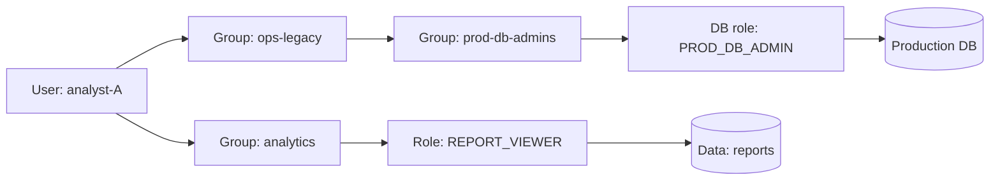
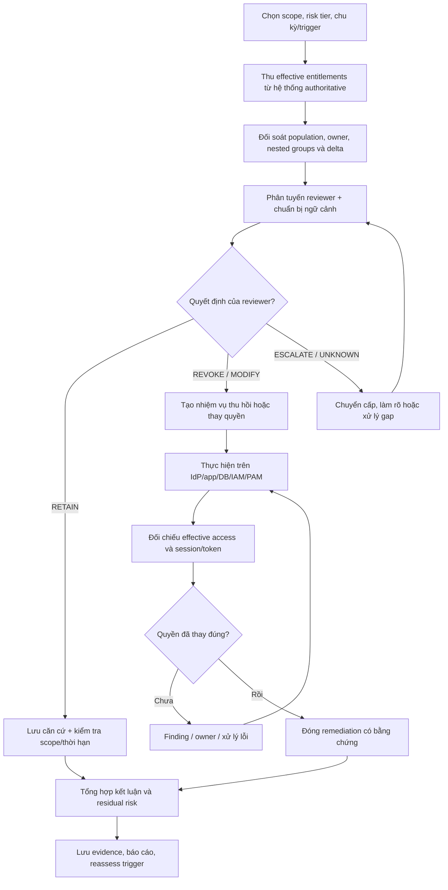
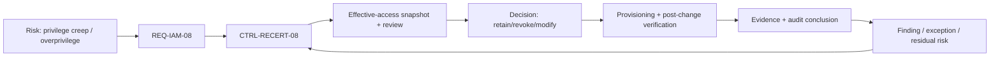

# Access recertification: tái xác nhận quyền truy cập dựa trên bằng chứng

Một nhân viên chuyển từ nhóm vận hành sang nhóm phân tích dữ liệu. Quyền quản trị cơ sở dữ liệu production lẽ ra không còn cần thiết, nhưng tài khoản của người đó vẫn được hưởng quyền `PROD_DB_ADMIN` qua một nhóm lồng nhau trong hệ thống quản lý danh tính. Vào cuối quý, bảng điều khiển báo **“100% access reviews completed”**. Khi kiểm tra, auditor phát hiện người quản lý đã nhấn “Approve all”, còn quyền cũ vẫn thực sự truy cập được database.

Tình huống nêu bật một điểm dễ nhầm: **đã có quyết định rà soát** không đồng nghĩa **quyền đã phù hợp**, và **đã yêu cầu thu hồi** không đồng nghĩa **quyền đã mất hiệu lực**. Chương trình kiểm soát truy cập cần xác định đầy đủ các quyền đang tồn tại, đưa chúng tới đúng người có thẩm quyền xem xét, ghi quyết định có căn cứ, thực hiện thay đổi và xác minh trạng thái cuối.

Hoạt động đó gọi là **access recertification** — thường được dịch là **tái xác nhận/tái chứng nhận quyền truy cập**. Đây là một control quản trị và vận hành quan trọng trong chương **Kiểm soát truy cập** của module `SECURITY_SECURITY_ASSURANCE`. Chủ đề gắn trực tiếp với mục tiêu xây dựng security assurance có bằng chứng, từ phân tích rủi ro, yêu cầu bảo mật và security controls tới kiểm thử, audit, khắc phục và cải tiến liên tục.

> **Nguyên tắc then chốt:** Đơn vị cần chứng minh không chỉ là **một người đã bấm duyệt**, mà là **một quyền cụ thể trên một tài nguyên cụ thể, tại một thời điểm cụ thể**, đã được người phù hợp quyết định và — nếu phải bỏ — **được xác minh đã thu hồi trên hệ thống thực tế**.

## 1. Access recertification là gì?

**Access recertification** là quy trình **định kỳ hoặc được kích hoạt bởi thay đổi/rủi ro** nhằm xác nhận lại những quyền truy cập hiện có của người dùng và các danh tính phi con người (workload/service accounts). Người có thẩm quyền xem xét xem quyền còn phù hợp với công việc, tài sản, mức rủi ro và chính sách hiện hành hay không; tổ chức ghi quyết định, thực hiện điều chỉnh/thu hồi và lưu bằng chứng.

Một chu trình hoàn chỉnh thường có:

1. **Xác định population:** những chủ thể, quyền và hệ thống nào nằm trong phạm vi.
2. **Thu thập effective access:** người/chủ thể thực sự có thể làm gì, bao gồm quyền trực tiếp và kế thừa.
3. **Gắn ngữ cảnh và chủ sở hữu:** lý do cấp, chức danh, nhóm, lịch sử sử dụng, mức nhạy cảm và owner tài nguyên.
4. **Review và attest:** người đủ thẩm quyền chọn giữ, thu hồi, sửa phạm vi hoặc chuyển cấp đánh giá.
5. **Provisioning/remediation:** IAM, ứng dụng hoặc đội vận hành thực hiện thay đổi.
6. **Verify:** kiểm tra quyền thực tế sau thay đổi, kể cả các đường truy cập không do IdP chính kiểm soát.
7. **Close và cải tiến:** lưu trail, xử lý ngoại lệ, finding, residual risk và trigger tái đánh giá.

Quy trình này giúp giảm **quyền dư thừa tích lũy theo thời gian (privilege creep)**, phát hiện tài khoản không rõ chủ, quyền xung đột nhiệm vụ và quyền còn tồn tại sau khi đổi vai trò hoặc kết thúc hợp đồng. Nó cũng cung cấp bằng chứng cho quản trị và kiểm toán.

### Access recertification khác gì access review?

Trong nhiều tổ chức, *access review*, *access certification*, *entitlement review* và *access recertification* được dùng gần nghĩa nhau. Khi xây quy trình, nên **định nghĩa thuật ngữ nội bộ** thay vì dựa tuyệt đối vào cách đặt tên công cụ.

| Thuật ngữ | Điểm nhấn | Ví dụ |
|---|---|---|
| **Access review** | Xem xét quyền, phát hiện quyền sai hoặc không còn cần | Manager kiểm tra quyền nhân viên trong nhóm |
| **Access recertification / certification** | Tái xác nhận một tập quyền theo tiêu chí, người có thẩm quyền và kỳ đánh giá | Quarterly privileged access campaign có quyết định chính thức và evidence |
| **Initial access approval** | Phê duyệt khi **cấp mới** quyền | Owner duyệt yêu cầu `ORDER_EXPORT` trước khi cấp |
| **Joiner–Mover–Leaver (JML)** | Cấp/đổi/thu hồi khi người dùng gia nhập, chuyển vai trò hoặc rời tổ chức | Thu hồi `PROD_DB_ADMIN` khi nhân viên đổi nhóm |
| **Continuous access evaluation** | Phản ứng theo sự kiện hoặc tín hiệu rủi ro gần thời gian thực | Vô hiệu hóa phiên/quyền khi tài khoản bị đánh dấu rủi ro |
| **Access testing** | Kiểm tra kiểm soát thực thi quyền có chặn truy cập trái phép | API cross-tenant negative test |

**Recertification không thay JML.** Không thể để quyền của nhân viên nghỉ việc chờ đến đợt review cuối năm; JML phải kích hoạt thu hồi theo thời hạn của chính sách. Ngược lại, JML hoạt động đúng vẫn không bảo đảm mọi quyền kế thừa hoặc quyền được cấp thủ công đều còn hợp lý; recertification giúp phát hiện những sai lệch đó.

## 2. Tại sao cần recertification trong security assurance?

Quyền truy cập có xu hướng thay đổi nhanh hơn bản mô tả công việc. Một danh tính có thể nhận quyền qua group, project, role ứng dụng, tài khoản cloud, database hoặc chia sẻ file; một số quyền không hết hạn theo hợp đồng nhân sự.

Các rủi ro điển hình:

- **Privilege creep:** quyền cũ không được gỡ khi người dùng chuyển công việc.
- **Orphaned account:** tài khoản không còn owner hoặc không còn liên kết với nhân sự/ứng dụng hợp lệ.
- **Toxic combination / SoD conflict:** cùng chủ thể có thể tạo và tự phê duyệt giao dịch nhạy cảm.
- **Overprivileged workload:** service account, CI runner hoặc token có quyền vượt nhu cầu.
- **Cross-tenant access:** role hoặc ACL vô tình mở dữ liệu ngoài phạm vi tenant.
- **Stale temporary access:** quyền cấp khẩn cấp/tạm thời vẫn tồn tại sau ngày hết hạn.
- **Unreviewed inherited access:** group membership lồng nhau hoặc quyền trực tiếp tại ứng dụng không xuất hiện trong báo cáo từ IdP.
- **Third-party access drift:** nhà thầu/đối tác hết hợp đồng nhưng credential và quyền vẫn hiệu lực.

### Từ rủi ro tới một control có thể kiểm chứng

| Thành phần | Ví dụ |
|---|---|
| **Risk ID** | `RISK-IAM-08`: chủ thể giữ quyền production không còn cần thiết |
| **Mục tiêu bảo mật** | Confidentiality, integrity, least privilege và accountability |
| **Security requirement** | `REQ-IAM-08`: quyền nhạy cảm phải có owner, lý do còn hiệu lực và được xác nhận lại theo chính sách |
| **Control** | `CTRL-RECERT-08`: campaign recertification có đối soát entitlement thực |
| **Tác dụng dự kiến** | Phát hiện và loại bỏ quyền dư, giảm thời gian phơi lộ khi quyền không còn cần |
| **Evidence** | Snapshot quyền, reviewer authority, quyết định, revoke ticket, hậu kiểm effective access |
| **Residual risk** | Quyền chưa được inventory, reviewer thiếu ngữ cảnh, grant phát sinh sau snapshot hoặc session cũ còn hiệu lực |

Recertification thường là **detective control** vì phát hiện quyền không phù hợp đã tồn tại; phần **thu hồi, giới hạn hoặc điều chỉnh quyền** có tác dụng corrective và hỗ trợ preventive đối với hành động sau đó. Không nên gọi recertification là một control tự động ngăn mọi lần truy cập trái phép. Authentication, authorization theo đối tượng, least privilege khi cấp ban đầu, monitoring và JML vẫn cần hoạt động độc lập.

## 3. Đơn vị đánh giá là quyền *thực sự có hiệu lực*

Một lần review chỉ có giá trị nếu danh sách đầu vào phản ánh đủ **ai có quyền gì** trên **tài nguyên nào**, thông qua **đường cấp quyền nào** tại **thời điểm nào**.

### 3.1. Các lớp quyền có thể cùng tồn tại

| Lớp quyền | Ví dụ | Tại sao dễ bị bỏ sót? |
|---|---|---|
| **Directory/IdP groups** | `ops-admins`, `finance-readers` | Group lồng nhau, role mapping phụ thuộc ứng dụng |
| **Application-native roles** | `SUPPORT_ADMIN` cấp trực tiếp trên SaaS | Không đồng bộ về IdP chính |
| **Database privileges** | `SELECT`, `UPDATE`, `DBA`, quyền schema | Tài khoản local/role kế thừa |
| **Cloud IAM** | Role có wildcard hoặc trust policy cho workload | Chính sách quyền, trust relationship và effective permission phức tạp |
| **Resource ACL / sharing** | File, bucket, project, report được chia sẻ cho user/group | Chủ tài nguyên chia sẻ ngoài workflow chuẩn |
| **Tenant-/object-level rights** | Được xem dữ liệu của tenant A nhưng không phải B | Vai trò chung không diễn tả hết scope dữ liệu |
| **Privileged access** | PAM, JIT elevation, break-glass | Quyền tạm nhưng session/token có thể kéo dài |
| **Machine identity** | Service account, API key, workload identity, CI runner | Không có “line manager” giống tài khoản nhân viên |
| **Delegation / impersonation** | Quyền hỗ trợ thay mặt hoặc cấp quyền thay mặt | Chủ thể thực và phạm vi ủy quyền dễ lẫn |
| **Đường truy cập phụ** | Queue consumer, batch, direct backend, export storage | Không đi qua gateway hoặc UI thông thường |

**Direct grant** là quyền được cấp trực tiếp cho một chủ thể; **inherited grant** là quyền đi qua nhóm/role/quan hệ kế thừa. Khi thu hồi, phải biết **nguồn cấp quyền**: xóa một quyền trực tiếp sẽ không có tác dụng nếu chủ thể vẫn nhận cùng quyền qua group khác.

### 3.2. Entitlement, role và effective permission

- **Identity:** người/workload đã được định danh theo nguồn có thẩm quyền.
- **Entitlement:** quyền hoặc quyền lợi truy cập cụ thể, ví dụ đọc bảng dữ liệu, quản trị máy chủ hoặc xuất báo cáo.
- **Role:** tập quyền có ý nghĩa theo công việc/chức năng; role name không tự mô tả mọi quyền hiệu lực.
- **Effective access:** các hành động mà chủ thể thật sự có thể thực hiện sau khi tính grant trực tiếp, nhóm, role kế thừa, policy, điều kiện, thời gian, deny rule và cơ chế ủy quyền.
- **Access path:** chuỗi các bước tạo ra quyền, ví dụ `user → group-A → group-B → DB_ROLE_ADMIN`.

**Snapshot có tên role nhưng thiếu effective permissions** có thể làm reviewer xác nhận một nhãn không hiểu rõ. Nếu một role mang tên `READ_ONLY` vẫn cho phép cập nhật IAM policy, tên vai trò là nguồn dữ liệu sai để ra quyết định.

### 3.3. Ví dụ quyền kế thừa



Người dùng đã chuyển sang nhóm phân tích nhưng còn `ops-legacy`; nếu campaign chỉ lấy nhóm `analytics`, quyền `PROD_DB_ADMIN` không xuất hiện để review. Nếu reviewer yêu cầu xóa `PROD_DB_ADMIN` ở application role nhưng không gỡ membership `ops-legacy`, **quyền có thể vẫn hiệu lực**.

Vì thế, một review nên lưu cả **effective entitlement** lẫn **đường cấp quyền có thể thu hồi**. Không nhất thiết mọi công cụ đều tính effective access hoàn hảo; phạm vi không thể xác định phải được ghi là **data gap** và có kế hoạch xử lý.

## 4. Xây population đúng trước khi mở campaign

**Population** là tập toàn bộ chủ thể–quyền thuộc phạm vi cần được đánh giá trong một kỳ. Chọn sai population sẽ tạo ra tỷ lệ 100% hoàn thành nhưng bỏ sót các tài khoản quan trọng nhất.

Một hàng dữ liệu tối thiểu có thể biểu diễn:

```text
AccessGrant = subject ID
            + resource / action
            + scope (tenant, project, environment)
            + granting path
            + owner
            + snapshot time
            + trạng thái hiệu lực
```

### 4.1. Xác định in-scope và out-of-scope

Ví dụ một campaign cho quyền production:

| Nội dung | Quyết định minh họa |
|---|---|
| **Phạm vi hệ thống** | Database production, cloud IAM, CI/CD deploy, PAM và các role ứng dụng nhạy cảm |
| **Phạm vi danh tính** | Nhân viên, nhà thầu, tài khoản quản trị, tài khoản ứng dụng/service, quyền vendor |
| **Phạm vi quyền** | Quản trị, xuất dữ liệu nhạy cảm, tạo/duyệt giao dịch, đọc PII diện rộng |
| **Khoảng thời gian** | Snapshot tại một thời điểm; các thay đổi sau snapshot cần cơ chế hòa giải |
| **Nguồn dữ liệu** | HR/vendor lifecycle, IdP, IAM, database, SaaS, PAM, secret/workload inventory |
| **Loại trừ** | Chỉ được loại trừ có lý do, người phê duyệt và phạm vi rõ, ví dụ hệ thống thử nghiệm tách biệt |
| **Owner population** | Control owner và người chịu trách nhiệm kết nối các hệ thống |

Không nên loại một nhóm tài khoản khỏi review chỉ vì không có người quản lý trực tiếp. Với non-human identities, cần **technical owner, application owner hoặc data/system owner** phù hợp.

### 4.2. Đối soát độ đầy đủ (completeness)

Để chứng minh population đáng tin, có thể:

1. So sánh **inventory ứng dụng/tài sản** với danh sách hệ thống đã xuất quyền; tìm hệ thống chưa kết nối.
2. So sánh danh sách nhân viên/nhà thầu hiệu lực với danh tính còn quyền.
3. Đối chiếu **IdP groups** với quyền được cấp cục bộ tại ứng dụng/database/cloud.
4. Phân giải nhóm lồng nhau và tìm những grant qua nhiều đường.
5. So sánh account inventory với PAM, service identity, CI runner và các tài khoản khẩn cấp.
6. Xác định record trùng, tài khoản thiếu owner, dữ liệu role không có mô tả, `tenantId` mơ hồ.
7. Ghi **thời điểm snapshot, connector version, source scope, số lượng bản ghi và các lỗi thu thập**.

Một snapshot không đầy đủ không nhất thiết khiến mọi kết quả review vô giá trị, nhưng **phải giới hạn kết luận** và xử lý phần thiếu. “100% of records returned by tool” không tương đương “100% effective access across all systems”.

### 4.3. Quyền thay đổi trong thời gian campaign

Giữa thời điểm snapshot và lúc review xong có thể phát sinh cấp/thu hồi hoặc điều chuyển nhân sự. Nếu không quản lý, quyết định có thể dựa trên dữ liệu cũ.

Cần quy định:

- Snapshot time và reference version cho mỗi đợt.
- Cách nhận/đối soát **delta grants** sau snapshot.
- Cách xử lý quyền đã bị xóa trước khi reviewer quyết định.
- Chính sách cho việc reviewer giữ quyền nhưng sau đó subject đổi role/nghỉ việc.
- Cách kiểm tra lại trạng thái cuối với nguồn authoritative.
- Khi nào cần mở **mini-review** hoặc đánh dấu kết quả cũ không còn đại diện.

## 5. Phân loại quyền và lựa chọn tần suất theo rủi ro

Không có một chu kỳ recertification duy nhất bắt buộc cho mọi tổ chức. Tần suất được quyết định theo **mức nhạy cảm tài sản, tác động tiềm tàng, tính biến động quyền, nghĩa vụ và khả năng phát hiện sai lệch**.

| Nhóm ví dụ | Đặc điểm | Cách tổ chức có thể lựa chọn |
|---|---|---|
| **Privileged production access** | Có thể đổi IAM, sửa dữ liệu diện rộng hoặc deploy | Review ưu tiên hơn, có thể theo quý và khi có thay đổi lớn |
| **Dữ liệu cá nhân/khách hàng nhạy cảm** | Có nguy cơ lộ diện rộng hoặc truy cập trái mục đích | Review theo kỳ do data owner quyết định, kiểm tra scope/tenant |
| **Quyền tạo/duyệt giao dịch** | Rủi ro gian lận, xung đột nhiệm vụ | Review kèm SoD, phân tích quan hệ role thực tế |
| **Tài khoản service/CI** | Có thể tồn tại lâu và truy cập secret/production | Review theo owner ứng dụng, inventory và biến động workload |
| **Quyền tạm thời/JIT** | Nhu cầu ngắn hạn, cấp theo sự kiện | Automatic expiry, đối soát quyền sau phiên, hậu kiểm khi rủi ro cao |
| **Quyền thông thường rủi ro thấp** | Phạm vi hẹp, ít tác động | Chu kỳ dài hơn nếu chính sách/đánh giá rủi ro cho phép |

Các mốc như **hàng quý, nửa năm hoặc hàng năm** chỉ là ví dụ về thiết kế chương trình, **không mặc nhiên là tiêu chuẩn phổ quát**. Với quyền có thể gây rủi ro tức thời, review định kỳ không thay control chặn request hoặc revoke ngay khi phát hiện sự kiện bất thường.

### Risk factors giúp ưu tiên

- **Privilege level:** quyền admin, cấp quyền cho người khác, sửa policy hoặc truy cập secrets.
- **Data classification:** mức nhạy cảm và quy mô dữ liệu có thể truy cập.
- **Access breadth:** nhiều tenant, nhiều hệ thống, wildcard, `*`/all-resources.
- **Access origin:** quyền được cấp thủ công, qua nhóm lồng nhau, cấp khẩn cấp hoặc từ đối tác.
- **Staleness:** thời gian không sử dụng, đã quá hạn hoặc không khớp với công việc hiện tại.
- **Account lifecycle:** user chuyển vai trò, hợp đồng sắp hết, tài khoản orphan hoặc inactive.
- **Threat signals:** incident, suspicious login, credential leak, audit finding.
- **Segregation of duties:** khả năng tạo và tự duyệt cùng giao dịch.

**“Không dùng trong 90 ngày” không tự động là bằng chứng quyền sai.** Một quyền DR/break-glass có thể hiếm sử dụng nhưng vẫn cần cho sự cố. Cần owner xác nhận mục đích, phương án quản trị và kiểm soát bù đắp; không ra quyết định chỉ từ `lastLogin`.

## 6. Người review có thẩm quyền và đủ thông tin

Một campaign có thể thất bại ngay cả khi population chính xác, nếu quyền được đưa tới người **không hiểu tài nguyên** hoặc có **xung đột lợi ích**.

### 6.1. Ai nên review quyền nào?

| Quyền | Reviewer phù hợp theo bối cảnh | Lưu ý |
|---|---|---|
| Quyền nghiệp vụ của nhân viên | Manager nắm nhiệm vụ hiện tại, phối hợp app/data owner | Manager có thể không hiểu hết quyền kỹ thuật |
| Quyền dữ liệu nhạy cảm | Data owner hoặc người được ủy quyền | Cần xác nhận mục đích, mức dữ liệu và tenant |
| Quyền quản trị production | System/Platform owner và tuyến phê duyệt độc lập nếu cần | Không để người được review tự xác nhận quyền quan trọng của mình |
| Quyền service account | Application/workload owner và Platform/Security | Cần bằng chứng workload sử dụng và permission scope |
| Quyền vendor/đối tác | Contract owner + system/data owner | Đối chiếu hợp đồng, hạn truy cập và người chịu trách nhiệm |
| Break-glass | Control owner và người hậu kiểm có thẩm quyền | Kiểm tra ai sử dụng, khi nào, vì sao và đã xử lý hậu sử dụng |

Reviewer cần có **authority** để giữ/thu hồi quyền trong phạm vi hoặc phải biết chuyển cho người quyết định phù hợp. Một manager không có quyền đánh giá admin cloud nên được **escalate**, không tùy tiện nhấn `Approve`.

### 6.2. Những thông tin reviewer cần thấy

Một màn hình recertification nên cung cấp:

- Subject ID và loại identity; bộ phận, vị trí, trạng thái công việc hoặc owner workload.
- Resource, action, environment, tenant/project và mức nhạy cảm.
- Effective permission và granting path (direct, group, nested, role, ACL).
- Lý do cấp quyền, ticket/approval trước đó và thời hạn nếu có.
- Thời điểm sử dụng gần nhất **có giải thích nguồn/giới hạn**.
- Các quyền xung đột nhiệm vụ (SoD) hoặc đặc quyền nhạy cảm.
- Lịch sử review, ngoại lệ và findings liên quan.
- Hành động reviewer có thể chọn và hậu quả của từng lựa chọn.

**Role `ADMIN` mà không có giải thích tài nguyên/quyền hiệu lực** là thông tin quá yếu để yêu cầu reviewer cam kết một quyết định có ý nghĩa.

### 6.3. Ngăn rubber-stamp và self-attestation

Các cách tăng chất lượng:

1. Chọn reviewer theo owner của tài sản và mức rủi ro, không chỉ theo sơ đồ nhân sự.
2. Hạn chế hoặc kiểm soát đặc biệt việc **self-approval**.
3. Tránh `Approve all` không kèm ngữ cảnh cho quyền có rủi ro cao; khi dùng bulk review phải có kiểm soát và rationale rõ.
4. Yêu cầu lý do giữ quyền đặc biệt hoặc quyền không sử dụng bất thường.
5. Phân tách reviewer, người thực thi revoke và người xác minh khi chính sách yêu cầu.
6. Kiểm tra hành vi campaign như thời gian review bất thường ngắn, tỷ lệ giữ 100% liên tục hoặc reviewer nhận lượng quyền vượt khả năng.
7. Cung cấp hướng dẫn rõ về **escalate** khi không hiểu entitlement; đừng biến thiếu hiểu biết thành `RETAIN` mặc định.

Việc reviewer ký xác nhận là **một evidence item**, không phải phép chứng minh rằng mọi quyền được giữ lại đều đúng. Tính hợp lệ của quyết định phụ thuộc vào **ngữ cảnh, thẩm quyền và khả năng thực thi**.

## 7. Quy trình recertification end-to-end



### Bước 1 — Thiết kế campaign

Ghi `campaign_id`, hệ thống, tài sản, phân loại rủi ro, reviewer pool, kỳ và thời hạn ra quyết định, SLA thực thi, phương án escalation, người tổng hợp và evidence cần lưu.

Khi dùng hệ thống GRC/IGA, cần kiểm tra cấu hình workflow và việc kết nối với hệ thống đích, không mặc định công cụ có thể thu hồi mọi quyền tự động.

### Bước 2 — Snapshot, reconcile và phân tuyến

Thu entitlement population từ nguồn có thẩm quyền; đối chiếu inventory/JML; giải quyền kế thừa; phân nhóm privileged/non-human/vendor; gắn owner và reviewer. Những mục không tìm được owner phải **escalate**, không ẩn khỏi mẫu số.

### Bước 3 — Review và ra quyết định

Quyết định phổ biến:

| Quyết định | Ý nghĩa | Việc tiếp theo |
|---|---|---|
| **RETAIN** | Quyền còn cần, còn phù hợp scope và chính sách | Lưu rationale, thời hạn/điều kiện nếu yêu cầu |
| **REVOKE** | Không còn cơ sở hợp lệ để duy trì quyền | Thực hiện thu hồi và kiểm chứng effective access |
| **MODIFY** | Cần quyền nhưng scope/role/quyền hiện tại quá rộng | Chuyển sang quyền tối thiểu phù hợp, kiểm chứng old/new |
| **ESCALATE** | Reviewer không đủ quyền hoặc dữ liệu chưa rõ | Chuyển người có thẩm quyền hoặc điều tra evidence |
| **EXCEPTION REQUEST** | Chưa thể sửa ngay nhưng cần quản lý rủi ro | Risk owner duyệt theo chính sách; đặt hạn và biện pháp |

`ESCALATE` **không phải** chấp thuận ngầm. `EXCEPTION` **không tự làm quyền phù hợp**. Quy trình phải nêu rõ điều gì xảy ra khi reviewer không trả lời trước hạn: escalation, khóa tạm theo mức rủi ro hoặc quyết định khác **do chính sách quy định**, tránh mặc định tất cả đều được giữ.

### Bước 4 — Thực thi thay đổi trên nguồn quyền thực

Với mỗi quyết định `REVOKE`/`MODIFY`, cần xác định:

- Hệ thống đích và **granting path** cần thay.
- Người/automation được phép thực hiện.
- Trạng thái xử lý `OPEN` / `IN_PROGRESS` / `APPLIED` / `FAILED`.
- Quyền phụ thuộc hoặc thao tác sản xuất có thể bị gián đoạn, kế hoạch fallback nếu cần.
- Các session/token/credential còn giá trị và cách vô hiệu hóa khi phù hợp.
- Timestamp và bằng chứng lệnh thực thi, không chỉ ticket `Done`.

Ví dụ một người có quyền DB qua **hai nhóm**. Xóa membership nhóm A nhưng còn nhóm B không đạt mục tiêu revoke; cần đối soát **effective access** sau mọi thay đổi.

### Bước 5 — Verify post-remediation

Đây là phần khác biệt quan trọng giữa *review completion* và *effective recertification*.

Một kiểm chứng tốt cần kiểm tra:

1. Entitlement không còn trên hệ thống authoritative.
2. Quyền kế thừa từ nhóm/role/ACL khác không tái cấp quyền tương đương.
3. Tài khoản local, service principal, API key, database role không còn truy cập ngoài phạm vi đã quyết định.
4. Session/token/credential đã cấp trước đó được xử lý theo chính sách, tránh quyền vẫn tiếp tục có hiệu lực qua phiên cũ.
5. Nếu quyền được **MODIFY**, quyền mới có phạm vi đúng và quyền cũ không còn.
6. Có bằng chứng xác nhận gắn thời điểm và tên hệ thống, đặc biệt với quyền production.
7. Nếu connector lỗi hoặc không thể xác minh, giữ trạng thái **RETEST_PENDING/NOT_VERIFIED**, không tự đóng.

Không nên thực hiện kiểm thử truy cập trái quyền trong production bằng cách gây hại hoặc vượt phạm vi được phép. Việc kiểm chứng có thể sử dụng chính sách, effective entitlement query, kiểm thử có kiểm soát, tài khoản thử nghiệm hoặc phương pháp audit phù hợp.

### Bước 6 — Tổng hợp kết luận và hành động tiếp

Campaign chỉ kết thúc một cách minh bạch khi có:

- Quyền đã được review và quyết định đúng thẩm quyền.
- Quyền đã `REVOKE`/`MODIFY` và **đã xác minh thay đổi thực tế**, hoặc còn mở cùng owner/hạn.
- Các trường hợp `ESCALATE`, missing owner, data gap, ngoại lệ được ghi cụ thể.
- Báo cáo denominator, nguồn, kỳ, tỷ lệ và giới hạn; không gộp quyết định review với hiệu lực thu hồi.
- Risk owner và control owner được thông báo về rủi ro còn lại.
- Hồ sơ evidence được lưu và bảo vệ theo chính sách.

## 8. Trường hợp đặc biệt: privileged access, SoD và break-glass

### 8.1. Privileged entitlements

Những quyền có thể cấp quyền cho người khác, thay policy, deploy production hoặc đọc dữ liệu diện rộng cần review có ngữ cảnh sâu hơn. Ngoài role, cần xem:

- Quyền cấp trực tiếp và nhóm kế thừa, đặc biệt wildcard/admin.
- Có áp dụng JIT/JEA/PAM hay quyền thường trực?
- Thời điểm dùng, mục đích, approval và session records.
- Quyền nào có thể **kết hợp** để leo thang hoặc vượt kiểm soát?
- Có tài khoản dự phòng, local admin hoặc API credential làm đường bypass?
- Quyền tồn tại sau khi người dùng thay vai trò hoặc contract hết hạn không?

Reviewer phải hiểu **quyền tác động lên tài sản nào**, không chỉ thấy chữ `Admin` rồi nhấn giữ.

### 8.2. Segregation of Duties (SoD)

Ví dụ một nhân viên có cả `PAYMENT_CREATOR` và `PAYMENT_APPROVER` trong cùng phạm vi nghiệp vụ. Hai quyền riêng lẻ có thể được cấp hợp lệ nhưng **tổ hợp** có thể vi phạm chính sách phân tách nhiệm vụ.

Recertification nên kiểm tra **role combinations**, điều kiện transaction-level và các đường ủy quyền. Một workflow bắt hai chữ ký UI vẫn có thể bị bypass qua API nếu backend không thực thi. Khi phát hiện SoD conflict, cần quyết định loại quyền, sửa quy trình hoặc kiểm soát bù đắp được phê duyệt; giữ nguyên cả hai role mà không ghi rõ rủi ro sẽ không giải quyết yêu cầu.

### 8.3. Break-glass và emergency access

Quyền khẩn cấp có thể không sử dụng trong thời gian dài nhưng vẫn cần khi IdP chính lỗi. Recertification phải xác định:

- Ai là owner và ai có thể kích hoạt?
- Điều kiện nào được phép dùng, xác thực, custody và storage credential ra sao?
- Mọi lần dùng có audit, cảnh báo và hậu kiểm không?
- Quyền và credential có được thu hồi/rotation sau sử dụng theo chính sách không?
- Quyền có quá rộng hơn nhu cầu khôi phục không?

Không dùng tiêu chí “không sử dụng nên xóa” một cách máy móc. Nhưng quyền khẩn cấp không phải lý do để **miễn hoàn toàn khỏi review**.

## 9. Tài khoản phi con người và quyền bên thứ ba

Access recertification không được giới hạn ở tập user từ HR. Nhiều sự cố bắt nguồn từ **service accounts, API tokens, cloud roles, CI/CD identities hoặc quyền của nhà cung cấp**.

### 9.1. Service accounts và workload identities

Với một workload, reviewer thường là **application owner/technical owner**; cần xem:

| Thuộc tính | Câu hỏi recertification |
|---|---|
| **Owner** | Service còn hoạt động và có người chịu trách nhiệm? |
| **Purpose** | Tài khoản dùng để thực hiện công việc gì? |
| **Permission scope** | Quyền có giới hạn resource/action/tenant/environment? |
| **Credential** | Dùng identity ngắn hạn hoặc secret dài hạn? Khi nào rotate/revoke? |
| **Trust relationship** | Workload nào được giả định vai trò? Có đường assume-role ngoài dự kiến không? |
| **Usage** | Có tín hiệu sử dụng gần đây không, có cần giữ quyền DR? |
| **Lifecycle** | Khi retire service, token/role/secret có bị thu hồi không? |
| **Deployment path** | CI runner hoặc branch kém tin cậy có thể lấy quyền production không? |

Nếu workload không còn, quyết định có thể là thu hồi identity, secret và role sau khi kiểm tra ảnh hưởng vận hành. Nếu vẫn dùng, cần **least privilege**, không phải chỉ ghi “service account: retain”.

### 9.2. Vendor và tài khoản bên thứ ba

Quyền nhà thầu/đối tác phải được đối chiếu với **hợp đồng, nhiệm vụ, owner nội bộ và ngày hiệu lực**. Rủi ro tồn tại khi vendor đổi nhân sự nhưng tài khoản local vẫn hoạt động, hoặc nhóm quyền giữ nguyên sau khi dự án kết thúc.

Quy trình nên hỗ trợ xác minh người bảo trợ nội bộ (*sponsor*), phê duyệt, thời hạn, data scope, MFA và đường disable. Nhà cung cấp không thể được coi là “ngoài phạm vi recertification” chỉ vì tổ chức không trực tiếp quản lý HR của họ.

## 10. Ví dụ xuyên suốt: campaign rà quyền production

Giả sử công ty triển khai campaign `CERT-2026-Q4-PRIV` cho:

- Quyền `PROD_DB_ADMIN` của nhân viên và nhà thầu.
- Vai trò `DATA_EXPORT_ADMIN` trên hệ thống xử lý dữ liệu khách hàng.
- Service account có quyền deploy production hoặc đọc secret.
- Quyền break-glass cần hậu kiểm.

### 10.1. Tập dữ liệu mẫu

| Grant ID | Subject | Effective access / granting path | Reviewer | Quyết định | Hành động cần có |
|---|---|---|---|---|---|
| `G-101` | `analyst-A` | `PROD_DB_ADMIN` qua `ops-legacy` | DB owner | REVOKE | Gỡ đường kế thừa, verify DB access |
| `G-102` | `operator-B` | `PROD_DB_ADMIN` theo vai trò vận hành | DB owner | RETAIN | Lưu nhu cầu, kiểm tra scope và policy |
| `G-103` | `service-export` | Đọc PII của mọi tenant | Export service owner | MODIFY | Giới hạn theo resource/tenant, verify |
| `G-104` | `vendor-C` | Quyền deploy production | Contract + Platform owner | REVOKE | Kiểm tra hợp đồng, revoke credential |
| `G-105` | `breakglass-db` | Quyền phục hồi khẩn cấp | PAM/DB owner | ESCALATE | Review custody, justification và post-use |
| `G-106` | `report-viewer-D` | Xem báo cáo thuộc tenant của mình | Data owner | RETAIN | Kiểm tra phân loại và tenant scope |

Đây là dữ liệu **giả định**. Reviewer cần có thể mở rộng từ tên role sang quyền hiệu lực, lý do, thời hạn và đường cấp. Với `G-103`, quyết định `MODIFY` cần xác định permission mới đủ nhu cầu nhưng không mở các tenant không liên quan.

### 10.2. Ví dụ quyền đã “revoke” nhưng vẫn tồn tại

Giả định `G-101` bị yêu cầu thu hồi. IAM team xóa role trực tiếp của `analyst-A` trong database nhưng người này vẫn thuộc nhóm `ops-legacy`, được kế thừa quyền qua `prod-db-admins`.

```text
Decision: REVOKE G-101
  |
  +--> Ticket: "Role removed"                  [status: APPLIED]
  |
  +--> Effective access via nested group? YES [verification: FAILED]
  |
  +--> Remediation: remove stale group membership
  |
  +--> Recompute effective DB permissions
  |
  +--> Existing sessions/credentials addressed per policy
  |
  +--> Retest: no production DB admin access   [verification: PASS]
```

Nếu campaign đóng ngay ở `status: APPLIED`, bằng chứng chỉ chứng minh một thao tác đã được thực hiện, **không chứng minh mục tiêu thu hồi đã đạt**. Cần lưu trạng thái `VERIFIED` riêng với bằng chứng.

### 10.3. Tính tỷ lệ minh bạch

Giả sử một campaign có **240 grant records đã xác minh thuộc phạm vi**. Có **220 grant có quyết định reviewer hợp lệ**, trong đó **34 quyết định REVOKE**, nhưng mới **27 quyền được xác minh đã thu hồi hiệu lực**.

```text
Decision completion = 220 / 240 = 91,7% (làm tròn)

Verified revoke completion = 27 / 34 = 79,4% (làm tròn)

20 grants chưa có quyết định hợp lệ;
7 quyết định revoke chưa có bằng chứng thu hồi hoàn tất.
```

Báo cáo “91,7% campaign complete” chưa nói hết bức tranh. Cần phân loại phần chưa hoàn thành theo **rủi ro, owner, hạn và trạng thái xử lý**, đặc biệt nếu bảy quyền chưa thu hồi là quyền production rủi ro cao.

Một KPI hữu ích khác là **time from revoke decision to effective revocation verification**. Tuy nhiên, không nên gộp chậm do reviewer, chậm do connector và chậm do chủ thể chưa bị thu hồi vào một số duy nhất nếu các nguyên nhân cần xử lý khác nhau.

## 11. Security assurance: Claim – Argument – Evidence

Mỗi chu kỳ recertification có thể lập thành một **assurance case** thay vì chỉ là dashboard “Completed”.

| Thành phần | Ví dụ |
|---|---|
| **Claim** | Các quyền production thuộc phạm vi campaign được tái xác nhận bởi reviewer có thẩm quyền, và các quyết định thu hồi đã được xác minh có hiệu lực |
| **Argument** | Population đã được đối soát với nguồn authoritative; reviewer thấy effective permissions; quyết định có trace; revoke được thực thi và xác nhận trên hệ thống đích |
| **Control** | `CTRL-RECERT-08`: risk-based privileged access recertification |
| **Evidence nguồn** | Snapshot IdP/IAM/DB/PAM, HR/vendor status, group inheritance, application-native entitlements |
| **Evidence quyết định** | Reviewer assignment, authority mapping, decision, rationale, timestamp, escalation |
| **Evidence thực thi** | Provisioning log, ticket, IAM/group change, DB permission diff |
| **Evidence xác minh** | Effective access comparison, test phù hợp, session/credential state, retest report |
| **Assumptions** | Inventory đầy đủ, connectors đúng scope, nguồn danh tính và metadata không bị giả mạo |
| **Limitations** | Một SaaS không có connector, chưa bao phủ local service identity, dữ liệu access log thiếu |
| **Conclusion** | Đạt/không đạt/chưa đủ bằng chứng theo kỳ và phạm vi; residual risk và finding kèm theo |

**Claim phải phản ánh phạm vi kiểm tra.** Nếu quyền database production đã được xác minh nhưng tài khoản SaaS nhạy cảm không có inventory, không thể kết luận “toàn bộ quyền truy cập của doanh nghiệp được tái chứng nhận”.

### Design, implementation và operating effectiveness

- **Design effectiveness:** phương pháp có xác định effective access, tuyến người reviewer đủ thẩm quyền và verify revoke chưa?
- **Implementation effectiveness:** campaign/workflow/connector và rule thực tế đã cấu hình đúng, có bao phủ các hệ thống thuộc phạm vi?
- **Operating effectiveness:** trong kỳ, quyền có được review theo đúng điều kiện, quyết định có hợp lệ, revoke có được thực hiện và xác minh đúng thời hạn?
- **Remediation effectiveness:** root cause khiến quyền dư xuất hiện đã được xử lý hay chỉ xóa một entitlement đơn lẻ?

Bảng quyền có ngày review hôm nay không chứng minh campaign quý trước đã hoạt động đúng. Một integration test của connector IAM không thay thế bằng chứng rằng các **quyền thực tế đã được thu hồi** theo quyết định.

## 12. Lưu hồ sơ campaign và bằng chứng bằng YAML

Cấu trúc sau là **ví dụ minh họa**, không phải schema mặc định của một sản phẩm IGA hay bản ghi audit thật:

```yaml
campaign_id: "CERT-2026-Q4-PRIV"
module: "SECURITY_SECURITY_ASSURANCE"
control_id: "CTRL-RECERT-08"
risk_ids: ["RISK-IAM-08"]
status: "IN_PROGRESS"
scope:
  environment: "production"
  resources: ["production-database", "export-service", "ci-cd"]
  subject_types: ["employee", "contractor", "workload"]
  risk_tier: "HIGH"
snapshot:
  captured_at: "<ISO-8601>"
  source_references:
    - "<idp-entitlement-export>"
    - "<db-effective-grants-snapshot>"
    - "<pam-and-service-identity-inventory>"
  reconciliation_result: "PARTIAL"
  known_missing_sources: ["<legacy-saas-connector>"]
grant_reviews:
  - grant_id: "G-101"
    subject_id: "analyst-A"
    resource: "production-database"
    permission: "PROD_DB_ADMIN"
    granting_path: ["ops-legacy", "prod-db-admins"]
    reviewer_id: "<db-owner-id>"
    reviewer_authority_ref: "<reviewer-mapping>"
    decision: "REVOKE"
    decided_at: "<ISO-8601>"
    justification: "No longer required after role change"
    remediation:
      ticket: "<ticket-id>"
      implementation_state: "APPLIED"
      verification_state: "NOT_VERIFIED"
      effective_access_check: "<pending-evidence-reference>"
exceptions:
  - "<approved-exception-or-none>"
open_findings:
  - "<unreviewed-or-unrevoked-grant-id>"
metrics:
  in_scope_grants: 240
  valid_review_decisions: 220
  revoke_decisions: 34
  verified_revocations: 27
assessment:
  conclusion: "INCONCLUSIVE"
  reason: "Incomplete population and pending revocation checks"
owners:
  control_owner: "<identity-team-owner>"
  business_risk_owner: "<authorized-risk-owner>"
  assessor: "<assigned-reviewer>"
next_review: "<date>"
triggers:
  - "Privileged role change or emergency access"
  - "Identity connector failure or new sensitive application"
```

Đặc biệt lưu **snapshot và đường cấp quyền** để đối chiếu về sau. Không đính kèm password, token, secret hoặc dữ liệu cá nhân không cần thiết vào campaign file. Các tham chiếu tới evidence gốc cần quyền truy cập phù hợp, có thời hạn lưu và phương án bảo toàn tính toàn vẹn.

Hồ sơ nên phân biệt `decision: REVOKE`, `implementation_state: APPLIED` và `verification_state: VERIFIED`. Đây là ba kết quả khác nhau. Một bản ghi `REVOKE` chưa có `VERIFIED` phải được coi là remediation còn mở hoặc chưa có chứng cứ hoàn tất.

## 13. Ví dụ Java 17: kiểm tra tính nhất quán của kết quả recertification

Trong một nền tảng Java, có thể xây guardrail phát hiện các **bất nhất metadata** giữa snapshot quyền, quyết định reviewer và trạng thái grant sau khi xử lý. Guardrail **không thay thế IdP/PAM hoặc authorization**, nhưng giúp tránh báo cáo campaign hoàn thành khi vẫn có quyền đang chờ xử lý.

Giả sử các ID của grant có tính ổn định **trong snapshot đang kiểm tra**. Hàm sau kiểm tra:

- Có quyết định cho tất cả grant thuộc phạm vi không?
- Có quyết định trùng hoặc tham chiếu tới grant ngoài snapshot không?
- Reviewer có đang tự xác nhận quyền của chính mình không?
- Quyết định `REVOKE` đã thực sự biến mất khỏi danh sách effective grant IDs chưa?
- Quyết định `RETAIN` có ghi lý do hay không?
- Quyết định `ESCALATE` có bị tính nhầm là đã hoàn thành không?

```java
import java.util.ArrayList;
import java.util.HashMap;
import java.util.HashSet;
import java.util.List;
import java.util.Map;
import java.util.Objects;
import java.util.Set;

public final class RecertificationChecker {
    private RecertificationChecker() {}

    public enum Choice { RETAIN, REVOKE, ESCALATE }

    public record Grant(
            String id, String subjectId, String resourceId) {}

    public record Decision(
            String grantId, String reviewerId,
            Choice choice, String rationale) {}

    public static List<String> validate(
            List<Grant> snapshot,
            List<Decision> decisions,
            Set<String> effectiveGrantIds) {

        Objects.requireNonNull(snapshot);
        Objects.requireNonNull(decisions);
        Objects.requireNonNull(effectiveGrantIds);

        Map<String, Grant> byId = new HashMap<>();
        List<String> issues = new ArrayList<>();
        for (Grant grant : snapshot) {
            if (byId.putIfAbsent(grant.id(), grant) != null) {
                issues.add("DUPLICATE_SNAPSHOT_GRANT: " + grant.id());
            }
        }

        Map<String, Decision> decisionsByGrant = new HashMap<>();
        for (Decision decision : decisions) {
            Grant grant = byId.get(decision.grantId());
            if (grant == null) {
                issues.add("UNKNOWN_GRANT: " + decision.grantId());
                continue;
            }
            if (decisionsByGrant.putIfAbsent(
                    decision.grantId(), decision) != null) {
                issues.add("DUPLICATE_DECISION: " + decision.grantId());
            }

            if (Objects.equals(
                    grant.subjectId(), decision.reviewerId())) {
                issues.add("SELF_REVIEW: " + grant.id());
            }

            if (decision.choice() == Choice.ESCALATE) {
                issues.add("UNRESOLVED_ESCALATION: " + grant.id());
            } else if (decision.choice() == Choice.RETAIN) {
                if (decision.rationale() == null
                        || decision.rationale().isBlank()) {
                    issues.add("RETAIN_WITHOUT_REASON: " + grant.id());
                }
            } else if (decision.choice() == Choice.REVOKE) {
                if (effectiveGrantIds.contains(grant.id())) {
                    issues.add("REVOKE_NOT_EFFECTIVE: " + grant.id());
                }
            } else {
                issues.add("MISSING_CHOICE: " + grant.id());
            }
        }

        for (Grant grant : snapshot) {
            if (!decisionsByGrant.containsKey(grant.id())) {
                issues.add("UNREVIEWED_GRANT: " + grant.id());
            }
        }
        return issues;
    }
}
```

Đoạn mã có giả định rõ: `snapshot` là danh sách đầu vào đã được thu thập; `effectiveGrantIds` là kết quả đối soát sau thực thi; đối tượng đầu vào không chứa null record và grant IDs có nghĩa ổn định. Cần kiểm tra thêm điều kiện dữ liệu/định dạng trong hệ thống thực. **Khi duplicate decision xuất hiện, chương trình phát hiện nhưng vẫn đánh giá từng bản ghi để liệt kê vấn đề; phải xử lý trùng trước khi đưa ra báo cáo cuối.**

### JUnit 5: chứng minh guardrail bắt lỗi kỹ thuật của campaign

```java
import static org.junit.jupiter.api.Assertions.assertTrue;
import java.util.List;
import java.util.Set;
import org.junit.jupiter.api.Test;

class RecertificationCheckerTest {
    @Test
    void acceptsReviewedRetainAndVerifiedRevocation() {
        var grants = List.of(
                new RecertificationChecker.Grant(
                        "G-101", "analyst-A", "production-db"),
                new RecertificationChecker.Grant(
                        "G-102", "operator-B", "production-db"));

        var decisions = List.of(
                new RecertificationChecker.Decision(
                        "G-101", "db-owner", 
                        RecertificationChecker.Choice.REVOKE,
                        "Role changed"),
                new RecertificationChecker.Decision(
                        "G-102", "db-owner",
                        RecertificationChecker.Choice.RETAIN,
                        "Required for active on-call operations"));

        var effective = Set.of("G-102"); // G-101 không còn hiệu lực.

        assertTrue(RecertificationChecker.validate(
                grants, decisions, effective).isEmpty());
    }

    @Test
    void findsUnreviewedAndRevocationNotEffective() {
        var grants = List.of(
                new RecertificationChecker.Grant(
                        "G-101", "analyst-A", "production-db"),
                new RecertificationChecker.Grant(
                        "G-103", "service-export", "customer-data"));

        var decisions = List.of(
                new RecertificationChecker.Decision(
                        "G-101", "db-owner",
                        RecertificationChecker.Choice.REVOKE,
                        "No longer needed"));

        var effective = Set.of("G-101", "G-103");

        var issues = RecertificationChecker.validate(
                grants, decisions, effective);

        assertTrue(issues.contains("REVOKE_NOT_EFFECTIVE: G-101"));
        assertTrue(issues.contains("UNREVIEWED_GRANT: G-103"));
    }

    @Test
    void detectsSelfReviewAndMissingJustification() {
        var grants = List.of(
                new RecertificationChecker.Grant(
                        "G-201", "operator-A", "production-db"));
        var decisions = List.of(
                new RecertificationChecker.Decision(
                        "G-201", "operator-A",
                        RecertificationChecker.Choice.RETAIN, ""));

        var issues = RecertificationChecker.validate(
                grants, decisions, Set.of("G-201"));

        assertTrue(issues.contains("SELF_REVIEW: G-201"));
        assertTrue(issues.contains("RETAIN_WITHOUT_REASON: G-201"));
    }
}
```

**Giới hạn rất quan trọng:** `effectiveGrantIds` có chứa đúng ID không vẫn là **thông tin do nguồn khác cung cấp**; mã không tự chứng minh quyền đã bị thu hồi trong database, cloud, queue hoặc phiên truy cập thực. ID có thể biến mất nhưng quyền tương đương vẫn được tái cấp qua **granting path khác**. Để kết luận security assurance, cần so sánh **effective permissions thực**, reviewer authority, phạm vi và runtime evidence, không chỉ ID. Đoạn code là minh họa quản trị chất lượng dữ liệu, **không phải một access recertification engine production-ready**.

## 14. Kiểm tra recertification theo quan điểm auditor

Một cuộc đánh giá assurance nên phân biệt:

| Mức | Câu hỏi | Bằng chứng tiêu biểu |
|---|---|---|
| **Thiết kế control** | Quy trình có bao phủ quyền trọng yếu, reviewer authority, revoke và verify không? | Policy, workflow design, risk-tier matrix, control specification |
| **Triển khai** | Các connector và cấu hình campaign có thực sự thu/đẩy dữ liệu và thực thi theo thiết kế? | IdP/IGA config, IAM integration, mẫu test và source mapping |
| **Vận hành trong kỳ** | Các quyền thuộc population đã được review và xử lý nhất quán trong kỳ? | Snapshot, decisions, timestamps, approval trail, revoke records |
| **Hiệu lực khắc phục** | Quyền bị từ chối có thật sự mất, không còn đường kế thừa và có theo dõi lỗi tái phát? | Effective permissions diff, kiểm tra có kiểm soát, retest và root-cause actions |

### 14.1. Kiểm tra completeness trước khi sampling

Nếu campaign có 240 grant được xuất, auditor không thể biết đó là **toàn population** cho đến khi đối chiếu với inventory và hệ thống nguồn. Một số quyền admin local hoặc group lồng nhau không hiện ra có thể làm mẫu đánh giá thiếu đáng kể.

Cần ghi **population extraction method**, snapshot timestamp, nguồn đã kiểm, đối chiếu số lượng và ngoại lệ dữ liệu. Khi lấy mẫu, không tự suy ra tỷ lệ sai toàn population từ một mẫu phi thống kê.

### 14.2. Kiểm tra quyết định review

Mẫu kiểm tra cần xét:

- Reviewer có đúng thẩm quyền, khác người được review khi policy yêu cầu?
- Người đó có đủ ngữ cảnh hiệu lực của permission và asset?
- Quyết định còn hiệu lực tại thời điểm review và phù hợp role/contract?
- Có `RETAIN` bất thường, bulk approval hoặc thiếu lý do?
- Quyền xung đột SoD đã được xử lý hay có ngoại lệ hợp lệ?
- `ESCALATE` và no response có bị tính nhầm là hoàn thành không?

### 14.3. Kiểm tra remediation riêng

Chọn các quyết định `REVOKE`/`MODIFY`, truy từ decision → provisioning → effective access after change. Nếu `REVOKE` chưa có evidence rằng quyền hết hiệu lực, ghi **pending verification** hoặc finding theo tiêu chí, không mặc định pass.

Một screenshot của ticket trạng thái `Closed` chỉ chứng minh xử lý hành chính, **không đủ** nếu quyền còn tồn tại qua nhóm khác hoặc credential cũ.

### 14.4. Rà ngoại lệ và báo cáo giới hạn

Một ngoại lệ chưa thể thu hồi quyền vì hệ thống legacy phải có owner, lý do, phạm vi, rủi ro, biện pháp bù đắp, người chấp thuận có thẩm quyền, thời hạn và kỳ xem lại. **Ngoại lệ được duyệt không có nghĩa quyền ấy đã được chứng minh phù hợp.**

Kết luận audit nên ghi rõ: **phạm vi, thời kỳ, population, phương pháp lấy mẫu, các sai lệch, giới hạn và residual risk**. Nếu chỉ review privileged accounts thì không được tuyên bố tất cả quyền người dùng thường của toàn tổ chức cũng đã được chứng nhận.

## 15. Finding mẫu: quyền đã review nhưng chưa được thu hồi

Giả sử reviewer quyết định **REVOKE** quyền `PROD_DB_ADMIN` của `analyst-A`, nhưng sau 10 ngày quyền vẫn hiệu lực qua group lồng nhau.

| Trường finding | Minh họa |
|---|---|
| **Finding ID** | `FND-RECERT-01` |
| **Criteria** | `REQ-IAM-08`: các quyền không còn cần phải được thu hồi và xác minh theo thời hạn chính sách |
| **Condition** | Decision `REVOKE` tồn tại; quyền DB thực tế vẫn còn qua `ops-legacy → prod-db-admins` |
| **Evidence** | Campaign decision, provisioning ticket, group membership snapshot, effective DB permissions |
| **Risk** | Quyền admin tồn tại vượt nhu cầu, có thể bị lạm dụng hoặc bị lợi dụng khi danh tính bị chiếm |
| **Root cause cần xác minh** | Revoke workflow chỉ xử lý direct entitlement, không tính nested group |
| **Owner** | IAM/Identity và Database owner |
| **Remediation** | Thu hồi tất cả granting paths không hợp lệ, điều chỉnh connector/workflow và rà các quyền tương tự |
| **Verification** | So sánh effective access trước/sau, kiểm tra session/credential, test hồi quy với nested group |
| **Residual risk** | Hệ thống khác có quyền kế thừa tương tự nhưng chưa đối soát đầy đủ |

Đóng finding theo tiêu chí đã thống nhất và khi **retest xác nhận hành động khắc phục**. Việc sửa một permission đơn lẻ không nhất thiết xử lý lỗi hệ thống của connector. Phải cân nhắc **mở rộng population** để kiểm tra các trường hợp cùng root cause.

Khi có dấu hiệu quyền đã được dùng trái phép, có thể cần kích hoạt **Incident Response** theo quy trình, không chỉ chờ campaign tiếp theo.

## 16. Chỉ số quản trị: tránh “100% reviewed” gây hiểu nhầm

| Chỉ số | Cách tính / định nghĩa | Giới hạn cần nhớ |
|---|---|---|
| **Population coverage** | Quyền thuộc phạm vi được trích xuất/đối soát / tổng quyền thuộc phạm vi có thể xác định | Phụ thuộc inventory và nguồn authoritative |
| **Valid decision completion** | Grant có quyết định hợp lệ / tổng grant in-scope | Quyết định không đồng nghĩa thu hồi đã thực hiện |
| **Revoke execution completion** | Revoke đã thực thi / tất cả quyết định revoke | `APPLIED` có thể chưa làm quyền hết hiệu lực |
| **Verified revoke completion** | Revoke đã được xác minh mất effective access / tất cả quyết định revoke | Cần kiểm tra granting paths và credential/session |
| **Overdue high-risk reviews** | Grant rủi ro cao chưa review đúng hạn | Số lượng cần đặt trong mức tác động |
| **Orphan/unknown owner count** | Quyền/account thiếu owner hợp lệ | Có thể làm reviewer assignment sai |
| **Privileged access without rationale** | Quyền đặc biệt được giữ nhưng lý do không đủ | Không tự kết luận tất cả quyền này đều trái phép |
| **SoD conflicts outstanding** | Các tổ hợp quyền bị xung đột chưa xử lý | Cần xem scope, exception và điều kiện giao dịch |
| **Remediation verification latency** | Thời gian decision → verify | Có thể cần phân nhóm theo hệ thống và mức rủi ro |
| **Repeated finding rate** | Tỷ lệ lỗi tái xuất hiện sau sửa | Cần thống nhất định nghĩa và kỳ quan sát |

**Số liệu có thể tốt nhưng chương trình vẫn thiếu:** Một campaign có 100% valid decisions nhưng **không bao phủ cloud root accounts, service identities hay local admins** chưa thể chứng minh kiểm soát toàn bộ đặc quyền.

Nên báo cáo ít nhất **ba lớp riêng**: population completeness, review decision và remediation verification, cùng các trường hợp `PENDING`, `ESCALATED`, `EXCEPTION`, `FAILED`. Có thể ưu tiên bằng mức rủi ro thay vì cố tối ưu phần trăm hoàn thành tổng thể.

## 17. Thực hiện recertification liên tục trong SDLC và vận hành

Một chương trình tốt kết hợp **review theo kỳ** với **reassessment theo sự kiện**, vì quyền có thể thay đổi ngay sau một đợt certification.

| Thay đổi/trigger | Hành động phù hợp | Bằng chứng |
|---|---|---|
| **Joiner / thay vai trò / nghỉ việc** | Thực hiện JML, đánh giá quyền mới/cũ, revoke kịp thời | HR event, IAM delta, post-change check |
| **Tạo ứng dụng/tenant mới** | Cập nhật inventory và access review scope | System onboarding, role matrix, tenant permissions |
| **Thêm service identity/CI runner** | Gán owner và phạm vi quyền; thêm vào recertification | IAM/service catalog, credential metadata |
| **Quyền admin được cấp khẩn cấp** | Đặt hạn, giám sát, hậu kiểm và xác nhận hết hiệu lực | PAM/JIT logs, access review |
| **Audit finding về nested group** | Mở rộng đánh giá các đường kế thừa và sửa workflow | Mapping, remediation, retest |
| **Đổi IdP hoặc cloud IAM** | Kiểm tra completeness và policy interpretation | Connector tests, entitlements before/after |
| **Incident lộ credential** | Thu hồi/rotation theo ứng phó sự cố; đánh giá quyền liên quan | IR evidence, session revoke, authorization review |
| **Đến hạn campaign** | Snapshot, review, thu hồi, verify và báo cáo | Campaign package, exceptions, metrics |

### Tự động hóa hợp lý

Công cụ IGA, IAM và workflow có thể hỗ trợ:

- Thu effective entitlements và owner attribution.
- Nhắc reviewer đúng hạn, escalation và SoD conflict flags.
- Tự động thu hồi quyền được reviewer đánh dấu `REVOKE`.
- Đồng bộ trạng thái thực thi và chạy đối soát quyền sau thay đổi.
- Gắn grant ID, decision, ticket, test, release và evidence với risk/control ID.
- Cảnh báo thiếu connector, quyền mới phát sinh và kết quả review không còn hiệu lực.

Tuy nhiên, **automation không tự giải quyết chất lượng quyết định**. Nếu một manager không hiểu role hoặc dữ liệu grant không đầy đủ, việc tự động hóa chỉ giúp đưa ra quyết định sai nhanh hơn. Cần kiểm soát chất lượng dữ liệu, reviewer authority và cách xử lý exception.

### Gắn với chương trình assurance



## 18. Các ngộ nhận thường gặp

| Ngộ nhận | Vì sao sai | Cách xử lý |
|---|---|---|
| “100% review hoàn thành = 100% quyền phù hợp.” | Có thể reviewer bấm đồng loạt hoặc không biết quyền thật | Cung cấp ngữ cảnh, kiểm tra mẫu và rationale |
| “Recertification thay quy trình leaver.” | Quyền nhân viên nghỉ việc không thể đợi review theo kỳ | JML revoke ngay theo yêu cầu và xác minh |
| “Export IdP là toàn bộ population.” | SaaS, DB, cloud, local account, nested role có thể không nằm trong IdP | Đối soát nguồn authoritative và inventory |
| “Tên role mô tả chính xác permission.” | Role có thể chứa quyền kế thừa hoặc wildcard | Trình bày effective permissions và granting path |
| “Quyết định REVOKE nghĩa là quyền đã bị thu hồi.” | Có thể lỗi connector, quyền cấp lại qua group khác | Đối chiếu quyền thực và session/credential |
| “Ticket Closed nghĩa là remediation đã đạt.” | Ticket không nhất thiết chứng minh permission đã mất | Retest và xác nhận `VERIFIED` riêng |
| “Quyền không dùng thì chắc chắn nên xóa.” | DR/break-glass có thể ít dùng nhưng hợp lệ | Đánh giá nhu cầu, rủi ro và owner thay vì dựa một chỉ số |
| “Service account không phải người nên miễn review.” | Workload có thể giữ đặc quyền lớn và token dài hạn | Gán technical owner và review quyền/secret |
| “Mỗi manager được tự duyệt quyền mình.” | Có xung đột lợi ích đặc biệt với đặc quyền cao | Phân tuyến reviewer có thẩm quyền, SoD và review độc lập |
| “Có ngoại lệ được duyệt là control PASS.” | Ngoại lệ là quyết định quản trị rủi ro, không làm quyền phù hợp | Giữ finding/limitation, thời hạn và bù đắp |
| “Review theo quý đủ ngăn mọi lạm quyền.” | Quyền có thể thay đổi hoặc bị lạm dụng giữa hai đợt | Kết hợp authorization, PAM, monitoring, JML và triggers |
| “Không thấy quyền dư tức không có lỗ hổng authorization.” | API có thể có BOLA dù entitlement inventory đúng | Kiểm thử quyền theo tài nguyên và tenant riêng |

## 19. Bài tập tình huống

Một doanh nghiệp triển khai access recertification cho hệ thống Java/Spring Boot và cloud IAM. Campaign quý này báo 98% quyết định review hoàn tất. Tuy nhiên:

- 2 tài khoản nhân viên đã nghỉ việc vẫn đăng nhập được một SaaS không kết nối IdP.
- Một service account có quyền `storage:*` nhưng không có owner hiện hành.
- Một người dùng còn `DB_ADMIN` qua nhóm lồng nhau dù reviewer đã chọn `REVOKE`.
- Nhóm báo cáo chỉ lưu quyết định trong dashboard, không lưu snapshot entitlement và test sau thu hồi.

**Hãy phân tích:**

1. Population của campaign có những **data gaps** nào?
2. Vấn đề nào thuộc **JML**, vấn đề nào thuộc **recertification**, và chúng liên quan nhau ra sao?
3. Tài khoản service nên được phân tuyến cho reviewer nào? Cần xác nhận điều gì?
4. Vì sao `REVOKE` của `DB_ADMIN` chưa thể được kết luận thành công?
5. Cần loại evidence nào cho design, implementation và operating effectiveness?
6. Viết một **assurance claim có giới hạn**, không dùng phần trăm hoàn tất để suy ra toàn hệ thống an toàn.
7. Đề xuất ba hành động khắc phục và cách **verify** từng hành động.

**Gợi ý tự đối chiếu:** SaaS ngoài IdP và service account thiếu owner là thiếu population/ownership; tài khoản leaver còn hoạt động là JML failure cần xử lý ngay; nhóm lồng nhau gây revoke không hiệu lực; thiếu snapshot và post-change test khiến assurance evidence yếu. Claim phù hợp phải nêu rõ **những hệ thống/loại quyền được review**, phần thiếu và trạng thái thu hồi còn mở.

## 20. Checklist triển khai access recertification

- [ ] Xác định **rủi ro, chính sách/yêu cầu, scope, risk tier và kỳ đánh giá**.
- [ ] Có `campaign_id`, owner, reviewer authority, SLA, deadline và quy trình escalation.
- [ ] Population gồm **human và non-human identities**, privileged, vendor và break-glass thuộc phạm vi.
- [ ] Có inventory của IdP, ứng dụng, database, cloud IAM, PAM, CI/CD và local accounts khi phù hợp.
- [ ] Thu và giải thích **effective permissions**, direct/inherited grants, nested groups và scope tenant/resource.
- [ ] Đối soát với HR/vendor lifecycle, asset inventory và các nguồn authoritative; ghi data gaps.
- [ ] Lưu snapshot time và cách xử lý delta grants trong thời gian campaign.
- [ ] Reviewer được chọn đúng vai trò, có đủ ngữ cảnh; hạn chế self-review và bulk approval thiếu căn cứ.
- [ ] Định nghĩa rõ `RETAIN`, `REVOKE`, `MODIFY`, `ESCALATE`, `EXCEPTION`; no response không ngầm thành approval.
- [ ] Rà rights nhạy cảm, SoD, quyền đặc biệt, service credentials, tenant scope và quyền đã lâu không dùng.
- [ ] Quyết định có timestamp, rationale, reviewer ID, nguồn và scope tương ứng.
- [ ] Mọi revoke/modify được thực thi trên **đúng granting paths**, không chỉ trên UI/ticket.
- [ ] Xác minh **effective access sau thay đổi**, session/token/credential khi cần; giữ `NOT_VERIFIED` nếu còn nghi ngờ.
- [ ] Có evidence nguồn, quyết định, provisioning, verification và bảo vệ hồ sơ nhạy cảm.
- [ ] Báo cáo riêng population coverage, decision completion và verified revoke completion.
- [ ] Findings/ngoại lệ có owner, tác động, biện pháp bù đắp, hạn và risk-owner approval phù hợp.
- [ ] Trigger tái đánh giá khi người chuyển vai trò, nghỉ việc, quyền mới, hệ thống mới, incident hoặc connector thay đổi.
- [ ] Kết luận assurance chỉ tuyên bố phần **đã được review và xác minh có bằng chứng**, không khái quát quá phạm vi.

**Ghi nhớ:** **Access recertification** không chỉ là việc yêu cầu manager nhấn “Approve” trên danh sách quyền. Nó là một **security control dựa trên risk, ownership và evidence** để chứng minh quyền truy cập còn phù hợp và quyền không phù hợp **đã được xử lý có hiệu lực**. Chuỗi **inventory → effective access → reviewer decision → provisioning → verification → audit evidence → finding/remediation → reassessment** biến một campaign định kỳ thành một phần đáng tin cậy của chương trình `SECURITY_SECURITY_ASSURANCE` liên tục.
