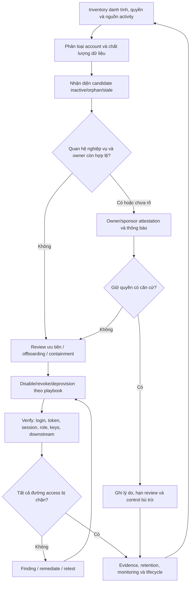
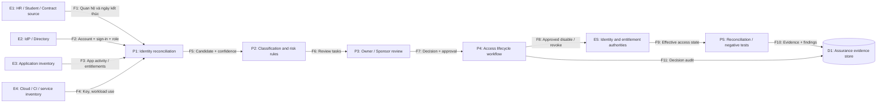

# Tài khoản không dùng: phát hiện, vô hiệu hóa và chứng minh hiệu lực kiểm soát truy cập

## 1. “Tài khoản không dùng” là gì?

**Tài khoản không dùng** (*inactive/dormant account*) là tài khoản vẫn tồn tại trong hệ thống danh tính hoặc ứng dụng, nhưng **không ghi nhận hoạt động phù hợp với loại tài khoản và mục đích được cấp** trong một khoảng thời gian theo tiêu chí đã xác định. Trên thực tế, nhóm này có thể gồm tài khoản học viên không còn học, nhân sự nghỉ việc, khách mời hết dự án, tài khoản quản trị cũ, hoặc danh tính máy không còn được workload sử dụng.

Trong chương **Kiểm soát truy cập** của module **SECURITY_SECURITY_ASSURANCE**, quản lý tài khoản không dùng là một **security control theo vòng đời danh tính**. Mục tiêu là giảm những quyền không còn nhu cầu chính đáng, hạn chế cơ hội kẻ tấn công lợi dụng thông tin đăng nhập cũ, đồng thời có **bằng chứng** rằng quy trình phát hiện, đánh giá, vô hiệu hóa/thu hồi và xác minh thực sự hoạt động.

Không thể rút gọn vấn đề thành “nếu không đăng nhập 90 ngày thì xóa tài khoản”. Một tài khoản có thể:

- Không đăng nhập tương tác nhưng vẫn **được dùng qua token, API key hoặc workload identity**.
- Chỉ dùng khi có sự cố khẩn cấp, như **break-glass account**, nên rất hiếm khi đăng nhập.
- Bị nhân sự chủ động bỏ quên nhưng vẫn nằm trong **nhóm quản trị** hoặc còn **refresh token** hợp lệ.
- Được vô hiệu hóa ở ứng dụng nhưng còn **quyền tại IdP, VPN, cloud IAM hoặc database**.
- Có dữ liệu cá nhân/bài thi phải được lưu theo nghĩa vụ, dù quyền đăng nhập cần chấm dứt.

Vì vậy **“không dùng” là một tín hiệu quản lý rủi ro, không phải kết luận có thể tự động xóa mọi tài khoản**.

### Mục tiêu học tập

Sau bài này, người học có thể:

1. Phân biệt **inactive**, **dormant**, **never used**, **orphaned**, **stale privileged**, **disabled** và **deleted accounts**.
2. Xác định dữ liệu và tiêu chí phù hợp để nhận diện tài khoản không dùng ở **IdP, ứng dụng, cloud và hệ thống máy–máy**.
3. Xây dựng policy và access-control baseline theo loại tài khoản, mức rủi ro, thời hạn và quyền của người phê duyệt.
4. Thiết kế quy trình **discover → validate → review → disable/revoke → verify → retain/delete/reactivate**.
5. Triển khai, kiểm thử và đánh giá kiểm soát bằng ví dụ Java/Spring Security, SQL và tích hợp IAM.
6. Liên kết **risk → requirement → control → assessment → evidence → finding → remediation → residual risk** để duy trì security assurance liên tục.

> **Nguyên tắc:** Việc có một danh sách “tài khoản 90 ngày không đăng nhập” chỉ là **evidence về phát hiện ứng viên**. Chưa thể kết luận access đã bị thu hồi nếu chưa có bằng chứng vô hiệu hóa, thu hồi token/khóa/phiên và kiểm thử đường truy cập liên quan.

## 2. Vì sao tài khoản không dùng tạo rủi ro?

Quyền truy cập nên tồn tại **chỉ khi có nhu cầu chính đáng và còn được phê duyệt**. Tài khoản bị bỏ quên thường ít được người dùng theo dõi: email/thiết bị có thể không còn được kiểm soát; MFA enrollment cũ; mật khẩu dùng lại hoặc đã lộ; role đặc quyền vẫn được kế thừa; các phiên hoặc token có thể tiếp tục hiệu lực. Tài khoản đó trở thành **bề mặt tấn công tiềm ẩn**.

| Kịch bản | Điều kiện tạo rủi ro | Hậu quả có thể xảy ra | Kiểm soát liên quan |
| --- | --- | --- | --- |
| **Học viên cũ vẫn có quyền** | Tài khoản đã hết quan hệ học tập nhưng chưa thu hồi quyền. | Đọc tài nguyên lớp cũ, dữ liệu cá nhân hoặc bài thi. | Account lifecycle, entitlement review, disable/deprovision. |
| **Nhân sự nghỉ việc** | IdP bị khóa muộn hoặc local admin account chưa thu hồi. | Truy cập tài liệu, thay đổi điểm/cấu hình trái quyền. | Event-driven offboarding, cross-system reconciliation. |
| **Khách mời bên ngoài** | Invite không có hạn, sponsor không review. | Quyền third party kéo dài ngoài hợp đồng. | Guest expiry, sponsor attestation, access revocation. |
| **Admin lâu không dùng** | Quyền cao vẫn hiệu lực; thông tin xác thực cũ. | Chiếm quyền quản trị, thay IAM, triển khai code. | Privileged-account review, MFA, disabling/revocation. |
| **Service account không còn workload** | Key vẫn hoạt động; quyền cloud/storage rộng. | Khai thác credential bị lộ và dịch chuyển ngang. | Workload inventory, key usage analysis, staged revocation. |
| **Tài khoản “mồ côi”** | Không còn owner/sponsor, không có người duyệt truy cập. | Quyền tồn tại không được quản trị hoặc giám sát. | Ownership reconciliation, escalation, removal. |

### Hai risk scenarios xuyên suốt

**RISK-STALE-01 – tài khoản học viên:** Một người đã tốt nghiệp hoặc rời nền tảng từ lâu vẫn có tài khoản đang hoạt động với quyền truy cập các bài nộp và tài liệu được chia sẻ. Nếu mật khẩu bị lộ, kẻ tấn công có thể đăng nhập và đọc dữ liệu không còn cần thiết cho người này.

**RISK-STALE-02 – tài khoản kỹ thuật:** Một service account của job import điểm đã ngừng chạy nhưng vẫn có cloud key có quyền ghi object storage. Nếu key còn tồn tại trong bản sao cấu hình cũ, kẻ tấn công có thể dùng key mà không cần tương tác với tài khoản người dùng.

Hai rủi ro **không** xử lý giống nhau: đánh giá tài khoản người dùng theo hoạt động đăng nhập, quan hệ nghiệp vụ và session; đánh giá service account theo dependency, token/key usage, owner, IAM privilege và tác động khi thu hồi.

## 3. Thuật ngữ cần phân biệt chính xác

| Thuật ngữ | Cách nhận diện | Điều không được suy luận |
| --- | --- | --- |
| **Inactive account** | Không ghi nhận loại hoạt động được policy định nghĩa trong thời gian nhất định. | Không mặc nhiên là đã bị xâm nhập hoặc có thể xóa ngay. |
| **Dormant account** | Tồn tại nhưng ít/không được dùng, thường được xác định qua một khoảng inactivity có ý nghĩa. | Không đồng nghĩa có quyền đặc biệt; mức rủi ro phụ thuộc scope. |
| **Never-used account** | Đã tạo/cấp quyền nhưng chưa có hoạt động được xác nhận phù hợp. | `lastLogin = null` không đủ: có thể thiếu telemetry hoặc mới khởi tạo. |
| **Orphaned account** | Không còn owner/sponsor/mối liên hệ với người hoặc workload hợp lệ. | Có thể vẫn hoạt động; không phải luôn có `lastLogin` cũ. |
| **Stale entitlement** | Quyền/role không còn nhu cầu, dù tài khoản vẫn hoạt động. | User login thường xuyên vẫn có thể giữ quyền quản trị thừa. |
| **Disabled/suspended account** | Bị chặn xác thực/ủy quyền theo cơ chế nhất định. | Không chứng minh mọi phiên, token, API key và app phụ đã bị thu hồi. |
| **Deprovisioned account** | Quyền/truy cập bị gỡ khỏi các ứng dụng hoặc hệ thống theo quy trình. | Không nhất thiết xóa dữ liệu của người dùng hay toàn bộ identity record. |
| **Deleted account** | Identity bị xóa theo quy định, có thể không khôi phục dễ dàng. | Không đồng nghĩa được phép xóa hồ sơ học tập hoặc audit logs. |
| **Disabled but still entitled** | Login bị chặn ở một nơi nhưng còn group/policy/credential ở nơi khác. | Không thể báo “fully revoked” khi chưa đối soát. |
| **Break-glass account** | Danh tính được giữ cho ứng cứu khi cơ chế bình thường không khả dụng. | Việc ít đăng nhập có thể **đúng thiết kế**, phải kiểm soát bằng phương pháp khác. |

**Cần ghi rõ ý nghĩa “hoạt động”:** lần xác thực thành công, phiên đã sử dụng, token refresh, yêu cầu API, lần chạy workload, sử dụng khóa cloud, hay lần được người quản lý xác nhận nhu cầu. Các tín hiệu này **không thay thế lẫn nhau**.

## 4. Xác định phạm vi: tài khoản nằm ở đâu?

Trong nền tảng học tập, một danh tính có thể tồn tại đồng thời ở IdP, ứng dụng Spring Boot, database, storage, CI/CD và các dịch vụ thuê ngoài. Đầu tiên hãy lập **identity inventory**:

| Nguồn | Ví dụ danh tính | Dữ liệu cần đối chiếu | Ai quản lý chính? |
| --- | --- | --- | --- |
| **IdP / directory** | Nhân sự, học viên SSO, admin, guest. | Enabled, sign-in activity, MFA, groups, credential age, owner. | IAM/Identity team. |
| **Local application accounts** | Người dùng đăng nhập trực tiếp vào Spring Boot. | Status, last successful login, role, tenant, business relationship. | Application owner. |
| **Cloud IAM** | Human federation, IAM user, workload identity, access keys. | Effective policy, key activity, account usage, trust policy. | Cloud/Platform owner. |
| **CI/CD and source control** | Bot, deploy identity, người cộng tác, service connection. | Last job/credential use, repo membership, owner, scopes. | DevSecOps/Engineering. |
| **Database and infrastructure** | DB login, bastion/VPN/OS accounts. | Active sessions, grants, source host, owner, last auth. | DBA/SRE/Infrastructure. |
| **SaaS and third party** | Guest account, vendor support, support portal. | Sponsor, contract end date, app usage, current access. | Third-party/business owner. |
| **App authorization store** | Role, class assignment, tenant membership. | Entitlement last used, class/course status, revocation. | Product/application owner. |

Một tài khoản **SSO** có thể không có mật khẩu nội bộ; ứng dụng vẫn có local profile và quyền riêng. **Vô hiệu hóa tại IdP** cần được phối hợp với **session/token, local assignments và downstream applications**, không được mặc nhiên suy ra mọi đường truy cập sẽ dừng ngay.

### Identity inventory nên lưu tối thiểu

| Thuộc tính | Mục đích |
| --- | --- |
| Stable account/identity ID; nguồn hệ thống | Tránh nhầm do username/email bị đổi hoặc tái sử dụng. |
| Account type và environment | Phân biệt human, privileged, service, break-glass, guest, test. |
| Business owner/sponsor và technical owner | Ai xác nhận nhu cầu tồn tại và ai thực thi việc thu hồi. |
| Joiner/mover/leaver hoặc contract/project state | Nhu cầu nghiệp vụ đã kết thúc chưa. |
| Created/activated/last-interactive-login timestamp | Xem vòng đời và khả năng chưa từng dùng. |
| Last non-interactive use, token/key use, workload binding | Đánh giá tài khoản máy và các đường không có login tương tác. |
| Effective roles, groups, IAM policies, active tokens | Đánh giá đặc quyền và phạm vi rủi ro. |
| Account state và last policy decision | Biết đang review, disabled, deleted hay có ngoại lệ. |
| Data source, observation window và freshness | Phân biệt “không hoạt động” với “không có dữ liệu”. |

Không đưa mật khẩu, raw access token, reset token hoặc secret đang hoạt động vào bảng inventory. Những thông tin bảo mật cần thiết được lưu dưới dạng **tham chiếu được kiểm soát quyền**.

## 5. Vì sao `lastLogin` không đủ để phát hiện tài khoản không dùng?

`lastLoginAt` là tín hiệu thuận tiện nhưng có nhiều giới hạn:

1. **Nguồn đăng nhập:** Ứng dụng local có timestamp khác IdP SSO; ứng dụng có thể không được thông báo mọi lần user xác thực ở IdP.
2. **Interactive vs non-interactive:** API token refresh, job, service principal hoặc background task có thể hoạt động mà không có login tương tác.
3. **Thời điểm ghi:** Dữ liệu replication/log pipeline có độ trễ, timestamp có thể bị ghi sai hoặc bị vô hiệu hóa khi migration.
4. **Đăng nhập thất bại:** Nhiều lần thử sai **không phải bằng chứng user đang dùng tài khoản hợp lệ**; có thể là tín hiệu tấn công.
5. **Ứng dụng được cấp quyền:** Một người đăng nhập IdP thường xuyên không có nghĩa còn cần quyền trong từng app/role cũ.
6. **Truy cập qua session còn sống:** Không có login mới nhưng session/token vẫn hoạt động; cần xác định ý nghĩa “use” theo policy.
7. **Account mới tạo:** `null` có thể nghĩa là chưa dùng vì vừa mời, không phải 90 ngày bị bỏ quên.
8. **Break-glass:** Ít sử dụng có thể là điều kiện mong muốn; không nên xử lý theo luật human account thông thường.
9. **False positives do telemetry:** Một connector hết quyền đọc hoặc API provider đổi semantics có thể khiến “last used” trống hàng loạt.
10. **Dấu hiệu bị chiếm:** “Có login gần đây” có thể là hành vi của attacker; không thể vì thế tự gia hạn mọi quyền.

### Lựa chọn “activity signals” đúng đối tượng

| Loại account | Tín hiệu ưu tiên | Tín hiệu cần bổ sung | Quyết định không được chỉ dựa vào |
| --- | --- | --- | --- |
| **Human local** | Lần đăng nhập thành công được xác minh. | Quan hệ học tập/nhân sự, session activity, quyền còn cần. | Một cột timestamp thiếu định nghĩa. |
| **Human SSO** | Dữ liệu đăng nhập từ IdP **và** app activity nếu cần. | Provisioning/SCIM status, entitlement usage. | Local `lastLogin` không cập nhật bởi SSO. |
| **Privileged admin** | Hoạt động và attestation quyền đặc biệt. | MFA, PAM/JIT eligibility, change tickets. | “Đã login hôm qua” nên còn cần admin. |
| **Service/workload** | Credential/key usage, workload executions, resource binding. | Secrets manager, pipeline, scheduled/seasonal usage. | Last interactive login. |
| **Guest/vendor** | Sponsor, hợp đồng, project end date và lần truy cập. | Vendor assurance, access review. | Chỉ đăng nhập gần đây là đủ để giữ quyền. |
| **Break-glass** | Drill, readiness check, account state, custody. | Alert on use, stored credential protection. | Quy tắc tự disable do không login. |

**Một đánh giá đáng tin phải có định nghĩa, nguồn, khoảng quan sát và giới hạn** cho từng loại dữ liệu. Ví dụ “last interactive sign-in từ IdP trong 90 ngày gần nhất, snapshot lúc 00:00 UTC, không bao gồm non-interactive sessions” là mô tả hữu ích hơn “90 days inactive”.

## 6. Risk assessment: không phải mọi tài khoản có rủi ro như nhau

Mức ưu tiên xử lý dựa trên khả năng bị lợi dụng, đặc quyền, dữ liệu có thể truy cập, bề mặt phơi lộ và tầm quan trọng nghiệp vụ.

| Yếu tố | Câu hỏi phân tích | Ý nghĩa |
| --- | --- | --- |
| **Quyền hiện có** | Tài khoản chỉ đọc khóa học hay có quyền thay điểm/IAM? | Đặc quyền cao làm tăng tác động khi bị chiếm. |
| **Exposure** | Đăng nhập qua Internet, VPN, bastion, service endpoint? | Đường xác thực và tấn công khác nhau. |
| **Authenticator** | MFA/phishing-resistant MFA, mật khẩu cũ, API key dài hạn? | Ảnh hưởng điều kiện khai thác. |
| **Business relationship** | Học viên đang học hay đã nghỉ; vendor còn hợp đồng? | Nhu cầu tồn tại có hợp lý không? |
| **Owner state** | Có sponsor, team, workload, runbook và người thay thế? | Không owner khó xác minh nhu cầu và xử lý. |
| **Data sensitivity** | Có quyền xem bài thi, PII, kết quả điểm, secrets? | Mức tác động bí mật/toàn vẹn. |
| **Session/credential lifetime** | Token/khóa/phiên còn hiệu lực bao lâu? | Disable có đủ chặn truy cập không? |
| **Monitoring coverage** | Có log và phát hiện truy cập từ account này? | Độ tin cậy của đánh giá và khả năng điều tra. |

**Ví dụ giả định:** Tài khoản admin production không dùng 45 ngày có thể cần review sớm hơn tài khoản học viên không dùng 180 ngày vì đặc quyền và hậu quả khác nhau. Nhưng một tài khoản break-glass không dùng 180 ngày lại có thể là **đúng trạng thái**, cần diễn tập và giám sát riêng.

Thang likelihood/impact phải lấy từ **risk methodology của tổ chức**; không được biến số ngày inactivity thành điểm rủi ro phổ quát.

## 7. Xây dựng chính sách và ngưỡng theo loại tài khoản

Một **inactive-account policy** nên ghi rõ những phần có thể kiểm chứng:

- **Scope:** identity sources, account types, môi trường, loại quyền và exclusions.
- **Activity definition:** tín hiệu được coi là “được sử dụng”, ưu tiên khi dữ liệu mâu thuẫn, độ trễ và chất lượng.
- **Thresholds:** khi nào bắt đầu review, thông báo, vô hiệu hóa, xóa quyền hoặc deprovision.
- **High-risk triggers:** nghỉ việc, hợp đồng kết thúc, mất sponsor, phát hiện compromise, credential leak có thể cần xử lý **ngay**, không chờ inactivity.
- **Review/approval:** ai xác nhận nhu cầu, ai thực thi, khi nào cần risk owner.
- **Exception:** loại tài khoản không thể áp dụng ngưỡng, biện pháp bù trừ, thời hạn và giám sát.
- **Session and key handling:** ảnh hưởng đến active tokens, refresh tokens, API keys, group membership, shared access.
- **Evidence:** báo cáo discovery, quyết định review, execution logs, verification tests và thời hạn lưu.
- **Notification/appeal:** kênh thông báo không lộ thông tin, quy trình xác minh/reactivation an toàn.
- **Retention:** quyền truy cập cần chấm dứt nhưng hồ sơ/audit có thể được giữ theo nghĩa vụ được phê duyệt.

### Ngưỡng minh họa, KHÔNG phải chuẩn bắt buộc

| Nhóm account | Mốc *review* minh họa | Hành động tiếp theo | Ghi chú |
| --- | --- | --- | --- |
| Học viên local thông thường | 90 ngày không có hoạt động phù hợp. | Xác nhận trạng thái khóa học, thông báo, sau đó disable nếu đủ điều kiện. | Có thể có khóa học theo học kỳ, bảo lưu hoặc sử dụng mùa vụ. |
| Nhân sự dùng SSO | 30–60 ngày không dùng app hoặc quyền. | Manager attestation và review quyền; đối chiếu HR status. | **Leaver** phải xử lý theo sự kiện nghỉ việc, không đợi mốc này. |
| Admin có đặc quyền | 30 ngày không có privileged action hoặc review theo cadence rủi ro. | Xác minh nhu cầu, cân nhắc JIT/PAM, disable entitlement dư. | Tài khoản ít dùng có thể là JIT hoặc dự phòng được quản trị. |
| Guest/vendor | Đến ngày hợp đồng/dự án kết thúc **hoặc** 30–60 ngày không dùng. | Sponsor attestation, revoke quyền khi hết nhu cầu. | Contract expiration có thể quan trọng hơn sign-in. |
| Service account | Theo dependency/inventory và chu kỳ công việc. | Review owner, usage, staged revocation/test. | Không dùng ngưỡng human login. |
| Break-glass | Không áp dụng ngưỡng inactivity chung. | Drill và access review định kỳ; cảnh báo khi được sử dụng. | Có ngoại lệ **có quản trị**, không miễn giám sát. |

**Mọi số ngày trong bảng là ví dụ giảng dạy**, không phải yêu cầu mặc định từ NIST/ISO và cũng không phải tư vấn pháp lý. Tổ chức phải xác lập ngưỡng qua risk appetite, quy định nội bộ, thỏa thuận hợp đồng, chu kỳ học tập và tác động vận hành.

## 8. Control lifecycle: từ phát hiện đến xác minh thu hồi

Quản lý tài khoản không dùng là một vòng lặp, không chỉ một script:



**Đường rủi ro khẩn cấp** như phát hiện nhân sự đã nghỉ còn đăng nhập admin có thể cần disable/containment ngay theo chính sách. Không bắt buộc gửi email nhắc nhở trước nếu điều đó tạo cơ hội lạm dụng; quy trình review/notification cần **phân biệt rủi ro và hoàn cảnh**.

### Các trạng thái quản trị nên rõ ràng

| State | Ý nghĩa | Điều cần chứng minh |
| --- | --- | --- |
| `ACTIVE` | Account vẫn được phép theo chính sách. | Owner và điều kiện cần quyền còn được xác nhận. |
| `INACTIVE_CANDIDATE` | Dữ liệu gợi ý không sử dụng; cần review. | Tín hiệu được xác định có nguồn và khoảng thời gian. |
| `REVIEW_PENDING` | Đang chờ owner/sponsor xác nhận. | Người được giao, deadline, escalation nếu không phản hồi. |
| `EXCEPTION_APPROVED` | Có lý do giữ quyền, thời hạn và người duyệt hợp lệ. | Risk/approval, control bù trừ, next review. |
| `DISABLE_REQUESTED` | Đã gửi yêu cầu tới authority/source of truth. | Request ID, API response, retry và event handling. |
| `DISABLED_VERIFIED` | Có bằng chứng vô hiệu hóa trên các đường access thuộc scope. | IdP/application status, token/key/session, negative test. |
| `DEPROVISIONED` | Group/role/entitlement được gỡ theo scope. | Đối soát downstream apps, IAM grants và owner approval. |
| `DELETED/ARCHIVED` | Identity hoặc phần dữ liệu được xóa/lưu có kiểm soát. | Phê duyệt theo retention và nghĩa vụ dữ liệu. |
| `REACTIVATION_PENDING` | Có yêu cầu cấp lại quyền, đang xác minh. | Identity proofing, authorization, MFA, owner approval. |

Một hệ thống có thể đặt tên state khác; điều quan trọng là **không nhầm “phát hiện ứng viên” với “đã tắt truy cập”, hoặc “đã tắt” với “đã xóa dữ liệu”**.

## 9. Account discovery, identity reconciliation và quyền sở hữu

Phát hiện tốt bắt đầu từ **tìm tất cả accounts có khả năng truy cập** chứ không chỉ danh sách tài khoản trên một màn hình quản trị.

### Những danh sách nên đối chiếu

1. **Identity source of truth:** HR/student information system, vendor contract registry, workload registry.
2. **IdP/directory:** accounts, guest identities, groups, MFA, last sign-ins và trạng thái disable.
3. **Applications:** local users, roles, school/class assignments, API tokens, active sessions.
4. **Cloud/CI/CD:** IAM users/roles, access keys, service connections, deploy keys, tokens.
5. **Infrastructure/DB:** database users, VPN, bastion, SSH keys, local admin accounts.
6. **Provider/SaaS:** tài khoản khách mời do bên thứ ba quản lý hoặc do tổ chức mời.

Không dựa duy nhất vào email/username để join records. Một account có thể đổi email, user bị trùng tên, mã sinh viên được tái sử dụng hoặc có **nhiều danh tính**. Cần stable identity ID, mapping có nguồn, rule giải quyết trùng và **ghi điểm chưa chắc chắn**.

### Orphaned account khác inactivity

Một tài khoản bot có thể hoạt động hằng ngày nhưng **không còn owner hợp lệ**. Nếu owner nghỉ việc hoặc job đã chuyển team, tài khoản này vẫn phải review vì:

- Không có người chịu trách nhiệm khi credential lộ.
- Không ai biết scope IAM có còn cần hay không.
- Không có quy trình rotate/revoke hoặc incident contact.
- Quyền có thể bị dùng để che hoạt động không hợp lệ.

Vì vậy **orphan detection** cần dữ liệu ownership, CMDB/workload registry và HR/contract lifecycle, chứ không thể chỉ dựa vào login.

## 10. Chất lượng dữ liệu và “không có hoạt động”

Trong security assurance, **absence of evidence không tự là evidence of absence**. Một hệ thống không thấy login có thể vì người dùng không truy cập, nhưng cũng có thể vì dữ liệu không được thu đủ.

| Kiểm tra chất lượng | Câu hỏi | Hành động nếu chưa đạt |
| --- | --- | --- |
| **Coverage** | Mọi tenant/region/identity source có xuất hiện trong inventory? | Gắn `NOT_VERIFIED` cho nguồn thiếu; bổ sung connector. |
| **Timestamp semantics** | Là interactive login, token use hay event update? Có timezone rõ không? | Công bố định nghĩa; chuẩn hóa thời gian. |
| **Freshness** | Connector sync lần cuối khi nào? Log pipeline có lag? | Theo dõi connector health và delayed events. |
| **Identity mapping** | Có ghép đúng account giữa IdP và app? | Dùng stable IDs, manual review với trường hợp mâu thuẫn. |
| **Revocation evidence** | Có đọc được effective state từ hệ thống đích? | Không gọi “đã thu hồi” khi chỉ có request queued. |
| **Completeness** | Service account có token/key activity, guest có sponsor, admin có role inventory? | Thu thêm nguồn dữ liệu và owner review. |
| **Tamper/retention** | Log có thể bị chỉnh, mất hoặc lưu chưa đủ kỳ? | Bảo vệ log, làm rõ giới hạn và độ tin cậy. |

**Ví dụ:** SIEM chỉ giữ log 30 ngày nhưng policy cần đánh giá 90 ngày inactivity. Nếu không có reliable `lastSuccessfulLoginAt` ở IdP hoặc dữ liệu lịch sử khác, kết luận “không đăng nhập 90 ngày” **không có đủ bằng chứng**. Nên ghi `INSUFFICIENT_ACTIVITY_HISTORY` và bổ sung nguồn, không tự đẩy account vào disable hàng loạt.

## 11. Ví dụ nhận diện bằng SQL – chỉ tạo danh sách ứng viên

Giả sử `user_accounts` của ứng dụng lưu `created_at`, `last_interactive_login_at`, `account_type`, `status`, `business_owner_id` và `last_activity_source_check_at`. Đoạn SQL sau minh họa **lọc ứng viên cần review**, không phải câu lệnh tự xóa tài khoản.

```sql
-- Illustrative SQL; adapt identifiers, types and time handling to your DB.
-- :cutoff: approved inactivity review cutoff in UTC
-- :minimum_observation_at: required latest successful telemetry sync

SELECT id,
       account_type,
       business_owner_id,
       created_at,
       last_interactive_login_at,
       last_activity_source_check_at,
       status
FROM user_accounts
WHERE status = 'ACTIVE'
  AND account_type = 'HUMAN_LOCAL'
  AND last_activity_source_check_at >= :minimum_observation_at
  AND (
       (last_interactive_login_at IS NOT NULL
          AND last_interactive_login_at < :cutoff)
       OR
       (last_interactive_login_at IS NULL
          AND created_at < :cutoff)
  );
```

**Giới hạn rất quan trọng:**

- Đây là **ứng viên** theo dữ liệu local, không khẳng định user không dùng IdP, app khác hay một credential khác.
- Trường hợp `null` được lọc bằng `created_at` nhưng có thể là telemetry bị thiếu hoặc account được tạo qua lời mời chưa hoàn tất; vẫn cần review.
- `last_activity_source_check_at` phải mang ý nghĩa sync đã thành công; timestamp mới của một job lỗi **không chứng minh dữ liệu đầy đủ**.
- Không dùng SQL trên để xử lý account máy, account đặc quyền, guest/break-glass theo cách mặc định.
- Query tự động phải tránh đọc/ghi thông tin không cần thiết, có phân quyền và audit.
- Không đưa trực tiếp đoạn `SELECT` thành `DELETE` hoặc `UPDATE status='DISABLED'` trước khi có policy, review, approval và test phù hợp.

### Lọc theo quyền thực tế

Một quyền nhạy cảm có thể còn tồn tại dù account vẫn hoạt động. Do đó cần một báo cáo riêng: **entitlement inventory** liên kết account ID, group, role, resource và owner; đánh giá “role không còn nhu cầu” thay vì chỉ “account không login”. Nếu không, team có thể bỏ sót những tài khoản **rất active nhưng vẫn giữ quyền admin cũ**.

## 12. Ví dụ Java/Spring Boot: phát hiện nhưng không tự khóa bừa bãi

Giả sử ứng dụng quản lý local accounts. Job định kỳ chỉ tạo **review candidates**; owner/engine thực hiện quyết định disable theo workflow. Thiết kế này giảm nguy cơ khóa nhầm học viên đang bảo lưu hoặc người dùng có lịch hoạt động mùa vụ.

### 12.1. Service sinh ứng viên

```java
// Pseudocode Java/Spring Boot: interface, repository, entity do dự án định nghĩa.
@Service
public final class DormantAccountReviewService {
    private final AccountRepository accounts;
    private final AccountReviewRepository reviews;
    private final Clock clock;

    public DormantAccountReviewService(
            AccountRepository accounts,
            AccountReviewRepository reviews,
            Clock clock) {
        this.accounts = accounts;
        this.reviews = reviews;
        this.clock = clock;
    }

    @Transactional
    public int discoverHumanLocalCandidates(Duration approvedInactivityPeriod) {
        Instant now = clock.instant();
        Instant cutoff = now.minus(approvedInactivityPeriod);
        int created = 0;

        // Only accounts with a validated, fresh activity source are returned.
        for (Account account : accounts.findHumanLocalInactivityCandidates(cutoff)) {
            if (account.isPrivileged()
                    || account.isBreakGlass()
                    || account.hasApprovedException(now)) {
                continue; // Handled in separately governed review flows.
            }

            // Deduplicate by account ID + review policy version; do not disable.
            if (reviews.openIfAbsent(
                    account.getId(),
                    "HUMAN_LOCAL_INACTIVITY_POLICY_V1",
                    "REVIEW_PENDING",
                    now)) {
                created++;
            }
        }
        return created;
    }
}
```

**Pseudocode, không phải code production hoàn chỉnh.** `AccountRepository` phải thật sự áp dụng điều kiện **fresh telemetry** và account scope; `hasApprovedException` phải xác minh **người duyệt, thời hạn và phạm vi**. `openIfAbsent` cần idempotency dưới cạnh tranh, và mọi thao tác phải có audit. Các account đặc biệt không bị “bỏ qua vĩnh viễn” mà đi vào **review chuyên biệt** với owner và evidence.

**Không tự suy rằng mọi ứng viên đều nên disable:** Job cần so sánh business state, quyền và phương án thông báo/khôi phục trước khi ra quyết định. Ngược lại, sự kiện nhân sự nghỉ việc hay credential bị compromise có thể kích hoạt **quy trình khẩn cấp** không cần chờ job này.

### 12.2. Enforce trạng thái đã bị disable tại đường xác thực

Nếu ứng dụng **tự quản local authentication**, trạng thái disabled phải được kiểm ngay khi xác thực. Ví dụ logic kiểm tra ở tầng identity/authentication:

```java
// Illustrative pseudocode within an authentication provider/service.
public AuthenticatedPrincipal authenticateLocal(
        String username, String rawPassword) {
    Account account = accounts.findByUsername(username)
        .orElseThrow(() -> genericAuthFailure());

    if (!account.isEnabled()) {
        throw genericAuthFailure(); // Do not disclose account state to client.
    }

    if (!passwordEncoder.matches(rawPassword, account.getPasswordHash())) {
        throw genericAuthFailure();
    }

    return trustedPrincipalFactory.fromAccount(account);
}
```

Đoạn code này **chưa bao gồm** rate limiting, MFA, generic timing controls, token/session issuance, audit, user enumeration protections, lỗi dependency và chính sách về brute force. Với Spring Security, có thể dùng **`UserDetails.isEnabled()` và thành phần authentication provider** được cấu hình phù hợp, thay vì tự dựng một quy trình xác thực trong controller.

Quan trọng hơn: **từ chối login mới chưa chắc vô hiệu hóa phiên hoặc access token đã phát hành**. Nếu dùng stateless JWT, resource servers có thể tiếp tục chấp nhận token còn hạn đến khi có revocation/short lifetime/authorization freshness check theo thiết kế. Vì vậy kế hoạch disable phải xác minh các đường truy cập tiếp theo.

### 12.3. Nếu đăng nhập qua SSO/IdP

Không nên tạo bộ kiểm tra mật khẩu local chỉ để “quản lý tài khoản không dùng”. Việc disable/enable account gốc thường do **IdP hoặc authority phù hợp** thực hiện; app cần kiểm tra token, session, local entitlements, SCIM/provisioning events và hoạt động đăng nhập riêng của app. Mỗi hệ thống phải có owner và chứng cứ.

## 13. Sơ đồ DFD: luồng phát hiện và vô hiệu hóa tài khoản

Một data flow diagram cho quy trình quản lý tài khoản không dùng minh họa **đường dữ liệu và ranh giới trách nhiệm**:



### Trust boundaries quan trọng

- **Nguồn nhân sự/học tập → IAM workflow:** Business state là dữ liệu nhạy cảm, cần xác thực nguồn và xử lý update trùng/lỗi. Không để webhook giả khiến khóa tài khoản hàng loạt.
- **IdP/app/cloud → reconciliation:** Mỗi connector có nghĩa “last activity” khác nhau, quyền đọc và độ trễ khác nhau.
- **Reviewer/sponsor → decision:** Ai có quyền nói tài khoản còn cần? Một người quản lý không nên có quyền duy trì account trái chính sách bắt buộc.
- **Workflow → authority:** Bot thực hiện disable/revoke cần least privilege, scope, idempotency và audit.
- **Authority → verification:** API trả “accepted” không nhất thiết nghĩa là đã **thu hồi hiệu lực** trên mọi hệ thống; cần đọc trạng thái và test.
- **Evidence store:** chứa audit decision, data lineage và identity metadata nhạy cảm; cần bảo vệ, retention và phân quyền.

Một DFD vẽ trên tài liệu chỉ hỗ trợ threat modeling. Bằng chứng về control hoạt động phải đến từ **test, config và observation** phù hợp.

## 14. Disable, suspend, revoke, deprovision và delete có gì khác?

Quy trình cần chỉ rõ **hành động kỹ thuật** thay vì dùng chung một từ “khóa”.

| Hành động | Mục tiêu | Những gì có thể vẫn còn |
| --- | --- | --- |
| **Disable authentication account** | Chặn đăng nhập mới bằng nguồn xác thực đó. | Session đã cấp, token, nhóm quyền, app-local account, API key. |
| **Suspend app access** | Từ chối thao tác tại một app. | Account IdP, truy cập app khác, cloud key, VPN. |
| **Revoke sessions/tokens** | Ngăn tiếp tục sử dụng quyền qua credentials đang hoạt động. | Long-lived keys khác, group membership hoặc local legacy auth. |
| **Remove entitlements** | Gỡ role, group, quyền theo lớp/tenant, cloud grants. | Bản thân identity có thể vẫn được dùng cho app khác. |
| **Revoke access key/secret** | Chặn một credential máy cụ thể. | Các keys/token khác, workload identity khác. |
| **Deprovision app account** | Gỡ khả năng truy cập và liên kết theo ứng dụng. | Identity ở nguồn và dữ liệu nghiệp vụ hợp lệ cần lưu. |
| **Delete identity** | Gỡ identity record theo chính sách vòng đời. | Audit/records lưu hợp pháp, backups theo retention; không mặc nhiên bị xóa ngay. |
| **Archive account data** | Giữ dữ liệu có kiểm soát nhưng không cho login. | Nghĩa vụ bảo vệ dữ liệu, access review cho người được quyền. |

### Vì sao phải kiểm từng lớp?

Một account admin bị disable ở IdP nhưng vẫn có deploy key trong CI và một API token của SaaS. Nếu mục tiêu là **thu hồi quyền production**, việc IdP báo `enabled=false` chỉ hỗ trợ một phần, không đủ kết luận toàn bộ access đã dừng.

Một số cơ chế không hỗ trợ **revocation tức thời** cho token self-contained; cần xác định **hạn tối đa còn hiệu lực**, session invalidation/re-authentication policy và biện pháp hạn chế bổ sung. Không ghi “access revoked immediately” khi công nghệ không cung cấp được bảo đảm đó.

## 15. Access-control baseline mẫu cho inactive accounts

Các ID dưới đây là **đề xuất nội bộ phục vụ học tập**. Khi dùng trong sản phẩm thật, tổ chức phải xác định applicability, ngưỡng, thẩm quyền và cách đánh giá.

| ID | Requirement/control mục tiêu | Tiêu chí kiểm chứng |
| --- | --- | --- |
| **IAC-01** | Mọi account trong scope được inventory, gắn loại và nguồn authority. | Đối chiếu IdP/app/cloud/CI; có tỷ lệ phát hiện và danh sách ngoài inventory. |
| **IAC-02** | Mỗi account có owner/sponsor hoặc quy tắc xử lý orphan rõ ràng. | Review danh tính không owner và escalation. |
| **IAC-03** | Định nghĩa nguồn activity, data quality và inactivity period theo loại account. | Có data dictionary, freshness checks, rule version. |
| **IAC-04** | Phát hiện human dormant/never-used bằng quy tắc được duyệt. | Synthetic cases cũ/mới/null và false-positive review. |
| **IAC-05** | Privileged, service, guest và break-glass có quy trình riêng. | Không bị skip vô hạn; có owner, review và evidence. |
| **IAC-06** | Leavers/contract expired được xử lý theo event và ngưỡng thời gian áp dụng. | Event-trigger tests, tickets, disable timestamps, downstream reconciliation. |
| **IAC-07** | Quyết định giữ/disable/revoke có reviewer và thẩm quyền đúng. | Attestation, approval, rationale, SLA, expiry. |
| **IAC-08** | Disable được áp dụng ở đúng authority; session/token/key/entitlement được xử lý theo policy. | Effective-state reconciliation + negative access tests. |
| **IAC-09** | Cơ chế disable có retry/idempotency, phát hiện thất bại và escalation. | Failure injection, queue/retry logs, alert delivery. |
| **IAC-10** | Có reactivation an toàn, identity verification và cấp lại theo least privilege. | Negative tests, MFA/recovery, role review, audit. |
| **IAC-11** | Dữ liệu và audit được giữ/xóa theo retention/privacy requirements. | Data lifecycle decision, record retention, permission review. |
| **IAC-12** | Evidence/finding/exception có owner, build/policy/version, kỳ review và hạn. | Assurance register, test reports, decision records, exception expiry. |
| **IAC-13** | Monitor account được dùng lại sau inactivity hoặc disable. | Alert/test on reactivation, denied auth, token use anomaly. |
| **IAC-14** | Thay đổi hệ thống danh tính/connector gây đánh giá lại rules và bằng chứng. | Change-impact assessment, regression tests, data reconciliation. |

**Không có một ngưỡng 30/90 ngày universal trong bảng này.** Các control phải được **tailor theo risk**, và tiêu chí “đạt” được đánh giá theo phạm vi đã phê duyệt.

## 16. Đặc thù service accounts, workload identities và khóa truy cập

Tài khoản máy thường **không có interactive login**. Vì vậy `lastInteractiveSignIn = null` **không phải** tiêu chí disable.

### Nguồn bằng chứng cho workload

| Nguồn | Dữ liệu có thể dùng | Giới hạn |
| --- | --- | --- |
| CI/CD job history | Service connection được dùng ở job nào, lần cuối. | Workload có thể chạy ngoài CI. |
| Cloud access key last-used | Credential phát sinh request vào thời điểm nào. | Chỉ phản ánh những key/đường mà provider ghi được. |
| IAM trust/bindings | Principal có thể assume role hoặc dùng key ở đâu. | Có binding không chứng minh workload còn chạy. |
| Scheduler/cron/runbook | Job theo lịch tuần/tháng/quý/năm. | Job có thể lỗi hoặc không còn owner; lịch không chứng minh thực thi. |
| Secret manager access logs | Credential có ai/ứng dụng nào đọc. | Đọc secret không phải bằng chứng secret được dùng thành công. |
| Network/API audit | Principal/token đã gọi resource gì. | Log thiếu hoặc identity mapping sai gây false negatives. |
| Workload inventory/CMDB | Service nào cần danh tính và vì sao. | Có thể lỗi thời nếu không đối soát deployment. |

### Quy trình staged revocation cho service account

1. **Identify:** xác định account ID, owner, quyền hiện tại, keys/tokens, workload và dependency.
2. **Observe:** đối chiếu nhiều nguồn usage, xem cả chu kỳ hiếm (ví dụ báo cáo cuối quý).
3. **Confirm:** owner xác nhận job còn cần hay đã retire; ưu tiên giảm quyền rộng không cần thiết.
4. **Plan:** đặt change window, cách kiểm tra chức năng, cách rollback, liên hệ incident on-call.
5. **Revoke with limited blast radius:** thu hồi key/credential đúng phạm vi và kiểm soát thay đổi.
6. **Verify:** job liên quan vẫn chạy nếu phải chạy; credential đã thu hồi thực sự không còn được chấp nhận; quyền khác đã đối soát.
7. **Clean up:** gỡ secret khỏi kho/cấu hình, xóa role/binding dư, quản trị audit retention.
8. **Record:** evidence, owner, change ID, residual risk, review.

**Không chạy bulk revoke** chỉ vì key không có activity trong 30 ngày: một job phục vụ kỳ thi cuối học kỳ có thể chỉ chạy vài lần mỗi năm. Nhưng cũng không nên giữ một admin key vô thời hạn với lý do “có thể sẽ cần”.

### Secrets không phải accounts

Một service account có thể có **nhiều** API keys hoặc tokens. Disable account, revoke một key và gỡ role là các thao tác khác nhau. Control phải kiểm kê ở **mức credential và permission** phù hợp; nếu chỉ có account status, vẫn có thể bỏ sót khóa/đường truy cập tách riêng.

## 17. Tài khoản quản trị, dự phòng và break-glass

**Privileged accounts** cần quản trị chặt hơn vì tác động khi bị chiếm có thể lớn. Một account admin “không dùng” không nhất thiết có cùng hành vi với account user thông thường:

| Kiểu | Nguy cơ hoặc nhu cầu | Control ưu tiên |
| --- | --- | --- |
| Admin cá nhân ít sử dụng | Quyền đặc biệt còn cấp dù người dùng không cần nữa. | Revalidate privilege, dùng JIT/PAM nếu phù hợp, remove entitlement dư. |
| Shared admin account | Khó truy trách nhiệm, credential phân phối rộng. | Giới hạn/tách tài khoản; audit và quản lý credential; loại bỏ shared access không cần. |
| Break-glass | Cần tồn tại khi IdP/MFA bình thường gặp sự cố. | Owner rõ, bảo vệ secret, test khẩn cấp, alert khi dùng, quyền tối thiểu tương xứng. |
| Emergency vendor support | Quyền sâu nhưng chỉ cần khi bảo trì. | Time-bound access, sponsor approval, session recording nếu policy, revocation. |

**Đặc biệt với break-glass**, không nên tự động disable theo `lastLoginAt`. Thay vào đó:

- Xác định rõ **khi nào được sử dụng** và người giữ quyền.
- Giữ thông tin xác thực trong hệ thống bảo vệ phù hợp, yêu cầu phê duyệt/kiểm soát truy cập khi cần.
- **Diễn tập có kiểm soát** để xác minh account thực sự hoạt động khi khẩn cấp; tránh khóa nhầm gây mất đường phục hồi.
- Sinh cảnh báo khi account được sử dụng ngoài diễn tập hoặc sự cố đã phê duyệt.
- Xem lại quyền và bảo vệ credential sau mỗi lần sử dụng và thay đổi personnel.

Việc tách chính sách không có nghĩa break-glass được bỏ mọi kiểm tra; nó là **ngoại lệ về tiêu chí hoạt động**, có control bù trừ và evidence riêng.

## 18. Tài khoản khách mời, vendor và tài khoản hết quan hệ nghiệp vụ

Đối với khách mời từ đối tác và nhà cung cấp:

- **Sponsor** phải là một người/vai trò trong tổ chức có thể xác nhận hợp đồng, dự án và nhu cầu access.
- Tài khoản nên có **ngày kết thúc dự kiến** và phạm vi role/data/access cụ thể.
- Khi hợp đồng kết thúc hoặc sponsor rời tổ chức, không chờ inactivity threshold mới review.
- Nếu account vẫn đăng nhập thường xuyên sau khi hợp đồng hết hạn, **hoạt động gần đây không hợp thức hóa quyền**.
- Với access hỗ trợ khẩn cấp, cân nhắc cấp quyền ngắn hạn, ghi approval và thu hồi sau phiên.
- Cần đối chiếu guest ở IdP, SaaS, cloud account, VPN và ứng dụng, đặc biệt khi quyền **không đi qua cùng một IdP**.

### Ví dụ

Nhà cung cấp tích hợp LMS có account hỗ trợ được cấp role xem bài nộp. Hợp đồng bảo trì kết thúc vào ngày T, nhưng account vẫn được dùng sau T. **Rủi ro cần đánh giá ngay** là sponsor/contract validity và data access scope, không phải “account active nên chưa phải dormant”.

Third-party owner điều phối thông tin hợp đồng và bằng chứng phía vendor; IAM/app control owners thực thi thu hồi; risk owner xem tác động và quyết định khi phát sinh ngoại lệ.

## 19. Offboarding theo sự kiện khác với phát hiện inactivity

**Leaver/offboarding** là một **business event** làm thay đổi tư cách được cấp quyền. Nó không nên phụ thuộc vào việc người dùng có còn đăng nhập hay không.

| Tình huống | Trigger ưu tiên | Hành động cần kiểm tra |
| --- | --- | --- |
| Nhân sự nghỉ việc | HR status/effective date được xác thực. | Disable access theo authority, gỡ đặc quyền, revoke tokens/keys theo scope. |
| Học viên tốt nghiệp/bảo lưu | Student information system state và chính sách học vụ. | Điều chỉnh quyền học tập, giữ hồ sơ hợp lệ, cho phép khả năng xem dữ liệu được duyệt. |
| Giáo viên đổi lớp | Assignment/role change. | Gỡ quyền lớp cũ dù vẫn đăng nhập hằng ngày. |
| Vendor kết thúc hợp đồng | Contract termination/sponsor event. | Thu hồi guest/VPN/SaaS access và kiểm downstream. |
| Workload ngừng hoạt động | Service decommission/change record. | Revoke service identity/keys, xóa quyền và secret, giữ audit. |
| Account không dùng theo chu kỳ | Activity + review criteria. | Xác minh business state rồi disable nếu policy quy định. |

**Access certification** giúp kiểm định quyền có còn cần, nhưng không thay automation offboarding khi có sự kiện rõ ràng. Một finding “nhân sự nghỉ còn quyền admin” phải được đánh giá như kiểm soát lifecycle thất bại, không thể coi là “chỉ mới inactive 3 ngày” rồi chờ đủ ngưỡng 90 ngày.

## 20. Reactivation: mở lại tài khoản phải là một quyết định có kiểm soát

Khi học viên quay lại học, giáo viên được phân công nhiệm vụ mới hoặc workload được khôi phục, cần quy trình **reactivation** an toàn:

1. **Xác minh danh tính** và tính hợp lệ của người/đơn vị yêu cầu qua kênh đã phê duyệt; không chỉ tin một email hoặc mã sinh viên có thể biết công khai.
2. **Xác nhận mục đích mới**, lớp/tenant/role và hạn sử dụng từ business owner/sponsor.
3. **Đánh giá các dấu hiệu compromise** nếu tài khoản đã bị disable do sự cố hoặc nghi ngờ xâm nhập.
4. **Khởi tạo lại phương thức xác thực** theo chính sách: reset credential, enroll/reverify MFA nếu cần; không phục hồi secret cũ đã bị thu hồi.
5. **Cấp lại quyền tối thiểu**, tránh khôi phục toàn bộ role cũ do “copy previous permissions”.
6. **Kiểm tra session/token lifecycle**: không hồi sinh token/refresh token đã thu hồi, không mở bypass cũ.
7. **Ghi audit**: ai yêu cầu, ai phê duyệt, lý do, time, quyền được cấp, identity và evidence.
8. **Theo dõi sau reactivation** để phát hiện hành vi bất thường và đóng review case có căn cứ.

### Ví dụ thất bại

Helpdesk mở lại account bằng cách chỉ nhận email từ địa chỉ cũ mà không xác minh danh tính. Nếu mailbox đã bị chiếm, kẻ tấn công có thể giành tài khoản. Ngược lại, account bị khóa do nhầm inactivity cần một quy trình khôi phục **đủ an toàn nhưng khả dụng**, có deadline và escalation, để không làm gián đoạn việc nộp bài/thi.

**Reactivation không đồng nghĩa rollback toàn bộ quyền**; entitlement phải được đánh giá lại theo trạng thái nghiệp vụ hiện tại.

## 21. Đánh giá kiểm soát: thiết kế, triển khai và hiệu lực vận hành

Để tuyên bố inactive-account control đạt, cần xem ít nhất ba khía cạnh:

| Khía cạnh | Câu hỏi | Bằng chứng phù hợp |
| --- | --- | --- |
| **Design adequacy** | Ngưỡng và loại tài khoản đã đúng rủi ro? Có loại trừ service/break-glass? Có quy trình reactivate? | Policy, risk assessment, architecture, owner review. |
| **Implementation** | Connector, rule, script, IAM API, application checks có hiện thực đúng? | Code/config review, rule version, negative/edge tests. |
| **Operating effectiveness** | Phát hiện đều đặn? Reviewer phản hồi? Disable và token revocation thành công? Có xử lý failures? | Job execution records, approval/audit, downstream state tests, incident reviews. |

### Phân biệt phát hiện, quyết định và thực thi

Một hệ thống có thể:

- **Đạt phát hiện:** tạo đúng danh sách ứng viên.
- **Không đạt review:** người quản lý bỏ qua attestation và không có escalation.
- **Đạt disable tại IdP:** IdP trả status disabled.
- **Không đạt thu hồi:** ứng dụng vẫn chấp nhận access token còn hiệu lực hoặc API key độc lập.

Vậy kết luận “quy trình thu hồi tài khoản không dùng PASS toàn bộ” là **sai**, dù một vài sub-controls đã đạt.

### Cách dùng trạng thái đánh giá

| Trạng thái | Khi nào sử dụng |
| --- | --- |
| **PASS** | Có evidence control đáp ứng tiêu chí **trong scope/time window cụ thể**. |
| **FAIL** | Có evidence control vi phạm yêu cầu. |
| **NOT VERIFIED** | Không có dữ liệu đủ tin cậy hoặc chưa kiểm đường liên quan. |
| **N/A** | Control thực sự không áp dụng theo loại tài khoản/kiến trúc, có giải trình được review. |
| **EXCEPTION / ACCEPTED GAP** | Control áp dụng nhưng chưa đạt, có quyết định hợp thẩm quyền và hạn/điều kiện. |

Không đổi FAIL thành PASS chỉ vì đã ký ngoại lệ; không đổi NOT VERIFIED thành PASS chỉ vì không phát hiện account nào.

## 22. Bộ kiểm thử minh họa cho tài khoản không dùng

| Test ID | Tình huống kiểm thử có kiểm soát | Kết quả mong đợi |
| --- | --- | --- |
| **TC-IAC-01** | Human local account có login thành công trước cutoff và dữ liệu telemetry đầy đủ. | Được tạo candidate đúng rule, không tự disable ngoài workflow. |
| **TC-IAC-02** | User mới được tạo, chưa từng login, chưa đến mốc review. | Không bị phân loại nhầm dormant. |
| **TC-IAC-03** | User chưa từng login và đã vượt mốc theo policy, có dữ liệu source đáng tin. | Được đưa vào never-used review, có owner và deadline. |
| **TC-IAC-04** | IdP SSO account có activity nhưng app-local lastLogin trống. | Không disable chỉ dựa vào local timestamp; hoạt động/quyền app được đánh giá đúng. |
| **TC-IAC-05** | Service account không login tương tác nhưng có job theo quý. | Được đưa vào review workflow phù hợp, không bị bulk-disable tự động. |
| **TC-IAC-06** | Break-glass account không đăng nhập 180 ngày. | Không bị auto-disable theo human policy; vẫn có drill/owner/alert. |
| **TC-IAC-07** | Vendor account hết hợp đồng nhưng mới login hôm qua. | Contract event kích hoạt review/revoke theo policy. |
| **TC-IAC-08** | HR báo nhân sự rời đi, account còn group admin. | Workflow xử lý đúng SLA, gỡ quyền ở các nguồn liên quan. |
| **TC-IAC-09** | Reviewer không phản hồi trước deadline. | Escalation, trạng thái audit rõ; không tự coi nhu cầu đã xác nhận. |
| **TC-IAC-10** | Hai event disable/retry đến cùng lúc. | Xử lý idempotent, không mất audit hoặc tạo state không nhất quán. |
| **TC-IAC-11** | IAM API nhận request disable nhưng downstream app sync lỗi. | Phát hiện thất bại, retry/escalation; không đánh `DISABLED_VERIFIED` sai. |
| **TC-IAC-12** | Disabled user thử đăng nhập local và SSO. | Bị từ chối trên đường được yêu cầu; log không tiết lộ account state không cần thiết. |
| **TC-IAC-13** | Access token/refresh token cũ được dùng sau disable. | Hành vi phù hợp chính sách revocation; ghi rõ giới hạn self-contained token nếu có. |
| **TC-IAC-14** | Cloud access key của service đã retire thử gọi API. | Bị từ chối; kiểm tra các credential liên quan đã xử lý. |
| **TC-IAC-15** | Account bị đánh dấu inactive nhưng thực tế có usage qua nguồn bị thiếu. | Phát hiện data gap và chuyển review, không disable máy móc. |
| **TC-IAC-16** | User yêu cầu reactivation bằng danh tính chưa xác minh. | Từ chối cấp lại quyền; không lộ dữ liệu. |
| **TC-IAC-17** | Reactivation hợp lệ của học viên sau bảo lưu. | Mở lại đúng loại quyền hiện tại, không khôi phục admin/role cũ. |
| **TC-IAC-18** | Synthetic audit event và security alert cho account disabled được sử dụng. | Alert đúng kênh; event đủ dữ liệu, không lộ token. |
| **TC-IAC-19** | Evidence review không có nguồn hoặc timestamp, connector stale. | Đánh giá `NOT VERIFIED`, không tự tuyên bố PASS. |
| **TC-IAC-20** | Có ngoại lệ giữ quyền đã hết hạn. | Trigger review/escalation; không tự gia hạn. |

**Tất cả test phải dùng dữ liệu và danh tính giả hoặc môi trường được ủy quyền**. Không thử vô hiệu hóa tài khoản quản trị thật, guest của khách hàng hoặc workload production mà không có kế hoạch phê duyệt và kiểm soát tác động.

### Negative tests trọng yếu

Đừng chỉ test “API disable trả 200”. Cần xác minh **effective result**:

- Request đăng nhập mới có bị từ chối?
- Session hiện có có còn quyền làm thao tác nguy hiểm không?
- Refresh token/API key/CI deploy token có còn sử dụng được?
- Group role, database grants, app-local entitlements có được gỡ khi yêu cầu?
- Event và log có lưu decision/approver/trạng thái thực tế?
- Khi một connector lỗi, có tạo finding và escalation hay âm thầm đánh PASS?

## 23. Evidence, audit trail và lưu trữ an toàn

Một **assurance package** cho tài khoản không dùng có thể gồm:

| Artifact | Nội dung | Điều cần tránh |
| --- | --- | --- |
| **Policy/baseline version** | Scope, account type, ngưỡng, exception authority, effective date. | Không có version hoặc policy thay đổi mà không đánh giá. |
| **Identity inventory snapshot** | Stable IDs, owner, account type, effective entitlements và data lineage. | Tên/email/PII phát tán ngoài phạm vi. |
| **Activity evidence** | Sign-in/use metadata, nguồn, độ trễ, khoảng quan sát. | Kết luận không có hoạt động khi source thiếu. |
| **Candidate/review report** | ID, lý do, threshold, reviewer, deadline và status. | Chỉ có tổng số mà không thể truy vết case. |
| **Decision/approval records** | Ai giữ/disable/revoke, lý do, chính sách, mốc phê duyệt. | Chữ “approved” không có người và thẩm quyền. |
| **Execution evidence** | IAM/SCIM/IDP API request reference, result, retry và exception. | Lưu raw token/secret trong log. |
| **Effective-state verification** | Readback account/group/key/token status, negative access tests. | Nhầm “API accepted” với “đã thu hồi đầy đủ”. |
| **Finding/exception register** | Gap, risk owner, remediation deadline, retest, expiry. | Đóng finding chỉ vì task được giao. |
| **Operational metrics** | Connector health, review overdue, disable failures, reactivation events. | Dashboard “0 stale accounts” khi job không chạy. |

### Chất lượng bằng chứng

Mỗi artifact cần có **đúng hệ thống**, **đúng loại account**, **đúng thời gian**, **nguồn đáng tin**, **phạm vi**, **phương pháp**, **người/công cụ**, **kết quả**, **độ đầy đủ** và **giới hạn**. Một screenshot IdP không có timestamp và tenant không đủ để khẳng định mọi account của tổ chức đã được xử lý.

**Bảo vệ quyền riêng tư:** Tài liệu có thể chứa thông tin nhân sự nghỉ việc, sinh viên, thời điểm truy cập, quyền hệ thống và quan hệ với nhà cung cấp. Áp dụng nguyên tắc dữ liệu tối thiểu, access control, retention và xử lý yêu cầu dữ liệu theo luật/chính sách áp dụng. Không xuất token thật, mật khẩu, bản ghi học tập nhạy cảm hoặc thông tin cá nhân không cần thiết vào báo cáo.

## 24. YAML minh họa cho một inactive account control register

Mẫu này là **dữ liệu minh họa**, không phải schema bắt buộc của hệ thống hoặc YAML metadata bài học:

```yaml
controlId: CTRL-IAC-01
title: "Inactive and orphan account lifecycle"
controlVersion: "1.0-example"
frameworkReferences:
  - "Internal Access Control Baseline (approved version required)"
securityObjectives:
  - "Only identities with valid business need retain access"
riskIds:
  - RISK-STALE-01
  - RISK-STALE-02

scope:
  environment: production
  sources:
    - identity-provider
    - learning-platform-local-accounts
    - cloud-iam
    - ci-cd-service-connections
  activityDefinition: "Defined by identity type and policy version"
  excludedFromHumanRule:
    - break-glass
    - workload-identity

ownership:
  accountableControlOwnerRole: "iam-access-lifecycle-owner"
  implementationOwnerRole: "identity-platform-engineering"
  applicationOwnerRole: "learning-platform-service-owner"
  riskOwnerRole: "business-access-risk-owner"
  assessorRole: "security-assurance-assessor"
  evidenceCustodianRole: "security-evidence-custodian"

reviewRule:
  humanLocalCandidateAfterDays: 90 # Example only
  onStaleActivitySource: "DO_NOT_AUTO_DISABLE_ESCALATE"
  onMissingBusinessOwner: "CREATE_ORPHAN_REVIEW"
  onBreakGlass: "SEPARATE_READINESS_AND_USAGE_REVIEW"
  onLeaverEvent: "FOLLOW_EVENT_BASED_OFFBOARDING_POLICY"

workflow:
  candidate: "INACTIVE_CANDIDATE"
  review: "REVIEW_PENDING"
  execution: "DISABLE_REQUESTED"
  verified: "DISABLED_VERIFIED"
  onFailedPropagation: "FINDING_AND_RETRY_ESCALATION"

assessment:
  requiredTests:
    - TC-IAC-01
    - TC-IAC-05
    - TC-IAC-06
    - TC-IAC-11
    - TC-IAC-13
    - TC-IAC-19
  evidence:
    - "<inventory-snapshot-reference>"
    - "<activity-data-quality-report>"
    - "<review-approval-reference>"
    - "<effective-access-negative-test-reference>"
  lastAssessedAt: null
  currentResult: NOT_VERIFIED

exceptions: []
reassessment:
  dueAt: "<ISO-8601-date>"
  triggers:
    - "IdP/SCIM connector or sign-in logging change"
    - "New service account or cloud IAM provider"
    - "Leaver/offboarding failure or access-control incident"
    - "Inactivity policy, threshold or role model changed"
```

**Điểm quan trọng:** Một control record có owner và rule nhưng `currentResult: NOT_VERIFIED` vẫn là **chưa chứng minh hiệu lực**. Chỉ đánh PASS khi các assessment cần thiết đủ căn cứ; dữ liệu phát hiện, attestation và hiệu lực access sau thu hồi đều được xem xét.

## 25. RACI: ai quyết định tài khoản cần giữ hay thu hồi?

RACI: **R** – Responsible (thực hiện), **A** – Accountable (chịu trách nhiệm cuối cùng), **C** – Consulted (tham vấn), **I** – Informed (được thông báo).

| Hoạt động | IAM control owner | HR/Student/Vendor source owner | App/Cloud operator | Business sponsor/risk owner | Security assessor |
| --- | :---: | :---: | :---: | :---: | :---: |
| Định nghĩa access lifecycle policy và ngưỡng ứng dụng | **A/R** | C | C | C | C |
| Cập nhật nguồn quan hệ học tập/nhân sự/hợp đồng | I | **A/R** | I | C | I |
| Phát hiện account không dùng/orphan | **A** | C | **R** | C | C |
| Xác nhận nhu cầu nghiệp vụ của account cụ thể | C | C | I | **A/R** | I |
| Thực thi disable/revoke/deprovision đã được duyệt | **A** | I | **R** | C | I |
| Đánh giá effective access và test control | C | I | C | I | **A/R** |
| Quyết định chấp nhận residual risk nếu được phép | C | C | C | **A/R** | C |
| Xử lý kỹ thuật khi propagation/revocation lỗi | **A** | I | **R** | C | C |
| Phê duyệt reactivation theo business need | C | C | R | **A** | C |

**Đây là mẫu minh họa**: cơ cấu thực tế có thể tách business sponsor và risk owner thành hai người; security policy owner có thể là cấp phê duyệt baseline; incident commander có thẩm quyền containment khi có sự cố. Không mặc định IAM control owner tự được **chấp nhận mọi residual risk**.

### Phân biệt tác vụ và thẩm quyền

- **IAM control owner:** duy trì logic, source integration, khả năng phát hiện/thu hồi và evidence end-to-end.
- **Application/platform owner:** thực hiện disable, gỡ entitlement và điều chỉnh session/keys ở hệ thống của mình.
- **Business owner/sponsor:** xác nhận nhu cầu dùng tài khoản hoặc tài nguyên, không tự bypass yêu cầu bắt buộc.
- **Risk owner:** nhận báo cáo residual risk, quyết định treatment/exception trong thẩm quyền.
- **Assessor/auditor:** đối chiếu yêu cầu và bằng chứng, đánh giá độc lập phù hợp rủi ro.

## 26. Findings, exception và risk acceptance

### Finding điển hình

> **FIND-IAC-03:** Trong bản kiểm tra theo scope X, một tài khoản vendor có ngày hợp đồng kết thúc trước thời điểm đánh giá nhưng vẫn giữ role truy cập bài thi. Workflow review đã phát hiện candidate nhưng không gửi escalation sau khi sponsor không phản hồi. Bằng chứng gồm contract state, role assignment và log workflow. Cần thực hiện containment/revoke theo policy, điều tra các lần truy cập sau ngày kết thúc, sửa escalation và retest.

**Không suy đoán compromise** chỉ từ tài khoản còn quyền; cần kiểm tra access logs và bối cảnh để đánh giá sự kiện thực tế. Tuy nhiên, việc tồn tại quyền trái policy có thể đã là finding độc lập.

### Hồ sơ exception nếu được phép

| Trường | Ý nghĩa |
| --- | --- |
| Exception ID / requirement | Mục nào trong policy chưa đáp ứng. |
| Scope & account ID | Tài khoản, quyền, hệ thống, thời điểm cụ thể. |
| Rationale | Vì sao cần giữ quyền dù inactive. |
| Risk scenario & residual risk | Tác động, likelihood, uncertainty và mức chấp nhận. |
| Compensating controls | MFA, access restriction, JIT, audit/alert, owner review phù hợp. |
| Approver | Người/cấp có thẩm quyền, không tự ký thay. |
| Effective/expiry | Mốc phê duyệt, hạn và điều kiện chấm dứt. |
| Review & evidence | Bằng chứng control bù trừ, trigger đánh giá lại. |

Không được đổi `FAIL` thành `PASS` vì đã có exception. Nếu một tài khoản phải bị thu hồi ngay theo nghĩa vụ bắt buộc, quy trình nội bộ không thể tự “chấp nhận” thay yêu cầu đó.

## 27. Continuous assurance: giám sát điều gì sau khi triển khai?

Đánh giá một lần chưa đủ. Hệ thống danh tính và quan hệ người dùng thay đổi liên tục.

| Giai đoạn | Hoạt động assurance | Evidence |
| --- | --- | --- |
| **Thiết kế** | Threat model và policy theo account class, nguồn dữ liệu, failure modes. | Scope/risk/design record. |
| **Implementation** | Kiểm rule phát hiện, IAM/SCIM workflow, permission scope, reactivation. | Code/config review, tests. |
| **Pre-release** | Negative tests, exception handling, retry/failed propagation, false positives. | Test report, policy/version, owner approval. |
| **Post-deploy** | Đối soát danh tính và trạng thái access thực tế. | Effective-state evidence, sample verification. |
| **Operations** | Job/connector health, stale data sources, overdue review, failed disables. | Metrics/alerts, runbook execution. |
| **Periodic review** | Reconfirm owner/sponsor, threshold, break-glass readiness, third-party accounts. | Attestation, audit records. |
| **Incident/change** | Risk reassessment, containment, retest sau lỗi hoặc thay IdP. | Incident/finding, change-impact report. |

### KPI/KRI có ý nghĩa

- **Account inventory coverage:** Tỷ lệ identity sources/accounts được kiểm kê so với nguồn độc lập có thể đối chiếu.
- **Ownership coverage:** Tỷ lệ accounts có owner/sponsor hợp lệ, tách riêng orphan.
- **Dormant candidates with timely review:** Tỷ lệ được xử lý trong ngưỡng SLA của policy.
- **Overdue privileged/guest reviews:** Số account rủi ro cao quá hạn.
- **Effective revocation coverage:** Tỷ lệ trường hợp disable được kiểm chứng trên các đường access liên quan.
- **Failed propagation / retried actions:** Số và tuổi những lệnh thu hồi lỗi hoặc chờ xác nhận.
- **Connector freshness:** Tỷ lệ các nguồn telemetry đạt khoảng thời gian đồng bộ đã duyệt.
- **Exception age/expiry:** Ngoại lệ quá hạn, thiếu approver, thiếu biện pháp bù trừ.
- **Unexpected use of disabled accounts:** Sự kiện liên quan token/key/session có dấu hiệu bypass cần điều tra.
- **False-positive disable incidents:** Tài khoản bị khóa sai gây mất khả năng thi/học hoặc vận hành.

**Đừng dùng chỉ số “0 dormant accounts” làm mục tiêu duy nhất**: nó có thể bị làm đẹp bằng cách xóa không kiểm soát hoặc bằng việc mất log. Quan trọng hơn là **nhận diện đầy đủ, xử lý có căn cứ, giảm quyền dư và xác minh kết quả**.

### Trigger phải đánh giá lại

- Thêm hoặc thay IdP, SSO, SCIM provisioning, user sync hoặc nguồn student/HR lifecycle.
- Chuyển authentication từ local sang external provider, đổi semantics last sign-in.
- Thêm API key/token type, service account, CI runner hoặc cloud role mới.
- Đổi policy về học viên bảo lưu, guest sponsorship, account retention, quyền admin.
- Có tài khoản leaver vẫn truy cập, IDOR qua app, stale-token use hoặc breach credential.
- Sensor health/logging mất dữ liệu hoặc connector xác thực thất bại.
- Phát hiện automated disable gây gián đoạn, false positive hoặc mất đường break-glass.
- Ngoại lệ hết hạn, control owner đổi, nhà cung cấp hoặc tenant boundary thay đổi.

## 28. Những lỗi thường gặp và cách khắc phục

| Sai lầm | Vì sao nguy hiểm? | Cách sửa |
| --- | --- | --- |
| “Không login 90 ngày thì xóa tất cả accounts.” | Service, break-glass, người bảo lưu và dữ liệu retention có đặc thù. | Phân loại account, review và staged revocation. |
| “`lastLogin = null` nghĩa là chắc chắn không dùng.” | Có thể mới tạo, SSO không cập nhật local hoặc connector lỗi. | Xem created date, nguồn activity, telemetry health. |
| “User login gần đây nên quyền admin cũ còn cần.” | Stale entitlement không phụ thuộc login. | Review quyền/role riêng theo business need. |
| “Disable ở IdP là thu hồi mọi quyền.” | Session, JWT, cloud key, app-local access còn. | Đối soát effective access và token/key revocation. |
| “Account machine không login nên xóa.” | M2M dùng token và key; job theo kỳ có thể hiếm. | Workload/key usage + owner/dependency review. |
| “Break-glass không dùng thì tự khóa.” | Có thể làm mất đường ứng cứu trong sự cố. | Review/readiness drill/alert riêng có kiểm soát. |
| “Người nghỉ việc phải đủ 90 ngày mới disable.” | Leaver là event riêng, có thể rất khẩn cấp. | Event-driven offboarding theo SLA/policy. |
| “Provider đã có SOC 2 nên guest account chắc đã được dọn.” | Customer tenant/guest access thuộc trách nhiệm riêng. | Shared-responsibility mapping và evidence tenant thực tế. |
| “API disable trả 200 nên PASS.” | Propagation asynchronous, token/keys có thể còn hiệu lực. | Readback/negative tests, retry/escalation. |
| “Không có cảnh báo về account bị disable tức không bị dùng.” | Sensor mất coverage, rule tắt hoặc token không được giám sát. | Test telemetry và synthetic alert. |
| “Thấy account tồn tại nên chắc có compromise.” | Tồn tại ngoài policy không tự là bằng chứng khai thác. | Phân biệt finding về quyền với điều tra hành vi thật. |
| “Đã xóa account thì nên xóa mọi dữ liệu học tập ngay.” | Có thể vi phạm nghĩa vụ retention hoặc audit. | Tách identity lifecycle khỏi data retention. |
| “Đổi status ở database app là đủ.” | IdP, SaaS, role và session ở nguồn khác có thể vẫn active. | Xác định source-of-truth, downstream reconciliation. |
| “Tự re-enable khi user gửi email.” | Kênh email có thể bị chiếm, role cũ có thể nguy hiểm. | Verify identity, approve need, least privilege và audit. |

## 29. Bài tập tình huống và đáp án định hướng

### Tình huống A – Học viên vừa tạo tài khoản

Một account được tạo hai ngày trước, chưa có lần login, `lastLoginAt = null`. Rule phát hiện “null = dormant” rồi yêu cầu disable.

**Hỏi:** Sai ở đâu?

**Gợi ý:** Phải dùng thời gian tạo, trạng thái invitation/enrollment, nguồn telemetry và thời hạn never-used được duyệt. Không khóa vì `null` mà chưa xác minh.

### Tình huống B – Người nghỉ việc vẫn đang đăng nhập

HR xác nhận giảng viên nghỉ việc hôm qua, nhưng tài khoản IdP vẫn active và dùng sáng nay.

**Hỏi:** Có thể chờ ngưỡng inactivity không?

**Gợi ý:** Không. Offboarding là business event; xử lý theo policy/SLA phù hợp và đánh giá truy cập sau thời điểm hiệu lực; kiểm token, app roles và incident response nếu cần.

### Tình huống C – Job chỉ chạy cuối học kỳ

Service account chấm batch không hoạt động suốt ba tháng, nhưng tài liệu cho biết nó chạy cuối kỳ. Key có quyền đọc/ghi bucket điểm thi.

**Hỏi:** Nên disable tự động không?

**Gợi ý:** Không dựa đơn lẻ vào thời gian. Xác nhận owner, lịch job, quyền tối thiểu, nguồn secrets và phương án thử có kiểm soát; staged revoke khi xác nhận retire.

### Tình huống D – IdP disabled, JWT còn dùng

Account bị disable tại IdP nhưng access token cũ vẫn gọi API đọc bài trong thời gian token chưa hết hạn.

**Hỏi:** Control được đánh giá thế nào?

**Gợi ý:** Phải so với tiêu chí revocation đã phê duyệt. Nếu yêu cầu chặn ngay nhưng token vẫn hoạt động, có gap; cân nhắc token TTL, revocation/denylist hoặc authorization freshness, session invalidation và retest theo scope.

### Tình huống E – Break-glass bị bulk-disable

Một automation xử lý inactive users bằng ngưỡng 90 ngày và vô hiệu hóa account cứu hộ sau 120 ngày không dùng.

**Hỏi:** Tác động và cách khắc phục?

**Gợi ý:** Có thể làm mất khả năng khôi phục khi IdP thông thường lỗi. Cần incident/change handling, kiểm khả năng phục hồi tài khoản cứu hộ, tách policy, thêm guardrails, owner và test negative classification.

### Tình huống F – Sponsor không còn làm việc

Guest account của nhà cung cấp vẫn hoạt động. Sponsor nghỉ việc, không còn người xác nhận dự án; account vẫn có login gần đây.

**Hỏi:** Đây là dormant hay orphan?

**Gợi ý:** Orphan hoặc thiếu sponsor hợp lệ dù hoạt động gần đây. Cần xác minh hợp đồng và quyền, chỉ định sponsor mới hoặc revoke; không coi login gần đây là phê duyệt quyền.

### Tình huống G – Dashboard báo 100% xử lý

Dashboard cho biết mọi candidate đã “disabled”, nhưng connector tới một SaaS chỉ ghi `DISABLE_REQUESTED` rồi không nhận trạng thái thực.

**Hỏi:** Có thể kết luận PASS không?

**Gợi ý:** Không. Tách submitted/accepted/effective/verified; kiểm retries, user access, stale connector, event logs và findings cho trường hợp không xác minh.

### Tình huống H – Người học quay lại sau bảo lưu

Một học viên bảo lưu trở lại, cần truy cập bài nộp cá nhân nhưng không còn quyền quản trị câu lạc bộ cũ.

**Hỏi:** Reactivation đúng cách?

**Gợi ý:** Xác minh danh tính, business need, cấp quyền tối thiểu theo khóa/lớp hiện tại, không phục hồi role cũ; reset/MFA/session theo chính sách và lưu audit.

## 30. Checklist thực hành và tài liệu tham khảo

Trước khi kết luận kiểm soát tài khoản không dùng đáp ứng **security assurance**, hãy kiểm:

1. **Scope:** Đủ IdP, app-local, cloud IAM, CI/CD, DB, SaaS, guest, human/service/break-glass?
2. **Identity:** Có stable ID, loại account, owner, sponsor, nguồn authority và phân loại quyền?
3. **Business need:** Đã đối chiếu HR, học vụ, hợp đồng và workload lifecycle?
4. **Activity:** Định nghĩa rõ interactive/non-interactive, observation window và data lineage?
5. **Telemetry health:** Connector/log có đầy đủ, mới, nhất quán, đáng tin?
6. **Risk:** Có phân loại đặc quyền, dữ liệu, exposure, authentication và tác động nếu khóa nhầm?
7. **Policy:** Các ngưỡng và ngoại lệ có phê duyệt và phân biệt account types?
8. **Discovery:** Candidate/never-used/orphan/stale entitlement được nhận diện với test biên?
9. **Review:** Owner/sponsor có attestation, deadline, escalation và audit?
10. **Leavers:** Event-driven offboarding tách khỏi inactivity?
11. **Disable:** Đã kiểm source-of-truth và downstream identity state?
12. **Revocation:** Có kiểm session, token, access keys, groups, entitlements và quyền ứng dụng?
13. **Break-glass:** Không bị bulk-disable nhầm; có readiness drill và alert khi dùng?
14. **Service accounts:** Có dependency, scheduled jobs, key usage, staged revocation và rollback?
15. **Reactivation:** Xác minh danh tính và cấp lại quyền tối thiểu, không phục hồi role cũ máy móc?
16. **Data retention:** Tách xóa quyền với nghĩa vụ lưu hồ sơ/audit và bảo vệ riêng tư?
17. **Evidence:** Có version, time, source, scope, reviewer, method, effective-state results?
18. **Findings:** Lỗi propagation/telemetry có owner, remediation, retest và risk decision?
19. **Monitoring:** Có cảnh báo connector stale, overdue review, exception expiry và use-after-disable?
20. **Continuous:** Có trigger khi IdP/SCIM, app, cloud, role, provider, contract hoặc threat model đổi?

**Kết luận:** “Tài khoản không dùng” là vấn đề **quản trị quyền và vòng đời danh tính**, không phải thao tác xóa các dòng có `lastLogin` cũ. Kiểm soát tốt phải **tìm đúng tài khoản, xác minh còn nhu cầu hay không, thu hồi đúng quyền, xử lý token/phiên/khóa, kiểm chứng kết quả và lưu bằng chứng**. Đối với security assurance, giá trị nằm ở **control thiết kế đúng, triển khai thực tế, hoạt động ổn định và quyết định rủi ro có trách nhiệm**.

### Tài liệu tham khảo định hướng

- **NIST SP 800-53, Account Management (AC-2):** tham chiếu cho yêu cầu quản lý vòng đời tài khoản, tạo/sửa/vô hiệu hóa/giám sát và trách nhiệm; kiểm tra **phiên bản và các enhancements** áp dụng nếu đưa vào policy.
- **NIST SP 800-53, Least Privilege (AC-6) và Identification and Authentication family:** hướng dẫn định hướng giảm quyền không cần thiết và quản trị danh tính/xác thực.
- **NIST SP 800-53A:** các phương pháp assessment giúp kiểm tra control qua examine/interview/test và evidence.
- **NIST SP 800-37:** quản lý rủi ro theo vòng đời, continuous monitoring và quyết định có thẩm quyền.
- **NIST Cybersecurity Framework (CSF):** các kết quả quản trị tài sản, quyền truy cập, bảo vệ danh tính và giám sát rủi ro; không phải danh sách thời hạn inactivity mặc định.
- **ISO/IEC 27001 và ISO/IEC 27002:** quản trị an toàn thông tin, quản lý danh tính, quyền truy cập, joiner/mover/leaver và trách nhiệm vận hành trong scope ISMS.
- **CIS Controls:** tham khảo thực hành quản trị tài khoản/đặc quyền, inventory và access control theo phiên bản áp dụng.
- **OWASP ASVS và Authentication Cheat Sheet:** các yêu cầu xác thực/phiên, giảm rủi ro bypass và hỗ trợ kiểm thử local/SSO integrations.

Các thời hạn, SQL, Java, YAML, control IDs và tình huống trong bài là **mẫu học tập**, không phải bằng chứng hệ thống production đã đạt tiêu chuẩn hoặc khẳng định một ngưỡng chung có giá trị pháp lý. Khi áp dụng phải đối chiếu chính sách và nghĩa vụ của tổ chức, đánh giá rủi ro thực tế, xác định owner và **kiểm chứng bằng chứng trên đúng môi trường**.
