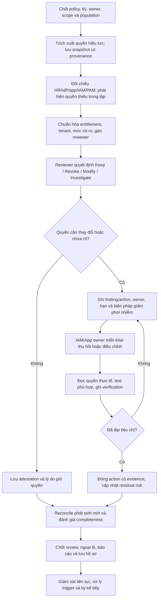

# Bằng chứng access review: chứng minh quyền truy cập được rà soát và xử lý thực sự

## 1. Tại sao access review phải có bằng chứng?

Một ứng dụng có thể triển khai đăng nhập đa yếu tố, phân quyền theo vai trò, giới hạn quyền quản trị và ghi audit log nhưng vẫn tồn tại các tài khoản đã nghỉ việc, quyền của nhân viên chuyển bộ phận, quyền cấp tạm không bị thu hồi hoặc tài khoản dịch vụ có đặc quyền quá rộng. Các quyền này có thể **được cấp hợp lệ ở một thời điểm trước đó** nhưng không còn phù hợp với nhiệm vụ và mức rủi ro hiện tại.

**Access review (rà soát quyền truy cập)** là hoạt động có tổ chức để kiểm tra **ai hoặc danh tính nào có quyền gì, trên tài sản nào, vì lý do nghiệp vụ nào, do ai chịu trách nhiệm và quyền đó có còn phù hợp hay không**. Hoạt động này thường được gọi là *access recertification* hoặc *user access review* khi mục tiêu là tái xác nhận các quyền đã cấp.

**Bằng chứng access review (access review evidence)** là tập hồ sơ có thể kiểm tra lại, cho thấy **phạm vi người dùng/quyền đã được xác định đầy đủ, người có thẩm quyền đã đưa ra quyết định, các quyền không phù hợp đã được sửa hoặc thu hồi, và trạng thái thực tế sau xử lý đã được xác minh**. Bằng chứng cũng phải thể hiện giới hạn và ngoại lệ còn lại; một file Excel được đánh dấu “Reviewed” không tự chứng minh quyền đã an toàn.

Trong chương **Kiểm soát truy cập** của module **SECURITY_SECURITY_ASSURANCE**, chủ đề này gắn với mục tiêu **đánh giá có bằng chứng rằng hệ thống đáp ứng các mục tiêu bảo mật**. Kết quả review phải kết nối được **rủi ro → yêu cầu phân quyền → security controls → kiểm tra/đánh giá → evidence → finding → khắc phục và retest → rủi ro còn lại → quyết định quản trị**. Đây là hoạt động assurance lặp lại trong phát triển và vận hành, không phải nghi thức ký bảng vào cuối kỳ.

### Kết quả học tập

Sau bài này, người học có thể:

1. Phân biệt **thực hiện access review**, **chứng minh access review đã diễn ra**, **chứng minh quyền thực tế sau xử lý** và **đánh giá hiệu lực liên tục**.
2. Xác định đúng phạm vi danh tính, tài sản và quyền, kể cả quyền kế thừa, quyền đặc biệt, tài khoản dịch vụ, nhà cung cấp và quyền tạm thời.
3. Thu thập gói bằng chứng có nguồn gốc, thời điểm, phiên bản, reviewer, quyết định, action và xác minh trạng thái hiện hành.
4. Đánh giá completeness, accuracy, timeliness, tính đáng tin và khả năng truy vết của bằng chứng.
5. Xử lý phát hiện, ngoại lệ và rủi ro còn lại; chuẩn bị hồ sơ có thể được kiểm toán mà không làm lộ thông tin nhạy cảm.

## 2. Phân biệt access review với những hoạt động gần nhau

| Hoạt động | Mục tiêu chính | Bằng chứng đặc trưng | Điều chưa thể kết luận |
| --- | --- | --- | --- |
| **Access request/provisioning** | Cấp quyền theo yêu cầu được duyệt. | Request, approval, lệnh cấp quyền, trạng thái cấp thực tế. | Quyền cấp từ trước có còn cần thiết không. |
| **Joiner–Mover–Leaver (JML)** | Cấp, thay đổi, thu hồi quyền theo vòng đời nhân sự. | Sự kiện HR, ticket IAM, thay đổi entitlement. | Các quyền ngoài quy trình JML đã được kiểm kê đầy đủ chưa. |
| **Periodic access review** | Tái xác nhận hoặc yêu cầu thu hồi quyền đang tồn tại. | Snapshot quyền, tập đối tượng, quyết định reviewer, remediation và verification. | Toàn bộ tổ chức an toàn tuyệt đối hoặc không có quyền sai ngoài phạm vi. |
| **Privileged access review** | Kiểm tra đặc quyền cao, quyền cấp theo phiên, break-glass. | Role assignments, phiên PAM/PIM, phê duyệt, thời hạn, sử dụng và thu hồi. | Một quyền “inactive” không thể sử dụng qua đường khác. |
| **Access monitoring** | Phát hiện truy cập hoặc thay đổi quyền bất thường trong vận hành. | Audit event, cảnh báo, điều tra, phản ứng. | Quyền chưa được sử dụng là quyền được phép giữ. |
| **Authorization testing** | Kiểm chứng người không đủ quyền bị từ chối tại API, DB, storage. | Test âm/dương theo build, môi trường và resource. | Mọi quyền được cấp cho mọi identity đều có lý do nghiệp vụ. |
| **Audit/assurance assessment** | Đánh giá thiết kế và hiệu lực của control theo tiêu chí và phạm vi. | Kết luận có căn cứ, mẫu kiểm tra, ngoại lệ và finding. | Không thể suy rộng vượt ngoài phạm vi hoặc kỳ đánh giá. |

**Điểm mấu chốt:** access review trả lời **“quyền này có còn phù hợp không?”**; authorization testing trả lời **“hệ thống có thực thi đúng quyết định quyền không?”**. Hai hoạt động bổ trợ. Một reviewer quyết định thu hồi quyền chưa chứng minh API đã từ chối quyền đó nếu token, cache, database grant hoặc đường truy cập trực tiếp vẫn còn hiệu lực.

### 2.1. Ba mức bằng chứng khác nhau

| Mức | Câu hỏi cần chứng minh | Ví dụ |
| --- | --- | --- |
| **Design evidence** | Có quy định và cơ chế review hợp lý không? | Policy quy định phạm vi, chu kỳ, thẩm quyền reviewer, xử lý ngoại lệ. |
| **Execution evidence** | Trong kỳ này, những ai/quyền nào đã được review và ra quyết định? | Snapshot đầy đủ, reviewer attestation, timestamp, lý do giữ/thu hồi. |
| **Operating/remediation evidence** | Quyết định đã được triển khai và quyền thực tế được kiểm chứng chưa? | IAM diff trước/sau, effective role, login/token/session test khi phù hợp, finding đóng sau xác minh. |

Không dùng bằng chứng mức một để thay mức hai hoặc mức ba. **Quy trình đã ban hành** không đồng nghĩa **đã rà soát**, và **đã ký thu hồi** không đồng nghĩa **đã thu hồi thực tế**.

## 3. Xác định đối tượng được review: identity × resource × entitlement

Một bản ghi access review cần phân biệt ba thành phần:

- **Identity (principal):** người dùng, tài khoản dịch vụ, workload, bot, quản trị viên, tài khoản nhà cung cấp hoặc nhóm được cấp quyền.
- **Resource:** ứng dụng, API, môi trường cloud, database, kho dữ liệu, dự án, bảng lương, tổ chức/tenant, tệp export, hệ thống logging hoặc secret store.
- **Entitlement/permission:** vai trò, nhóm, quyền đọc/ghi/xuất/phê duyệt, quyền quản trị, policy, scope, quyền cấp tạm hoặc quyền có điều kiện.

Một user có thể có nhiều entitlement trên nhiều resource. Cùng một role name như `Admin` ở hai hệ thống **không nhất thiết có cùng hiệu lực**; cần biết quyền thực tế mà role cho phép và phạm vi tài nguyên.

### 3.1. Các nhóm danh tính không được bỏ sót

| Nhóm | Ví dụ | Rủi ro nếu không review |
| --- | --- | --- |
| **Nhân viên** | HR, kế toán, vận hành, support. | Giữ quyền từ vị trí cũ, quyền chồng chất qua nhiều lần chuyển bộ phận. |
| **Quản trị viên và tài khoản đặc quyền** | Admin hệ thống, DBA, cloud administrator. | Khả năng sửa dữ liệu, thay policy, xóa log hoặc mở quyền khác. |
| **Nhân sự thuê ngoài/nhà cung cấp** | Tư vấn, bảo trì, đối tác tích hợp. | Tài khoản còn hiệu lực sau khi hợp đồng hoặc nhiệm vụ kết thúc. |
| **Tài khoản không gắn trực tiếp với người** | Service account, workload identity, CI runner, integration bot. | Quyền quá rộng, không có sponsor, secret không luân chuyển. |
| **Break-glass/emergency access** | Tài khoản khẩn, quyền cao cấp ngắn hạn. | Quyền cấp tạm trở thành thường trực, sử dụng không có hậu kiểm. |
| **Danh tính liên kết/federated** | SSO, IdP bên ngoài, nhóm từ directory. | Thu hồi quyền ở nguồn này nhưng effective entitlement vẫn còn nơi khác. |
| **Quyền cấp trực tiếp hoặc kế thừa** | Direct assignment, group, nested group, role binding. | Reviewer chỉ thấy tên nhóm mà không hiểu quyền thực nhận. |
| **Danh tính/người dùng không còn hoạt động** | Disabled, dormant, orphaned, tài khoản không có chủ sở hữu. | Không ai quyết định; quyền hoặc token vẫn có thể còn sử dụng được. |

**Tài khoản dịch vụ** cũng phải có chủ sở hữu hoặc *sponsor* phù hợp để quyết định nhu cầu quyền. Việc không có người đăng nhập trực tiếp không làm quyền trở nên ít quan trọng; tài khoản có thể được dùng bởi job, API token hoặc pipeline.

### 3.2. Kiểm tra “quyền hiệu lực”, không chỉ danh sách vai trò khai báo

Trong thực tế, quyền có thể phát sinh từ:

1. Gán role trực tiếp cho người dùng.
2. Nhóm directory/SSO, kể cả nhóm lồng nhau.
3. Policy theo thuộc tính (ABAC), thời gian, thiết bị, vị trí hoặc môi trường.
4. Cloud IAM role, resource policy, service account và quyền assume role.
5. Database grants, schema/object privileges và các tài khoản kỹ thuật.
6. Privileged Identity Management (PIM) hoặc Privileged Access Management (PAM): quyền đủ điều kiện kích hoạt (*eligible*) và quyền đang kích hoạt (*active*).
7. Liên kết chia sẻ, token sống dài, khóa API hoặc phiên chưa thu hồi.
8. Quyền quản trị ở tenant, dự án, repository và các hệ thống con có cơ chế phân quyền riêng.

Reviewer cần nhìn thấy **ý nghĩa nghiệp vụ của entitlement**, đặc biệt với quyền kế thừa. Nếu chỉ đưa tên nhóm `HR_GLOBAL_READERS` cho người phê duyệt mà không giải thích nhóm đó đọc được dữ liệu của tenant nào, quyết định “Keep” có thể chỉ là đoán.

### 3.3. Phạm vi dữ liệu và ranh giới tenant

Ở SaaS đa tenant, quyền “Read Employee” cần kèm **tenant/resource scope**; người dùng có quyền đọc hồ sơ tenant A không vì thế được đọc tenant B. Nếu access review chỉ chụp role nhưng không có tenant, sẽ bỏ sót rủi ro truy cập chéo.

Đối với hệ thống cloud hoặc database, cần biết **đường cấp quyền và sự kế thừa**. Reviewer không nhất thiết phải đọc mọi policy JSON dài, nhưng báo cáo phải chuyển thành quyền dễ hiểu và cho phép mở chi tiết kỹ thuật khi có nghi vấn.

## 4. Xác lập mục tiêu, chu kỳ và trigger của access review

### 4.1. Policy và tiêu chí áp dụng

Một chính sách access review cần quy định:

| Trường chính sách | Cần làm rõ |
| --- | --- |
| **Scope** | Hệ thống, môi trường, dữ liệu, loại principal, entitlement và các loại quyền đặc biệt. |
| **Frequency** | Chu kỳ theo mức rủi ro; ngày kết thúc kỳ, thời điểm lấy snapshot và hạn hoàn thành. |
| **Trigger ngoài lịch** | Chuyển vị trí, chấm dứt hợp tác, phát hiện lạm quyền, sự cố, thay IAM/role hoặc nhà cung cấp. |
| **Reviewer authority** | Ai hiểu nhu cầu nghiệp vụ và có quyền quyết định quyền giữ/thu hồi? |
| **Decision vocabulary** | Keep, Revoke, Modify, Investigate, Exception, Not applicable (kèm lý do). |
| **Response deadline** | Khi nào phải xử lý quyền không phù hợp; quy trình ưu tiên theo rủi ro. |
| **Escalation** | Reviewer vắng mặt, không đồng thuận, quyền đặc biệt/vượt ngưỡng hoặc bằng chứng thiếu. |
| **Verification criteria** | Bằng chứng triển khai thay đổi và xác nhận trạng thái quyền thực tế. |
| **Evidence protection/retention** | Quyền đọc, nguồn dữ liệu, lịch sử, định dạng, thời hạn lưu theo chính sách liên quan. |

Không có một chu kỳ bắt buộc chung cho mọi hệ thống. Tổ chức có thể xem **quyền đặc biệt và hệ thống dữ liệu nhạy cảm thường xuyên hơn** các quyền ít rủi ro, theo chính sách/hợp đồng/nghĩa vụ đang áp dụng. Đừng trình bày “mỗi quý” như một luật phổ quát.

### 4.2. Review định kỳ không thay xử lý tức thời

Một user nghỉ việc cần được xử lý theo **JML/leaver control**, không chờ tới kỳ review tiếp theo. Khi phát hiện token bị lộ hoặc quyền admin đang bị khai thác, phải áp dụng quy trình ứng phó sự cố và chuyển cấp đúng thẩm quyền. Review định kỳ phát hiện sai lệch bị bỏ sót và xác nhận sự phù hợp, **không cho phép trì hoãn những hành động khẩn cấp**.

### 4.3. Chọn mức độ review theo rủi ro

| Tình huống | Độ sâu review nên cân nhắc | Lý do |
| --- | --- | --- |
| Tài khoản có quyền sửa số tiền, tài khoản thụ hưởng hoặc cấp quyền. | Xem từng entitlement, bối cảnh, SoD, lịch sử cấp và thời hạn. | Hậu quả toàn vẹn và gian lận có thể nghiêm trọng. |
| Service account có quyền đọc nhiều tenant. | Xác định owner, workload, secret, phạm vi API và các đường assume role. | Quyền máy thường ít người nhìn thấy và có blast radius lớn. |
| Quyền xem dữ liệu nhạy cảm ở một tenant. | Xác minh vai trò nghiệp vụ và tenant/resource scope. | Ngăn privilege creep và lộ dữ liệu chéo tenant. |
| Quyền xem nội dung công khai ít rủi ro. | Có thể áp dụng quy trình đơn giản theo chính sách. | Giảm tải cho reviewer mà vẫn giữ phạm vi rõ. |
| Quyền tạm/break-glass. | Xem phiên kích hoạt, người duyệt, thời hạn và hậu kiểm. | Quyền đặc biệt không nên trở thành thường trực. |

## 5. Những đặc tính làm bằng chứng access review đáng tin

### 5.1. Completeness – đầy đủ đối tượng trong phạm vi

Một mẫu dữ liệu 100% được reviewer ký vẫn vô giá trị nếu bỏ sót toàn bộ service accounts hoặc quyền qua nhóm kế thừa. **Completeness** trả lời: *đã xác định đủ population phải review chưa?*

Kiểm tra bằng cách đối chiếu danh sách principal và entitlement từ **các nguồn có thẩm quyền**, ví dụ HRIS cho nhân viên, vendor roster cho nhà cung cấp, IdP/directory cho danh tính, IAM/PAM và ứng dụng/database/cloud cho quyền thực tế. Cần xem tài khoản không có bản ghi HR, alias, người chuyển bộ phận, nhóm lồng nhau, quyền tạm và các tài nguyên ngoài luồng provisioning trung tâm.

### 5.2. Accuracy – đúng quyền và trạng thái

Một entitlement snapshot phải thể hiện đúng **quyền hiệu lực tại mốc đánh giá**. Tài liệu “role matrix” chưa chắc giống quyền trong production. Hệ thống có thể bị drift, user được cấp quyền trực tiếp ngoài group, role đã thay ý nghĩa hoặc token cũ vẫn còn quyền.

Đối chiếu mẫu với cấu hình thực tế ở ứng dụng/IAM/DB; khi dữ liệu review là dữ liệu tổng hợp, cần mô tả logic chuyển đổi sang quyền có thể hiểu và kiểm tra đường nguồn.

### 5.3. Timeliness – đúng kỳ, đúng thời điểm

Quyền có thể thay đổi giữa lúc **trích xuất**, **review** và **khắc phục**. Vì thế gói bằng chứng phải có:

- `snapshot_at`: mốc chụp dữ liệu.
- `review_opened_at`, `review_closed_at`: khoảng reviewer xem và quyết định.
- `decision_at`: mốc quyết định của mỗi entitlement.
- `change_applied_at`, `verified_at`: mốc thay đổi quyền và xác minh.
- Khoảng thời gian dữ liệu bao phủ và cơ chế xử lý **thay đổi trong lúc review**.

Một danh sách chụp tháng trước có thể đã lỗi thời khi vai trò nhân viên hoặc role definition thay đổi. Cần quy tắc tái đồng bộ các quyền mới/thay đổi trong kỳ, hoặc làm review bổ sung theo sự kiện.

### 5.4. Authenticity, integrity và non-repudiation phù hợp

Người kiểm toán cần biết **ai xuất dữ liệu, ai review, ai phê duyệt và liệu hồ sơ có bị sửa âm thầm**. Lưu identity reviewer từ hệ thống xác thực, timestamp, audit trail và lịch sử phiên bản. Có thể dùng snapshot bất biến theo thiết kế hoặc kiểm soát sửa đổi tương đương.

**Hash của một file** có thể giúp phát hiện byte bị thay đổi **sau thời điểm hash được tạo**, nhưng **không tự chứng minh** nguồn dữ liệu chính xác hoặc người xuất là ai. Cần kết hợp provenance, quyền truy cập, log thu thập và kiểm soát kho lưu.

### 5.5. Traceability và reproducibility

Mỗi quyết định phải đi được từ **identity → entitlement → resource/tenant → reviewer → lý do → action → trạng thái cuối → evidence**. Khi kiểm toán chọn một dòng bất kỳ, người phụ trách phải tái dựng được tại sao giữ hoặc thu hồi quyền và bằng chứng xác minh quyết định đã có hiệu lực.

### 5.6. Confidentiality của chính evidence

Review artifacts có thể tiết lộ người có quyền quản trị, cấu trúc quyền, ứng dụng nhạy cảm, dữ liệu nhân sự và điểm yếu chưa khắc phục. Không sao chép token, mật khẩu, dữ liệu lương thật vào spreadsheet hoặc ticket. Chỉ lưu **định danh cần thiết và tham chiếu đến evidence trong kho bảo vệ**, giới hạn quyền đọc cho người cần thực hiện, đánh giá và kiểm toán.

## 6. Quy trình access review theo vòng đời bằng chứng



### Bước 1 — Khởi tạo chiến dịch review

Ghi rõ `review_id`, kỳ, dữ liệu ở mốc nào, nguồn tài sản, loại danh tính, entitlement được xét, reviewer có thẩm quyền và các điều kiện kết thúc. Xác định thời điểm mà **quyền mới, quyền đổi trong kỳ** phải được đối chiếu hoặc đưa vào review bổ sung.

Không định nghĩa thành công chỉ là “100% dòng đã có tick”: phải gồm **coverage, quyết định hợp lệ và xử lý các quyền không phù hợp**.

### Bước 2 — Thu thập evidence gốc

Thu dữ liệu từ ứng dụng, IdP/directory, cloud IAM, PAM/PIM, database và nguồn nghiệp vụ. Ghi **nguồn/công cụ, quyền trích xuất, lọc truy vấn, timestamp, phạm vi tài sản, số lượng bản ghi** và mã snapshot. Bằng chứng gốc nên có thể đối chiếu lại khi kiểm toán.

Nếu ứng dụng chỉ xuất user có trạng thái active, phải kiểm tra có bỏ **disabled accounts vẫn còn token/grant**, guest, service, group, hoặc tài khoản ngoài SSO không.

### Bước 3 — Kiểm tra tính đầy đủ và chuẩn hóa

Đối chiếu danh tính với roster nhân sự/nhà cung cấp, resource inventory với hệ thống đang hoạt động và entitlement trực tiếp/kế thừa. Chuẩn hóa thành các bản ghi có ID bền vững, role meaning, tenant/resource scope, nguồn và trạng thái.

Tập **không xác định owner** không được loại bỏ im lặng; đưa vào trạng thái `investigate` hoặc finding, phân công người chịu trách nhiệm.

### Bước 4 — Đưa đến reviewer đúng người

Reviewer phải hiểu **nhu cầu nghiệp vụ và độ nhạy của quyền**, có quyền quyết định giữ/thu hồi trong phạm vi được giao. Ví dụ line manager biết nhu cầu công việc nhưng có thể không hiểu quyền `cloud:iam:*`; cần cung cấp entitlement description và tham vấn application owner/security cho quyền kỹ thuật hoặc đặc quyền cao.

Không để người được review **tự phê duyệt quyền đặc biệt của chính mình** khi cơ chế kiểm soát đòi hỏi sự độc lập. Nếu có xung đột, chuyển cấp hoặc chỉ định reviewer thay thế theo policy.

### Bước 5 — Ghi quyết định có lý do

Các quyết định thường dùng:

| Quyết định | Ý nghĩa | Dữ liệu cần lưu |
| --- | --- | --- |
| **Keep/Approve** | Quyền vẫn cần và trong phạm vi được phép. | Reviewer, ngày, lý do/ngữ cảnh, tenant và phạm vi, thời hạn nếu có. |
| **Revoke** | Không còn nhu cầu hoặc không được phép; cần thu hồi. | Lý do, mức độ ưu tiên, action owner, hạn, tiêu chí đóng. |
| **Modify** | Cần thu hẹp/đổi role/scope hoặc chuyển sang quyền tạm. | Trạng thái mục tiêu, yêu cầu thay đổi, deadline, test sau thay đổi. |
| **Investigate** | Thiếu owner, ý nghĩa role không rõ, bất đồng hoặc dữ liệu không chắc chắn. | Câu hỏi cần xác minh, người xử lý, hạn, biện pháp giảm phơi nhiễm nếu cần. |
| **Exception theo policy** | Không đáp ứng quy tắc thông thường nhưng có cơ chế xem xét hợp lệ. | Risk owner/cấp duyệt, phạm vi, biện pháp bù đắp, hạn và trigger. |
| **Not applicable có căn cứ** | Dòng/tài sản không thuộc phạm vi đã duyệt, không phải do thiếu dữ liệu. | Lý do, bằng chứng và người xác nhận phạm vi. |

**Reviewer không được giữ quyền bằng một chữ “OK” thiếu bối cảnh** đối với quyền nhạy cảm. Lý do có thể ngắn gọn nhưng đủ xác minh, chẳng hạn “Đang chịu trách nhiệm đối soát lương tenant A đến hết đợt chuyển giao, cần quyền xem, không cần quyền thay tài khoản”.

### Bước 6 — Triển khai quyết định và xác minh

Quyền được thu hồi trong directory **chưa chắc đã biến mất** ở ứng dụng dùng local account, cloud role, API token hay phiên đang hoạt động. Cần:

1. Xác định nguồn cấp quyền thực tế: direct, group, nested group, role binding, token, resource policy.
2. Thay đổi/thu hồi ở đúng nơi với quyền được ủy quyền.
3. Kiểm tra **effective entitlement sau thay đổi**.
4. Xem xét session, token, cached permissions, đường access khác và quyền sinh từ nhóm còn tồn tại.
5. Khi rủi ro yêu cầu, chạy **negative authorization test** với principal thử hoặc cách kiểm tra được kiểm soát.
6. Lưu action/ticket, thay đổi trước–sau, timestamp, verifier và các giới hạn.

Một finding **không đóng** chỉ vì ticket có trạng thái `Done` hoặc admin đã gửi email “đã xóa quyền”. Cần bằng chứng quyền sau xử lý trong phạm vi liên quan.

### Bước 7 — Chốt completeness và báo cáo có căn cứ

Sau review, kiểm tra thay đổi trong thời gian diễn ra chiến dịch, các account mới, quyền tạm, quyết định còn treo và remediation quá hạn. Đối chiếu snapshot bổ sung hoặc delta theo quy tắc review đã chốt. Bản báo cáo phải công bố **tập được review, phần chưa bao phủ, các ngoại lệ và quyền chưa khắc phục**; không chỉ tổng phần trăm đã tick.

## 7. Bộ evidence tối thiểu cần có

Một lần access review có thể lưu các thành phần sau ở những hệ thống khác nhau, miễn **tham chiếu ổn định và đủ quyền kiểm toán**:

| Evidence ID/loại | Thông tin bắt buộc | Câu hỏi nó trả lời |
| --- | --- | --- |
| **EV-SCOPE: scope & policy** | Review ID, policy version, hệ thống/tenant, population, kỳ, ngưỡng và các ngoại lệ loại trừ. | Đánh giá cái gì, theo tiêu chí nào? |
| **EV-SOURCE: source inventory** | Nguồn HR/IdP/app/IAM/PAM, đối tượng truy xuất, truy vấn hoặc API scope, timestamp. | Tập dữ liệu bắt đầu từ đâu? |
| **EV-SNAPSHOT: entitlement export** | Identity/resource/permission, cách cấp trực tiếp/kế thừa, trạng thái, mốc thời gian. | Ai có quyền gì lúc trích xuất? |
| **EV-RECON: completeness check** | Số đối tượng theo nguồn, bản ghi thiếu/thừa, logic đối soát, kết quả xử lý. | Có bỏ sót account hoặc quyền đáng kể không? |
| **EV-ATTEST: reviewer decisions** | Reviewer ID, thẩm quyền, từng entitlement, decision, lý do, ngày và version danh sách. | Ai đã xem và quyết định như thế nào? |
| **EV-EXCEPTION: approved deviation** | Phạm vi, rủi ro, cấp duyệt, điều kiện, hạn, biện pháp bù đắp. | Quyền giữ khác quy tắc có được phép không? |
| **EV-ACTION: remediation** | Ticket, owner, due date, thay đổi yêu cầu và thực hiện. | Ai có trách nhiệm sửa và sửa gì? |
| **EV-VERIFY: effective-state evidence** | Trạng thái quyền trước/sau, test, asset, thời gian và người kiểm chứng. | Thu hồi/thu hẹp quyền đã có hiệu lực chưa? |
| **EV-CLOSE: campaign closeout** | Scope cuối, độ bao phủ, ngoại lệ, hành động quá hạn, quyết định cấp quản trị. | Chiến dịch kết thúc với những rủi ro còn lại nào? |

**Bản screenshot đơn lẻ không đủ thay toàn bộ gói**. Nó có thể thiếu bộ lọc, dữ liệu ngoài màn hình, mốc thời gian, quyền kế thừa và khả năng đối chiếu trước/sau. Nếu dùng screenshot vì công cụ không có export, cần kèm bối cảnh, tổng population, cách kiểm soát tính toàn vẹn và quy tắc lấy mẫu phù hợp.

## 8. Ví dụ thực hành xuyên suốt: rà soát quyền của HR SaaS đa tenant

**Bối cảnh giả định:** hệ thống quản lý nhân sự phục vụ nhiều khách hàng. Có hai tenant A và B, ứng dụng HR, API export dữ liệu lương, database, cloud object storage và dịch vụ tạo báo cáo. Mỗi tenant có người quản trị HR, người xem hồ sơ, bộ phận thanh toán và tài khoản tích hợp. Một phần tài khoản sử dụng SSO; một số tài khoản kỹ thuật có grant độc lập.

Đội assurance xác định rủi ro chính:

| Risk ID | Kịch bản | Mục tiêu/tiêu chí review |
| --- | --- | --- |
| **R-01** | Quyền đọc/export vượt tenant → lộ hồ sơ. | Bí mật: entitlement và phạm vi tenant phải có lý do được phê duyệt. |
| **R-02** | Quyền sửa tài khoản nhận tiền còn ở người đã chuyển bộ phận. | Toàn vẹn: chỉ đúng nhiệm vụ/vai trò được phép chỉnh sửa và phê duyệt. |
| **R-03** | Tài khoản nhà thầu hoặc cựu nhân viên vẫn truy cập được hệ thống. | Bí mật/truy vết: lifecycle và quyền phải được thu hồi kịp. |
| **R-04** | Service account đọc toàn bộ tenant bằng credential còn hiệu lực. | Bí mật: chỉ có quyền cần cho workload, có owner và vòng đời secret. |
| **R-05** | Tài khoản khẩn và admin có quyền kéo dài ngoài mục đích. | Bí mật/toàn vẹn: quyền đặc biệt có phê duyệt, hạn và hậu kiểm. |

### 8.1. Population mẫu trước review

Tất cả tên/ID dưới đây là **dữ liệu giả lập**. Giả sử kỳ này hệ thống có **8 entitlement records** trong tập review sau khi đối chiếu nguồn. Mỗi hàng biểu diễn một entitlement của một principal, không phải một người duy nhất.

| Row ID | Principal | Resource và quyền hiệu lực tại snapshot | Nguồn grant | Dữ kiện nghiệp vụ |
| --- | --- | --- | --- | --- |
| **AR-01** | `usr-hr-a` | Tenant A / xem hồ sơ | Nhóm HR-A qua SSO. | Nhân sự HR đang làm việc tại tenant A. |
| **AR-02** | `usr-pay-a` | Tenant A / phê duyệt thay tài khoản nhận lương | Direct role assignment. | Đã chuyển sang vị trí chỉ đối soát, không còn duyệt. |
| **AR-03** | `usr-support` | Tenant A và B / đọc hồ sơ nhạy cảm | Nhóm hỗ trợ toàn hệ thống. | Support cần ticket cụ thể, không cần quyền đọc thường trực. |
| **AR-04** | `ext-contractor-9` | Tenant B / export hồ sơ | Local account trong ứng dụng. | Hợp đồng nhà thầu đã kết thúc. |
| **AR-05** | `svc-report-job` | Toàn tenant / đọc và xuất CSV | Cloud service role + DB grant. | Job chỉ tạo báo cáo tenant A. |
| **AR-06** | `admin-breakglass` | Toàn hệ thống / privileged admin | PAM/PIM emergency role. | Chưa rõ có phiên kích hoạt nào ngoài thời hạn hay không. |
| **AR-07** | `usr-hr-b` | Tenant B / xem hồ sơ | Nested group HR-B/Readers. | HR đang làm việc và có nhu cầu được xác nhận. |
| **AR-08** | `svc-audit-pipe` | Log service / gửi sự kiện audit | Workload identity. | Dịch vụ cần ghi sự kiện, không cần quyền đọc/xóa audit. |

**Giả định completeness:** tám hàng chỉ là **tập thử nghiệm của bài học**, không phải toàn bộ quyền của một hệ thống thực. Muốn kết luận “8/8 đã review”, trước tiên phải chứng minh các nguồn liên quan đã được đối soát và không có principal/entitlement trong phạm vi bị bỏ ngoài bảng.

### 8.2. Reviewer đưa ra quyết định

| Row | Quyết định | Lý do được ghi | Người review có trách nhiệm |
| --- | --- | --- | --- |
| **AR-01** | **Keep** | Quyền xem chỉ tenant A phù hợp công việc HR. | HR owner tenant A. |
| **AR-02** | **Revoke** | Người dùng đã chuyển nhiệm vụ; quyền phê duyệt không còn hợp lệ. | Chủ sở hữu quy trình thanh toán. |
| **AR-03** | **Modify** | Chuyển từ quyền thường trực liên tenant sang truy cập hỗ trợ có phê duyệt theo ticket và thời hạn. | Product/risk owner của dữ liệu khách hàng. |
| **AR-04** | **Revoke – ưu tiên theo leaver policy** | Hợp đồng đã kết thúc; cần kiểm tra mọi đường truy cập còn lại. | Application owner + vendor sponsor. |
| **AR-05** | **Modify** | Giảm quyền toàn tenant xuống phạm vi workload thật sự cần, tenant A. | Owner tích hợp và cloud/platform owner. |
| **AR-06** | **Investigate** | Cần xem điều kiện kích hoạt, phiên thực tế, reviewer độc lập và hạn của quyền khẩn. | Privileged access owner/security. |
| **AR-07** | **Keep** | Quyền xem tenant B hợp nhiệm vụ; quyền kế thừa được xác nhận. | HR owner tenant B. |
| **AR-08** | **Modify** | Thu hẹp role ghi log, loại bỏ khả năng đọc/xóa không cần thiết nếu có. | Security logging owner. |

Với AR-06, **Investigate không phải Keep**. Nếu quyền đang phơi nhiễm ở mức rủi ro cao, phải xem biện pháp giới hạn tạm và chuyển cấp trong khi kiểm tra; không để một quyền đặc biệt tồn tại vô thời hạn vì chưa biết ai sở hữu.

### 8.3. Bằng chứng sau xử lý cho các dòng cần thay đổi

| Row | Hành động | Bằng chứng phải có để xác minh đóng |
| --- | --- | --- |
| AR-02 | Bỏ direct approval role; rà soát quyền tương đương từ group khác. | IAM/app role trước–sau; test user thử không duyệt được giao dịch; audit thay quyền. |
| AR-03 | Hủy role global; cấp cơ chế support theo ticket/tenant/thời hạn đã duyệt. | Effective scope mới, phiên access được duyệt, test truy cập B khi không có ticket bị từ chối. |
| AR-04 | Disable/remove local identity; thu hồi token và đường đăng nhập khác trong phạm vi. | User state, token/session revocation khi áp dụng, đối chiếu SSO/local, thử truy cập âm có kiểm soát. |
| AR-05 | Thu hẹp cloud IAM + DB grant cho job; kiểm tra các dependency. | Effective policy và DB grants; test job chỉ đọc được dữ liệu thuộc tenant A. |
| AR-06 | Rà soát hoạt động PAM/PIM, quyền hiện tại, phiên kích hoạt và phê duyệt. | Activation log, role eligibility, hạn, review/decision của người đủ thẩm quyền. |
| AR-08 | Giới hạn workload identity về thao tác append/write sự kiện đúng scope. | Effective service role, negative test đọc/xóa log trái quyền, deploy ID. |

Giả sử sau quyết định, chỉ AR-02, AR-04 và AR-05 đã được **triển khai và retest đạt**; AR-03, AR-08 chưa đủ bằng chứng và AR-06 còn điều tra. Khi đó **không được báo “8/8 access review completed với mọi sai lệch đã khắc phục”**. Có thể báo “8/8 dòng có quyết định sơ bộ; 3/5 dòng cần thay đổi đã verified; 1 dòng đang điều tra; phần còn lại chưa có evidence đóng”, kèm định nghĩa rõ cách phân nhóm. Nếu đánh dấu AR-06 là chưa có **quyết định cuối cùng**, tỷ lệ final decision cũng phải trừ dòng này.

### 8.4. Vấn đề cốt lõi của bằng chứng sau thu hồi

Nếu reviewer chọn Revoke cho AR-04, một ticket được đóng nhưng **local account vẫn có API token chưa hết hạn** thì quyết định chưa mang lại hiệu lực như yêu cầu. Phải đánh giá các **đường cấp quyền thực tế** chứ không chỉ thay trạng thái trong công cụ quản lý chiến dịch.

Ngược lại, nếu quyền AR-05 đã được thu hẹp ở cloud nhưng DB grant vẫn cho đọc tất cả tenant, phải coi remediation **chưa đủ**, bởi entitlement hiệu lực còn xuất hiện trên đường dữ liệu khác.

## 9. Mẫu hồ sơ access review có thể audit

Dưới đây là **mẫu YAML mô tả hồ sơ review**, không phải schema chính thức của sản phẩm IAM/GRC hay tệp cấu hình có thể thực thi. ID, ngày, principal và vai trò là dữ liệu ví dụ; sử dụng mã giả thay cho thông tin cá nhân thật.

```yaml
review_id: "AR-HR-2026-Q4-01"
title: "Rà soát quyền ứng dụng HR SaaS"
service: "HR SaaS multi-tenant"
period: "2026-Q4"
policy_ref: "POL-ACCESS-REVIEW-v2"
scope:
  environment: "production"
  tenants: ["tenant-A", "tenant-B"]
  resources: ["HR application", "CSV export", "Database", "Cloud IAM", "PAM"]
  principal_types: ["human", "external", "service", "privileged"]
  entitlement_types: ["direct", "inherited", "eligible", "temporary"]
  snapshot_at: "2026-11-28T09:00:00+07:00"
  exclusions: []
source_evidence:
  - ref: "EV-IDP-01"
    source: "Identity provider user and group export"
    extracted_at: "2026-11-28T09:00:00+07:00"
  - ref: "EV-IAM-02"
    source: "Runtime application, DB and cloud grants"
    extracted_at: "2026-11-28T09:05:00+07:00"
population_reconciliation:
  evidence_ref: "EV-RECON-03"
  scope_population_rows: 8
  unexplained_gaps: 0
  reconciliation_method: "Compare IdP/HR/vendor roster with app and IAM"
entries:
  - entry_id: "AR-01"
    principal_id: "usr-hr-a"
    resource: "tenant-A employee records"
    entitlement: "read"
    grant_path: "SSO group HR-A"
    reviewer_role: "Tenant-A HR owner"
    decision: "keep"
    rationale: "Nhiệm vụ HR hiện hành"
    decided_at: "2026-11-28T10:00:00+07:00"
    decision_evidence_ref: "EV-ATTEST-01"
  - entry_id: "AR-02"
    principal_id: "usr-pay-a"
    resource: "tenant-A payment beneficiary"
    entitlement: "approve_change"
    grant_path: "direct"
    reviewer_role: "Payment process owner"
    decision: "revoke"
    rationale: "Đã chuyển sang nhiệm vụ đối soát"
    decided_at: "2026-11-28T10:10:00+07:00"
    decision_evidence_ref: "EV-ATTEST-02"
    remediation:
      action_id: "ACT-AR-02"
      action_owner_role: "Application IAM owner"
      status: "verified_closed"
      effective_state_evidence_ref: "EV-ROLE-AFTER-02"
      negative_test_ref: "TEST-APPROVE-DENIED-02"
      verified_at: "2026-11-28T14:00:00+07:00"
  - entry_id: "AR-06"
    principal_id: "admin-breakglass"
    resource: "production administration"
    entitlement: "emergency_admin"
    grant_path: "PAM eligible and activatable"
    reviewer_role: "Privileged access owner"
    decision: "investigate"
    rationale: "Chưa đủ lịch sử activation và phê duyệt"
    decided_at: "2026-11-28T10:30:00+07:00"
    action_ref: "ACT-PAM-VERIFY-06"
    due_date: "Theo thời hạn xử lý rủi ro được duyệt"
    final_decision: "pending"
closeout:
  campaign_status: "open_pending_followup"
  evidence_manifest_ref: "EV-MANIFEST-01"
  unresolved_action_refs: ["ACT-PAM-VERIFY-06"]
  risk_register_refs: ["R-02", "R-03", "R-05"]
  next_review: "Theo lịch và trigger được phê duyệt"
```

**Không nhầm mẫu 3 entries với population 8 entries của bài tập:** YAML cố ý chỉ trích dẫn **ba quyết định đại diện**, không phải export đầy đủ. Hồ sơ thực phải giữ danh sách **tám bản ghi** ở `EV-SNAPSHOT`/`EV-ATTEST` cùng dấu vết đầy đủ. Chỉ khi tài liệu gốc được lưu và đối chiếu mới có thể kết luận campaign coverage; một ví dụ rút gọn không tự chứng minh tính đầy đủ.

### 9.1. Trường bổ sung khi áp dụng thực tế

Nên lưu **person/team ID thực tế của reviewer**, bằng chứng họ có quyền quyết định theo policy, role definition version, hệ thống và tenant chính xác, approval chain, deadline có thể xử lý, cột `effective_state_before`/`effective_state_after`, kết quả kiểm tra session/token, thay đổi trong kỳ và lịch sử mở/đóng finding.

Đối với yêu cầu lưu trữ nhiều năm, dùng **chính sách retention có hiệu lực của tổ chức**, không tự chọn thời hạn chung. Xem thêm các nghĩa vụ dữ liệu cá nhân, giới hạn truy cập của auditor và cơ chế xóa khi hết hạn lưu phù hợp.

## 10. Kỹ thuật kiểm chứng completeness và tính nhất quán

### 10.1. Đối soát các nguồn độc lập tương đối

Một cách tổ chức:

1. **HRIS/vendor roster:** ai đang có quan hệ công việc, role nghiệp vụ và ngày bắt đầu/kết thúc?
2. **IdP/directory:** ai có danh tính, nhóm, guest, external, disabled account?
3. **Application/IAM/DB/PAM:** ai **thực sự có** role/permission, kể cả grant trực tiếp và kế thừa?
4. **Asset inventory:** ứng dụng/tenant/service nào phải xuất hiện trong tập review?
5. **Audit/configuration records:** có grant khẩn hoặc tài khoản được tạo ngoài provisioning trung tâm không?

Đối soát phải **hai chiều**. Nếu lấy danh sách IdP rồi lọc sang ứng dụng, có thể bỏ tài khoản local trong ứng dụng. Nếu lấy danh sách app rồi đối chiếu HR, có thể bỏ service account vì không có nhân viên tương ứng; service account phải có sponsor/owner riêng.

### 10.2. Pseudocode đối soát population

Ví dụ sau là **pseudocode mô tả thuật toán**, không phải script production. Dữ liệu được đọc trong môi trường có quyền, không tự động hiển thị danh tính nhạy cảm:

```text
roster = loadApprovedHumanAndVendorRoster()
identities = loadAllIdentityProviderAccounts()
entitlements = loadEffectiveAppDbCloudPamGrants()
serviceOwners = loadServiceAccountSponsors()
resources = loadInScopeResourceInventory()

for resource in resources:
    assert exportSourceAndTimestampRecorded(resource)

for grant in entitlements:
    principal = resolveStablePrincipalId(grant, identities)

    if principal is unknown:
        createFinding("unknown_principal_with_entitlement", grant)

    if grant.isHuman and not roster.contains(principal):
        createFinding("orphan_or_leaver_access", grant)

    if grant.isService and not serviceOwners.contains(principal):
        createFinding("unowned_service_entitlement", grant)

    if not resources.contains(grant.resourceId):
        createFinding("out_of_inventory_resource", grant)

    normalizeAndRecord(
        principalId = principal,
        resourceId = grant.resourceId,
        tenantScope = grant.tenantScope,
        effectivePermission = grant.effectivePermission,
        grantPath = grant.directOrInheritedPath,
        sourceRef = grant.sourceRef
    )

reconcileRowCountsAndExceptionsBySource()
publishScopeAndEvidenceManifest()
```

**Điều kiện quan trọng:** thuật toán chỉ đầy đủ **trong tập nguồn đã kiểm kê và được quyền truy xuất**. Nếu ứng dụng không có API lấy quyền hiệu lực hoặc PAM export bỏ sót quyền eligible, phải ghi limitation và phương án bổ sung, không khẳng định completeness tuyệt đối.

### 10.3. Đối chiếu theo số lượng và theo đặc tính

Không chỉ so “số bản ghi bằng nhau”. Hai nguồn cùng có 100 dòng nhưng chứa người/quyền khác nhau. Đối chiếu theo **principal ID, resource ID, entitlement ID, grant path và tenant scope**, xem cả quyền không có owner hoặc role description.

Khi không thể so sánh tuyệt đối, dùng sampling có căn cứ và báo **phạm vi lấy mẫu**: ví dụ kiểm tra một số đặc quyền trực tiếp và nhóm kế thừa; kết quả mẫu không chứng minh 100% đối tượng ngoài mẫu.

## 11. Access review cho đặc quyền, service account và quyền tạm

### 11.1. Privileged access (PAM/PIM)

Một review quyền admin không nên chỉ hỏi “user này có role Admin không?”. Cần xem:

- **Eligible vs active:** ai có thể kích hoạt quyền, ai đã kích hoạt và theo điều kiện nào.
- **Thời hạn và phê duyệt:** quyền đặc biệt có cần dual approval, ticket và lý do không.
- **Break-glass:** tài khoản khẩn có sponsor, kiểm soát bí mật, sử dụng có log và hậu kiểm không.
- **Scope quyền:** có thể cấp quyền khác, xóa audit, truy cập backup/keys hoặc nhiều tenant không.
- **Separation of duties:** có xung đột với quyền tạo và duyệt giao dịch, quyền phát triển và kiểm soát release không.
- **Bằng chứng sử dụng/thay đổi:** log activation, yêu cầu, role assignments và state sau khi hết hạn.

**Không xem “không thấy phiên admin trong log” là quyền không tồn tại**. Eligible access có thể được kích hoạt sau này, còn log có thể thiếu phạm vi hoặc thời gian.

### 11.2. Service account và workload identity

Với tài khoản kỹ thuật, reviewer thường là **application owner/workload sponsor**, không phải line manager. Hồ sơ cần:

| Trường | Câu hỏi |
| --- | --- |
| Workload và owner | Job/dịch vụ nào thực dùng danh tính? Ai chịu trách nhiệm? |
| Quyền hiệu lực | Đọc/ghi dữ liệu nào; có truy cập chéo tenant, storage, secret manager hay deploy không? |
| Grant path | Role trực tiếp, cloud assume role, DB grants, API scopes hay nested group? |
| Credential lifecycle | Secret/key/token được cấp và thu hồi thế nào? Có credential thừa không? |
| Usage evidence | Có bằng chứng workload cần quyền đó hay chỉ dựa trên quyền cũ? |
| Segregation | Dùng chung danh tính giữa dev/test/production hay nhiều dịch vụ không? |
| Decision + verification | Nếu thu hẹp quyền, test chức năng job và negative access có đạt không? |

Một quyền rất rộng nhưng “job đang chạy ổn” không chứng minh cần tất cả quyền đó. Nên kết hợp **quyền theo nhiệm vụ, kiểm tra hành vi và theo dõi thay đổi**; không gỡ quyền bừa bãi khiến dịch vụ mất khả dụng mà không có phương án kiểm chứng/rollback.

### 11.3. Quyền được cấp theo phiên hoặc theo thời gian

Quyền JIT/temporary cần thông tin về:

- Ai **có thể** kích hoạt quyền, điều kiện và người phê duyệt.
- Ai **đã** kích hoạt quyền trong kỳ, khi nào, trong bao lâu và để làm gì.
- Quyền có tự hết hạn và có bị giữ lại qua token/session/cache không.
- Những phiên bất thường có được audit và kiểm tra độc lập không.

Không gộp “eligible” và “active” thành cùng một ô không giải thích; hai trạng thái tạo các câu hỏi rủi ro khác nhau.

## 12. Phân biệt review decision và remediation verification

### 12.1. Kỹ thuật đọc sau thay đổi

Một reviewer chọn **Revoke** cho entitlement của user X. Quy trình hiệu lực phải trả lời:

1. **Nguồn nào đã cấp quyền?** Direct assignment, nhóm, nested group, local account, database grant, PAM role, token?
2. **Nguồn nào đã bị sửa?** Nếu xóa user khỏi một nhóm nhưng vẫn có direct grant, quyền còn tồn tại.
3. **Quyền hiệu lực sau thay đổi là gì?** Đọc lại runtime role/grants với dữ liệu được trích từ hệ thống có thẩm quyền.
4. **Phiên và token còn hiệu lực không?** Có cần thu hồi token hoặc chờ TTL theo chính sách được duyệt? Nếu còn khả năng truy cập, chưa thể kết luận đã thu hồi hoàn toàn.
5. **Các đường khác có tương đương?** API, file link, DB, cloud role và tích hợp.
6. **Ai kiểm chứng?** Người khác người thay đổi khi mức rủi ro hoặc chính sách yêu cầu, kèm evidence ref.

Đối với quyền nhạy cảm, có thể dùng principal thử nghiệm hoặc cách xác minh được kiểm soát để kiểm tra **hành vi từ chối**. Tránh yêu cầu người bị thu hồi thử truy cập dữ liệu nhạy cảm không được phép hoặc tạo tình huống gây hại trên production.

### 12.2. Các trạng thái không được nhầm

| Trạng thái | Bằng chứng hiện có | Kết luận phù hợp |
| --- | --- | --- |
| **Reviewer approved revoke** | Quyết định có reviewer và timestamp. | Có yêu cầu thu hồi; chưa khẳng định đã thực hiện. |
| **Ticket completed** | Ticket ghi triển khai và thay đổi cấu hình. | Có dấu vết xử lý; cần đối chiếu runtime. |
| **Source updated** | IdP/group đã bỏ quyền. | Nguồn này không còn grant; cần xét app local/token/các đường khác. |
| **Effective state verified** | Kiểm tra quyền hiện tại và các đường liên quan đạt. | Có căn cứ đã thu hồi trong phạm vi/ thời điểm đã xác minh. |
| **Risk reassessed** | Owner xem finding, test và tác động còn lại. | Có kết luận rủi ro hiện tại và quyết định trong thẩm quyền. |
| **Unknown/partial** | Một đường chưa kiểm tra hoặc thông tin thiếu. | Không đánh dấu verified closed; giao action. |

### 12.3. Ví dụ một finding đã sửa nhưng chưa thể đóng

User chuyển bộ phận không còn có role sửa tài khoản nhận tiền trong hệ thống IAM; tuy nhiên một API key cũ được gắn với local admin account vẫn hoạt động. Evidence **thu hồi role IAM** là thật, nhưng **control objective** “người này không thể đổi tài khoản thụ hưởng” chưa được chứng minh. Phải tiếp tục điều tra, thu hồi hoặc giới hạn API key và retest theo phạm vi.

## 13. Hồ sơ evidence manifest, lưu trữ và khả năng kiểm toán

### 13.1. Evidence manifest là gì?

**Evidence manifest** là danh mục liên kết các phần bằng chứng thành một gói có thể lần theo, thay vì gửi rời rạc screenshot qua email. Mỗi mục nên có:

- Evidence ID, loại và mục tiêu/risk/control liên quan.
- Tài sản, tenant/nhóm dữ liệu, kỳ và phạm vi thời gian.
- Hệ thống nguồn, cách trích xuất, người thực hiện và timestamp.
- Định danh snapshot/phiên bản, vị trí lưu trong kho bảo vệ.
- Kết quả kiểm tra completeness/quality, các giới hạn và tham chiếu ngoại lệ.
- Lịch sử cập nhật, quyền truy cập, quy tắc retention và khi nào evidence hết giá trị.

### 13.2. Mẫu manifest rút gọn

```yaml
manifest_id: "EV-MANIFEST-AR-2026-Q4"
review_id: "AR-HR-2026-Q4-01"
classification: "restricted"
scope_ref: "EV-SCOPE-01"
artifacts:
  - evidence_id: "EV-SNAPSHOT-01"
    type: "effective_entitlement_snapshot"
    source: "Application and IAM export"
    captured_at: "2026-11-28T09:00:00+07:00"
    population_ref: "POP-HR-01"
    storage_ref: "protected-evidence-store:EV-SNAPSHOT-01"
    limitations: ["Cần đối chiếu quyền local với IdP"]
  - evidence_id: "EV-ATTEST-01"
    type: "review_decisions"
    source: "Access review campaign"
    captured_at: "2026-11-28T11:00:00+07:00"
    storage_ref: "protected-evidence-store:EV-ATTEST-01"
    reviewer_identity_verified: true
  - evidence_id: "EV-VERIFY-02"
    type: "post_revocation_verification"
    source: "Runtime IAM and application access check"
    captured_at: "2026-11-28T14:00:00+07:00"
    storage_ref: "protected-evidence-store:EV-VERIFY-02"
    related_action: "ACT-AR-02"
quality_checks:
  source_scope_recorded: true
  entitlement_population_reconciled: true
  reviewer_attribution_preserved: true
  unresolved_exceptions_reported: true
retention: "Theo chính sách và nghĩa vụ áp dụng"
access_control: "Chỉ nhóm được phân quyền review/audit"
```

Các đường `protected-evidence-store:...` là **định danh ví dụ**, không phải URL hoặc dữ liệu thật. Manifest giúp kiểm tra tính đầy đủ của hồ sơ; **nó không tự chứng minh nội dung artifacts đúng** nếu chưa đối chiếu với hệ thống nguồn.

### 13.3. Giữ provenance và chống sửa âm thầm

Một quy trình lưu evidence đáng tin thường có:

1. Kho có kiểm soát quyền đọc/ghi, log truy cập và phiên bản.
2. Phương pháp xuất hoặc API scope có thể tái kiểm tra, thời điểm và người thu thập.
3. Bản ghi reviewer gắn identity xác thực, không phải ô ký tên tự nhập.
4. Lịch sử sửa quyết định hoặc entitlement, không ghi đè âm thầm các bản gốc.
5. Biện pháp kiểm tra tính toàn vẹn khi phù hợp, ví dụ hash/định danh nội dung và chính sách chống sửa.
6. Giới hạn retention và cơ chế hủy dữ liệu đúng quy định khi hết thời hạn.

Không phải mọi tổ chức bắt buộc dùng một công cụ GRC đắt tiền hoặc chữ ký số cho mọi ô. Phương án lưu trữ có thể đơn giản, nhưng vẫn phải **đủ bằng chứng xác thực, toàn vẹn, truy vết và bảo mật** theo mức độ rủi ro.

## 14. Trách nhiệm: ai review, ai sửa và ai quyết định rủi ro?

Trong access review, **người xác nhận nhu cầu nghiệp vụ**, **người quản lý danh tính/quyền**, **người đánh giá assurance** và **người chấp nhận rủi ro** có thể khác nhau. Bảng RACI sau là **minh họa**, không thay thế phân cấp quyền của tổ chức:

| Hoạt động | Product/Risk owner (PO) | Application owner (APP) | IAM/Platform (IAM) | HR/Vendor sponsor (HR) | Security/GRC (SEC) | QA/Assessor (QA) | Lãnh đạo (LD) |
| --- | :---: | :---: | :---: | :---: | :---: | :---: | :---: |
| Xác định policy, scope, lịch và tiêu chí | C | C | C | C | **A/R** | C | I |
| Kiểm kê resource và entitlement thực tế | C | **A** | **R** | C | C | C | I |
| Cung cấp trạng thái nhân sự/nhà cung cấp | I | C | C | **A/R** | C | I | I |
| Đối chiếu completeness và phân phối population | C | **R** | R | C | **A** | R | I |
| Quyết định giữ/thu hồi quyền nghiệp vụ | **A** | **R** | C | C | C | C | I |
| Rà soát/quyết định quyền kỹ thuật đặc biệt theo phân cấp | **A** | **R** | R | C | C | C | I |
| Thực hiện revoke/modify ở IdP, app, cloud, DB | I | R | **A/R** | C | C | C | I |
| Kiểm chứng hiệu lực thu hồi và bằng chứng | I | C | R | I | C | **A/R** | I |
| Tổng hợp finding và kết luận assurance | C | R | R | C | **A** | **R** | I |
| Chấp nhận rủi ro còn lại trong quyền được giao | **A** | C | C | C | **R** | C | I |
| Quyết định rủi ro vượt thẩm quyền của PO | **R** | C | C | C | **R** | C | **A** |
| Rà soát hiệu lực chương trình và nguồn lực | R | C | C | C | **R** | C | **A** |

**R = Responsible**, **A = Accountable**, **C = Consulted**, **I = Informed**; `A/R` nghĩa là một vai trò vừa thực hiện vừa giải trình cuối cùng trong hoạt động đó. Mỗi hàng có một A theo cách phân công minh họa. Trong tổ chức thực, có thể tách **quyết định quyền nghiệp vụ** và **quyền quản trị nền tảng** thành các luồng khác nhau, dùng reviewer có thẩm quyền chuyên môn và tránh self-approval.

### 14.1. Reviewer phải có quyền quyết định và đủ ngữ cảnh

Line manager có thể xác nhận nhân viên có cần truy cập hệ thống hay không; application owner có thể hiểu role cho phép làm gì; risk owner xem hậu quả nếu giữ quyền ngoại lệ. Nếu một người thiếu phần thông tin cần thiết, nên **tham vấn hoặc chuyển reviewer** thay vì ký mọi quyền theo thói quen.

### 14.2. Tính độc lập

Người có entitlement đặc quyền không nên là người duy nhất xác nhận entitlement của chính họ khi chính sách yêu cầu đánh giá độc lập. Với đội nhỏ, có thể dùng kiểm tra chéo, review theo cấp cao hơn và bằng chứng truy xuất được; không tự giả định rằng một ô tick là sự phê duyệt hợp lệ.

## 15. Finding, ngoại lệ và quyết định chấp nhận rủi ro

### 15.1. Những finding điển hình từ access review

| Finding | Nguyên nhân/ảnh hưởng | Action phù hợp |
| --- | --- | --- |
| User nghỉ việc vẫn có tài khoản local active. | JML hoặc SSO deprovision không bao phủ ứng dụng. | Thu hồi các đường truy cập, đối soát account tương tự, retest. |
| Nhân viên chuyển vị trí còn quyền duyệt thanh toán. | Privilege creep, phân tách nhiệm vụ không đạt. | Bỏ role, kiểm tra SoD và các grant kế thừa. |
| Nhóm hỗ trợ có quyền global đọc mọi tenant. | Phạm vi quyền vượt nhu cầu, blast radius lớn. | Thiết kế JIT/ticket-based scope, thử truy cập âm. |
| Service account không có owner hoặc role quá rộng. | Không ai có thẩm quyền đánh giá nhu cầu, secret exposure lớn. | Gán sponsor, thu hẹp quyền, xác minh workload và vòng đời secret. |
| Reviewer chưa đánh giá quyền đặc biệt đúng hạn. | Thiếu quyết định, evidence và khả năng giải trình. | Chuyển cấp, giảm phơi nhiễm nếu cần, hoàn tất review có căn cứ. |
| Role được thu hồi ở IdP nhưng vẫn còn qua local account/token. | Control thực thi không đồng bộ. | Tìm đường cấp còn lại, thu hồi và test effective state. |

### 15.2. Access exception khác một quyết định Keep thông thường

**Keep** là kết luận quyền vẫn phù hợp với tiêu chí đã áp dụng. **Exception** là trường hợp quyền không đáp ứng quy tắc thông thường nhưng có **quy trình xem xét ngoại lệ hợp lệ**. Ngoại lệ phải ghi:

- Entitlement, tenant/resource scope và lý do nghiệp vụ.
- Kịch bản rủi ro, impact, likelihood và mức rủi ro còn lại với bằng chứng.
- Biện pháp giảm phơi nhiễm có thể kiểm chứng.
- Người phê duyệt theo phân cấp, ngày, thời hạn, điều kiện tự hết hiệu lực/thu hồi.
- Người theo dõi, trigger và yêu cầu đánh giá lại.

Không dùng ngoại lệ để hợp thức hóa việc vi phạm luật, hợp đồng hoặc yêu cầu bắt buộc không thể miễn trừ. Nếu quyền quá nguy hiểm hoặc không có thẩm quyền chấp nhận, phải **chuyển cấp, giới hạn hoặc ngừng quyền** theo quy trình.

### 15.3. Risk register và kết luận sau review

Kết quả access review phải cập nhật các risk scenarios có liên quan, nhưng cần tách:

- **Inherent risk:** mức rủi ro theo giả định trước controls.
- **Current residual risk:** mức còn lại trong thực trạng với controls đã được chứng minh phù hợp.
- **Target residual risk:** mức kỳ vọng sau thu hồi/điều chỉnh nhưng chưa hoàn tất hoặc chưa kiểm chứng.

Nếu reviewer chọn Revoke hôm nay nhưng IAM chưa thực hiện, **current residual không tự giảm**. Nếu role đã bị bỏ nhưng token còn hiệu lực, vẫn phải đánh giá đường còn lại. Khi trạng thái quyền hiệu lực đã được xác minh, người đánh giá mới có cơ sở cập nhật current residual **trong phạm vi có evidence**, không tự kết luận rủi ro bằng 0.

## 16. Các chỉ số đo chất lượng access review

Chỉ số phải có **mẫu số, thời điểm, phạm vi, nguồn dữ liệu và cách xử lý ngoại lệ**. Không dùng một tỷ lệ đẹp để che việc thiếu quyền trong tập dữ liệu.

| KPI/KRI | Cách tính hoặc phân loại | Giới hạn diễn giải |
| --- | --- | --- |
| **Population coverage** | Entitlement thuộc phạm vi đã đưa vào review / tổng entitlement trong population đã đối soát. | Không đủ nếu tài sản hoặc grant source chưa được kiểm kê. |
| **Final decision completion** | Dòng có quyết định hợp lệ của reviewer đủ thẩm quyền / tổng dòng cần quyết định. | Investigate đang mở không được tự tính Keep. |
| **On-time reviewer completion** | Review decisions hợp lệ hoàn tất đúng hạn / tổng decisions đến hạn. | Nhanh nhưng tick hàng loạt không chứng minh chất lượng. |
| **Remediation verification coverage** | Action Revoke/Modify có evidence verified / tổng action Revoke/Modify cần kiểm chứng. | Ticket Done không bằng quyền đã thu hồi thực tế. |
| **Overdue high-risk access** | Quyền rủi ro cao cần sửa nhưng quá hạn chưa verified, phân theo tuổi và chủ sở hữu. | Cần ưu tiên theo tác động, không chỉ số dòng. |
| **Orphan/unowned identities** | Principal có grant nhưng không có sponsor/owner hợp lệ / toàn principal có grant thuộc phạm vi. | Service accounts không nằm trong HRIS nhưng vẫn cần owner. |
| **Exception aging** | Ngoại lệ quá hạn/chưa được đánh giá lại / tổng ngoại lệ thuộc phạm vi. | Không được tự động gia hạn. |
| **Review evidence validity** | Dòng/evidence đúng môi trường, thời điểm, nguồn và role version / số mẫu kiểm tra. | Ảnh chụp thiếu metadata không đủ provenance. |
| **Post-revocation test failures** | Số trường hợp test xác nhận quyền vẫn còn sau tuyên bố thu hồi. | Đánh giá cả nguyên nhân và những đường bị bỏ sót. |
| **Recurrence of excess access** | Finding quyền thừa tái diễn sau khắc phục, theo nguồn cấp và nguyên nhân gốc. | Số tăng có thể do cải thiện kiểm kê, không chỉ do kiểm soát xấu đi. |

### 16.1. Ví dụ cách báo cáo trung thực

Giả sử một kỳ có 100 entitlement thuộc phạm vi đã xác nhận:

- 96 có quyết định reviewer hợp lệ; 4 đang Investigate.
- Trong 20 quyền cần Revoke/Modify, 12 được xác minh đã sửa; 8 đang xử lý.
- Có 3 tài khoản dịch vụ chưa xác nhận sponsor, trong đó 1 có quyền đọc nhiều tenant.

Không nên viết **“96% compliant”**. Viết chính xác hơn: **“96/100 dòng có quyết định cuối cùng; 12/20 thay đổi đã verified; còn 8 action chưa verified, 4 decision đang điều tra và 3 service account cần xác nhận owner; rủi ro quyền liên tenant cần ưu tiên”**. Quyết định lãnh đạo cần dựa trên **chất lượng và hậu quả của phần chưa đạt**.

### 16.2. Khi lấy mẫu để kiểm tra evidence

Assessor có thể dùng sampling để xác minh chất lượng hồ sơ khi population lớn. Cần ghi **cách lấy mẫu, kích thước, nhóm rủi ro được ưu tiên, thời kỳ, sai lệch và giới hạn kết luận**. Các quyền đặc biệt hoặc rủi ro cao có thể cần kiểm tra toàn bộ hoặc độ sâu khác theo chính sách. Một mẫu 20 dòng đạt không chứng minh 10.000 quyền ngoài mẫu đều đúng.

## 17. Thất bại thường gặp và cách nhận biết

| Sai lầm | Tại sao nguy hiểm? | Cách khắc phục |
| --- | --- | --- |
| Chỉ lấy danh sách từ IdP rồi coi đủ mọi quyền. | App local account, database grants, cloud role và service account có thể bị bỏ sót. | Đối soát độc lập với app/IAM/DB/PAM và asset inventory. |
| Chỉ hỏi reviewer “có đồng ý không?” | Không biết quyền thực hiện được gì, thiếu tenant/role context. | Giải nghĩa entitlement, scope, rủi ro và nhiệm vụ nghiệp vụ. |
| Line manager ký quyền cloud admin không hiểu đặc quyền. | Review hình thức, thiếu chuyên môn. | Application/privileged owner tham vấn và phê duyệt theo thẩm quyền. |
| Cho user tự review quyền đặc biệt của chính mình. | Xung đột lợi ích và thiếu độc lập. | Reviewer phù hợp, escalation/review chéo. |
| Không lưu snapshot đầu kỳ. | Không chứng minh quyền nào đã được xét và thay đổi ra sao. | Giữ population, nguồn, timestamp và version. |
| Kết quả trích xuất bị lọc nhưng không ghi bộ lọc. | Có thể mất service accounts hoặc disabled users còn quyền. | Lưu truy vấn/scope, tổng số và kiểm tra completeness. |
| “Revoke” được xem là “Revoked”. | Quyền vẫn có thể còn qua local account, group, token hoặc cache. | Effective-state verification và test cần thiết. |
| Chỉ đóng ticket khi đã sửa cấu hình. | Runtime hoặc các đường khác có thể chưa đổi. | Retest, đối chiếu before/after và lưu evidence. |
| Mọi dòng đều Keep, không có lý do. | Có thể là ký hàng loạt không kiểm tra. | Yêu cầu rationale theo mức rủi ro, sampling độc lập. |
| Không xử lý account thiếu owner. | Không ai chịu trách nhiệm chấp nhận rủi ro. | Gán sponsor hoặc thu hồi/chuyển cấp theo chính sách. |
| Bỏ quyền JIT/break-glass do không active lúc snapshot. | Bỏ sót khả năng kích hoạt quyền cao. | Xem eligible assignment và activation history. |
| Chưa xử lý các quyền được cấp sau snapshot. | Review cuối kỳ không còn phản ánh toàn bộ population. | Delta reconciliation và trigger review bổ sung. |
| Bằng chứng chứa danh tính/dữ liệu khách hàng không cần thiết. | Gói audit trở thành nguồn rò rỉ. | Mã định danh tối thiểu, kho phân quyền và retention. |
| Báo cáo “100% reviewed” dù 20% action chưa được sửa. | Nhầm mức hoàn tất quyết định với hiệu lực kiểm soát. | Tách decision completion và verified remediation coverage. |

## 18. Bài tập thực hành: chuẩn bị evidence package cho access review

**Bối cảnh:** một nền tảng thanh toán đa tenant có cổng người dùng, back-office, dịch vụ phê duyệt thay tài khoản nhận tiền, cloud IAM, database, SSO, tài khoản vendor, PAM và hệ thống log. Trong đợt rà soát, đội assurance phát hiện:

- Ba nhân viên đã chuyển bộ phận nhưng vẫn có entitlement tạo hoặc duyệt lệnh thanh toán.
- Một vendor đã hết hợp đồng nhưng local account vẫn tồn tại.
- Hai service accounts có role quản trị rộng và chưa có sponsor được xác nhận.
- Một nhóm SSO lồng nhau cấp quyền đọc dữ liệu của nhiều tenant.
- Một tài khoản break-glass được kích hoạt trong kỳ; reviewer chưa nhận được activation log.
- Một admin xác nhận đã thu hồi quyền nhưng API token vẫn có thể dùng trong bài thử kiểm soát.

**Yêu cầu:**

1. **Chốt scope:** liệt kê tất cả nguồn danh tính, resource, role/grant, loại principal và các loại quyền phải review; nêu điều kiện chụp snapshot và delta.
2. **Phân tích rủi ro:** viết ít nhất năm risk scenarios cho bí mật, toàn vẹn, truy vết và khả năng ứng phó; gắn risk owner và yêu cầu chính sách.
3. **Thiết kế population reconciliation:** chọn nguồn HR/vendor, IdP, app, DB, cloud, PAM; giải thích cách phát hiện tài khoản local, quyền nhóm kế thừa, service và quyền JIT.
4. **Tạo bảng review:** tối thiểu mười entitlement records, có principal ID giả, tenant/resource scope, grant path, reviewer phù hợp và quyết định Keep/Revoke/Modify/Investigate.
5. **Lập evidence manifest:** source snapshot, kiểm tra completeness, quyết định reviewer, action ticket, effective-state proof, final report; nêu timestamp và bảo vệ quyền truy cập.
6. **Đặt tiêu chí verification:** với các quyền thu hồi, xác nhận cả role, token/session và các đường grant còn lại khi liên quan; viết ít nhất ba negative test cases an toàn.
7. **Xử lý ngoại lệ:** đề xuất cách giải quyết quyền break-glass còn thiếu log, sponsor chưa xác định và yêu cầu giữ quyền cao trong một cửa sổ công việc; nêu cấp phê duyệt, hạn và trigger.
8. **Báo cáo:** tính riêng tỷ lệ final decision, remediation verified và các quyền rủi ro cao quá hạn. Nếu có 95 dòng reviewer đã ký nhưng 10 action chưa retest, giải thích vì sao không được kết luận “95 dòng đã an toàn”.
9. **Audit walkthrough:** chọn một entitlement bất kỳ, mô tả toàn bộ đường từ source → quyết định → ticket → trạng thái hiệu lực → evidence → risk decision; xác định thông tin nào cần che trước khi chia sẻ.

**Tiêu chí đạt:** người kiểm tra độc lập có thể xác nhận **population không bỏ sót một cách vô lý, quyết định có người đủ thẩm quyền, quyền không phù hợp được sửa và xác minh, cùng những phần thiếu bằng chứng được ghi trung thực**. Không đếm quyết định “Revoke” là kết quả đã thu hồi.

## 19. Câu hỏi tự kiểm tra

**1. Bằng chứng trưởng bộ phận ký bảng quyền có đủ chứng minh access review hiệu quả chưa?**  
Chưa. Cần xác nhận bảng bao phủ các quyền thực tế, reviewer hiểu entitlement, quyết định đúng thẩm quyền, các quyền cần thu hồi được thực thi và verified.

**2. Tài khoản dịch vụ không xuất hiện trong danh sách HRIS có nên loại khỏi population?**  
Không. Nó có thể vẫn có quyền nhạy cảm; cần gắn owner/sponsor nghiệp vụ hoặc kỹ thuật và review theo workload.

**3. Một user đã bị xóa khỏi nhóm SSO có chắc không còn quyền ứng dụng không?**  
Không tự động. Có thể còn local grant, direct assignment, token, session, cache hoặc quyền ở hệ thống khác; phải xác minh effective state.

**4. Sự khác nhau giữa Keep, Exception và Investigate?**  
Keep là xác nhận quyền phù hợp; Exception là trường hợp lệch quy tắc nhưng được xử lý trong cơ chế ngoại lệ có thẩm quyền; Investigate nghĩa là thiếu dữ kiện hoặc quyết định cuối cùng, không được tự tính đạt.

**5. Vì sao cần chụp entitlement snapshot có timestamp và source?**  
Để biết reviewer đã xét trạng thái quyền nào, ở thời điểm nào, có thể tái kiểm tra completeness và giải thích thay đổi trước/sau review.

**6. Có thể chấm “100% reviewed” nếu mọi dòng có decision nhưng quyền cần thu hồi chưa được sửa?**  
Chỉ có thể nói quyết định đã được ghi cho các dòng trong scope, nếu completeness và thẩm quyền hợp lệ; **không** được kết luận mọi sai lệch đã xử lý. Phải công bố riêng action/remediation verification.

**7. Một privileged role không active tại thời điểm snapshot có cần review?**  
Có thể cần, vì quyền eligible có thể kích hoạt sau này. Phải xét cả khả năng kích hoạt, quyền đã kích hoạt, thời hạn và các điều kiện kiểm soát theo phạm vi chính sách.

**8. Hash evidence có chứng minh dữ liệu export từ ứng dụng chính xác không?**  
Không. Hash hỗ trợ phát hiện thay đổi nội dung sau khi tạo, nhưng không tự xác minh nguồn xuất, scope hay ý nghĩa entitlement; cần provenance và reconciliation.

**9. Khi nào có thể đóng một finding quyền thừa?**  
Khi thay đổi đúng nguồn cấp và kiểm chứng quyền hiệu lực sau xử lý theo phạm vi cần thiết, có evidence, người xác minh và cập nhật rủi ro/ngoại lệ liên quan.

**10. Access review định kỳ có thay thế xử lý tài khoản nghỉ việc tức thời không?**  
Không. JML/leaver và incident response phải thực hiện theo yêu cầu thời gian tương ứng; review định kỳ kiểm tra sự phù hợp và khoảng trống còn sót.

## 20. Ghi nhớ

**Bằng chứng access review không chỉ là một danh sách quyền đã được ký.** Một kết luận có căn cứ cần ba lớp: **(1) population đầy đủ và chính xác trong phạm vi; (2) quyết định được người có thẩm quyền đưa ra với lý do và thời điểm; (3) những quyết định sửa/thu hồi đã được thực thi, xác minh ở quyền hiệu lực và có lịch sử lưu trữ**. Cần bao phủ người dùng, đặc quyền, service accounts, quyền kế thừa, quyền tạm và các đường truy cập thực tế; đồng thời công khai những phần còn thiếu evidence hoặc chưa khắc phục.

Trong **SECURITY_SECURITY_ASSURANCE**, access review evidence là một mắt xích cụ thể của chuỗi **risk → access requirement → control → review/test/audit → evidence → finding/remediation → residual risk → quyết định và theo dõi liên tục**. Khi mỗi entitlement có nguồn dữ liệu, chủ sở hữu, reviewer, quyết định và bằng chứng hiệu lực đủ tin cậy, tổ chức mới có cơ sở giải trình rằng quyền truy cập vẫn phù hợp với mục tiêu bảo mật trong phát triển và vận hành.
