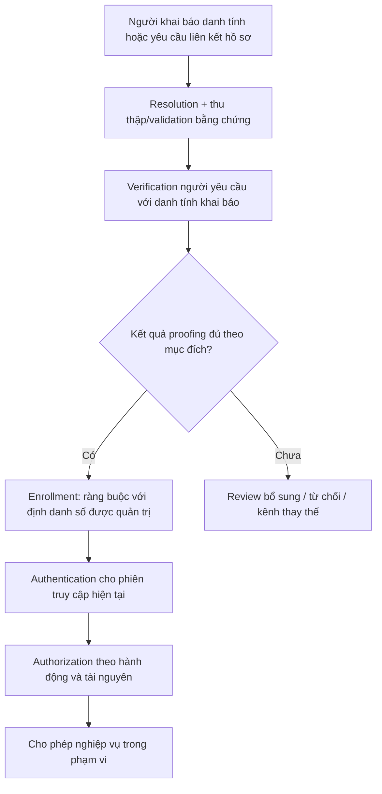
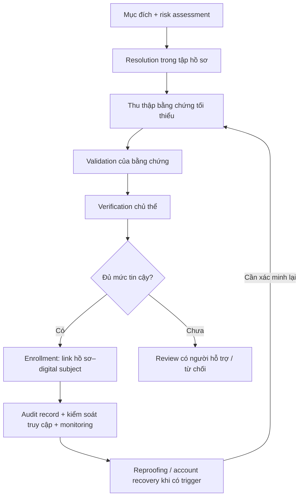
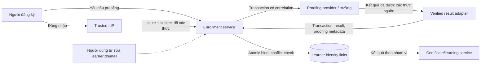

# Identity proofing

## Mục tiêu học tập

Sau bài học này, bạn có thể:

- Giải thích **identity proofing (xác minh danh tính ban đầu)** là gì, mục đích và giới hạn của nó trong chương trình **identity assurance**.
- Phân biệt **identity resolution**, **evidence validation**, **identity verification**, **enrollment/account binding** với **authentication**, **authorization** và **account recovery**.
- Lựa chọn mức độ xác minh theo **rủi ro nghiệp vụ và tác động tới cá nhân**, thay vì bắt mọi người dùng gửi giấy tờ tùy thân một cách mặc định.
- Nhận diện các kịch bản **giả danh, danh tính tổng hợp, trùng/misbind hồ sơ, giả mạo bằng chứng, social engineering và chiếm đoạt tài khoản**; thiết kế controls và phương án xử lý.
- Xác định các yêu cầu về **privacy, data minimization, bảo vệ bằng chứng, accessibility, con người review và quản trị nhà cung cấp**.
- Thiết kế quy trình proofing cho nền tảng học tập Java/Spring Boot, gắn kết quả đã được xác minh với **định danh số ổn định** và kiểm thử quyền nghiệp vụ.
- Xây dựng hồ sơ **Claim – Argument – Evidence** để đánh giá hiệu lực proofing trong quá trình phát triển, phát hành, vận hành và audit.

## 1. Identity proofing là gì?

**Identity proofing** là quá trình thu thập và đánh giá thông tin/bằng chứng để tạo mức tin cậy phù hợp rằng **một người đang yêu cầu thiết lập hoặc liên kết danh tính số thực sự tương ứng với danh tính được khai báo**. Proofing thường diễn ra khi đăng ký một tài khoản cần tin cậy cao hơn, liên kết hồ sơ chính thức, cấp quyền nhạy cảm hoặc khôi phục một danh tính đã có.

Ví dụ: một học viên có thể tạo tài khoản để xem khóa học miễn phí chỉ bằng phương thức đăng ký được phép. Tuy nhiên, để cấp **chứng chỉ gắn danh tính thật** hoặc liên kết kết quả thi với hồ sơ chính thức của trường, tổ chức có thể cần **bằng chứng bổ sung rằng người đang thao tác chính là người thuộc hồ sơ học viên tương ứng**.

Proofing là **đánh giá căn cứ về danh tính**, không phải cam kết không thể bị giả mạo. Mức độ tin cậy phụ thuộc vào phương pháp, nguồn dữ liệu, chất lượng bằng chứng, threat model, cách xử lý ngoại lệ và độ mới của kết quả. Khi bối cảnh rủi ro thay đổi, một kết luận proofing cũ có thể không còn đủ cho mục đích mới.

Trong module **SECURITY_SECURITY_ASSURANCE**, trọng tâm không chỉ là “quy trình có bước kiểm tra giấy tờ”. Chúng ta cần chứng minh rằng **mục tiêu danh tính được xác định đúng, biện pháp proofing phù hợp rủi ro, hoạt động đúng trên những ca thử quan trọng và quyết định có thể truy vết**.

### 1.1. Một ví dụ phân biệt rõ

Một người truy cập `/api/certificates/issue` với tài khoản đã đăng nhập thành công. Tài khoản đó có thể dùng một email hợp lệ, mật khẩu mạnh và MFA. Những điều trên vẫn **không tự chứng minh** người ấy là học viên trong hồ sơ đào tạo chính thức.

Cần phân biệt ba khẳng định:

1. **Đã xác thực:** người gọi chứng minh quyền kiểm soát phương thức đăng nhập gắn với tài khoản số.
2. **Đã proofing theo yêu cầu:** có bằng chứng phù hợp về mối liên kết giữa người gọi và danh tính/hồ sơ được khai báo.
3. **Được phép cấp chứng chỉ:** người gọi có quyền nghiệp vụ thực hiện hành động này đối với học viên, khóa học và kết quả cụ thể.

Ba điều kiện bổ trợ nhau. Một tài khoản proofing thành công **không tự được cấp quyền quản trị**; một tài khoản có vai trò `ADMIN` cũng **không được tự tuyên bố** rằng người dùng khác đã được xác minh.

## 2. Thuật ngữ cần phân biệt

| Khái niệm | Câu hỏi được giải quyết | Ví dụ trong nền tảng học tập |
| --- | --- | --- |
| **Identification** | Chủ thể tự giới thiệu bằng định danh hoặc thuộc tính gì? | Người dùng nhập họ tên, mã học viên và email. |
| **Identity resolution** | Thông tin có đủ để phân biệt hồ sơ đang yêu cầu với các hồ sơ khác trong phạm vi không? | Đối chiếu mã học viên với một hồ sơ tồn tại, xử lý nhiều người trùng tên. |
| **Evidence collection** | Cần thu thập căn cứ nào đúng với mục đích? | Hồ sơ tuyển sinh do trường kiểm soát hoặc thông tin xác nhận từ bên tin cậy. |
| **Evidence validation** | Bằng chứng có hợp lệ, phù hợp, còn hiệu lực và đến từ nguồn đáng tin không? | Kiểm tra tính nhất quán của hồ sơ và xác thực nguồn phát hành. |
| **Identity verification** | Người đang yêu cầu có thực sự gắn với danh tính trong bằng chứng không? | So khớp bằng quy trình được phép hoặc xác minh qua kênh tin cậy độc lập. |
| **Enrollment/binding** | Kết quả đã xác minh được gắn an toàn với tài khoản số nào? | Liên kết một hồ sơ học viên với định danh số bất biến của IdP. |
| **Authentication** | Ở phiên truy cập này, người dùng có chứng minh kiểm soát authenticator/tài khoản không? | Đăng nhập bằng passkey, mật khẩu hoặc MFA theo chính sách. |
| **Authorization** | Người đã xác thực được phép làm gì với tài nguyên cụ thể? | Chỉ học viên hoặc vai trò được phép mới nhận chứng chỉ. |
| **Reproofing/recovery** | Khi thông tin thay đổi hoặc tài khoản bị mất, làm sao phục hồi niềm tin một cách hợp lệ? | Xác minh lại khi đổi liên kết tài khoản của học viên. |

**Validation** và **verification** không phải một. Một giấy tờ có thể có dấu hiệu hợp lệ nhưng chưa chứng minh người cầm giấy tờ là chủ sở hữu; người đang điều khiển một email không đương nhiên là người có tên trên hồ sơ trường. **Resolution** phân biệt hồ sơ, nhưng tìm thấy một hồ sơ trùng tên cũng chưa xác minh ai đang yêu cầu liên kết.

### 2.1. Proofing khác authentication và authorization thế nào?



Trong thực tế, tài khoản có thể tồn tại **trước** khi proofing; người dùng có thể đăng nhập để hoàn thành quy trình proofing. Sơ đồ thể hiện **phân biệt chức năng kiểm soát**, không nhất thiết là thứ tự tạo tài khoản bắt buộc của mọi tổ chức.

## 3. Chọn mức identity assurance theo rủi ro

**Không phải mọi tương tác số đều cần proofing sâu.** Thu thập quá nhiều bằng chứng có thể làm tăng nguy cơ lộ thông tin cá nhân, gây phiền hà và loại trừ người không có giấy tờ hoặc thiết bị phù hợp. Vì vậy phải bắt đầu từ **mục đích sử dụng danh tính** và hậu quả nếu liên kết sai.

### 3.1. Các câu hỏi đánh giá

1. Danh tính có được dùng để **trao quyền nhạy cảm**, cấp chứng chỉ, ghi điểm chính thức hoặc tiếp cận dữ liệu cá nhân không?
2. Nếu một kẻ gian **giả danh hoặc liên kết nhầm tài khoản**, ai bị thiệt hại và mức độ nào?
3. Có thể dùng **hồ sơ tổ chức đã kiểm chứng trước đó** thay cho việc thu thập giấy tờ mới không?
4. Cần xác minh **danh tính pháp lý ngoài đời**, hay chỉ cần biết tài khoản là một người thuộc tổ chức/nhóm hợp lệ?
5. Quy định, hợp đồng hoặc cam kết áp dụng có yêu cầu bổ sung nào không?
6. Nếu proofing thất bại, có đường **review có người hỗ trợ**, khiếu nại hoặc tiếp cận thay thế thích hợp không?
7. Những dữ liệu thu thập có cần giữ không, lưu trong bao lâu và ai được tiếp cận?

### 3.2. Phân tích cho ba tính năng

| Tính năng | Rủi ro khi gắn nhầm danh tính | Cách tiếp cận minh họa |
| --- | --- | --- |
| Đọc bài học công khai | Tác động danh tính có thể thấp. | Có thể không cần xác minh danh tính thật; dùng session/tài khoản theo nhu cầu sản phẩm. |
| Liên kết hồ sơ sinh viên với điểm đã lưu | Lộ dữ liệu cá nhân hoặc liên kết nhầm tiến độ chính thức. | Cần nguồn hồ sơ tin cậy và bước xác minh người yêu cầu có quyền liên kết. |
| Phát hành chứng chỉ hoặc thay đổi hồ sơ học viên chính thức | Có thể gian lận danh tính, sai lệch chứng chỉ hoặc gây hại cho người thật. | Chọn quy trình proofing và kiểm tra bổ sung có độ tin cậy phù hợp hậu quả, giữ quyết định có thể audit. |

Các ví dụ trên **không áp đặt** rằng mọi chứng chỉ đều bắt buộc kiểm tra giấy tờ tùy thân. Trường có thể đã xác minh danh tính người học khi nhập học và cho phép dùng **kết quả đáng tin từ hệ thống đăng ký** nếu việc chuyển giao, liên kết và độ mới đáp ứng yêu cầu. Không nên lặp lại thao tác xâm lấn chỉ để “đủ bước”.

### 3.3. IAL, AAL và FAL không thay thế nhau

Trong các hướng dẫn quản lý danh tính số như **NIST SP 800-63**, người học thường gặp ba trục bảo đảm:

- **Identity Assurance Level (IAL):** mức tin cậy đối với việc danh tính được khai báo đã được xác minh theo quy trình proofing.
- **Authenticator Assurance Level (AAL):** mức tin cậy vào cách người dùng xác thực quyền kiểm soát authenticator trong một phiên.
- **Federation Assurance Level (FAL):** mức bảo đảm đối với cách khẳng định danh tính/xác thực được chuyển qua quan hệ liên kết giữa các hệ thống.

Những khái niệm này phục vụ các khía cạnh **khác nhau**. MFA mạnh có thể tăng bảo đảm xác thực nhưng không tự nâng mức proofing. Kết quả proofing tốt cũng không sửa được cấu hình liên kết IdP sai, token giả mạo hoặc authorization nghiệp vụ bị bỏ qua.

Các phiên bản và profile của tiêu chuẩn có thể quy định chi tiết khác nhau về mức, loại bằng chứng và phương thức thực hiện. **Không tự gắn nhãn “đạt IAL2/IAL3” cho một quy trình chỉ vì có ảnh giấy tờ hoặc selfie.** Nếu dự án cần công bố mức tuân thủ cụ thể, phải đối chiếu **đúng phiên bản tiêu chuẩn/profile được chọn**, toàn bộ yêu cầu kỹ thuật và bằng chứng kiểm chứng.

## 4. Vòng đời identity proofing

Một quy trình có thể chia thành các pha chức năng sau, có điều chỉnh theo mô hình trực tiếp/từ xa, có người hỗ trợ hay tích hợp bên thứ ba:

### Bước 1 – Xác định mục đích và chủ thể

Định nghĩa **tại sao** cần proofing, hồ sơ nào sẽ được liên kết, tài sản và quyền nào phụ thuộc vào kết quả. Xác định người đề nghị, hệ thống tin cậy, kênh giao tiếp và mức rủi ro. Ghi rõ **điều kiện thành công và trường hợp cần xem lại**.

Ví dụ: liên kết một tài khoản số với **mã hồ sơ học viên do trường quản lý**, chứ không phải chứng minh tất cả thông tin pháp lý về người đó cho mọi hoạt động trên nền tảng.

### Bước 2 – Identity resolution

Đánh giá thông tin đã khai để xác định **đúng hồ sơ trong phạm vi tổ chức**, xử lý bản ghi trùng hoặc không nhất quán. Tên và ngày sinh có thể trùng; email có thể thay đổi và có thể bị cấp lại. Tìm thấy một bản ghi duy nhất theo thuật toán **chưa chứng minh người yêu cầu là chủ hồ sơ**.

Đầu ra có thể là `RESOLVED`, `AMBIGUOUS` hoặc `NO_MATCH` theo quy trình, kèm lý do. Khi có hai hồ sơ nghi trùng, không nên tự động gộp thông tin nhạy cảm nếu chưa có bằng chứng.

### Bước 3 – Thu thập bằng chứng phù hợp

Chỉ thu thập **đúng loại và lượng dữ liệu cần thiết**: hồ sơ nhập học, thông tin xác minh từ tổ chức có thẩm quyền, tài liệu được phép hoặc kết quả xác nhận từ nhà cung cấp đáng tin. Một số mục đích có thể cần phương pháp có người hỗ trợ, nhưng nhiều mục đích khác có thể dùng bản ghi đã được trường xác nhận.

Nên ưu tiên lưu **metadata kết quả** thay vì ảnh tài liệu gốc khi nghiệp vụ không đòi giữ ảnh. Nếu phải giữ tài liệu, cần kiểm soát chặt quyền truy cập, thời hạn, mục đích, cách xóa và đường tiếp nhận yêu cầu của chủ thể dữ liệu.

### Bước 4 – Validation của bằng chứng

Kiểm tra bằng chứng **hợp lệ, nguyên vẹn, còn giá trị và có nguồn đáng tin trong phạm vi**. Chất lượng không chỉ dựa vào định dạng của ảnh, mà có thể phụ thuộc việc xác nhận với nguồn phát hành hoặc dữ liệu có thẩm quyền khi được phép.

Ví dụ, một mã học viên có cú pháp đúng không đủ xác nhận hồ sơ thuộc người yêu cầu. Một ảnh giấy tờ trông giống thật cũng không chắc chắn là tài liệu thật hoặc chưa bị chỉnh sửa.

### Bước 5 – Verification người yêu cầu

Thiết lập căn cứ rằng **người đang yêu cầu liên kết là chủ thể thích hợp** với thông tin/bằng chứng đã được validation. Cách xác minh phụ thuộc phương pháp: tương tác có nhân viên, bước xác nhận qua kênh tổ chức đáng tin, kiểm chứng trực tiếp hoặc quy trình được nhà cung cấp kiểm soát.

Nếu dùng ảnh/video/sinh trắc, cần threat model cho giả mạo, replay, deepfake, presentation attack và chất lượng thiết bị; biện pháp **liveness** có thể hỗ trợ nhưng không mặc định loại bỏ mọi giả mạo. Sinh trắc là dữ liệu nhạy cảm, có rủi ro khó thu hồi khi lộ; phải xem quyền riêng tư, tính cần thiết, hỗ trợ người không thể dùng phương thức đó và nguồn bằng chứng bổ sung.

### Bước 6 – Quyết định và enrollment

Đưa ra kết quả `VERIFIED`, `REVIEW_REQUIRED`, `REJECTED` hoặc trạng thái tương đương theo chính sách. Kết quả phải được gắn an toàn với **tài khoản số cụ thể** và **hồ sơ nghiệp vụ đã xác minh**. Cần bảo đảm không có hai luồng đồng thời tự liên kết sai một hồ sơ, không cho phép client chỉ định tùy tiện định danh của người khác.

Một bản ghi proofing hợp lệ **không đồng nghĩa quyền nghiệp vụ đã được cấp**: hệ thống authorization còn phải kiểm tra người yêu cầu có quyền đối với thao tác/tài nguyên.

### Bước 7 – Vận hành và tái xác minh

Quy định khi nào kết quả cần được xem lại: thay thông tin hồ sơ trọng yếu, nghi ngờ gian lận, account recovery, liên kết với IdP mới, khóa/mất tài khoản, phát hiện hồ sơ trùng hoặc nhiệm vụ nhạy cảm mới. Không bắt mọi người dùng proofing lại vô thời hạn theo lịch nếu không có cơ sở rủi ro.



## 5. Threat modeling cho identity proofing

Các nguồn rủi ro không chỉ nằm trong hình thức bằng chứng. **Liên kết sai giữa hồ sơ và tài khoản** có thể tạo hậu quả tương đương hoặc lớn hơn lỗi xác minh một giấy tờ.

| Threat scenario | Điều kiện/điểm yếu có thể bị lợi dụng | Hậu quả | Biện pháp cần xem xét |
| --- | --- | --- | --- |
| **Giả danh người có hồ sơ hợp lệ** | Người tấn công biết họ tên, mã học viên và ngày sinh từ nguồn công khai. | Liên kết tài khoản kẻ gian với hồ sơ người thật. | Xác minh quyền kiểm soát qua nguồn/kênh đáng tin; không dùng thông tin dễ đoán làm bằng chứng duy nhất. |
| **Danh tính tổng hợp hoặc hồ sơ giả** | Hệ thống dựa hoàn toàn vào dữ liệu tự khai không được validation. | Tạo hồ sơ không đáng tin để nhận quyền/chứng chỉ. | Resolution, evidence validation và review theo mức rủi ro. |
| **Giấy tờ/ảnh hoặc tín hiệu số giả mạo** | Chỉ kiểm định dạng/ảnh không có bước xác thực nguồn hoặc xác minh người. | Chấp nhận sai danh tính. | Kiểm tra tính nguyên vẹn, dấu hiệu giả mạo, kênh xác minh tin cậy, đánh giá rủi ro công nghệ. |
| **Replay kết quả từ nhà cung cấp** | Webhook không xác minh chữ ký, freshness, event ID hoặc ràng buộc request. | Đánh dấu `VERIFIED` cho nhầm người/phiên. | Xác minh nguồn, chống replay, liên kết transaction, idempotency và mapping có thể audit. |
| **Account misbinding** | Client được gửi `learnerId` và hệ thống tin trực tiếp hoặc gộp theo email. | Tài khoản của người A được gắn với hồ sơ B. | Dùng định danh từ nguồn đã xác thực, mapping kiểm soát server, constraint và review xung đột. |
| **Insider override** | Reviewer có thể tự chấp thuận hàng loạt, bỏ qua điều kiện mà không có dấu vết. | Người không đủ điều kiện được cấp trạng thái tin cậy. | Separation of duties, kiểm tra thẩm quyền, lý do, audit trail và lấy mẫu review. |
| **Chiếm đoạt tài khoản sau proofing** | Recovery qua kênh yếu, không kiểm tra lại khi đổi chủ thể điều khiển. | Người gian dùng tài khoản vốn đã proofing thành công. | Authentication phù hợp, recovery có kiểm soát, re-binding/reproofing theo trigger. |
| **Rò rỉ dữ liệu proofing** | Ảnh giấy tờ lưu công khai, log ghi thông tin đầy đủ, vendor retention không rõ. | Lộ thông tin cá nhân có tính nhạy cảm, có thể bị dùng để giả danh tiếp. | Data minimization, mã hóa, RBAC/IAM, retention, logging an toàn và kiểm toán bên thứ ba. |
| **Từ chối sai hoặc phân biệt đối xử** | Chất lượng ảnh, thiết bị, ngôn ngữ hoặc khuyết tật làm quy trình thất bại. | Người hợp lệ không tiếp cận dịch vụ/học tập. | Kênh thay thế, review có người hỗ trợ, giám sát lỗi và khiếu nại công bằng. |

### 5.1. Ưu tiên xử lý dựa trên hậu quả

Với chứng chỉ chính thức, **false acceptance** có thể tạo chứng chỉ sai danh tính. Nhưng **false rejection** cũng gây tác hại khi người học hợp lệ bị từ chối quyền lợi. Chương trình assurance phải đo và quản trị **cả hai loại thất bại**, không chỉ tỷ lệ gian lận bị bắt.

Một quy trình quá nghiêm ngặt mà không có kênh hỗ trợ có thể đẩy người dùng sang đường không chính thức, làm tăng rủi ro tổng thể. Vì vậy đánh giá threat phải bao gồm trải nghiệm, khả năng tiếp cận và quyền riêng tư như những yếu tố ảnh hưởng tới **chất lượng và độ tin cậy của quy trình**.

## 6. Proofing tại trường và proofing qua bên thứ ba

### 6.1. Sử dụng nguồn hồ sơ tổ chức đã tin cậy

Với một học viên đã được xác minh khi nhập học, hệ thống quản lý đào tạo có thể là **nguồn hồ sơ đủ tin cậy** cho một số mục đích. Tuy nhiên cần kiểm tra:

- **Nguồn gốc:** hồ sơ do hệ thống/trường nào tạo, được quản trị và thay đổi bởi ai?
- **Mức đánh giá trước đó:** bước nhập học đã xác minh những gì, cho mục đích nào?
- **Độ mới:** thông tin liên kết, trạng thái học viên và mối quan hệ có còn đúng?
- **Cách chuyển giao:** assertion/kết quả được gửi qua kênh nào, có chữ ký, bảo vệ và kiểm tra replay không?
- **Binding:** tài khoản số có được liên kết đúng một hồ sơ và không bị người khác chiếm chỗ?
- **Giới hạn:** kết quả proofing của tổ chức A có phù hợp cho chứng chỉ do tổ chức B phát hành không?

Đừng suy ra rằng **email có đuôi tên trường** là bằng chứng danh tính chính thức. Một địa chỉ có thể được cấp lại, chuyển quyền điều khiển hoặc không gắn duy nhất với người học.

### 6.2. Dùng nhà cung cấp identity proofing

Khi thuê dịch vụ kiểm tra tài liệu hoặc danh tính, tổ chức vẫn phải đánh giá **trách nhiệm chia sẻ**, không thể chuyển hết rủi ro sang vendor:

| Thành phần | Câu hỏi cần đặt |
| --- | --- |
| Phạm vi dịch vụ | Vendor xác minh danh tính pháp lý, giấy tờ, quyền kiểm soát kênh hay chỉ phân tích hình ảnh? |
| Phương pháp và giới hạn | Có hỗ trợ review thủ công, ca thiếu giấy tờ, thiết bị chất lượng thấp, gian lận tinh vi không? |
| Dữ liệu và quyền riêng tư | Vendor thu thập gì, chia sẻ với ai, giữ bao lâu, có cơ chế xóa và quyền truy cập nào? |
| Kết quả trả về | Assertion gồm issuer, subject, transaction, mức/phương pháp, thời gian và trạng thái nào? |
| Bảo vệ tích hợp | Xác minh chữ ký, audience, freshness, TLS, replay, mapping và rotation keys thế nào? |
| Evidence và audit | Có thể kiểm tra chất lượng proofing mà không lưu bản sao giấy tờ thô không? |
| Sự cố và vận hành | Có cách phát hiện fraud, tạm dừng tích hợp, sửa kết quả sai và thông báo theo thỏa thuận không? |
| Hết hợp đồng | Dữ liệu/bằng chứng có được xử lý đúng, cách duy trì truy vết quyết định cũ là gì? |

**Một cờ `verified=true` do API vendor trả** không tự đảm bảo phù hợp mục đích nếu hệ thống không biết **ai được xác minh, bằng chứng nào, ở thời điểm nào và transaction nào**, hoặc chấp nhận cờ đó từ request client.

## 7. Thiết kế liên kết danh tính an toàn

Một trong những lỗi nguy hiểm nhất là **account misbinding**: hệ thống proofing đúng một người nhưng liên kết kết quả đó với tài khoản/hồ sơ của người khác. Vì thế cần coi **binding** là một security control riêng.

### 7.1. Không dựa vào trường có thể đổi hoặc tái cấp

Không nên coi họ tên, email hiển thị, số điện thoại hoặc mã tự khai trong request là khóa duy nhất của danh tính lâu dài. Đối với tài khoản federated, ứng dụng thường cần dùng cặp định danh từ **issuer tin cậy + subject định danh ổn định** (và những ràng buộc tenant/organization nếu áp dụng). Chỉ tin kết quả sau khi luồng authentication/token validation đã đạt.

Ví dụ dữ liệu liên kết nội bộ:

```text
Learning record: learner_id = 42         (ID nội bộ do trường quản trị)
Digital account: issuer + subject        (đã được xác thực bởi IdP tin cậy)
Proofing transaction: provider + event  (sự kiện có nguồn gốc đã xác minh)
Binding record: learner_id ↔ digital subject
Binding status: pending | verified | disputed | revoked
```

**Một ID nội bộ không tự là chứng cứ danh tính**. Nó chỉ là chìa khóa hồ sơ; quá trình xác minh cần kết luận người đang yêu cầu liên kết có liên quan đúng đến hồ sơ đó.

### 7.2. Thực thi binding có thể kiểm chứng

Các điều kiện thiết kế:

1. Bản ghi proofing được tạo từ **kênh backend tin cậy**, không từ JSON tự khai của người dùng.
2. Mỗi sự kiện có định danh và correlation tới **yêu cầu proofing** trước đó; kiểm tra nguồn, chữ ký/transport, thời gian hiệu lực và replay theo giao thức được lựa chọn.
3. Một hồ sơ đang liên kết có thể cần **ràng buộc duy nhất** và quy tắc chuyển/chấm dứt liên kết rõ, thực thi **atomically** trong database.
4. Không tự overwrite liên kết khác khi hai yêu cầu đồng thời hoặc khi email thay đổi; xử lý như xung đột cần review.
5. Kết quả proofing phải được đối chiếu với **tài khoản xác thực đang được liên kết**, không đơn thuần là `learnerId` trong URL.
6. Có audit trail cho tạo/sửa/thu hồi liên kết; nhân viên xử lý thủ công phải có quyền và lý do phù hợp.
7. Account recovery hoặc đổi IdP phải có quy tắc liên kết lại để không làm mất assurance ban đầu.



Các mũi tên là **mô hình dữ liệu và ranh giới tin cậy**; không có nghĩa hệ thống được phép tự lấy `issuer + subject` từ request frontend. Phải xác thực assertion tại backend, gắn đúng phiên đã khởi tạo và kiểm tra các tình huống race/replay.

## 8. Ví dụ Java/Spring Boot: hạn chế chức năng cần identity proofing

### 8.1. Mục tiêu và các control

Giả sử một nền tảng học tập cho phép mọi tài khoản hợp lệ xem nội dung đã đăng ký, nhưng chỉ **người học có liên kết hồ sơ được xác minh theo mức yêu cầu** mới được tự yêu cầu phát hành chứng chỉ cá nhân.

Các yêu cầu minh họa:

| ID | Requirement | Phạm vi |
| --- | --- | --- |
| `IDP-01` | Kết quả proofing chỉ được chấp nhận từ nguồn đã định danh, có kiểm chứng về transaction, thời gian và tính toàn vẹn. | Backend proofing integration. |
| `IDP-02` | Liên kết hồ sơ–tài khoản phải kiểm tra xung đột và không cho người gọi tự gán hồ sơ của người khác. | Enrollment/binding. |
| `IDP-03` | Thao tác cấp chứng chỉ phải kiểm cả trạng thái proofing **và quyền trên hồ sơ/kết quả**. | Certificate issuance API. |
| `IDP-04` | Quyết định review thủ công có người chịu trách nhiệm, lý do, thẩm quyền và audit log. | Operator/reviewer workflow. |
| `IDP-05` | Hồ sơ proofing thu thập và lưu tối thiểu phù hợp mục đích, giới hạn truy cập và thời hạn. | Data governance/retention. |
| `IDP-06` | Account recovery, đổi IdP hoặc nhận tín hiệu gian lận phải kích hoạt rà soát liên kết khi cần. | Lifecycle/security operations. |

### 8.2. Ví dụ kiểm tra tại tầng dịch vụ

Một service có thể chặn phát hành chứng chỉ khi không đủ điều kiện identity proofing:

```java
@Configuration
@EnableMethodSecurity
class MethodSecurityConfig {}

@Service
class CertificateIssuanceService {
    private final CertificateRepository certificates;

    CertificateIssuanceService(CertificateRepository certificates) {
        this.certificates = certificates;
    }

    @PreAuthorize("@certificatePolicy.canIssue(authentication, #learnerId)")
    public Certificate issue(long learnerId) {
        return certificates.issueForLearner(learnerId);
    }
}
```

`certificatePolicy`, `CertificateRepository` và `Certificate` là **thành phần minh họa** do ứng dụng tự thiết kế. `canIssue` phải kiểm tra đầy đủ các điều kiện **từ nguồn phía server**:

- Danh tính phiên xác thực hợp lệ, issuer/subject được hệ thống tin cậy; không chỉ tin email hoặc username do client khai.
- Binding `learnerId ↔ issuer/subject` đúng, không disputed/revoked, trạng thái proofing phù hợp mục đích phát hành.
- Hồ sơ và kết quả khóa học cho phép hành động này theo nghiệp vụ; proofing thành công không tự cấp quyền.
- Trạng thái proofing còn hiệu lực theo policy, không có tín hiệu gian lận hoặc yêu cầu review chưa giải quyết.
- Quy tắc thất bại an toàn nếu không truy vấn được nguồn quyết định quan trọng; không tự giả định `VERIFIED` từ cache cũ không được quản trị.

**Không nên** xây một phương thức `POST /proofing/complete` nhận `{"learnerId":42,"verified":true}` và trực tiếp đánh dấu trạng thái chỉ vì người dùng đã đăng nhập. Đó là bypass biện pháp proofing. Backend phải xác minh nguồn kết quả, binding, thời hạn và phê duyệt theo quy trình.

### 8.3. Xử lý kết quả từ nhà cung cấp

Một adapter nhận kết quả proofing nên thực hiện kiểm tra **trước khi gọi nghiệp vụ liên kết**:

```text
1. Verify trusted sender and protocol signature/authentication.
2. Verify issuer, expected audience, transaction ID and event freshness.
3. Reject replay using an idempotent event ledger.
4. Look up the server-created pending enrollment transaction.
5. Verify subject/account correlation and result type.
6. Atomically bind the verified learner record to trusted digital subject.
7. Record scoped decision and audit event without raw ID document data.
8. If duplicate, disputed, stale or unexpected -> REVIEW_REQUIRED / deny.
```

Đây là **pseudo-flow**, không phải thuật toán xác minh chữ ký hay proofing triển khai được. Các bước thực tế phải theo **giao thức/SDK đã chọn**, chuẩn bảo vệ transport/assertion, cách xoay khóa và threat model của nhà cung cấp. Đặc biệt, không được coi chữ ký hợp lệ là đủ nếu event không ràng buộc với **transaction đang chờ của đúng người**.

### 8.4. Kiểm thử bằng MockMvc cho business gate

Giả sử các fixtures được thiết lập ở persistence phía server: `learner-a` có binding `VERIFIED` với hồ sơ 42, `learner-b` có binding `PENDING` với hồ sơ 43, và không ai có quyền chéo. Controller minh họa dùng `POST /api/learners/{learnerId}/certificates`.

```java
@SpringBootTest
@AutoConfigureMockMvc
class CertificateProofingGateIT {
    @Autowired
    MockMvc mockMvc;

    @Test
    @WithMockUser(username = "learner-a", roles = "STUDENT")
    void verifiedOwnerMayRequestCertificate() throws Exception {
        mockMvc.perform(post("/api/learners/42/certificates")
                .with(csrf()))
            .andExpect(status().isCreated());
    }

    @Test
    @WithMockUser(username = "learner-b", roles = "STUDENT")
    void pendingProofingCannotIssueCertificate() throws Exception {
        mockMvc.perform(post("/api/learners/43/certificates")
                .with(csrf()))
            .andExpect(status().isForbidden());
    }

    @Test
    @WithMockUser(username = "learner-b", roles = "STUDENT")
    void verifiedRecordCannotBeUsedByOtherAccount() throws Exception {
        mockMvc.perform(post("/api/learners/42/certificates")
                .with(csrf()))
            .andExpect(status().isForbidden());
    }
}
```

Mã là **ví dụ kiểm thử cấu trúc**, giả định Spring Security/MockMvc được bật, endpoint tồn tại, dữ liệu fixture hợp lệ, nghiệp vụ đủ điều kiện cấp chứng chỉ và controller trả `201 Created` khi tạo thành công. `csrf()` thuộc hỗ trợ kiểm thử khi CSRF áp dụng; không nên vô hiệu hóa security chain để đạt kết quả. Trong một hệ thống OIDC, username trong `@WithMockUser` chỉ là fixture; **cần thêm test với principal/claims hợp lệ của IdP và token validation thực**.

Các ca quan trọng khác: không xác thực, provider event giả hoặc replay, event đến muộn, tài khoản đổi IdP, hồ sơ đã link tài khoản khác, hai yêu cầu đồng thời, reviewer tự duyệt, trạng thái disputed/revoked và lỗi nguồn IAM/proofing. Một test trả `403` chỉ có giá trị khi biết nó bị từ chối **do policy mong đợi** chứ không phải lỗi CSRF hay route sai.

## 9. Thiết kế trạng thái và quyết định có thể audit

Identity proofing không nên chỉ có boolean `isVerified` vì nó không thể hiện **độ tin cậy, giới hạn mục đích, trạng thái tranh chấp và lịch sử**.

### 9.1. Một state machine minh họa

| Trạng thái | Ý nghĩa | Hành động cho phép |
| --- | --- | --- |
| `NOT_STARTED` | Chưa có yêu cầu proofing hợp lệ. | Có thể sử dụng chức năng không đòi proofing theo chính sách. |
| `PENDING` | Yêu cầu đã tạo, đang chờ bằng chứng/xử lý. | Không tự cho phép chức năng bắt buộc `VERIFIED`. |
| `REVIEW_REQUIRED` | Có mâu thuẫn, kết quả chưa chắc chắn hoặc cần người kiểm tra. | Dùng kênh review, không tự nâng trạng thái. |
| `VERIFIED` | Có quyết định proofing phù hợp phạm vi/phương pháp tại thời điểm đánh giá. | Có thể là **một điều kiện** để xét cấp quyền nghiệp vụ. |
| `REJECTED` | Không đáp ứng hoặc bằng chứng không hợp lệ theo quy trình. | Không dùng proofing cho hành động yêu cầu tin cậy; có đường khiếu nại phù hợp. |
| `DISPUTED` | Liên kết bị tranh chấp, có dấu hiệu misbinding hoặc gian lận. | Hạn chế các hành động nhạy cảm và điều tra. |
| `REVOKED` | Kết quả/link không còn được chấp nhận do quyết định có thẩm quyền. | Hủy quyền phụ thuộc theo thiết kế, xem xét reproofing. |

Tổ chức cũng có thể cần trường **thời điểm review lại**, version policy, loại phương pháp và phạm vi sử dụng. **Hết hạn bằng chứng không nhất thiết đồng nghĩa mọi danh tính mất hiệu lực**; phải có policy quy định cách xác định độ mới và khi nào cần reproofing theo rủi ro.

### 9.2. Mẫu hồ sơ proofing không chứa dữ liệu gốc

```yaml
proofing_record_id: "PROOF-EXAMPLE-001"
purpose: "Link learner to official academic record"
scope:
  system: "learning-platform"
  learner_record_ref: "<internal-record-reference>"
  digital_identity:
    trusted_issuer_ref: "<idp-issuer-reference>"
    subject_ref: "<stable-subject-reference>"
  environment: "production"
policy_revision: "<approved-proofing-policy-version>"
source:
  category: "trusted-academic-record-or-provider"
  transaction_ref: "<verified-transaction-reference>"
validation:
  evidence_types_checked: ["<approved-evidence-category>"]
  result: "PENDING"
verification:
  method: "<approved-method-category>"
  result: "PENDING"
decision:
  status: "REVIEW_REQUIRED"
  owner_role: "authorized-identity-reviewer"
  decided_at: "<decision-instant>"
  reason_code: "LINKAGE_NOT_YET_ESTABLISHED"
assurance:
  claim: "Learner record is linked to the rightful digital identity"
  evidence_refs: ["<protected-artifact-reference>"]
  verification_state: "INSUFFICIENT_EVIDENCE"
privacy:
  raw_document_stored_in_this_record: false
  retention_policy_ref: "<approved-retention-rule>"
audit:
  event_ref: "<protected-decision-log>"
reassess_on:
  - "Account recovery or identity provider migration"
  - "Binding dispute or credible fraud signal"
```

Mẫu này **không phải một chứng nhận thực tế** hay định dạng chuẩn. Trường `evidence_refs` phải liên kết tới bằng chứng **có thật, còn hiệu lực và được bảo vệ**, không phải chỉ một chuỗi tùy ý. Bản ghi phải tránh lưu ảnh giấy tờ, số định danh và sinh trắc thô nếu không cần thiết; ngay cả metadata cũng phải được phân quyền và giữ theo thời hạn đã được phê duyệt.

## 10. Bảo vệ quyền riêng tư, khả năng tiếp cận và niềm tin của người dùng

Proofing là một quy trình **nhạy cảm** vì có thể yêu cầu người dùng cung cấp căn cứ danh tính. Thu thập quá mức vừa tăng chi phí vừa tạo một kho dữ liệu có giá trị cao cho kẻ tấn công.

### 10.1. Privacy by design

- **Mục đích rõ:** thông báo cần xác minh gì và vì sao, không dùng dữ liệu ngoài mục đích được phép.
- **Tối thiểu hóa:** chỉ thu những thuộc tính/bằng chứng đủ cho mức tin cậy đã chọn; ưu tiên xác nhận từ nguồn đáng tin khi phù hợp.
- **Giới hạn lưu:** quyết định xem có cần giữ tài liệu gốc không; thiết lập retention/deletion có thể kiểm chứng.
- **Truy cập hẹp:** reviewer, nhân viên hỗ trợ, vendor và Operator chỉ thấy thông tin cần cho nhiệm vụ; log cũng phải bảo vệ.
- **Bảo vệ truyền/lưu:** lựa chọn biện pháp bảo mật phù hợp dữ liệu, secrets và quyền truy cập hệ thống xử lý.
- **Minh bạch:** mô tả các bên nhận dữ liệu, khả năng review và kênh hỗ trợ; xử lý yêu cầu của người dùng theo nghĩa vụ áp dụng.
- **Không mặc định đồng ý là đủ:** cơ sở xử lý dữ liệu phụ thuộc bối cảnh và pháp luật áp dụng, không thể tự tuyên bố mọi hoạt động hợp lệ chỉ vì biểu mẫu có nút đồng ý.

### 10.2. Khả năng tiếp cận và công bằng

Một người học có thể không có camera tốt, giấy tờ theo loại dự kiến, kết nối ổn định hoặc khả năng sử dụng sinh trắc. Nên thiết kế **kênh hỗ trợ và phúc tra** để người hợp lệ không bị loại trừ vô lý; kiểm tra tỷ lệ thất bại của quy trình, nguyên nhân và thời gian giải quyết.

Nếu sử dụng hệ thống đánh giá tự động, cần xem xét độ chính xác trên những điều kiện hoạt động khác nhau và khả năng **human review** khi cần, nhưng vẫn tôn trọng nguyên tắc chỉ thu thập dữ liệu nhạy cảm khi có căn cứ. Việc thu thập thêm nhiều thuộc tính của người dùng để đo công bằng cũng cần được đánh giá riêng về mục đích, quyền riêng tư và pháp lý.

### 10.3. Review có người và chống gian lận nội bộ

Khi reviewer được phép phê duyệt các hồ sơ khó, cần:

- Danh tính và **thẩm quyền reviewer** được kiểm tra tại thời điểm hành động.
- Tách việc tạo yêu cầu, phê duyệt và audit với các trường hợp rủi ro cao.
- Quyết định có **lý do có cấu trúc** và nguồn bằng chứng liên kết; không cho bấm “Approve all” không giải trình.
- Bảo vệ dữ liệu khỏi sao chép ra thiết bị cá nhân hoặc hệ thống ngoài phạm vi.
- Có kiểm tra chất lượng review, phát hiện bất thường và quy trình xử lý khi reviewer đưa ra quyết định sai.

**Sự tham gia của con người không tự đảm bảo kết quả đúng.** Chất lượng nguồn dữ liệu, trình độ, tính độc lập, áp lực thời gian và bằng chứng thực thi phải được đánh giá.

## 11. Proofing, khôi phục tài khoản và tái liên kết

Một liên kết identity có thể đã được proofing đúng ở thời điểm T, nhưng sau đó người dùng đổi email, mất thiết bị hoặc yêu cầu chuyển sang IdP mới. **Account recovery** là một đường rủi ro: kẻ gian có thể chiếm tài khoản đã có trạng thái `VERIFIED` nếu recovery yếu.

### 11.1. Các tình huống cần đánh giá lại

| Sự kiện | Rủi ro | Phương pháp kiểm soát |
| --- | --- | --- |
| Đổi email/số điện thoại | Kênh giao tiếp mới bị người khác kiểm soát; link sai. | Xác thực yêu cầu thay đổi và xem tác động đến binding. |
| Mất authenticator và recovery | Attacker có thể chiếm tài khoản đã proofing. | Recovery theo mức tin cậy yêu cầu, log và review lại nếu cần. |
| Chuyển IdP/SSO | Subject identifier thay đổi; dữ liệu mapping có thể trùng/sai. | Migration mapping có dấu vết, xác minh nguồn và không tự gộp bằng email. |
| Phát hiện hai tài khoản cùng yêu cầu một hồ sơ | Khả năng misbinding, gian lận hoặc bản ghi trùng. | Dừng tự động liên kết, review hồ sơ và lịch sử. |
| Thay đổi mục đích sử dụng | Kết quả proofing cũ chưa đủ cho nghiệp vụ rủi ro hơn. | Đánh giá yêu cầu mới; proofing bổ sung khi cần. |
| Vendor báo nghi ngờ gian lận | Kết quả trước đây có thể không còn đáng tin. | Tạm hạn chế hành động nhạy cảm, điều tra, quyết định mới. |

Không nên coi một email OTP là bằng chứng phục hồi đủ cho **mọi tài khoản có assurance cao**; nó chủ yếu cho thấy quyền điều khiển kênh tại thời điểm kiểm tra. Quy trình recovery phải xem threat model, mức bảo đảm cần duy trì và nghĩa vụ áp dụng.

### 11.2. Không biến reproofing thành yêu cầu lặp lại không cần thiết

Nếu người dùng chỉ thay ảnh đại diện, chưa chắc cần kiểm tra lại danh tính thật. Nếu chuyển quyền sở hữu hồ sơ học viên hoặc yêu cầu sửa danh tính trên chứng chỉ chính thức, quy trình có thể cần căn cứ mạnh hơn. Cần quy định **trigger dựa trên rủi ro**, dùng lại bằng chứng còn hiệu lực phù hợp mục đích khi được phép và hạn chế việc thu thập lại giấy tờ vô ích.

## 12. Đánh giá hiệu lực proofing trong security assurance

Trong assurance, cần tách **design effectiveness** khỏi **operating effectiveness**:

| Góc nhìn | Câu hỏi | Bằng chứng gợi ý |
| --- | --- | --- |
| **Design effectiveness** | Nếu quy trình được thực thi đúng, nó có ngăn liên kết sai/gian lận phù hợp threat model không? | Threat model, risk assessment, data-flow, quyết định phương pháp và nguồn trust. |
| **Implementation** | Các điểm kiểm tra, liên kết, bảo vệ dữ liệu và chuyển trạng thái đã được hiện thực đúng chưa? | Code review, cấu hình tích hợp, phân quyền reviewer, ràng buộc DB, API tests. |
| **Operating effectiveness** | Hồ sơ thật trong kỳ có được xử lý theo yêu cầu, xử lý review/exception và audit đúng không? | Decision logs, mẫu case, provider attestations, records có provenance, kết quả kiểm tra hoạt động. |
| **Continuous effectiveness** | Khi vendor, IdP, policy, threat hoặc nghiệp vụ thay đổi, kết luận được cập nhật không? | Change-triggered review, finding, re-test, incident/postmortem và metrics. |

### 12.1. Claim – Argument – Evidence

**Claim:** “Đối với các yêu cầu liên kết hồ sơ học viên chính thức trong phạm vi bản phát hành R, hệ thống chỉ đánh dấu `VERIFIED` khi có kết quả proofing phù hợp mục đích từ nguồn đáng tin, được ràng buộc đúng với tài khoản số và hồ sơ học viên; các trường hợp mâu thuẫn không được tự động phê duyệt.”

**Argument:**

1. Mức proofing đã được lựa chọn từ rủi ro và yêu cầu nghiệp vụ, có owner và scope.
2. Nguồn bằng chứng, phương pháp validation/verification và các giới hạn đã được ghi nhận.
3. Tích hợp chỉ nhận kết quả từ nguồn đáng tin, kiểm tra freshness, transaction binding, event ID, replay và tình trạng xung đột.
4. Trạng thái `VERIFIED` được tạo từ quy trình server-side và không thể do client tùy tiện đặt.
5. Reviewer thủ công có quyền và audit trail; ca thiếu dữ liệu không bị biến thành `PASS`.
6. Các phép kiểm với gian lận, liên kết trùng, account recovery và thay đổi môi trường hỗ trợ kết luận trong phạm vi đã định.

**Evidence:**

| Điều cần chứng minh | Bằng chứng | Giới hạn |
| --- | --- | --- |
| Phạm vi/mức proofing phù hợp | Risk assessment và bản policy được duyệt. | Risk profile có thể đổi khi cấp quyền mới. |
| Nguồn và kết quả proofing đáng tin | Tài liệu tích hợp, assertion đã kiểm chứng, metadata của transaction và audit quyết định. | Không cần/không nên trích xuất tài liệu cá nhân thô vào báo cáo phổ biến. |
| Chống replay/misbinding | Tests sai chữ ký, audience, transaction, event trùng và concurrent binding. | Test chỉ chứng minh các đường đã triển khai và thực thi. |
| Quyết định reviewer hợp lệ | Role mapping tại thời điểm duyệt, case notes, log sửa trạng thái. | Chữ ký không tự chứng minh chất lượng phán đoán. |
| Chặn chức năng trước `VERIFIED` | Integration tests cho pending/rejected/verified và quyền đúng/sai. | Cần test runtime, API phụ và quyền nghiệp vụ khác. |
| Vận hành và xử lý khiếu nại | Case sample, thời gian xử lý, trạng thái dispute/revocation. | Mẫu có giới hạn; tỷ lệ sự cố thấp có thể do thiếu phát hiện. |

**Giới hạn claim:** proofing không xác định chắc chắn một người không thể bị mạo danh trong tương lai, không thay thế authentication cho từng phiên và không tự cho phép người đó truy cập tất cả dữ liệu liên quan.

### 12.2. Kiểm tra population và sampling

Nếu audit lấy mẫu các hồ sơ `VERIFIED`, cần trước hết xác định **population** từ nguồn đáng tin: mọi quyết định proofing thuộc phạm vi trong kỳ, kể cả quyết định thủ công, rejected, retry và recovery nếu policy yêu cầu. Chỉ xem danh sách “những ca reviewer đã mở” có thể bỏ sót các ca tự động không được kiểm tra.

Với từng mẫu có thể đối chiếu nguồn giao dịch, loại bằng chứng, kết quả validation/verification, tài khoản được liên kết, thẩm quyền reviewer, mốc thời gian và việc cấp chức năng sau quyết định. **Mẫu đạt không chứng minh toàn bộ mọi phiên và trường hợp chưa kiểm tra đều đạt**; cần nói rõ phương pháp và giới hạn.

## 13. Chỉ số theo dõi và điều kiện chuyển cấp

Đo lường proofing cần cân bằng **fraud risk**, khả năng tiếp cận, độ tin cậy nguồn và quyền riêng tư:

| KRI/KPI | Câu hỏi | Lưu ý |
| --- | --- | --- |
| Tỷ lệ liên kết có đủ quyết định/bằng chứng theo policy | Có hồ sơ nào được đánh dấu `VERIFIED` thiếu nguồn hoặc transaction hợp lệ? | Có metadata chưa đồng nghĩa chứng cứ thật đạt. |
| Số ca binding collision hoặc hồ sơ tranh chấp | Có dấu hiệu liên kết nhầm/gian lận hoặc dữ liệu nguồn không thống nhất? | Một collision không tự chứng minh gian lận. |
| Số event proofing bị từ chối do replay/invalid signature | Tích hợp có đang chặn input không tin cậy? | Số 0 có thể do không có tấn công hoặc logging thiếu. |
| Thời gian xử lý `REVIEW_REQUIRED` | Ca hợp lệ có được hỗ trợ trong thời hạn phù hợp không? | Nhanh không đảm bảo chính xác; cần đánh giá kết quả. |
| Tỷ lệ từ chối sai được xác nhận sau khiếu nại | Quy trình có làm tổn hại người dùng hợp lệ không? | Phụ thuộc khả năng tiếp cận kênh khiếu nại. |
| Số thay đổi proofing/recovery không có re-test | Bằng chứng assurance có bị lỗi thời khi hệ thống thay đổi? | Phải xác định trigger theo phạm vi và mức rủi ro. |
| Tỷ lệ hồ sơ tài liệu gốc quá hạn lưu | Privacy/retention controls có được thực thi? | Chỉ xem DB chính có thể bỏ sót backup/log/vendor. |
| Số reviewer override sai thẩm quyền | Manual controls có lỗ hổng hoặc SoD không? | Kiểm tra nguồn quyền và audit tại thời điểm override. |

### 13.1. Khi nào cần chuyển cấp?

Chuyển cấp tới security/risk owner/incident response theo quy trình khi phát hiện **một người có thể tự đánh dấu verified, kết quả nhà cung cấp bị giả mạo/replay, liên kết hồ sơ sai, dữ liệu proofing bị lộ, reviewer lạm quyền hoặc recovery cho phép chiếm tài khoản chính thức**. Nếu có dấu hiệu incident, cần bảo toàn chứng cứ và điều tra trước khi kết luận phạm vi ảnh hưởng.

Khi **thiếu bằng chứng**, không tự khẳng định có gian lận; dùng trạng thái `INSUFFICIENT_EVIDENCE`, xác định owner và bước kiểm chứng. Khi một test thật chứng minh chức năng nhạy cảm được dùng bởi tài khoản chưa proofing hoặc bị liên kết sai, đánh giá control là `FAIL` trong phạm vi test, lập finding và xử lý phù hợp.

## 14. Những ngộ nhận thường gặp

| Ngộ nhận | Cách hiểu đúng |
| --- | --- |
| “Có email OTP thì danh tính thật đã được proofing.” | Email OTP chủ yếu chứng minh quyền điều khiển kênh ở thời điểm kiểm tra, không đủ mặc định để chứng minh danh tính/hồ sơ. |
| “Có MFA là có identity assurance cao trên mọi phương diện.” | AAL nói về xác thực; identity proofing là khía cạnh khác. |
| “Chụp giấy tờ là chắc chắn chính chủ.” | Cần validation bằng chứng và verification người yêu cầu, cùng biện pháp chống giả mạo phù hợp. |
| “Vendor trả verified=true thì phải tin.” | Phải kiểm nguồn, transaction, freshness, binding, scope, phương pháp và giới hạn. |
| “Tên hoặc email trùng hồ sơ là đủ để link.” | Thuộc tính có thể trùng/đổi/tái cấp; cần quy trình liên kết an toàn. |
| “Một khi đã proofing thì không cần xác thực nữa.” | Authentication vẫn cần cho mỗi phiên theo thiết kế; recovery và liên kết phải được bảo vệ. |
| “Proofing thành công cấp luôn mọi quyền cho học viên.” | Authorization nghiệp vụ phải kiểm riêng theo hành động và tài nguyên. |
| “Cần thu thập giấy tờ của mọi người dùng để an toàn nhất.” | Thu thập quá mức tăng rủi ro privacy và loại trừ; mức proofing phải dựa trên mục đích/rủi ro. |
| “Không ai khiếu nại nghĩa là không từ chối sai.” | Người bị từ chối có thể không thể khiếu nại; cần theo dõi chất lượng và kênh hỗ trợ. |
| “Đã ký review là quyết định đúng.” | Review cần nguồn đáng tin, thẩm quyền, nội dung và audit; chữ ký chỉ là một phần chứng cứ. |
| “Tài khoản đổi IdP vẫn an toàn nếu email giống cũ.” | Cần mapping và xác minh ràng buộc danh tính; email không đủ để tự gộp. |
| “Lưu toàn bộ ảnh giấy tờ giúp audit tốt hơn.” | Cần cân bằng khả năng kiểm chứng với data minimization, retention và an toàn của kho dữ liệu. |

## 15. Tình huống thực hành: liên kết danh tính để cấp chứng chỉ

**Bối cảnh:** một nền tảng học tập Java/Spring Boot cho học viên đăng nhập bằng IdP của trường và xin chứng chỉ sau khóa học. Đội sản phẩm vừa thêm chức năng liên kết hồ sơ học viên. Hiện tại:

1. Client gửi `learnerId` và `email` tới `POST /api/identity/verify`, rồi server tự đặt `verified=true` nếu email trùng hồ sơ.
2. Kết quả từ một vendor được gửi qua webhook, nhưng dịch vụ chỉ đọc `verified=true` mà không kiểm chữ ký, sự kiện trùng hoặc transaction.
3. Người dùng có thể dùng email khôi phục để liên kết sang tài khoản số mới mà không phải đánh giá lại binding.
4. Reviewer có nút `Approve` cho mọi hồ sơ; các quyết định không lưu lý do và không kiểm tra reviewer có tự phê duyệt yêu cầu của mình hay không.
5. Bản scan giấy tờ và thông tin sinh trắc được giữ vô thời hạn trong một bucket truy cập bởi nhiều service accounts.
6. Kết quả CI xanh vì chỉ test “tài khoản đã đăng nhập có thể yêu cầu chứng chỉ”, không có test người khác thay `learnerId`.

### 15.1. Câu hỏi thực hành

1. Giải thích **sáu lỗ hổng hoặc khoảng trống assurance** trong bối cảnh; phân biệt identity proofing, authentication, account binding và authorization.
2. Xác định mục tiêu proofing theo hai phạm vi: tài khoản học tập thông thường và chứng chỉ gắn hồ sơ học viên chính thức. Có cần quy trình giống nhau không? Vì sao?
3. Thiết kế lại flow **resolution → validation → verification → binding**; chỉ rõ hệ thống nào là nguồn tin cậy, điều kiện xung đột và cách xử lý `REVIEW_REQUIRED`.
4. Viết **bốn requirements có thể kiểm chứng**: nguồn webhook, chống replay, liên kết hồ sơ và quyền cấp chứng chỉ.
5. Xây một bảng **positive/negative test** cho kết quả hợp lệ, sai nguồn, event trùng, transaction sai, hồ sơ đã liên kết và người dùng không có quyền.
6. Mô tả cách bảo vệ dữ liệu proofing: tập dữ liệu tối thiểu, retention, quyền truy cập, audit và xử lý data tại vendor. Có cách tránh giữ ảnh thô không?
7. Viết **Claim – Argument – Evidence** chứng minh hệ thống không đánh dấu `VERIFIED` từ dữ liệu tự khai; liệt kê ít nhất **năm artifact** và giới hạn của chúng.
8. Sau khi đã sửa và re-test thành công trên staging, có thể kết luận mọi bản production đã an toàn không? Cần bằng chứng deploy/runtime nào?
9. Nếu xuất hiện một hồ sơ bị liên kết nhầm, ai được phép thu hồi liên kết, cần giữ chứng cứ gì và có phải điều tra sự cố không?

### 15.2. Gợi ý tự đối chiếu

- **Email trùng không chứng minh chủ hồ sơ**; cần nguồn danh tính đáng tin và kiểm chứng người yêu cầu liên kết.
- **Webhook phải được xác thực** và ràng buộc với transaction server đã tạo; bản ghi event phải chống replay và xử lý nhất quán nếu đến muộn hoặc lặp.
- **Quyền cấp chứng chỉ** còn cần kiểm quyền trên học viên/khóa học/kết quả, dù trạng thái proofing là `VERIFIED`.
- Reviewer không được tự duyệt ngoài quy trình; quyết định cần lý do, evidence, thời điểm và thẩm quyền.
- Kho proofing chứa dữ liệu nhạy cảm phải được giới hạn mục đích, truy cập và thời hạn; thu thập thêm không tự làm hệ thống an toàn hơn.
- Kết quả test trên staging chỉ hỗ trợ claim trong bản/môi trường được xét; cần kiểm tra mapping IdP, đường gọi, cấu hình và dữ liệu liên kết đúng trên production.
- Nếu thiếu bằng chứng, dùng `INSUFFICIENT_EVIDENCE`. Nếu test đã xác nhận dữ liệu client có thể tự tạo trạng thái verified, đây là `FAIL` đối với yêu cầu proofing.

## Tổng kết

**Identity proofing** tạo căn cứ tin cậy rằng **người đang yêu cầu thiết lập hoặc liên kết danh tính số tương ứng với danh tính/hồ sơ được khai báo**, theo một mục đích và mức rủi ro xác định. Nó **khác** authentication và authorization, và chỉ đáng tin khi có đủ các bước **resolution → thu thập/validation bằng chứng → verification người yêu cầu → enrollment/binding an toàn → giám sát và tái đánh giá**. Trong **security assurance**, cần nối được **mục tiêu và rủi ro danh tính → yêu cầu và security controls → phép kiểm và evidence → quyết định có thẩm quyền → xử lý sai lệch, recovery và reproofing**. Chất lượng quy trình không chỉ đo bằng số người được `VERIFIED`, mà còn ở việc ngăn liên kết sai, giảm gian lận, bảo vệ dữ liệu cá nhân và duy trì khả năng tiếp cận cho người dùng hợp lệ.
