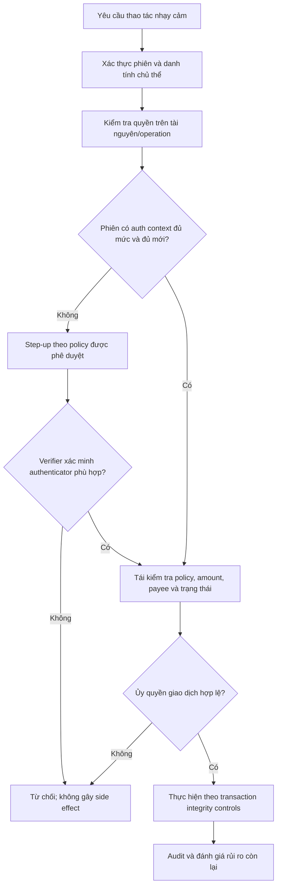
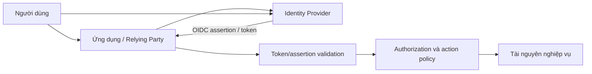
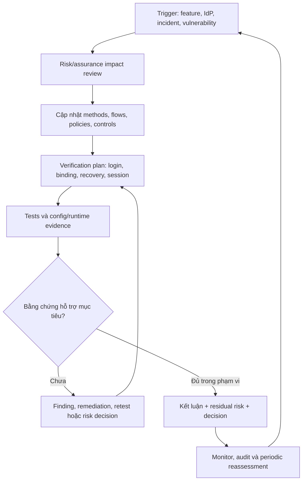

# Authentication assurance: Đánh giá có bằng chứng mức bảo đảm xác thực

## 1. Mục tiêu học tập

Sau bài học, người học có thể:

1. Giải thích **authentication assurance** (mức bảo đảm xác thực) là gì và phân biệt với *identity proofing*, *authorization*, bảo đảm liên kết danh tính liên hệ, tính an toàn của phiên và quyết định cho phép giao dịch.
2. Diễn giải cách **mức rủi ro, tài sản, đối tượng người dùng và hành động** quyết định yêu cầu đối với phương thức xác thực, độ tin cậy và bằng chứng.
3. Hiểu vai trò của các khái niệm **IAL, AAL, FAL** trong hướng dẫn định danh số của NIST, đồng thời tránh coi chúng là một thang điểm có thể thay thế cho nhau.
4. Phân tích những cơ chế thường gặp: mật khẩu, OTP, xác thực đa yếu tố (MFA), WebAuthn/FIDO2/passkeys, chứng chỉ và xác thực dựa trên khóa mật mã.
5. Xây dựng kiểm soát cho toàn bộ vòng đời: **enrollment → liên kết authenticator → đăng nhập → phiên → step-up → recovery → thu hồi → giám sát**.
6. Phân biệt xác thực người dùng tương tác với **xác thực dịch vụ/workload**, và xác định các yêu cầu an toàn đối với OIDC, OAuth 2.0, token, mTLS hoặc cơ chế tương đương khi áp dụng.
7. Thiết kế các kịch bản positive/negative/failure tests, thu evidence đúng build, cấu hình, môi trường và mô tả giới hạn của kết luận assurance.
8. Xử lý tình huống nâng mức xác thực cho thao tác thanh toán nhạy cảm trong Java/Spring Boot, lập bảng rủi ro–control–bằng chứng và ra quyết định theo thẩm quyền.

Bài thuộc chương **Identity assurance** của module **SECURITY_SECURITY_ASSURANCE**. Module xây dựng phương pháp **đánh giá có bằng chứng rằng hệ thống đáp ứng mục tiêu bảo mật** từ phân tích rủi ro, requirements và security controls tới testing, audit, remediation và giám sát liên tục trong phát triển/vận hành. Bởi vậy, **authentication assurance** không dừng ở việc “đã bật login/MFA” mà trả lời: **căn cứ nào chứng minh hệ thống đang xác thực đúng chủ thể với mức tin cậy cần thiết, trong ngữ cảnh và thời điểm cần thiết?**

## 2. Authentication assurance là gì?

**Authentication** là quá trình xác minh một chủ thể đang yêu cầu truy cập có quyền sử dụng một hoặc nhiều **authenticators** đã được liên kết với tài khoản hoặc danh tính tương ứng. Authenticators có thể là bí mật được biết, thiết bị/khóa được sở hữu hoặc cơ chế liên quan đặc tính sinh trắc, tùy thiết kế.

**Authentication assurance** là mức độ tin cậy có cơ sở rằng **quy trình, phương thức và kết quả xác thực** đáp ứng yêu cầu đặt ra đối với một phiên hoặc hành động trong điều kiện đánh giá. Nó bao gồm nhiều câu hỏi hơn việc hệ thống trả HTTP 200 ở endpoint login:

- Có căn cứ tin rằng **authenticator được liên kết đúng tài khoản** khi đăng ký hoặc bổ sung phương thức mới?
- Phương thức có chống những đe dọa quan trọng như phishing, đánh cắp mật khẩu, replay hoặc chiếm kênh recovery ở mức nào?
- Verifier có kiểm tra phản hồi/credential theo đúng protocol và trust boundary?
- Hệ thống có phân biệt xác thực mới, phiên còn hiệu lực, phiên bị nâng quyền hoặc trạng thái khôi phục tài khoản?
- Các bên nhận assertion/token có kiểm tra **issuer, audience, hạn, chữ ký và ngữ cảnh tin cậy**?
- Khi token, session, authenticator hoặc danh tính bị thu hồi, hệ thống có thực thi đúng chính sách?
- Có evidence từ test, review và vận hành để chứng minh những nhận định này?

**Mức bảo đảm không phải xác suất tuyệt đối người đăng nhập là người “thật”**, và cũng không chứng minh rằng mọi thao tác sau đăng nhập đều hợp lệ.

### 2.1. Một ví dụ ngắn

Người dùng A đăng nhập tài khoản chuyển tiền bằng mật khẩu và mã OTP. API chấp nhận yêu cầu chuyển tiền từ tài khoản B do endpoint chỉ kiểm tra user đã đăng nhập.

Ở đây, **authentication có thể đã diễn ra đúng**, nhưng **authorization theo tài khoản đã thất bại**. Ngược lại, API có kiểm tra quyền tốt nhưng luồng khôi phục tài khoản dễ bị chiếm vẫn làm suy yếu mức bảo đảm rằng chủ thể đang dùng tài khoản là người được phép.

**Authentication assurance** cần được xem cùng identity lifecycle, authorization và kiểm soát nghiệp vụ, nhưng không được lẫn các kết luận thành một nhãn “security passed”.

## 3. Phân biệt identity proofing, authentication, federation và authorization

| Hoạt động | Câu hỏi | Ví dụ |
| --- | --- | --- |
| **Identity proofing / enrollment** | Danh tính được khai có được xác lập hoặc đối chiếu đủ đáng tin để cấp tài khoản không? | Quy trình xác minh hồ sơ trước khi tạo tài khoản tài chính |
| **Authenticator binding** | Thiết bị/khóa/credential có thực sự gắn với tài khoản được cấp phép không? | Đăng ký passkey mới sau phiên đủ điều kiện và kiểm tra bổ sung |
| **Authentication** | Chủ thể hiện tại có chứng minh được quyền dùng authenticator liên kết không? | Challenge WebAuthn được xác minh, đăng nhập thành công |
| **Federation** | Bên nhận có thể tin assertion/kết quả từ bên cung cấp định danh theo quan hệ liên kết nào? | Ứng dụng dùng OIDC để nhận identity assertions |
| **Authorization** | Chủ thể được làm gì với tài sản/hành động cụ thể? | Chủ tài khoản mới có quyền sửa lịch chuyển của mình |
| **Transaction authorization** | Hành động/giao dịch quan trọng có được xác nhận theo dữ kiện giao dịch và policy không? | Xác nhận số tiền, tài khoản nhận hoặc yêu cầu step-up |
| **Session management** | Tính liên tục của ngữ cảnh đã xác thực được quản lý ra sao? | Session timeout, refresh rotation, logout, reauthentication |
| **Account recovery** | Khi mất authenticator, ai được khôi phục và bằng chứng có đủ không? | Quy trình cấp lại phương thức đăng nhập có kiểm tra danh tính |

Một hệ thống có thể có **identity proofing nghiêm ngặt** nhưng password login yếu; hoặc có passkey chống phishing rất tốt cho một tài khoản tự khai danh tính mà chưa kiểm tra giấy tờ. Hai trường hợp không giống nhau về assurance.

## 4. IAL, AAL và FAL: ba trục không được nhập làm một

Các hướng dẫn định danh số của **NIST SP 800-63** dùng những khái niệm giúp tổ chức mô tả mức độ bảo đảm theo các hoạt động khác nhau. Khi áp dụng thực tế, cần kiểm tra **ấn bản và tài liệu thành phần đang có hiệu lực**; đây là diễn giải khái niệm, không tự áp đặt yêu cầu của một ấn bản cụ thể.

| Thuật ngữ | Viết đầy đủ | Trọng tâm | Không có nghĩa |
| --- | --- | --- | --- |
| **IAL** | Identity Assurance Level | Mức độ bảo đảm của quá trình xác lập/kiểm tra danh tính (*identity proofing*) | Không tự chứng minh từng phiên đăng nhập mạnh |
| **AAL** | Authenticator Assurance Level | Mức độ bảo đảm của cơ chế xác thực người dùng | Không tự chứng minh tên/giấy tờ của tài khoản được xác minh |
| **FAL** | Federation Assurance Level | Mức độ bảo đảm của cơ chế assertion/federation giữa các bên | Không thay thế authorization và bảo vệ dữ liệu của ứng dụng nhận |

Các mức thường được nhắc dưới ký hiệu như **IAL1/2/3, AAL1/2/3 và FAL1/2/3**, nhưng **mỗi trục có tiêu chí riêng**. Không nói “đã đạt AAL2 nên tự động đạt IAL2 hay FAL2”.

### 4.1. AAL có ý nghĩa gì?

Ở mức tổng quan:

- **AAL1:** mức xác thực cơ sở theo tiêu chí tương ứng; không đồng nhất với “cứ có một password là đạt” nếu những điều kiện khác không được đáp ứng.
- **AAL2:** đòi hỏi khả năng xác thực nhiều yếu tố theo quy tắc/loại authenticator đáp ứng các yêu cầu áp dụng; phải xét vòng đời, verifier, bảo mật kênh và các điều kiện khác.
- **AAL3:** mục tiêu bảo đảm cao hơn với yêu cầu mạnh hơn về authenticators, sự bảo vệ khóa và tính chống giả mạo/phishing theo ấn bản áp dụng.

Những đoạn trên chỉ là **mô tả hướng học**, không phải checklist chứng nhận. Các chi tiết như điều kiện authenticator, session, authenticator binding, syncable authenticators và recovery cần được kiểm tra từ **tài liệu chuẩn đúng ấn bản**.

### 4.2. Ví dụ các trục độc lập

Một tài khoản được xác minh danh tính bằng quy trình nghiêm ngặt nhưng đăng nhập chỉ bằng mật khẩu có thể có **mức proofing cao hơn mức authentication**.

Một người dùng tạo tài khoản chỉ bằng email, sau đó đăng nhập với passkey chống phishing có thể có **mức tin cậy xác thực của phiên tốt hơn mức tin cậy về danh tính pháp lý**.

Một ứng dụng nhận token OIDC từ nhà cung cấp đáng tin nhưng **không kiểm tra audience** có lỗi ở việc xác minh assertion/token phía nhận, bất kể phương thức login của nhà cung cấp mạnh tới đâu.

## 5. Xác định yêu cầu authentication assurance theo rủi ro

Trước khi chọn MFA hoặc passkeys, phải xác định **tài sản, đối tượng, hành động và hậu quả**.

Quy trình:

1. **Xác định chủ thể:** khách hàng, nhân viên, quản trị viên, đối tác, workload.
2. **Xác định hành động:** xem dữ liệu ít nhạy cảm, thay thông tin liên hệ, chuyển tiền, đổi authenticator, cấp quyền, xuất dữ liệu.
3. **Xác định hậu quả:** lộ dữ liệu, giao dịch trái phép, thay quyền, chiếm tài khoản, gián đoạn sản xuất.
4. **Mô tả đường tấn công:** phishing, credential stuffing, malware, session theft, SIM swap, account recovery abuse, token substitution.
5. **Đánh giá controls hiện hữu:** verifier, MFA, risk signals, session lifecycle, transaction step-up và hỗ trợ phục hồi.
6. **Chọn tiêu chí mức bảo đảm:** dựa trên risk appetite, chính sách, nghĩa vụ và phương pháp đánh giá được tổ chức chấp nhận.
7. **Đặt acceptance criteria:** kiểm chứng được yếu tố, thời điểm, token/session và các kịch bản lỗi.
8. **Lập kế hoạch bằng chứng:** test, code/config review, IAM/IdP policy, logs và những điều không thể kiểm chứng trực tiếp.

### 5.1. Ma trận yêu cầu minh họa

| Ngữ cảnh | Tác động nếu chiếm phiên | Hướng thiết kế cần xem | Bằng chứng |
| --- | --- | --- | --- |
| Đọc thông tin công khai | Thấp | Có thể không yêu cầu đăng nhập | Review phân loại và boundary |
| Xem hồ sơ cá nhân | Có thể cao | Xác thực phù hợp, session controls, authorization | Login/session tests, quyền tài khoản |
| Thêm tài khoản nhận tiền | Cao | Reauthentication/step-up, kiểm tra rủi ro, xác nhận thao tác | Step-up negative tests, audit trail |
| Chuyển tiền giá trị cao | Cao hoặc rất cao | Xác thực mức mạnh theo risk policy, transaction approval controls | Evidence xác thực và dữ liệu giao dịch đã được xác nhận |
| Đăng ký authenticator mới | Rất nhạy cảm | Binding được bảo vệ, bảo vệ recovery | Enrollment/credential replacement tests |
| Thao tác admin production | Blast radius lớn | Phishing-resistant MFA thích hợp, quyền tối thiểu, session ngắn và phê duyệt theo chính sách | IdP/SSO settings, tests, access review |
| Machine-to-machine | Phụ thuộc phạm vi quyền workload | Workload authentication, key lifecycle, mTLS/signed assertions khi phù hợp | Trust config, certificate/token validation, IAM tests |

Ma trận không quy định cố định AAL nào bắt buộc cho từng hành động. Phải **lựa chọn theo chính sách/chuẩn cụ thể và diễn giải đúng phiên bản** thay vì tự xem nhãn “high risk” là căn cứ chứng nhận.

## 6. Yếu tố xác thực và authenticator

Ba loại yếu tố cơ bản:

| Loại | Ý nghĩa | Ví dụ | Rủi ro cần xem |
| --- | --- | --- | --- |
| **Something you know** | Thông tin bí mật người dùng biết | Mật khẩu, PIN theo thiết kế | Phishing, đoán, reuse, lộ, replay |
| **Something you have** | Thiết bị/khóa hoặc authenticator do chủ thể sở hữu/kiểm soát | Security key, thiết bị chứa khóa xác thực, OTP authenticator | Mất thiết bị, phishing ở những loại OTP, đồng bộ/khôi phục |
| **Something you are** | Đặc điểm sinh trắc | Vân tay, khuôn mặt trong cơ chế thích hợp | Spoofing, false accept/reject, privacy, bảo vệ template |

**Hai mật khẩu không tạo thành MFA** vì đều thuộc nhóm yếu tố kiến thức. Tương tự, mật khẩu + câu hỏi bí mật không nên mặc nhiên được coi là hai yếu tố độc lập.

### 6.1. Sinh trắc không luôn là yếu tố xác thực độc lập ở verifier

Ví dụ **mở khóa passkey bằng vân tay trên thiết bị** thường là thao tác **kích hoạt authenticator ở phía thiết bị**, còn verifier ở server xác minh phản hồi mật mã từ khóa đã đăng ký. Server không nhất thiết nhận hay so sánh dấu vân tay.

Do đó, cần diễn tả chính xác: “Khóa mật mã trên thiết bị được kích hoạt sau kiểm tra sự hiện diện/xác minh người dùng theo cơ chế authenticator”, thay vì “server đã xác minh sinh trắc người dùng” nếu không có bằng chứng tương ứng.

### 6.2. Độc lập giữa các yếu tố

MFA giảm một số đường chiếm tài khoản khi các yếu tố khó bị chiếm đồng thời. Nhưng nếu password, OTP, recovery và session đều có thể bị kiểm soát bởi **một email đã bị chiếm** thì thiết kế có thể có điểm yếu chung.

Cần xét:

- Khả năng chiếm thiết bị, tài khoản đồng bộ, SIM hoặc email.
- Điều kiện thiết lập lại authenticator.
- Liệu yếu tố thứ hai có thể được phê duyệt qua cùng phiên yếu không.
- Khả năng người dùng bị lừa nhập OTP ở trang giả.
- Bằng chứng rằng verifier thực sự yêu cầu những yếu tố như chính sách, không chỉ UI hiển thị thêm bước.

## 7. Mật khẩu: control cơ bản nhưng cần bảo đảm toàn vòng đời

Mật khẩu vẫn tồn tại trong nhiều hệ thống. Assurance không chỉ là yêu cầu “mật khẩu phải dài”, mà gồm:

- **Enrollment:** mật khẩu được đặt qua kênh được bảo vệ, đúng tài khoản và không lộ trên log/URL.
- **Verifier storage:** bí mật được lưu bằng phương pháp băm mật khẩu phù hợp, có cấu hình và quản lý chính sách cập nhật.
- **Rate limiting và chống abuse:** giảm password guessing, credential stuffing và tài nguyên bị lạm dụng.
- **Quản lý mật khẩu bị lộ/phổ biến:** áp dụng kiểm tra và hướng dẫn theo chính sách/chuẩn được lựa chọn.
- **Reset/recovery:** quá trình đặt lại phải không dễ hơn việc chiếm tài khoản.
- **Session/reauthentication:** thay đổi mật khẩu có tác động thích hợp tới các phiên, token và cảnh báo liên quan.
- **Thông báo và điều tra:** phát hiện truy cập đáng ngờ, không làm lộ chi tiết cho kẻ dò tài khoản.

Không nên lưu mật khẩu bằng cách **mã hóa có thể giải mã** để so sánh trực tiếp, hay dùng hash nhanh thông thường không được thiết kế cho mật khẩu trong hệ thống xác thực người dùng.

### 7.1. Credential stuffing khác brute force

- **Brute force/guessing:** thử đoán các giá trị có thể là mật khẩu.
- **Credential stuffing:** dùng cặp username/password đã bị lộ từ nguồn khác.
- **Password spraying:** dùng ít mật khẩu phổ biến trên nhiều tài khoản để tránh ngưỡng một tài khoản.

Controls có thể cần kết hợp rate limiting theo nhiều chiều, kiểm tra dữ liệu bị lộ theo chính sách, anomaly detection, MFA và quy trình phản ứng. **Lockout quá cứng** có thể bị dùng để gây DoS cho tài khoản hợp lệ.

### 7.2. Bằng chứng kiểm chứng mật khẩu

- Review cơ chế lưu bí mật và các cấu hình liên quan.
- Negative tests với mật khẩu sai, replay/reset token, yêu cầu đổi mật khẩu.
- Tình huống thử rate limit có kiểm soát trên môi trường hợp lệ.
- Kiểm tra log không chứa password/one-time code.
- Đánh giá những đường bypass như API legacy, admin reset và recovery.

Một UI “password strength: strong” không chứng minh verifier an toàn hoặc recovery đủ mạnh.

## 8. OTP, SMS, email codes và giới hạn của MFA không chống phishing

**OTP** có thể được cung cấp qua ứng dụng authenticator, thiết bị chuyên dụng hoặc kênh out-of-band, tùy loại. Những cơ chế này có thể giảm rủi ro mật khẩu bị lộ nhưng có giới hạn đáng kể:

- Người dùng có thể bị lừa nhập mã OTP vào trang giả; attacker chuyển tiếp mã trong thời gian thực.
- SMS/đường điện thoại có các rủi ro như SIM swap, chiếm tài khoản nhà mạng, chuyển hướng hoặc lộ nội dung.
- Email codes phụ thuộc an toàn của chính mailbox; nếu email cũng dùng cho recovery, các yếu tố có thể không đủ độc lập.
- Mã có thể bị replay nếu verifier không kiểm tra thời hiệu và sử dụng một lần đúng cách.
- Hệ thống có thể có đường “bỏ qua MFA” qua API/legacy login hoặc cơ chế hỗ trợ khách hàng.

**Không gọi OTP mặc định là “phishing-resistant”.** Phishing resistance thường gắn với các cơ chế mật mã được thiết kế để ràng buộc quá trình xác thực với verifier/origin và không cung cấp bí mật dễ chuyển tiếp.

### 8.1. Ví dụ assurance claim chính xác

Không nên viết:

> Có SMS OTP nên hệ thống chống phishing.

Nên viết:

> Đăng nhập bằng mật khẩu kết hợp SMS OTP hỗ trợ giảm một số trường hợp kẻ tấn công chỉ biết mật khẩu. Cơ chế vẫn có rủi ro phishing/chuyển tiếp mã và chiếm đường điện thoại; cần đánh giá có đáp ứng mức bảo đảm yêu cầu đối với tài sản và phiên bản chuẩn áp dụng hay không.

### 8.2. Khi tổ chức thay đổi phương thức

Nếu dịch vụ chuyển từ SMS OTP sang ứng dụng authenticator hoặc passkey, không được chỉ thay nhãn trong bảng kiểm. Cần xem **enrollment, migration, fallback, lost-device recovery, session validity và evidence** để biết mức đảm bảo tổng thể có thực sự cải thiện.

## 9. WebAuthn, FIDO2 và passkeys trong assurance

**WebAuthn** và hệ sinh thái **FIDO2/passkeys** cho phép xác thực dựa trên mật mã khóa công khai, thường có khả năng **ràng buộc khóa với tên miền/origin của relying party**, giúp chống những kịch bản phishing phổ biến tốt hơn phương thức nhập lại password/OTP.

Khái quát:

1. Người dùng đăng ký một credential với relying party trong một quá trình đã được xác thực/ủy quyền phù hợp.
2. Authenticator tạo hoặc sử dụng cặp khóa, khóa bí mật không được gửi cho server theo kiểu mật khẩu.
3. Server lưu thông tin khóa công khai và metadata cần thiết.
4. Khi đăng nhập, server đưa challenge; authenticator ký/chứng minh bằng khóa bí mật.
5. Verifier kiểm tra **challenge, relying party identifier, origin, chữ ký, trạng thái credential và các điều kiện user presence/user verification theo chính sách**.
6. Kết quả được gắn với tài khoản và tạo phiên theo mức assurance có căn cứ.

### 9.1. Phishing resistance đến từ đâu?

Điểm quan trọng không phải người dùng có chạm vân tay hay không. Cơ chế chống phishing dựa trên **ràng buộc mật mã với relying party/origin và việc verifier thực hiện kiểm tra đúng**, giúp một trang giả không đơn giản thu mã rồi dùng lại với trang chính thức.

Tuy nhiên, cần xem:

- Credential được đăng ký vào tài khoản đúng hay đã bị kẻ tấn công thêm sau khi chiếm account?
- Fallback password/SMS có yếu hơn và dễ bị dùng thay không?
- Có policy đối với origin/RP ID và domain/embedding phù hợp không?
- Khóa được quản lý ở thiết bị, được đồng bộ hay có thể xuất/khôi phục theo cách nào?
- Người dùng được thông báo khi thêm/xóa passkey hoặc có hoạt động đáng ngờ không?
- Bên server có kiểm tra đầy đủ các trường yêu cầu của assertion theo tiêu chí thư viện/chuẩn không?

### 9.2. Syncable passkeys và device-bound credentials

**Passkeys có thể đồng bộ** giúp người dùng sử dụng trên nhiều thiết bị, cải thiện trải nghiệm và khả năng phục hồi, nhưng cũng đưa vào các phụ thuộc về **an toàn tài khoản đồng bộ và quy trình khôi phục**.

**Device-bound credentials** có đặc tính quản lý khóa khác và có thể phù hợp khi tổ chức cần thêm bảo đảm về đặc tính vật lý/hardware của authenticator.

Không kết luận “mọi passkey luôn tương đương mức assurance cao nhất”. Lựa chọn phải dựa trên loại authenticator, khả năng chống phishing, user verification, bảo vệ khóa, chính sách đồng bộ/khôi phục và **ấn bản tiêu chí bảo đảm áp dụng**.

### 9.3. Những tuyên bố cần được chứng minh

| Claim | Bằng chứng phù hợp |
| --- | --- |
| Chỉ credential đã đăng ký của tài khoản được chấp nhận | Registration/authentication negative tests |
| Challenge không thể dùng lại trái phép | Replay và expiration tests |
| Verifier kiểm tra origin/RP ID đúng | Protocol/config review, negative tests sai origin |
| Step-up thực sự dùng authenticator đáp ứng chính sách | Auth event/context và runtime tests |
| Thêm/xóa authenticator được quản trị | Binding/recovery workflow tests và event records |
| Fallback không hạ cấp ngoài ý muốn | Test các đường login/recovery/legacy/API |
| Key management phù hợp mức bảo đảm | Authenticator metadata, policy và assessment tương ứng |

## 10. Binding: liên kết authenticator vào đúng tài khoản

Đây là một trong những điểm dễ bị bỏ sót nhất. Một phương thức xác thực mạnh vẫn có thể tạo **assurance thấp** nếu kẻ tấn công có thể gắn khóa của mình vào tài khoản nạn nhân bằng một luồng yếu.

Ví dụ tấn công:

1. Kẻ tấn công chiếm phiên hiện tại của Alice.
2. Portal cho thêm passkey mới chỉ bằng việc phiên còn đăng nhập, không cần kiểm tra rủi ro hoặc tái xác thực theo chính sách.
3. Kẻ tấn công thêm credential của mình.
4. Khi phiên bị thu hồi, kẻ tấn công vẫn có thể đăng nhập bằng passkey đã được gắn.

Controls cần xem:

- Quy trình thêm authenticator có yêu cầu **chứng minh quyền hiện tại** phù hợp rủi ro?
- Người dùng có được thông báo qua kênh đáng tin và có cách phản hồi khi không nhận ra thao tác?
- Có giới hạn số/lần đăng ký và điều kiện kiểm tra bất thường không?
- Có kiểm tra thay đổi thiết bị, recovery và credential management theo chính sách không?
- Có audit được **ai, khi nào, ở phiên/điều kiện nào** đã gắn hoặc gỡ credential?
- Khi tài khoản bị phát hiện xâm nhập, có thể vô hiệu hóa những credentials đáng ngờ và phiên liên quan không?

### 10.1. Thay đổi authenticator không phải một thao tác profile thông thường

Thay tên hiển thị và thêm một phương thức đăng nhập có tác động bảo mật khác nhau. Cơ chế step-up, notify, audit và quyền của support operator cần được thiết kế theo **hậu quả nếu giả mạo được hành động**.

## 11. Enrollment và proofing tác động đến cách hiểu xác thực

Việc đăng ký người dùng hoặc cấp tài khoản cần xác định **đang xác thực điều gì**:

- Tài khoản chỉ đại diện một danh tính tự khai do người dùng chọn?
- Có yêu cầu khẳng định danh tính thật theo luật/hợp đồng/rủi ro?
- Có nguồn dữ liệu hoặc quy trình kiểm tra cần thiết trước khi phát hành thông tin xác thực?
- Các thuộc tính quan trọng như số điện thoại/email có được liên kết và xác nhận đúng?
- Có cách tránh tạo hai tài khoản có quyền cùng một tài sản mà không kiểm soát?
- Khi thông tin định danh thay đổi, điều đó có ảnh hưởng tới authenticator/session/authorization?

**Chứng minh quyền kiểm soát email** không tự động chứng minh người đó là chủ sở hữu pháp lý của một tài khoản ngân hàng. Phải tách kết luận identity proofing và authentication khỏi việc kiểm tra quyền giao dịch.

## 12. Recovery là đường đăng nhập thứ hai cần bảo vệ

**Account recovery** có thể trở thành đường dễ nhất để chiếm tài khoản nếu yêu cầu thấp hơn đáng kể so với phương thức đăng nhập thông thường.

Các trường hợp:

- Mất điện thoại chứa passkey hoặc ứng dụng OTP.
- Không còn sử dụng số điện thoại/email cũ.
- Quên mật khẩu khi đang ở thiết bị lạ.
- Tài khoản bị tấn công, kẻ tấn công đã đổi thông tin liên hệ.
- Người dùng cần đổi authenticator sau sự cố hoặc hỏng phần cứng.

### 12.1. Các câu hỏi kiểm soát

1. Bằng chứng nào cho phép khôi phục tài khoản? Có tương xứng hậu quả không?
2. Ai có thể khởi tạo recovery, và có thể chống enumeration/abuse không?
3. Recovery có vô hiệu hóa hoặc ảnh hưởng tới credentials/session cũ theo chính sách?
4. Có bảo vệ chống replay, thỏa mãn điều kiện thời hiệu và giới hạn số lần thử?
5. Đơn vị hỗ trợ có thể bypass MFA bằng quyền quá rộng không?
6. Những trường hợp nghi ngờ rủi ro cao có quy trình xác minh bổ sung hoặc tạm trì hoãn hợp lệ không?
7. Có thông báo, audit và khả năng điều tra hậu kiểm không?
8. Kết quả recovery có ảnh hưởng mức bảo đảm của phiên đầu tiên và quyền step-up không?

### 12.2. Kiểm soát recovery yếu phá vỡ phương thức mạnh

Giả sử đăng nhập hằng ngày dùng passkey chống phishing, nhưng chức năng “mất thiết bị” cho đổi authenticator chỉ bằng **câu hỏi bí mật dễ đoán**. Khi đó kẻ tấn công có thể đi qua recovery để chiếm tài khoản, bỏ qua ưu điểm của passkey.

Báo cáo assurance nên nói rõ **đường recovery chưa đáp ứng yêu cầu**, không chỉ nêu “FIDO enabled”.

## 13. Session assurance: sau xác thực vẫn có thể bị chiếm phiên

Sau khi verifier xác thực thành công, ứng dụng thường cấp session cookie hoặc token. Điều đó mở một phần vòng đời assurance mới.

Những nội dung cần thiết kế:

- Session ID/token được tạo và bảo vệ khỏi đoán/reuse/fixation.
- Cookie có `Secure`, `HttpOnly`, `SameSite` phù hợp với luồng trình duyệt và chống CSRF khi áp dụng.
- Thời gian session, inactivity timeout và absolute lifetime phù hợp với rủi ro và hướng dẫn tổ chức.
- Reauthentication/step-up khi thay authenticator, thay thông tin nhạy cảm hoặc thực hiện giao dịch có tác động lớn.
- Logout, revocation, token expiration và xử lý phiên khi thông tin xác thực/role bị thay đổi.
- Quản lý refresh token và điều kiện rotation/replay detection khi dùng OAuth.
- Bảo vệ session khỏi lộ qua logs, URLs, referrer, bộ nhớ không phù hợp hoặc trang bị xâm nhập.
- Phân biệt **đã xác thực trước đây** với **đã xác thực gần đây bằng phương thức đủ mạnh**.

### 13.1. “Có MFA lúc đăng nhập” không đồng nghĩa mọi thao tác hiện tại đều được xác thực mạnh

Một người dùng thực hiện MFA vào buổi sáng rồi để phiên mở trong thời gian dài. Khi yêu cầu đổi phương thức nhận tiền vào buổi tối, hệ thống có thể cần **step-up hoặc reauthentication** theo chính sách.

Cần kiểm tra:

- Thời điểm xác thực mạnh gần nhất có được ghi đáng tin?
- Có cách phân biệt MFA thực tế với một login/password-only?
- Thông tin chứng minh authentication context có được truyền đúng giữa IdP, gateway và ứng dụng?
- Nếu phiên đã vượt giới hạn, hệ thống có từ chối và yêu cầu xác thực mới không?
- Kẻ tấn công có thể bỏ qua step-up bằng API khác hoặc request replay không?

### 13.2. Cookie và bearer token

- **Cookie session:** cần cấu hình cờ bảo vệ và mô hình chống CSRF/phòng lộ phù hợp.
- **Bearer token:** bên nắm giữ token có thể sử dụng theo phạm vi và thời hạn; vì vậy phải bảo vệ lưu trữ, vận chuyển, log và các bên nhận.
- **Proof-of-possession/token binding**, khi được thiết kế phù hợp, có thể giảm một số nguy cơ sử dụng lại token bị đánh cắp, nhưng cũng cần verification và key lifecycle.

Không tự suy diễn “dùng JWT nên an toàn hơn session cookie” hoặc ngược lại. Hai cách có trade-off và đòi hỏi các controls khác nhau.

## 14. Step-up authentication và hành động nhạy cảm

**Step-up authentication** là yêu cầu chứng minh xác thực bổ sung hoặc mạnh hơn khi rủi ro của hành động vượt mức được phiên hiện tại hỗ trợ.

Ví dụ các trigger cần cân nhắc:

- Thêm hoặc thay đổi tài khoản thụ hưởng.
- Thay đổi authenticator, email/số điện thoại khôi phục.
- Chuyển tiền vượt ngưỡng theo chính sách.
- Export nhiều dữ liệu cá nhân.
- Cấp quyền đặc biệt hoặc deploy production.
- Session đã lâu, thiết bị/ngữ cảnh rủi ro thay đổi.

### 14.1. Khung quyết định step-up



Step-up **không thay thế authorization**: dù chủ thể xác thực mạnh vẫn không được sửa tài khoản của người khác. Đồng thời, nếu dữ kiện giao dịch thay đổi sau step-up, cần đánh giá **transaction binding/reconfirmation**, không chỉ xem một mã MFA đã được dùng cho phiên.

### 14.2. Authentication ≠ transaction approval

Một challenge xác thực chứng minh quyền sử dụng authenticator; nó không tự khẳng định người dùng đã **đọc và đồng ý** với số tiền hoặc tài khoản nhận tiền. Với hành động quan trọng, thiết kế có thể cần confirmation và ràng buộc với chi tiết giao dịch, chống thay đổi sau phê duyệt.

Bằng chứng cần bao gồm cả **chủ thể xác thực** và **operation mà hệ thống cuối cùng thực hiện**.

## 15. Federation, OIDC và OAuth: xác thực bên ngoài tổ chức

Trong kiến trúc SSO, ứng dụng có thể không trực tiếp kiểm tra password hoặc passkey. IdP đảm nhận một phần xác thực, còn ứng dụng nhận assertion hoặc token.

Một luồng thường gặp:



Cần phân biệt:

- **OIDC** cung cấp lớp danh tính và đăng nhập được chuẩn hóa trên nền OAuth 2.0.
- **OAuth 2.0** là khung cấp quyền; không phải mọi access token đều là bằng chứng người dùng đã thực hiện một phiên xác thực với mức tin cậy cụ thể.
- **ID token** thường phục vụ relying party xác minh thông tin đăng nhập theo OIDC, trong khi **access token** dùng để truy cập resource theo phạm vi/protocol tương ứng.
- Token chỉ đáng tin khi bên nhận **xác minh đúng loại, nơi phát hành, người nhận, chữ ký/thời hiệu và các điều kiện protocol**.

### 15.1. Điều verifier/ứng dụng cần kiểm tra

- Cấu hình trust với issuer/IdP và khóa được lấy từ nguồn đáng tin.
- Các thông số **issuer**, **audience**, chữ ký/thuật toán chấp nhận, `exp`, `nbf` khi có, loại token và các ràng buộc phù hợp.
- Các điều kiện OIDC/OAuth trên luồng sử dụng như state/nonce/PKCE hoặc cơ chế bảo vệ tương ứng khi yêu cầu.
- Chính sách xử lý `acr`, `amr`, `auth_time` nếu sử dụng để suy ra authentication context; phải hiểu **ngữ nghĩa từng giá trị do IdP phát**.
- Mapping account/subject và cách xử lý khi IdP thay người dùng, khóa, tên hoặc role.
- Không cho rằng mọi token ký đúng đều có quyền truy cập tài nguyên.
- Không chấp nhận token của service khác hoặc token sai mục đích chỉ vì cùng issuer.

### 15.2. Claim ACR/AMR không phải chứng chỉ tự thân

- `acr` có thể chỉ mức/lớp ngữ cảnh xác thực theo hợp đồng giữa các bên.
- `amr` có thể mô tả các phương thức/nhóm yếu tố đã dùng.
- `auth_time` hỗ trợ đánh giá thời điểm xác thực thực tế.

**Không được tự suy ra `acr="high"` nghĩa là đạt AAL3** nếu không có định nghĩa/assurance mapping, hợp đồng, cấu hình và bằng chứng của IdP. Tương tự, một `amr` liệt kê “mfa” chưa đủ chứng minh phishing resistance hoặc yêu cầu mới nhất về enrollment/recovery.

## 16. JWT validation và Spring Security: đúng loại token, đúng audience

Dưới đây là **pseudocode định hướng** cho tài nguyên API Spring Boot dùng bearer JWT. Mục đích minh họa các yêu cầu kiểm chứng, không phải triển khai đầy đủ và không bảo đảm tương thích mọi phiên bản Spring Security.

```java
public AuthenticationResult authenticateApiRequest(String rawBearerToken) {
    VerifiedJwt token = trustedJwtVerifier.verify(
        rawBearerToken,
        ValidationPolicy.builder()
            .trustedIssuer("https://id.example.invalid/realms/customers")
            .expectedAudience("transfer-api")
            .requireSignature(true)
            .enforceExpiryAndNotBefore(true)
            .restrictAllowedAlgorithmsToPolicy()
            .build()
    );

    // Không dùng role, tenant hoặc authentication context
    // mà chưa xác minh nguồn và ý nghĩa của claim.
    AuthenticatedPrincipal principal =
        principalMapper.fromVerifiedToken(token);

    return AuthenticationResult.authenticated(
        principal,
        token.authTime(),
        token.authenticationContext()
    );
}
```

Các lớp trên là **khái niệm**, không phải API có sẵn của Spring Security. Khi hiện thực hóa thật, nên dùng **thư viện xác minh token được duy trì** và cấu hình resource-server/OIDC tương ứng, thay vì viết trình phân tích JWT thủ công.

### 16.1. Kiểm tra ngoài logic verifier

Một JWT ký đúng vẫn có thể không được phép sử dụng:

- Token đã hết hạn hoặc chưa tới thời gian có hiệu lực.
- Audience khác resource server.
- Issuer không thuộc trust configuration.
- Token không dùng cho loại API này.
- Scope/role không đủ cho hành động.
- Token từ phiên chưa được xác thực ở mức cần thiết cho step-up.
- Token không phản ánh revocation/context thay đổi theo chính sách.

Do đó, **authentication assurance kết thúc bằng một context có thể tin cậy**, sau đó authorization/transaction policy phải ra quyết định dựa trên context đó.

## 17. Machine identity và workload authentication

Trong microservice, scheduler, broker, worker, gateway và deployment pipeline cần xác thực lẫn nhau. **Nguyên tắc assurance vẫn áp dụng**, nhưng không nên máy móc áp các mức AAL dành cho subscriber authentication của con người vào workload identity.

Những vấn đề cần xem:

| Thành phần | Rủi ro | Control có thể phù hợp | Evidence |
| --- | --- | --- | --- |
| API → Broker | Producer giả phát event | Workload identity, publish ACL và bảo vệ kênh | IAM/config review, negative publish tests |
| Broker → Worker | Consumer không có quyền lấy message | Consumer ACL, key/cert management | Broker permission tests |
| Worker → Provider | Credential bị chiếm hoặc dùng sai phạm vi | Scoped credential, mTLS/signed requests nếu contract yêu cầu | Integration protocol tests, secret/IAM review |
| CI/CD → Production | Pipeline giả triển khai artifact | Strong workload identity, scoped deploy permissions | Pipeline identity/deploy audit |
| Service → Secrets | Workload đọc secrets không thuộc chức năng | IAM least privilege và cấp bí mật theo scope | Runtime access test |
| Service → Service | Caller nội bộ giả mạo | mTLS hoặc token signed assertions theo trust model | Mutual identity checks, cert/token lifecycle |

### 17.1. Không tin “nằm trong private network”

Một service account có thể bị chiếm và truy cập các tài nguyên nội bộ nếu chỉ dựa trên IP hoặc kết nối mạng. Cần xác thực danh tính workload tại trust boundaries, hạn chế quyền và bảo vệ credential.

### 17.2. Quản lý vòng đời khóa/chứng chỉ

Xác thực máy–máy có thể thất bại do:

- Khóa/chứng chỉ bị sao chép vào image hoặc repository.
- Chứng chỉ hết hạn gây outage hoặc cơ chế bypass được bật khi lỗi.
- API key dùng chung cho nhiều workload, không truy vết được nguồn.
- Quyền rotate/revoke không rõ hoặc old key không được thu hồi.
- Verifier không kiểm tra đúng tên/danh tính/issuer của peer.
- Luồng khẩn cấp cho phép bỏ qua mTLS mà không có phê duyệt.

Các tình huống này cần được đưa vào **risk register, control design, failure tests và evidence**.

## 18. Authentication failure, lockout và resilience

Một verifier được thiết kế để ngăn lạm dụng vẫn phải **chịu được lỗi và tấn công gây quá tải**.

Các lựa chọn:

- Rate limits và phản ứng dựa trên rủi ro, không chỉ khóa vô hạn một tài khoản.
- Error messages tránh tiết lộ rõ tài khoản có tồn tại hay không khi chính sách yêu cầu.
- Logging và monitoring cho brute force, credential stuffing, recovery abuse.
- Cách bảo vệ kênh xác thực và IdP dependency trước lỗi mạng.
- Chính sách xử lý IdP timeout: không tự phát hành “authenticated” khi không kiểm chứng được.
- Định nghĩa cách ứng dụng hiển thị sự cố đăng nhập mà không mở bypass cho thao tác quan trọng.
- Đánh giá trải nghiệm và khả năng tiếp cận cho người dùng chính đáng; có phương án recovery hợp lệ.
- Tách các lỗi người dùng nhập sai khỏi lỗi infrastructure để điều tra và vận hành.

### 18.1. Fail closed đúng ngữ cảnh

Khi **IdP không trả phản hồi** và hệ thống chưa có bằng chứng xác thực hợp lệ, không nên coi request là đã đăng nhập. Nhưng nếu một phiên trước đó còn hợp lệ, việc cho phép một số thao tác theo chính sách session khác với **tự cho phép đăng nhập mới**.

Thiết kế cần xác định tình huống rõ để tránh hai cực đoan: **fail open làm mất an toàn** hoặc khóa cứng không kiểm soát gây gián đoạn lớn mà không có phương án phục hồi.

## 19. Threat modeling cho authentication assurance

Các kịch bản minh họa:

| Threat ID | Kịch bản | Điểm yếu thường gặp | Kiểm soát/bằng chứng cần |
| --- | --- | --- | --- |
| AUTH-01 | Password bị credential stuffing | Không kiểm soát tái sử dụng hoặc abuse | Rate limits, risk detection, MFA tests |
| AUTH-02 | Người dùng bị lừa nhập OTP | OTP không chống phishing | Phishing-resistant option, policy review, negative tests |
| AUTH-03 | Kẻ tấn công đăng ký authenticator mới | Binding không yêu cầu đủ xác minh | Reauthentication, alerts, binding tests |
| AUTH-04 | Kẻ tấn công chiếm qua recovery | Reset yếu hơn login chính | Recovery flow review, abuse tests |
| AUTH-05 | JWT sai audience được API chấp nhận | Verifier kiểm tra chữ ký nhưng bỏ audience | Wrong-audience negative test |
| AUTH-06 | Session bị tái sử dụng sau logout/thu hồi | Session lifecycle thiếu | Revoke/expiry tests, token policy evidence |
| AUTH-07 | Step-up bị bỏ qua qua endpoint khác | Enforcement thiếu complete mediation | Cross-path authorization and step-up tests |
| AUTH-08 | Workload giả làm payment worker | Secret chung/IAM quá rộng | Workload identity/mTLS/IAM reviews |
| AUTH-09 | Role của người cũ còn có tác dụng | Token/cached policy và deprovisioning sai | Change-of-role and access-revocation tests |
| AUTH-10 | App nhận token từ IdP lạ | Trust config/issuer validation sai | Wrong-issuer test |
| AUTH-11 | Authenticated session bị gắn vào tài khoản khác | Account mapping/binding lỗi | Subject mapping and negative tests |
| AUTH-12 | Thao tác tiền xảy ra sau khi chi tiết bị đổi | Không ràng buộc approval với transaction | Transaction authorization integrity tests |

Một số kịch bản là **đánh cắp authenticator**, số khác là **lỗi xác minh kết quả hoặc sử dụng context sau xác thực**. Không nên gộp chúng thành một finding chung “MFA chưa đủ mạnh” vì giải pháp khác nhau.

## 20. Liên kết risk → control objective → evidence

Mục tiêu kiểm soát ví dụ:

> **CO-AUTH-01:** Tất cả chủ thể truy cập chức năng thanh toán nhạy cảm phải được xác thực bằng phương pháp đáp ứng mức bảo đảm theo rủi ro đã phê duyệt, với authenticator được liên kết đúng, verifier an toàn, session/step-up và recovery không mở đường hạ cấp ngoài ý muốn; trạng thái có bằng chứng kiểm chứng trong phạm vi xác định.

Ma trận:

| Risk | Requirements | Controls | Evidence cần có |
| --- | --- | --- | --- |
| AUTH-01: password guessing/stuffing | Chống thử đoán và lạm dụng theo policy | Rate limiting, MFA, detection | Login abuse tests và policy/config |
| AUTH-02: phishing | Các thao tác cần mức chống phishing theo policy | WebAuthn/FIDO2 hoặc phương pháp phù hợp | Protocol review, login/fallback tests |
| AUTH-03: authenticator binding | Chỉ chủ tài khoản có đủ xác minh được thêm/xóa credential | Reauthentication, alerts, audit, approval khi cần | Add/remove binding tests |
| AUTH-04: recovery | Recovery không tạo đường chiếm tài khoản dễ dàng | Identity verification, one-time grants, secure support workflow | Recovery and helpdesk tests |
| AUTH-05: token substitution | Verifier chỉ chấp nhận token đúng issuer/audience/type | Trusted JWT/OIDC validation | Wrong-issuer/audience/expired tests |
| AUTH-06: session theft/reuse | Phiên không tồn tại vượt điều kiện chấp nhận | Secure cookies, timeout, revoke, rotation | Session lifecycle tests |
| AUTH-07: step-up bypass | Mọi thao tác nhạy cảm yêu cầu context đủ mạnh/mới | Centralized enforcement, reauthentication, action policy | Cross-path negative tests |
| AUTH-08: workload spoofing | Workloads có identity đúng và quyền giới hạn | mTLS/signed identity, scoped IAM | Service identity/credential tests |
| AUTH-12: transaction change | Approval phù hợp operation được thực thi | Transaction binding, integrity/idempotency | Changed-amount/payee tests |

**Không cộng các ô “Pass” để khẳng định assurance của toàn bộ hành trình**, nếu recovery hoặc federation còn một đường bypass có ảnh hưởng trọng yếu.

## 21. Thiết kế test có thể chứng minh hoặc bác bỏ claim

Chỉ kiểm tra “login success” không đủ. Hãy thiết kế tests bám **từng nhánh và từng trust boundary**.

### 21.1. Positive tests

- Chủ thể có credential hợp lệ đăng nhập theo đúng phương thức và chính sách.
- MFA/passkey được đăng ký trong quy trình được phép, login thành công.
- Session được cấp đúng context và điều kiện thời gian.
- Người có quyền thực hiện thao tác thông thường trong giới hạn phiên.
- Với thao tác nhạy cảm, step-up hợp lệ dẫn đến thao tác được phép **sau kiểm tra quyền tài nguyên và dữ kiện giao dịch**.
- Workload hợp lệ gọi dịch vụ được phép bằng danh tính đúng.

### 21.2. Negative tests

| Test ID | Điều kiện | Kết quả kỳ vọng |
| --- | --- | --- |
| T-AUTH-01 | Password sai hoặc authenticator không liên kết | Không xác thực |
| T-AUTH-02 | OTP hết hạn, sai hoặc dùng lại | Không chấp nhận, không phát phiên mới |
| T-AUTH-03 | WebAuthn challenge bị replay | Từ chối response |
| T-AUTH-04 | WebAuthn response sai origin/RP ID | Từ chối theo policy/protocol |
| T-AUTH-05 | JWT issuer không đáng tin | API từ chối |
| T-AUTH-06 | JWT audience dành cho service khác | API từ chối |
| T-AUTH-07 | JWT hết hạn/không hợp lệ | API từ chối |
| T-AUTH-08 | Có phiên hợp lệ nhưng mức xác thực chưa đủ | Yêu cầu step-up hoặc từ chối hành động |
| T-AUTH-09 | Step-up thành công nhưng caller không có quyền tài khoản | Không tạo giao dịch |
| T-AUTH-10 | Phiên bị logout/thu hồi theo chính sách | Không tái sử dụng trái điều kiện |
| T-AUTH-11 | Đăng ký passkey mới khi thiếu điều kiện binding | Không thêm credential |
| T-AUTH-12 | Recovery token đã dùng lại | Không thể khôi phục lần nữa |
| T-AUTH-13 | Worker dùng danh tính không được phép | Không gọi provider hoặc đọc secrets |
| T-AUTH-14 | Người dùng sửa payee/amount sau approval | Không thực hiện dữ kiện chưa được phê duyệt |

### 21.3. Failure tests

- IdP chậm/không sẵn sàng.
- Kênh recovery lỗi hoặc gửi mã chậm.
- Tài khoản mất authenticator chính.
- Token/cookie đã cấp trước khi role hoặc trạng thái người dùng thay đổi.
- Đồng thời gửi nhiều yêu cầu gắn authenticator hoặc xác thực cùng challenge.
- Đồng hồ các hệ thống lệch ngoài dung sai policy.
- Nhân viên support yêu cầu bypass qua helpdesk.
- Key rotation của IdP làm thay đổi JWKS/verification trust.

Các kịch bản failure quan trọng phải có **mức rủi ro và phạm vi môi trường được phép thử**; không chạy thử phá hoại không được phê duyệt trên production.

## 22. Authentication context trong một giao dịch: ví dụ Gherkin

```gherkin
Feature: Strong authentication for sensitive transfer actions

  Scenario: Authenticated customer views own transfer history
    Given Alice has a valid session accepted for viewing history
    And Alice is authorized for account A
    When Alice views the history of account A
    Then the permitted records are returned

  Scenario: A sensitive payee change requires approved step-up
    Given Alice has a valid session without recent required step-up
    And Alice is authorized to manage account A
    When Alice requests a sensitive payee change
    Then the action is not executed yet
    And an approved reauthentication or step-up is required

  Scenario: Step-up does not bypass object authorization
    Given Bob has completed strong authentication
    And account A belongs to Alice
    And Bob is not authorized for A
    When Bob attempts a transfer from A
    Then the transfer is rejected
    And no protected transaction side effect occurs

  Scenario: A stolen session cannot enroll a new authenticator alone
    Given an authenticated session is not sufficient for credential binding
    When a new authenticator is requested without required verification
    Then the authenticator is not linked to the account

  Scenario: A token intended for another API is rejected
    Given an otherwise valid token is issued for an unrelated audience
    When the token is presented to the transfer API
    Then the API rejects authentication
```

Đây là các **acceptance scenarios mô tả mong muốn**, không phải bằng chứng đã chạy. Phải lưu test artifacts và kiểm chứng các giả định về account, session, mức xác thực và resource ownership.

## 23. Bằng chứng authentication assurance nên gồm những gì?

Một hồ sơ evidence tối thiểu:

| Metadata | Ví dụ |
| --- | --- |
| **Claim/control ID** | CO-AUTH-01 / CTRL-PASSKEY-01 |
| **Scenario/test ID** | AUTH-03 / T-AUTH-11 |
| **Version** | Release candidate, commit, image digest, IdP policy revision |
| **Environment** | Staging, production configuration snapshot, issuer/realm |
| **Authentication method** | Passkey, OTP hoặc phương pháp thực sự được dùng |
| **Authentication context** | Sự kiện, thời điểm, `acr`/`amr` nếu có hợp đồng ngữ nghĩa |
| **Verifier details** | Trust config, issuer/audience, policy và thuật toán được chấp nhận |
| **Result** | Pass, fail, partial, not tested; logs đã giảm dữ liệu |
| **Actor/condition** | Vai trò, thiết bị test, loại authenticator, session lifetime |
| **Evidence provenance** | Người/công cụ, thời điểm, đường dẫn kiểm soát truy cập, tính nguyên vẹn |
| **Limitations** | Fallback chưa thử, recovery ngoài scope, khác biệt IdP production |
| **Owner/decision** | Người khắc phục và người có quyền xem xét residual risk |

### 23.1. Chất lượng bằng chứng

Một test login với passkey trên staging chỉ hỗ trợ kết luận đối với **luồng, build và cấu hình đã thử**. Nó không chứng minh:

- Tất cả người dùng production chỉ dùng passkey.
- Legacy login hoặc recovery không cho bypass.
- Máy khách và authenticator đáp ứng yêu cầu của mọi mức bảo đảm.
- Các ứng dụng nhận token kiểm tra audience/issuer đúng.
- Session bị thu hồi trong mọi điều kiện khi tài khoản bị xâm nhập.

**Evidence phải có độ phủ tương xứng claim.** Báo cáo cần công bố phần chưa được thử.

## 24. Đánh giá design effectiveness và operating effectiveness

### 24.1. Design effectiveness

Câu hỏi: nếu triển khai đúng, **thiết kế xác thực** có đạt mức bảo đảm mục tiêu trước các threat scenarios được xét không?

Đầu vào:

- Risk assessment về account takeover, phishing, recovery và quyền hệ thống.
- User journeys, IdP/rp architecture, token/session flows.
- Chính sách MFA, passkey, enrollment, recovery và step-up.
- Thiết kế federation trust, verifier, audience, auth context.
- Cơ chế chống downgrade, bypass, fallback, legacy và account mapping.
- Yêu cầu bảo mật cho service identities và rotation/revocation.
- Test plan chứng minh/bác bỏ các giả định trọng yếu.

Ví dụ thiết kế có passkeys nhưng recovery chỉ bằng câu hỏi bí mật dễ đoán có thể **không đủ về mặt thiết kế** đối với objective bảo vệ tài khoản tài chính.

### 24.2. Operating effectiveness

Câu hỏi: các controls có **đang thực thi và hoạt động** trong hệ thống/kỳ đánh giá đúng như thiết kế không?

Nguồn bằng chứng:

- IdP policy, login method configuration và runtime enforcement.
- Negative/positive/failure integration tests trên build tương ứng.
- Logs về enrollment/binding/recovery và step-up có mục đích rõ.
- Review các ứng dụng nhận assertion và verifier settings.
- Sampling các hồ sơ cấp quyền và exception theo kỳ.
- Access/session revocation tests, incident response rehearsals.
- Token/credential lifecycle và IAM/config drift checks.
- Kết quả retest sau findings và lịch sử quyết định.

### 24.3. Trạng thái báo cáo cần tách

| Trạng thái | Ý nghĩa |
| --- | --- |
| **Planned** | Đã định nghĩa control, chưa triển khai |
| **Designed/reviewed** | Thiết kế được xem xét, chưa chứng minh vận hành |
| **Implemented** | Mã và cấu hình đã triển khai |
| **Verified in scope** | Có evidence đạt trong phạm vi đã đánh giá |
| **Partially verified** | Một số paths/methods đạt, còn giới hạn quan trọng |
| **Failed** | Kết quả cho thấy control không đáp ứng tiêu chí |
| **Insufficient evidence** | Không đủ dữ kiện xác minh một claim |
| **Accepted exception** | Rủi ro còn lại được người có thẩm quyền chấp nhận có điều kiện; không phải control đã đạt |

Tránh dashboard có một ô xanh “MFA enabled” trong khi recovery và legacy login chưa được kiểm tra.

## 25. Case study: Authentication assurance cho ứng dụng chuyển tiền Spring Boot

### 25.1. Bối cảnh

Hệ thống giả định:

- Khách hàng dùng mobile/web app.
- Identity Provider cung cấp đăng nhập bằng password+OTP hoặc passkey cho những tài khoản/thiết bị đủ điều kiện.
- **Transfer API** viết bằng Java/Spring Boot nhận access token qua gateway.
- Database lưu tài khoản và lịch giao dịch.
- Scheduler, broker và payment worker xử lý chuyển tiền định kỳ.
- Payment provider và các service nội bộ được nhận dạng bằng workload credentials.
- Team hỗ trợ có quy trình khôi phục khi khách hàng mất thiết bị.

Những hành động có mức rủi ro khác nhau: xem số dư, thêm tài khoản thụ hưởng, thay số điện thoại recovery và chuyển tiền giá trị lớn.

### 25.2. Mục tiêu assurance minh họa

**CO-AUTH-CUSTOMER:** những thao tác nhạy cảm phải có xác thực đạt mức yêu cầu theo chính sách đã duyệt, liên kết authenticator an toàn, không hạ cấp qua recovery/legacy, được chuyển thành context đáng tin cho Transfer API.

**CO-AUTH-WORKLOAD:** API, broker, worker và provider integration xác thực đúng service identity và không chấp nhận caller giả hoặc credential ngoài phạm vi.

**CO-AUTH-SESSION:** session và step-up giữ đúng tuổi phiên, điều kiện thay đổi trạng thái và khả năng thu hồi.

### 25.3. Kịch bản tấn công giả định

Một nhóm hỗ trợ kỹ thuật phát hiện:

- **F-01:** ứng dụng chính yêu cầu step-up khi thêm payee, nhưng một endpoint cũ gọi trực tiếp cho phép thực hiện mà không kiểm tra auth context.
- **F-02:** resource server kiểm tra chữ ký JWT nhưng không giới hạn audience, dẫn tới nguy cơ token được phát cho ứng dụng khác bị chấp nhận.
- **F-03:** helpdesk có thể gắn phương thức recovery mới sau một xác minh không tương xứng mức rủi ro.
- **F-04:** service credential cho worker được chia sẻ với một job không liên quan.

Đây là các **finding giả định để luyện phân tích**, không phải kết quả thực trên hệ thống cụ thể.

### 25.4. Đánh giá theo kịch bản

| Risk | Đường tấn công | Claim bị ảnh hưởng | Action/verification |
| --- | --- | --- | --- |
| R-01 | Bypass step-up qua legacy API | Mọi thao tác nhạy cảm yêu cầu context phù hợp | Enforcement chung, cross-endpoint tests |
| R-02 | Token substitution/sai audience | API chỉ tin token đúng mục đích/issuer | JWT validation config, wrong-audience tests |
| R-03 | Helpdesk recovery làm chiếm tài khoản | Recovery không làm yếu assurance | Recovery policy redesign, supervised tests |
| R-04 | Worker key được dùng ngoài service | Xác thực workload và scope đúng | Phân tách identity, rotate, IAM/mTLS tests |
| R-05 | Session đã xác thực mạnh từ lâu vẫn thực hiện giao dịch nhạy cảm | Context phải đủ mới theo policy | Reauthentication timing tests |
| R-06 | Người dùng mạnh xác thực nhưng thao tác tài khoản người khác | Authentication không thay thế AuthZ | Negative object-level authorization tests |

### 25.5. Quy trình xử lý trước release

1. Xác minh findings và scope bằng test/config trên đúng release candidate.
2. Đánh giá mức rủi ro của từng kịch bản theo tác động và exposure.
3. Chỉ định engineering, IdP team, AppSec, platform và risk owner.
4. Sửa các đường thiếu step-up, cấu hình verifier và quy trình recovery.
5. Tách workload identities và cấp/thu hồi credentials theo chính sách.
6. Chạy positive/negative/failure tests trên bản sửa, kể cả legacy, API trực tiếp và cross-account.
7. Cập nhật evidence, threat model, control matrix và residual risk.
8. Trình người có thẩm quyền quyết định release hoặc ngoại lệ theo chính sách.

**Không kết luận AAL hoặc “phishing-resistant authentication đã hoàn toàn đạt” chỉ dựa trên một test pass của passkey** trong khi các đường recovery/legacy vẫn chưa đánh giá.

### 25.6. Nếu IdP đã xác thực mạnh nhưng backend không kiểm tra quyền

Bob dùng authenticator mạnh, đăng nhập hợp lệ, sau đó gọi chuyển tiền từ tài khoản của Alice.

- **Authentication:** có thể đạt điều kiện của phiên.
- **Authorization:** thất bại nếu Bob được cho phép chuyển tiền của Alice.
- **Assurance conclusion:** không được ghi “giao dịch an toàn” từ riêng việc đạt xác thực.
- **Remediation:** kiểm tra object-level authorization và transaction integrity ở domain boundary.
- **Evidence:** Bob có phiên hợp lệ nhưng bị từ chối, không thay đổi DB/event/provider state; Alice được phép thực hiện giao dịch hợp lệ.

Đây là ví dụ vì sao cần các luận điểm bảo đảm **độc lập nhưng liên kết**.

## 26. Mẫu hồ sơ assurance YAML

Mẫu dưới đây chỉ dùng để **diễn đạt dữ liệu quản trị và bài tập**, không phải file cấu hình bắt buộc của module hay chứng nhận của một hệ thống đang chạy.

```yaml
authentication_assurance:
  id: AUTH-ASSURANCE-TRANSFER-DEMO
  service: "scheduled-transfer-platform"
  release: "<build-id>"
  environment: "<target-environment>"
  purpose: "Đánh giá đăng nhập, step-up và recovery theo rủi ro"
  scope:
    included:
      - "Customer login and authenticator enrollment"
      - "Step-up for sensitive transfer actions"
      - "Account recovery and authenticator replacement"
      - "OIDC/JWT validation by transfer API"
      - "Session lifecycle and workload identity boundaries"
    exclusions:
      - "<out-of-scope-IdP-internal-operation>"
    assumptions:
      - "<IdP-contract-or-attribute-mapping-to-verify>"

  standards:
    reference: "NIST SP 800-63 family, edition to be confirmed"
    claimed_ial: "<not-assessed-or-assessed-level>"
    target_aal: "<policy-defined-level>"
    federation_assurance: "<assessed-separately>"
    applicability_notes:
      - "Không suy luận IAL/FAL từ AAL"

  risks:
    - id: AUTH-03
      scenario: "Authenticator bị gắn trái phép sau khi chiếm session"
      objective_id: CO-AUTH-CUSTOMER
      current_risk: "<rating-and-rationale>"
      controls:
        - "AUTH-BINDING-01"
        - "AUTH-REAUTH-01"
      owner: "<authorized-risk-owner>"
      evidence:
        - id: EV-BIND-NEGATIVE
          method: "Authenticator binding negative tests"
          build: "<build-id>"
          artifact: "<protected-link>"
          result: pending
          limitations: ["<not-tested-recovery-paths>"]
      remediation:
        owner: "<engineering-and-identity-team>"
        due_at: "<approved-date>"
        retest_criteria: "Unauthorized binding denied; no credential added"
      residual_risk: not_assessed

  controls:
    - id: AUTH-TOKEN-01
      objective: "Chỉ token hợp lệ đúng issuer và audience được chấp nhận"
      design_status: reviewed
      deployment_status: "<planned-or-implemented>"
      operating_effectiveness: not_assessed
      verification:
        - "Wrong issuer negative test"
        - "Wrong audience negative test"
        - "Expired/replayed token test where applicable"

    - id: AUTH-STEPUP-01
      objective: "Sensitive actions require approved recent auth context"
      design_status: reviewed
      operating_effectiveness: not_assessed
      verification:
        - "Sensitive action without step-up denied"
        - "Legacy API and direct invocation cannot bypass"
        - "Operation details remain authorized after step-up"

  decision:
    assessor: "<reviewer-role>"
    risk_owner: "<authorized-role>"
    release_status: pending
    rationale: "<link-to-evidence-and-limitations>"
    reassessment_triggers:
      - "Change to login, IdP, token, MFA or recovery policies"
      - "New legacy endpoint or sensitive operation"
      - "Credential compromise or suspicious binding event"
      - "Workload identity/certificate rotation or IAM drift"
```

Lưu ý: các trường `claimed_ial`, `target_aal` và `federation_assurance` không nên được khai thành những mức số liệu cụ thể khi chưa **đánh giá đúng tiêu chí của ấn bản tham chiếu**. `residual_risk: not_assessed` khác với rủi ro thấp.

## 27. Quản trị assurance: ai sở hữu quyết định?

| Vai trò | Trách nhiệm |
| --- | --- |
| **Business/Service Owner** | Nêu tác động của chiếm tài khoản, yêu cầu trải nghiệm và tính liên tục nghiệp vụ |
| **Risk Owner** | Xác định phương án xử lý/chấp nhận rủi ro trong thẩm quyền |
| **Identity/IAM Team** | Quản trị IdP, authenticator policy, token/session và credential lifecycle |
| **Security Architect** | Thiết kế trust model, assurance objectives, federation và step-up boundary |
| **Engineering** | Tích hợp đúng verifier/token validation, session/transaction enforcement |
| **Platform/SRE** | Quản lý workload identity, secrets, certificates, configuration và giám sát |
| **AppSec/QA/Assessor** | Đề xuất tests, xác minh thiết kế/operating effectiveness và lưu evidence |
| **Customer Support** | Thực hiện recovery theo quy trình, không tự bypass chính sách bảo mật |
| **SecOps/Incident Response** | Theo dõi account takeover, credential compromise và xử lý sự cố |
| **Audit/Compliance** | Đánh giá bằng chứng và nghĩa vụ áp dụng trong phạm vi được giao |

Một tổ chức nhỏ có thể gộp vai trò, nhưng **người triển khai MFA không nên tự mặc định có thẩm quyền chấp nhận mọi rủi ro còn lại**, nhất là với tài khoản hoặc thao tác có hậu quả lớn.

### 27.1. Phê duyệt ngoại lệ

Nếu vì nhu cầu vận hành vẫn phải giữ phương thức recovery yếu trong một thời gian:

- Nêu **risk scenario, tài sản, đối tượng, quy mô và thời gian** áp dụng.
- Mô tả tại sao chưa khắc phục và những phương án đã xem.
- Đánh giá nguy cơ downgrade/fallback, các controls bù trừ và cách giám sát.
- Có owner, người phê duyệt đúng quyền, ngày hết hạn và trigger mở lại.
- Không ghi control đã đạt chỉ vì ngoại lệ được phê duyệt.
- Kế hoạch sửa phải có test và mốc retest trước khi đóng.

## 28. Duy trì authentication assurance liên tục

Authentication assurance thay đổi khi hệ thống, IdP và môi trường đe dọa thay đổi. Một vòng duy trì:



Các trigger cần đặc biệt chú ý:

- Bổ sung hoặc loại bỏ một phương thức login, MFA, passkey hoặc fallback.
- Thay email/phone recovery, helpdesk workflow, enrollment hoặc authenticator-binding policy.
- Đổi Identity Provider, issuer, audience, signing keys/JWKS, redirect URIs hoặc OIDC client config.
- Đổi thời hạn access/refresh tokens, session inactivity timeout hoặc cấu hình cookie.
- Thêm endpoint/role/giao dịch nhạy cảm phải step-up.
- IdP hoặc application phát hiện sai mapping `acr`/`amr`/`auth_time`.
- Lộ credential, tài khoản bị chiếm, cảnh báo MFA fatigue hoặc phishing.
- Thêm workload identity, service credential, mTLS hoặc thay cơ chế rotate.
- Bằng chứng trước đó hết hiệu lực do đổi release, môi trường, role hoặc chính sách.

### 28.1. Chỉ số nên theo dõi

| Chỉ số | Mục đích | Giới hạn |
| --- | --- | --- |
| Tỷ lệ hành động nhạy cảm có step-up enforcement được kiểm chứng | Độ phủ hành động rủi ro cao | Có thể thiếu legacy/API paths |
| Tỷ lệ người dùng đăng ký phương thức theo policy | Theo dõi adoption | Adoption không đồng nghĩa compliance/assurance |
| Số recovery/binding events bất thường | Phát hiện đường chiếm tài khoản | Cần ngữ cảnh, tránh suy diễn mọi sự kiện đều là tấn công |
| Thời gian thu hồi compromised credentials | Đo response | Token/session/backup authenticator có thể khác nhau |
| Token validation failures theo loại | Nhận diện sai issuer/audience và abuse | Tăng lỗi có thể do config rollout |
| Evidence freshness trên login/recovery flows | Kết luận có áp dụng release hiện tại? | Kết quả mới vẫn có thể thiếu kịch bản |
| Các ngoại lệ MFA/recovery quá hạn | Quản trị rủi ro chưa xử lý | Không được ẩn khỏi dashboard |
| Số incident vượt qua xác thực do đường fallback | Tìm control gap hệ thống | Số nhỏ có thể do thiếu khả năng phát hiện |
| Tỷ lệ negative tests theo trust boundary | Độ phủ kiểm thử quan trọng | Không thể chỉ đếm số lượng tests |

Một KPI “99% MFA enabled” không nói liệu **1% còn lại có chứa tài khoản đặc quyền**, hay một đường recovery có thể bypass toàn bộ cơ chế. Phải đọc chỉ số cùng risk distribution và bằng chứng.

## 29. Những sai lầm thường gặp

| Sai lầm | Hệ quả | Cách khắc phục |
| --- | --- | --- |
| Coi authentication = authorization | Tài khoản đăng nhập hợp lệ truy cập dữ liệu người khác | Kiểm tra quyền theo tài nguyên/nghiệp vụ riêng |
| Coi identity proofing = authentication | Danh tính được kiểm tra nghiêm nhưng phiên login yếu | Tách IAL/AAL/FAL và workflow |
| Ghi “MFA enabled” là đủ assurance | Fallback/recovery/legacy có thể bypass | Đánh giá toàn vòng đời |
| Coi SMS OTP chống phishing | Kẻ tấn công có thể chuyển tiếp mã/chiếm số | Chọn phương thức theo risk; đánh giá phishing resistance |
| Coi vân tay luôn được server kiểm chứng | Hiểu sai user verification và key-based auth | Mô tả authenticator/server protocol chính xác |
| Coi passkey luôn đạt mức cao nhất | Bỏ qua binding, đồng bộ, recovery và verifier | Kiểm tra tiêu chí chuẩn/ấn bản và evidence |
| Không kiểm tra `issuer`/`audience` | Token sai đối tượng được nhận | Verifier trust validation và negative tests |
| Tin `acr="high"` là AAL cụ thể | Sai mapping và công bố assurance | Ký rõ hợp đồng ngữ nghĩa và kiểm tra IdP |
| Dùng access token như ID token tùy tiện | Sai loại token/flow, dễ lỗi trust | Phân biệt OIDC/OAuth và token audience/type |
| Bỏ qua authenticator binding | Session bị chiếm được gắn credential mới | Reauthentication/approval, notify và audit |
| Recovery chỉ dựa câu hỏi dễ đoán | Kẻ tấn công vượt qua MFA chính | Bảo vệ recovery tương xứng rủi ro |
| Phiên đăng nhập mạnh được dùng vô hạn | Step-up freshness không được kiểm soát | Time/context policy, reauthentication |
| Chỉ kiểm tra UI step-up | API trực tiếp/legacy bypass | Complete mediation và cross-path tests |
| Dùng một workload secret cho mọi service | Không truy nguồn, blast radius lớn | Workload identity, scoped creds và rotation |
| “Đã dùng SSO nên resource server an toàn” | Ứng dụng nhận không xác minh token đúng | App-side token/assertion tests |
| Chỉ test login thành công | Không phát hiện replay, sai audience, recovery abuse | Positive/negative/failure test matrix |
| Đóng finding khi code vừa merge | Production chưa chắc dùng control mới | Retest trên build/config mục tiêu |
| Nhầm phiên hợp lệ với giao dịch được ủy quyền | Giao dịch trái quyền hoặc bị sửa chi tiết | Object AuthZ và transaction binding/approval |
| Chấp nhận ngoại lệ không hạn | Rủi ro tồn đọng không được quản trị | Risk owner, expiry, compensating controls |
| Log chứa OTP hoặc bearer token | Lộ credential qua observability | Redaction, access control và kiểm thử log |

## 30. Checklist trước khi kết luận authentication assurance

- [ ] Đã mô tả đối tượng, tài sản, hành động và kịch bản account takeover?
- [ ] Đã chọn **mức yêu cầu theo risk policy/ấn bản chuẩn** áp dụng?
- [ ] Có tách **identity proofing, authentication, federation, authorization**?
- [ ] IAL/AAL/FAL không bị suy diễn thay thế cho nhau?
- [ ] Phương thức login và các đường fallback/legacy đã được lập inventory?
- [ ] Các authenticator có được enrollment và binding theo policy?
- [ ] Có xét MFA phishing resistance phù hợp mức rủi ro?
- [ ] Verifier xác thực challenge/credential/token với nguồn tin cậy và chống replay?
- [ ] Token/assertion có được kiểm tra issuer, audience, hạn, loại và ngữ cảnh?
- [ ] `acr`/`amr`/`auth_time` có hợp đồng ngữ nghĩa nếu được dùng cho step-up?
- [ ] Session/refresh/revocation và reauthentication được thiết kế/test?
- [ ] Các thao tác nhạy cảm có step-up enforced ở **mọi entry point**?
- [ ] Transaction authorization và object-level authorization được kiểm tra độc lập?
- [ ] Recovery không mở đường chiếm tài khoản dễ hơn theo cách thiếu kiểm soát?
- [ ] Thêm/xóa authenticator có kiểm tra quyền, thông báo và audit?
- [ ] Các workload/service identities có quyền/credential phù hợp?
- [ ] Có positive, negative, failure, cross-path và credential lifecycle tests?
- [ ] Bằng chứng ghi build, IdP/config revision, method, thời gian, environment và limitations?
- [ ] Đã đánh giá design effectiveness và operating effectiveness riêng?
- [ ] Findings có owner, kế hoạch sửa, hạn, retest và residual risk?
- [ ] Ngoại lệ được duyệt đúng thẩm quyền, có thời hạn và trigger?
- [ ] Có review lại khi IdP, user flows, credentials hoặc môi trường đe dọa đổi?

Checklist giúp bảo đảm **không bỏ sót các đường làm yếu xác thực**; nó không thay thế đánh giá theo văn bản chuẩn chính thức hoặc kiểm thử trên hệ thống cụ thể.

## 31. Bài tập vận dụng

**Bài 1 — Tách IAL/AAL/FAL.** Một người mở tài khoản bằng email tự khai, đăng nhập bằng passkey, và một ứng dụng nhận ID token qua OIDC. Hãy chỉ rõ những kết luận nào thuộc proofing, authentication và federation; thông tin nào còn thiếu để công bố mức bảo đảm theo một ấn bản chuẩn.

**Bài 2 — MFA không chống phishing.** Nhóm tuyên bố “password+SMS OTP chống mọi phishing”. Hãy viết lại assurance claim chính xác, liệt kê attack paths và đưa ra lựa chọn nâng cấp cùng evidence.

**Bài 3 — Authenticator binding.** Một tài khoản đang đăng nhập có thể thêm passkey mới mà không cần kiểm tra gì khác. Hãy thiết kế yêu cầu binding, các điều kiện step-up, audit và negative tests khi session bị chiếm.

**Bài 4 — Recovery.** Người dùng mất cả password và thiết bị OTP. Hãy xây quy trình recovery có kiểm soát theo rủi ro, giới hạn quyền helpdesk, điều kiện thu hồi session cũ và evidence.

**Bài 5 — Token substitution.** Hai resource servers tin cùng issuer. Một API chấp nhận access token được cấp cho API khác vì không kiểm tra audience. Hãy mô tả finding, root cause, test và cách sửa theo thư viện xác minh token phù hợp.

**Bài 6 — ACR/AMR.** IdP trả `amr=["pwd","otp"]` và `acr="strong"`. API suy ra đã đạt mức cao nhất. Hãy giải thích vì sao chưa đủ và cần thêm hợp đồng/evidence gì.

**Bài 7 — Session và step-up.** Một người dùng đã MFA từ nhiều giờ trước muốn thêm thụ hưởng mới. Thiết kế reauthentication policy theo rủi ro, kiểm tra thời điểm, chống bypass và các trường hợp phiên lỗi.

**Bài 8 — Authentication vs authorization.** Bob đăng nhập bằng WebAuthn và có phiên hợp lệ nhưng muốn chuyển tiền từ tài khoản Alice. Hãy thiết kế test chứng minh cả hai loại kiểm soát độc lập.

**Bài 9 — Machine identity.** Worker thanh toán chia sẻ API key với service báo cáo. Hãy phân tích giả mạo và phạm vi ảnh hưởng; thiết kế kiểm soát credential/mTLS/IAM, rotation và negative tests.

**Bài 10 — Chất lượng bằng chứng.** Báo cáo audit chỉ ghi “MFA enabled”. Hãy lập evidence plan gồm login, fallback, recovery, verifier, token, session, step-up, workload và các phiên bản cấu hình.

**Bài 11 — Release decision.** Có 50 login tests pass, nhưng recovery cho phép thêm authenticator mới bằng mã gửi tới email đã bị chiếm. Viết executive summary cho risk owner, nêu claim chưa đạt, hạn chế, treatment và retest.

**Bài 12 — Chương trình liên tục.** Tổ chức thay Identity Provider và đưa tính năng passkeys vào production. Hãy nêu các trigger, phần evidence cũ có thể hết hiệu lực, trách nhiệm và công việc assurance cần làm lại.

## 32. Kết luận

**Authentication assurance** là mức độ tin cậy **có căn cứ** vào quá trình xác thực một chủ thể sử dụng tài khoản và authenticator của mình trong phạm vi, thời điểm và bối cảnh xác định. Nó không thể được rút gọn thành “có MFA”, “dùng passkey” hay “JWT hợp lệ”. Mức bảo đảm phụ thuộc **enrollment, liên kết và bảo vệ authenticator, khả năng chống tấn công của verifier, recovery, session, step-up, federation và cách hệ thống sử dụng kết quả xác thực**.

Trong **SECURITY_SECURITY_ASSURANCE**, mục tiêu là duy trì chuỗi truy vết **tài sản/rủi ro → mức yêu cầu → yêu cầu xác thực → controls → positive/negative/failure tests → bằng chứng theo build/config → assurance conclusion → residual risk và hành động**. Mỗi kết luận phải nói rõ điều gì đã chứng minh, đường nào chưa được kiểm tra và thay đổi nào buộc đánh giá lại. **Chỉ khi cả đường đăng nhập chính lẫn những đường thay thế và vòng đời liên quan đều được kiểm soát, tổ chức mới có cơ sở để tin vào mức bảo đảm xác thực được công bố.**
