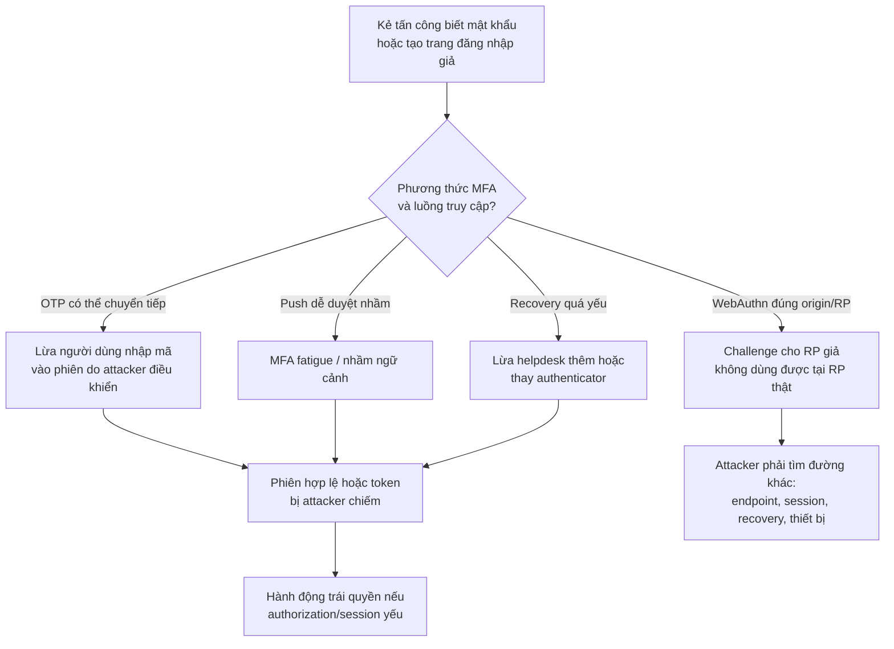
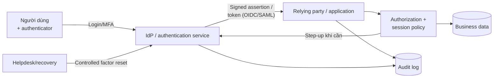
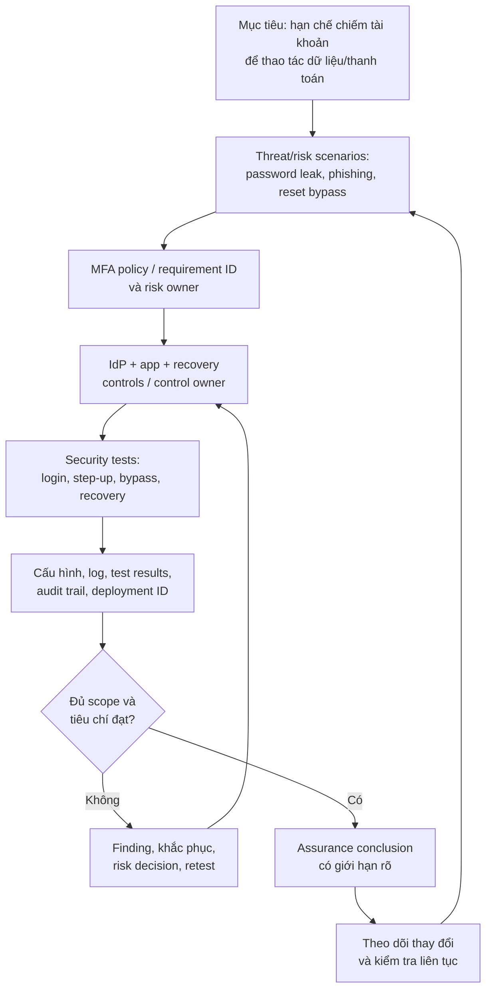

# MFA trong Identity assurance: xác thực đa yếu tố và bằng chứng bảo đảm danh tính

## Mục tiêu học tập

Sau bài này, người học có thể:

1. Giải thích **Multi-Factor Authentication (MFA)**, phân biệt yếu tố xác thực với số bước đăng nhập, phân biệt xác thực với **định danh ban đầu, phân quyền và quản lý phiên**.
2. Đánh giá các phương thức như **password + TOTP, SMS OTP, push notification, security key, FIDO2/WebAuthn và passkey**, đặc biệt về **khả năng chống phishing**, đánh cắp mã, lạm dụng khôi phục và độ tin cậy của thiết bị.
3. Đặt yêu cầu MFA theo **tài sản, danh tính, mức rủi ro, môi trường và hành động nhạy cảm**; thiết kế MFA ban đầu, xác thực lại (*reauthentication*) và **step-up authentication**.
4. Thiết kế vòng đời phương thức xác thực: **đăng ký, gắn với tài khoản, thêm/thay thiết bị, thu hồi, khôi phục, emergency access và offboarding**.
5. Nhận diện điểm vượt kiểm soát từ **SSO/federation, ứng dụng legacy, API, mobile, service accounts, tài khoản quản trị và đường helpdesk**.
6. Chuyển mục tiêu bảo mật thành **security requirements → controls → test cases → audit evidence**, phân biệt control có mặt với control hoạt động hiệu quả.
7. Quản lý **ngoại lệ, rủi ro còn lại, phát hiện bất thường, sự cố tài khoản và giám sát liên tục** với trách nhiệm rõ ràng.

Trong module **SECURITY_SECURITY_ASSURANCE**, câu hỏi không chỉ là “đã bật MFA chưa?” mà là **MFA bảo vệ đúng tài khoản và hành động nào, trước kiểu tấn công nào, trên bản hệ thống nào, với vòng đời và đường khôi phục ra sao; bằng chứng nào chứng minh các yêu cầu đang hoạt động**. Đây là cách liên kết đánh giá rủi ro, security controls, kiểm thử, audit và khắc phục để tổ chức chương trình bảo đảm bảo mật liên tục.

## 1. MFA là gì và nằm ở đâu trong Identity assurance?

**MFA (xác thực đa yếu tố)** là phương thức xác thực một chủ thể bằng bằng chứng thuộc **ít nhất hai nhóm yếu tố độc lập theo cơ chế được thiết kế**. Mục đích là giảm khả năng kẻ tấn công đăng nhập chỉ nhờ đánh cắp hoặc đoán được một loại bí mật.

Ba nhóm yếu tố quen thuộc:

| Nhóm | Ý nghĩa | Ví dụ | Lưu ý |
|---|---|---|---|
| **Knowledge** – điều biết | Bí mật người dùng biết | Mật khẩu, PIN được sử dụng đúng ngữ cảnh | Hai mật khẩu vẫn cùng một nhóm yếu tố |
| **Possession** – vật sở hữu/kiểm soát | Bằng chứng đang kiểm soát thiết bị hoặc khóa | Security key, thiết bị giữ khóa riêng, authenticator app | Phải xác minh được khả năng sở hữu, không chỉ nhập một tên thiết bị |
| **Inherence** – đặc điểm sinh trắc | Đặc điểm người dùng | Vân tay, khuôn mặt thông qua thiết bị xác thực phù hợp | Chất lượng cảm biến, chống giả và cơ chế xác minh rất quan trọng |

Ví dụ **mật khẩu + TOTP** có thể tạo MFA vì kết hợp một bí mật nhớ được với bằng chứng kiểm soát thiết bị/seed OTP. **Mật khẩu + câu hỏi bí mật** không phải đa yếu tố nếu cả hai đều là yếu tố kiến thức; việc yêu cầu hai màn hình nhập cũng không biến nó thành MFA.

Một **authenticator đa yếu tố** có thể kết hợp hai nhóm bên trong **một lần tương tác**. Chẳng hạn, một passkey/WebAuthn credential có khóa riêng được giữ bởi authenticator và cơ chế **user verification** tại thiết bị (PIN hoặc sinh trắc, khi được yêu cầu và xác nhận phù hợp). Không cần mặc định “hai popup” mới là MFA; ngược lại, **nếu chỉ có kiểm tra hiện diện người dùng (*user presence*) mà không yêu cầu user verification**, không nên tự khẳng định đã đạt yêu cầu hai yếu tố.

### 1.1. MFA không đồng nghĩa “Identity assurance” toàn bộ

Identity assurance rộng hơn một bước đăng nhập:

| Khái niệm | Câu hỏi cần trả lời | Ví dụ |
|---|---|---|
| **Identity proofing / enrollment** | Khi tạo danh tính, tổ chức biết gì về người được gắn tài khoản? | Đối chiếu nhân sự với hồ sơ được phê duyệt, xác minh người đăng ký |
| **Authentication** | Chủ thể đang truy cập có kiểm soát authenticator đã gắn với tài khoản không? | Passkey, password + OTP, security key |
| **Authentication assurance** | Mức bảo đảm của cơ chế và quá trình xác thực ra sao? | Yêu cầu MFA và chống phishing cho hành động nhạy cảm |
| **Federation** | Ứng dụng dựa vào khẳng định danh tính từ IdP bằng giao thức nào? | OIDC/SAML, token/assertion đã được xác minh |
| **Authorization** | Chủ thể đã xác thực có được phép làm **hành động này trên tài nguyên này** không? | Chỉ xem hóa đơn thuộc tenant của mình |
| **Session management** | Sau đăng nhập, phiên/token được bảo vệ và làm mới/thu hồi thế nào? | Thời hạn phiên, chống chiếm phiên, reauth |
| **Lifecycle** | Ai cấp/thu hồi danh tính, thiết bị và quyền trong toàn vòng đời? | Nghỉ việc, mất thiết bị, thay nhân sự, account recovery |

Nhiều hệ thống dùng các thuật ngữ **IAL (Identity Assurance Level), AAL (Authenticator Assurance Level), FAL (Federation Assurance Level)** trong tài liệu về danh tính số. Chúng nói về **ba khía cạnh khác nhau**: mức xác minh danh tính ban đầu, mức xác thực và mức bảo đảm trao đổi thông tin qua federation. Không được suy ra có MFA là đã đạt một mức IAL/FAL nào đó. Nếu cần viện dẫn mức cụ thể từ chuẩn bên ngoài, tổ chức phải xác định **phiên bản tiêu chuẩn, toàn bộ điều kiện và phạm vi áp dụng**.

### 1.2. MFA giải quyết kịch bản nào?

MFA thường hữu ích trước:

- **Credential stuffing/password reuse:** Mật khẩu lộ từ dịch vụ khác chưa đủ để hoàn thành xác thực.
- **Password guessing/brute force:** Kẻ đoán đúng password vẫn cần bằng chứng từ yếu tố khác.
- **Một số cuộc tấn công chiếm tài khoản:** Khi attacker không có thiết bị hoặc khóa xác thực phù hợp.
- **Lạm dụng quyền quản trị dựa trên tài khoản bị lộ mật khẩu:** Tăng rào cản cho phiên đăng nhập mới.

Nhưng MFA **không tự ngăn**:

- **Phishing qua reverse proxy thời gian thực** lấy mã OTP hoặc cookie phiên của nạn nhân.
- **Chiếm session/token đã được cấp**, đặc biệt khi kẻ tấn công không phải xác thực lại.
- **Chiếm quyền thiết bị** có thể thao túng một phiên đã xác thực.
- **Account recovery yếu:** Helpdesk xóa MFA cho người giả mạo.
- **Sai authorization:** Người dùng được xác thực hợp lệ vẫn truy cập đối tượng của tenant khác.
- **Thao tác nghiệp vụ sai hoặc thông đồng:** Hai người đăng nhập hợp lệ vẫn có thể cùng thực hiện một giao dịch trái quy tắc.

Vì vậy, MFA là một **security control quan trọng**, không phải bằng chứng “không thể chiếm tài khoản” hay thay thế threat modeling, SoD, session protection và audit.

## 2. Phân loại phương thức xác thực và mức chống phishing

Không phải mọi cách triển khai MFA có bảo đảm như nhau. Phải xem **ai giữ bí mật/khóa, chứng cứ được kiểm tra với điều gì, có thể bị tái sử dụng trên trang giả hay không và quá trình recovery**.

### 2.1. So sánh các phương thức

| Phương thức | Bằng chứng chính | Điểm mạnh | Rủi ro/giới hạn phải kiểm tra |
|---|---|---|---|
| **Password + TOTP** | Password và mã thời gian từ authenticator | Phổ biến, tương đối dễ triển khai; không phụ thuộc SMS | Mã có thể bị phishing/replay trong cửa sổ hợp lệ; seed có thể bị lộ, cần chống thử mã hàng loạt |
| **Password + SMS OTP** | Password và quyền nhận SMS tại số được gắn | Hỗ trợ thiết bị phổ thông | SIM swap, chiếm/đổi số, chuyển tiếp tin nhắn, phishing, phụ thuộc hạ tầng viễn thông |
| **Password + email OTP** | Password và quyền đọc hộp thư | Triển khai dễ trong một số bối cảnh | Hộp thư có thể dùng cùng mật khẩu/phiên và cùng kênh recovery; không mặc định là yếu tố độc lập mạnh |
| **Password + push “Approve/Deny”** | Password và phản hồi trên thiết bị đã đăng ký | Trải nghiệm dễ dùng | Push fatigue, chấp nhận nhầm, thiết bị bị chiếm; push không tự chống phishing |
| **Push có number matching/context** | Liên kết yêu cầu đăng nhập với số/ngữ cảnh hiển thị | Giảm một số kiểu duyệt vô ý | Vẫn cần kiểm tra đúng origin, device, session; không tự ngang bằng WebAuthn |
| **FIDO2/WebAuthn security key** | Chữ ký bằng khóa riêng gắn với relying party | Khả năng chống phishing khi xác minh origin/RP ID đúng | Cần kiểm tra user verification, đăng ký/khôi phục, quy trình quản lý key, thiết bị mất |
| **Passkey với user verification** | WebAuthn credential và xác minh người dùng tại authenticator | Đăng nhập thuận tiện, kháng phishing đúng thiết kế | Phân biệt credential đồng bộ/giữ trên thiết bị, quyền khôi phục tài khoản đồng bộ, cấu hình UV |
| **Smart card/certificate-based authentication** | Khóa riêng/chứng thư và quy trình sử dụng | Có thể đáp ứng yêu cầu tổ chức phù hợp | Phụ thuộc thiết kế PKI, PIN/đặc tính phần cứng, kiểm tra chứng thư và revocation |

**Phishing-resistant MFA** là khả năng chống việc kẻ tấn công khiến người dùng cung cấp một bằng chứng xác thực có thể dùng cho **một endpoint giả mạo**. WebAuthn/FIDO2 được thiết kế gắn credential với **relying party/origin**, nên khác căn bản với việc nhập OTP có thể bị attacker chuyển tiếp. Tuy nhiên, triển khai WebAuthn sai, recovery yếu hoặc session bị đánh cắp vẫn có thể dẫn đến compromise.

### 2.2. Hiểu đúng passkeys

Một passkey là credential dựa trên mật mã khóa công khai dùng với WebAuthn/FIDO. Ứng dụng lưu/trao đổi thông tin để kiểm chứng chữ ký mà **không cần giữ private key của người dùng**. Khi thực hiện:

1. Server/relying party tạo một **challenge mới** và chỉ định điều kiện xác thực.
2. Trình duyệt/ứng dụng tương tác với authenticator đã có credential phù hợp.
3. Authenticator ký dữ liệu liên quan tới challenge và ngữ cảnh relying party.
4. Server kiểm tra chữ ký, challenge, origin/RP ID và các cờ xác minh thích hợp.

**User presence (UP)** — xác nhận có tương tác (ví dụ chạm khóa) — **khác user verification (UV)** — authenticator xác minh người dùng bằng PIN/sinh trắc hay cơ chế đáp ứng yêu cầu. Nếu mục tiêu là MFA dựa vào một authenticator đa yếu tố, bên dựa vào kết quả phải yêu cầu và kiểm tra **UV** phù hợp, không chỉ nhìn thấy “đăng nhập bằng security key”.

Credential có thể là **device-bound** hoặc được **đồng bộ theo cơ chế của nhà cung cấp**. Mô hình đồng bộ ảnh hưởng tới đánh giá khả năng mang sang thiết bị mới, khôi phục và quản trị tài khoản đồng bộ. Không nên xem mọi passkey là khóa không thể xuất khỏi phần cứng, cũng không nên mặc định đồng bộ làm mất toàn bộ khả năng chống phishing.

### 2.3. Những hiểu nhầm thường gặp

- “**Hai mã OTP**” không nhất thiết bằng hai yếu tố độc lập; phải xác định nguồn và cơ chế chứng minh.
- “**Có vân tay**” không tự đảm bảo MFA nếu vân tay chỉ mở khóa ứng dụng cục bộ mà server không kiểm chứng cơ chế đa yếu tố tương ứng.
- “**SMS OTP là an toàn tuyệt đối**” bỏ qua SIM swap, phishing và kịch bản mất số.
- “**Push có xác nhận là phishing-resistant**” không chính xác nếu người dùng vẫn có thể duyệt một phiên tấn công.
- “**Bật WebAuthn là đủ**” bỏ qua yêu cầu UV, kiểm tra origin/RP, luồng recovery và quyền khóa đăng ký mới.
- “**AAL cao**” không nên được gán chỉ dựa trên tên phương thức; cần xem điều kiện kỹ thuật và quy trình vận hành của bộ tiêu chuẩn đang áp dụng.

## 3. Threat modeling cho MFA

MFA phải được thiết kế theo **đường chiếm tài khoản và hành động nhạy cảm**, không chỉ theo giao diện đăng nhập chính.

### 3.1. Một số kịch bản rủi ro

| Risk scenario | Tài sản/thuộc tính bị đe dọa | Câu hỏi bảo đảm cần đặt |
|---|---|---|
| Mật khẩu nhân viên bị lộ | Quyền truy cập tài khoản, bí mật dữ liệu | Mọi đường login thuộc scope có bắt buộc yếu tố thứ hai? |
| Trang giả lấy OTP và cookie phiên | Tính xác thực phiên và dữ liệu | MFA có chống phishing? Session có được bảo vệ sau login? |
| Kẻ tấn công gửi nhiều push liên tiếp | Quyết định đăng nhập hợp lệ | Có chống push fatigue, giới hạn số yêu cầu và cảnh báo bất thường? |
| Helpdesk reset MFA cho người giả mạo | Quyền đăng ký authenticator mới | Recovery có mức bảo đảm phù hợp, kiểm tra độc lập và audit? |
| Quản trị viên có API/token cũ không cần MFA | Khả năng thao tác production | Scope có bao gồm legacy/CLI/API, tài khoản và đường token? |
| Nhân viên mất security key | Khả năng truy cập hợp lệ | Có backup authenticator và recovery được kiểm soát không? |
| Service account bị lộ secret | Quyền hệ thống–hệ thống | Có cơ chế workload identity và kiểm soát riêng thay vì áp MFA của con người sai ngữ cảnh? |
| Đăng nhập SSO có MFA nhưng session sống lâu | Phiên đã xác thực và hành động nhạy cảm | Có reauthentication/step-up và kiểm soát thời hạn/thu hồi? |
| Tài khoản bị khóa do lỗi IdP/MFA outage | Tính sẵn sàng vận hành | Có kế hoạch duy trì an toàn, emergency access và monitoring? |

### 3.2. Chuỗi tấn công có thể vượt MFA yếu



**Điều quan trọng:** Chống phishing của bước đăng nhập và bảo vệ phiên sau đăng nhập là **hai lớp khác nhau**. Một ứng dụng có thể dùng WebAuthn tốt nhưng vẫn mất dữ liệu nếu JavaScript độc hại, malware hoặc quyền quản lý session cho phép kẻ khác lấy token đang hoạt động.

### 3.3. Nhận diện ranh giới tin cậy

- **Người dùng/thiết bị → identity provider (IdP):** Có dùng origin, protocol và authenticator đã đăng ký đúng không?
- **IdP → relying party/application:** Assertion/token có được xác minh chữ ký, issuer, audience, hạn và ngữ cảnh xác thực?
- **Ứng dụng → session/token store:** Phần nào giữ bằng chứng đăng nhập, phiên có thể bị đánh cắp/không thu hồi?
- **Helpdesk/recovery → IdP:** Ai có quyền reset factor hoặc đăng ký thiết bị mới? Bằng chứng xác minh người yêu cầu?
- **CI/CD, CLI, automation → production:** Quyền máy và token phi tương tác có bypass chính sách dành cho nhân viên không?
- **Nhà cung cấp/đối tác → hệ thống:** Vendor admin, federated users hoặc tài khoản dùng chung có vào scope không?

Một bảng điều khiển IdP báo “MFA enforced” không chứng minh **tất cả các boundary trên** đều được kiểm soát. Bằng chứng phải gắn với **ứng dụng, luồng, danh tính, hành động và môi trường**.

## 4. Xác định phạm vi yêu cầu MFA

Phần khó trong assurance thường là **định nghĩa mẫu số đúng**: tài khoản nào, loại phiên nào và khả năng hành động nào thật sự cần MFA?

### 4.1. Danh mục đối tượng và kênh truy cập

| Đối tượng/đường | Yêu cầu cần xem xét | Điểm mù phổ biến |
|---|---|---|
| Nhân viên đăng nhập SSO | MFA tại IdP với độ mạnh phù hợp | App chấp nhận đăng nhập local song song |
| Quản trị viên cloud/IAM/KMS | Yêu cầu mạnh hơn theo mức ảnh hưởng; xác thực lại khi thực hiện hành động nhạy cảm | API key/CLI token tồn tại ngoài luồng tương tác |
| Người dùng ứng dụng khách hàng | MFA theo risk, đối tượng hoặc giao dịch, có phương án khả dụng | Password reset tự động gỡ yếu tố thứ hai |
| Nhân viên hỗ trợ/helpdesk | MFA khi truy cập, quy trình bảo đảm khi reset yếu tố cho người khác | Helpdesk là đường chiếm tài khoản đặc quyền |
| Nhà thầu/vendor | Kết nối federation, phân quyền và thời hạn truy cập phù hợp | Tài khoản dùng chung, vòng đời vendor không quản lý |
| Kênh mobile/desktop | Luồng xác thực, lưu token và reauth phù hợp | App cũ bypass policy web |
| VPN/bastion/admin console | Định danh và MFA áp dụng tại đúng entry point | Đường quản trị trực tiếp không qua bastion |
| API/service-to-service | **Workload authentication** dựa trên machine identity, mTLS, short-lived credentials hoặc tương đương | Dùng shared secret dài hạn và tưởng đã có MFA vì một admin login |
| Break-glass | Quyền tạm/khẩn cấp, audit, hậu kiểm và giới hạn rõ | Tài khoản luôn được miễn MFA nhưng không giám sát |

**MFA cho con người** không áp đặt máy móc cho **service account phi tương tác**. Workload cần xác minh riêng danh tính máy/dịch vụ, bảo vệ khóa, vòng đời credential, quyền và kiểm tra event. Tuy nhiên, người quản trị **cấp/quản lý những credential đó** có thể cần MFA mạnh ở luồng quản trị.

### 4.2. Phân loại theo mức tác động

Những mục thường cần xem xét yêu cầu xác thực mạnh hơn:

- Quyền **quản trị danh tính và cấp quyền**.
- Quyền **thay đổi dữ liệu thanh toán, người nhận, hạn mức hoặc bản phê duyệt**.
- Quyền **giải mã dữ liệu nhạy cảm, thay policy KMS hoặc xuất dữ liệu hàng loạt**.
- Quyền **sửa CI/CD, thay release gate, cập nhật secrets hoặc triển khai production**.
- Quyền **xóa audit log, chỉnh chính sách retention, khôi phục hoặc hủy dữ liệu**.
- **Đăng ký authenticator mới, thay recovery factor hoặc reset MFA**.

Nếu hệ thống có nhiều cấp rủi ro, không nhất thiết áp cùng phương thức cho mọi hành động. Có thể đặt **baseline MFA** cho đăng nhập và **phương thức chống phishing/reauth** cho những hành động có tác động cao, với các quyết định được ghi rõ và phê duyệt theo rủi ro.

### 4.3. MFA, reauthentication và step-up khác nhau

- **MFA tại đăng nhập:** Xác minh chủ thể trước khi cấp phiên ban đầu.
- **Reauthentication:** Yêu cầu xác thực lại theo thời gian, thay đổi ngữ cảnh hoặc hành động, không chỉ hỏi lại mật khẩu nếu chính sách đòi mức mạnh hơn.
- **Step-up authentication:** Nâng mức bảo đảm xác thực khi sắp thực hiện một **hành động nhạy cảm**, hoặc khi rủi ro của phiên tăng.

Ví dụ người dùng đăng nhập xem đơn hàng bằng một phương thức được phép; khi đổi tài khoản nhận tiền, ứng dụng yêu cầu xác minh bằng **authenticator có độ mạnh được quy định** và chỉ cho phép tiếp tục nếu kết quả đủ mới và ràng buộc với đúng phiên/chủ thể.

Không đồng nhất “đã bật MFA một lần cách đây nhiều ngày” với “đã xác thực đủ mạnh cho hành động hiện tại”. Đồng thời, nếu app chỉ gửi người dùng tới trang MFA nhưng **không xác minh kết quả ở phía server**, bước step-up có thể bị bỏ qua.

## 5. Kiến trúc MFA với SSO và ứng dụng

### 5.1. Luồng xác thực minh họa



**IdP** có thể thực hiện MFA, còn ứng dụng cần:

1. Chỉ chấp nhận assertion/token **từ issuer đáng tin**, đúng audience/client và được xác minh bằng thư viện phù hợp.
2. Kiểm tra **chữ ký, thời hạn, trạng thái yêu cầu, nonce/state và ràng buộc phiên** theo giao thức OIDC/SAML tương ứng.
3. Hiểu đúng **acr/amr/auth_time hoặc claim khác theo hợp đồng với IdP**; không suy rằng có chuỗi “mfa” nào cũng đồng nghĩa phương thức đủ mạnh, chống phishing hoặc đủ mới.
4. Áp dụng **authorization** theo tài nguyên, tenant và hành động; MFA chỉ xác nhận người dùng, không cấp mọi quyền.
5. Quản lý **session expiry, logout, token rotation/revocation** và yêu cầu step-up/reauth nếu hành động có rủi ro cao.
6. Có bằng chứng **luồng fallback/local login/legacy** không cho phép bypass yêu cầu.

### 5.2. Hai kiểu sai lầm trong federation

**Sai lầm A:** Ứng dụng tin claim `amr=["mfa"]` do client tự gửi mà không xác minh chữ ký và issuer. Trong trường hợp này, giá trị claim có thể bị giả mạo; không có assurance.

**Sai lầm B:** Ứng dụng xác minh token hợp lệ nhưng **không kiểm tra độ mới và phương thức cần thiết** cho giao dịch thay đổi ngân hàng. Token xác thực hợp lệ cho đăng nhập thông thường không tự đáp ứng yêu cầu step-up của giao dịch nhạy cảm.

Một giao thức federation có thể bảo đảm truyền **assertion đáng tin**, nhưng không tự chứng minh **IdP có xác minh đúng authenticator hoặc recovery không bị bypass**. Cần phân chia trách nhiệm giữa đội IdP và đội ứng dụng.

### 5.3. Quyền truy cập sau MFA

Một phiên đã qua MFA vẫn phải chịu các quy tắc:

- Người dùng chỉ truy cập **dữ liệu thuộc vai trò/tenant được phép**.
- Thao tác phê duyệt vẫn tuân **separation of duties**; cùng một người không tự duyệt lệnh của mình chỉ nhờ đăng nhập mạnh.
- Sự kiện thay đổi quan trọng cần **audit trail và kiểm tra bất biến nghiệp vụ**.
- Mọi endpoint cũ, worker, admin API và direct DB access phải có control tương ứng.
- Cần phát hiện phiên bất thường, login từ thiết bị lạ, **đăng ký factor mới** và thay đổi quyền nhạy cảm.

## 6. Thiết kế vòng đời MFA

**Điểm yếu nghiêm trọng nhất đôi khi không nằm ở bước MFA bình thường mà ở cách thêm, thay hoặc xóa authenticator.**

### 6.1. Enrollment — đăng ký authenticator lần đầu

Một luồng đăng ký nên có:

1. **Xác định danh tính hiện có và quyền đăng ký:** Ai đang được cho phép thêm factor? Có đủ bằng chứng rằng đây là chủ tài khoản hợp lệ?
2. **Chọn phương thức được phê duyệt:** Theo phân loại đối tượng và mức tác động; không hiển thị phương thức yếu ngoài chính sách.
3. **Binding:** Gắn authenticator/credential với đúng tài khoản, dựa trên giao thức an toàn và xác minh hoàn tất.
4. **Proof of control:** Kiểm tra chủ thể thật sự kiểm soát authenticator theo cơ chế được chọn, không chỉ nhập một số điện thoại hoặc tên thiết bị.
5. **Thông báo và audit:** Ghi event đăng ký, thời điểm, phương thức, thiết bị/credential ID thích hợp; thông báo cho chủ tài khoản qua kênh đáng tin.
6. **Khả năng phục hồi:** Hướng dẫn đăng ký thêm phương thức backup phù hợp và xử lý mất thiết bị theo rủi ro.

Nếu một tài khoản mới chưa xác minh chủ sở hữu mà đã cho attacker tự gắn factor, việc bật MFA về sau **không sửa được rủi ro gắn sai danh tính**.

### 6.2. Thêm phương thức mới sau khi đã đăng nhập

Đây là một **hành động nhạy cảm**. Cần xem xét:

- **Reauthentication/step-up** bằng phương thức đã được tin cậy trước đó, đủ mới.
- Kiểm tra ngữ cảnh đáng ngờ và giới hạn **factor enrollment rate**.
- Thông báo qua kênh khác để chủ tài khoản phát hiện thay đổi bất thường.
- Lưu actor, thời điểm, phương thức cũ/mới, địa chỉ/thiết bị ở mức tối thiểu và kết quả.
- Chính sách về **thời gian chờ hoặc hạn chế hành động nhạy cảm** sau khi thêm factor, nếu kịch bản rủi ro yêu cầu.
- Cơ chế thu hồi phương thức vừa thêm khi nghi ngờ tài khoản đã bị chiếm.

**Không nên** cho phép bất kỳ session nào đang mở tự thêm authenticator mạnh mà không xác minh ngữ cảnh, nếu kẻ có session bị đánh cắp có thể biến quyền tạm thành quyền truy cập bền vững.

### 6.3. Recovery — mất thiết bị, đổi số hoặc quên phương thức

Recovery cần đạt mức bảo đảm tương xứng vì nó có thể **vô hiệu hóa toàn bộ rào cản MFA**.

| Đường khôi phục | Kịch bản cần phòng | Yêu cầu kiểm soát có thể áp dụng |
|---|---|---|
| **Backup codes** | Mã dự phòng bị lộ hoặc dùng nhiều lần | Sinh an toàn, hiển thị/lưu theo nguyên tắc tối thiểu, dùng một lần, rate-limit, audit |
| **Authenticator dự phòng** | Mất thiết bị chính | Gắn thiết bị backup từ trước và kiểm tra quyền dùng đúng tài khoản |
| **Helpdesk reset** | Kẻ mạo danh chủ tài khoản | Identity verification theo chính sách, phân tách phê duyệt, giữ chứng cứ |
| **Đổi số điện thoại** | SIM swap và chiếm kênh nhận SMS | Không coi chỉ việc nhận SMS ở số mới là bằng chứng đủ để gỡ mọi factor khác |
| **Khôi phục qua email** | Email bị chiếm hoặc cùng phiên đăng nhập | Đánh giá độ độc lập của kênh, xác minh bổ sung theo rủi ro |
| **Tài khoản đồng bộ passkey** | Attacker chiếm quyền tài khoản đồng bộ/thiết bị mới | Xem chính sách và bảo đảm của dịch vụ đồng bộ, kiểm soát thêm thiết bị |
| **Break-glass** | Không truy cập được IdP khi khẩn cấp | Danh tính, quyền, giới hạn, phê duyệt/hậu kiểm, audit và thời hạn |

Không có **một câu hỏi bảo mật** hoặc “xác nhận sinh nhật” nào tự động đủ độ tin cậy để reset tài khoản đặc quyền. Các bước xác minh phải dựa trên **mô hình rủi ro, quy chế và cách chống giả mạo** đã được phê duyệt.

### 6.4. Thu hồi và thay đổi vòng đời

Khi người dùng nghỉ việc, đổi vai trò, mất thiết bị hoặc xuất hiện dấu hiệu chiếm quyền:

- Thu hồi hoặc vô hiệu authenticator/credential liên quan.
- Xem xét **active sessions, refresh tokens, recovery codes** và liên kết thiết bị còn hiệu lực.
- Thu hồi quyền truy cập theo scope, không chỉ xóa một phương thức MFA.
- Ghi lại quyết định, thời điểm, người xử lý và kết quả xác minh.
- Kiểm tra tác động tới các dịch vụ federated, offline và legacy có thể chưa đồng bộ trạng thái.
- Khi nghi lộ secret TOTP hoặc khóa, xác định phạm vi, thay credential và kiểm tra sử dụng bất thường.

## 7. Đặt yêu cầu MFA có thể kiểm thử

Không nên viết “Mọi tài khoản phải bật MFA mạnh” mà không có **phạm vi, phương thức chấp nhận, nguồn kiểm tra và các trường hợp ngoại lệ**.

### 7.1. Ma trận yêu cầu

| ID | Yêu cầu và phạm vi minh họa | Tiêu chí kiểm chứng chính |
|---|---|---|
| **MFA-01** | Human users truy cập admin console production phải hoàn thành MFA theo baseline được phê duyệt | Test login không đủ yếu tố bị từ chối; IdP/app config đúng scope |
| **MFA-02** | Các quyền admin có tác động cao dùng phương thức chống phishing theo chính sách đã duyệt | Test không chấp nhận OTP fallback nếu bị cấm; WebAuthn origin/UV được xác minh |
| **MFA-03** | Hành động đổi tài khoản nhận tiền yêu cầu step-up phù hợp, đủ mới | Test session cũ/độ mạnh thấp không thực thi; token/assertion đủ điều kiện mới được chấp nhận |
| **MFA-04** | Thêm hoặc reset authenticator phải có xác minh danh tính và audit | Test reset trái quyền bị từ chối; hồ sơ helpdesk và cảnh báo đăng ký mới |
| **MFA-05** | Access recovery không cho phép bỏ qua toàn bộ cơ chế cần bảo vệ | Test backup/recovery, giới hạn retry và phê duyệt theo rủi ro |
| **MFA-06** | Các đường local, legacy, mobile và federation trong scope không bypass MFA | Inventory và negative tests theo từng tuyến, client hoặc protocol |
| **MFA-07** | Account/service credentials phi tương tác có controls danh tính riêng, không dùng chung mật khẩu yếu | Workload identity, quyền, rotation, chứng cứ truy cập và lifecycle |
| **MFA-08** | Factor removal, login bất thường và MFA reset được ghi nhận và phát hiện theo quy tắc | Synthetic event, alert→triage, test pipeline health |
| **MFA-09** | Ngoại lệ có risk owner, người chấp nhận đúng quyền, kiểm soát bù trừ và ngày hết hạn | Exception register, review, việc kết thúc hoặc gia hạn đúng quy trình |
| **MFA-10** | Thay chính sách IdP/app phải được rà soát và xác minh lại trên bản đang chạy | Change record, policy version, regression tests, production evidence |

**Đây là mẫu yêu cầu học tập**, không phải tiêu chuẩn có tính bắt buộc cho mọi tổ chức. Ngưỡng freshness, loại factor, các loại account và phương pháp recovery phải được quy định theo **mức độ rủi ro và yêu cầu áp dụng**.

### 7.2. Thiết kế chính sách có cấu trúc

YAML dưới đây mô tả **chính sách giả lập** phục vụ threat modeling và security assurance, không phải file cấu hình trực tiếp của một IdP:

```yaml
identityAssurancePolicy:
  id: POL-MFA-PAYMENTS-01
  title: MFA controls for the Payments Platform
  version: "1.0"
  status: illustrative
  systemOwnerRole: Payments Platform Owner
  policyOwnerRole: Identity Security Lead
  riskOwnerRole: Payments Risk Owner
  scope:
    environment: production
    humanAccess:
      - payment-admin-console
      - payment-operations-portal
      - privileged-cloud-console
    lifecycleFlows:
      - first-enrollment
      - add-authenticator
      - factor-reset
      - emergency-access
    excludedFromHumanMfa:
      - workload-identity-with-separate-controls

  accessRules:
    - id: MFA-ADMIN-01
      subjectGroup: privileged-human-users
      action: interactive-login
      requiredAuthentication: approved-phishing-resistant-mfa
      fallback: exception-only
    - id: MFA-STEPUP-02
      subjectGroup: authorized-payments-operators
      action: change-beneficiary-or-payment-limit
      requiredAuthentication: recent-approved-step-up
      freshnessReference: PAYMENTS-REAUTH-POLICY
      decisionOwnerRole: Payments Risk Owner

  recovery:
    mustIdentifyRequester: true
    resetRequiresRiskAppropriateChecks: true
    notifyAccountOwner: true
    auditFactorChanges: true
    privilegedResetApprovalRole: Authorized Identity Recovery Approver
    prohibitUncontrolledSelfReset: true

  detection:
    events:
      - factor-enrolled
      - factor-removed
      - recovery-reset
      - login-method-fallback
      - repeated-authentication-failures
    routing: identity-security-oncall

  assurance:
    requiredTests:
      - MFA-ADMIN-WITHOUT-SECOND-FACTOR-DENIED
      - MFA-INVALID-PHISHING-RESISTANT-CREDENTIAL-DENIED
      - MFA-STEPUP-EXPIRED-CONTEXT-DENIED
      - MFA-RECOVERY-UNAUTHORIZED-RESET-DENIED
      - MFA-LEGACY-BYPASS-DENIED
      - MFA-AUDIT-PIPELINE-HEALTH
    evidenceReferences:
      - TEST-MFA-PAYMENTS-2026-11
      - IDP-POLICY-REVIEW-04
    knownLimitations:
      - Old vendor support portal requires separate review
    reviewTriggers:
      - New login protocol or federation client
      - Change to recovery or MFA fallback
      - Privileged account incident
```

Chữ `approved-phishing-resistant-mfa` chỉ có giá trị khi **baseline chỉ rõ cơ chế được chấp nhận và phương pháp xác minh**. Mục `evidenceReferences` là một **con trỏ**, chưa chứng minh bài test đã chạy hoặc đạt.

### 7.3. Phân biệt chính sách “đủ yếu tố” với “đủ bảo đảm”

Một yêu cầu có thể đòi:

- **Số và nhóm yếu tố** đáp ứng mục tiêu MFA.
- **Phương thức** đủ khả năng chống phishing cho tài sản cụ thể.
- **Độ mới** của lần xác thực trước hành động nhạy cảm.
- **Ngữ cảnh** phiên, thiết bị, rủi ro hành vi và điều kiện truy cập.
- **Vòng đời** đăng ký, reset, khôi phục và thu hồi không làm giảm bảo đảm.
- **Chứng cứ** về kiểm tra ở phía IdP và relying party cùng các đường fallback.

Kết luận “user đã nhập password + OTP” có thể chứng minh một **luồng MFA cụ thể**, nhưng không chứng minh yêu cầu **phishing-resistant MFA** hoặc **reauth gần đây** nếu policy có những điều kiện đó.

## 8. Thực thi step-up và xác minh mức xác thực ở ứng dụng

Hệ thống nhạy cảm không nên tự viết giao thức mật mã xác thực nếu có IdP và thư viện chuẩn phù hợp. Tuy nhiên, ứng dụng vẫn cần đưa ra **quyết định cấp quyền sau xác thực**.

### 8.1. Pseudocode tại điểm xử lý nghiệp vụ

Mẫu minh họa cho endpoint thay người nhận; các trường `acr`, `amr` và `auth_time` chỉ có nghĩa khi đã **thống nhất ngữ nghĩa với IdP và xác thực token/assertion đúng giao thức**.

```text
function changeBeneficiary(request, authenticatedSession):
    principal = requireValidatedIdentitySession(authenticatedSession)
    payment = loadPaymentForUpdate(request.paymentId)

    if not authorize(principal, "CHANGE_BENEFICIARY", payment):
        denyAndAudit("NOT_AUTHORIZED")

    if payment.isAlreadyExecuted():
        denyAndAudit("INVALID_BUSINESS_STATE")

    # Bản ghi assurance chỉ tin kết quả đã kiểm tra từ IdP,
    # không chấp nhận chuỗi amr/acr do client tự khai.
    authContext = validatedAuthenticationContext(principal.session)

    if not satisfiesApprovedStepUpPolicy(authContext,
                                         action="CHANGE_BENEFICIARY",
                                         payment=payment):
        requireStepUpAndReturnWithoutChangingPayment()

    if payment.version != request.expectedVersion:
        rejectStaleChangeAndAudit()

    updateBeneficiaryWithVersionCheck(payment, request.newBeneficiary)
    invalidateOldApprovalIfPaymentDetailsChanged(payment)
    auditActorAuthContextAndBusinessDecision(principal, payment)
```

Đoạn mã tập trung vào **bất biến và điểm kiểm soát**. Khi triển khai thực tế cần:

1. Sử dụng **OIDC/SAML library** có xác minh chữ ký, issuer, audience, token expiry và trạng thái/challenge theo chuẩn, tránh tự parse claim rồi tin kết quả.
2. Ràng buộc **step-up result** với **đúng chủ thể, phiên và luồng yêu cầu**, chống replay và session mix-up.
3. Định nghĩa **freshness và mức assurance** dựa trên policy, không dùng một cờ boolean dễ bị giả.
4. Kiểm tra **authorization và trạng thái nghiệp vụ** sau khi xác thực; MFA không làm người dùng có thêm quyền.
5. Nếu phải rời ứng dụng để step-up, kiểm tra lại **resource, số tiền, version và session** khi quay lại vì dữ liệu có thể đã thay đổi.
6. Lưu audit sự kiện nhạy cảm nhưng **không ghi token/OTP, biometric hoặc secrets vào log**.

### 8.2. Không dựa vào bước MFA chỉ ở frontend

Nếu frontend hiển thị popup “Xác minh MFA” rồi gửi `mfaCompleted: true` trong request, kẻ gọi API trực tiếp có thể tự đặt cờ này. Kết quả MFA phải đến từ **ngữ cảnh xác thực được server tin cậy và có thể kiểm chứng**, kết hợp session và chính sách đang có hiệu lực.

Tương tự, UI có thể từ chối nhưng **endpoint v1, mobile API hoặc batch/admin tool** vẫn cho thực hiện hành động. Test assurance phải bao phủ **mọi điểm có thể tạo hiệu ứng**, không chỉ giao diện.

### 8.3. Thời hạn phiên và lấy cắp cookie

Trong thiết kế session:

- Cân nhắc cookie có thuộc tính bảo vệ phù hợp như **Secure, HttpOnly, SameSite** theo kiến trúc; kiểm soát CSRF khi cần.
- Bảo vệ **refresh tokens**, vòng đời khóa ký, giới hạn audience và scope.
- Đánh giá thời gian phiên, thời điểm reauth và tín hiệu rủi ro như thay thiết bị/địa điểm/quyền.
- Có kế hoạch **logout và vô hiệu hóa session** khi mất thiết bị, reset factor hoặc nghi chiếm tài khoản.
- Không xem cookie tồn tại là bằng chứng người dùng vừa hoàn thành step-up cho hành động nhạy cảm.
- Định nghĩa quy trình phát hiện **login bất thường, token replay và thay factor**.

Chính sách session phải phù hợp mục tiêu khả dụng và trải nghiệm, nhưng không được đánh đổi bảo đảm một cách không có quyết định rủi ro.

## 9. Kiểm thử MFA: từ đăng nhập tới đường bypass

### 9.1. Ma trận kiểm thử

| Kịch bản | Kết quả cần chứng minh | Dạng bằng chứng |
|---|---|---|
| Mật khẩu đúng nhưng thiếu factor bắt buộc | Không cấp phiên đạt mức yêu cầu | Integration test, IdP policy, authentication events |
| OTP sai, hết hạn hoặc dùng lại | Bị từ chối/giới hạn theo cơ chế, không tiếp tục login trái phép | Negative tests, rate limit policy, log |
| TOTP bị nhập vào origin giả | Không được tự coi là chống phishing | Threat assessment; nếu yêu cầu chống phishing thì dùng cơ chế phù hợp |
| WebAuthn challenge sai hoặc origin/RP không hợp lệ | Assertion bị từ chối | Protocol test, IdP/relying party config, test report |
| WebAuthn không có UV khi policy yêu cầu UV | Không đạt mức xác thực yêu cầu | Authenticator/IdP verification test |
| Session cũ hoặc auth yếu đổi người nhận | Buộc step-up; request chưa được thực thi | Step-up test, business-state test |
| Đăng nhập qua legacy/local path | Không được bypass policy MFA thuộc scope | Coverage test theo login methods, config inventory |
| Tài khoản admin via CLI/API token | Kiểm soát machine/privileged identity tương ứng | Credential inventory, permissions, security review |
| Reset factor bởi helpdesk không có xác minh | Bị chặn hoặc không được hoàn tất | Recovery workflow test, approval record |
| Thêm authenticator khi session bị nghi chiếm | Đáp ứng yêu cầu xác minh thêm và giám sát | Negative enrollment tests, notification/audit |
| Mất thiết bị và recovery hợp lệ | Khôi phục theo đúng kiểm soát, không vô hiệu bằng chứng | Recovery drill có phép, retest, review |
| Mất log đăng ký/reset factor | Có cảnh báo sức khỏe telemetry | Synthetic event, pipeline health test |
| MFA outage/IdP không truy cập được | Hành động nhạy cảm không âm thầm fail-open; đường khẩn cấp có kiểm soát | Failure drill, break-glass runbook và audit |

### 9.2. Gherkin minh họa

```gherkin
Feature: MFA assurance for privileged payments operations

  Scenario: Password-only login cannot access admin actions
    Given account U1 is in the privileged payments group
    And policy requires approved MFA for this group
    When U1 presents only a valid password
    Then no session satisfying the privileged policy is issued
    And the failed assurance requirement is auditable

  Scenario: Strong authentication requires matching relying party
    Given a WebAuthn credential is registered for the legitimate relying party
    When an assertion is supplied for an unexpected origin or RP ID
    Then authentication must be rejected
    And no privileged session may be established

  Scenario: Expired authentication context requires step-up
    Given U2 has an authenticated session
    And its authentication context is too old for beneficiary changes
    When U2 requests to change a payment beneficiary
    Then the change must not be committed
    And approved step-up must be completed before reconsidering it

  Scenario: Factor reset is denied without approved identity verification
    Given a caller asks helpdesk to remove U3's registered factor
    And the caller has not met the identity recovery requirements
    When a reset is attempted
    Then the factor must remain registered
    And the request must produce reviewable evidence

  Scenario: Legacy login path cannot bypass MFA
    Given admin U4 must satisfy MFA regardless of login channel
    When U4 attempts an older supported login path without required assurance
    Then the application must deny privileged access

  Scenario: Missing MFA telemetry produces a health alert
    Given MFA enrollment and reset events are expected from the IdP
    When the event stream stops beyond its approved health threshold
    Then monitoring must report degraded detection coverage
    And an alert must reach the designated control owner
```

**Kiểm thử đúng phạm vi:** Kịch bản Gherkin nêu **expected behavior**. Khi thực hiện, nhóm cần lưu **actual result, release, IdP/app policy version, environment, credential loại thử, thời điểm, người kiểm thử và giới hạn**. Test synthetic không tự chứng minh mọi tuyến production sẽ hành xử giống hệt.

### 9.3. Các lỗi khó phát hiện nếu chỉ test happy path

- User đã bật MFA nhưng **một phương thức yếu vẫn được chọn làm fallback** trên admin portal.
- Đăng nhập SSO đạt MFA nhưng **ứng dụng tự nhận login local** ở đường khác.
- Application kiểm tra claim MFA cho web nhưng **API mobile không kiểm tra**.
- Người dùng đã thực hiện step-up cho một hành động nhưng kết quả được dùng **vô hạn cho hành động khác**.
- IdP đúng phương thức nhưng ứng dụng **không ràng buộc phiên** hoặc không kiểm tra auth context freshness.
- Helpdesk reset factor bằng **thông tin dễ tìm** và không có xác minh bổ sung.
- Tài khoản khẩn cấp được miễn MFA và không có audit/hạn/owner.
- MFA event logging bật nhưng **mất kết nối collector**, khiến không phát hiện reset bất thường.
- Tài khoản được đổi quyền sau đăng nhập nhưng **session quá cũ** vẫn cho hoạt động nhạy cảm.

## 10. Bằng chứng assurance: xác minh thiết kế, triển khai, vận hành

### 10.1. Ba lớp đánh giá

| Lớp | Câu hỏi | Bằng chứng phù hợp |
|---|---|---|
| **Design effectiveness** | Phương thức và vòng đời MFA có đối phó đúng kịch bản, mức rủi ro không? | Threat model, scope, phương thức, chính sách enrollment/recovery/step-up |
| **Implementation** | Policy có thật sự áp dụng ở IdP, ứng dụng, client và luồng truy cập thuộc scope không? | IdP configuration/version, federation client config, app authorization, deployment ID |
| **Operating effectiveness** | Khi login, recovery, step-up hoặc sự cố xảy ra, hệ thống có đáp ứng tiêu chí và người trực có xử lý không? | Negative tests, enrollment/reset records, event/alert/ticket, recovery drill, audit và retest |

Một screenshot “MFA enabled” thường chỉ là **bằng chứng cấu hình tại một thời điểm**. Nó không chứng minh mọi người dùng thuộc scope đã đăng ký, mọi ứng dụng đều enforce, luồng recovery an toàn hoặc mọi phiên đều đủ mức bảo đảm.

### 10.2. Truy vết requirement → control → evidence



### 10.3. Ma trận chứng cứ

| Claim hoặc control | Cần quan sát gì? | Bằng chứng |
|---|---|---|
| Mọi admin account thuộc phạm vi được enforce MFA | Population, policies, account trạng thái và exception | IAM/IdP export, policy assignment, sample login test |
| Phương thức chống phishing được áp dụng nơi bắt buộc | Cấu hình cho phép/không cho phép, yêu cầu UV/origin | WebAuthn/IdP policy, negative protocol tests, review fallback |
| Step-up được áp dụng cho thao tác nhạy cảm | Fresh auth context, server-side gating và không có side effect nếu thiếu | Application tests, logs, trạng thái giao dịch |
| Factor enrollment/reset có độ bảo đảm phù hợp | Actor, reauth, identity verification, quyền helpdesk, notification | Workflow config, recovery records, test giả mạo có phép |
| Không còn đường login bypass | Tất cả client, local/legacy routes, vendor/admin paths trong scope | Inventory, cấu hình, test âm, risk/exception register |
| Session được quản trị sau sự cố | Thu hồi credential/phiên, event bất thường và response | Session revoke test, incident records, monitoring alerts |
| Những lỗi IdP/telemetry được phát hiện | Giám sát availability, event completeness, rule health | Failure drill, synthetic events, alert→ack→triage |

### 10.4. Hồ sơ bằng chứng cần những trường nào?

1. **Requirement ID/control ID**, policy version, mục tiêu và risk scenario.
2. **System, app/client, identity type, environment, tenant, release** và phạm vi.
3. **Method/authenticator loại dùng**, các điều kiện xác thực và phiên theo policy; không lưu secret.
4. **Test procedure**, input đã kiểm soát, expected/actual, kết quả và người kiểm tra.
5. **IdP/app configuration, timestamps, change record** và thông tin deployment.
6. **Enrollment/recovery event, approval, alert, triage, incident** hoặc access-review record nếu liên quan.
7. **Population completeness**: mẫu số user/session/client/flows và điều kiện loại trừ.
8. **Ngoại lệ, giới hạn, finding, remediation và retest**.

Lưu bằng chứng theo phân loại dữ liệu; tuyệt đối tránh ghi **mật khẩu, OTP, recovery code, private key, access token hoặc dữ liệu sinh trắc thô** vào báo cáo audit. Lưu ID sự kiện và tham chiếu tới kho có phân quyền thường thích hợp hơn.

## 11. Đo coverage và chất lượng MFA

### 11.1. Không đánh đồng các tỷ lệ

Những chỉ số sau có **mẫu số khác nhau**:

| Chỉ số | Câu hỏi | Cảnh báo khi diễn giải |
|---|---|---|
| **Enrollment coverage** | Trong số danh tính thuộc scope, bao nhiêu đã đăng ký phương thức được phép? | Đăng ký không chứng minh mọi login bị buộc dùng |
| **Enforcement coverage** | Bao nhiêu đường/đăng nhập nhạy cảm thực sự bắt buộc phương thức đúng? | Web portal đạt không suy ra API legacy đạt |
| **Phishing-resistant coverage** | Trong những tài khoản/hành động bắt buộc, bao nhiêu không được hạ xuống phương thức dễ phishing? | “MFA enabled” không đồng nghĩa chống phishing |
| **Recovery assurance coverage** | Bao nhiêu đường reset/thêm factor thực hiện đúng yêu cầu? | Một helpdesk bypass có thể phá toàn bộ login control |
| **Step-up compliance** | Hành động nhạy cảm có auth context đủ mạnh và đủ mới không? | Có step-up ở UI không có nghĩa server enforce |
| **Factor reset/incident rate** | Có bất thường trong thêm/xóa/reset? | Nhiều reset có thể do onboarding, không tự chứng minh tấn công |
| **Evidence freshness** | Bằng chứng còn đúng policy/version trong production? | Test staging cũ có thể không khớp release mới |
| **Exception exposure** | Quyền/đường login nào chưa đạt nhưng được quản trị ngoại lệ? | Không gộp exception với PASS |

### 11.2. Ví dụ tỷ lệ đúng mẫu số

Giả sử production có **120 danh tính người dùng thuộc phạm vi MFA**: 108 đã đăng ký yếu tố được phép, 12 chưa đăng ký. Báo cáo enrollment:

```text
Enrollment coverage = 108 / 120 = 90%
```

Tuy nhiên, trong 108 người đã đăng ký có thể có tài khoản **chưa được policy enforce** hoặc đường mobile/legacy cho password-only. Vì vậy:

- **90% enrollment** không đồng nghĩa **90% đăng nhập được bảo vệ**.
- Số user đạt yêu cầu chống phishing có thể nhỏ hơn số đã đăng ký TOTP.
- Nếu 20 service accounts thuộc một phạm vi danh tính khác, không nên trộn chúng vào cùng tỷ lệ MFA người dùng mà không giải thích chính sách dành cho machine identities.
- **Một admin đặc quyền** nằm ngoài enforcement có thể quan trọng hơn nhiều tài khoản thông thường đã đạt.

Khi báo cáo cần nêu **scope, thời kỳ, nguồn danh sách và mức độ đầy đủ**. Tỷ lệ 100% có thể sai nếu chỉ lấy user đang hoạt động tại IdP mà bỏ qua local administrators hoặc vendor users.

### 11.3. Chỉ số hiệu quả vận hành

- Số **đường đăng nhập/phiên không đáp ứng policy**, đã được kiểm thử và còn mở.
- Số **đăng ký factor mới và reset không có căn cứ đầy đủ**, thời gian phát hiện/xử lý.
- Tỷ lệ **step-up requests** được server chặn khi mức xác thực thấp hoặc quá cũ.
- Số **fallback/legacy authentication** và xu hướng loại bỏ đường không đạt.
- Thời gian **thu hồi factor/session** sau sự cố có xác nhận kết quả.
- Số **recovery tickets và break-glass activations** chưa review đúng hạn.
- Số lần **IdP outage, event pipeline failure và cảnh báo không tới on-call**.
- Số findings liên quan **MFA bypass, token theft, session reuse**, trạng thái khắc phục và retest.

Không nên tối ưu “ít reset”, “ít cảnh báo” một cách máy móc. Ít event có thể vì **đường giám sát không hoạt động**, còn quá nhiều yêu cầu đăng nhập lặp lại có thể tạo MFA fatigue và giảm trải nghiệm.

## 12. Giám sát phát hiện và ứng phó

MFA chủ yếu là **preventive authentication control**, nhưng cần các **detective controls** để nhận biết việc lạm dụng, thất bại và suy giảm bảo đảm.

### 12.1. Security events quan trọng

| Event | Điều có thể cần phát hiện | Ví dụ phản ứng |
|---|---|---|
| Đăng nhập sai nhiều lần, nhiều tài khoản | Credential stuffing hoặc brute force | Rate limiting, review và điều tra |
| Yêu cầu push liên tục | MFA fatigue hoặc login nhầm | Hạn chế yêu cầu, cảnh báo chủ tài khoản |
| Đăng ký authenticator mới | Attacker đã có session/khôi phục tài khoản | Thông báo qua kênh đáng tin, review rủi ro |
| Xóa factor/đổi recovery channel | Giảm khả năng bảo vệ tương lai | Triage, yêu cầu reauth và kiểm tra quyền reset |
| Đăng nhập bằng fallback khác chính sách | Đường hạ mức bảo đảm/bypass | Cảnh báo, vô hiệu đường sai hoặc ngoại lệ có căn cứ |
| Thực hiện admin action với auth context yếu | Thiếu step-up hoặc app mapping sai | Chặn hành động, tạo finding |
| Tài khoản break-glass được sử dụng | Đường khẩn cấp có rủi ro | Audit, đối chiếu incident và hậu kiểm |
| Mất log IdP, schema lỗi | Không còn nhìn thấy hành vi authentication | Telemetry health alert, đánh dấu coverage degraded |
| Đăng nhập đúng yếu tố nhưng hành vi dữ liệu bất thường | Phiên bị đánh cắp hoặc lạm dụng hợp lệ | Phân tích session và hành vi nghiệp vụ, response theo policy |

### 12.2. Triage một nghi vấn chiếm tài khoản

Khi có dấu hiệu MFA bị vượt hoặc factor reset bất thường:

1. Xác minh nguồn alert, sự kiện IdP, phiên, actor và thời điểm; **không coi alert là kết luận phạm lỗi**.
2. Xem **enrollment/recovery history, thay đổi factor, login method, IP/thiết bị ở mức cần thiết** và quyền liên quan.
3. Đánh giá ảnh hưởng: app/tenant nào đã truy cập, hành động nhạy cảm nào thực hiện, có xuất dữ liệu hoặc thay quyền?
4. Theo quyền đã được ban hành, thực hiện **giới hạn phiên, thu hồi authenticator/token, reset credential hoặc khóa truy cập tạm thời** khi cần.
5. Bảo vệ evidence để phục vụ điều tra; không tiết lộ secret trong ticket/chat.
6. Ghi finding về **đường bypass, recovery gap hoặc session weakness** nếu phát hiện nguyên nhân.
7. Khắc phục và **retest** trên đúng luồng/môi trường, đánh giá residual risk và cập nhật control.

Nếu sự cố liên quan đến máy bị chiếm quyền, việc chỉ bật thêm OTP **không đủ**; cần xử lý thiết bị, session và quyền theo quy trình ứng phó.

## 13. Vận hành MFA khi có lỗi và trường hợp đặc biệt

### 13.1. IdP, MFA provider hoặc mạng gặp sự cố

Hệ thống cần định nghĩa trước:

- Khi không xác thực được yếu tố bắt buộc, **hành động nhạy cảm phải xử lý ra sao**? Không âm thầm “fail open” ngoài quyết định.
- Tài khoản/hệ thống nào cần **emergency access** để duy trì hoạt động?
- Ai có quyền kích hoạt, trong điều kiện nào, với **thời hạn và phạm vi** nào?
- Có **log độc lập, giám sát và hậu kiểm** với thao tác emergency?
- Có phương án khôi phục đăng nhập hợp lệ cho người dùng bị mất thiết bị mà không hạ chuẩn toàn bộ hệ thống?
- Các ứng dụng phụ thuộc IdP có đo **availability và failure mode** không?

Một tài khoản break-glass không có MFA có thể được tổ chức cân nhắc trong một số mô hình khẩn cấp, nhưng cần **đánh giá rủi ro, kiểm soát bảo vệ, giới hạn quyền và chứng cứ**, không phải một đường login mặc định được bỏ qua mọi quy trình.

### 13.2. Khả năng tiếp cận và trải nghiệm

MFA hiệu quả cần sử dụng được cho **nhiều nhóm người và tình huống**, gồm người không có smartphone, người có nhu cầu hỗ trợ tiếp cận, thiết bị hạn chế, người thường xuyên di chuyển hoặc vùng sóng yếu.

Các quyết định cần cân bằng:

- Hỗ trợ **nhiều authenticator phù hợp** thay vì phụ thuộc duy nhất vào SMS hoặc điện thoại cá nhân.
- Có cách **đăng ký và sử dụng backup authenticator** an toàn.
- Mô tả lỗi và hướng dẫn phục hồi **không tiết lộ thông tin nhạy cảm**.
- Tránh **MFA fatigue** do yêu cầu không cần thiết, nhưng duy trì step-up tại hành động tác động cao.
- Hỗ trợ kênh trợ giúp có khả năng xác minh danh tính và audit, không tạo bypass dễ dàng.
- Tối thiểu hóa dữ liệu thiết bị/định vị cần thu để thực hiện đánh giá rủi ro, phù hợp yêu cầu riêng tư.

Một policy quá khó sử dụng có thể khiến người dùng tìm đường tắt, chia sẻ tài khoản hoặc dùng phương thức recovery thường xuyên; đây là **rủi ro vận hành** cần xem xét trong assurance.

### 13.3. Shared responsibility với IdP và nhà cung cấp

| Thành phần | Phía IdP/provider có thể đảm nhiệm | Ứng dụng/tổ chức còn cần kiểm chứng |
|---|---|---|
| Authenticator và protocol | Quản lý WebAuthn/TOTP, policy cho nhóm user | Policy áp đúng nhóm, yêu cầu đủ mức cho hành động |
| SSO/federation | Phát hành assertion/token, cấu hình đăng nhập | Validate issuer/audience/signature, phiên, acr/amr, authorization |
| Recovery | Self-service/helpdesk flow, bảo vệ danh tính | Quyền reset, yêu cầu riêng cho tài khoản đặc quyền, notification |
| Detection/audit | Authentication events, login alerts | Thu event đủ, tương quan app actions, xử lý alert |
| Availability | Hạ tầng xác thực, SLA theo dịch vụ | Fallback an toàn, emergency procedure và kiểm thử khôi phục |
| Workload identity | Machine credentials, key/service management | Quyền app, rotation, no-secret-in-code và đường deploy |

Một chứng nhận/attestation của IdP không tự chứng minh app cũ không bypass MFA hoặc helpdesk nội bộ của tổ chức đang làm đúng quy trình.

## 14. Quản trị, RACI và ngoại lệ

### 14.1. Vai trò và trách nhiệm

| Vai trò | Trách nhiệm |
|---|---|
| **Identity governance/policy owner** | Đặt mức yêu cầu MFA, phương thức được phép, thẩm quyền thay đổi |
| **IdP/MFA control owner** | Triển khai, giám sát policy, enrollment/recovery, sự kiện và configuration |
| **System owner** | Liệt kê mọi ứng dụng/client/đường login, bảo đảm enforcement và evidence của hệ thống |
| **Application/engineering owner** | Validate federation, authorization, step-up, session và regression tests |
| **Business/data owner** | Xác định tài sản và hành động có tác động cao, yêu cầu nghiệp vụ |
| **Helpdesk/recovery owner** | Xác minh người yêu cầu, thực thi reset theo quy trình, bảo vệ chứng cứ |
| **Risk owner** | Đánh giá kịch bản, xử lý rủi ro còn lại và chuyển cấp quyết định |
| **Security assurance/QA** | Thiết kế hoặc thực hiện kiểm thử, đánh giá chứng cứ và giới hạn |
| **SOC/incident response** | Theo dõi yếu tố bị thay, phiên bất thường, điều tra và xử lý sự cố |
| **Internal audit** | Đánh giá độc lập theo scope được giao |
| **Người được ủy quyền chấp nhận rủi ro** | Phê duyệt ngoại lệ trong giới hạn quyền và điều kiện quy định |

Control owner chịu trách nhiệm vận hành một kiểm soát; **risk owner** chịu trách nhiệm một rủi ro cụ thể. Người quản lý IdP không mặc nhiên có quyền chấp nhận mọi rủi ro từ việc miễn MFA.

### 14.2. RACI minh họa

RACI: **R** thực hiện, **A** chịu trách nhiệm cuối cùng, **C** tham vấn, **I** được thông báo.

| Hoạt động | Identity owner | System owner | Engineering | Risk owner | Assurance |
|---|---|---|---|---|---|
| Xác định baseline phương thức MFA | **A/R** | C | C | C | C |
| Rà soát scope app và danh tính | R | **A/R** | C | C | C |
| Enforce federation, reauth và step-up | C | **A** | **R** | I | C |
| Thực hiện recovery và factor reset | **A/R** | C | I | C khi có gap | I |
| Kiểm thử/đối chiếu evidence | R | **A** về phạm vi | R | I | **R** về đánh giá theo nhiệm vụ |
| Đánh giá rủi ro khi thiếu MFA | C | C | C | **A/R** | C |

Ma trận chỉ là ví dụ; người phê duyệt ngoại lệ thực sự phải theo **phân quyền và khẩu vị rủi ro** của tổ chức, không tự gán theo tên chức danh.

### 14.3. Quản lý ngoại lệ MFA

Ngoại lệ có thể được đề xuất khi có hệ thống legacy, phần mềm nhà cung cấp hoặc thiết bị hỗ trợ hạn chế; nhưng cần **hồ sơ có điều kiện**, không thay đổi nhãn kỹ thuật từ FAIL thành PASS:

1. Policy/requirement ID, tài khoản/ứng dụng, hành động, môi trường và đường truy cập bị ảnh hưởng.
2. Lý do không đáp ứng; kết quả kiểm tra, không chỉ câu “không hỗ trợ”.
3. Risk scenario, mức tác động, likelihood, độ bất định và rủi ro còn lại.
4. Phương án thay thế: thay IdP/client, disable local login, giới hạn network, tăng giám sát, giảm quyền, JIT access, thay vendor.
5. Kiểm soát bù trừ được lựa chọn, **evidence và owner**.
6. Thẩm quyền phê duyệt, hiệu lực và **ngày hết hạn**.
7. Kế hoạch khắc phục, action owner, mốc và tiêu chí retest.
8. Trigger đánh giá lại: sự cố, thay quyền, thêm dữ liệu nhạy cảm, thay hệ thống hoặc bù trừ thất bại.

**Ngoại lệ là quyết định quản trị rủi ro**, không phải bằng chứng MFA đang đáp ứng yêu cầu. Nếu một nghĩa vụ pháp lý hoặc hợp đồng bắt buộc áp dụng, không thể dùng giấy miễn trừ nội bộ để loại bỏ nghĩa vụ đó ngoài thẩm quyền.

## 15. Tình huống tổng hợp: “100% MFA” nhưng admin vẫn bị chiếm quyền

Một công ty vận hành hệ thống thanh toán dùng SSO. Bảng điều khiển IdP báo **100% tài khoản quản trị đã đăng ký MFA**. Đội bảo mật tuyên bố: “Tài khoản admin được bảo vệ hoàn toàn.”

Sau đó xuất hiện trường hợp thao tác đổi người nhận thanh toán trái phép. Điều tra phát hiện:

1. Phần lớn nhân viên dùng **password + TOTP**. Kẻ tấn công dựng trang đăng nhập giả, chuyển tiếp mã OTP theo thời gian thực và lấy **session cookie**.
2. Ứng dụng thanh toán chỉ kiểm tra **SSO session hợp lệ**, không yêu cầu step-up khi đổi người nhận.
3. Một admin bị mất thiết bị từng được **helpdesk reset MFA** dựa trên câu hỏi xác minh dễ bị mạo danh, không có rà soát độc lập.
4. Một API quản trị legacy vẫn nhận **long-lived token**, nằm ngoài luồng SSO.
5. Dashboard tính số **account có factor đã đăng ký**, không kiểm tra phương thức chống phishing, luồng recovery hay hiệu quả enforcement của từng ứng dụng.
6. IdP có log thêm/xóa factor, nhưng luồng alert không được thử sau khi thay đổi pipeline và **không có người trực nhận**.

### 15.1. Vì sao kết luận trước đó không được hỗ trợ?

| Nhận định ban đầu | Thực tế cần phân biệt |
|---|---|
| “100% đã đăng ký” | Enrollment coverage chưa phải enforcement hoặc mức chống phishing |
| “Có hai yếu tố là chống phishing” | TOTP có thể bị chuyển tiếp qua trang giả |
| “SSO đã có MFA” | Session sau login có thể bị chiếm; app cần kiểm tra auth context cho hành động |
| “Reset qua helpdesk là an toàn” | Recovery có thể trở thành đường bypass yếu nhất |
| “Tất cả admin đều được MFA bảo vệ” | API token legacy nằm ngoài luồng đăng nhập SSO |
| “Có log nên phát hiện được” | Log không đi tới người chịu trách nhiệm hoặc không được kiểm thử |

### 15.2. Kịch bản rủi ro cần đánh giá lại

**Tài sản:** Khả năng thay đổi người nhận thanh toán và thông tin tài khoản quản trị.

**Risk scenario:** Kẻ tấn công lừa admin nhập password/OTP tại trang giả hoặc lạm dụng recovery, sau đó dùng session/token để thay người nhận khi ứng dụng chưa kiểm tra step-up.

**Hậu quả:** Lệnh thanh toán có thể bị chuyển hướng, dữ liệu nhạy cảm có thể bị xuất hoặc quyền admin mở rộng.

**Khoảng trống bảo vệ:** Phương thức không chống phishing cho tài khoản tác động cao, session và step-up thiếu điều kiện, recovery yếu, legacy token không quản lý theo phạm vi và detection không có response.

### 15.3. Thiết kế kế hoạch khắc phục

**Ngắn hạn theo rủi ro:** Kiểm tra phiên và token liên quan; thu hồi quyền/phiên nếu có căn cứ; tăng giám sát hành động thay người nhận, ngừng hoặc giới hạn đường legacy có rủi ro; bảo vệ chứng cứ.

**Thay đổi phương thức:** Đánh giá triển khai **phishing-resistant MFA** cho nhóm quản trị theo baseline đã phê duyệt; kiểm tra cấu hình user verification, cách đăng ký và hỗ trợ thiết bị.

**Ứng dụng:** Ràng buộc step-up cho thay người nhận, hạn mức và thay quyền; xác thực kết quả IdP đáng tin và freshness, đồng thời kiểm tra bất biến nghiệp vụ, SoD và authorization.

**Recovery:** Sửa quy trình helpdesk, xác minh người yêu cầu theo mức rủi ro, bảo vệ reset factor, audit và cảnh báo qua kênh thích hợp.

**API và machine credentials:** Kiểm kê local/legacy login, long-lived tokens, service identities; thay hoặc giới hạn theo phương án có kiểm soát và bằng chứng.

**Detection:** Giám sát factor reset/enroll, login fallback, session bất thường; thử end-to-end alert→triage và xử lý khi telemetry mất.

**Assurance:** Chạy test âm, recovery drill, step-up regression, kiểm tra scope population và kết quả trên bản triển khai; giữ findings, action owners, retest và giới hạn chứng cứ.

### 15.4. Kết luận có giới hạn trước và sau khắc phục

Một kết luận hợp lệ **trước khắc phục** có thể là:

> **Claim:** Các tài khoản quản trị có mặt trong danh sách IdP tại thời điểm chụp đã đăng ký một phương thức MFA được hệ thống ghi nhận.
>
> **Evidence:** Account/factor inventory, policy snapshot và thời gian kiểm tra.
>
> **Limitations:** Chưa chứng minh phương thức đáp ứng yêu cầu chống phishing cho các quyền nhạy cảm, ứng dụng có enforce step-up, mọi đường legacy đã được bao phủ hoặc recovery và alert response hiệu quả.
>
> **Follow-up:** Ghi findings theo từng khoảng trống, đánh giá residual risk, chỉ định control/action owners và retest trước khi mở rộng claim.

**Sau khi kiểm thử khắc phục**, kết luận có thể mở rộng **chỉ tới hệ thống, phương thức, người dùng, môi trường, hành động và phiên bản đã được đánh giá**. Không tuyên bố “không thể chiếm tài khoản”: MFA vẫn phải phối hợp với session security, authorization, device security và phát hiện gian lận.

## 16. Các sai lầm thường gặp

| Sai lầm | Vì sao chưa đủ | Cách cải thiện |
|---|---|---|
| Coi “hai màn hình” là MFA | Hai bí mật kiến thức không tạo hai nhóm yếu tố | Kiểm tra thực chất yếu tố và authenticator |
| Coi OTP là phishing-resistant | OTP có thể bị chuyển tiếp theo thời gian thực | Dùng cơ chế chống phishing khi risk yêu cầu |
| Chỉ nhìn “MFA enabled” trên IdP | Không chứng minh enrollment, enforcement, app scope hoặc recovery | Đối chiếu user/client inventory, negative tests và evidence |
| Coi WebAuthn luôn là hai yếu tố | Có thể thiếu xác minh UV theo yêu cầu | Kiểm tra cơ chế và cờ UV, policy của authenticator |
| Dùng MFA để thay object-level authorization | User xác thực mạnh vẫn có thể xem tài nguyên người khác nếu app sai quyền | Kiểm tra authz, tenant và nghiệp vụ riêng |
| Quên đường khôi phục và enrollment | Attacker mạo danh để thay factor | Quy trình bảo đảm recovery, reauth, approval và audit |
| Coi một phiên MFA cũ đủ cho mọi thao tác | Phiên có thể bị chiếm hoặc không đủ độ mới | Enforce step-up/reauth cho hành động nhạy cảm |
| Đọc claim MFA từ client | Claim có thể giả mạo hoặc không có ngữ nghĩa thống nhất | Xác minh token/assertion và hợp đồng IdP |
| Không kiểm tra app cũ/token dài hạn | Các đường này có thể bypass SSO | Inventory và test mọi đường truy cập trong scope |
| Áp MFA của con người cho mọi service account | Machine authentication cần thiết kế riêng | Workload identity, least privilege, credential lifecycle |
| Không có backup/recovery hợp lệ | Người dùng bị khóa hoặc tìm đường tắt yếu | Thiết kế phục hồi an toàn và dễ sử dụng |
| MFA outage thì bỏ kiểm tra | Tạo fail-open cho thao tác quan trọng | Failure mode rõ, emergency access có kiểm soát |
| Log token/OTP để audit | Tạo nguy cơ lộ xác thực | Lưu metadata tối thiểu và bảo vệ evidence |
| Ngoại lệ đã ký bị xem là PASS | Chưa đáp ứng technical requirement | Báo cáo exception và residual risk riêng |
| Kết luận 100% theo danh sách thiếu tài khoản | Mẫu số bỏ sót vendor, local admin và app | Reconcile population và công bố scope |
| Test staging rồi áp cho production | Policy, release, client và quyền có thể khác | Xác minh bằng chứng trên bản/môi trường tương ứng |

## 17. Bài tập thực hành

### Bài tập 1 — Phân loại yếu tố và độ mạnh

Một công ty có các phương thức: mật khẩu + câu hỏi bí mật, mật khẩu + SMS OTP, mật khẩu + TOTP, mật khẩu + push Approve, WebAuthn security key không yêu cầu UV, và passkey với UV tại thiết bị.

**Yêu cầu:** Lập bảng xác định **nhóm yếu tố, có đạt mục tiêu MFA theo cấu hình nêu không, khả năng chống phishing, các rủi ro còn lại và các trường hợp cần xem cấu hình thực tế**. Giải thích tại sao hai màn hình xác thực không đủ để phân loại MFA.

**Gợi ý:** Phải phân biệt UP và UV với WebAuthn, nguồn độc lập của phương thức, và vai trò recovery/session.

### Bài tập 2 — Viết MFA policy theo rủi ro

Hệ thống **Payments Portal** có ba loại người dùng: nhân viên chỉ xem giao dịch, nhân viên điều chỉnh người nhận, và quản trị viên quyền/KMS. Có một đường đăng nhập SSO và một mobile client.

**Yêu cầu:** Viết ít nhất **sáu yêu cầu** với ID, scope, phương thức chấp nhận, thời điểm reauth/step-up, control owner, test và evidence. Nêu rõ cách kiểm tra mobile không bypass.

**Gợi ý:** Không tự đặt thời gian phiên/reauth như một số cố định nếu chưa có business/risk approval; có thể ghi requirement tham chiếu baseline.

### Bài tập 3 — Thiết kế luồng recovery

Một admin mất điện thoại và gọi helpdesk xin reset MFA. Người gọi có thể biết email, chức danh, mã nhân viên và ngày sinh của nạn nhân.

**Yêu cầu:** Mô tả **threat model**, mức xác minh cần phê duyệt, cách bảo vệ account khi chờ recovery, sự kiện audit, notification và hậu kiểm; xác định ai thực hiện, ai phê duyệt và risk owner.

**Gợi ý:** Thông tin cá nhân dễ tìm không tự chứng minh người gọi là chủ tài khoản. Recovery là đường có rủi ro tương đương với cấp lại khả năng đăng nhập.

### Bài tập 4 — Phát hiện bypass và claim assurance

IdP thống kê 400/400 nhân viên đăng ký MFA. Nhưng vẫn có hai local admin accounts trên ứng dụng legacy, sáu vendor accounts và một service account có token dài hạn. App không kiểm tra step-up khi xuất dữ liệu.

**Yêu cầu:** Viết **claim–argument–evidence–limitations** đúng phạm vi. Định nghĩa lại mẫu số của enforcement coverage theo danh tính/luồng phù hợp, không trộn machine identities một cách tùy ý. Đề xuất năm phép thử bổ sung.

**Gợi ý:** Danh sách đăng ký tại IdP chứng minh tình trạng enrollment của **400 user trong scope IdP**, không tự đại diện cho mọi đường truy cập hệ thống.

### Bài tập 5 — Kiểm thử step-up và session

Người dùng hoàn thành MFA cách đây nhiều ngày. Sau khi đăng nhập lại qua một phiên khôi phục, họ tìm cách sửa tài khoản nhận tiền. Frontend hiện popup MFA, nhưng API chỉ nhận cờ `mfaCompleted=true`.

**Yêu cầu:** Xác định lỗ hổng thiết kế. Viết hai test âm cho **đường API không qua frontend** và **auth context quá cũ**, một test dương cho step-up hợp lệ và kiểm tra trạng thái nghiệp vụ sau thao tác bị từ chối.

**Gợi ý:** Không tin cờ MFA từ client. Step-up phải được xác minh bởi server qua ngữ cảnh IdP/session đáng tin và ràng buộc hành động.

### Bài tập 6 — Đánh giá vận hành liên tục

Một doanh nghiệp thay đổi chính sách từ TOTP sang WebAuthn cho tài khoản quản trị, nhưng chưa xác nhận cách enrollment, user verification, backup, recovery hoặc API legacy.

**Yêu cầu:** Lập kế hoạch **rollout và assurance** gồm inventory, thử nghiệm, migration, recovery drill, security test, logging, exception, metrics và quyết định release. Chỉ rõ những bằng chứng nào đủ để kết luận “có MFA chống phishing” theo phạm vi đã chọn.

## 18. Checklist trước khi kết luận MFA hiệu quả

- **Rủi ro:** Có tài sản, quyền và hành động nhạy cảm nào cần bảo vệ trước kịch bản chiếm tài khoản?
- **Yếu tố:** Phương thức thực sự chứng minh hai nhóm yếu tố phù hợp hay chỉ hai bước thuộc cùng một nhóm?
- **Chống phishing:** Nếu policy yêu cầu, có cơ chế origin/RP binding và điều kiện user verification phù hợp không?
- **Phạm vi:** Đã bao gồm user, admin, vendor, client, legacy/local login và đường emergency trong hệ thống chưa?
- **Workload:** Service/machine credentials có policy riêng, được kiểm soát quyền và vòng đời chưa?
- **Federation:** IdP assertion/token có được validate đúng giao thức và có ngữ nghĩa assurance rõ với app không?
- **Step-up:** Hành động nhạy cảm có xác minh mức, độ mới, session và quyền ở phía server không?
- **Recovery:** Thêm/xóa/reset factor có xác minh danh tính, phê duyệt, notification, audit và giới hạn đủ không?
- **Session:** Có kế hoạch chống chiếm, giới hạn, thu hồi phiên/token và xử lý sau sự cố không?
- **Trải nghiệm:** Người dùng có phương án dự phòng, trợ năng và hỗ trợ không tạo đường bypass yếu không?
- **Failure mode:** Khi IdP/thiết bị/telemetry lỗi, có phản ứng được định nghĩa; không âm thầm fail-open không?
- **Kiểm thử:** Có negative tests cho password-only, fallback, step-up, recovery, origin/UV và legacy bypass không?
- **Evidence:** Có scope, population, policy/IdP config, release, expected/actual, audit và retest không?
- **Ngoại lệ:** Có risk owner, quyết định đúng thẩm quyền, thời hạn, kiểm soát bù trừ và theo dõi kết thúc không?
- **Liên tục:** Thay ứng dụng, factor, IdP, session policy, vendor hoặc có sự cố có kích hoạt đánh giá lại không?

**Điều cần ghi nhớ:** MFA không phải dấu kiểm “đã bật hai yếu tố”. Trong **identity assurance**, hiệu quả đến từ **chọn phương thức đúng rủi ro, gắn đúng danh tính và phiên, thực thi trên mọi đường cần bảo vệ, kiểm soát chặt đăng ký/khôi phục, và xác minh có bằng chứng**. Một kết luận security assurance chỉ có giá trị khi nói rõ **đối tượng, hành động, độ mạnh, giới hạn, kết quả kiểm thử và cách duy trì kiểm soát trong vận hành**.
