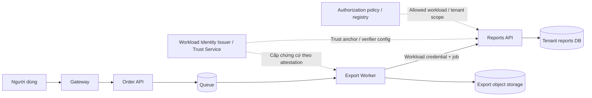
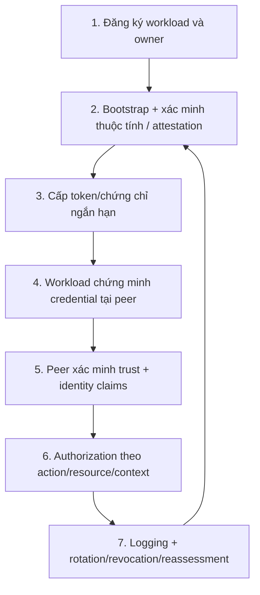
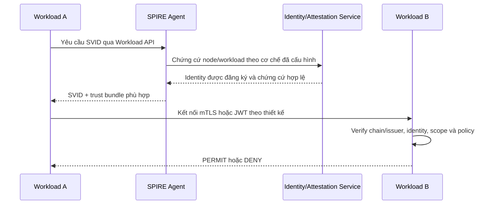
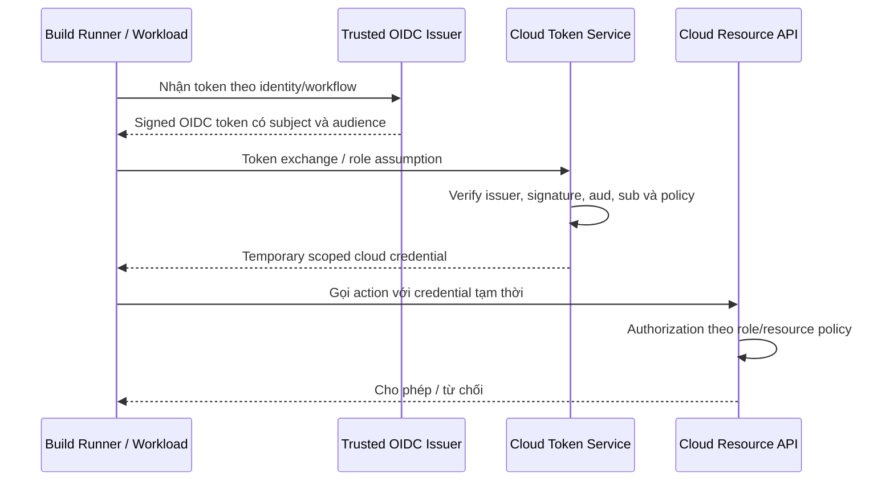

# Workload identity: bảo đảm danh tính cho ứng dụng, dịch vụ và tác vụ tự động

Một hệ thống thương mại điện tử dùng `order-api`, `export-worker`, cơ sở dữ liệu, object storage và pipeline CI/CD. Các service chạy trong cùng Kubernetes cluster, nên nhóm phát triển từng cho rằng “gọi từ mạng nội bộ là đáng tin”. Sau đó, một workload bị cấu hình sai có thể lấy token của service account với quyền rộng, gửi yêu cầu tới storage và đọc file xuất dữ liệu của tenant khác.

Vấn đề có nhiều lớp: **workload nào đang gọi**, **chứng cứ nào chứng minh nó là workload đã được đăng ký**, **credential có đúng đối tượng nhận và còn hiệu lực không**, **workload có quyền với tài nguyên/tenant cụ thể không**, và **làm sao kiểm chứng những điều đó bằng bằng chứng vận hành**?

**Workload identity** là cách biểu diễn, cấp phát, xác minh và quản lý **danh tính của một thực thể tính toán hoặc phần mềm đang thực thi**: service, container, pod, VM, job, serverless function, build runner hay agent tự động. Workload identity giúp hệ thống ra quyết định tin cậy giữa các máy mà không cần giả vờ mọi kết nối nội bộ đều đáng tin.

Trong chương *Identity assurance* của module `SECURITY_SECURITY_ASSURANCE`, mục tiêu là liên kết **rủi ro → yêu cầu xác thực danh tính → controls → kiểm thử/audit → bằng chứng → khắc phục và đánh giá lại liên tục**. Học workload identity vì thế không chỉ là học tạo token; trọng tâm là xây dựng **assurance case** cho những khẳng định về danh tính và quyền của workload trong từng môi trường.

> **Ghi nhớ:** **Xác thực workload** trả lời “bên gọi thực sự mang danh tính nào theo nguồn tin cậy nào?”. **Phân quyền workload** trả lời “danh tính đó có được thực hiện hành động này trên tài nguyên này không?”. Credential được ký hợp lệ **không tự động** chứng minh mọi thao tác của workload đều được phép, hoặc workload không bị chiếm quyền.

## 1. Workload identity là gì?

Một **workload** là thực thể phần mềm thực thi công việc trong môi trường máy tính. Nó có thể chạy liên tục như API service, theo lịch như cron job, trong thời gian ngắn như CI runner, hoặc được tạo/hủy thường xuyên như một pod autoscale.

**Workload identity** thường có ba tầng liên quan nhưng khác nhau:

1. **Định danh (identity):** một tên hoặc thuộc tính ổn định theo thiết kế, ví dụ service account và namespace, một SPIFFE ID hoặc identity của cloud role/workload.
2. **Chứng cứ xác thực (credential):** token ký số, chứng chỉ X.509 với private key, hoặc credential được cấp cho workload để chứng minh danh tính.
3. **Quyền (authorization):** chính sách quyết định identity đó được gọi API, đọc secret, publish queue hay truy cập dữ liệu nào.

Ví dụ giả định:

```text
Workload            : export-worker của hệ thống đơn hàng
Logical identity    : service account report-worker trong namespace orders-prod
Credential          : token ngắn hạn hoặc X.509 SVID
Audience / peer     : orders-reports-api
Permission          : report:read trong tenant được ủy quyền
Trust anchor        : issuer/CA và cơ chế đăng ký/attestation của nền tảng
Assessment scope    : production, release-X, luồng export-worker -> reports-api
```

Một tên service trong log không phải chứng cứ. Một container image có tên `report-worker` không đủ chứng minh workload đang chạy là bản đã được phê duyệt. Ngược lại, việc xác minh một danh tính bằng token cũng **không khẳng định** mã nguồn không có lỗi hoặc host không bị xâm nhập.

### Các thuật ngữ cần phân biệt

| Thuật ngữ | Ý nghĩa | Sai lầm dễ gặp |
|---|---|---|
| **Workload identity** | Danh tính được gắn với một thực thể phần mềm/workload | Đồng nhất identity với password/token |
| **Service account** | Tài khoản hoặc principal được dùng bởi phần mềm | Cho rằng mọi service account luôn là danh tính ngắn hạn |
| **Credential** | Vật liệu dùng để chứng minh một khẳng định danh tính | Coi token còn hạn là bằng chứng không bị đánh cắp |
| **Attestation** | Thu thập/kiểm tra chứng cứ về môi trường hoặc thuộc tính workload để hỗ trợ quyết định cấp identity | Coi attestation là bằng chứng toàn bộ hệ thống không có lỗ hổng |
| **Issuer / certificate authority (CA)** | Thành phần có thẩm quyền cấp token/chứng chỉ theo chính sách tin cậy | Tin mọi credential có chữ ký mà không kiểm tra issuer/chain |
| **Audience (`aud`)** | Bên nhận hoặc hệ thống mục tiêu mà token được cấp để sử dụng | Chấp nhận token dành cho API khác |
| **Subject (`sub`)** | Chủ thể được token diễn tả theo quy ước của issuer | Tin `sub` client tự nhập vào request |
| **Trust domain** | Không gian quản trị danh tính/trust anchor và quy tắc liên quan | Gộp production và development thành một phạm vi tin |
| **Authorization policy** | Quy tắc cấp quyền theo action/resource/context | Dùng authentication thành giấy phép “admin mọi nơi” |
| **Identity lifecycle** | Đăng ký, cấp, sử dụng, đổi, thu hồi và ngừng danh tính | Quên thu hồi quyền khi ứng dụng bị loại bỏ |

## 2. Vì sao workload identity quan trọng với security assurance?

Trong kiến trúc microservices, một request thường đi qua nhiều thành phần. Nếu mọi service dùng chung một API key hoặc chỉ tin mạng nội bộ, rất khó biết **ai làm gì**, giới hạn phạm vi thiệt hại và thu hồi quyền khi một thành phần bị chiếm.

Những rủi ro chính:

- **Static shared secrets:** nhiều service dùng chung password/API key, khó quy nguồn và xoay khóa.
- **Overprivileged service account:** một job đọc báo cáo có quyền quản trị cả storage hoặc IAM.
- **Identity spoofing:** client hoặc workload giả mạo header/tên service để được tin.
- **Token replay hoặc token substitution:** một token bị lấy lại hoặc đưa tới endpoint khác không kiểm tra `aud`.
- **Confused deputy:** service đặc quyền bị dụ thực hiện hành động thay bên ít quyền hơn.
- **Compromised runner/container:** kẻ tấn công chiếm môi trường thực thi và dùng credential hợp lệ của workload.
- **Misconfigured trust:** production chấp nhận identity hoặc credential từ môi trường test.
- **Stale identity:** service đã ngừng chạy nhưng IAM role, secret hoặc trust relationship vẫn tồn tại.
- **Loss of accountability:** không thể truy vết hành động về đúng workload, phiên bản và nguồn phát hành.

### Một tình huống cụ thể

`export-worker` cần lấy dữ liệu báo cáo từ `reports-api`. Nếu `reports-api` chỉ kiểm tra `X-Service: export-worker`, bất kỳ bên nào gửi được HTTP request có thể tự ghi header đó. Nếu chỉ kiểm tra token hợp lệ do issuer cấp nhưng không kiểm tra audience, token dành cho service khác có thể được dùng sai chỗ. Và ngay cả khi token hợp lệ đúng workload, nếu API không giới hạn **tenant** của job, worker có thể bị lạm dụng để đọc dữ liệu tenant không được phép.

Vì vậy assurance phải chứng minh **cả đường định danh, xác thực và phân quyền ở đúng trust boundary**.

## 3. Phân biệt human identity và workload identity

| Khía cạnh | Human identity | Workload identity |
|---|---|---|
| **Chủ thể** | Người dùng, nhân viên, quản trị viên, nhà thầu | Service, job, pod, VM, function, build runner |
| **Khởi tạo** | Quy trình nhân sự, định danh người dùng, account onboarding | Đăng ký workload, deployment metadata, cloud/Kubernetes identity |
| **Chứng cứ thường gặp** | Passwordless, MFA, phiên, token sau đăng nhập | X.509, mTLS, OIDC token, projected service account token, federation |
| **Vòng đời** | Joiner–Mover–Leaver, đổi vai trò | Deploy–scale–rotate–revoke–retire, owner thay đổi |
| **Tốc độ thay đổi** | Từ ngày đến tháng, có khi ngắn hơn | Có thể theo giây/phút với pod/job tạm thời |
| **Đối tượng phê duyệt quyền** | Line manager, data/system owner | Application/technical owner, platform/IAM owner |
| **Mối đe dọa nổi bật** | Phishing, chiếm phiên, đặc quyền dư | Secret leak, token reuse, pod/runner compromise, identity spoofing |
| **Bằng chứng trọng yếu** | Quyết định cấp/quyền, identity proofing, access review | Workload registration, attestation, issuer/CA, token policy, runtime/deployment evidence |

Các khái niệm **AAL (Authenticator Assurance Level)** trong một số chuẩn xác thực người dùng không nên được gán máy móc cho workload như thể workload có MFA kiểu con người. Với máy, cần nêu rõ tiêu chí riêng về **bootstrap, attestation, credential, proof of possession, issuer, audience, authorization và lifecycle**.

**Một workload có thể hành động thay mặt người dùng**, nhưng identity của service và identity của người dùng là hai chủ thể khác nhau. Khi cần delegation, phải xác định quyền được ủy quyền, scope, thời hạn, người dùng gốc và khả năng audit; không ngầm chuyển quyền quản trị của service cho mọi request do user gửi.

## 4. Mô hình kiến trúc và trust boundaries

Giả sử một nền tảng có `frontend`, `order-api`, `export-worker`, queue, `reports-api` và kho dữ liệu.



**Các ranh giới cần đánh giá:**

| Boundary | Điều không thể mặc nhiên tin | Kiểm tra và bằng chứng cần có |
|---|---|---|
| Gateway → API | Danh tính user và quyền với tài nguyên | User token validation, object-level authorization |
| API → queue | Producer, tenant/job/approval trong message | Producer IAM, nguồn job đáng tin, schema và authorization |
| Queue → worker | Payload có thể bị sửa hoặc đến từ producer ít quyền | Kiểm tra job origin, tenant binding, replay/idempotency |
| Worker → reports API | Bên gọi thật, credential và phạm vi gọi | Workload authentication, issuer/audience/expiry, permission |
| Reports API → DB | Quyền đọc đối tượng/tenant, service account DB | Query/DB policy, least privilege, cross-tenant tests |
| Worker → object storage | Quyền ghi file, đường tải và thời hạn | Workload IAM, storage ACL/policy, download authorization |
| CI/CD → production | Artefact/runner nào được quyền deploy | Workload federation, branch/environment conditions, approvals |

Điều kiện quan trọng: **mTLS có thể xác thực peer/workload theo thiết kế, nhưng không tự cấp quyền nghiệp vụ**. Tương tự, token có `sub=export-worker` cần được xác minh bởi bên nhận; gửi một chuỗi `sub` từ payload không phải authentication.

## 5. Chuỗi tin cậy của workload identity

Một thiết kế tin cậy có thể mô tả thành bảy giai đoạn. Mỗi giai đoạn có thể tạo một control và một điểm cần assurance.



### 5.1. Đăng ký và cấp quyền ban đầu

Trước tiên phải biết workload **được tạo bởi ai**, phục vụ ứng dụng/môi trường nào, chạy dưới danh tính nào và cần gọi tài nguyên gì. Một inventory cơ bản nên có:

- Application/system owner và technical owner.
- Tên workload, namespace/project/account và môi trường.
- Workload type: deployment, job, serverless, VM, CI runner.
- Trust domain hoặc issuer được tin.
- Quyền truy cập cần thiết, tài nguyên, audience, tenant/project scope.
- Người có thẩm quyền thay deployment và policy cấp identity.
- Cơ chế cấp/đổi/thu hồi credential; thời điểm xem lại và sunset date nếu có.

Thiếu owner và phạm vi đồng nghĩa không có cơ sở đáng tin để chứng nhận quyền dài hạn của machine identity.

### 5.2. Bootstrap: ban đầu ai được tin?

Vấn đề “con gà và quả trứng”: workload chưa có credential thì **căn cứ nào** cho hệ thống phát hành identity tin rằng nó là workload đã đăng ký?

Các nguồn bootstrap/attestation có thể gồm:

- Kubernetes service account được gắn với pod theo API server và các thuộc tính điều phối.
- Instance identity hoặc metadata được cloud provider bảo vệ theo mô hình của họ.
- Node/agent attestation bằng cơ chế phù hợp hạ tầng.
- Chứng cứ từ môi trường thực thi, tính toàn vẹn boot/host hoặc hardware root khi được sử dụng.
- Quan hệ trust do pipeline và deployment policy tạo, nếu có bằng chứng tương ứng.

**Attestation chỉ mạnh bằng nguồn dữ liệu và root of trust của nó.** Một namespace hoặc label do bên ít quyền có thể tự tạo không phải chứng cứ mạnh về tính hợp pháp của workload. Nếu kẻ tấn công có quyền deploy pod với service account đặc quyền, một token hoàn toàn hợp lệ vẫn có thể được cấp cho workload ngoài ý muốn.

### 5.3. Issuance: cấp chứng cứ có giới hạn

Issuer cấp token/chứng chỉ với **danh tính, audience hoặc peer scope, thời hạn, khóa/chữ ký** và những thuộc tính cần thiết. Nên ưu tiên credential ngắn hạn, được cấp động và gắn với workload hiện tại khi nền tảng hỗ trợ.

Không nên truyền secret dài hạn qua build image, environment variables rộng hoặc repository nếu có phương án identity federation phù hợp. Tuy nhiên, credential ngắn hạn **không tự ngăn** việc bị lạm dụng trong khoảng thời gian còn hiệu lực.

### 5.4. Verification: bên nhận phải xác minh

Bên nhận cần kiểm tra chứng cứ bằng trust anchors và validation rules **đã được cấu hình có thẩm quyền**, thay vì tin header do client gửi. Với token ký số, có thể cần kiểm tra chữ ký/thuật toán được phép, issuer, audience, thời hạn, `nbf` nếu có, subject và chính sách revocation/binding thích hợp.

Với mTLS, bên nhận cần tin đúng CA/bundle, kiểm tra chứng chỉ còn hạn và danh tính workload trong SAN theo quy ước, không chỉ chứng minh “kết nối có mã hóa”.

### 5.5. Authorization: chỉ quyền cần thiết

Sau khi có authenticated workload principal, hệ thống vẫn phải kiểm tra:

- Workload nào, thuộc môi trường/trust domain nào?
- Được gọi endpoint, method và action nào?
- Có được đọc/ghi dữ liệu tenant hoặc project nào?
- Có thể lấy secret, publish message, thực hiện export/deploy không?
- Quyền có được giới hạn theo thời điểm, trạng thái job/approval và đối tượng không?

**Authentication success ≠ authorization success.** Đây là một claim khác và cần test/evidence riêng.

### 5.6. Lifecycle và operational evidence

Khi workload autoscale, nâng bản build, đổi namespace, thay owner hoặc ngừng hoạt động, danh tính và quyền cần được quản lý lại. Log/telemetry phải cho phép truy vết principal, endpoint, kết quả, thời gian và ngữ cảnh tài nguyên mà không lưu credential nguyên bản.

## 6. Những cách triển khai workload identity phổ biến

| Mô hình | Bản chất | Khi nào phù hợp | Giới hạn cần xét |
|---|---|---|---|
| **Kubernetes service account token** | Token cho danh tính service account gắn với workload trong cluster | Pod gọi Kubernetes API hoặc hệ thống tin issuer/token được cấu hình | Quyền SA và quyền tạo pod là ranh giới; audience và validator phải đúng |
| **SPIFFE / SPIRE** | Định danh workload chuẩn hóa cùng hạ tầng phát hành/attestation | Service-to-service đa môi trường, cần identity thống nhất | Cần quản lý trust domain, attestation, agent/CA và policy |
| **mTLS với workload certificate** | X.509 certificate giúp peer authentication và bảo vệ kênh | Service mesh, internal API hoặc workload giao tiếp với nhau | CA trust, SAN identity, key lifecycle và quyền nghiệp vụ cần riêng |
| **OIDC workload federation / token exchange** | Token từ issuer bên ngoài đổi thành credential có hạn theo trust policy | K8s/CI/workload gọi cloud API mà không cần static key | Issuer/audience/subject conditions và token exchange phải hạn chế chặt |
| **Cloud-native workload role/identity** | Role/identity do cloud provider quản trị gắn VM/function/container | Truy cập tài nguyên cloud đúng scope | Metadata exposure, trust policy, least privilege và lifecycle |
| **Static API key/client secret** | Bí mật được chia sẻ để chứng minh client | Một số hệ legacy hoặc tích hợp hạn chế | Rotation/revocation khó, nguy cơ sao chép và thiếu danh tính riêng |

Không phải mọi tổ chức phải dùng SPIFFE hay service mesh. Chọn giải pháp theo **trust boundaries, threat model, khả năng nền tảng, trách nhiệm vận hành và bằng chứng cần thu**. Một công cụ bảo mật phức tạp nhưng có trust policy quá rộng có thể yếu hơn một phương án ít thành phần và được kiểm soát đúng.

## 7. Kubernetes service accounts và projected tokens

Trong Kubernetes, **ServiceAccount** cung cấp danh tính cho các process chạy trong pod trong tương tác với Kubernetes API và có thể dùng làm cơ sở cho các tích hợp identity khác. Workload dùng service account nào phụ thuộc `serviceAccountName` và chính sách tạo pod; quyền thao tác tài nguyên cluster phụ thuộc **RBAC**, không phải tên service account.

### 7.1. Định danh và namespace

Một service account thường được nhận diện theo tên **và namespace** trong phạm vi cluster, chẳng hạn `orders-prod/report-worker`. Khi dùng token có `sub`, cần hiểu cách issuer thực sự biểu diễn service account và kiểm tra token được phát hành bởi cluster/issuer tin cậy tương ứng.

**Không dùng riêng tên `report-worker` làm danh tính toàn cục.** Các cluster/namespace khác có thể có service account trùng tên nhưng thuộc trust domain và quyền khác. Production và development cần ranh giới policy, dù cách đặt tên workload tương tự.

### 7.2. Mẫu Pod với projected service account token

Ví dụ này tạo service account và chủ động mount một token có audience dành riêng cho `orders-reports-api`. Đây là **manifest học tập**, không phải một bản triển khai đầy đủ cho production.

```yaml
apiVersion: v1
kind: ServiceAccount
metadata:
  name: report-worker
  namespace: orders-prod
automountServiceAccountToken: false
---
apiVersion: v1
kind: Pod
metadata:
  name: report-worker-example
  namespace: orders-prod
spec:
  serviceAccountName: report-worker
  automountServiceAccountToken: false
  containers:
    - name: worker
      image: registry.example.invalid/orders/report-worker:example
      volumeMounts:
        - name: report-api-identity
          mountPath: /var/run/secrets/report-api
          readOnly: true
  volumes:
    - name: report-api-identity
      projected:
        sources:
          - serviceAccountToken:
              path: token
              audience: orders-reports-api
              expirationSeconds: 3600
```

**Ý nghĩa chính:**

- `automountServiceAccountToken: false` hạn chế việc mount token mặc định không cần thiết; volume được khai báo **tường minh** cho use case này.
- `audience: orders-reports-api` yêu cầu một token cho bên nhận cụ thể; bên nhận cũng phải **xác minh đúng audience**, không chỉ nhìn sự tồn tại claim.
- `expirationSeconds` biểu thị thời hạn được yêu cầu theo khả năng/giới hạn của cluster; ứng dụng phải xử lý vòng đời token, không giả định token bất biến.
- Projected token được Kubernetes quản lý làm mới theo cơ chế tương ứng. Ứng dụng nên **đọc lại credential** khi cần, thay vì cache giá trị trong bộ nhớ vô thời hạn.
- Manifest **không tự cấp quyền** cho worker trên `reports-api`, database hoặc object storage.
- Token audience tùy chỉnh chỉ có ý nghĩa khi `reports-api` có cơ chế kiểm chứng issuer/chữ ký/audience/subject và chính sách ứng dụng phù hợp.

**Điểm cần chú ý về trust:** ai được tạo/sửa Pod hoặc cấu hình `serviceAccountName` có thể ảnh hưởng workload nhận identity nào. Cần kiểm soát RBAC/admission policy, identity của deployment pipeline và khả năng truy cập token trong pod. Token bị sao chép có thể bị dùng lại trong thời hạn hợp lệ nếu không có ràng buộc và biện pháp chống lạm dụng phù hợp.

### 7.3. Kiểm chứng thực tế, không chỉ nhìn YAML

Một review cần kiểm tra:

1. Service account thực sự được gán cho pod đang chạy, trong namespace/cluster đúng.
2. Chính sách RBAC có hạn chế các thao tác Kubernetes API theo nhu cầu không.
3. Quyền tạo/sửa workload/service account và quyền đọc secret/token có bị cấp quá rộng không.
4. Audience/issuer/subject được xác minh ở bên nhận ra sao; có tin cluster không đúng không.
5. Container có đường lấy credential từ pod khác, host, volume hoặc log không.
6. Rotation, lỗi issuer và thời điểm token hết hạn được hệ thống xử lý an toàn không.
7. API/worker có authorization theo resource/tenant bên cạnh authentication không.

Một screenshot ServiceAccount trên dashboard không đủ để chứng minh các điều trên.

## 8. SPIFFE và SPIRE: định danh thống nhất giữa workload

**SPIFFE** là cách chuẩn hóa khái niệm danh tính của workload trong các môi trường triển khai khác nhau. Một workload có thể được gán một **SPIFFE ID** dạng URI, ví dụ:

```text
spiffe://corp.example/ns/orders-prod/sa/report-worker
```

Trong URI này, `corp.example` là *trust domain* minh họa, còn phần đường dẫn biểu diễn tên workload theo **quy ước của tổ chức**. Không nên tự suy luận path chuẩn của mọi deployment chỉ từ ví dụ.

**SVID (SPIFFE Verifiable Identity Document)** là chứng cứ có thể xác minh cho SPIFFE identity, có thể tồn tại ở dạng **X.509-SVID** hoặc **JWT-SVID** theo trường hợp sử dụng. Bên nhận phải xác thực tài liệu theo trust bundle/validator phù hợp và **phân quyền** danh tính sau khi xác minh.

**SPIRE** là một triển khai hệ thống giúp cấp/duy trì SPIFFE identity qua registration và attestation. Mô hình thường gồm thành phần server và agent thực hiện những bước nhận diện node/workload, cấp SVID và phối hợp tin cậy.

### Một luồng SVID đơn giản



Sơ đồ trên là **mô hình khái niệm**, không đại diện đầy đủ thứ tự mọi thao tác nội bộ hay cách cấu hình cụ thể của SPIRE. Điểm assurance cần xem là **registration entries, selector/attestation rules, quyền thay đổi chúng, CA/trust bundle, lifecycle của SVID và policy của peer**.

### Những claim không được suy ra quá mức

- Có SPIFFE ID **không chứng minh** mã đang chạy không có lỗ hổng.
- Attestation dựa trên metadata đáng tin **không thay thế** kiểm tra hành động nghiệp vụ.
- mTLS giữa hai SPIFFE identities **không tự chứng minh** tenant dữ liệu được phép.
- Một trust domain không nên mở rộng tùy tiện; identity từ dev/test không được tự hưởng quyền prod.
- Nếu host/node/agent bị xâm nhập, có thể ảnh hưởng tới tính đáng tin của identity hoặc credential; cần đánh giá giới hạn và biện pháp giảm thiểu.

## 9. OIDC federation và cloud workload identity

Một trường hợp phổ biến là workload cần truy cập API tài nguyên cloud nhưng không muốn giữ **long-lived access key**. Có thể dùng **workload identity federation**:

1. Workload chạy trong môi trường có issuer đáng tin (Kubernetes, CI provider hoặc nền tảng tính toán khác).
2. Workload nhận một token/credential có chủ thể, audience, thời hạn và các claim được issuer xác thực.
3. Cloud security token service hoặc hệ thống tương đương **xác minh** credential và điều kiện trust policy.
4. Nếu phù hợp, hệ thống cấp credential **ngắn hạn, giới hạn quyền** cho role/service principal cloud.
5. Workload dùng credential cloud để truy cập đúng tài nguyên; các hành động được audit.



**Federation không có nghĩa “bất kỳ token OIDC nào cũng hợp lệ”.** Trust policy phải khóa chặt **issuer**, `aud`, `sub` và thuộc tính phù hợp với nhà cung cấp: repository/workflow/branch/environment/service account/namespace/cluster... tùy trường hợp. Nếu chỉ kiểm tra tên tổ chức mà cho phép mọi repository hoặc branch nhận role deploy production, ranh giới tin cậy có thể bị phá.

### CI/CD là workload identity

Pipeline không phải “người dùng vô danh”. Build runner hoặc deployment job cũng là workload, thường có quyền quan trọng:

| Hành động | Yêu cầu identity | Quyền cần giới hạn |
|---|---|---|
| Checkout/test | CI workload được cấp quyền đọc nguồn cần thiết | Không cần secret production cho unit tests |
| Build/scan | Workload thực thi từ workflow/commit được kiểm soát | Chỉ đọc phụ thuộc/công cụ cần thiết |
| Publish artefact | Identity cho đúng repository/pipeline đã được phê duyệt | Chỉ ghi registry/project được chỉ định |
| Deploy staging | Job có quyền môi trường staging | Không được tự assume role production |
| Deploy production | Job có provenance, approval và trust conditions phù hợp | Quyền deployment đúng service/environment, thời hạn ngắn |

**Một token được phát hành hợp lệ cho workflow từ branch không đáng tin vẫn có thể bị lạm dụng** nếu cloud role tin mọi branch. Do đó cần kết hợp branch/environment protection, kiểm soát sửa workflow, quyền release, OIDC claim restrictions và bằng chứng source-to-deployment.

## 10. Xác minh token/chứng chỉ và các kiểm tra không được bỏ qua

Workload authentication là một **security boundary**. Nếu bên nhận xác thực sai, mọi authorization phía sau có thể dựa trên danh tính giả.

### 10.1. Với JWT/OIDC tokens

Bên nhận phải sử dụng thư viện/validator phù hợp và kiểm tra ít nhất những thuộc tính áp dụng:

| Yếu tố | Câu hỏi kiểm chứng | Rủi ro nếu thiếu |
|---|---|---|
| **Signature/algorithm** | Chữ ký có được kiểm đúng và chỉ chấp nhận thuật toán được cho phép? | Token giả, algorithm confusion |
| **Issuer (`iss`)** | Token có đến từ issuer tin cậy cho môi trường đang xét? | Chấp nhận token từ dev hoặc issuer không kiểm soát |
| **Audience (`aud`)** | Token có dành cho đúng API/token-exchange service? | Token substitution/confused deputy |
| **Subject (`sub`)** | Chủ thể có đúng workload đã đăng ký, quy tắc mapping có an toàn? | Impersonation bằng tên/service account tương tự |
| **Expiry (`exp`)** | Token còn hạn với chính sách clock skew hợp lý? | Dùng credential cũ quá thời gian |
| **Not-before (`nbf`)** | Token đã đến thời điểm sử dụng nếu claim tồn tại? | Chấp nhận credential chưa hiệu lực |
| **Issued-at (`iat`)** | Có bất thường về thời gian cấp nếu policy cần kiểm soát không? | Không phát hiện token tuổi/nguồn không hợp lệ |
| **Key selection/rotation** | Khóa xác minh được lấy từ nguồn tin cậy, đúng issuer, xử lý rollover? | Tin key do attacker chỉ định hoặc sự cố khi rotate |
| **Replay / token theft** | Có ràng buộc audience, thời hạn, mTLS/token binding hoặc bảo vệ chống replay phù hợp? | Credential hợp lệ bị sao chép dùng lại |
| **Authorization scope** | Sau khi verify, identity được phép làm gì trên resource nào? | Authentication hợp lệ nhưng truy cập vượt quyền |

Không phải token nào cũng có đủ mọi claim. Validator phải dựa vào **profile token thực tế và tiêu chí của issuer/bên nhận**. `jti` nếu tồn tại có thể hỗ trợ kiểm soát replay/thu hồi theo thiết kế, nhưng chỉ thấy `jti` trong token **không tự động** ngăn replay.

**Không tự viết thư viện kiểm chữ ký JWT từ đầu** chỉ để tránh dependency. Ví dụ trong bài chỉ xử lý authorization *sau khi* principal đã được tạo bởi thành phần xác thực đáng tin; phần xác minh chứng cứ phải dùng giải pháp được kiểm tra và vận hành phù hợp.

### 10.2. Với X.509 và mTLS

Kiểm tra thường cần:

- Peer certificate chain tới **đúng trust bundle/CA**, còn hạn và phù hợp chính sách.
- Workload identity nằm ở **SAN phù hợp** (ví dụ URI SAN cho SPIFFE ID); không mặc định tin CN hay chuỗi tùy ý do client đưa vào.
- Private key được quản lý và chỉ khả dụng theo phạm vi workload phù hợp.
- Kết nối thực sự xác thực hai chiều nếu thiết kế yêu cầu **mTLS**, không chỉ TLS server authentication.
- Có chính sách **được phép gọi endpoint/tài nguyên nào** sau khi peer identity đã được xác minh.
- Rotation/expiry/revocation và sự cố trust bundle được xử lý/giám sát.

Dù kênh mTLS đã xác thực service A, service B vẫn phải kiểm tra **action, audience/peer scope, environment và tenant**. TLS mã hóa traffic không chứng minh payload nghiệp vụ được ủy quyền.

### 10.3. Trust policy và khóa xác minh

Không chấp nhận URL/JWKS/issuer do request gửi vào làm nguồn trust tùy ý. Trust roots và mapping policy phải do người có thẩm quyền quản lý, có review và kiểm thử khi đổi cấu hình. Kiểm tra rằng **key rotation** không làm service fail-open hoặc ngừng xác thực trong thời gian dài không được phát hiện.

## 11. Authenticated workload chưa phải authorized workload

Sau xác thực, bên nhận thường tạo một **verified workload principal** có các thuộc tính đã được chứng minh hoặc đối chiếu:

```text
principal:
  trustDomain: corp.example
  namespace: orders-prod
  serviceAccount: report-worker
  environment: production
  audience: orders-reports-api
  tenantScope: tenant-A
  permissions: [report:read]
  expiresAt: <verified token/credential expiry>
```

Đây là hình thức biểu diễn **logic**. Thuộc tính `tenantScope` và `permissions` có thể cần lấy từ **registry hoặc policy authoritative**, không nhất thiết có trong token. Không được tin chúng chỉ vì client ghi vào JSON hoặc header.

### Ba kiểm tra cần phân biệt

1. **Authentication:** credential thuộc issuer/trust domain được tin và xác định workload.
2. **Authorization:** workload có quyền gọi `readReport` trên report của tenant A không?
3. **Business authorization / delegation:** report có thuộc một job đã được phê duyệt và người dùng khởi tạo có quyền không?

Một worker có `report:read` ở tenant A **không được** thay `tenantId=tenant-B` trong request để đọc tenant B. Nếu worker dùng quyền rộng “đọc mọi tenant” cho toàn bộ request của người dùng, nó có thể trở thành **confused deputy**.

### Bảo vệ identity propagation

Khi gateway/service mesh đưa identity vào header, ứng dụng chỉ được tin header đó nếu có cơ chế bảo đảm **nguồn phát và tính toàn vẹn của header** (ví dụ chặn đường trực tiếp, xóa header không tin cậy, xác thực proxy/sidecar hoặc token được ký phù hợp). Header `X-Workload-Id: report-worker` do client tự gửi không phải chứng cứ định danh.

## 12. Java 17: kiểm tra quyền sau khi đã xác thực workload

Ví dụ sau mô tả một lớp **authorization policy** ở `orders-reports-api`. `VerifiedWorkload` đại diện cho kết quả **đã được validator riêng xác minh**, không phải object nhận trực tiếp từ body hay header HTTP.

Nó chỉ cho phép `report-worker` thuộc đúng trust domain/namespace/môi trường đọc tài nguyên **cùng tenant**, có đúng audience và quyền. Tài nguyên có phân loại `PII` cần thêm permission cụ thể.

```java
import java.time.Instant;
import java.util.Objects;
import java.util.Set;

record VerifiedWorkload(
        String trustDomain,
        String namespace,
        String serviceAccount,
        String environment,
        String tenantId,
        String audience,
        Instant expiresAt,
        Set<String> grants) {}

record ReportResource(
        String id, String tenantId,
        String environment, String classification) {}

public final class WorkloadPolicy {
    private WorkloadPolicy() {}

    public static boolean mayRead(
            VerifiedWorkload caller,
            ReportResource report,
            Instant now) {

        if (caller == null || report == null || now == null
                || caller.expiresAt() == null
                || caller.grants() == null) {
            return false;
        }

        // Các giá trị identity phải đến từ validator/registry tin cậy.
        if (!"corp.example".equals(caller.trustDomain())
                || !"orders-prod".equals(caller.namespace())
                || !"report-worker".equals(caller.serviceAccount())
                || !"production".equals(caller.environment())
                || !"orders-reports-api".equals(caller.audience())) {
            return false;
        }

        // Hết hạn tại đúng thời điểm expiresAt.
        if (!now.isBefore(caller.expiresAt())) {
            return false;
        }

        // Tenant của report phải lấy từ kho tài nguyên authoritative.
        if (report.id() == null || report.id().isBlank()
                || caller.tenantId() == null
                || caller.tenantId().isBlank()
                || !Objects.equals(caller.tenantId(), report.tenantId())
                || !Objects.equals(
                        caller.environment(), report.environment())) {
            return false;
        }

        if ("PII".equals(report.classification())) {
            return caller.grants().contains("report:read:pii");
        }
        if ("INTERNAL".equals(report.classification())) {
            return caller.grants().contains("report:read");
        }
        return false;
    }
}
```

**Ý nghĩa và giới hạn:**

- Những chuỗi `corp.example`, `orders-prod`, `report-worker` là **giá trị giả định của policy demo**, không được hardcode theo ví dụ trong mọi hệ thống thật. Hệ thống production có thể dùng policy engine/config được quản trị và version hóa.
- Lớp này **không xác minh chữ ký JWT, token binding, chứng chỉ hoặc tính hợp lệ của CA**. Việc đó phải được hoàn thành ở trust boundary trước khi tạo `VerifiedWorkload`.
- `grants` cần nguồn quyền đáng tin; một trường permissions tự khai báo từ client sẽ tạo lỗ hổng.
- `ReportResource.tenantId` phải được lấy từ dữ liệu của report đã xác minh, không do requester tự điền.
- Với hệ thống thực, cần kiểm tra request/job, authorization trước tác dụng phụ, truy cập cache/storage và đường xử lý queue.
- Dù cùng một service có quyền đọc PII, có thể phải kiểm tra **job/user delegation** và data purpose trước khi trả dữ liệu.

### JUnit 5: các tình huống âm tính quan trọng

```java
import static org.junit.jupiter.api.Assertions.assertFalse;
import static org.junit.jupiter.api.Assertions.assertTrue;
import java.time.Instant;
import java.util.Set;
import org.junit.jupiter.api.Test;

class WorkloadPolicyTest {
    private static final Instant NOW =
            Instant.parse("2026-11-28T00:00:00Z");

    private static VerifiedWorkload worker(Set<String> grants) {
        return new VerifiedWorkload(
                "corp.example", "orders-prod", "report-worker",
                "production", "tenant-A", "orders-reports-api",
                NOW.plusSeconds(900), grants);
    }

    private static ReportResource internalReport() {
        return new ReportResource(
                "report-42", "tenant-A", "production", "INTERNAL");
    }

    @Test
    void allowsExpectedWorkerForItsTenant() {
        assertTrue(WorkloadPolicy.mayRead(
                worker(Set.of("report:read")), internalReport(), NOW));
    }

    @Test
    void deniesCrossTenantEvenWithValidServiceIdentity() {
        var otherTenant = new ReportResource(
                "report-43", "tenant-B", "production", "INTERNAL");
        assertFalse(WorkloadPolicy.mayRead(
                worker(Set.of("report:read")), otherTenant, NOW));
    }

    @Test
    void deniesWrongAudience() {
        var wrongAudience = new VerifiedWorkload(
                "corp.example", "orders-prod", "report-worker",
                "production", "tenant-A", "different-api",
                NOW.plusSeconds(900), Set.of("report:read"));
        assertFalse(WorkloadPolicy.mayRead(
                wrongAudience, internalReport(), NOW));
    }

    @Test
    void deniesDevIdentityOnProduction() {
        var devWorker = new VerifiedWorkload(
                "corp.example", "orders-dev", "report-worker",
                "development", "tenant-A", "orders-reports-api",
                NOW.plusSeconds(900), Set.of("report:read"));
        assertFalse(WorkloadPolicy.mayRead(
                devWorker, internalReport(), NOW));
    }

    @Test
    void deniesExpiredCredential() {
        var expired = new VerifiedWorkload(
                "corp.example", "orders-prod", "report-worker",
                "production", "tenant-A", "orders-reports-api",
                NOW, Set.of("report:read"));
        assertFalse(WorkloadPolicy.mayRead(
                expired, internalReport(), NOW));
    }

    @Test
    void requiresSeparatePermissionForPii() {
        var piiReport = new ReportResource(
                "report-pii", "tenant-A", "production", "PII");
        assertFalse(WorkloadPolicy.mayRead(
                worker(Set.of("report:read")), piiReport, NOW));
        assertTrue(WorkloadPolicy.mayRead(
                worker(Set.of("report:read:pii")), piiReport, NOW));
    }

    @Test
    void deniesMissingInputAndPermission() {
        assertFalse(WorkloadPolicy.mayRead(
                null, internalReport(), NOW));
        assertFalse(WorkloadPolicy.mayRead(
                worker(Set.of()), internalReport(), NOW));
    }
}
```

**Unit tests trên chỉ chứng minh logic của hàm demo**, không chứng minh cluster thực phát hành token đúng, API đã kiểm chứng cryptographic credential, hoặc `mayRead` được gọi ở tất cả đường truy cập. Các **integration/security tests** cần mô phỏng request đã xác thực, sai issuer, sai audience, token hết hạn, giả header, đường queue và thao tác chéo tenant, đồng thời xác minh **không có dữ liệu hoặc tác dụng phụ bị rò rỉ**.

## 13. Vòng đời: từ tạo workload đến thu hồi identity

Workload có thể chạy rất ngắn, nhưng role/IAM/trust policies có thể tồn tại nhiều năm. Vì vậy cần quản lý **machine identity lifecycle**, không chỉ rotate credential.

| Giai đoạn | Công việc | Bằng chứng cần có |
|---|---|---|
| **Register / onboard** | Gán owner, trust domain, workload selector, môi trường và quyền tối thiểu | Workload inventory, approval, mapping policy |
| **Provision / bootstrap** | Xác minh nền tảng/node/pod, cấp identity theo quy tắc được phê duyệt | Attestation rules, issuer config, issuance events |
| **Deploy / activate** | Gắn đúng service account/role vào workload thực | Manifest, image provenance, runtime metadata |
| **Authenticate / authorize** | Bên nhận xác minh credential và quyết định theo action/resource | Token/peer tests, policy review, audit events |
| **Rotate / renew** | Làm mới token/chứng chỉ, cập nhật trust bundle/keys an toàn | Rotation logs, expiry alerts, canary/negative tests |
| **Change / scale** | Kiểm tra namespace, service account, audience, tenant và quyền khi autoscale hoặc đổi môi trường | Deployment diff, IAM review, new identity inventory |
| **Suspend / revoke** | Dừng cấp mới, thu hồi quyền, vô hiệu hóa session/token hoặc thay trust policy theo thiết kế | IAM/registration changes, retest, impact records |
| **Retire** | Xóa/disable identity, secret, role, registration và quyền storage | Decommission ticket, effective-access verification |
| **Recertify** | Xác nhận owner, mục đích và quyền còn cần | Access review decision, scope, justification |

**Phân biệt rotation và revocation:** phát hành credential mới không nhất thiết làm credential cũ mất hiệu lực ngay. Với token đã phát hành, thu hồi ngay có thể cần một cơ chế bổ sung (ví dụ thay policy, ngắt truy cập, kiểm tra token state, thay trust anchor hoặc chờ hết hạn theo mô hình), tùy loại token và khả năng của issuer/verifier. **Không hứa khả năng revoke tức thời cho mọi JWT tự chứa** nếu hệ thống chỉ xác minh chữ ký và `exp`.

### Phản ứng khi credential bị lộ

1. Xác định identity, audience, quyền và thời điểm credential bị lộ.
2. Hạn chế hoặc cô lập đường sử dụng bị ảnh hưởng theo quy trình incident response.
3. Vô hiệu hóa trust/role, thu hồi credential hoặc làm ngắn cửa sổ sử dụng theo khả năng nền tảng.
4. Xác minh logs và phát hiện hành động bất thường trong thời kỳ phơi lộ.
5. Rotate/reissue với root-cause remediation: chặn leak trong log/build, sửa RBAC, harden runner.
6. Re-test và cập nhật risk register, control evidence, owner và kết luận assurance.

Một token ngắn hạn là **biện pháp giảm cửa sổ rủi ro**, không phải bảo đảm tuyệt đối chống chiếm quyền.

## 14. Threat modeling workload identity bằng STRIDE

| STRIDE | Kịch bản ở identity boundary | Controls cần xem | Kiểm thử/bằng chứng |
|---|---|---|---|
| **S – Spoofing** | Workload giả header/tên service, giả issuer hoặc dùng token của service khác | Xác minh issuer/subject/audience, mTLS peer identity, trust policy | Invalid issuer, wrong subject, spoofed header tests |
| **T – Tampering** | Sửa claim/config mapping hoặc thay artefact/manifest để gắn role đặc quyền | Signature validation, protected config, RBAC, build provenance | Policy diff review, deployment audit, negative tests |
| **R – Repudiation** | Không xác định workload nào tạo export/deploy | Workload identity trong audit trail, correlation/job ID | Log completeness và trace theo credential/subject |
| **I – Information disclosure** | Lộ token trong logs, environment hoặc image; truy cập dữ liệu tenant khác | Credential handling, least privilege, data-level authz | Secret scans, token exposure review, cross-tenant tests |
| **D – Denial of service** | Issuer/CA/identity provider hỏng; token renewal lỗi làm toàn hệ thống ngừng | HA, cache/renewal design, retry/backoff, safe degradation | Failure simulation, rotation/expiry tests |
| **E – Elevation of privilege** | Tạo pod với service account đặc quyền, CI assume prod role sai điều kiện | RBAC/admission control, OIDC trust claims, SoD/JIT | Pod/runner RBAC review, wrong branch/namespace tests |

### Những điểm yếu không được bỏ qua

**Metadata service / token endpoint:** Ở một số nền tảng, workload có thể lấy credential qua metadata endpoint. Nếu ứng dụng có SSRF hoặc workload khác có thể truy cập endpoint không đúng phạm vi, credential có thể bị chiếm. Cần xem isolation, chính sách truy cập metadata, IAM scope và controls chống SSRF theo mô hình nền tảng.

**Sidecar/service mesh:** Một proxy có thể xác thực peer nhưng ứng dụng vẫn cần kiểm tra quyền nghiệp vụ. Phải đảm bảo đường vào đi qua enforcement point, không có port nội bộ hoặc đường bypass không được kiểm soát.

**Namespace/cluster confusion:** Service account cùng tên ở nhiều cluster không có nghĩa cùng identity. Trust policy phải phân biệt nguồn tin, môi trường và quyền; không mặc định cluster chung đồng nghĩa tenant chung.

**Confused deputy trong export:** Một worker có `data:read-all` không được biến quyền đó thành quyền xem mọi tenant cho bất kỳ user/job nào. Cần ràng buộc job với người yêu cầu/tenant/approval đáng tin và kiểm tra tại nơi thực hiện.

**Compromised workload:** Workload bị chiếm quyền có thể dùng credential thật. Identity assurance giúp phân biệt và giới hạn quyền nhưng phải kết hợp runtime hardening, detection, least privilege, isolation và ứng phó sự cố.

## 15. Control mapping: từ rủi ro đến kiểm thử

Ví dụ cho `export-worker`:

| Risk / requirement | Control | Điểm thực thi | Test cần có | Evidence phù hợp |
|---|---|---|---|---|
| `RISK-WI-01`: giả identity worker | `CTRL-WI-01`: issuer/subject/audience verification | Reports API hoặc identity-aware proxy | Token sai issuer/sub/aud, expired, tampered | Validator config, negative tests |
| `RISK-WI-02`: workload dev lấy quyền prod | `CTRL-WI-02`: trust policy theo environment | STS/IAM, gateway, API | Dev issuer/namespace không assume role prod | Federation policy, IAM review |
| `RISK-WI-03`: service account quá quyền | `CTRL-WI-03`: least privilege & workload ownership | Cloud IAM, Kubernetes RBAC, app policy | Unauthorized action/resource, role recertification | Effective policy, approval, review |
| `RISK-WI-04`: token leak hoặc dùng lại | `CTRL-WI-04`: short-lived credential & controlled access | Issuer, pod/runner, verifier | Expired/replay/failure modes và leak checks | Token config, rotation tests, logs |
| `RISK-WI-05`: cross-tenant data export | `CTRL-WI-05`: authorization theo tenant/job | Export worker + Reports API + storage | Cross-tenant API/queue/download tests | Integration reports, code/DB policy review |
| `RISK-WI-06`: identity không thu hồi khi retire | `CTRL-WI-06`: identity lifecycle | Inventory, IAM/registry, decommission | Deactivated identity/token/role no longer usable | Termination record, effective-access verification |

**Thời điểm và phạm vi kiểm chứng** quan trọng như loại control. Kiểm tra role ở môi trường test không tự chứng minh policy production đúng; một unit test cho JWT validation không chứng minh worker export dữ liệu đúng tenant.

### Mapping tới tiêu chuẩn/framework

Những nguồn như NIST CSF, NIST SP 800-53, ISO/IEC 27001/27002 hay các hướng dẫn công nghệ có thể hỗ trợ chọn controls. Khi ánh xạ, phải lưu **nguồn, phiên bản, điều khoản đã xác minh, phạm vi áp dụng và lý do tương đồng**. Không tự gán số điều khoản hoặc khẳng định “đạt chuẩn” chỉ vì có workload identity. Tùy nguồn, một yêu cầu có thể bao gồm quản trị tài khoản, quản lý credential, monitoring, phân quyền và review định kỳ — **không một token ngắn hạn nào tự đáp ứng hết**.

## 16. Thiết kế assessment và negative tests

Một bộ kiểm thử assurance nên kiểm tra cả **đường cho phép đúng**, **đường bị từ chối**, **sự cố lifecycle** và **khả năng bypass**.

| Test ID | Kịch bản | Kết quả mong đợi | Bằng chứng |
|---|---|---|---|
| `TEST-WI-01` | Đúng workload, issuer, audience, quyền và tenant | Cho phép action đã được cấp, đúng scope | Authn/authz integration test |
| `TEST-WI-02` | Token sai chữ ký hoặc issuer không được tin | Từ chối trước nghiệp vụ | Validator tests, issuer trust config |
| `TEST-WI-03` | Token hợp lệ cho API khác (`aud` khác) | Từ chối tại peer không thuộc audience | Audience negative test |
| `TEST-WI-04` | Token hết hạn hoặc `nbf` chưa tới | Từ chối theo policy thời gian | Expiry/not-before test |
| `TEST-WI-05` | Header `X-Workload-Id` giả | Không tăng quyền, không bypass authn | Spoofing test qua gateway |
| `TEST-WI-06` | Pod dev/namespace khác dùng cùng tên SA | Không được nhận quyền production | Wrong environment/subject test |
| `TEST-WI-07` | Workload có credential hợp lệ nhưng thiếu permission | Từ chối hành động/resource | Authorization test |
| `TEST-WI-08` | Worker đọc resource tenant khác | Không trả dữ liệu hoặc sinh file trái tenant | Cross-tenant end-to-end test |
| `TEST-WI-09` | Workload ngừng hoạt động/role bị thu hồi | Không tiếp tục dùng quyền sau trạng thái thu hồi theo thiết kế | Effective-access retest, token lifecycle |
| `TEST-WI-10` | Token/chứng chỉ renew/rotate | Tiếp tục hoạt động với credential mới; credential cũ xử lý đúng | Rotation test, logs |
| `TEST-WI-11` | Issuer/CA tạm ngừng hoặc key rollover | Không fail-open; xử lý theo thiết kế về availability và bảo mật | Failure mode/chaos test có kiểm soát |
| `TEST-WI-12` | CI job từ branch/workflow không được phép | Không thể assume role production | OIDC trust policy + negative CI test |
| `TEST-WI-13` | Identity mapping đổi sau deploy | Policy/evidence được cập nhật, không quyền dư | Drift detection, config and runtime review |
| `TEST-WI-14` | Token xuất hiện trong log/build artifact | Không tiết lộ credential; có phát hiện nếu xảy ra | Logging review, secret detection checks |

Với kịch bản có hạ tầng production, các phép thử phải được **ủy quyền và thiết kế an toàn**, tránh gây tác động cho người dùng hay làm lộ secret trong log test. Với failure/chaos test, có thể dùng staging/canary và bằng chứng cấu hình production liên quan thay vì thử gây gián đoạn diện rộng.

**Thử thành công không chỉ nhìn HTTP status.** Một API trả `403` nhưng đã enqueue job hoặc tạo file nhạy cảm trước khi kiểm tra quyền vẫn không đạt control.

## 17. Claim – Argument – Evidence cho workload identity

Trong security assurance, kết luận cần nêu **đúng claim** và gắn nó với lập luận và bằng chứng.

| Thành phần | Ví dụ ở `reports-api` |
|---|---|
| **Claim** | Trong release/phạm vi đã đánh giá, chỉ workload được đăng ký và có quyền mới đọc dữ liệu báo cáo thuộc đúng tenant |
| **Argument** | Credential chỉ cấp theo attestation/trust policy; peer xác minh issuer/identity/audience/expiry; authorization kiểm tra tenant/permission; đường queue/storage không bypass |
| **Evidence: registration/issuance** | Workload registry, owner/approval, issuer/CA settings, bootstrap/attestation policy |
| **Evidence: implementation** | K8s manifest/IAM/mTLS/OIDC validator config, code review, release artefact |
| **Evidence: functional test** | Negative token/peer tests, cross-tenant integration tests, CI report |
| **Evidence: operating** | Issuance/rotation events, workload authentication failures, IAM change history, runtime logs |
| **Assumptions** | Issuer và CA tin cậy, pod/runner policy được bảo vệ, identity metadata chính xác |
| **Limitations** | Legacy service dùng static API key hoặc exporter route chưa được đánh giá |
| **Conclusion** | Đạt/chưa đạt/chưa đủ bằng chứng trong phạm vi, với residual risk và finding cụ thể |

Một result `PASS` của token validation không chứng minh đầy đủ claim “chỉ tenant A mới xem dữ liệu tenant A”, vì phần đó cần **authorization tests và data flow evidence** riêng.

### Ba cấp hiệu lực cần đánh giá

1. **Design effectiveness:** chuỗi identity/bootstrap/issuer/verification/authorization có xử lý đúng threat model nếu vận hành như thiết kế không?
2. **Implementation effectiveness:** Kubernetes/IAM/federation, trust bundle, validator và policy thực tế đã cấu hình đúng ở môi trường đang xét chưa?
3. **Operating effectiveness:** trong kỳ đánh giá, controls có thực sự hoạt động đúng, credentials có được rotate/revoke, policy drift và exceptions có được xử lý không?

Ảnh chụp ServiceAccount tại cuối quý không chứng minh nó đã giữ quyền tối thiểu **trong suốt quý**. Một integration test staging không chứng minh production từng chấp nhận/từ chối đúng credential ở kỳ trước. Nêu rõ loại claim mỗi evidence hỗ trợ.

## 18. Mẫu workload identity assurance record

YAML dưới đây là **mẫu ghi nhận**, không phải bằng chứng một hệ thống thật đã đạt tiêu chí. Các placeholder phải được thay bằng references có thật khi đưa vào quản trị.

```yaml
identity_assurance_id: "WI-ASSURE-007"
module: "SECURITY_SECURITY_ASSURANCE"
workload:
  name: "report-worker"
  type: "kubernetes-pod"
  application: "orders"
  environment: "production"
  namespace: "orders-prod"
  owner: "<application-owner>"
  technical_owner: "<platform-owner>"
  registry_reference: "<approved-workload-registration>"
identity:
  trust_domain: "corp.example"
  service_account: "report-worker"
  issuer: "<verified-issuer>"
  subject: "<expected-subject>"
  accepted_audience: "orders-reports-api"
  credential_type: "<projected-jwt-or-x509-svid>"
  bootstrap_attestation: "<approved-mechanism>"
  issuance_evidence: "<issuance-record>"
  trust_policy_version: "<policy-version>"
authorization:
  allowed_actions: ["report:read"]
  tenant_scope: ["tenant-A"]
  allowed_resources: ["reports-api"]
  production_role: "<approved-workload-role>"
  expiration_and_revocation: "<policy-reference>"
risks:
  - id: "RISK-WI-01"
    scenario: "Workload impersonation or wrong-audience token"
  - id: "RISK-WI-05"
    scenario: "Valid workload identity used for cross-tenant export"
controls:
  - id: "CTRL-WI-01"
    owner: "<identity-platform-owner>"
  - id: "CTRL-WI-05"
    owner: "<report-api-owner>"
assessment:
  scope: ["worker -> reports-api", "reports-api -> tenant data"]
  assessed_release: "<release-or-digest>"
  evaluated_at: "<ISO-8601>"
  methods: ["configuration-review", "negative-integration-tests"]
  test_ids: ["TEST-WI-02", "TEST-WI-03", "TEST-WI-08"]
  evidence_refs:
    - "<validator-config-review>"
    - "<ci-test-report>"
    - "<deployment-linked-runtime-evidence>"
  conclusion: "PENDING"
  limitations:
    - "Legacy export path not yet assessed"
operations:
  credential_rotation_check: "<evidence-or-pending>"
  lifecycle_recertification: "<access-review-reference>"
  last_owner_confirmation: "<date>"
  retired_at: null
findings:
  - "<open-finding-id-or-none>"
residual_risk:
  owner: "<authorized-risk-owner>"
  decision_ref: "<approved-decision-or-pending>"
next_review: "<date>"
reassessment_triggers:
  - "Issuer, trust domain, service account or namespace change"
  - "New tenant flow, workload role, CI pipeline or incident"
```

Một control record nên ghi cả **issuer/trust policy version**, vì thay trust relationship có thể làm mọi kết luận cũ mất hiệu lực. Không lưu token thật, private key, password hoặc dữ liệu cá nhân trong YAML hay ticket.

Các trường liên quan `PENDING` hoặc `limitations` không được tự xóa để làm báo cáo xanh. **Workload identity assurance phải trung thực với phạm vi và nguồn evidence**.

## 19. Finding mẫu: CI workload có thể assume production role từ branch ngoài phạm vi

Giả định một repo chứa workflow build. Trust policy của cloud role dùng để deploy production kiểm tra đúng issuer OIDC nhưng **chấp nhận quá rộng các subject của repository**; job trên branch chưa được phê duyệt cũng có thể nhận credential tạm thời của production.

| Thành phần | Minh họa |
|---|---|
| **Finding ID** | `FND-WI-007` |
| **Criteria** | Chỉ deployment workflow đã được phê duyệt từ môi trường/revision được phép mới có thể nhận quyền deploy production |
| **Condition** | Federation trust policy không hạn chế đủ branch/environment/workflow subject trong phạm vi cần quản trị |
| **Evidence** | Policy review, kiểm tra claim contract và negative CI test được ủy quyền |
| **Risk** | Code hoặc job không được phê duyệt có thể lấy quyền phát hành/đọc tài nguyên production |
| **Root cause cần xác minh** | Policy mapping quá rộng hoặc không được review khi CI provider/workflow đổi |
| **Owner** | Platform/IAM và nhóm quản lý CI/CD |
| **Remediation** | Siết issuer/audience/subject conditions, bảo vệ workflow và quyền approval, giới hạn role |
| **Verification** | Unauthorized workflow bị từ chối, authorized workflow vẫn hoạt động, kiểm tra bản config production |
| **Residual risk** | Quyền runner, artefact provenance và secret ở workflow cũ còn cần đánh giá |

**Không kết luận finding đã sửa khi chỉ mở pull request thay policy.** Phải đối chiếu trust policy đã triển khai, làm lại negative test trong phạm vi cho phép, kiểm tra quyền role thực tế và xác nhận những đường liên quan.

Nếu xảy ra nghi vấn credential đã bị lạm dụng, cần xử lý theo quy trình ứng phó sự cố, không chỉ tạo ticket hardening.

## 20. Governance, chủ sở hữu và recertification

Workload identities thường nhiều và thay đổi nhanh, dễ trở thành “tài khoản vô chủ”. Một chương trình assurance cần phân chia trách nhiệm:

| Vai trò | Trách nhiệm |
|---|---|
| **Application/workload owner** | Xác định mục đích và permission cần thiết, phê duyệt thay đổi/retirement |
| **Platform/Kubernetes owner** | Bảo vệ điều phối, service account, node/pod trust, token projection, admission/RBAC |
| **Identity/PKI/Federation team** | Quản lý issuers, CA, trust policy, registration, key rotation và revocation |
| **Developer/Tech Lead** | Dùng credential đúng audience, bảo vệ token, triển khai authorization và test |
| **Cloud/IAM owner** | Giới hạn role trust, permissions, federation conditions và audit |
| **AppSec/Security architecture** | Threat modeling, trust-boundary review, control design và negative-test guidance |
| **Risk owner** | Quyết định residual risk/exception theo thẩm quyền |
| **Auditor/Assurance assessor** | Đánh giá evidence, tính đầy đủ của scope, operating effectiveness và remediation |

### Recertification cho workload identity

Tái xác nhận cần kiểm tra:

- Service còn tồn tại? Ai là owner?
- Workload có đúng namespace/project/environment/issuer không?
- IAM permission và policy trust còn phù hợp scope của ứng dụng?
- Có identity trùng chức năng hoặc credential sống lâu không cần thiết?
- Branch, pipeline, image provenance hoặc deployment policy có đổi không?
- Rotation/revocation có bằng chứng vận hành không?
- Workload đã retire nhưng role/secret/registration entry còn tồn tại không?

**Không dùng “machine accounts không có line manager nên miễn recertification”**. Nên phân review tới technical/application owner và có kiểm soát độc lập tương xứng rủi ro.

## 21. Continuous assurance và chỉ số vận hành

Một hệ thống identity tốt có thể suy giảm hiệu lực khi đổi issuer, cluster, namespace, cloud role, image hoặc API audience. Nên coi workload identity là control có vòng đời **design → implementation → continuous monitoring → reassessment**.

| SDLC / vận hành | Hoạt động cần làm | Bằng chứng |
|---|---|---|
| **Threat modeling** | Xác định trust boundaries, workload calls, token/credential threat | DFD, abuse cases, risk-to-control mapping |
| **Design review** | Quy tắc issuer/subject/aud, attestation, least privilege và fail-safe | Architecture và policy review |
| **PR / Coding** | Không hardcode secrets, dùng credential đúng audience, kiểm tra principal/tenant | Code review, unit/negative tests |
| **CI / Build** | Bảo vệ OIDC trust/runner/release, quét secret và config | Policy diff, CI logs, provenance |
| **Pre-release** | Test sai issuer/aud/sub, wrong environment, role thiếu, cross-tenant | Integration tests gắn release |
| **Production** | Monitor token issuance/auth failures, rotation, IAM drift, unusual access | Audit events, alerts, access reviews |
| **Incident / decommission** | Revoke/rotate, cập nhật trust và kiểm chứng hết quyền | IR record, effective-access retest, inventory update |

### Chỉ số có ích, nhưng không được suy diễn quá mức

| Chỉ số | Ý nghĩa | Giới hạn |
|---|---|---|
| **Identity inventory coverage** | Phần workloads trong scope có định danh và owner đã xác minh | Inventory có thể bỏ sót workload tự phát |
| **Short-lived credential adoption** | Mức sử dụng credential có hạn và được quản lý động | Credential ngắn hạn vẫn bị lạm dụng khi còn hạn |
| **Least-privilege review completion** | Workload permissions/trust policies được rà theo kỳ | Review hoàn thành chưa chắc policy đã thu hẹp đúng |
| **Invalid issuer/aud rejection coverage** | Số luồng/endpoint có negative tests xác thực | Test coverage khác hiệu lực toàn hệ thống |
| **Credential rotation/revocation success** | Cơ chế lifecycle đã được kiểm chứng trong điều kiện chọn | Không chứng minh mọi sự cố sẽ xử lý tức thời |
| **Open privileged workload findings** | Rủi ro còn mở liên quan identities có quyền cao | Cần phân loại tác động và tài sản |
| **Unowned or stale workload identities** | Mức nợ quản trị danh tính máy | Một số identities DR hiếm dùng vẫn có lý do tồn tại |
| **Verified workload authorization coverage** | Đường quan trọng có evidence xác thực + phân quyền đủ phạm vi | Phải xét tính mới, chất lượng evidence và các đường phụ |

Định nghĩa **mẫu số, phạm vi, kỳ đo, dữ liệu nguồn và tiêu chí VERIFIED** trước khi báo phần trăm. Ví dụ “95% workloads có token ngắn hạn” không có nghĩa “95% hệ thống an toàn”, đặc biệt nếu 5% còn lại là những runner có quyền deploy toàn production.

## 22. Những ngộ nhận phổ biến

| Ngộ nhận | Cách hiểu phù hợp |
|---|---|
| “Ở cùng VPC/cluster nên service đáng tin.” | Network locality không chứng minh identity và quyền |
| “Tên container hoặc header `X-Service` đủ xác thực.” | Phải xác minh credential từ nguồn được tin |
| “JWT decode được nghĩa là đã xác thực.” | Decode không phải verify chữ ký/issuer/audience |
| “mTLS có rồi nên không cần authorization.” | Peer authentication không quyết định quyền với tài nguyên/tenant |
| “Service account trong Kubernetes có quyền với mọi API.” | Kubernetes RBAC và application IAM/policy là hai lớp riêng |
| “Credential ngắn hạn không thể bị đánh cắp.” | Token bị lộ vẫn có thể bị dùng khi còn hiệu lực |
| “Có SPIFFE ID chứng minh workload không bị chiếm.” | Identity và attestation có phạm vi, không là chứng chỉ an toàn toàn bộ |
| “Audience trong token không cần kiểm tra.” | Thiếu audience check có thể dẫn tới token dùng sai bên nhận |
| “Federation loại bỏ mọi nguy cơ IAM.” | Trust policy quá rộng vẫn cấp credential hợp lệ cho workload ngoài ý muốn |
| “Dev và prod cùng service name nên được chung role.” | Phải phân biệt issuer, trust domain, namespace, môi trường và policy |
| “Workload identity hợp lệ nghĩa là được đọc mọi tenant.” | Authorization và business delegation vẫn cần ở resource |
| “Rotate credential nghĩa là đã revoke token cũ.” | Credential cũ có thể còn hiệu lực theo thiết kế verifier/issuer |
| “Đã test policy Java thì đã chứng minh token thực hợp lệ.” | Unit test policy không thay crypto/issuer/integration test |
| “Service nghỉ chạy là quyền tự mất.” | IAM role, registration, static secret và trust relationship có thể còn |
| “Mọi dòng dashboard PASS là assurance đầy đủ.” | Phải truy về scope, test, evidence, thời gian và giới hạn |

## 23. Bài tập tình huống

Một công ty dùng Kubernetes, CI OIDC federation và storage cloud. `invoice-exporter` chạy trong namespace `billing-prod`, truy cập reports API và lưu file. Sau một thay đổi, doanh nghiệp có những phát hiện:

- Cùng một service account được dùng cho cả `invoice-exporter` và `debug-job`.
- Reports API kiểm tra chữ ký JWT nhưng không kiểm tra `aud`.
- CI workflow trên branch thử nghiệm có thể nhận role deploy production.
- Object storage IAM role có quyền đọc mọi tenant.
- Token ngắn hạn được cấp đúng nhưng thường xuất hiện trong debug logs.
- Assurance report chỉ có một screenshot IAM và kết quả unit test của policy, vẫn ghi `PASS`.

**Hãy thực hiện:**

1. Phân biệt **identity**, **credential**, **authorization** và **trust anchor** trong tình huống.
2. Xác định các **trust boundaries** giữa pod, issuer, reports API, CI/STS và storage.
3. Phân tích ít nhất bốn **risk scenarios** theo STRIDE hoặc lạm dụng quyền.
4. Đề xuất controls cho **issuer/audience**, tách service account, federation, storage scope và bảo vệ token.
5. Thiết kế **negative tests**: sai audience, wrong branch, cross-tenant và debug-job impersonation.
6. Viết một **assurance claim có giới hạn** và nêu evidence còn thiếu trước khi có thể kết luận.
7. Nếu token bị lộ, cần **response, revocation/rotation và hậu kiểm** nào; giới hạn của JWT tự chứa ra sao?

**Gợi ý tự kiểm:** Không chỉ sửa logic Java. Cần tách identity/policy của `debug-job`, kiểm tra `aud` tại API, siết trust policy CI, giới hạn quyền object storage và loại token ra khỏi log. Unit test của hàm authorization không đủ chứng minh hạ tầng thực đã kiểm tra chữ ký và nguồn, cũng không thay integration test qua các đường dữ liệu. Credential có chữ ký vẫn có thể bị replay trong thời hạn còn hiệu lực nếu không có giới hạn/phòng vệ thích hợp.

## 24. Checklist thiết kế và đánh giá workload identity

- [ ] Xác định **workload, owner, mục đích, environment và trust domain**; có inventory và sunset policy.
- [ ] Phân biệt **logical identity**, credential, attestation và authorization.
- [ ] Xác định **trust boundaries** giữa workload, issuer/CA, verifier, STS, API và tài nguyên.
- [ ] Chỉ cho phép workload được đăng ký/attest theo nguồn phù hợp nhận identity/credential tương ứng.
- [ ] Không cấp quyền dựa trên tên container, IP nội bộ hoặc header client tự khai báo.
- [ ] Xác minh đúng issuer/CA, chữ ký/chain, `aud`, `sub`, thời hạn và điều kiện khác theo profile.
- [ ] Dùng credential ngắn hạn và quản lý xoay vòng/thu hồi; không nhầm rotation với revocation.
- [ ] Giới hạn quyền service account, workload role, secret, queue, storage và IAM theo **least privilege**.
- [ ] Tách **development/staging/production** bằng trust/policy/permission phù hợp.
- [ ] Bảo vệ bootstrap và khả năng tạo pod, đổi service account, sửa federation/CI policies.
- [ ] Với mTLS/SPIFFE, kiểm tra peer identity, trust bundle và authorization ứng dụng riêng.
- [ ] Với OIDC federation, siết issuer, audience, subject và điều kiện workflow/namespace/branch theo provider.
- [ ] Với API nhiều tenant, kiểm tra **resource/tenant/job delegation** ngay cả khi workload đã xác thực.
- [ ] Bảo vệ credential khỏi logs, image, repository và khả năng truy cập metadata không phù hợp.
- [ ] Test các trường hợp đúng, sai issuer/audience/subject, expired, replay, wrong environment, unauthorized resource.
- [ ] Chứng minh việc từ chối không lộ dữ liệu và không tạo tác dụng phụ ở HTTP, queue, batch/export.
- [ ] Lưu evidence liên kết với issuer/trust policy version, commit/build, environment, release và thời gian.
- [ ] Tách **design, implementation và operating effectiveness**; ghi limitations và `INCONCLUSIVE` khi thiếu bằng chứng.
- [ ] Có owner, recertification, decommission, incident response và kiểm tra đã thu hồi quyền thực.
- [ ] Có trigger đánh giá lại khi đổi issuer, CA, namespace, cluster, CI/CD, cloud role, tenant, API hoặc có finding.
- [ ] Kết luận assurance chỉ nói điều **đã được kiểm chứng trong phạm vi**, không suy ra an toàn tuyệt đối từ một token hợp lệ.

**Ghi nhớ:** **Workload identity** là nền tảng để các hệ thống xác định **workload nào đang yêu cầu hành động**, bằng chứng nào hỗ trợ danh tính đó và quyền nào được phép dùng. Một chương trình `SECURITY_SECURITY_ASSURANCE` đáng tin phải kiểm chứng **đăng ký/attestation → cấp credential → xác thực peer → phân quyền theo tài nguyên → vận hành/rotation/revocation → bằng chứng → finding/khắc phục → đánh giá lại**. **Đúng danh tính chỉ là điều kiện cần; đúng quyền và bằng chứng về hiệu lực mới giúp đưa ra kết luận assurance có cơ sở.**
