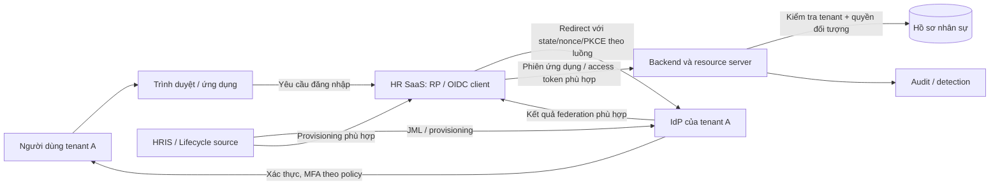
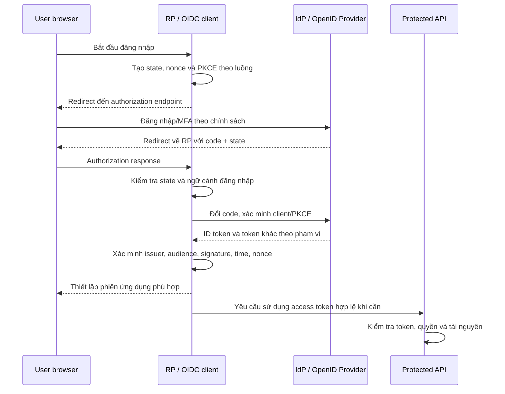
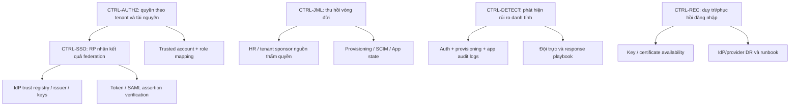

# Identity provider (IdP): thiết lập niềm tin danh tính và kiểm chứng trong Security Assurance

## 1. Identity provider là gì và vì sao cần đánh giá có bằng chứng?

Khi người dùng mở một ứng dụng quản lý nhân sự, màn hình đăng nhập có thể chuyển hướng họ sang hệ thống đăng nhập tập trung của doanh nghiệp. Sau khi xác thực, ứng dụng nhận một thông điệp hoặc token thể hiện người dùng là ai, rồi quyết định họ được phép làm gì. Hệ thống cung cấp dịch vụ xác thực và thông tin danh tính này thường được gọi là **Identity Provider (IdP)**.

**Identity Provider** là thành phần quản lý hoặc xác minh danh tính và phát hành **kết quả xác thực/khẳng định danh tính** để các hệ thống khác có thể tin cậy theo một mối quan hệ đã thiết lập. Tùy kiến trúc, IdP còn quản lý danh sách người dùng, phương thức xác thực, MFA, đăng nhập một lần (SSO), chính sách đăng nhập và vòng đời phiên. Trong các giao thức, thuật ngữ có thể khác nhau: OIDC có *OpenID Provider*, SAML có *Identity Provider*, OAuth 2.0 có *Authorization Server*. Một sản phẩm thường đóng nhiều vai trò nhưng **không vì thế mà ba vai trò hoàn toàn đồng nhất**.

Một ứng dụng sử dụng IdP **không tự động an toàn**. Ví dụ:

- IdP xác thực thành công nhân viên của tenant A, nhưng ứng dụng dựa vào tham số `tenantId` do client gửi để đọc bảng lương tenant B.
- Ứng dụng nhận token từ đúng IdP nhưng bỏ qua việc kiểm tra `audience`; token dành cho dịch vụ khác bị dùng sai ngữ cảnh.
- Nhân viên đã nghỉ việc bị vô hiệu hóa trong directory, nhưng ứng dụng vẫn chấp nhận một phiên hoặc khóa API chưa thu hồi.
- IdP yêu cầu MFA nhưng quy trình khôi phục tài khoản cho phép đặt lại yếu tố xác thực quá dễ dàng.
- Người dùng đăng nhập hợp lệ nhưng quyền của họ chưa được đánh giá lại; IdP chỉ chứng minh danh tính, không thay thế access review.

Trong chương **Identity assurance** của module **SECURITY_SECURITY_ASSURANCE**, bài học tập trung vào cách **xác định các tuyên bố danh tính mà hệ thống được phép tin, kiểm chứng mối quan hệ federation và thu thập bằng chứng về hiệu lực thực tế**. Đây là một phần của chương trình bảo đảm an toàn có bằng chứng từ phân tích rủi ro, yêu cầu, security controls đến kiểm thử, audit, xử lý phát hiện và cải tiến liên tục trong phát triển lẫn vận hành.

### Kết quả học tập

Sau bài này, người học có thể:

1. Phân biệt **identity proofing, authentication, federation, provisioning và authorization**; xác định trách nhiệm của IdP và ứng dụng.
2. Mô tả luồng đăng nhập OIDC/SAML, các ranh giới tin cậy và những kiểm tra quan trọng ở bên nhận thông điệp.
3. Đánh giá cách IdP quản lý danh tính, phương thức xác thực, phiên, khóa, claims, MFA, khôi phục tài khoản và vòng đời nhân sự.
4. Xây dựng yêu cầu security assurance, test âm/dương, evidence và trạng thái hiệu lực cho tích hợp IdP.
5. Phân tích sự cố, phụ thuộc nhà cung cấp, quyền chéo tenant, đăng xuất/thu hồi và ra quyết định rủi ro còn lại đúng thẩm quyền.

## 2. Ranh giới: IdP chứng minh điều gì, không chứng minh điều gì?

### 2.1. Năm khái niệm dễ nhầm lẫn

| Khái niệm | Câu hỏi được trả lời | Ví dụ | Trách nhiệm cần tách |
| --- | --- | --- | --- |
| **Identity proofing** | Danh tính được đăng ký liên hệ đúng đối tượng thực đến mức nào? | Xác minh người mới theo hồ sơ nhân sự/quy trình đăng ký. | Nguồn định danh, người bảo trợ hoặc bên proofing. |
| **Authentication (AuthN)** | Chủ thể hiện tại có chứng minh quyền sử dụng danh tính không? | Passkey/MFA, xác thực phiên và phát hành kết quả. | IdP/authenticator và bên xác minh. |
| **Federation** | Hệ thống nhận có thể tin kết quả xác thực từ nhà cung cấp nào, cho ứng dụng nào? | OIDC ID token hoặc SAML assertion. | IdP và ứng dụng nhận (RP/SP), quan hệ tin cậy. |
| **Provisioning/lifecycle** | Tài khoản, nhóm và thuộc tính được tạo/sửa/thu hồi thế nào? | Đồng bộ người dùng, SCIM, JML từ HRIS. | Nguồn nhân sự, IdP/directory, ứng dụng đích. |
| **Authorization (AuthZ)** | Danh tính này được phép làm gì trên tài nguyên cụ thể? | Người tenant A được xem hồ sơ A nhưng không được tải hồ sơ B. | Ứng dụng/resource server, chính sách nghiệp vụ và dữ liệu. |

**Đăng nhập thành công không đồng nghĩa đủ quyền.** IdP có thể cung cấp danh tính đáng tin, song việc đọc, ghi, xuất CSV và duyệt thanh toán cần kiểm tra quyền **ở nơi thực thi hành động**, dựa trên tài nguyên và ngữ cảnh hiện tại. Nếu hệ thống cần IdP phát hành nhóm hoặc thuộc tính, ứng dụng vẫn phải xác định **claim nào đáng tin, còn mới và có ý nghĩa gì trong ngữ cảnh tenant/role**.

### 2.2. Identity assurance khác mật khẩu mạnh

Identity assurance là mức tin cậy mà hệ thống có thể đặt vào:

- **Đăng ký và liên kết danh tính:** ai được tạo tài khoản và gắn với tổ chức/tenant nào?
- **Khả năng xác thực:** cách chứng minh quyền kiểm soát danh tính; chống lừa đảo, mất thiết bị và tấn công chiếm tài khoản.
- **Liên kết qua federation:** kết quả xác thực đến từ đúng nhà cung cấp, đúng ứng dụng và đúng phiên hay không?
- **Tính nhất quán của vòng đời:** user nghỉ việc, chuyển vai trò, tài khoản dịch vụ và quyền tạm được thay đổi đúng hạn không?
- **Bằng chứng vận hành:** controls có thực sự hoạt động trên cấu hình/phiên bản hiện tại không?

Một hệ thống dùng MFA nhưng cho phép người hỗ trợ đổi email/tái đăng ký yếu tố xác thực mà không xác minh đủ có thể bị chiếm tài khoản qua **account recovery**. Một hệ thống xác thực rất mạnh nhưng ánh xạ tài khoản bằng email tự khai và không kiểm tra tenant vẫn có rủi ro chiếm quyền dữ liệu.

### 2.3. Các bên trong kiến trúc

| Vai trò | Thuật ngữ thường gặp | Vai trò chính |
| --- | --- | --- |
| **End user / subject** | Người dùng, principal | Chủ thể đăng nhập và yêu cầu sử dụng dịch vụ. |
| **Identity Provider** | IdP, OpenID Provider (OP) trong OIDC | Xác thực và phát hành assertion/ID token theo giao thức, chính sách. |
| **Relying Party** | RP trong OIDC, Service Provider (SP) trong SAML | Tiêu thụ assertion/kết quả danh tính để tạo phiên ứng dụng. |
| **OAuth client** | Client application | Yêu cầu token hoặc ủy quyền theo luồng OAuth phù hợp. |
| **Authorization Server (AS)** | OAuth AS | Phát hành access token sau khi thực hiện luồng ủy quyền/xác thực thích hợp. |
| **Resource Server** | API bảo vệ | Nhận access token và xác minh điều kiện trước khi phục vụ tài nguyên. |
| **Identity source** | HRIS, directory, customer tenant roster | Nguồn dữ liệu để khởi tạo/kiểm tra vòng đời danh tính. |
| **Lifecycle/provisioning system** | SCIM client/server, IAM workflow | Đồng bộ tài khoản, nhóm và thay đổi quyền. |

Một nền tảng có thể vừa là IdP, AS và directory, nhưng **RP, resource server và risk owner vẫn có trách nhiệm riêng**. Không coi nhà cung cấp danh tính là người ra quyết định truy cập nghiệp vụ cho mọi API của tổ chức.

## 3. Kiến trúc điển hình và các ranh giới tin cậy

Hệ thống HR SaaS phục vụ nhiều doanh nghiệp có thể kết nối IdP của từng doanh nghiệp bằng federation, dùng một tầng ứng dụng tạo phiên và kiểm soát tài nguyên trong database.



Sơ đồ là **ví dụ kiến trúc**, không xác nhận rằng một giao thức hay control đã được triển khai. Các ranh giới cần kiểm tra gồm:

1. **Trình duyệt ↔ RP:** redirect an toàn, phiên, cookie, kiểm soát đăng nhập và tránh CSRF/login mix-up.
2. **RP ↔ IdP:** mối tin cậy, issuer, client, endpoint, metadata, khóa, chữ ký và thời hạn.
3. **IdP ↔ nguồn nhân sự:** ai được tạo/tắt danh tính, thuộc tính tenant và trạng thái hợp đồng.
4. **RP ↔ API:** loại token, đối tượng nhận, thời hạn, phân biệt xác thực với quyền truy cập.
5. **API ↔ tài nguyên:** kiểm tra quyền trên **từng đối tượng** và nguồn dữ liệu đúng tenant, không tin ID do client tự đưa.
6. **Log/monitoring:** xác thực, thay policy, sự kiện nhạy cảm có đầy đủ tín hiệu và được bảo vệ không?

### 3.1. Xây dựng trust relationship trước khi nhận token

RP cần biết **IdP nào được tin cho tenant nào**. Thông tin thường bao gồm **issuer/metadata endpoint, client registration, redirect URI, keys/certificates, protocol, thuật toán cho phép, claim contract và trách nhiệm vận hành**. Một URL IdP nhận qua query parameter từ người dùng **không tự là cấu hình tin cậy**.

Đặc biệt với multi-tenant federation, cần tránh để người dùng tự gắn một IdP mà họ kiểm soát vào tenant của người khác chỉ bằng cách khai email domain hoặc tenant ID. Việc thiết lập quan hệ federation cần **chủ sở hữu tenant có thẩm quyền** xác nhận, lưu lịch sử thay đổi và kiểm tra chính sách domain/tenant onboarding theo cơ chế tổ chức đã phê duyệt.

## 4. Các giao thức và công nghệ liên quan IdP

| Công nghệ | Vai trò chính | Thành phần/bằng chứng thường gặp | Cảnh báo cần nhớ |
| --- | --- | --- | --- |
| **OpenID Connect (OIDC)** | Lớp nhận diện xây trên OAuth 2.0, cho phép RP xác minh xác thực của người dùng. | Issuer discovery, client registration, ID token, auth code, userinfo tùy phạm vi. | ID token dành cho RP, **không tự là access token cho API**. |
| **OAuth 2.0** | Khung ủy quyền cho phép client truy cập tài nguyên theo cấp quyền. | Authorization code, access token, scope, token endpoint. | OAuth 2.0 **đơn lẻ không phải giao thức đăng nhập danh tính**. |
| **SAML 2.0** | Federation dựa trên assertion XML giữa IdP và SP. | Metadata, issuer, assertion, chữ ký, audience/recipient, thời hạn. | Phải xác minh chữ ký và ngữ cảnh assertion, tránh chỉ parse XML. |
| **SCIM 2.0** | Đồng bộ danh tính, nhóm và vòng đời tài khoản giữa các hệ thống. | User/Group API, provisioning/deprovisioning logs. | SCIM không chứng minh phiên đăng nhập đã bị thu hồi ở mọi ứng dụng. |
| **FIDO2/WebAuthn** | Xác thực dựa trên khóa công khai gắn với RP origin; có thể hỗ trợ xác thực chống phishing. | Credential registration, challenge/response, authenticator metadata/attestation tùy chính sách. | Không thay thế kiểm soát recovery, device lifecycle và account linking. |
| **LDAP/Directory** | Lưu/tra cứu danh tính và nhóm, có thể tham gia xác thực doanh nghiệp. | Directory entries, group membership, sync logs. | Không đồng nghĩa có federation OIDC/SAML an toàn. |
| **MFA / step-up** | Yêu cầu thêm yếu tố hoặc nâng độ bảo đảm cho hoạt động rủi ro cao. | Authentication events, policy mapping, context và yếu tố đã dùng. | “Có MFA” không đủ nếu enrollment/recovery hoặc đường bypass yếu. |

**Không nhất thiết triển khai tất cả**. Chọn theo mô hình người dùng, ứng dụng, phương thức federation, rủi ro, nghĩa vụ và năng lực vận hành. Một SaaS B2B có thể dùng OIDC cho ứng dụng hiện đại và SAML cho doanh nghiệp dùng SSO cũ, nhưng phải có kiểm thử/đánh giá từng tích hợp chứ không tự coi hai giao thức tương đương hoàn toàn.

## 5. Tài khoản từ lúc tạo tới lúc thu hồi: nguồn danh tính và lifecycle

### 5.1. Identity proofing và onboarding

Khi tạo tài khoản, cần trả lời **ai có quyền xác nhận một người thuộc tổ chức và tenant cụ thể?** Với nhân viên nội bộ, thông tin có thể xuất phát từ hệ thống nhân sự đã được kiểm soát. Với khách hàng doanh nghiệp, chủ sở hữu tenant và cơ chế mời/cấp tài khoản được duyệt có thể là nguồn thẩm quyền.

Các nguy cơ:

- Người đăng ký tự nhập email thuộc tổ chức khác và được gán tenant mà không xác minh quyền sở hữu.
- Hai tài khoản của hai tổ chức được hợp nhất chỉ vì cùng email hiển thị.
- Một tài khoản tái sử dụng sau khi tên/email của người cũ được cấp lại.
- Người dùng tự gắn social login bên ngoài vào account có quyền cao mà không xác minh bảo đảm tương đương.

**Bằng chứng:** quy tắc onboarding, nguồn thẩm quyền, mối liên kết giữa `issuer` và `subject`, tenant được gán, người duyệt, sự kiện tạo account và test chống liên kết sai danh tính.

### 5.2. Dùng định danh ổn định

Trong OIDC, cặp **`iss` + `sub`** thường là cơ sở xác định một user ở phía RP, với điều kiện issuer đã được tin cậy và subject được diễn giải theo contract của nhà cung cấp. Email, tên người dùng hoặc số điện thoại có thể **thay đổi, tái sử dụng hoặc chưa được xác minh đủ**, nên không nên dùng riêng chúng làm khóa danh tính toàn cục cho quyết định nhạy cảm.

Ví dụ hai IdP có thể phát hành `sub = "123"` cho hai người khác nhau; RP không được gộp chúng vì trùng `sub`. Ngược lại, người dùng cùng email nhưng chuyển tổ chức có thể cần được xử lý như **quan hệ danh tính/tenant mới**, theo quy trình account linking được duyệt.

### 5.3. Joiner – Mover – Leaver (JML)

| Sự kiện | Kiểm soát cần có | Evidence phù hợp |
| --- | --- | --- |
| **Joiner** | Chỉ tạo account theo nguồn/approval hợp lệ; cấp role tối thiểu và tenant đúng. | HR/vendor/tenant request, provisioning log, effective roles. |
| **Mover** | Thu hồi quyền vai trò cũ, cấp quyền mới, kiểm tra xung đột/phân tách nhiệm vụ. | Change record, before/after entitlement, reviewer và ngày hiệu lực. |
| **Leaver** | Thu hồi tài khoản/phiên/token/credential theo loại và chính sách, xử lý cả local account. | Deprovision result, session/token handling, effective access test. |
| **Guest/vendor expiry** | Giới hạn theo nhiệm vụ/hợp đồng và tự đánh giá khi hết hạn. | Sponsor, expiry, revoke evidence và các đường truy cập còn lại. |
| **Service/workload identity** | Có owner, scope, vòng đời secret/role và điều kiện thu hồi. | Workload inventory, IAM policy, rotation/revocation tests. |

**Kết quả SCIM “user disabled” không chứng minh mọi quyền đã biến mất.** Nếu ứng dụng giữ local role, phiên/cookie hoặc token hợp lệ chưa bị thu hồi theo cơ chế áp dụng, phải xem thêm hiệu lực thực tế.

### 5.4. Đồng bộ và sai lệch nguồn

Kiểm tra các đường **HRIS → directory → IdP → provisioning → ứng dụng/API**. Khi cập nhật không đồng bộ có thể phát sinh:

- Sự kiện nghỉ việc xảy ra nhưng webhook bị lỗi, không đến ứng dụng.
- Group membership đổi nhưng token hiện tại chứa claim cũ.
- IdP disable account trong khi ứng dụng có user local riêng vẫn active.
- Một bộ phận tạo tài khoản dịch vụ ngoài quy trình và không có sponsor.

Yêu cầu assurance cần xem **độ trễ, retry, dead-letter handling, reconciliation và phát hiện lỗi đồng bộ**, không chỉ “có tích hợp SCIM”.

## 6. Xác thực ở IdP: phương thức, MFA, recovery và step-up

### 6.1. Khả năng xác thực và rủi ro

Thiết kế chính sách dựa trên độ nhạy tài sản, hậu quả chiếm tài khoản, điều kiện truy cập và nghĩa vụ áp dụng. Một ứng dụng đọc thông tin công khai và một ứng dụng duyệt chuyển tiền có thể cần yêu cầu xác thực khác nhau.

| Thành phần | Mục tiêu | Điều kiện/bằng chứng cần đánh giá |
| --- | --- | --- |
| **Authenticators** | Chủ thể chứng minh quyền kiểm soát danh tính. | Enrollment, phương thức thực tế, chống chiếm tài khoản và thu hồi. |
| **MFA** | Hạn chế tác động nếu một yếu tố bị lộ. | Chính sách bắt buộc, đường không áp MFA, evidence của lần xác thực. |
| **Phishing-resistant authentication** | Hạn chế người dùng bị lừa chuyển kết quả xác thực đến trang giả. | Phương thức và binding đúng RP/origin, recovery/bypass paths. |
| **Step-up** | Nâng mức xác thực cho hoạt động rủi ro cao. | Điều kiện kích hoạt, độ mới của xác thực, event và test bypass. |
| **Session management** | Ràng buộc phiên vào ngữ cảnh và thời hạn phù hợp. | TTL, idle timeout, cookie security, logout và session invalidation. |
| **Account recovery** | Phục hồi truy cập hợp lệ không tạo cửa sau chiếm tài khoản. | Quy trình xác minh, phê duyệt, audit, thông báo và kiểm thử gian lận. |
| **Authenticator lifecycle** | Đăng ký, thay thế, mất thiết bị, vô hiệu hóa. | Event, người/nguồn quyết định, chống tự đăng ký trái phép. |

Không nên đồng nhất mọi MFA. Một số hình thức có khả năng chống phishing và liên kết với đúng website/tài nguyên hơn hình thức dùng mã một lần. Việc chọn mức bảo đảm cần dựa vào **tính chất xác thực và mô hình rủi ro**, không chỉ số yếu tố hiển thị trên giao diện.

### 6.2. Recovery là một phần của authentication control

Giả sử IdP dùng passkey nhưng người dùng có thể đặt lại phương thức xác thực bằng cách gọi điện tới một nhân viên hỗ trợ không xác minh đủ quyền yêu cầu. Đường recovery yếu có thể **vượt qua cơ chế đăng nhập mạnh**.

Khi review IdP cần đánh giá: đăng ký yếu tố mới, thay thiết bị, khóa tài khoản, hỗ trợ khẩn, sự kiện đáng ngờ, thông báo ngoài kênh và quyền nhân viên hỗ trợ. **Không công bố hướng dẫn vượt qua recovery** trong tài liệu phân phối rộng; đưa test ở mức tiêu chí bảo mật và hành vi mong đợi.

### 6.3. Step-up khác authorization

Một giao dịch thay tài khoản nhận lương có thể cần người dùng **xác thực lại gần thời điểm thao tác** và qua phương thức thích hợp. Tuy nhiên, step-up chỉ giúp tăng tin cậy về **người thực hiện**, còn ứng dụng vẫn phải kiểm tra **người đó có quyền thay thông tin của tài khoản/tài nguyên đó không** và có trạng thái phê duyệt hợp lệ không.

## 7. OIDC: hiểu đúng luồng và những điều phải xác minh

Một tích hợp web thông dụng dùng **Authorization Code Flow** cùng PKCE theo mô hình client phù hợp. Sau khi RP khởi tạo phiên đăng nhập, trình duyệt được chuyển đến IdP; IdP xác thực và trả về **authorization code**; client đổi code theo quy trình phù hợp để nhận các token cần thiết. Một số chi tiết phụ thuộc loại client, cấu hình và phiên bản giao thức đang dùng.



### 7.1. Những đối tượng không được lẫn lộn

| Đối tượng | Người nhận/ý nghĩa | Không nên sử dụng |
| --- | --- | --- |
| **Authorization code** | Giá trị tạm, dùng đổi token theo flow và điều kiện client phù hợp. | Không dùng như token truy cập API hoặc lưu lâu. |
| **ID token** | Assertion OIDC về sự kiện xác thực và danh tính, phát hành cho **RP/client**. | Không đưa thay access token đến API không phải audience của nó. |
| **Access token** | Cấp quyền truy cập resource theo issuer, audience, scope/claim/contract. | Không dùng để khẳng định user đã được proofing ở một mức nào đó nếu token không nói lên điều đó. |
| **Refresh token** | Cơ chế lấy token mới khi được phép, cần bảo vệ theo loại client và chính sách vòng đời. | Không đưa vào URL, log hay nơi có thể truy xuất trái phép. |
| **Application session** | Phiên nội bộ sau khi xác minh kết quả IdP, có timeout và kiểm soát riêng. | Không giả định IdP logout sẽ tự chấm dứt mọi session ứng dụng. |

**Access token có thể là JWT hoặc opaque token.** Resource server phải xác minh bằng cách phù hợp (ví dụ JWT validation hoặc introspection khi được quy định), không đơn giản tách JSON hoặc kiểm tra chuỗi có vẻ giống JWT.

### 7.2. Những kiểm tra trọng yếu ở RP

- **Issuer (`iss`):** phải khớp nhà cung cấp được đăng ký và tin cậy cho phiên/tenant; không tự lựa chọn issuer tùy ý từ dữ liệu người dùng.
- **Audience (`aud`):** token được phát hành cho đúng client/resource theo contract. Với một số trường hợp đa audience hoặc `azp`, phải tuân theo quy tắc giao thức và cấu hình áp dụng.
- **Chữ ký/thuật toán:** xác minh theo key/algorithm được cho phép từ đúng issuer; không tin lựa chọn thuật toán/URL khóa do nội dung token chưa xác minh điều khiển.
- **Thời gian (`exp`, `nbf`, `iat` khi áp dụng):** kiểm tra hiệu lực, sai lệch đồng hồ được giới hạn hợp lý; không chấp nhận token hết hạn tùy tiện.
- **`nonce`:** kiểm tra liên kết kết quả xác thực với yêu cầu khởi tạo theo luồng OIDC yêu cầu; `state` liên kết authorization response với phiên chống giả mạo/mix-up.
- **Redirect URI và code flow:** chỉ cho phép redirect URI đã đăng ký chính xác theo yêu cầu của giao thức, dùng PKCE và bảo vệ code/session.
- **Token type và ngữ cảnh:** không cho ID token dùng thay access token; không dùng token cho client/resource khác.
- **Session và claims mapping:** dùng danh tính đã được xác minh, ánh xạ tenant theo binding do ứng dụng quản lý, giới hạn quyền nếu claim thiếu hoặc không đáng tin.

Đây là **danh mục kiểm soát thiết kế**, không thay thế quy tắc kỹ thuật chi tiết của giao thức và thư viện được sử dụng. Nên dùng thư viện OIDC/OAuth đã được duy trì, tránh tự viết parser hoặc token validator dựa trên kiểm tra chuỗi đơn giản.

### 7.3. Một lỗi thiết kế có tính hệ thống

Giả sử RP kết nối nhiều IdP doanh nghiệp. Ứng dụng nhận một ID token có chữ ký hợp lệ nhưng **không buộc issuer đã xác minh vào tenant mà người dùng đang đăng nhập**. Một IdP được cấu hình cho tenant khác có thể không nên có quyền khẳng định danh tính hoặc nhóm quản trị của tenant đích.

**Giải pháp thiết kế:** trust relationship và mapping `(issuer, subject) → local principal → tenant membership` phải được kiểm soát, tránh tự gắn tenant qua email hoặc request parameter; test đăng nhập chéo IdP, token sai audience/issuer và account linking không được phép.

## 8. SAML 2.0: assertion và kiểm tra ở Service Provider

Một hệ thống doanh nghiệp có thể sử dụng SAML federation: **SP** yêu cầu/nhận phản hồi đăng nhập; **IdP** phát hành SAML assertion có chữ ký theo cấu hình; SP xác minh và tạo phiên ứng dụng.

| Kiểm soát thiết kế | Câu hỏi cần kiểm tra | Evidence/test |
| --- | --- | --- |
| **Metadata và trust anchor** | SP có đúng certificate/key và entity ID IdP được tin không? | Metadata đã duyệt, rotation runbook, runtime config. |
| **Signature validation** | Chữ ký của phần dữ liệu đang dùng để ra quyết định có hợp lệ và được gắn đúng assertion/response không? | Test assertion bị sửa hoặc chữ ký không hợp lệ bị từ chối. |
| **Issuer/Entity ID** | Assertion đến từ IdP đã đăng ký cho ứng dụng/tenant này? | Test issuer không khớp và IdP khác bị từ chối. |
| **Audience restriction** | Assertion được phát hành cho đúng SP? | Test assertion dành cho SP khác. |
| **Recipient/Destination** | Response/assertion đến đúng endpoint và đối tượng nhận theo flow? | Test endpoint hoặc recipient không hợp lệ. |
| **InResponseTo/flow binding** | Response có liên hệ đúng yêu cầu đăng nhập khi flow đòi hỏi không? | Test replay/mismatched request. |
| **Conditions/SubjectConfirmation** | Assertion còn hiệu lực, điều kiện thời gian/phương thức sử dụng hợp lệ? | Test hết hạn, chưa đến thời điểm hợp lệ hoặc điều kiện sai. |
| **Identifier/attributes** | NameID/attributes có được ánh xạ ổn định đúng tenant/role? | Test người dùng thuộc tenant khác hoặc attribute không được tin. |
| **Replay protection** | Cùng assertion/response có bị chấp nhận lặp trái quy tắc không? | Test replay trong môi trường kiểm soát, log phát hiện. |

**Không đủ chỉ thấy XML có trường “signed”.** SP cần xác minh chữ ký và sử dụng đúng phần assertion/response đã được chứng thực theo thư viện/protocol, tránh nhập nhằng phần XML được ký và phần ứng dụng thực dùng.

Một số tình huống SAML có **IdP-initiated login**. Khả năng liên kết phiên và yêu cầu có thể khác SP-initiated flow; nếu tổ chức hỗ trợ, phải đánh giá rủi ro login CSRF/mix-up, ánh xạ tenant và cơ chế chống replay theo thiết kế được duyệt. Không giả định hai flow có bảo đảm giống nhau.

## 9. Token, session và key lifecycle: điểm dễ tạo niềm tin giả

### 9.1. Token validation ở đúng bên nhận

Không phải chỉ RP mới kiểm tra. **Mỗi API/resource server** cần cơ chế bảo vệ token và quyết định quyền tương ứng. Với JWT access token, thường phải xác minh **issuer, signature, expiration/not-before, audience phù hợp, token type/scope và các claims có ý nghĩa theo contract**. Với opaque token, dùng cơ chế xác thực hợp lệ như introspection nếu thiết kế yêu cầu.

Một token có chữ ký hợp lệ nhưng phát hành cho API thanh toán **không tự có quyền truy cập API hồ sơ nhân sự**. Audience và chính sách quyền là các kiểm soát khác nhau, cùng cần thiết.

### 9.2. Key rotation và JWKS

IdP có thể luân chuyển khóa ký. Bên nhận cần:

- Chỉ tin **keys/metadata từ issuer đã đăng ký** theo cơ chế được hỗ trợ.
- Quản lý cache khóa, refresh và khả năng sử dụng khi IdP tạm không khả dụng, không âm thầm chấp nhận khóa lạ.
- Thử chuyển khóa cũ → mới và thu hồi khóa trong tình huống sự cố, xét giới hạn phiên/token đang tồn tại.
- Phân tách môi trường production/test và quyền thay cấu hình trust.
- Log thay đổi metadata/key theo mức cần thiết, không log key bí mật.

Không tự fetch một URL khóa được khai báo trong token chưa được xác minh để quyết định tin token. Cần dùng **thư viện đã kiểm tra giao thức và cấu hình trust anchors**.

### 9.3. Session và logout/revocation

Đăng xuất tại IdP, thu hồi refresh token, hết hạn access token và xóa session cookie của RP **không phải luôn là cùng một sự kiện**. Thiết kế phải định nghĩa:

| Sự kiện | Câu hỏi assurance |
| --- | --- |
| User logout tại ứng dụng | Session RP có kết thúc, cookie có bị vô hiệu, backend còn token sử dụng được không? |
| Logout tại IdP | Ứng dụng nào nhận thông báo/nhận biết logout? Có giới hạn session còn lại không? |
| User bị disable | IdP không xác thực mới; những session, API token và quyền local hiện tại được xử lý thế nào? |
| Privileged role bị thu hồi | Token chứa claim quyền cũ còn thời hạn; resource server có kiểm tra trạng thái mới khi cần không? |
| Token bị lộ | Có phương án thu hồi/giới hạn thời hạn, log, phát hiện và phản ứng không? |
| Bên thứ ba ngừng hoạt động | Phiên còn hợp lệ có được tiếp tục theo quy tắc rõ ràng, hay truy cập bị chặn có kiểm soát? |

**Giảm TTL có thể giới hạn cửa sổ rủi ro nhưng cũng ảnh hưởng vận hành và trải nghiệm.** Quyết định phải được thiết kế theo risk appetite, loại token/phiên, khả năng thu hồi và yêu cầu nghiệp vụ; không mặc định có một thời lượng chuẩn cho mọi ứng dụng.

### 9.4. Cookie và trình duyệt

Ứng dụng web tạo session cần xem thuộc tính cookie như **Secure, HttpOnly, SameSite theo ngữ cảnh**, kiểm soát CSRF, session fixation, thời hạn và bảo vệ redirect. Những cơ chế này bổ sung xác thực tại IdP; không thể giả định IdP đã giải quyết tất cả vấn đề session ở RP.

## 10. Ranh giới multi-tenant: IdP nào được đại diện cho ai?

Trong SaaS B2B, một tenant có thể đưa IdP của mình để nhân viên đăng nhập. Điều này mở ra những câu hỏi đặc biệt:

1. **Ai có quyền cấu hình IdP cho tenant?** Chỉ chủ sở hữu tenant được xác minh và phân quyền mới được thay issuer/certificate/metadata.
2. **Mỗi IdP được tin cho tenant nào?** Không cho kết quả IdP A tự gán người dùng vào tenant B.
3. **Principal được nhận diện ra sao?** Dùng định danh ổn định theo issuer/subject; tránh dùng email toàn cục một cách tùy tiện.
4. **Group claims có ý nghĩa gì?** Nhóm `Admins` của khách hàng A không đồng nghĩa admin toàn nền tảng; cần mapping có thẩm quyền.
5. **Khi IdP đổi tenant/domain/metadata:** Có review, confirmation, rollback và test chéo tenant không?
6. **Khách hàng có thể vừa dùng SSO vừa local login?** Cần chính sách rõ các đường đăng nhập, MFA/recovery, tài khoản hỗ trợ và nguy cơ bypass.
7. **Khi người dùng có mặt trong hai tenant:** Quyền và tài nguyên phải được phân tách theo ngữ cảnh; không cộng gộp quyền tùy tiện.

### 10.1. Mẫu ánh xạ danh tính

Một mô hình logic có thể dùng:

```text
Federated identity key:
    verified_issuer + stable_subject

Local identity binding:
    federated_identity_key -> local_principal_id

Tenant membership:
    local_principal_id + tenant_id -> allowed_roles/scopes

Resource decision:
    authenticated_principal + active_tenant + resource
        -> policy evaluation -> allow / deny
```

Việc ánh xạ phải do quy trình tin cậy tạo ra, có lịch sử và nguồn chứng thực. **Không tin `tenant_id` do client tự nhập** như bằng chứng quyền; mọi request dữ liệu phải được kiểm tra theo nguồn danh tính đáng tin, membership và đối tượng.

### 10.2. Tình huống lỗi federated account linking

Người dùng của doanh nghiệp A có email trùng với một account local cũ thuộc tenant B. Nếu ứng dụng **tự động hợp nhất tài khoản chỉ theo email**, người dùng có thể được gán quyền không thuộc về họ. Kiểm soát cần buộc liên kết danh tính qua quy trình được duyệt, có quyền/giám sát và kiểm thử các trường hợp **issuer khác, email thay đổi, email chưa xác minh, tên trùng và người đổi tổ chức**.

## 11. Identity provider trong kiến trúc phân tán và tài khoản máy

IdP cho người dùng không giống việc cấp danh tính cho workload:

- **Human federation:** kết quả đăng nhập của người dùng qua OIDC/SAML/SSO, đi kèm session và chính sách MFA/recovery.
- **Service-to-service identity:** workload hoặc service account dùng credential/token theo flow phù hợp, cần scope, audience và vòng đời máy.
- **CI/CD identity:** pipeline/runner cần quyền lấy artifact, deploy và secrets nhưng không được dùng quyền admin thường trực không kiểm soát.
- **Privileged identity:** PIM/PAM, JIT và emergency access đòi hỏi reviewer, thời hạn, giám sát và hậu kiểm.

Không áp dụng **một quy trình MFA có giao diện người dùng** cho mọi service-to-service call; thay vào đó sử dụng mô hình danh tính workload/credential phù hợp với kiến trúc, kiểm soát vòng đời và quyền. Một **client credentials access token** thường đại diện cho client/service theo phạm vi ủy quyền, **không được giả mạo thành danh tính end user** nếu không có cơ chế delegation rõ ràng.

### 11.1. Không làm mất thông tin actor khi ủy quyền qua nhiều dịch vụ

Giả sử user kích hoạt export, API gọi job nền và job dùng service identity để lấy dữ liệu. Cần phân biệt:

- **Actor (người khởi tạo):** user/tenant được xác thực, nguồn yêu cầu.
- **Execution identity:** service/job thật sự gọi database/storage.
- **Authorization context:** phạm vi dữ liệu được phép trên job theo quyết định đã được kiểm tra.

Audit có thể cần cả actor và service identity, nhưng không nên ghi token thô. Nếu job chỉ dùng quyền service rộng mà **không duy trì giới hạn theo request đã được duyệt**, một người dùng có thể kích hoạt export ngoài quyền dù đăng nhập ở IdP là hợp lệ.

## 12. Thiết kế controls cho IdP: từ rủi ro đến tiêu chí chấp nhận

| Control ID | Kịch bản rủi ro/mục tiêu | Thiết kế control | Tiêu chí có thể kiểm chứng |
| --- | --- | --- | --- |
| **IDP-01** | IdP chưa được phê duyệt đăng nhập tenant khác → bí mật. | Registry issuer/tenant/client đã phê duyệt; onboarding có owner. | Kết quả từ issuer không thuộc tenant bị từ chối; thay trust có approval. |
| **IDP-02** | Token giả/sai ứng dụng/hết hạn được chấp nhận. | RP/API xác minh token và claims theo giao thức, audience và thời gian. | Negative tests signature/issuer/audience/time/token type đều bị từ chối. |
| **IDP-03** | Email/subject liên kết sai tài khoản. | Mapping (issuer, subject) theo binding được duyệt; kiểm soát account linking. | Test trùng email/khác issuer không cấp quyền nhầm. |
| **IDP-04** | User bị chiếm tài khoản qua MFA enrollment/recovery. | Auth policy, enrollment/recovery kiểm chứng, log và step-up cho nghiệp vụ. | Test yêu cầu thay yếu tố trái quyền bị từ chối; reviewer có evidence. |
| **IDP-05** | Người nghỉ việc vẫn truy cập. | JML/SCIM/reconciliation, session/token xử lý theo policy. | Disable/revoke có hiệu lực ở RP/API trong điều kiện đã định. |
| **IDP-06** | Group claim cấp đặc quyền quá rộng. | Mapping role theo tenant, least privilege, access review và SoD. | Người không đủ quyền không thực hiện hành động nhạy cảm dù token hợp lệ. |
| **IDP-07** | Key rotation làm login hỏng hoặc tin khóa không đáng tin. | Trust anchors, JWKS/certificate rotation, fail behavior. | Diễn tập chuyển khóa, kiểm tra token sai key và khôi phục. |
| **IDP-08** | Không phát hiện chiếm tài khoản hoặc thay policy. | Auth/audit events, alert, triage, response. | Event thử có đến đội trực đúng quy trình, đủ dữ kiện và không lộ bí mật. |
| **IDP-09** | IdP ngừng hoạt động làm toàn dịch vụ gián đoạn hoặc fail-open. | HA/DR, kiểm soát phiên và chế độ suy giảm có thẩm quyền. | Test dependency timeout/outage; không bỏ qua xác thực nhạy cảm. |
| **IDP-10** | Workload identity/token quyền rộng. | Scope theo dịch vụ, credential lifecycle, chủ sở hữu và monitoring. | Dịch vụ không gọi API trái audience/scope; secret được kiểm soát. |

Các ID trên là **mã ví dụ của control catalog nội bộ**, không phải mã thuộc chuẩn công nghiệp. Khi đưa vào thực tế, phải gắn risk ID, requirement, môi trường, build, owner, phương pháp kiểm chứng và lịch sử.

### 12.1. Design effectiveness khác operating effectiveness

Một sơ đồ ghi “Validate JWT” mới là **thiết kế dự kiến**. Một cấu hình thư viện thể hiện issuer/audience là **bằng chứng triển khai**. Chỉ khi có **test, runtime configuration và quan sát vận hành** phù hợp, mới có căn cứ khẳng định control đang hiệu quả trong phạm vi đánh giá.

### 12.2. Đường phụ thuộc không được bỏ qua



Nếu phần lớn controls cùng phụ thuộc vào **một IdP** hoặc một kho khóa, đây có thể là điểm lỗi chung. Nhưng **IdP lỗi không tự động gây rò rỉ**: nếu RP fail-closed, bí mật có thể vẫn được giữ trong khi sẵn sàng giảm. Phải ghi failure mode, điều kiện fallback và evidence thay vì tính mọi controls như lớp độc lập.

## 13. Kế hoạch kiểm thử và bằng chứng cho tích hợp IdP

### 13.1. Bộ test OIDC/federation

| Test ID | Tình huống | Kết quả mong đợi | Bằng chứng cần giữ |
| --- | --- | --- | --- |
| **T-SSO-01** | User hợp lệ đăng nhập đúng tenant/issuer/client. | Đăng nhập thành công với local principal và tenant đúng. | Issuer/client mapping, test identity giả, phiên bản, thời gian. |
| **T-SSO-02** | Token có chữ ký không hợp lệ hoặc key không tin cậy. | Bị từ chối, không tạo phiên/quyền. | Negative test, expected/actual, build. |
| **T-SSO-03** | Token sai `iss` hoặc issuer hợp lệ của tenant khác. | Không được chấp nhận cho tenant đích. | Issuer–tenant registry và test chéo tenant. |
| **T-SSO-04** | Token sai `aud` hoặc dùng ID token như API access token. | Bị từ chối ở đúng thành phần. | Test RP/resource server, policy/token type. |
| **T-SSO-05** | Token hết hạn, `nbf` tương lai hoặc flow response không khớp state/nonce khi áp dụng. | Bị từ chối theo quy tắc và ngữ cảnh giao thức. | Test dữ liệu giả, kiểm tra timestamp, request correlation. |
| **T-SSO-06** | Auth response redirect về URI không được đăng ký. | Không được tiếp nhận, không tạo session trái phép. | Client registration, negative response. |
| **T-SSO-07** | Cùng email từ hai issuer khác nhau hoặc email được thay đổi. | Không tự nhập nhằng/hợp nhất local principal và tenant. | Mapping record, account-linking test. |
| **T-SSO-08** | User hợp lệ nhưng không có quyền xem hồ sơ tenant khác. | AuthN thành công, AuthZ ở API từ chối tài nguyên trái quyền. | Resource-level negative test. |
| **T-SSO-09** | IdP timeout hoặc tạm ngừng dịch vụ. | RP/API xử lý theo fail-safe và phương án availability đã duyệt. | Fault injection có kiểm soát, log và recovery. |
| **T-SSO-10** | Chuyển khóa/certificate trong quy trình được duyệt. | Token hợp lệ được xác minh đúng, token sai key bị từ chối. | Kế hoạch rotation, runtime metadata, kết quả. |

Không nên dùng access token hoặc dữ liệu khách hàng production thật làm fixture. Tạo danh tính thử có phạm vi và dùng **môi trường được phép**; việc thay IdP/key hoặc tạo outage trên production cần có kế hoạch, quyền phê duyệt và phương án rollback.

### 13.2. Bộ test SAML

| Test ID | Tình huống | Kết quả mong đợi |
| --- | --- | --- |
| **T-SAML-01** | Assertion hợp lệ từ IdP đã đăng ký cho đúng SP. | SP tạo đúng principal và session trong phạm vi. |
| **T-SAML-02** | Chữ ký bị sửa hoặc assertion chứa nội dung không khớp phần được ký. | Từ chối; không cấp quyền theo dữ liệu không được xác thực. |
| **T-SAML-03** | Audience/issuer/recipient sai. | Từ chối, không gắn sai tenant hoặc SP. |
| **T-SAML-04** | Assertion hết hạn, replay hoặc response không khớp yêu cầu theo flow. | Từ chối theo policy/giao thức áp dụng. |
| **T-SAML-05** | Certificate rotation theo kế hoạch hoặc key cũ bị thu hồi. | Hành vi tin cậy/không tin cậy đúng với chuyển đổi. |
| **T-SAML-06** | NameID/attribute mapping bị đổi. | Không tự động tạo quyền cao, có migration/review rõ. |

### 13.3. Test lifecycle, MFA và recovery

- **JML:** tạo nhân viên, đổi vai trò, leaver; đối chiếu IdP, RP/local account, cloud/API scope, session/token theo thiết kế.
- **Service identity:** kiểm tra tài khoản không có owner, token quá rộng, thiếu expiry hoặc credential còn dùng sau revoke.
- **MFA/recovery:** kiểm tra các đường đăng nhập, enroll/đổi yếu tố, recovery, step-up và quyền hỗ trợ theo tiêu chí; xem audit không chứa bí mật.
- **Privileged account:** kiểm tra eligible/active role, thời hạn, duyệt tạm, break-glass và hậu kiểm.
- **Detection:** tạo auth event thử hợp lệ; theo dõi sự kiện đến alert và người trực.
- **Availability:** test IdP outage và trường hợp mất khóa/metadata trong môi trường kiểm soát.

### 13.4. Tách “có log” khỏi “kiểm soát hiệu quả”

Log đăng nhập chỉ chứng minh sự kiện đã được ghi trong phạm vi đó. Nó không tự chứng minh authentication policy đủ mạnh, claims được kiểm chứng đúng, hoặc nhóm on-call có khả năng xử lý. Với control phát hiện, cần **tín hiệu → quy tắc → cảnh báo → người tiếp nhận → phản ứng và dấu vết**.

## 14. Gói bằng chứng Identity Assurance dành cho auditor

### 14.1. Các thành phần tối thiểu

| Evidence ID/loại | Nội dung | Chứng minh được | Giới hạn |
| --- | --- | --- | --- |
| **EV-TRUST** | Issuer registry, tenant mapping, IdP registration và approvals. | Quan hệ tin cậy đã được xác định/quản trị. | Chưa chứng minh RP chạy đúng cấu hình. |
| **EV-DESIGN** | Data flow, security requirements, threat model, token/claim contract. | Thiết kế đã xem các đường rủi ro và mục tiêu. | Chưa chứng minh runtime. |
| **EV-CONFIG** | Config RP/SP/AS và runtime trust anchors, protocol versions. | Trạng thái cấu hình ở build/môi trường đã kiểm tra. | Không đủ chứng minh hành vi người dùng. |
| **EV-TEST** | OIDC/SAML positive/negative tests, issuer/audience/tenant/flow. | Hành vi pass/fail trong trường hợp và bản triển khai đã thử. | Không bao phủ mọi tình huống ngoài phạm vi. |
| **EV-AUTH** | Auth/MFA/recovery/step-up event và policy có phiên bản. | Những sự kiện/chính sách trong kỳ đã quan sát. | Không tự chứng minh user proofing hoặc API authorization. |
| **EV-JML** | HR/provider source, SCIM logs, deprovision và after-state. | Sự thay đổi vòng đời và kết quả ở nguồn được kiểm tra. | Cần kiểm tra local accounts/sessions. |
| **EV-REVIEW** | Access review, entitlements, reviewer decisions, PAM records. | Nhu cầu quyền đã được rà soát trong phạm vi. | Không thay resource-level authorization tests. |
| **EV-DR** | Đánh giá nhà cung cấp, HA/DR/rotation drill, support và escalation. | Giả định sẵn sàng/phục hồi được đánh giá và thử. | Chưa chứng minh mọi kịch bản provider outage. |
| **EV-ACTION** | Finding, owner, hạn, sửa đổi, retest và risk decision. | Khép vòng khắc phục có truy vết. | Ticket đóng không đủ nếu thiếu test. |

Mỗi evidence ref nên có **nguồn, asset, issuer/client/tenant trong phạm vi, phiên bản hoặc commit, môi trường, thời điểm, công cụ/người thực hiện, expected/actual và hạn chế**. Những tài liệu chứa user danh tính nhạy cảm, sơ đồ trust, metadata và lỗi chưa sửa phải được bảo vệ theo chính sách, không đưa refresh token hoặc secrets vào báo cáo.

### 14.2. Chất lượng bằng chứng

Kiểm tra tối thiểu:

1. **Completeness:** danh sách IdP/tenant/client/API và tài khoản trong phạm vi có đủ không?
2. **Accuracy:** cấu hình và nhóm quyền có phản ánh effective state, không chỉ tài liệu dự kiến?
3. **Freshness:** bằng chứng có còn đại diện sau khi đổi issuer, key, IdP, tenant hoặc build không?
4. **Authenticity/integrity:** ai trích xuất/đánh giá, lịch sử sửa và nguồn đáng tin?
5. **Traceability:** finding có liên kết test, control, risk và quyết định hay không?
6. **Independent verification:** với risk cao, reviewer/tester đủ độc lập với người cấu hình khi chính sách yêu cầu?

Một screenshot “MFA enabled” có thể là bằng chứng cấu hình tại thời điểm chụp, **không chứng minh recovery không cho bypass MFA**, cũng không chứng minh mọi tenant hoặc mọi flow có cùng chính sách.

## 15. Case study: tích hợp hai IdP doanh nghiệp vào HR SaaS

**Bối cảnh giả định:** sản phẩm HR SaaS có tenant A và tenant B. Cả hai dùng SSO nhưng do **hai doanh nghiệp khác nhau quản trị IdP**. SaaS lưu hồ sơ nhân viên, bảng lương và cho xuất CSV; một tài khoản support được phép truy cập theo nhiệm vụ đã duyệt. Một số service accounts thực hiện batch export.

### 15.1. Danh mục rủi ro

| Risk ID | Kịch bản | Mục tiêu bảo mật | Các control liên quan |
| --- | --- | --- | --- |
| **R-ID-01** | IdP tenant A có token nhưng RP ánh xạ nhầm sang B. | Bí mật và phân tách tenant. | Issuer–tenant trust, stable subject mapping, authorization ở API. |
| **R-ID-02** | API chấp nhận token dành cho client/resource khác. | Bí mật/toàn vẹn. | Audience/type/scope validation ở đúng resource server. |
| **R-ID-03** | User nghỉ việc nhưng còn local account hoặc phiên/API token. | Bí mật, truy vết. | JML, SCIM, revoke/session control, effective-state tests. |
| **R-ID-04** | Nhân viên support lấy lại account bằng recovery yếu. | Bí mật/toàn vẹn. | Recovery policy, MFA, step-up, audit và quyền hỗ trợ. |
| **R-ID-05** | IdP/key service ngừng hoạt động trước kỳ tính lương. | Sẵn sàng. | HA, key rotation, fail-safe, runbook/DR. |
| **R-ID-06** | Service identity có thể xuất dữ liệu của nhiều tenant. | Bí mật. | Least privilege, job authorization context, access review. |
| **R-ID-07** | Thay trust metadata không có approval làm RP tin issuer lạ. | Bí mật/toàn vẹn. | Config change control, trusted issuer registry và monitoring. |

### 15.2. Một đợt kiểm tra có kết quả trái chiều

Giả sử nhóm thu được:

| Kiểm tra | Quan sát giả định | Trạng thái đúng |
| --- | --- | --- |
| Login user A bằng IdP A. | Đăng nhập thành công và gắn tenant A. | **Pass trong ca dương này**, chưa kết luận cách ly tenant. |
| Token có issuer A được gửi vào luồng gán tenant B. | Ứng dụng dựa trên email trùng và tạo local session B. | **Fail – account/tenant binding**. |
| API hồ sơ nhận ID token từ client thay access token. | Một endpoint vẫn trả dữ liệu cho token đó. | **Fail – token type/audience contract** nếu endpoint không được phép nhận. |
| User nghỉ việc bị disable trong IdP. | IdP chặn login mới; local session vẫn được dùng đến khi hết hạn theo thiết kế hiện hành. | **Partially effective / residual risk**, phải so ngưỡng leaver và session policy. |
| T-SSO negative cases trong staging. | Đạt issuer và audience tests ở build đang thử. | **Pass trong scope staging**, chưa mặc nhiên đúng production. |
| Key rotation. | Chưa có diễn tập trên cấu hình IdP mới. | **Implemented/unverified**, cần test và phương án fallback. |

**Điểm then chốt:** chứng minh IdP A xác thực user A đúng không thể che đi việc **RP tự gắn quyền tenant B**. Trong chuỗi assurance, authentication có thể đạt nhưng **federation mapping hoặc authorization control vẫn fail**.

### 15.3. Hành động khắc phục có ưu tiên

1. **R-ID-01:** giới hạn đường gán tenant không hợp lệ; sửa mapping bằng trust registry và khóa danh tính bền vững; test chéo issuer/tenant/account linking với dữ liệu thử.
2. **R-ID-02:** cấu hình API chỉ chấp nhận loại token, issuer, audience và scope theo contract; test ID token/API access token sai ngữ cảnh bị từ chối.
3. **R-ID-03:** thiết kế quy tắc leaver/session rõ thời hạn và hiệu lực; kiểm chứng IdP, RP, local account và token/permission trong scope.
4. **R-ID-05:** chuẩn bị kế hoạch key rotation và outage, có test thời gian phục hồi/khả năng đăng nhập theo mục tiêu được duyệt, không tự chuyển sang fail-open.
5. **R-ID-06:** gắn service account owner, giới hạn quyền theo workload và tenant; test cả API export/job/storage.

Nếu có bằng chứng **dữ liệu thực đã bị truy cập ngoài quyền**, cần kích hoạt quy trình ứng phó sự cố, bảo toàn bằng chứng và xác định nghĩa vụ áp dụng ngay, không đợi kỳ risk assessment hoặc cuộc họp cuối quý.

### 15.4. Kết luận assurance minh họa

Thay vì báo “SSO hoạt động tốt”, kết luận nên ghi:

> Đăng nhập OIDC của tenant A hoạt động trong phạm vi đã kiểm tra, nhưng ánh xạ account/tenant và một endpoint API chưa đáp ứng điều kiện token validation. Hiệu lực quản lý session sau leaver còn phụ thuộc thời hạn và trạng thái token; key rotation chưa được thử. Không đủ bằng chứng kết luận toàn bộ tích hợp IdP và kiểm soát truy cập của sản phẩm đã đạt yêu cầu. Các finding cần owner, biện pháp giảm phơi nhiễm, thời hạn và retest trước quyết định có thẩm quyền.

## 16. Mẫu hồ sơ đánh giá IdP có thể tái sử dụng

Đây là **YAML mô tả evidence và quyết định**, không phải tệp cấu hình IdP chạy được hoặc schema bắt buộc. Mã và tên là ví dụ giả định:

```yaml
assessment_id: "IA-HR-2026-Q4-08"
title: "Assurance review cho IdP liên kết HR SaaS"
service: "HR SaaS multi-tenant"
environment: "staging-and-production-review"
period: "2026-Q4"
method_version: "IDP-Assurance-Checklist-v1"
scope:
  tenants: ["tenant-A", "tenant-B"]
  identity_sources: ["customer-idp-A", "customer-idp-B"]
  protocols: ["OIDC"]
  applications: ["HR web RP", "HR API resource server"]
  principal_types: ["human", "service", "support"]
  exclusions: ["Chưa bao phủ toàn bộ user account recovery của khách hàng"]
trust_relationships:
  - trust_id: "TRUST-A"
    tenant: "tenant-A"
    issuer_ref: "approved-issuer-A"
    client_registration_ref: "CLIENT-HR-A"
    owner_role: "Identity platform owner"
    approval_ref: "APPROVAL-TRUST-A"
controls:
  - control_id: "IDP-01"
    objective: "Issuer chỉ đại diện tenant đã phê duyệt"
    design_status: "approved"
    implementation_status: "implemented"
    operating_status: "failed"
    test_refs: ["T-SSO-01", "T-SSO-03", "T-SSO-07"]
    evidence_refs: ["EV-TRUST-01", "EV-TEST-ISSUER-03"]
    finding_ref: "FINDING-IA-01"
  - control_id: "IDP-02"
    objective: "RP/API xác minh token theo context"
    design_status: "approved"
    implementation_status: "implemented"
    operating_status: "failed"
    test_refs: ["T-SSO-02", "T-SSO-04", "T-SSO-05"]
    evidence_refs: ["EV-TEST-TOKEN-07"]
    finding_ref: "FINDING-IA-02"
  - control_id: "IDP-07"
    objective: "Key rotation và trust material an toàn"
    design_status: "approved"
    implementation_status: "implemented"
    operating_status: "unverified"
    evidence_refs: ["EV-ROTATION-PLAN-01"]
findings:
  - id: "FINDING-IA-01"
    risk_ref: "R-ID-01"
    action: "Sửa identity binding và negative test chéo tenant"
    owner_role: "Engineering lead"
    verifier_role: "Security QA"
    status: "open"
  - id: "FINDING-IA-02"
    risk_ref: "R-ID-02"
    action: "Cấu hình resource token validation và retest"
    owner_role: "API security owner"
    verifier_role: "Security QA"
    status: "open"
decision:
  risk_owner_role: "Product risk owner"
  conclusion: "not_ready_for_unrestricted_release"
  decision_ref: "DECISION-IA-08"
  residual_risk: "Cần đánh giá lại sau remediation verification"
review:
  triggers: ["Issuer change", "Tenant onboarding", "Incident", "Key rotation"]
  next_due: "Theo lịch và mức rủi ro đã được phê duyệt"
evidence_manifest_ref: "EV-MANIFEST-IA-08"
```

**Chú ý:** `implementation_status: implemented` không đồng nghĩa control pass; hai controls đang **failed**, một control **unverified**. Phải phân biệt **bằng chứng thiết kế, bằng chứng triển khai và bằng chứng hiệu lực vận hành**, và không hạ current residual risk chỉ vì đã có kế hoạch sửa.

### 16.1. Chuỗi truy vết cho một finding

```text
THREAT-T01    Người tenant A bị gắn nhầm vào tenant B
  RISK-R01    Lộ hồ sơ nhân viên giữa tenant
  REQ-ID-01   Chỉ tin issuer được cấp quyền cho tenant đó
  CTRL-IDP-01 Registry và mapping issuer + subject
  CTRL-AUTHZ  Backend kiểm tra tenant và quyền đối tượng
  TEST-SSO03  Token issuer A không thể tạo session tenant B
  EV-TEST03   Kết quả test, build, environment, time
  FIND-IA01   Fail: gán tenant theo email không đủ tin cậy
  ACTION-01   Sửa mapping, retest, kiểm tra quyền hiệu lực
  DEC-IA08    Risk owner/cấp có quyền quyết định phần rủi ro còn lại
```

Việc lưu các ID liên kết giúp reviewer **đi từ yêu cầu đến bằng chứng và quyết định**, không chỉ xem một nhãn “SSO compliant”.

## 17. Java và Spring Security: ranh giới xác thực trong ứng dụng

Đối với backend Java, nên sử dụng **thư viện Spring Security và các thành phần OAuth2/OIDC được duy trì theo phiên bản ứng dụng**, cấu hình issuer/trust rõ ràng và kiểm tra quyền theo resource. Không tự viết JWT validator bằng cách tách dấu chấm hoặc decode payload.

### 17.1. Ví dụ minh họa kiểm tra tenant sau khi token đã được xác minh

Mã Java sau biểu diễn **authorization business logic** và cách không tin tenant từ request. `VerifiedPrincipal` ở đây là **đối tượng đã được middleware xác thực token và ánh xạ issuer/subject sang principal đáng tin**, không phải DTO tự tạo từ header client.

```java
public final class TenantAuthorization {
    private final MembershipRepository memberships;

    public TenantAuthorization(MembershipRepository memberships) {
        this.memberships = memberships;
    }

    public void requireReadEmployee(
            VerifiedPrincipal actor,
            EmployeeRecord employee) {

        if (actor == null || employee == null) {
            throw new AccessDeniedException("Access denied");
        }

        // Tenant của record đến từ DB; tenant của actor đã được ánh xạ
        // từ issuer + subject qua nguồn membership tin cậy.
        boolean allowed = memberships.hasPermission(
                actor.localPrincipalId(),
                employee.tenantId(),
                "employee.read");

        if (!allowed) {
            throw new AccessDeniedException("Access denied");
        }
    }
}
```

**Giới hạn ví dụ:** đoạn code giả định `VerifiedPrincipal` và `MembershipRepository` được triển khai đúng; nó không phải một ví dụ Spring Boot đầy đủ có thể build ngay. Khi triển khai thật cần kiểm tra phương thức truy vấn, token validation, stale permission/cache, race condition và bảo vệ mọi endpoint/list/export/download. **Client-supplied tenant ID** không được dùng làm nguồn chứng minh quyền.

### 17.2. Những kiểm tra nên có ở lớp framework

- API chấp nhận **đúng loại token** và xác minh issuer, signature, thời gian, audience, scope theo contract.
- OIDC client/RP quản lý auth flow, `state`/`nonce`/PKCE đúng vai trò và library.
- Không đưa raw access/refresh token vào HTTP logs, exception traces hay metrics labels.
- Endpoint logout/session có chính sách hạn, thu hồi hoặc xác minh lại khi cần.
- Bài kiểm thử âm phải bao gồm **sai issuer, sai audience, hết hạn, role thiếu, khác tenant, local account trùng email**.
- Test trong CI phải gắn version/build; kiểm tra runtime trust registry khi triển khai.

**Phân biệt rõ:** middleware xác thực token trả lời *danh tính/token có được tin trong ngữ cảnh này?*, còn authorization service trả lời *danh tính đó được làm gì trên tài nguyên đang yêu cầu?*. Cả hai đều cần trong hệ thống có dữ liệu nhạy cảm.

## 18. Failure modes và sự cố IdP

| Failure mode | Rủi ro có thể xuất hiện | Biện pháp và bài test |
| --- | --- | --- |
| **IdP outage/timeouts** | Không đăng nhập mới được; nếu RP fail-open có thể lộ dữ liệu. | Fail securely, chế độ availability được duyệt, fault test, rollback/DR. |
| **Token issuer/audience bị bỏ qua** | Token từ ngữ cảnh khác được nhận như quyền hợp lệ. | Negative validation tests, trust config review. |
| **JWKS/certificate rotation sai** | Đăng nhập gián đoạn hoặc tin khóa sai. | Rotation drill, cache/rules, metadata verification. |
| **Claim/group mapping drift** | Quyền admin hoặc tenant được gán sai. | Mapping contract, change review, regression tests. |
| **Provisioning sync hỏng** | Người nghỉ việc còn quyền, nhân viên mới không truy cập được. | Reconciliation, retry/dead letter, after-state checks. |
| **Account recovery bị lạm dụng** | Chiếm danh tính dù MFA mạnh. | Recovery control, audit, anomaly triage, kiểm tra theo policy. |
| **Session/token sống sau revoke** | Quyền còn tồn tại trong cửa sổ không mong muốn. | TTL/revocation design, test IdP vs RP vs API effective access. |
| **Quyền support hoặc service identity quá rộng** | Đọc/sửa dữ liệu ngoài nhiệm vụ, blast radius lớn. | JIT/least privilege, sponsor, access review và negative tests. |
| **Audit pipeline ngừng hoạt động** | Không phát hiện/điều tra kịp. | Event-to-alert tests, health monitoring và đội trực. |
| **Nhà cung cấp IdP thay policy mà không thông báo** | Mô hình trust/MFA không còn như trước. | Supplier/change governance, periodic review, contract và evidence. |

### 18.1. Fail-open không phải giải pháp chuẩn cho sự cố IdP

Nếu IdP không sẵn sàng, một API bảo vệ hồ sơ không nên tự cho phép mọi request “để giữ uptime”. Thiết kế có thể cho các phiên đã được xác thực hợp lệ tiếp tục trong **giới hạn và điều kiện đã duyệt**, hoặc từ chối các hành động rủi ro cao; phải kiểm tra expiry, quyền đã thu hồi, khả năng phát hiện và mục tiêu sẵn sàng. Không có một phương án chung cho mọi dịch vụ.

### 18.2. Sự cố nghi ngờ token hoặc khóa bị lộ

Đội ứng phó cần xác định nguồn/phạm vi, đánh giá khóa hoặc token còn hiệu lực, bảo toàn log, chặn hoặc thu hồi theo quy trình và rà soát RP/API đang tin trust material nào. Có thể cần phối hợp với IdP provider, người sở hữu dịch vụ và người chịu trách nhiệm bảo mật dữ liệu. **Không đợi kỳ kiểm toán** nếu có bằng chứng truy cập trái phép đang diễn ra.

### 18.3. Supplier/shared responsibility

Báo cáo chứng nhận hoặc kiểm toán của nhà cung cấp có thể cung cấp bằng chứng về **hoạt động của họ trong phạm vi được đánh giá**, nhưng không chứng minh ứng dụng của bạn đã xác minh `audience`, gắn đúng tenant, cấu hình role hợp lệ hoặc thu hồi session đầy đủ. Cần tách:

- **Provider:** dịch vụ xác thực, chính sách được cung cấp, khóa/metadata và hỗ trợ vận hành theo hợp đồng.
- **Identity platform owner:** tenant federation registration, chính sách MFA, provisioning integration, keys và change governance.
- **RP/API owner:** kiểm chứng token, mapping quyền, session, resource authorization và audit.
- **Risk owner:** phê duyệt xử lý hoặc chấp nhận phần rủi ro còn lại trong thẩm quyền.

## 19. Quản trị RACI trong Identity Assurance

Ma trận sau chỉ là **ví dụ để học**, cần điều chỉnh theo phân cấp và phạm vi thực của tổ chức. **R** thực hiện, **A** chịu trách nhiệm giải trình cuối cùng, **C** tham vấn và **I** được thông báo:

| Hoạt động | Lãnh đạo (LD) | Product/Risk owner (PO) | Identity platform (ID) | App/API engineering (ENG) | Security/GRC (SEC) | QA/Assessor (QA) | Operations (OPS) |
| --- | :---: | :---: | :---: | :---: | :---: | :---: | :---: |
| Xác lập mức bảo đảm và ngưỡng rủi ro | **A** | **R** | C | C | **R** | C | C |
| Duyệt onboarding IdP và tenant trust registry | I | **A** | **R** | C | C | C | C |
| Cấu hình IdP authentication/MFA/recovery policy | I | C | **A/R** | C | C | C | R |
| Thiết kế RP token/claim validation và account mapping | I | C | R | **A/R** | C | C | C |
| Thiết kế và triển khai resource-level authorization | I | **A** | C | **R** | C | C | C |
| Thực hiện JML/provisioning đến app | I | C | **A/R** | R | C | C | R |
| Kiểm thử OIDC/SAML, token, session và negative tenant | I | I | R | R | C | **A/R** | C |
| Đánh giá kết quả assurance, evidence và findings | I | C | R | R | **A** | **R** | C |
| Khắc phục lỗi IdP/config/runtime | I | C | **A** | R | C | C | R |
| Quyết định chấp nhận residual risk trong thẩm quyền | I | **A** | C | C | **R** | C | C |
| Rủi ro vượt thẩm quyền PO | **A** | **R** | C | C | **R** | C | C |
| Review hiệu lực chương trình và supplier dependencies | **A** | R | R | C | **R** | C | C |

Ở hàng thiết kế resource authorization, **PO là A của yêu cầu và trách nhiệm giải trình nghiệp vụ**, ENG là R cho thiết kế/triển khai; nếu tổ chức tách hai hoạt động thì A có thể khác. **Đừng dùng RACI để ngầm cấp quyền cho engineering tự chấp nhận rủi ro kinh doanh**.

Với quyền cấp cao hoặc rủi ro lớn, reviewer/tester nên đủ độc lập theo yêu cầu. Nếu một đội nhỏ kiêm nhiệm, cần review chéo, evidence có thể tái lập và thẩm quyền phê duyệt phù hợp.

## 20. Metrics: đo hiệu lực IdP mà không làm đẹp số liệu

| KPI/KRI minh họa | Cách đo | Giới hạn phải công bố |
| --- | --- | --- |
| **Federation trust coverage** | IdP/client/tenant thuộc scope có trust registration được duyệt / tổng quan hệ cần kiểm tra. | Được đăng ký không đồng nghĩa token validation hoạt động đúng. |
| **Protocol negative-test coverage** | Token/assertion test cases quan trọng có kết quả phù hợp / tổng cases bắt buộc đã xác định. | Scope API, issuer và môi trường có thể thiếu. |
| **MFA/recovery policy coverage** | Đường đăng nhập/recovery thuộc phạm vi có policy và evidence xác minh / tổng đường trong scope. | Checkbox “MFA on” không chứng minh recovery an toàn. |
| **JML deprovision verified** | Leaver events có bằng chứng thu hồi/đánh giá phiên ở ứng dụng đích / tổng sự kiện đến hạn. | Disabled ở IdP chưa đồng nghĩa local account/session đã mất. |
| **Unmapped or unowned identities** | Danh tính/quyền chưa có owner hoặc binding tin cậy / tổng principal thuộc phạm vi. | Số thấp có thể do kiểm kê chưa đủ. |
| **Privileged identity review** | Đặc quyền active/eligible được review đúng kỳ / toàn đặc quyền thuộc scope. | Không đo được đường support/break-glass bỏ ngoài scope. |
| **Token/key lifecycle findings** | Finding chưa retest hoặc quá hạn về issuer, key, audience, session. | Ticket đóng không chứng minh runtime đạt. |
| **IdP outage recovery** | Thời gian phục hồi và hành vi fail-safe trong diễn tập so với mục tiêu được duyệt. | Một diễn tập không đại diện mọi sự cố provider. |
| **Detection-to-response** | Thời gian từ auth event có dấu mốc đến phát hiện, triage và hành động. | Chỉ đo các sự kiện đã quan sát được, không thấy false negatives ngoài scope. |
| **Exception aging** | Ngoại lệ trust/role/recovery/session hết hạn chưa có quyết định/kiểm chứng. | Không được gia hạn ngầm theo thời gian. |

Ví dụ dashboard báo **“98% login thành công”** không nói được **token sai audience có bị từ chối không**, người nghỉ việc có còn quyền API hay không, hay các tenant có cách ly dữ liệu. Metrics bảo đảm danh tính phải kết hợp **chất lượng xác thực, tính đúng của federation, vòng đời, authorization và bằng chứng vận hành**.

## 21. Những sai lầm phổ biến khi đánh giá IdP

| Sai lầm | Hệ quả | Cách tiếp cận đúng |
| --- | --- | --- |
| Coi SSO = hệ thống đã an toàn. | Lỗi authorization, session, tenant mapping vẫn tồn tại. | Kiểm chứng cả IdP, RP, API và data access. |
| Dùng OAuth 2.0 token như bằng chứng đăng nhập bất kể ngữ cảnh. | Nhầm ủy quyền và danh tính. | Dùng OIDC/federation đúng contract; phân biệt ID/access token. |
| Chỉ giải mã JWT mà không xác minh chữ ký/issuer/audience. | Tin dữ liệu không đủ điều kiện. | Thư viện validation an toàn và negative tests. |
| Dùng email làm định danh toàn cục tự động. | Gộp nhầm người/tenant, email tái sử dụng. | (Issuer, subject) và account-linking có kiểm soát. |
| Tin role/tenant client tự truyền. | Truy cập chéo tenant hoặc vượt quyền. | Trusted mapping và resource-level authorization. |
| Có MFA nhưng bỏ qua recovery/bypass. | Account takeover qua hỗ trợ hoặc reset. | Đánh giá cả enrollment, recovery và step-up. |
| Coi SCIM deactivation là đã revoke mọi phiên. | Local token, session và grants vẫn tồn tại. | Effective-state verification và session design. |
| Chỉ test đăng nhập thành công. | Bỏ issuer/audience lỗi, replay, key rotation, flow mix-up. | Negative tests, timeout và cross-tenant scenarios. |
| Không review keys/metadata khi thay nhà cung cấp. | Outage hoặc tin issuer/key không phù hợp. | Change control, trust registry, rotation drill. |
| Fail-open khi IdP không sẵn sàng. | Có thể chấp nhận request nhạy cảm không xác thực. | Fail securely, chế độ suy giảm theo thẩm quyền và test. |
| Quên danh tính service/CI và quyền break-glass. | Quyền cao ngoài vòng đời review. | Owner, scope, access review và evidence theo từng loại principal. |
| Coi supplier audit là bằng chứng ứng dụng tích hợp đạt. | Không thấy lỗi token/tenant mapping riêng. | Đánh giá trách nhiệm chung và test bên nhận. |
| Ghi token/PII trong test report và auth logs. | Evidence trở thành nguồn lộ dữ liệu. | Dữ liệu giả, che bí mật và phân quyền kho bằng chứng. |
| Hạ current residual sau merge mà chưa retest. | Dựa vào kỳ vọng thay vì hiệu lực thực. | Tách current/target, xác minh trước khi kết luận. |

## 22. Bài tập thực hành: thiết kế assurance cho IdP đa tenant

**Tình huống:** một SaaS quản lý thanh toán có tenant A và B. A dùng IdP với OIDC, B dùng SAML. Ứng dụng có API thông tin thanh toán, chức năng sửa tài khoản thụ hưởng, job background, kho log và backup. Một số người dùng support có thể hỗ trợ nhiều tenant theo ticket và thời hạn. Kỳ kiểm tra gần đây có các thông tin:

- Tenant B thay certificate SAML nhưng đội ứng dụng chưa có bằng chứng rotation drill.
- RP liên kết account theo email; hai tenant từng có email hiển thị trùng nhau.
- API từ chối access token hết hạn nhưng chưa thử access token **sai audience**.
- Nhân sự thuê ngoài nghỉ việc; IdP đã disable nhưng một local session còn thời hạn.
- MFA được bật trên SSO, nhưng quy trình đổi thiết bị xác thực chưa được review.
- Job xử lý giao dịch sử dụng credential dịch vụ có quyền đọc nhiều tenant.
- Hệ thống ghi log đăng nhập nhưng cảnh báo bất thường chưa từng được thử tới đội trực.

Hãy thực hiện:

1. **Vẽ kiến trúc:** user, trình duyệt, tenant A OIDC IdP, tenant B SAML IdP, RP/SP, API, IAM/SCIM, job, data và audit. Đánh dấu trust boundaries.
2. **Phân tích kịch bản:** viết ít nhất bảy risk scenarios về bí mật, toàn vẹn, sẵn sàng và truy vết; xác định IdP hay RP/API chịu trách nhiệm control nào.
3. **Thiết kế trust registry:** các trường issuer/entity ID, client/SP, tenant, key/certificate, metadata, owner, approval, change trigger và account mapping.
4. **Viết requirement có thể kiểm chứng:** token/assertion validity, audience, account linking, MFA/recovery, session revoke, JML, role mapping và resource authorization.
5. **Lập test plan:** ít nhất mười ca positive/negative, bao gồm OIDC `state`/`nonce`/PKCE theo ngữ cảnh, SAML audience/recipient/signature, sai tenant, key rotation, leaver và timeout.
6. **Tách bằng chứng:** design review, runtime trust config, test results, provisioning logs, access review, recovery, DR và evidence manifest; nêu source/time/version/environment.
7. **Xử lý phát hiện:** với account linking và token sai audience, mô tả giảm phơi nhiễm, action, owner, retest, điều kiện release và risk decision.
8. **Phân tích rủi ro còn lại:** khi code sửa đã merge nhưng test chưa chạy, ghi current residual và target residual riêng; khi test đạt trên staging, nêu giới hạn production.
9. **Lập RACI:** phân biệt IdP provider, tenant administrator, identity team, app engineering, QA, security và risk owner.
10. **Báo cáo quản trị:** những gì có thể khẳng định đã đạt, những gì fail/unverified, các quyết định cần chuyển cấp và lịch theo dõi sau phát hành.

**Tiêu chí đạt:** người kiểm tra độc lập có thể lần theo **risk → control objective → trust/config → protocol test → evidence → finding/remediation → residual risk → decision**, không dùng việc “đăng nhập được” làm bằng chứng toàn bộ quyền truy cập đã an toàn.

## 23. Câu hỏi tự kiểm tra

**1. IdP xác thực thành công người dùng có chứng minh họ được đọc mọi tài nguyên của tenant không?**  
Không. IdP chứng minh thông tin xác thực và một số attributes theo contract; ứng dụng/API phải kiểm tra membership, permission và tài nguyên cụ thể.

**2. OAuth 2.0 và OIDC có giống nhau không?**  
Không. OAuth 2.0 là khung ủy quyền; OIDC bổ sung lớp nhận diện và ID token cho relying party. Phân biệt ID token và access token.

**3. Vì sao phải kiểm tra `aud` nếu token đã có chữ ký hợp lệ?**  
Vì token hợp lệ với issuer có thể được cấp **cho đối tượng nhận khác**. Resource không được chấp nhận token không dành cho mình.

**4. Có thể chỉ dựa vào email để gộp tài khoản từ hai IdP không?**  
Không nên. Email có thể trùng, thay đổi, tái sử dụng hoặc không đủ tin; cần account-linking có phê duyệt và cặp định danh issuer/subject phù hợp.

**5. SCIM báo user disabled đã đủ chứng minh họ không truy cập được ứng dụng chưa?**  
Chưa. Cần xem local account, effective grants, session, API token và chính sách thu hồi thực tế.

**6. MFA được bật có chứng minh account recovery an toàn không?**  
Không. Enrollment, reset, đổi thiết bị và quyền hỗ trợ phải được đánh giá riêng và có bằng chứng.

**7. IdP ngừng hoạt động có nên cho API bỏ qua kiểm tra xác thực để giữ uptime không?**  
Không. Cần xử lý lỗi an toàn; chế độ suy giảm có thể cho những phiên/hoạt động đã được thiết kế trong điều kiện rõ ràng và được phê duyệt, không tự fail-open cho tài nguyên nhạy cảm.

**8. Vì sao phải kiểm tra key rotation?**  
Để chứng minh hệ thống tiếp tục xác minh đúng token/assertion theo khóa tin cậy khi có thay đổi và từ chối khóa không được phép; tránh gián đoạn hoặc chấp nhận sai.

**9. Đăng nhập qua IdP A nhưng ứng dụng gắn quyền tenant B là lỗi ở đâu?**  
Có thể ở trust configuration/account mapping hoặc resource authorization của RP/API. IdP A xác thực đúng vẫn không chứng minh việc gán tenant B được phép.

**10. Supplier audit chứng minh luôn SaaS đã xác minh issuer/audience đúng chưa?**  
Không. Báo cáo provider áp dụng trong phạm vi của họ; ứng dụng cần test tích hợp và kiểm chứng runtime riêng.

**11. Khi nào được hạ current residual risk sau khi sửa token validation?**  
Khi có bằng chứng phù hợp rằng control đã được triển khai và hoạt động trên đường/môi trường liên quan, cùng đánh giá rủi ro của người có trách nhiệm; không chỉ vì code đã merge.

**12. Bằng chứng IdP assurance tốt có những thuộc tính nào?**  
Có nguồn tin cậy, scope, issuer/client/tenant, phiên bản, môi trường, timestamp, phương pháp, kết quả/giới hạn, reviewer và liên kết tới risk/control/finding/decision.

## 24. Tổng kết

**Identity provider là điểm cung cấp và liên kết niềm tin xác thực, không phải giấy phép truy cập mọi dữ liệu.** Đánh giá IdP phải tách **identity proofing, authentication, federation, provisioning, authorization và session**, xem đúng vai trò của OIDC, OAuth 2.0, SAML, SCIM và các phương thức xác thực. Một tích hợp đáng tin cần quan hệ issuer/tenant được duyệt, xác minh token/assertion đúng ngữ cảnh, account linking ổn định, lifecycle kịp thời, MFA/recovery phù hợp, quản lý khóa và phương án ứng phó/phục hồi.

Trong **SECURITY_SECURITY_ASSURANCE**, các tuyên bố “đã bật SSO/MFA”, “đã cấu hình IdP” hoặc “đăng nhập thành công” chỉ là **một phần bằng chứng**. Kết luận assurance phải dựa trên chuỗi **risk/threat → identity requirement → IdP/RP/API control → design + operating tests → evidence → finding → remediation/retest → residual risk → quyết định và giám sát liên tục**. Khi hiểu và kiểm chứng từng ranh giới tin cậy, tổ chức mới có thể giải trình rằng danh tính được xác nhận đúng, quyền được thực thi đúng và các mục tiêu bảo mật vẫn được bảo vệ trong phát triển và vận hành.
