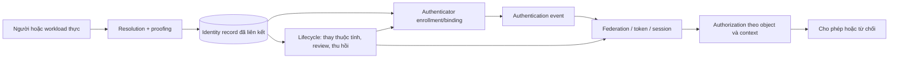
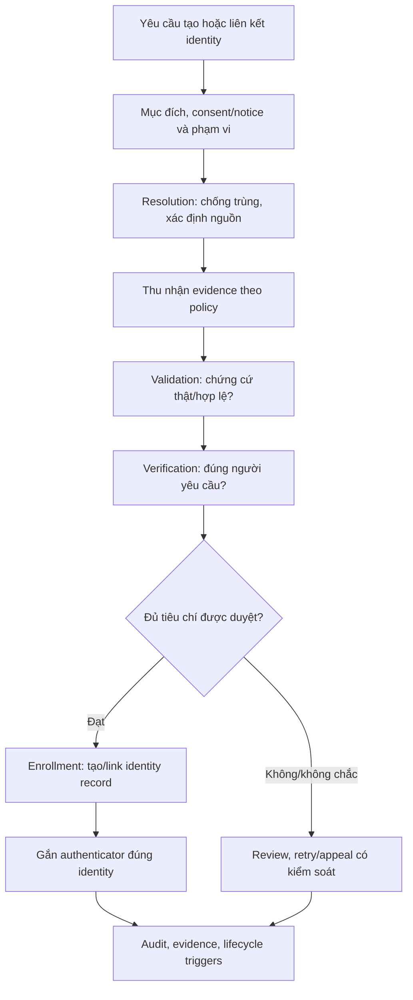
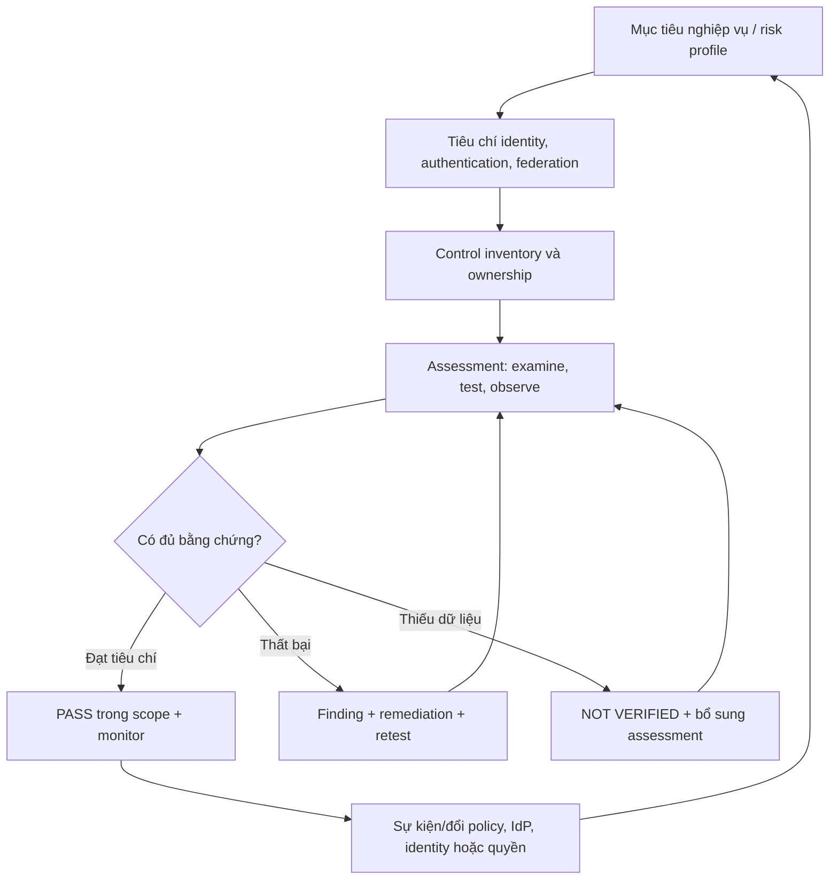

# Đánh giá độ tin cậy identity trong Security Assurance

## 1. Độ tin cậy identity là gì?

**Identity assurance** là mức độ có cơ sở để tin rằng một **định danh số được liên kết đúng với người, tổ chức hoặc workload mà nó đại diện**, và quá trình tạo lập, kiểm chứng, gắn phương thức xác thực và duy trì liên kết đó đáp ứng những yêu cầu đã được lựa chọn theo rủi ro.

Trong chương **Identity assurance** của module **SECURITY_SECURITY_ASSURANCE**, mục tiêu không phải chỉ hỏi “người này có đăng nhập được không?”. Ta cần đánh giá **có bằng chứng** rằng:

- Danh tính được khai báo thuộc về đúng thực thể trong phạm vi nghiệp vụ.
- Dữ liệu/hồ sơ làm căn cứ xác minh có nguồn và độ tin cậy phù hợp.
- Authenticator được đăng ký cho **đúng identity**, không bị gắn bởi kẻ mạo danh.
- Mỗi lần xác thực và assertion/token được kiểm tra theo chính sách, giao thức và trust boundary.
- Quyền truy cập được quyết định theo **principal, role, tenant, đối tượng và thời điểm**, chứ không chỉ dựa vào tên tài khoản.
- Recovery, thay thiết bị, thay thuộc tính, nghỉ việc và vô hiệu hóa tài khoản không phá vỡ độ tin cậy đã thiết lập.
- Những tuyên bố “đạt” có **phương pháp, kết quả kiểm thử, audit, phạm vi, giới hạn và người chịu trách nhiệm**.

Ví dụ: một học viên có account LMS đã đăng nhập bằng passkey. Điều đó có thể hỗ trợ kết luận người thực hiện đang kiểm soát authenticator đã đăng ký; nhưng **không tự chứng minh** account được liên kết với đúng hồ sơ sinh viên, người đó còn đang theo học, hay được phép xem điểm của học viên khác.

Identity assurance là cầu nối giữa **risk assessment → security requirements → controls → kiểm thử/audit → evidence → finding/khắc phục → quyết định rủi ro còn lại**.

### Mục tiêu học tập

Sau bài này, người học có thể: phân biệt proofing/authentication/federation/authorization; hiểu IAL/AAL/FAL; đánh giá evidence và quy trình identity resolution, verification, enrollment, authenticator binding/recovery; thiết kế control và test trong Java/Spring Boot; xử lý trách nhiệm IdP/third-party; lập assurance case có bằng chứng và tổ chức continuous reassessment.

> **Cách phát biểu đúng:** “Trong phạm vi học viên dùng SSO của release R, các control liên kết hồ sơ và token validation đã vượt qua những phép kiểm thử được liệt kê; luồng recovery qua nhà cung cấp chưa có đủ bằng chứng nên vẫn NOT VERIFIED.” Không dùng một nhãn “Identity verified = true” để kết luận tất cả khâu đều đáng tin.

## 2. Phân biệt identity, account, authenticator, session và quyền

| Khái niệm | Ý nghĩa | Ví dụ ở nền tảng học tập | Điều cần đánh giá |
| --- | --- | --- | --- |
| **Entity / subject** | Người, tổ chức hay workload cần được đại diện. | Học viên, giáo viên, job đồng bộ điểm. | Thực thể nào có nhu cầu được nhận diện? |
| **Identity** | Thuộc tính và mối quan hệ dùng để phân biệt entity trong một ngữ cảnh. | Hồ sơ học viên với mã sinh viên ổn định, khóa học và trạng thái. | Nguồn, độ đúng, tính cập nhật và scope. |
| **Identifier** | Giá trị nhận dạng trong namespace. | Student ID, IdP `sub`, service principal ID. | Có bị đổi/tái sử dụng/trùng ở namespace khác? |
| **Account** | Bản ghi được cấp và quản lý để truy cập hệ thống. | Local account LMS, IdP account, cloud identity. | Có còn đúng owner, đúng nhu cầu và state? |
| **Authenticator** | Phương thức/chứng cứ dùng để xác thực quyền kiểm soát một yếu tố. | Password, passkey, security key, OTP, client key. | Binding, strength, phishing/replay resistance, recovery. |
| **Authentication event** | Lần xác thực credential theo quy trình. | IdP xác thực WebAuthn tại thời điểm T. | Ai/chứng cứ nào được xác minh, độ mới ra sao? |
| **Assertion/token** | Thông tin được phát hành để truyền kết quả hoặc quyền theo giao thức. | OIDC ID token, OAuth access token. | Issuer, audience, type, signature, lifetime, claims. |
| **Session** | Trạng thái giữ truy cập sau xác thực. | Session cookie hoặc access token. | Expiry, revocation, step-up và hijacking. |
| **Authorization** | Quyết định ai được làm gì trên đối tượng nào. | Giáo viên chỉ được sửa điểm lớp đang được giao. | Role + object + tenant + policy + state. |

**Ví dụ:** Xác minh người dùng kiểm soát email chỉ chứng minh một điều về **kênh liên hệ tại một thời điểm**. Nó không chứng minh chủ thể đó là người có tên trên hồ sơ học vụ. Ngược lại, proofing rất tốt cũng không chứng minh phiên đăng nhập hôm nay chưa bị đánh cắp.

## 3. Bốn câu hỏi khác nhau trong luồng truy cập

1. **Identity proofing:** “Tài khoản đại diện cho ai?” Có đủ căn cứ liên kết entity với identity record?
2. **Authentication:** “Ai đang kiểm soát authenticator?” Phương thức được xác minh theo cơ chế và điều kiện nào?
3. **Federation/session:** “Thông tin xác thực được truyền và duy trì thế nào?” Assertion/token có đúng nguồn và mục đích?
4. **Authorization:** “Được làm gì trên tài nguyên nào?” Danh tính đã xác thực không mặc nhiên có quyền trên mọi bản ghi.



| Khâu | Ví dụ thất bại | Vì sao khâu khác không tự giải quyết? |
| --- | --- | --- |
| Proofing | Attacker tạo account bằng mã sinh viên của người khác. | MFA sau này có thể bảo vệ **account bị gắn sai ngay từ đầu**. |
| Binding | Support gắn passkey của attacker cho account thật. | Giấy tờ đã kiểm lúc enrollment không chứng minh lần rebinding đúng. |
| Authentication | Attacker phishing password hoặc chiếm session. | Hồ sơ identity chính xác không ngăn attacker dùng credential bị lộ. |
| Federation | API nhận token sai audience hoặc từ issuer không được tin. | Token có chữ ký ở đâu đó không đủ để sử dụng ở API này. |
| Authorization | Học viên A dùng studentId của B để lấy điểm. | A đăng nhập hợp lệ không chứng minh quyền xem dữ liệu B. |

**Lưu ý:** Một hệ thống tự định nghĩa “identity confidence” chỉ bằng một cột `verified` dễ bỏ qua các khâu có mục tiêu và bằng chứng hoàn toàn khác nhau.

## 4. IAL, AAL và FAL: ba chiều assurance độc lập

Bộ hướng dẫn **NIST SP 800-63 – Digital Identity Guidelines** dùng các chiều assurance để phân biệt những điều hệ thống đang cố chứng minh. Khi áp dụng chính thức cần đối chiếu **đúng ấn bản, phần và tiêu chí có hiệu lực** thay vì mặc định mọi phiên bản giống nhau.

| Chiều | Câu hỏi chủ yếu | Bằng chứng có liên quan | Suy luận sai cần tránh |
| --- | --- | --- | --- |
| **IAL – Identity Assurance Level** | Identity được proofing và liên kết với chủ thể đáng tin ở mức nào? | Resolution, identity evidence validation/verification, enrollment decisions, controls chống mạo danh. | “Có MFA nên identity thật đã được xác minh.” |
| **AAL – Authenticator Assurance Level** | Một authentication event có đủ chứng cứ rằng người yêu cầu kiểm soát authenticator đã gắn đúng account? | Loại authenticator, giao thức, binding, anti-replay/phishing properties, session/recovery. | “Đã kiểm giấy tờ nên login có độ tin cậy cao.” |
| **FAL – Federation Assurance Level** | Relying party dựa vào IdP/assertion qua cơ chế và bảo vệ federation nào? | Trust agreement, protocol config, assertion protection, token validation, binding khi áp dụng. | “Dùng OIDC và JWT nên tự đạt FAL cao.” |

Tài liệu NIST có các mức IAL1/IAL2/IAL3, AAL1/AAL2/AAL3 và FAL1/FAL2/FAL3 với **điều kiện cụ thể**. Trong thực tế không được tự gán cấp:

- **Có ảnh giấy tờ** không đủ để tuyên bố mức IAL: phải kiểm nguồn, validation, verification, matching và yêu cầu theo phiên bản chuẩn.
- **Có OTP hoặc passkey** không tự chứng minh toàn bộ AAL nếu recovery, binding, đường đăng nhập cũ hoặc session bypass chưa kiểm.
- **JWT có chữ ký hợp lệ** không tự đáp ứng FAL: còn intended audience, trust model và protocol requirements.

Ba chiều **không được cộng thành một điểm tổng hợp** kiểu “IAL2 + AAL2 + FAL1 = 5 điểm”. Mỗi chiều bảo vệ một mục tiêu và có cách kiểm chứng khác.

### Assurance profile theo chức năng

Một hệ thống có thể yêu cầu profile khác nhau cho việc xem nội dung công khai, đăng ký học, nộp bài thi, sửa điểm và quản trị production. Nếu chính sách chọn một mức NIST cụ thể, cần lập **ma trận tiêu chí theo đúng ấn bản** và kiểm tra toàn bộ điều kiện thay vì suy theo tên công nghệ.

## 5. Xác định mục tiêu, phạm vi và mức rủi ro

Không có một mức identity assurance hợp lý cho tất cả loại người dùng và hành động. Cần xem **hậu quả nếu nhận sai người, nếu attacker xác thực được, hoặc nếu role/tenant liên kết sai**.

| Chức năng | Rủi ro chính | Mục tiêu assurance |
| --- | --- | --- |
| Đọc nội dung khóa học công khai | Ít hoặc không có dữ liệu cá nhân. | Có thể không cần proofing/account; giảm thu thập dữ liệu. |
| Xem bài nộp cá nhân | Lộ dữ liệu học viên, sai hồ sơ. | Liên kết identity với student record, xác thực và phân quyền object. |
| Nộp bài thi | Người khác nộp thay, sai dữ liệu, tranh chấp. | Identity binding và authentication/session phù hợp quy trình thi. |
| Giáo viên nhập điểm | Sửa điểm trái quyền, ảnh hưởng toàn vẹn. | Teacher affiliation, step-up khi cần, policy theo lớp và audit. |
| Reset MFA của admin | Kẻ gian chiếm admin qua helpdesk. | Recovery/reproofing nghiêm ngặt, phê duyệt và audit. |
| Deploy production | Workload/CI bị mạo danh, phát hành trái phép. | Workload identity, credential provenance và least privilege. |

### Scope statement mẫu

> **SCOPE-IDA-01:** Đánh giá quy trình liên kết học viên với hồ sơ hệ thống học vụ, SSO IdP, đăng ký authenticator, account recovery, kiểm JWT access token tại API Spring Boot và authorization theo studentId của production release R. Ngoài scope: thanh toán, kiểm tra hiện diện trong phòng thi và guest/vendor accounts; mọi đường legacy login có thể bypass SSO phải được kiểm kê và giải trình.

Scope nêu được **claim và những giới hạn**: không kiểm phòng thi thì không thể nói hệ thống đã ngăn mọi hình thức thi hộ. Không kiểm recovery thì không thể kết luận toàn bộ vòng đời danh tính đạt.

## 6. Threat modeling: các điểm mạo danh có thể xuất hiện

| Threat ID | Kịch bản | Khâu liên quan | Hậu quả có thể xảy ra |
| --- | --- | --- | --- |
| **THR-IDA-01** | Đăng ký bằng mã học viên của người khác. | Proofing, source binding. | Mạo danh, đọc/nộp bài sai chủ thể. |
| **THR-IDA-02** | Ghép hai hồ sơ trùng tên vào một account. | Identity resolution. | Lộ PII, điểm và dữ liệu nhầm. |
| **THR-IDA-03** | Bằng chứng nhận dạng giả hoặc bị chỉnh sửa không được phát hiện. | Evidence validation. | Enrollment sai identity. |
| **THR-IDA-04** | Giấy tờ hợp lệ nhưng người thực hiện không phải chủ thể trên giấy tờ. | Evidence verification. | Mạo danh qua bằng chứng đánh cắp. |
| **THR-IDA-05** | Support cho phép gắn passkey mới qua email bị chiếm. | Recovery/rebinding. | Account takeover lâu dài. |
| **THR-IDA-06** | Phishing/password/session theft. | Authentication/session. | Thực hiện thao tác bằng account thật. |
| **THR-IDA-07** | JWT hợp lệ cho client khác được API chấp nhận. | Federation/token verification. | Token substitution, truy cập sai ngữ cảnh. |
| **THR-IDA-08** | Claim `verified` hoặc `studentId` do client tự gửi được backend tin. | Trusted input / linking. | Giả mạo identity state. |
| **THR-IDA-09** | Giáo viên đã thôi phụ trách lớp nhưng role/assignment không bị thu hồi. | Lifecycle/authorization. | Sửa/xem điểm trái quyền. |
| **THR-IDA-10** | Workload identity cũ hoặc CI secret bị lộ. | Machine identity. | Ghi dữ liệu/deploy trái phép. |
| **THR-IDA-11** | Proofing provider/log lưu biometrics hoặc giấy tờ không được bảo vệ. | Privacy/evidence custody. | Lộ thông tin nhạy cảm. |
| **THR-IDA-12** | IdP mất log, thay key hoặc thay semantics token mà app không cập nhật. | Federation/assurance monitoring. | Mất bằng chứng, xác minh sai hoặc gián đoạn. |

**Threat scenario không tự là finding.** Nếu chỉ mới phát hiện khả năng xảy ra, ghi giả định và kế hoạch assessment; finding cần bằng chứng cho thấy control chưa đáp ứng một tiêu chí trong phạm vi xác định.

## 7. Chất lượng identity evidence: nguồn nào đáng tin đến đâu?

**Identity evidence** có thể là hồ sơ, thông tin do nguồn có thẩm quyền xác lập, giấy tờ nhận dạng, dữ liệu điện tử, xác minh người bảo trợ hay kết quả từ proofing provider. Không có một danh sách “tài liệu X luôn đáng tin” áp dụng cho mọi quốc gia và mục đích.

| Nguồn | Hỗ trợ điều gì? | Giới hạn cần đánh giá |
| --- | --- | --- |
| Hệ thống học vụ | Trạng thái học viên, mã hồ sơ, quan hệ lớp/khóa học. | Sai số nhập liệu, hồ sơ trùng, đồng bộ chậm. |
| HR directory | Quan hệ công tác, trạng thái nhân sự. | Assignment giáo viên có thể quản lý ở nguồn khác. |
| Giấy tờ nhận dạng | Identity attributes theo loại giấy tờ và phép xác minh. | Giả/hết hạn, ảnh đánh cắp, nguồn dữ liệu. |
| Verifiable/electronic credential | Claims của issuer theo trust framework phù hợp. | Chữ ký, issuer, status, scope và revocation. |
| Email đã xác minh | Kiểm soát mailbox tại thời điểm verification. | Không tự chứng minh danh tính pháp lý hay quyền admin. |
| Phone/OTP | Tín hiệu kiểm soát số điện thoại theo giao thức. | SIM swap, đổi chủ, interception. |
| Biometric match/liveness | Hỗ trợ một khâu liên kết theo giải pháp đã đánh giá. | False match/reject, spoofing, privacy/bias. |
| Sponsor/manager attestation | Xác nhận business need hoặc quan hệ. | Người xác nhận có thẩm quyền không; dữ liệu có còn mới? |
| IdP assertion/token | Claims về authentication/subject theo trust agreement. | Issuer, audience, signature, freshness, semantics. |

### Chín tiêu chí đánh giá evidence

1. **Provenance:** Nguồn phát hành/thu thập, kênh, người/công cụ?
2. **Authenticity:** Có căn cứ chứng cứ thật, không bị sửa/giả?
3. **Validity:** Còn hiệu lực và đúng mục đích sử dụng?
4. **Accuracy:** Thuộc tính có phản ánh đúng entity trong bối cảnh?
5. **Binding:** Evidence có được liên kết với **người đang yêu cầu**?
6. **Freshness:** Thu thập lúc nào, có sự kiện làm mất hiệu lực?
7. **Independence:** Hai nguồn có độc lập thật hay sao chép cùng dữ liệu gốc?
8. **Integrity/confidentiality:** Chain of custody, quyền xem, retention và bảo vệ dữ liệu?
9. **Limitations:** Chứng minh điều gì, không chứng minh điều gì, mức bất định nào?

**Không cộng điểm tùy ý theo số giấy tờ:** ba file ảnh được tải lên từ cùng một nguồn tự khai có thể chỉ lặp lại một lỗi. Nếu nguồn học vụ ghi sai người, việc đối chiếu email và tên lấy từ chính nguồn đó có thể không làm tăng độ tin cậy thực.

## 8. Identity resolution và ngăn gắn nhầm hồ sơ

**Identity resolution** tìm đúng thực thể khi hệ thống có nhiều định danh, người trùng tên, email đổi hoặc dữ liệu từ nhiều nguồn.

### Các tình huống và control

| Tình huống | Sai lầm phổ biến | Control phù hợp |
| --- | --- | --- |
| Hai sinh viên cùng họ tên | Dùng tên làm khóa duy nhất. | Stable student ID từ nguồn học vụ và matching criteria rõ. |
| Sinh viên đổi email | Tạo identity mới hoặc chuyển account sang hồ sơ khác. | Identity key ổn định, quy trình xác minh đổi attribute. |
| Cùng giá trị `sub` từ hai IdP | Map thành một người vì chỉ lưu `sub`. | Khóa liên kết có **issuer + subject** trong namespace hợp lệ. |
| Hồ sơ trùng cần merge | Merge điểm, bài nộp của hai người trái quyền. | Manual review trường hợp ambiguous, audit, rollback và data integrity checks. |
| Một người là giáo viên và học viên | Gộp role không xét tenant/phạm vi. | Mô hình nhiều affiliations với quyền riêng, review xung đột. |
| Người đại diện/giám hộ | Đồng nhất người được ủy quyền với chủ thể hồ sơ. | Relationship/delegation model có scope và expiry. |

Quy trình tham khảo: xác định stable IDs/namespace → đối chiếu authoritative sources → áp dụng matching rules đã kiểm → review trường hợp mơ hồ → tạo liên kết có audit → kiểm các quyền/bản ghi liên quan → theo dõi sau migration.

**Không dùng email/username tự khai từ request như bằng chứng đủ cho một mapping nhạy cảm**. Một account từ IdP đáng tin có thể đổi email mà `sub` vẫn ổn định; nếu ứng dụng map theo email, sai lệch liên kết có thể dẫn tới rò dữ liệu dù JWT và MFA đúng.

## 9. Identity proofing: resolution, validation, verification và enrollment

**Identity proofing** xây dựng cơ sở ban đầu rằng người yêu cầu đúng là chủ thể được claim. Mức độ và từng phép kiểm tra phụ thuộc profile rủi ro/chuẩn đã chọn.



### Validation khác verification

- **Validation:** bằng chứng nhận dạng có thực, hợp lệ, còn hiệu lực, thuộc nguồn phù hợp? Ví dụ thông tin giấy tờ qua kiểm tra được chấp nhận.
- **Verification:** người đang thực hiện proofing có liên kết **đúng với chứng cứ/identity** không? Một giấy tờ thật vẫn có thể do người khác cầm.
- **Enrollment/binding:** kết quả được sử dụng để tạo/link identity record và đăng ký authenticator. Nếu bước này sai, verification trước đó có thể bị vô hiệu hóa.

### Failure behavior là một phần của control

Khi nguồn xác minh down, evidence không rõ hoặc matching ambiguous, hệ thống không nên lặng lẽ cho tài khoản trạng thái “verified” và cấp quyền quan trọng. Cần **review/appeal có thẩm quyền**, giới hạn retry/fraud attempts, telemetry và bảo vệ dữ liệu proofing. Đồng thời phải có phương án tiếp cận công bằng cho người thiếu thiết bị hoặc bằng chứng theo luồng mặc định; không tạo một **backdoor hỗ trợ** thiếu kiểm chứng.

## 10. Chọn assurance theo nhóm đối tượng và thao tác

| Nhóm đối tượng | Độ tin cậy cần chứng minh | Biện pháp và assessment gợi ý |
| --- | --- | --- |
| Người truy cập nội dung công khai | Không có nhu cầu nhận dạng cá nhân nếu dữ liệu công khai. | Tránh thu thập PII không cần thiết. |
| Học viên học trực tuyến | Đúng hồ sơ học vụ và quyền với dữ liệu cá nhân. | Authoritative records, linking, MFA theo rủi ro, object authorization. |
| Thí sinh kỳ thi quan trọng | Người nộp bài là đúng người theo quy trình thi được phê duyệt. | Assurance nâng cao theo risk, controls chống mạo danh, audit và review. |
| Giáo viên/chấm thi | Danh tính và tư cách/assignment hiện tại. | HR/học vụ, MFA phù hợp, role/tenant/object tests. |
| Admin production | Đúng người có đặc quyền, phiên không bị chiếm và recovery an toàn. | Privileged onboarding, phishing-resistant methods khi phù hợp, PAM/JIT, reauthentication. |
| Guest/vendor | Identity và sponsor/hợp đồng còn hiệu lực. | Sponsor attestation, guest expiry, SSO/tenant controls. |
| Service/workload | Request thực sự đến từ workload được phê duyệt. | Workload binding, secret/key lifecycle, least privilege và logging. |

**Step-up authentication** có thể cần cho thao tác nhạy cảm (cấp role admin, đổi email recovery, sửa điểm) dù phiên hiện tại đủ để xem lịch học. **Không nhầm step-up với việc proofing lại giấy tờ trên mọi request**; phải xác định dimension nào cần tăng assurance.

## 11. Authenticator binding và thay phương thức xác thực

Sau proofing, hệ thống cần bảo đảm authenticator (passkey, hardware key, OTP factor, certificate...) được **gắn với đúng account/identity** theo quy trình đã duyệt. Rủi ro lớn thường ở **thêm hoặc khôi phục authenticator**, không chỉ ở kiểm tra mật khẩu.

Control cần xem:

1. Ai được phép thêm/xóa authenticator và trên tài khoản nào?
2. Có reauthentication hoặc step-up đủ cho hành động binding?
3. Authenticator được tạo/chứng minh quyền kiểm soát bằng protocol nào; có bảo vệ chống replay/CSRF khi cần?
4. Có thông báo qua kênh phù hợp và audit bản ghi binding, nhưng không lộ secret/private key?
5. Khi thiết bị bị mất hoặc compromised, authenticator và các phiên liên quan được revoke ra sao?
6. Có xử lý hai yếu tố/thiết bị, phương án khôi phục và người dùng không thể dùng thiết bị mặc định?
7. Có đánh giá các đường bypass qua support, recovery, remembered device và legacy client?

**Passkey/WebAuthn** có thể có khả năng chống phishing nhờ ràng buộc theo origin/RP ID khi triển khai đúng. Tuy vậy, một passkey **không tự chứng minh identity pháp lý** hoặc affiliation học vụ; nếu helpdesk có thể gắn passkey attacker bằng một email đơn lẻ, luồng recovery vẫn có thể gây chiếm account.

## 12. Recovery và re-proofing: đường tấn công thay vì ngoại lệ nhỏ

Account recovery đôi khi là **đường xác thực yếu nhất** vì attacker cố gắn authenticator mới mà không cần vượt qua MFA hiện tại.

| Recovery scenario | Threat | Phép kiểm tra cần có |
| --- | --- | --- |
| Quên mật khẩu | Mailbox bị chiếm, reset token bị dùng lại. | Token an toàn, có hạn/một lần, rate limit, anti-enumeration, audit. |
| Mất thiết bị MFA | Support bị social-engineer. | Risk-based verification, approval, re-binding, notify/revoke. |
| Đổi email/số liên hệ | Attacker chiếm recovery channel và reset tài khoản sau đó. | Reauthentication, xác minh kênh mới, thông báo kênh cũ khi phù hợp. |
| Account bị khóa do nghi gian lận | Kẻ gian dùng evidence giả để tự mở khóa. | Fraud review, separation of duties, decision log. |
| Học viên bảo lưu trở lại | Account cũ không còn đúng quyền/record. | Re-resolve, identity proofing khi cần, least-privilege reactivation. |
| Workload thay key/certificate | Credential mới được gắn với job không được phê duyệt. | Owner approval, workload binding, rotation và effective revocation. |

### Một recovery flow có thể đánh giá

```text
REQ-REC-01: Chỉ rebind authenticator khi đã xác minh đúng
identity và đạt tiêu chí risk profile được duyệt.

1. Nhận recovery request qua kênh được phép, chống lạm dụng.
2. Xác minh người yêu cầu bằng những nguồn và bước phù hợp.
3. Xử lý ambiguity/escalation; không tự cấp quyền khi thiếu căn cứ.
4. Nếu được duyệt, gắn authenticator mới đúng identity record.
5. Thu hồi credential/phiên cũ theo policy; xác minh hiệu lực.
6. Ghi decision, phương pháp, timestamp, approver reference.
7. Theo dõi sự kiện đăng nhập hoặc thay đổi nhạy cảm tiếp theo.
```

**Email OTP** có thể xác nhận một kênh nhưng không mặc nhiên đủ để chứng minh identity của admin hoặc người kiểm soát tài sản quan trọng. Nghĩa vụ quy trình và độ sâu phải xuất phát từ rủi ro và chính sách được phê duyệt.

## 13. Authentication assurance của lần đăng nhập

**Proofing identity tốt** không tự làm authentication hiện tại đủ mạnh. Trong một lần xác thực cần đánh giá:

- **Loại authenticator, protocol và cryptographic properties** phù hợp profile.
- **Binding/enrollment** đã được thực hiện qua luồng đáng tin.
- **Replay/phishing resistance** trong phạm vi công nghệ và tiêu chí áp dụng.
- **Authenticator lifecycle:** lost/revoked/compromised/rotated và error handling.
- **Authentication context:** lúc nào, phương pháp nào, step-up có đủ mới không.
- **Legacy/bypass paths:** API cũ, app-specific passwords, remembered devices, recovery.
- **Session handling:** TTL, logout, refresh, invalidation và account disable.
- **Telemetry:** login, add/remove factor, failed attempts, alert, không ghi secret.

Một tenant báo “MFA enabled” có thể vẫn có admin ngoài policy, service legacy password-only, recovery cho phép bỏ MFA hoặc token cũ. Assessor phải kiểm **coverage và negative paths**, không chỉ một ảnh chụp cấu hình.

## 14. Federation và SSO: trust nhưng phải xác minh

Với IdP, những trách nhiệm chia nhau giữa **provider, IAM tenant owner, relying party/resource server và application owner**. Việc IdP đã proofing và xác thực không làm API được quyền **tin mọi dữ liệu trong request**.

| Kiểm soát federation | Câu hỏi kiểm tra | Ví dụ cách xác minh |
| --- | --- | --- |
| Trusted issuer | Token/assertion từ đúng IdP/tenant được duyệt? | Issuer mismatch test. |
| Signature, key/algorithm | Chữ ký hợp lệ, key rotation/metadata được quản lý? | Invalid signature, unknown key, rotation exercise. |
| Intended audience | Token dành cho đúng API/client? | Wrong-audience negative test. |
| Lifetime/replay | Token hết hạn/chưa hợp lệ hoặc assertion bị replay có bị từ chối? | Expiry/nbf/replay tests theo protocol. |
| Token type | ID token hay access token được dùng đúng mục đích? | ID-token substitution negative test. |
| Subject namespace | `issuer + sub` có được phân biệt giữa các tenants? | Same-sub different-issuer test. |
| Authn context | Claim về MFA/method được hiểu đúng semantics/contract? | Missing/weak-context tests. |
| Provisioning/lifecycle | Disabled account/role có hiệu lực ở app và session? | Revocation/SCIM tests, downstream review. |
| Authorization | Account đã xác thực có đúng quyền object/tenant? | BOLA tests, state assertions. |

### ID token không thay access token

Trong OIDC, **ID token** mang thông tin về authentication dành cho client/relying party theo giao thức. **Access token** phục vụ truy cập resource server theo audience/scope/định dạng được authorization server quy định. Một API không nên chấp nhận “JWT nào có signature từ IdP cũng được”. Cần kiểm **token type, issuer, audience và intended use** theo kiến trúc cụ thể.

**Không tự giả định** mọi IdP có cùng nghĩa cho `acr`, `amr` hoặc claim “verified”. Nếu muốn dùng authentication context để cho phép thao tác nhạy cảm, phải xác định semantics, độ mới và negative tests với IdP thực tế.

## 15. Lifecycle: identity và quyền luôn thay đổi theo thời gian

| Sự kiện | Dữ liệu/niềm tin bị ảnh hưởng | Hành động cần xác minh |
| --- | --- | --- |
| Học viên nhập học/tốt nghiệp | Student affiliation và app entitlements. | Provision/deprovision, giữ hồ sơ theo retention. |
| Giáo viên đổi lớp | Assignment và role theo lớp. | Thu hồi quyền cũ và negative authorization tests. |
| Đổi tên/email/số | Identity attributes, kênh recovery. | Chứng minh đổi đúng entity, bảo vệ account linking. |
| Thêm/mất passkey/MFA | Binding, nguy cơ chiếm account. | Recovery/step-up, notify, revoke và audit. |
| Nhân sự nghỉ việc | Business relationship và access need. | Event-driven offboarding, session/key handling. |
| Đổi IdP/tenant | Issuer, sub, token semantics và trust boundary. | Federation mapping migration và regression testing. |
| Account lâu không dùng | Owner/sponsor và nhu cầu truy cập có thể mất hiệu lực. | Inactivity review và disable theo account type. |
| Credential compromise | Khả năng xác thực hoặc session bị chiếm. | Containment, revoke, reproofing khi cần, investigation. |

Một giáo viên có identity được xác minh đúng lúc tuyển dụng nhưng **không còn quyền sửa điểm lớp cũ** sau khi chuyển nhiệm vụ. Không thể dùng proofing status lâu dài làm thay đổi access-control policy.

### Session/token sau khi disable

Disable tại IdP có thể chặn login mới, nhưng access token tự chứa còn hiệu lực theo thời hạn hoặc service keys khác vẫn hoạt động. Control và bằng chứng phải mô tả **mức hiệu lực thu hồi**, độ trễ, ứng dụng downstream và cách đo negative access; không nói “immediate revoke” khi công nghệ không đáp ứng.

## 16. Non-human identity: workload, CI/CD và service principals

Một service principal không phải người thật, nên không dùng giấy tờ nhận dạng hoặc last interactive login để đánh giá. Các câu hỏi đúng hơn:

| Câu hỏi | Evidence hoặc control |
| --- | --- |
| Workload nào có quyền dùng identity? | Inventory, deployment namespace, runner/project owner, service-to-service trust. |
| Ai tạo/duyệt identity? | IAM provisioning và thay đổi policy có audit. |
| Credential gắn với workload ra sao? | Short-lived identity khi khả thi, mTLS/workload credentials, key provenance. |
| Có thể lấy credential từ workload khác? | Workload binding, trust policy, admission và negative tests. |
| Identity được phép làm gì? | Resource-scoped permissions, effective IAM, DB/storage grants. |
| Khi job hoặc team bị retire? | Access key/role revocation, staged validation và owner handover. |
| Tài khoản có bị mạo danh? | Secret exposure monitoring, credential rotation, workload authentication evidence. |

**Ví dụ:** CI bot được đặt tên `deploy-prod` nhưng có token lưu trong cấu hình của workflow nhận pull request không đáng tin. Tên account không bảo đảm request đến từ runner được phê duyệt. Cần đánh giá **nguồn phát hành credential, binding với workload, scope IAM, expiry và event provenance**.

Một mTLS certificate có thể chứng minh client nắm private key theo cơ chế được cấu hình, **không tự chứng minh** service được cấp quyền thay đổi toàn bộ bảng điểm hoặc key chưa từng bị lộ.

## 17. Privacy, fairness và khả năng tiếp cận

**Tăng mức identity assurance không có nghĩa phải thu càng nhiều dữ liệu nhạy cảm càng tốt.** Việc thu và xử lý giấy tờ nhận dạng, ảnh khuôn mặt, biometrics hoặc lịch sử xác thực có rủi ro riêng.

| Nguyên tắc | Cần đánh giá | Ví dụ |
| --- | --- | --- |
| **Data minimization** | Thu thuộc tính cần thiết cho mục đích và mức assurance được duyệt. | Chỉ cần xác nhận tư cách học viên, không mặc nhiên giữ bản ảnh giấy tờ lâu dài. |
| **Purpose limitation** | Dữ liệu proofing không bị dùng sang mục đích không được chấp nhận. | Không dùng ảnh verification cho marketing hoặc analytics tùy ý. |
| **Retention/deletion** | Có lịch giữ/xóa/ẩn, phân biệt audit và dữ liệu nguyên gốc. | Xóa bản chụp không còn cần nhưng giữ quyết định xác minh theo nghĩa vụ phù hợp. |
| **Encryption/access controls** | Ai có quyền xem/sửa evidence? Kênh truyền và lưu có an toàn? | Quyền riêng cho reviewer, log truy cập và storage policies. |
| **Biometric performance** | False match, false non-match, spoofing và bias có được đánh giá? | Test phù hợp với dân số/sử dụng và có xử lý human review. |
| **Accessibility/inclusion** | Người thiếu thiết bị/giấy tờ mặc định có đường thay thế hợp lệ? | Kênh proofing thay thế nhưng vẫn có kiểm chứng/risk approval. |
| **Appeal/recourse** | Người bị từ chối có thể yêu cầu review công bằng? | Quy trình review có audit, không tự động kết tội gian lận. |
| **Data transfer/third parties** | Provider xử lý ở đâu, ai có quyền và hợp đồng/luật áp dụng? | Quy định scope, retention và shared responsibility. |

**Tình huống cần cân nhắc:** Người học muốn xem tài liệu công khai không nên phải tải giấy tờ tùy thân chỉ vì hệ thống có khả năng eKYC. Trước khi áp dụng một biện pháp tăng assurance, phải đánh giá **lợi ích giảm rủi ro so với xâm lấn riêng tư, tác động người dùng và nghĩa vụ thực tế**.

### Fraud signal không phải phán quyết

Một thiết bị lạ, kết quả biometric thấp hoặc tên không khớp có thể xuất phát từ lỗi kỹ thuật, thay đổi hợp lệ hoặc gian lận. Thiết kế cần ghi confidence, evidence và đường review; không tự kết luận “người này gian lận” chỉ từ một số điểm.

## 18. Third-party identity assurance và shared responsibility

Hệ thống có thể dùng IdP, dịch vụ kiểm chứng giấy tờ, SMS/email provider hoặc nhà cung cấp dữ liệu hồ sơ. **Bằng chứng từ provider chỉ có hiệu lực trong scope/kỳ đánh giá và control cụ thể**.

| Lớp | Provider có thể chịu trách nhiệm | Tổ chức/ứng dụng vẫn cần thực hiện |
| --- | --- | --- |
| **Proofing provider** | Thu thập/validation/verification theo dịch vụ đã cam kết. | Chọn đúng profile, tích hợp decision, xử lý failures, privacy và provider evidence. |
| **IdP/SSO** | Xác thực, phát token theo giao thức, log của dịch vụ. | Cấu hình tenant, MFA coverage, identity mapping, token validation, session/recovery. |
| **Hệ thống học vụ/HR** | Hồ sơ và relationship state theo quy trình nguồn. | Đối chiếu updates, xử lý duplicate, tenant/role mapping, revocation. |
| **Cloud/KMS/workload IdP** | Cung cấp công nghệ credentials/IAM. | Thiết kế trust policies, least privilege, workload binding và rotation. |
| **Email/phone channel** | Vận hành kênh giao nhận theo cam kết. | Không coi quyền kiểm soát kênh tự chứng minh danh tính hay quyền thao tác. |

### Checklist evidence của provider

1. Báo cáo/chứng nhận **phạm vi nào, kỳ nào**, với ngoại lệ gì?
2. Quy trình và nguồn evidence có phù hợp profile tổ chức yêu cầu?
3. Những **customer responsibilities / complementary controls** nào phải tự làm?
4. Quy trình khi provider thay phương pháp, chuyển region, thay subcontractor hoặc bị incident?
5. Có đủ dữ liệu về results, decision reason, timestamp, rule version và độ tin cậy không?
6. Có bảo vệ/retention dữ liệu nhận dạng và điều kiện audit theo hợp đồng?
7. Có cơ chế giám sát false positive/negative và appeal khi phù hợp?

**Một báo cáo SOC 2 hoặc chứng chỉ ISO/IEC 27001** của nhà cung cấp không tự chứng minh mọi enrollment, token mapping và quyền trong tenant của tổ chức đã đạt.

## 19. Kế hoạch đánh giá identity assurance theo bằng chứng

Một assessment đáng tin không bắt đầu bằng câu hỏi đơn lẻ “có KYC/MFA không?”. Nó cần **tuyên bố có thể kiểm chứng**:

1. **Define claims:** identity record gắn đúng học viên; token API đến từ đúng issuer/audience; người dùng được step-up khi cần.
2. **Define scope:** use cases, identity sources, đối tượng, tenant, release, môi trường và phần loại trừ.
3. **Select criteria:** mục tiêu nghiệp vụ, risk scenarios, yêu cầu nội bộ và mức IAL/AAL/FAL nếu có theo phiên bản được chọn.
4. **Map controls:** proofing, matching, binding, authentication, recovery, federation, authorization và lifecycle.
5. **Choose assessment methods:** examine config/hồ sơ, test positive/negative/failure paths, interview/observe operating process khi cần.
6. **Gather evidence:** rule versions, build, environment, source, timestamps, test reports, review samples, provider scope.
7. **Determine state:** PASS, FAIL, NOT VERIFIED, N/A, EXCEPTION cùng giới hạn và rủi ro.
8. **Act and reassess:** remediation/retest, risk decision, monitoring và triggers đổi claim.



### Ba lớp đánh giá cần phân biệt

| Lớp | Câu hỏi | Ví dụ evidence |
| --- | --- | --- |
| **Design adequacy** | Quy trình dự kiến có giải quyết threat scenario và risk profile? | Proofing design, recovery policy, trust model, threat assessment. |
| **Implementation effectiveness** | Code, IdP config, matching và IAM thực thi đúng, không bypass? | Token negative tests, mapping tests, review implementation, config. |
| **Operating effectiveness** | Trong kỳ đánh giá, control có chạy đều và failures được xử lý? | Enrollment samples, recovery cases, incident/appeal logs, drift monitoring. |

**Không lấy implementation PASS thay kết luận operating effectiveness** nếu source telemetry đã ngừng hoạt động hoặc reviewer bỏ qua những case cần xét.

## 20. Control baseline và ma trận assurance

Các ID `IDA-01` đến `IDA-16` là **mẫu nội bộ minh họa**, không tự tương đương điều khoản của NIST hoặc ISO.

| Control ID | Điều kiện cần đạt | Control owner và evidence điển hình |
| --- | --- | --- |
| **IDA-01** | Có identity inventory, nguồn authority, loại account, namespace và owner. | IAM/system owner; reconciliation và review inventory. |
| **IDA-02** | Identity resolution chống nhầm/duplicate, ambiguity được review. | Proofing/app owner; matching tests, case records. |
| **IDA-03** | Evidence validation theo nguồn và phương pháp được phê duyệt. | Proofing/provider owner; validation procedure, provenance. |
| **IDA-04** | Verification liên kết đúng người yêu cầu với identity evidence. | Proofing owner; positive/negative tests, review samples. |
| **IDA-05** | Enrollment/authenticator binding chỉ sau khi đạt điều kiện. | IAM/auth owner; binding flow tests và audit. |
| **IDA-06** | Authentication/MFA bao phủ các đường được yêu cầu, không bypass. | IAM/app owner; policy export, legacy/recovery tests. |
| **IDA-07** | Federation kiểm đúng issuer, audience, signature, lifetime, token type. | IdP integration owner; negative token tests. |
| **IDA-08** | Mapping account dùng namespace-aware stable IDs, không dùng email đơn lẻ cho quyết định nhạy cảm. | App/identity owner; migration/mapping review. |
| **IDA-09** | Recovery/rebinding có verification, approval, revocation và audit. | IAM/support owner; recovery abuse and race tests. |
| **IDA-10** | Session và step-up phù hợp với rủi ro hành động. | Session owner; reauthentication/revocation tests. |
| **IDA-11** | HR/học vụ/vendor changes làm cập nhật identity attributes/entitlements đúng. | Business source + IAM; offboarding/role tests. |
| **IDA-12** | Workload identity có owner, provenance, least privilege và lifecycle. | Cloud/DevSecOps; workload trust/negative IAM tests. |
| **IDA-13** | Proofing data được bảo vệ, tối thiểu hóa và retention phù hợp. | Privacy/security; inventory, access/retention tests. |
| **IDA-14** | Fraud/ambiguous case có review và appeal theo chính sách. | Fraud/proofing owner; case sampling và SLA. |
| **IDA-15** | Evidence có source, build, time, decision và finding workflow. | Security assurance owner; artifact review. |
| **IDA-16** | Thay nguồn identity/IdP/credential/role kích hoạt reassessment. | Control owners; impact records, regression tests. |

**Một control có owner nhưng thiếu test hoặc evidence phù hợp phải là NOT VERIFIED**, không tự đánh PASS. Một control không áp dụng phải có **lý do và người review**, không dùng N/A để che gap.

## 21. Ví dụ Spring Security: token hợp lệ vẫn phải liên kết đúng identity

Giả sử `grade-service` là **OAuth 2.0 Resource Server** nhận **JWT access tokens** từ IdP đã phê duyệt. Bước bảo vệ cần gồm:

1. Resource server kiểm chữ ký, issuer, expiry/time và **audience dành cho API**.
2. `sub` được diễn giải trong **namespace của issuer/tenant**, không coi email là stable identifier.
3. App ánh xạ principal IdP sang bản ghi identity nội bộ qua liên kết được tạo từ enrollment đáng tin.
4. Đọc/sửa dữ liệu phải kiểm **authorization theo object/class/tenant**, không chỉ sự hiện diện của token.
5. Recovery/disable/role change phải có đường cập nhật/revoke theo policy, không để cache giữ quyền vô hạn.

### 21.1. Cấu hình Resource Server có kiểm tra audience

Đây là **ví dụ Java/Spring Boot/Spring Security minh họa**, các API và phiên bản phải được rà soát theo dự án thật. Mẫu cấu hình `SecurityApiProperties` để cung cấp issuer và audience qua configuration có quản lý, không ghi các giá trị thật vào bài học.

```java
import org.springframework.boot.context.properties.ConfigurationProperties;
import org.springframework.boot.context.properties.EnableConfigurationProperties;
import org.springframework.context.annotation.Bean;
import org.springframework.context.annotation.Configuration;
import org.springframework.security.config.Customizer;
import org.springframework.security.config.annotation.web.builders.HttpSecurity;
import org.springframework.security.web.SecurityFilterChain;
import org.springframework.security.oauth2.core.OAuth2Error;
import org.springframework.security.oauth2.core.OAuth2TokenValidator;
import org.springframework.security.oauth2.core.OAuth2TokenValidatorResult;
import org.springframework.security.oauth2.core.DelegatingOAuth2TokenValidator;
import org.springframework.security.oauth2.jwt.Jwt;
import org.springframework.security.oauth2.jwt.JwtDecoder;
import org.springframework.security.oauth2.jwt.JwtValidators;
import org.springframework.security.oauth2.jwt.NimbusJwtDecoder;

@ConfigurationProperties(prefix = "security.api")
record SecurityApiProperties(String issuer, String audience) { }

@Configuration
@EnableConfigurationProperties(SecurityApiProperties.class)
class ApiSecurityConfiguration {

    @Bean
    SecurityFilterChain securityFilterChain(HttpSecurity http)
            throws Exception {
        http.authorizeHttpRequests(auth -> auth
            .requestMatchers("/actuator/health").permitAll()
            .requestMatchers("/api/**").authenticated()
            .anyRequest().denyAll());
        http.oauth2ResourceServer(oauth ->
            oauth.jwt(Customizer.withDefaults()));
        return http.build();
    }

    @Bean
    JwtDecoder jwtDecoder(SecurityApiProperties props) {
        NimbusJwtDecoder decoder = NimbusJwtDecoder
            .withIssuerLocation(props.issuer())
            .build();

        OAuth2TokenValidator<Jwt> issuerAndTime =
            JwtValidators.createDefaultWithIssuer(props.issuer());
        OAuth2TokenValidator<Jwt> audience = token ->
            token.getAudience().contains(props.audience())
                ? OAuth2TokenValidatorResult.success()
                : OAuth2TokenValidatorResult.failure(
                    new OAuth2Error("invalid_token",
                        "Incorrect API audience", null));

        decoder.setJwtValidator(
            new DelegatingOAuth2TokenValidator<>(
                issuerAndTime, audience));
        return decoder;
    }
}
```

**Giới hạn bảo mật:** Resource Server framework quản lý phần xác minh JWT theo cấu hình, nhưng mã trên **chưa chứng minh** token type/intended use, toàn bộ quy tắc JWK/algorithm, key rotation, session, CSRF/CORS hoặc issuer availability. Một API phải định nghĩa và kiểm chính sách **access token** theo authorization server; **không chấp nhận OIDC ID token thay access token** chỉ vì cả hai là JWT có chữ ký. `SecurityApiProperties` phải được cung cấp đúng qua cấu hình production được quản lý và xét tới override/drift.

### 21.2. Tách IdP subject khỏi studentId và authorization

```java
// Pseudocode: application-specific interfaces and types are illustrative.
@Service
public class GradeAccessService {
    private final IdentityLinkRepository identityLinks;
    private final GradeRepository grades;
    private final GradeAccessPolicy policy;

    public GradeDto readGrade(
            UUID gradeId, JwtAuthenticationToken authentication) {
        Jwt token = authentication.getToken();
        String trustedIssuer = token.getIssuer().toString();
        String trustedSubject = token.getSubject();

        AppIdentityLink link = identityLinks.requireActiveLink(
            trustedIssuer, trustedSubject);
        Grade grade = grades.findById(gradeId)
            .orElseThrow(() -> new NotFoundException("Grade not found"));

        // Authentication is not permission to read every grade.
        if (!policy.canRead(link.getPrincipalId(), grade)) {
            throw new AccessDeniedException("Grade access denied");
        }
        return GradeDto.from(grade);
    }
}
```

**Điểm assurance:**

- Principal phải đến từ **authentication context đã được framework xác minh**, không từ request body/query/header tùy ý.
- Bảng identity links phải được tạo/cập nhật qua enrollment với source authority đáng tin, có kiểm uniqueness, quyền ghi, audit, xử lý đổi issuer/tenant.
- `GradeAccessPolicy` phải xét quyền theo **lớp, học viên, tenant, trạng thái và object cụ thể**; `isAuthenticated()` không đủ.
- Mã minh họa **không** xử lý đầy đủ lỗi, transaction/race, phiên/refresh token, MFA/recovery hay các đường batch/admin. Assessment phải bao phủ những phần thuộc scope.

## 22. Bộ test kiểm chứng identity assurance

Một bài test tốt cần so sánh **expected behavior và actual behavior**, bao gồm trạng thái dữ liệu và kết quả policy, không chỉ HTTP code.

| Test ID | Tình huống | Kết quả cần chứng minh |
| --- | --- | --- |
| **TC-IDA-01** | Học viên hợp lệ được tạo identity link từ nguồn học vụ. | Stable ID đúng, decision có audit, enrollment đúng scope. |
| **TC-IDA-02** | Hai học viên cùng tên nhưng khác mã. | Không merge/link nhầm hồ sơ. |
| **TC-IDA-03** | User đổi email nhưng không đổi identity chính. | Account vẫn gắn đúng record, không rò dữ liệu và không tạo identity mới trái phép. |
| **TC-IDA-04** | Evidence giả/hết hạn/sai nguồn trong mô phỏng. | Validation bị từ chối hoặc được chuyển review; không tự PASS. |
| **TC-IDA-05** | Evidence thật nhưng người yêu cầu không khớp. | Verification thất bại/review theo policy, không enrollment trái quyền. |
| **TC-IDA-06** | Retry enrollment sau timeout và duplicate request. | Không tạo hai account/role sai hoặc bypass trạng thái pending. |
| **TC-IDA-07** | Thêm passkey/MFA khi thiếu step-up/approval bắt buộc. | Không được bind; có security event phù hợp. |
| **TC-IDA-08** | Authenticator bị thu hồi được dùng lại. | Bị từ chối; session/credential state phù hợp. |
| **TC-IDA-09** | Recovery qua kênh chưa đủ verification. | Không cấp authenticator mới hoặc bypass policy. |
| **TC-IDA-10** | Người dùng thiếu MFA thử legacy login. | Không bypass yêu cầu xác thực. |
| **TC-IDA-11** | JWT sai chữ ký, issuer, hết hạn hoặc chưa hợp lệ. | Resource server từ chối, không tạo principal có quyền. |
| **TC-IDA-12** | JWT đúng chữ ký nhưng `aud` dành cho API khác. | Từ chối token. |
| **TC-IDA-13** | ID token OIDC được gửi thay API access token. | Từ chối theo intended-use/token-type policy. |
| **TC-IDA-14** | Hai issuers phát `sub` cùng chuỗi. | Không map vào cùng AppIdentityLink nếu không có linking phê duyệt. |
| **TC-IDA-15** | Học viên A dùng token hợp lệ đọc điểm B. | Bị từ chối, không lộ kết quả hoặc metadata B. |
| **TC-IDA-16** | Giáo viên rời lớp/nhân sự nghỉ việc, token cũ còn hạn. | Đúng revocation/authorization freshness policy. |
| **TC-IDA-17** | IdP/proofing source/policy lookup ngừng hoạt động. | Failure mode phù hợp; không mặc nhiên tin claim chưa xác minh. |
| **TC-IDA-18** | Workload dùng credential từ runner/job trái phép. | Workload binding và IAM không cho vượt scope. |
| **TC-IDA-19** | Account admin thay recovery contact/authenticator. | Step-up, verification, notice/revocation và audit theo policy. |
| **TC-IDA-20** | Provider trả “PASS” nhưng không cung cấp metadata/procedure đủ. | NOT VERIFIED cho claim vượt quá evidence. |
| **TC-IDA-21** | Log proofing chứa giấy tờ/PII không cần thiết. | Redaction, retention và access controls đúng. |
| **TC-IDA-22** | Đổi issuer/IdP rules giữa hai releases. | Impact assessment và regression tests được cập nhật. |
| **TC-IDA-23** | Người dùng bị false rejection cần review. | Có appeal an toàn, không tạo backdoor. |
| **TC-IDA-24** | Account đã disable dùng refresh/access token cũ. | Đúng giới hạn TTL/revocation đã duyệt, có evidence. |

### Chất lượng test cần có gì?

- **Positive cases** cho người dùng hợp lệ, nguồn hợp lệ, token hợp lệ, quyền đúng object.
- **Negative cases** cho identity sai, token sai, role/tenant/object trái quyền và recovery bypass.
- **Failure cases** cho provider timeout, log thiếu, nguồn dữ liệu mâu thuẫn, retry và race.
- **Coverage** cho batch, API legacy, admin, mobile, SSO và non-human identities thuộc scope.
- **Evidence** có build/policy, môi trường, dữ liệu giả, phương pháp, expected/actual và limitations.

**Không thử identity fraud bằng giấy tờ thật của người khác hoặc tài khoản thật ngoài phạm vi được ủy quyền.** Dữ liệu test phải giả/có phép và không tạo tác động production ngoài kế hoạch.

## 23. Assurance evidence package và giới hạn suy luận

| Artifact | Điều nó có thể chứng minh | Giới hạn cần ghi |
| --- | --- | --- |
| Policy, risk profile | Mục tiêu, scope, assurance criteria và thẩm quyền. | Policy chưa chứng minh được thực thi. |
| Identity source inventory | Các nguồn authoritative, namespace và owners. | Inventory có thể thiếu hoặc lỗi thời. |
| Proofing workflow/provider report | Cách validation/verification và kết quả trong scope. | Provider scope, exceptions, sampling, quality. |
| Identity-link mapping tests | Khả năng chống trùng/gắn nhầm theo test. | Không bao phủ mọi biến thể và migrated data nếu thiếu mẫu. |
| MFA/binding config và negative tests | Yêu cầu authenticator và recovery ở paths đã kiểm. | Có thể còn bypass ở legacy/guest/bot. |
| Token-validation tests | Issuer, signature, audience/type/time ở API đúng build. | Không tự chứng minh identity proofing hoặc authorization. |
| Object authorization tests | Principal được/không được truy cập bản ghi. | Không tự chứng minh IAM tenant/provider. |
| Access/lifecycle review | Account, role, session và quyền đã cập nhật theo event. | Asynchronous propagation và token lifetime. |
| Provider independent assessment | Controls đã được đánh giá trong kỳ và phạm vi provider. | Customer/tenant controls và CUECs. |
| Findings/retest/risk decisions | Sai lệch, xử lý và mức rủi ro còn lại. | Ticket closed chưa chắc có retest. |

### Evidence phải có provenance và thời gian

Mỗi artifact nên có **control ID, scope, environment, identity source/tenant, build, IdP config version, ngày giờ, người/công cụ, test data, result, giới hạn và tham chiếu thay đổi**. Một ảnh chụp “verified=true” không có nguồn và quy trình xác minh **không đủ** để kết luận người dùng đã được proofing ở mức cần thiết.

Evidence thường chứa dữ liệu rất nhạy cảm (giấy tờ, biometrics, định danh, lịch sử login). Cần tách **dữ liệu nguyên gốc** khỏi **bản ghi quyết định/audit**, lưu qua reference phân quyền và theo retention được duyệt; không đưa thông tin xác thực thật hoặc dữ liệu học viên thật vào ticket công khai.

## 24. Control register YAML minh họa

Mẫu dưới **không phải chuẩn YAML chính thức của NIST hoặc schema metadata bài học**, chỉ là ví dụ quản trị control để dễ traceability:

```yaml
controlId: IDA-CORE-01
title: "Identity proofing, linking and federation assurance"
version: "1.0-example"
service: learning-platform
environment: production

scope:
  identities:
    - students
    - teachers
  sources:
    - student-information-system
    - approved-idp
  functions:
    - enrollment
    - identity-linking
    - authenticator-recovery
    - api-token-validation
  exclusions:
    - billing

criteria:
  standardReference: "<approved-guideline-and-version>"
  identityProfile: "<IAL-related-requirements-approved-by-risk>"
  authenticationProfile: "<AAL-related-requirements-approved-by-risk>"
  federationProfile: "<FAL-related-requirements-approved-by-risk>"
  objective: >-
    Only the correctly linked principal may use credentials
    and assertions intended for the authorized service.

ownership:
  controlOwnerRole: identity-assurance-control-owner
  identitySourceOwnerRole: academic-data-owner
  idpOwnerRole: iam-platform-owner
  applicationOwnerRole: learning-platform-backend-owner
  riskOwnerRole: academic-identity-risk-owner
  assessorRole: application-security-assessor
  evidenceCustodianRole: security-evidence-custodian

controls:
  - id: IDA-02
    condition: "No ambiguous identity link is accepted silently"
  - id: IDA-07
    condition: "Token issuer, audience, type and lifetime validated"
  - id: IDA-09
    condition: "Recovery needs risk-appropriate verification"
  - id: IDA-11
    condition: "Identity and affiliation changes affect access"

assessment:
  requiredTests:
    - TC-IDA-02
    - TC-IDA-07
    - TC-IDA-12
    - TC-IDA-13
    - TC-IDA-15
    - TC-IDA-17
  evidenceReferences: []
  currentResult: NOT_VERIFIED
  lastAssessedAt: null
  limitations:
    - "Provider proofing evidence requires separate assessment"

findings: []
exceptions: []
reassessment:
  dueAt: "<ISO-8601-date>"
  triggers:
    - "IdP tenant or issuer changes"
    - "Recovery or authenticator binding changes"
    - "New matching rule or student identity source"
    - "Identity misbinding, impersonation or account takeover"
```

Đặc biệt, `currentResult: NOT_VERIFIED` là trạng thái phù hợp trước khi có assessment. Việc có policy, owner và danh sách test **không phải bằng chứng control đạt**.

## 25. PASS, FAIL, NOT VERIFIED và độ bất định

| Trạng thái | Cách hiểu | Ví dụ |
| --- | --- | --- |
| **PASS** | Có bằng chứng control đáp ứng tiêu chí trong scope/time window. | API từ chối JWT sai audience ở build R. |
| **FAIL** | Có bằng chứng control không đạt yêu cầu. | Support cho phép rebinding MFA mà không thực hiện verification bắt buộc. |
| **NOT VERIFIED** | Thiếu dữ liệu, nguồn không đáng tin, test chưa chạy hoặc coverage thiếu. | Provider trả nhãn PASS nhưng không có bằng chứng phù hợp cho claim. |
| **N/A** | Control không áp dụng với mô hình đã xác minh; có lý do. | Quy trình giấy tờ cá nhân không áp dụng cho workload-only principal. |
| **EXCEPTION** | Control áp dụng nhưng chưa đạt, có xử lý/chấp nhận rủi ro đúng thẩm quyền. | Tính năng cũ tạm hạn chế, có hạn và compensating control được kiểm. |

Không chuyển `FAIL` thành `PASS` sau khi một ngoại lệ được ký. Không lấy “18/20 controls PASS” để phê duyệt nếu hai mục không đạt là **recovery bypass MFA** và **resource server chấp nhận sai audience**.

### Phân biệt bốn loại đánh giá

- **Confidence của evidence:** bằng chứng có đầy đủ, đúng nguồn, mới và đáng tin?
- **Identity proofing outcome:** liên kết identity được xác minh như thế nào?
- **Authentication/federation assurance:** một phiên hoặc token có đáp ứng profile không?
- **Risk severity:** control thất bại có hậu quả và điều kiện khai thác nào?

Các kết quả này có thể hỗ trợ ra quyết định nhưng **không cộng thành một số chung** rồi gọi là “identity trust score” có hiệu lực pháp lý hoặc mức NIST chính thức.

## 26. Ownership, RACI và separation of duties

Một chuỗi identity assurance thường trải qua nhiều bộ phận:

| Vai trò | Trách nhiệm |
| --- | --- |
| **Identity assurance control owner** | Duy trì control objectives, scope, quality, evidence và remediation. |
| **Business identity source owner** | Xác nhận dữ liệu học vụ/HR, relationship state và độ chính xác nguồn. |
| **IAM/IdP owner** | Quản lý tenant, identity provisioning, MFA, recovery và token trust. |
| **Application owner** | Duy trì identity links, token verification, authorization và session behavior. |
| **Proofing/third-party owner** | Quản lý provider evidence, privacy, contract, exceptions và risk dependencies. |
| **Security assessor/GRC** | Thiết kế kiểm chứng, phân tích evidence, kết luận và báo findings. |
| **Risk owner** | Quyết định residual risk và treatment trong thẩm quyền. |
| **Privacy/legal** | Xem xét bảo vệ dữ liệu, retention, transfer và nghĩa vụ áp dụng. |
| **SOC/incident responder** | Phát hiện mạo danh/compromise, containment, điều tra và hậu kiểm. |

### RACI minh họa

R = Responsible, A = Accountable, C = Consulted, I = Informed. Đây là mẫu **tổ chức nội bộ**, không phải một ma trận bắt buộc cho mọi đơn vị.

| Hoạt động | IDA control owner | Business source owner | IAM/App engineering | Assessor | Risk owner |
| --- | :---: | :---: | :---: | :---: | :---: |
| Chọn yêu cầu proofing/assurance theo risk | **A/R** | C | C | C | C |
| Duy trì dữ liệu source authority | C | **A/R** | I | C | I |
| Triển khai identity link/authenticator/federation | **A** | C | **R** | C | I |
| Thu thập evidence và xử lý missing records | **A** | R | R | C | I |
| Thiết kế/đánh giá control độc lập phù hợp | C | C | C | **A/R** | I |
| Khắc phục token/recovery/mapping bypass | **A** | C | **R** | C | C |
| Chấp nhận residual risk trong thẩm quyền | C | C | C | C | **A/R** |
| Theo dõi changes/drift và reassessment | **A** | R | R | C | C |

Ở hệ thống rủi ro cao, người viết control không nên là **người duy nhất tự xác nhận** điều kiện đã đạt khi governance yêu cầu assessment độc lập. Release/incident authority có thể là vai trò riêng, không tự đồng nhất với risk owner hoặc control owner.

## 27. Case study: SSO đúng nhưng hồ sơ sinh viên bị gắn nhầm

### Bối cảnh

Một hệ thống LMS dùng `email` làm khóa liên kết giữa IdP và hệ thống học vụ. Hai người có tên gần giống nhau; email của một hồ sơ bị nhập sai, sau đó email được thay đổi. Job mapping dựa trên email gán account của A vào hồ sơ B.

**Kết quả:** A đăng nhập SSO, MFA thành công, API chấp nhận JWT đúng issuer, nhưng lại trả điểm và bài nộp của B. Nhóm vận hành ban đầu nói “xác thực đúng, nên identity đáng tin”.

### Phân tích

| Lớp | Bằng chứng hiện có | Đánh giá |
| --- | --- | --- |
| Proofing tại IdP | A đã được xác thực theo cơ chế IdP. | Không chứng minh identity link của LMS đúng B. |
| Authentication | A dùng authenticator đã đăng ký. | Không phải nguồn lỗi chính của mapping. |
| Federation | Token signature/issuer/audience đúng. | Chỉ xác thực principal trong namespace IdP. |
| Identity linking | Email thiếu ổn định gây liên kết sai record. | **Finding** ở identity resolution/linking. |
| Authorization | API kiểm login rồi đọc dữ liệu qua studentId đã map sai. | Thiếu defense-in-depth trên dữ liệu nhạy cảm/mapping. |
| Evidence coverage | SSO happy-path tests PASS, chưa test đổi email/trùng ID. | Claim toàn diện **chưa được chứng minh**. |

### Kế hoạch xử lý

1. **Containment:** hạn chế đường đọc sai; xem xét session và dữ liệu có thể đã lộ theo incident/privacy process.
2. **Root-cause:** kiểm bản ghi source, rule matching, lịch sử đổi email và quyền sửa identity links.
3. **Thiết kế lại:** dùng IdP key có namespace (issuer, subject), liên kết với stable student ID theo nguồn học vụ và quy trình xác minh.
4. **Migration:** rà soát links hiện hữu, trường hợp ambiguous đưa vào review; không merge/xóa hàng loạt thiếu rollback.
5. **Assessment:** chạy `TC-IDA-02/03/14/15` và migration/negative tests trên build được sửa, kiểm không đọc nhầm data.
6. **Evidence:** data reconciliation, test report, audit đã ẩn dữ liệu, review và change record.
7. **Risk reassessment:** đánh giá số account bị ảnh hưởng, nguyên nhân control failure, rủi ro còn lại và phạm vi mở rộng tới giáo viên/admin.

**Bài học:** SSO, MFA và JWT có thể hoạt động đúng kỹ thuật nhưng identity–app binding vẫn sai. Mỗi lớp cần owner, yêu cầu và bằng chứng riêng.

## 28. Finding, remediation và ngoại lệ

| Trường finding | Ví dụ |
| --- | --- |
| Finding ID | `FIND-IDA-04` |
| Control/requirement | `IDA-08` – identity-to-account linking. |
| Scope | LMS SSO, production release R, đổi email/matching workflow. |
| Expected | Liên kết không thể ghép nhầm người do email thay đổi. |
| Actual | Test tạo ra account A đọc hồ sơ B. |
| Evidence | Synthetic identities, trace và response đã che dữ liệu, build/timestamp. |
| Risk impact | Disclosure/vi phạm toàn vẹn hồ sơ; cần điều tra quy mô thực. |
| Remediation owner | Identity integration/service owner. |
| Closure criteria | Rule mới và migration/negative tests PASS, kiểm data reconciliation. |
| Approval | Risk/release/incident authority theo quy trình. |

**Không tự kết luận đã có gian lận thật** chỉ từ lỗi ghép hồ sơ; phải phân biệt khả năng rủi ro, finding kỹ thuật và điều tra truy cập thực tế.

### Hồ sơ exception nếu được phép

Ghi requirement chưa đạt, scope, nguyên nhân, risk scenario, bằng chứng, compensating controls đã kiểm, owner, approver có thẩm quyền, ngày hết hạn, remediation và retest. Một support recovery legacy yếu **không trở thành an toàn** vì đã được risk owner chấp nhận tạm thời. Nếu nghĩa vụ bắt buộc không cho ngoại lệ, phải escalation và thực hiện biện pháp tuân thủ.

## 29. Continuous assurance và chỉ số theo dõi

| Giai đoạn | Hoạt động | Evidence |
| --- | --- | --- |
| **Design** | Risk scenarios, assurance profile, identity sources và privacy review. | Risk/proofing design, control mapping. |
| **Implementation** | Matching, authenticator binding, recovery, token/session verification. | Code/config review, positive/negative tests. |
| **Release** | Kiểm coverage, IdP trust, role mapping, findings và decision. | Build ID, tests, policy version, sign-off. |
| **Production** | Monitor identity changes, login/recovery anomalies, drift/sensor health. | IAM/IdP/SIEM events, case reviews. |
| **Periodic review** | Proofing samples, access review, provider assessments, support drills. | Evidence, issue register, results. |
| **After incident/change** | Reassess impacted links, credentials, roles, assertions và risk. | Incident timeline, remediation/retest. |

### KPI/KRI có thể theo dõi

- **Identity inventory coverage:** bao nhiêu nguồn/tenants/accounts có owner và stable IDs.
- **Misbinding/duplicate findings:** số trường hợp và thời gian xử lý theo phạm vi được biết.
- **Proofing decision coverage:** tỷ lệ decisions có evidence, reviewer, outcome và version.
- **Authentication policy coverage:** bao nhiêu đường dùng MFA/step-up đúng yêu cầu, bao nhiêu bypass chưa kiểm.
- **Recovery/rebinding anomalies:** số sự kiện cần review và thời gian phản ứng.
- **Federation negative-test coverage:** tỷ lệ API/clients được kiểm issuer, audience, token type, expiry.
- **Stale roles/identities:** quyền còn tồn tại sau business events và thời gian verified revocation.
- **Evidence freshness:** phần trăm control có artifact phù hợp với build/IdP configuration hiện hành.
- **Provider shared-control coverage:** trách nhiệm phía tổ chức đã được review và kiểm chứng.
- **Incident/finding closure effectiveness:** remediation đã retest PASS, không chỉ ticket đóng.

Không đưa chỉ số “100% verified identity” khi chưa định nghĩa verified là **khâu nào, nguồn nào, trong thời gian nào**. Không dùng tổng số giấy tờ thu được làm đại diện cho chất lượng assurance.

### Trigger reassessment

1. Thay IdP, issuer, JWKS, OIDC client, audience hoặc token semantics.
2. Thay student/HR source, stable IDs, rules matching, tenant/role relationship.
3. Thêm proofing provider, biometric process, dữ liệu nhận dạng mới hoặc data region.
4. Thay MFA/passkey enrollment, recovery/reauthentication hoặc session/token lifetime.
5. Thêm chức năng sửa điểm, admin role, batch import/export, account delegation.
6. Incident impersonation, account takeover, misbinding, recovery fraud, PII leak.
7. Provider report hết hạn, có exception đáng kể hoặc thay shared responsibility.
8. Thay service/workload identity, CI secret, role trust hoặc đường break-glass.

Mỗi trigger cần **impact assessment** để biết control/test/evidence nào phải đánh giá lại. Không nhất thiết chạy lại toàn bộ chương trình, nhưng cũng không được coi báo cáo của release cũ là bằng chứng vĩnh viễn.

## 30. Những sai lầm phổ biến

| Lỗi | Vì sao sai? | Cách khắc phục |
| --- | --- | --- |
| “Có MFA nên biết chắc người thật là ai.” | MFA chứng minh một phương thức xác thực, không tự proofing identity. | Tách IAL và AAL, đánh giá enrollment/binding. |
| “Email verified là hồ sơ sinh viên verified.” | Email có thể đổi/chuyển chủ và không chứng minh business identity. | Dùng authoritative stable identifiers. |
| “JWT signature đúng nên API nhận được.” | Sai audience/type/issuer vẫn có thể là token không phù hợp. | Validation theo protocol và intended use. |
| “Proofing provider PASS nghĩa là mọi thứ đạt.” | Scope/đường recovery, app links và customer controls có thể thiếu. | Review evidence/contract và test integration. |
| “IAL, AAL, FAL cộng thành một điểm trust.” | Đây là ba chiều khác mục tiêu. | Chọn profile theo rủi ro và tiêu chí từng chiều. |
| “Verified một lần đủ mãi mãi.” | Attribute, affiliation và authenticator có thể đổi hoặc bị xâm phạm. | Lifecycle/reproofing khi cần và reassessment. |
| “Có IdP là ứng dụng không còn trách nhiệm.” | App phải kiểm token, mapping, session và object authorization. | Shared responsibility matrix. |
| “Role TEACHER đủ để sửa mọi điểm.” | Quyền phụ thuộc lớp/tenant/object. | Negative access tests. |
| “Càng thu nhiều giấy tờ càng an toàn.” | Có thể tăng privacy/biometric risks không cần thiết. | Data minimization và phương pháp tương xứng. |
| “Biometric liveness PASS là chắc đúng người.” | Có false positives/negatives và spoofing. | Test method, human review và appeal. |
| “Email OTP đủ phục hồi admin.” | Mailbox compromise và support social engineering. | Risk-based verification và authenticator rebinding controls. |
| “Token bị revoke ngay khi IdP disable account.” | Self-contained token có thể vẫn hoạt động tới lúc hết hạn. | Kiểm revocation/TTL và effective access. |
| “Unit test JWT PASS nghĩa production đạt.” | Tenant/config/keys/legacy paths và release có thể khác. | Effective config tests và impact assessment. |
| “Không có fraud alert nghĩa là không có fraud.” | Log/connector/alert rule có thể thiếu hoặc lỗi. | Telemetry health, synthetic tests và investigation. |
| “Exception ký xong nghĩa control PASS.” | Acceptance không thay đổi trạng thái triển khai. | Giữ gap riêng, retest sau remediation. |

## 31. Bài tập tình huống và gợi ý trả lời

### A. Token hợp lệ nhưng dành cho API khác

Spring Boot nhận JWT có chữ ký đúng, chưa hết hạn nhưng audience dành cho ứng dụng quản trị khác.

**Hỏi:** Mối nguy và bài test?

**Định hướng:** Federation/token substitution; chạy `TC-IDA-12/13`, kiểm token type, audience, issuer và intended use. Không gán lỗi này cho identity proofing.

### B. Hai học viên cùng tên và một người đổi email

App map theo email, trả bài nộp của người B khi A đăng nhập đúng.

**Hỏi:** MFA có giải quyết không?

**Định hướng:** Không. Identity resolution/linking và object authorization cần stable ID + namespace, ambiguity review và negative tests.

### C. Helpdesk reset MFA theo mã sinh viên/ngày sinh

Một người gọi biết thông tin có thể tìm được công khai, xin reset authenticator.

**Hỏi:** Evidence đủ chưa?

**Định hướng:** Chưa mặc nhiên đủ; cần recovery verification theo risk, approval, audit, chống social engineering và kiểm session/credential bị ảnh hưởng.

### D. Giấy tờ thật nhưng người sử dụng không phải chủ sở hữu

Hệ thống validation giấy tờ PASS nhưng không xác minh người gửi.

**Hỏi:** Khâu thiếu?

**Định hướng:** Verification/binding người yêu cầu với evidence; validity của giấy tờ chỉ là một thành phần.

### E. Provider eKYC thay phương pháp

Provider chuyển từ review có giám sát sang tự động; tổ chức vẫn dùng evidence của năm trước.

**Hỏi:** Có được giữ kết luận assurance cũ?

**Định hướng:** Không tự động; cần change-impact assessment, provider scope, false decisions, privacy, fraud và test tích hợp.

### F. Giáo viên vẫn được xác minh identity nhưng đã nghỉ dạy

Role sửa điểm lớp A không bị thu hồi.

**Hỏi:** Có phải cứ nâng IAL là giải quyết?

**Định hướng:** Không. Đây là identity/attribute lifecycle và object authorization; cần nguồn phân công, revocation và negative tests.

### G. Passkey chống phishing nhưng support recovery yếu

Ứng dụng đăng nhập bằng passkey nhưng support cho phép thêm authenticator qua email chưa xác minh đúng.

**Hỏi:** Độ tin cậy còn ở đâu?

**Định hướng:** Binding/recovery là đường takeover; phải đánh giá người yêu cầu, approval, audit, revoke và notify.

### H. CI token không còn owner

Bot cũ giữ token deploy production dù team giải thể.

**Hỏi:** Kiểm thế nào?

**Định hướng:** Workload identity provenance, owner, effective IAM scope, key usage, staged revocation và negative tests; không dùng quy tắc human proofing/last interactive login.

## 32. Checklist thực hành và tài liệu tham khảo

Trước khi tuyên bố đã **đánh giá độ tin cậy identity**, hãy kiểm tra:

1. **Scope:** Có định nghĩa nhóm người/workload, use cases, app, tenant, environment và release?
2. **Claims:** Phân biệt proofing, authentication, federation, authorization và session?
3. **Risk:** Mức cần đạt dựa trên consequences, threat model và business need?
4. **IAL/AAL/FAL:** Nếu gán mức, có phiên bản chuẩn và kiểm đủ từng criterion?
5. **Inventory:** Stable identity IDs, namespaces, owner và authoritative data sources?
6. **Resolution:** Test duplicate, đổi email, relink, merge/split và ambiguous case?
7. **Evidence:** Nguồn, validity, authenticity, freshness, independence và privacy?
8. **Verification:** Đã liên kết đúng người yêu cầu với identity evidence?
9. **Enrollment/binding:** Authenticator được gắn khi đủ điều kiện, tránh bypass/CSRF?
10. **Recovery:** Có risk-based verification, revoked credentials, notify, appeal và audit?
11. **Authentication:** MFA/passkey/legacy paths và step-up đúng profile?
12. **Federation:** Issuer, audience, signature, expiry, token type, trust và subject namespace?
13. **Authorization:** Role/tenant/class/object được kiểm theo principal và state thực?
14. **Lifecycle:** Học vụ/HR/contract events, stale accounts, session/key revocation?
15. **Workload:** Service/CI identities có origin, owner, least privilege và rotation?
16. **Privacy:** Minimization, access/retention/biometric risks và alternative channels?
17. **Provider:** Shared responsibility, contract/assessment scope và customer controls?
18. **Assessment:** Positive/negative/failure tests, build/environment/time, assessor và limits?
19. **Status/risks:** PASS, FAIL, NOT VERIFIED, N/A, EXCEPTION được tách rõ?
20. **Continuous:** Findings có remediation/retest; triggers và evidence freshness được giám sát?

**Ghi nhớ:** Đánh giá độ tin cậy identity là đánh giá **chuỗi liên kết giữa chủ thể thực, identity record, authenticator, authentication event, federation token và quyền truy cập**. Mỗi liên kết có những kiểm soát và bằng chứng riêng. **Security assurance** chỉ có căn cứ khi các claims được kiểm chứng theo **rủi ro, phạm vi, phiên bản, bằng chứng, giới hạn và thẩm quyền** — rồi được đánh giá lại khi người dùng và hệ thống thay đổi.

### Tài liệu tham khảo định hướng

- **NIST SP 800-63 – Digital Identity Guidelines:** tham khảo về các chiều assurance và mô hình identity; đối chiếu phiên bản được chọn trước khi gán IAL/AAL/FAL.
- **NIST SP 800-63A:** tham khảo về identity proofing/enrollment, identity evidence, validation và verification.
- **NIST SP 800-63B:** tham khảo về authentication, authenticator lifecycle, security properties, recovery và session.
- **NIST SP 800-63C:** tham khảo về federation và assertion security.
- **NIST SP 800-53 và 800-53A:** các security/privacy controls và phương pháp đánh giá bằng examine, interview, test.
- **NIST Cybersecurity Framework:** mục tiêu quản trị rủi ro, bảo vệ danh tính và cải tiến liên tục.
- **OWASP ASVS, Authentication Cheat Sheet và Multifactor Authentication Cheat Sheet:** các yêu cầu và phương pháp kiểm chứng authentication, recovery, authorization.
- **OpenID Connect Core và OAuth 2.0 Security Best Current Practice:** quy tắc giao thức, token validation và federation integration.
- **WebAuthn/FIDO2 specifications:** cơ sở kỹ thuật về public-key authenticators và tính chống phishing trong phạm vi công nghệ.
- **ISO/IEC 27001 và ISO/IEC 27002:** khung quản trị, identity/access management, trách nhiệm và kiểm toán theo phạm vi.

Các đoạn mã, control IDs, ma trận, tình huống và YAML trong bài là **mẫu học tập**, không phải chứng nhận một hệ thống production đã đạt IAL/AAL/FAL hoặc một yêu cầu tuân thủ cụ thể. Khi áp dụng, phải xác định **tiêu chuẩn/phiên bản, rủi ro, bằng chứng thật, phạm vi và người có quyền phê duyệt**.
