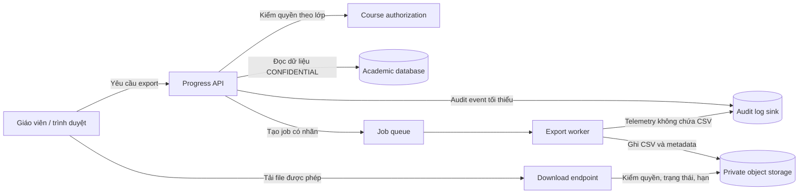
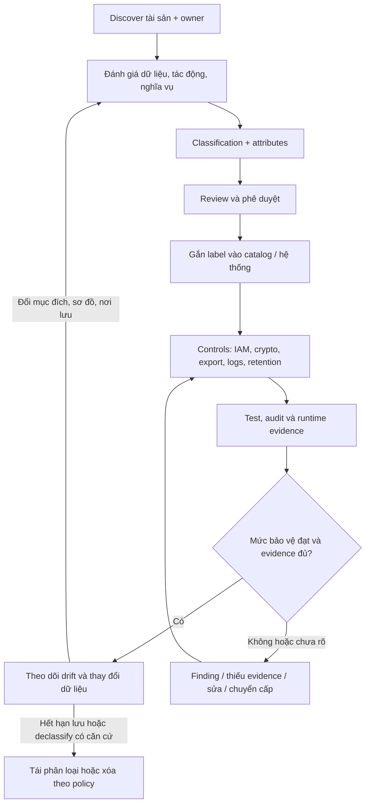

# Phân loại dữ liệu

## Mục tiêu học tập

Sau bài học này, bạn có thể:

- Giải thích **data classification (phân loại dữ liệu)** và phân biệt nó với **data discovery, data labeling, data inventory, data categorization, data retention** và **data loss prevention (DLP)**.
- Xây dựng các mức phân loại phù hợp với **giá trị tài sản, loại dữ liệu, khả năng gây hại khi lộ/sửa/mất và các nghĩa vụ áp dụng**, không coi một bảng nhãn duy nhất là toàn bộ chính sách bảo vệ dữ liệu.
- Phân loại dữ liệu của nền tảng học tập: giáo trình công khai, tài khoản, tiến độ, bảng điểm, hồ sơ định danh, chứng chỉ, secrets, log, bản sao lưu và dữ liệu xuất.
- Thiết kế vòng đời **nhận diện → gán owner → xác định mức/nhãn → thực thi controls → kiểm chứng → xem lại → lưu giữ/xóa**; xử lý dữ liệu dẫn xuất, bản sao và chuyển giao qua trust boundary.
- Viết yêu cầu bảo mật và thiết kế controls truy cập, mã hóa, logging, chia sẻ, export, sao lưu, retention theo **classification** và bối cảnh sử dụng.
- Sử dụng Java/Spring Boot để minh họa việc **lấy nhãn từ nguồn tin cậy ở server**, thực thi quyền theo tài nguyên và kiểm thử những đường dữ liệu nhạy cảm.
- Đánh giá hiệu lực của chương trình phân loại bằng **Claim – Argument – Evidence**, hồ sơ kiểm chứng, finding, khắc phục và đo lường liên tục.

## 1. Phân loại dữ liệu là gì và vì sao cần?

**Phân loại dữ liệu** là quá trình xác định một tập dữ liệu hoặc tài sản dữ liệu cần được **bảo vệ và xử lý theo những yêu cầu nào**, dựa trên bản chất, mục đích sử dụng, hậu quả nếu dữ liệu bị truy cập, tiết lộ, chỉnh sửa, mất hoặc sử dụng trái phép, cùng các ràng buộc áp dụng. Kết quả thường được thể hiện bằng **mức phân loại** (classification level), **nhãn** (label), **thuộc tính** và **quy tắc xử lý** có thể áp dụng cho các bản sao/luồng dữ liệu.

Ví dụ trong nền tảng học tập:

- Trang giới thiệu khóa học đã được cho phép công bố có thể thuộc lớp **công khai**.
- Hướng dẫn thao tác dành riêng cho nhân viên có thể là **nội bộ**.
- Tiến độ học tập gắn với một học viên là **dữ liệu cá nhân**, thường cần hạn quyền truy cập và không được coi là công khai chỉ vì xuất hiện trong một báo cáo.
- Bảng điểm cá nhân hoặc hồ sơ xác minh danh tính có thể cần **bảo vệ cao hơn**, tùy ngữ cảnh rủi ro và nghĩa vụ.
- Khóa ký token, mật khẩu cơ sở dữ liệu và khóa mã hóa là **secrets**; dù không phải dữ liệu học viên, chúng có thể cần lớp bảo vệ nghiêm ngặt nhất vì quyền truy cập vào chúng có thể gây tác động rộng.

Phân loại không trực tiếp chặn một request trái quyền. Nó cung cấp **quy tắc quyết định control nào phải áp dụng** và giúp người kiểm tra xác định **evidence nào là bắt buộc**. Một bảng dữ liệu được dán nhãn `RESTRICTED` mà mọi tài khoản đều có thể đọc không thể được xem là đã bảo vệ đúng.

Trong module **SECURITY_SECURITY_ASSURANCE**, phân loại là cầu nối giữa **mục tiêu bảo mật, risk assessment, chính sách/chuẩn, security controls, test, audit và khắc phục**. Khi kết luận rằng “dữ liệu nhạy cảm đã được bảo vệ”, nhóm phải chỉ ra dữ liệu nào nằm trong phạm vi, vì sao được xếp loại đó, control nào thực thi và kiểm chứng gì hỗ trợ kết luận.

### 1.1. Những thuật ngữ liên quan nhưng không tương đương

| Khái niệm | Câu hỏi được giải quyết | Ví dụ |
| --- | --- | --- |
| **Data discovery** | Dữ liệu nằm ở đâu, được tạo/nhận qua luồng nào? | Tìm bảng `learner_progress`, CSV export, cache, logs và object storage. |
| **Data inventory/catalog** | Có những tài sản dữ liệu nào, ai sở hữu, đang được dùng ở đâu? | Catalog có ID, owner, môi trường, nguồn, bản sao và data flow. |
| **Data categorization** | Dữ liệu thuộc nhóm hoặc chủ đề gì? | Hồ sơ học viên, điểm, thông tin thanh toán, secrets, logs. |
| **Data classification** | Cần mức bảo vệ và hạn chế xử lý nào dựa trên tác động/ràng buộc? | `PUBLIC`, `INTERNAL`, `CONFIDENTIAL`, `RESTRICTED`. |
| **Data labeling/tagging** | Làm sao gắn kết quả phân loại để hệ thống và con người nhận biết? | Metadata `classification: CONFIDENTIAL`, cloud tag hoặc nhãn trên tài liệu. |
| **Data handling standard** | Với từng loại dữ liệu được phép tạo, xem, lưu, truyền, export và xóa như thế nào? | CSV bảng điểm phải hạn quyền, quản lý thời hạn tải và lưu. |
| **DLP** | Có thể phát hiện/ngăn một số đường dữ liệu rời phạm vi được phép không? | Cảnh báo khi người dùng tải dữ liệu nhạy cảm ra kênh không được duyệt. |
| **Retention/disposal** | Lưu trong bao lâu và xóa/ẩn danh ra sao khi hết mục đích? | Tự xóa export hết hạn, quản lý bản sao và backup theo chính sách. |

**Một mã nhãn không thay thế sự hiểu biết về dữ liệu.** Cùng nhãn `CONFIDENTIAL` có thể áp dụng cho bảng điểm và tài liệu hợp đồng, nhưng yêu cầu nghiệp vụ, cơ sở xử lý và quyền xem thực tế khác nhau.

## 2. Tiêu chí xác định mức độ bảo vệ

Đánh giá dữ liệu theo nhiều chiều thay vì chỉ hỏi “có PII hay không”. Các chiều thường gồm:

1. **Confidentiality (bí mật):** nếu người không có quyền xem dữ liệu, hậu quả cho cá nhân, tổ chức và đối tác là gì?
2. **Integrity (toàn vẹn):** nếu dữ liệu bị sửa sai, có ảnh hưởng đến điểm số, chứng chỉ, quyền truy cập hay quyết định nghiệp vụ không?
3. **Availability (sẵn sàng):** mất dữ liệu hoặc không thể truy cập trong một khoảng thời gian gây gián đoạn gì?
4. **Privacy và mục đích xử lý:** dữ liệu có thể liên kết tới người cụ thể? Thuộc loại nhạy cảm hoặc chịu yêu cầu xử lý riêng nào?
5. **Legal/contractual obligations:** có yêu cầu về bảo vệ, vị trí, chuyển giao, lưu giữ, xóa hoặc giới hạn bên nhận không?
6. **Tác động khi kết hợp và suy luận:** dữ liệu không nhạy cảm khi đứng riêng có trở nên nhận diện được khi kết hợp không?
7. **Tính độc quyền/giá trị nghiệp vụ:** lộ đề thi chưa công bố, thuật toán chấm điểm hoặc chiến lược sản phẩm gây thiệt hại gì?
8. **Độ phơi bày, quy mô và vòng đời:** dữ liệu có được công bố theo kế hoạch, export hàng loạt, gửi nhà cung cấp, lưu ở log/backup không?

### 2.1. Không gộp mọi thuộc tính vào một điểm duy nhất

Một bảng điểm có thể có **yêu cầu bí mật cao** do dữ liệu cá nhân, đồng thời **yêu cầu toàn vẹn rất cao** vì thay điểm có thể ảnh hưởng kết quả đào tạo. Dữ liệu backup phục vụ vận hành có thể đòi **khả năng phục hồi** cao dù không được truy cập thường xuyên.

Tổ chức có thể dùng **mức classification chính** để biểu diễn yêu cầu bí mật và **các thuộc tính rủi ro độc lập** cho integrity/availability/privacy:

```text
Data asset: learner-grade-records
Confidentiality class: CONFIDENTIAL
Integrity impact: HIGH
Availability impact: MODERATE
Personal-data flag: YES
Retention rule: linked-to-approved-policy
Owner: academic-records-owner
```

Đây là **cấu trúc minh họa**, không phải một tiêu chuẩn bắt buộc. Nếu chỉ dùng một cột “mức nhạy cảm”, phải làm rõ nó biểu diễn điều gì và không dùng nó thay thế đánh giá các mục tiêu bảo mật khác.

## 3. Ví dụ hệ thống bốn mức phân loại

Một tổ chức có thể thiết kế **bốn mức** như dưới đây, với yêu cầu bảo vệ tăng dần. **Tên và số mức chỉ là ví dụ về taxonomy nội bộ**, không phải quy tắc pháp lý áp dụng cho mọi nơi.

| Mức | Mô tả phạm vi | Ví dụ có điều kiện | Nguyên tắc xử lý |
| --- | --- | --- | --- |
| **PUBLIC – Công khai** | Được chủ dữ liệu cho phép công bố rộng rãi; không còn hạn chế công bố thuộc phạm vi này. | Trang khóa học/FAQ đã duyệt xuất bản. | Bảo đảm toàn vẹn nội dung, kiểm soát thay đổi; không tự coi tài liệu “chưa gắn nhãn” là PUBLIC. |
| **INTERNAL – Nội bộ** | Phục vụ vận hành, chưa được phép chia sẻ công khai; hậu quả tiết lộ thường thấp hơn dữ liệu nhạy cảm. | Hướng dẫn nội bộ, lịch triển khai chưa công bố. | Giới hạn cho nhân sự/tài khoản có nhu cầu, kênh chia sẻ được duyệt. |
| **CONFIDENTIAL – Mật** | Lộ hoặc dùng sai có thể gây tác động đáng kể cho cá nhân/tổ chức. | Tiến độ gắn định danh, bảng điểm cá nhân, thông tin khách hàng theo bối cảnh. | Phân quyền theo tài nguyên, kiểm soát export/chia sẻ, bảo vệ lưu/truyền và audit thích hợp. |
| **RESTRICTED – Hạn chế đặc biệt** | Rủi ro/hậu quả cao hoặc có nghĩa vụ, mục đích và đối tượng truy cập đặc biệt. | Tập dữ liệu identity proofing nhạy cảm, khóa ký, secret production, một số dữ liệu chưa công bố quan trọng. | Quyền rất hẹp, kiểm soát hành động nhạy cảm, bảo vệ khóa/secret, giám sát và quản trị ngoại lệ chặt. |

### 3.1. Các quy tắc nền tảng của taxonomy

- **Không có nhãn không có nghĩa là PUBLIC**. Tài sản chưa phân loại cần trạng thái `UNCLASSIFIED` hoặc `PENDING_REVIEW`, với quy tắc xử lý tạm thời bảo thủ tương xứng rủi ro.
- **PUBLIC phải là quyết định công bố hợp lệ**: một file PDF chưa công bố trong repository nội bộ không tự là dữ liệu công khai.
- **Tác nhân và hành động vẫn quan trọng**: một dữ liệu `CONFIDENTIAL` không có nghĩa mọi nhân viên đăng nhập đều đọc được; cần need-to-know, phân quyền và mục đích.
- **Dữ liệu thuộc diện kiểm soát đặc biệt có thể cần nhiều nhãn**: ví dụ `CONFIDENTIAL` + `PERSONAL_DATA` + `ACADEMIC_RECORD`.
- **Chủ dữ liệu phải hiểu bối cảnh nghiệp vụ**, không chỉ công cụ scan định dạng chuỗi hoặc tên bảng.
- **Hạ mức chỉ bằng quy trình được duyệt**, có đánh giá rủi ro, mục đích, người quyết định và bằng chứng; không để người tạo một bản sao tự chọn nhãn thấp để chia sẻ.

### 3.2. Ví dụ phân loại theo từng tài sản

| Tài sản dữ liệu | Nhãn gợi ý | Bối cảnh cần xét trước khi chốt |
| --- | --- | --- |
| Tên khóa học đã xuất bản | `PUBLIC` | Đã được phép công bố, không kèm thông tin nội bộ chưa duyệt. |
| Kế hoạch bảo trì chưa công bố | `INTERNAL` | Có đường truy cập nhạy cảm, thông tin hạ tầng hoặc lịch an ninh không? |
| Dữ liệu tiến độ học viên có ID | `CONFIDENTIAL` | Có thông tin cá nhân hoặc khả năng liên kết định danh, số lượng bản ghi? |
| File CSV bảng điểm cả lớp | `CONFIDENTIAL` hoặc cao hơn theo bối cảnh | Quy mô, người nhận, trường dữ liệu, mục đích xuất và thời hạn. |
| Hồ sơ xác minh danh tính, tài liệu nhạy cảm | `RESTRICTED` trong ví dụ | Loại bằng chứng, khả năng tổn hại, retention và các ràng buộc xử lý. |
| Secret ký JWT production | `RESTRICTED` | Có thể dùng để giả mạo danh tính/token nếu bị lộ; phải quản lý secret riêng. |
| Access log HTTP | `INTERNAL` hoặc cao hơn | Có chứa user ID, IP, token, tham số hoặc dữ liệu nhạy cảm không? |
| Backup cơ sở dữ liệu học viên | Theo dữ liệu chứa bên trong, thường ít nhất `CONFIDENTIAL` | Backup giữ cả dữ liệu đã xóa, keys, index và nhiều bản ghi hơn màn hình. |
| Báo cáo thống kê lớp đã được tổng hợp | Phải đánh giá trước khi gọi `PUBLIC` | Kích thước nhóm, nguy cơ suy ra danh tính từ các ô nhỏ hoặc dữ liệu liên kết. |

Các nhãn trên là **gợi ý cho tình huống học**. Chủ tài sản và các bên quản trị rủi ro phải quyết định theo taxonomy, ngữ cảnh, nghĩa vụ và phương pháp của tổ chức.

## 4. Discover và lập danh mục dữ liệu trước khi gán nhãn

Không thể bảo vệ một cách có hệ thống nếu tổ chức không biết dữ liệu đang **ở đâu, tồn tại bao nhiêu bản sao và đi qua những hệ thống nào**. Data inventory là nền tảng cho cả phân loại và kiểm chứng.

### 4.1. Các vị trí thường bị bỏ sót

- **Cơ sở dữ liệu chính:** bảng học viên, kết quả học tập, quan hệ đăng ký, bảng quyền và audit.
- **Dịch vụ thứ cấp:** search index, cache, kho analytics, data warehouse và bản sao dùng để lập báo cáo.
- **Object storage:** CSV, PDF, ảnh hồ sơ, tệp đính kèm, file export, tệp chờ cleanup.
- **Thông điệp và queue:** payload job nền, dead-letter queue và event replay.
- **Logs và traces:** URL chứa ID, request body, response body, exception stack, debug snapshots.
- **Backups và snapshots:** bản sao có thể tồn tại lâu hơn dữ liệu đang chạy.
- **Máy của nhân sự:** file CSV đã tải, tài liệu gửi qua email/chat, ticket đính kèm.
- **Nhà cung cấp và đối tác:** xác minh danh tính, analytics, e-mail delivery, lưu trữ và hệ thống báo cáo bên ngoài.
- **Môi trường phát triển/test:** bản sao dữ liệu thật được dùng để kiểm thử hoặc phân tích.

Với mỗi tài sản, cần xác định **owner, custodian/operator, người xử lý, classification, nguồn, vị trí, purpose, retention, danh sách bản sao, trust boundaries và điểm chuyển giao**.

### 4.2. Bản đồ luồng dữ liệu cho một chức năng export



Cần hỏi: **CSV đã nhận nhãn đúng chưa? Queue có chứa bản ghi thật không? Worker dùng quyền storage nào? File xóa khi hết hạn ra sao? URL tải bị chia sẻ ngoài ý muốn có còn truy cập được?** Một nhãn trong DB chưa đủ nếu export sang object storage rồi mất metadata.

### 4.3. Phát hiện tự động và review bằng con người

Công cụ có thể tìm tên cột, pattern định danh, mẫu secrets hoặc loại file để **gợi ý classification**. Nhưng:

- Một chuỗi giống số định danh có thể là dữ liệu test hoặc dữ liệu thật; công cụ cần ngữ cảnh.
- Dữ liệu cá nhân có thể không theo pattern, ví dụ nội dung tự do, ảnh hoặc tổ hợp thuộc tính.
- Một báo cáo đã tổng hợp có thể vẫn suy ra người cụ thể khi nhóm quá nhỏ.
- Dữ liệu đánh dấu thấp trong bảng nguồn có thể trở nên nhạy cảm khi ghép với bảng khác.

Vì thế nên kết hợp **scanner/discovery → gợi ý → owner review → quyết định → gắn nhãn → giám sát thay đổi**, không để detection heuristic tự quyết mọi trường hợp có hậu quả lớn.

## 5. Phân loại theo vòng đời và dữ liệu dẫn xuất

Classification không phải một thao tác chỉ làm lúc tạo bảng mới. Nó phải đi theo **dữ liệu thật** khi dữ liệu được tạo, sao chép, biến đổi, tổng hợp, lưu trữ, chia sẻ và xóa.

### 5.1. Những thời điểm dễ thay đổi mức rủi ro

| Hoạt động | Rủi ro với classification | Biện pháp cần xem xét |
| --- | --- | --- |
| Thu thập | Form nhận thêm trường nhạy cảm không được khai báo. | Review purpose/schema, owner phê duyệt thay đổi mức và retention. |
| Xử lý nội bộ | Join hai dataset làm xuất hiện thuộc tính nhận dạng mới. | Đánh giá lại dữ liệu dẫn xuất và đối tượng truy cập. |
| Ghi log | Debug log vô tình chép số định danh hoặc token. | Log allowlist, masking/redaction, kiểm tra payload thực. |
| Cache/queue | Dữ liệu được lưu tại nơi không có label, TTL hoặc quyền phù hợp. | Cấu hình hạn lưu, quyền, encryption và kiểm soát payload. |
| Export/download | Bản sao rời DB và được tải ra file riêng. | Gán nhãn, permission theo job/tệp, quản lý URL và vòng đời file. |
| Chia sẻ vendor | Trust boundary, chủ xử lý và ràng buộc đổi. | Thẩm định vendor, hợp đồng/điều kiện xử lý, quyền và audit. |
| Backup/restore | Bản sao có data/keys cũ, được phục hồi sang môi trường khác. | Bảo vệ backup, kiểm tra restore, phân loại môi trường đích. |
| Ẩn danh/tổng hợp | Có thể vẫn tái nhận diện hoặc suy luận cá nhân. | Đánh giá hiệu lực xử lý, quy mô nhóm, dữ liệu kết hợp và giới hạn sử dụng. |
| Lưu giữ/xóa | Dữ liệu hết mục đích nhưng vẫn nằm ở snapshots hoặc export. | Retention/deletion policy, chứng cứ xóa theo phạm vi và ngoại lệ lưu hợp lệ. |

### 5.2. Quy tắc cho bản sao và dữ liệu dẫn xuất

Một **quy tắc bảo thủ hữu ích** là: bản sao chứa nội dung nhạy cảm phải kế thừa ít nhất **yêu cầu bảo vệ tương ứng**, trừ khi có đánh giá và biến đổi đủ điều kiện để gán mức mới. Tuy nhiên, không thể chỉ lấy `max(level)` một cách máy móc cho mọi phép biến đổi:

- **Sao chép thuần túy:** CSV chứa toàn bộ điểm có thể cần bảo vệ tương ứng bản ghi gốc.
- **Kết hợp hai nguồn:** dữ liệu dẫn xuất có thể **nhạy cảm hơn** từng nguồn riêng lẻ do tăng khả năng suy luận định danh.
- **Tổng hợp:** báo cáo tổng hợp đủ điều kiện có thể ít nhạy cảm hơn, nhưng phải kiểm chứng nguy cơ suy luận/ngược dữ liệu và các hạn chế áp dụng.
- **Che hoặc thay thế định danh (pseudonymization):** vẫn có thể liên kết lại nếu tồn tại khóa ánh xạ hoặc tổ hợp thuộc tính; không tự gọi là công khai.
- **Ẩn danh hóa đủ hiệu quả:** có thể mở cơ hội phân loại lại theo mục đích, nhưng phải có đánh giá tính không thể nhận diện hợp lý trong bối cảnh dữ liệu và công nghệ liên quan.

**Không đồng nhất encryption với hạ mức classification**: ciphertext bảo vệ dữ liệu trong một số tình huống, nhưng dữ liệu sau giải mã vẫn có yêu cầu xử lý ban đầu và rủi ro có thể quay lại nếu khóa/đầu cuối bị chiếm.

### 5.3. Nhãn phải đi theo dữ liệu qua ranh giới tin cậy

Một hệ thống tốt cần quyết định **nhãn được lan truyền như thế nào** từ DB sang API, job queue, object storage, analytics và đối tác. Ví dụ, nếu API tạo CSV lớp học, metadata của job có thể giữ:

```text
export_id       : internal stable reference
source_asset_id : academic-grades-v1
classification  : CONFIDENTIAL
purpose         : approved-course-report
requester_ref   : trusted authenticated principal
course_scope    : server-validated course ID
expires_at      : approved download/storage expiry
```

Metadata phải được **thiết lập ở backend từ catalog và policy tin cậy**, không tin trường `classification` do client tự gửi. Việc lưu metadata mà không thực thi storage permissions, authz hoặc TTL vẫn là bảo vệ không đầy đủ.

## 6. Ánh xạ classification sang security controls

Các mức phân loại chỉ có ý nghĩa khi tạo được sự khác biệt trong **hành vi vận hành và khả năng kiểm tra**. Ma trận dưới đây là **ví dụ về policy nội bộ**, không phải yêu cầu phổ quát:

| Kiểm soát | PUBLIC | INTERNAL | CONFIDENTIAL | RESTRICTED |
| --- | --- | --- | --- | --- |
| **Công bố** | Chỉ sau khi có quyết định xuất bản. | Không tự công khai. | Chia sẻ đúng đối tượng và mục đích được duyệt. | Giới hạn đặc biệt và phê duyệt bổ sung theo chính sách. |
| **Access control** | Kiểm soát thay đổi nội dung. | Tài khoản nội bộ có nhu cầu. | Least privilege, quyền theo tài nguyên và ngữ cảnh. | Quyền rất hẹp, theo dõi đặc quyền và cân nhắc SoD/JIT. |
| **Data transfer** | Kênh phù hợp và bảo toàn integrity. | Kênh chia sẻ được phê duyệt. | Bảo vệ đường truyền, kiểm tra người nhận/đích và phạm vi. | Hạn chế đích, tăng kiểm chứng nguồn/đích và giám sát. |
| **At rest** | Bảo vệ toàn vẹn và khả dụng theo nhu cầu. | Controls lưu trữ phù hợp. | Mã hóa/kiểm soát truy cập phù hợp với policy và threat model. | Quản trị khóa nghiêm ngặt, truy cập đặc biệt và giám sát hoạt động. |
| **Logging** | Ghi thay đổi nội dung khi cần. | Truy vết hành vi quản trị. | Audit truy cập/hành động nhạy cảm, không log dữ liệu thô không cần. | Audit chặt, cảnh báo đường truy cập/di chuyển trái phạm vi. |
| **Export/retention** | Theo chính sách công bố. | Theo nhu cầu nghiệp vụ. | Export có hạn, dữ liệu tối thiểu, quy tắc chia sẻ và xóa. | Chỉ export khi có căn cứ và điều kiện được duyệt; theo dõi đặc biệt. |
| **Incident handling** | Xử lý sửa nội dung/gián đoạn. | Đánh giá phơi bày nội bộ. | Ưu tiên bảo vệ dữ liệu cá nhân/tài sản và điều tra truy cập. | Chuyển cấp và kiểm soát ảnh hưởng theo mức rủi ro cao. |

Không có quy tắc rằng dữ liệu công khai thì **không cần security**: tính toàn vẹn của trang public, chống sửa trái phép, availability và chống phát tán nội dung giả vẫn quan trọng.

### 6.1. Hai lớp kiểm soát phải phân biệt

**Classification decision** nói “tài sản này cần bảo vệ ở mức nào”. **Authorization decision** nói “chủ thể này có được phép hành động này trên tài sản này không”. Chủ thể là giáo viên đã đăng nhập vẫn không có quyền xuất điểm của lớp khác dù cả hai lớp có nhãn `CONFIDENTIAL`.

Một cơ chế nên xét:

```text
ALLOW = identity_is_trusted
        AND subject_is_authorized_for(resource, action)
        AND classification_handling_rules_are_satisfied
        AND context_is_permitted
```

Đây là **mô hình quyết định**, không phải mã hoàn chỉnh. Nếu dịch vụ không lấy được nhãn hoặc quan hệ quyền từ nguồn tin cậy, cần xử lý `UNKNOWN/INSUFFICIENT_EVIDENCE` theo policy, không tự gán `PUBLIC` để tiếp tục.

### 6.2. Data minimization khác classification

Giảm lượng dữ liệu xử lý thường giảm hậu quả khi xảy ra sự cố, nhưng một trường dữ liệu rất nhạy cảm vẫn có thể được bảo vệ ở mức cao dù chỉ có một bản ghi. Ngược lại, việc export hàng triệu bản ghi có thể làm tăng tác động so với đọc một hồ sơ, dù các bản ghi có cùng nhãn.

Vì vậy cần kết hợp **phân loại theo loại/tác động dữ liệu** và **giới hạn theo số lượng, mục đích, phạm vi người nhận và hành động**.

## 7. Quản trị, trách nhiệm và quy trình quyết định

### 7.1. Ai làm gì?

| Vai trò | Trách nhiệm chính | Bằng chứng và quyết định |
| --- | --- | --- |
| **Data owner / business owner** | Hiểu mục đích, loại dữ liệu, tác động nghiệp vụ; phê duyệt mức/đối tượng xử lý theo thẩm quyền. | Classification decision, lý do, danh sách người dùng hợp lệ. |
| **Data steward/custodian** | Duy trì catalog, lineage, chất lượng metadata và phân phối chính sách xử lý. | Inventory, nhãn, cập nhật dữ liệu và kiểm tra completeness. |
| **Security/Risk** | Xác định threat scenarios, policy, risk limits, biện pháp bảo vệ và khoảng trống. | Risk assessment, control mapping, escalation. |
| **Privacy/Legal/Compliance** | Đánh giá nghĩa vụ xử lý dữ liệu theo bối cảnh, giới hạn mục đích, lưu giữ/chia sẻ. | Yêu cầu áp dụng, nhận xét và phê duyệt khi cần. |
| **Developer/architect** | Thiết kế metadata, access control, luồng export, masking/logging theo classification. | Design, code review, integration tests. |
| **Operator/platform** | Quản lý IAM, bucket policy, encryption, backup, monitoring và cấu hình runtime. | IaC, runtime snapshots, drift checks. |
| **Assurance reviewer/auditor** | Xác minh chất lượng classification, phạm vi, hiệu lực controls và evidence. | Kết luận PASS/FAIL/thiếu evidence, findings, test samples. |
| **Risk owner** | Quyết định xử lý residual risk thuộc thẩm quyền và các ngoại lệ khi được policy cho phép. | Risk decision, điều kiện và hạn xem lại. |

Một cá nhân có thể có nhiều vai trò trong đội nhỏ, nhưng **tự hạ classification rồi tự duyệt mở truy cập** có thể tạo xung đột lợi ích. Cần mức độc lập và kiểm soát bù trừ phù hợp rủi ro.

### 7.2. Quy trình phân loại theo các bước

1. **Xác định mục đích và asset:** dữ liệu được tạo/nhận để làm gì, ai có quyền quyết định?
2. **Discover/inventory:** tìm nơi tồn tại, các bản sao, loại dữ liệu, luồng, hệ thống nhận và môi trường.
3. **Đánh giá hậu quả và nghĩa vụ:** confidentiality, integrity, availability, privacy, hợp đồng và dữ liệu kết hợp.
4. **Chọn class/attributes:** theo taxonomy được duyệt; ghi lý do và độ không chắc chắn.
5. **Review/phê duyệt:** data owner, Security/Privacy và vai trò có thẩm quyền theo mức độ.
6. **Gắn nhãn và phân phối:** cập nhật catalog, metadata của dataset/export và hướng dẫn xử lý cho các hệ thống liên quan.
7. **Ánh xạ controls:** IAM, authorization, encryption, logging, retention, DLP, backup và quản trị khóa theo requirement.
8. **Kiểm chứng design/runtime:** tests và cấu hình thực phản ánh nhãn và chính sách; ghi evidence theo phiên bản/môi trường.
9. **Theo dõi thay đổi:** tạo trigger khi thêm trường, thay mục đích, tạo bản sao, chuyển vendor, công bố báo cáo hoặc phát hiện incident.
10. **Reclassification/disposal:** xem xét lại theo thẩm quyền, xử lý dữ liệu dẫn xuất, bản sao, retention và lưu dấu vết quyết định.



## 8. Thực thi classification trong Java/Spring Boot

### 8.1. Bối cảnh nghiệp vụ

Ứng dụng `learning-progress-api` cung cấp `POST /api/courses/{courseId}/grades/exports` để giáo viên xuất bảng điểm. Dữ liệu điểm được gắn `CONFIDENTIAL` theo catalog; một tập hồ sơ xác minh danh tính có thể thuộc `RESTRICTED` và **không** được export bằng chức năng này.

**Các yêu cầu kiểm chứng minh họa:**

| ID | Yêu cầu | Kiểm chứng |
| --- | --- | --- |
| `DP-CLASS-01` | Mỗi dataset xử lý ở production phải có owner, classification và purpose do nguồn tin cậy quản lý. | Catalog review và reconciliation với dữ liệu/runtime. |
| `DP-AUTHZ-02` | Export dữ liệu điểm chỉ được thực hiện bởi chủ thể có quyền với lớp và hành động cụ thể. | Test lớp được phân công/không được phân công; test tài nguyên chéo. |
| `DP-HAND-03` | Dataset `RESTRICTED` không được xuất qua đường báo cáo thông thường nếu thiếu điều kiện phê duyệt riêng. | Test từ chối, kiểm tra cấu hình và workflow approval theo policy. |
| `DP-EXPORT-04` | Tệp xuất được gán nhãn, giới hạn truy cập và lưu trong hạn được duyệt; không có đường tải công khai ngoài policy. | Review storage IAM, URL/download tests, TTL/cleanup và logs. |
| `DP-LOG-05` | Audit event phải có định danh và kết quả xử lý nhưng không sao chép dữ liệu bảng điểm hay secret không cần thiết. | Test log end-to-end, kiểm tra payload/retention/quyền. |

Các ID và tiêu chí là **ví dụ học tập**, không phải điều khoản chuẩn bên ngoài.

### 8.2. Model phân loại và enforcement phía server

Ví dụ Java mô tả những mức phân loại:

```java
public enum DataClass {
    PUBLIC,
    INTERNAL,
    CONFIDENTIAL,
    RESTRICTED
}

public record DataAssetLabel(
        String assetId,
        DataClass classification,
        String ownerRef,
        String purpose
) {}
```

Nhãn thực tế phải được lưu/đọc từ **nguồn có quyền quản trị**. Một enum chỉ định nghĩa kiểu dữ liệu, không tự bảo vệ các hàng trong database. Ví dụ Spring Security đặt điểm kiểm tra ở service:

```java
@Configuration
@EnableMethodSecurity
class MethodSecurityConfig {}

@Service
class CourseGradeExportService {
    private final GradeExportJobRepository jobs;

    CourseGradeExportService(GradeExportJobRepository jobs) {
        this.jobs = jobs;
    }

    @PreAuthorize("@gradeExportPolicy.canRequest(authentication, #courseId)")
    public ExportJobId requestExport(long courseId) {
        return jobs.enqueue(courseId);
    }
}
```

`gradeExportPolicy` là **bean giả định**; nó không được chỉ kiểm `hasRole('TEACHER')`, mà phải xác minh quyền theo lớp, dữ liệu, nhãn và hành động ở server. Một minh họa về logic ra quyết định:

```java
@Component("gradeExportPolicy")
class GradeExportPolicy {
    private final CourseAssignmentRepository assignments;
    private final DataAssetLabelRepository labels;

    GradeExportPolicy(CourseAssignmentRepository assignments,
                      DataAssetLabelRepository labels) {
        this.assignments = assignments;
        this.labels = labels;
    }

    public boolean canRequest(Authentication auth, long courseId) {
        if (auth == null || !auth.isAuthenticated()
                || auth instanceof AnonymousAuthenticationToken) {
            return false;
        }
        if (!assignments.isActiveTeacher(auth.getName(), courseId)) {
            return false;
        }

        DataAssetLabel label = labels.forCourseGrades(courseId);
        if (label == null || label.classification() == null) {
            return false; // Không tự xem dữ liệu chưa phân loại là PUBLIC.
        }

        // Chính sách ví dụ chỉ cho luồng này xuất dữ liệu CONFIDENTIAL.
        return label.classification() == DataClass.CONFIDENTIAL;
    }
}
```

Các repository, DTO và chính sách là **mã minh họa**, không phải API dựng sẵn. Ở hệ thống thật phải xem tenant, vai trò, mục đích, phiên đã xác thực, nguồn danh tính ổn định, trạng thái khóa tài khoản và phân quyền tải kết quả. Nếu dataset `RESTRICTED`, ví dụ **từ chối ở luồng thông thường**, thay vì “hạ nhãn” để cho phép export.

**Giới hạn quan trọng:** `@PreAuthorize` chỉ bảo vệ những lời gọi đi qua proxy và điểm thực thi liên quan; không thay thế kiểm quyền khi worker xử lý job, khi tải tệp hay khi truy cập trực tiếp storage. Metadata client gửi như `classification=PUBLIC` **không** được dùng để ghi đè nhãn từ catalog.

### 8.3. Kiểm thử positive và negative

Giả sử fixtures xác định lớp `42` có dữ liệu `CONFIDENTIAL`, giáo viên `teacher-a` được phân công, `teacher-b` không được phân công; lớp `99` chứa dữ liệu ngoài scope export tiêu chuẩn:

```java
@SpringBootTest
@AutoConfigureMockMvc
class GradeExportClassificationIT {
    @Autowired
    MockMvc mockMvc;

    @Test
    @WithMockUser(username = "teacher-a", roles = "TEACHER")
    void assignedTeacherCanRequestApprovedExport() throws Exception {
        mockMvc.perform(post("/api/courses/42/grades/exports")
                .with(csrf()))
            .andExpect(status().isAccepted());
    }

    @Test
    @WithMockUser(username = "teacher-b", roles = "TEACHER")
    void anotherTeacherCannotExportClassGrades() throws Exception {
        mockMvc.perform(post("/api/courses/42/grades/exports")
                .with(csrf()))
            .andExpect(status().isForbidden());
    }

    @Test
    @WithMockUser(username = "teacher-a", roles = "TEACHER")
    void restrictedDatasetIsNotExportedThroughNormalFlow() throws Exception {
        mockMvc.perform(post("/api/courses/99/grades/exports")
                .with(csrf()))
            .andExpect(status().isForbidden());
    }
}
```

Ví dụ giả định Spring Security/MockMvc, controller, fixture và method security đã được cấu hình. `csrf()` là thành phần kiểm thử khi ứng dụng sử dụng CSRF protection. Với test cuối, fixture phải đảm bảo **teacher-a thực sự có quyền với lớp 99** nhưng dataset bị phân loại `RESTRICTED`; nếu không, test có thể trả `403` chỉ vì thiếu quyền theo lớp và **không chứng minh classification gate hoạt động**.

Cần thêm ca: nhãn **không tồn tại/không chắc chắn**, dữ liệu vừa nâng mức, đổi owner, export batch, job cũ, download `exportId` của người khác, quyền bị thu hồi và tệp đã hết hạn. Kiểm tra rằng **job không được tạo và dữ liệu không rò qua response/log** trong các ca từ chối. Test ở ứng dụng không kiểm chứng được chính sách bucket/IAM nên vẫn phải xác minh trên hạ tầng.

## 9. Bảo vệ log, cache, backups và các bản sao khó nhìn thấy

### 9.1. Logs và observability

Logs có thể chứa **định danh người dùng, địa chỉ mạng, token, query string, nội dung request, stack trace và thông tin tài sản**. Một log sink không tự có nhãn thấp chỉ vì tên là `application.log`.

Nên thiết kế:

- **Allowlist** các trường audit cần thiết (subject ref, action, resource ref, outcome, timestamp, correlation ID).
- Tránh log credential, token, nội dung bảng điểm hoặc tài liệu proofing ở dạng thô.
- Hạn chế quyền xem/sửa/xóa logs theo nhiệm vụ; bảo vệ luồng truyền và lưu trữ.
- Thiết lập thời hạn lưu và xem cả log trong backup, export dashboard, ticket và hệ thống bên ngoài.
- Kiểm thử từ **event nguồn đến log sink**, xác nhận payload không chứa dữ liệu cấm và alert về pipeline lỗi.

**Masking** hỗ trợ giảm phơi bày nhưng không đảm bảo ẩn danh; nếu vẫn nối được bản ghi tới người dùng qua ID, logs có thể vẫn là dữ liệu cá nhân.

### 9.2. Cache và queue

Một queue có job export có thể mang dữ liệu gốc hoặc chỉ tham chiếu tới tài nguyên. Trong mọi trường hợp cần:

- Phân loại payload và metadata theo dữ liệu có thể bị lộ.
- Giới hạn quyền produce/consume, DLQ, debug viewer và reprocess.
- Không ghi toàn bộ payload vào error logs mặc định.
- Thiết lập TTL/retention phù hợp, kiểm soát replay và kiểm tra sau khi thay schema.
- Đánh giá trường hợp quyền người dùng thay đổi **sau khi job đã vào queue** nhưng trước khi worker xử lý.

### 9.3. Backups và môi trường kiểm thử

Backup **không ít nhạy cảm hơn** dữ liệu gốc chỉ vì được mã hóa hoặc lưu offline. Nó có thể chứa cả các bản ghi đã xóa khỏi hệ thống chính. Cần phân quyền, mã hóa/khóa, retention, thử restore và kiểm soát việc phục hồi vào môi trường ít bảo vệ hơn.

Không nên sao chép nguyên dữ liệu học viên thật vào test/staging khi không cần. Có thể sử dụng **dữ liệu tổng hợp giả lập**, dữ liệu test tự tạo hoặc biến đổi được đánh giá phù hợp. Nếu cần dữ liệu thực vì mục tiêu kiểm chứng, phải có căn cứ, môi trường và controls tương xứng.

## 10. Mã hóa, ẩn danh hóa và DLP: vai trò và giới hạn

### 10.1. Encryption không phải classification

Mã hóa khi truyền hoặc khi lưu có thể giảm nguy cơ dữ liệu bị đọc trên một số đường tấn công. Nhưng:

- Dịch vụ có khóa giải mã và quyền truy cập quá rộng vẫn có thể làm lộ dữ liệu.
- Mã hóa không xác định dữ liệu được phép gửi tới **người nhận nào**.
- Dữ liệu bị sửa có thể cần cơ chế bảo vệ tính toàn vẹn/xác thực riêng tùy thiết kế, không chỉ mã hóa.
- Keys và secrets cần chủ, phân quyền, xoay/thu hồi, audit và kiểm chứng phục hồi; khóa bị lộ có thể làm mất hiệu lực lợi ích mã hóa.

Vì vậy, **phân loại quyết định yêu cầu bảo vệ**, còn encryption là một trong nhiều controls để đáp ứng chúng.

### 10.2. Pseudonymization, anonymization và aggregation

| Phương pháp | Ví dụ | Điều phải kiểm tra |
| --- | --- | --- |
| **Masking** | Chỉ hiển thị một phần địa chỉ email trên UI. | Trường đầy đủ có còn trong API, log hoặc export không? |
| **Pseudonymization** | Thay mã học viên bằng token có bảng ánh xạ riêng. | Có thể tái liên kết? Ai giữ mapping? Dữ liệu kết hợp có nhận dạng được không? |
| **Anonymization** | Biến đổi dữ liệu đủ để không thể nhận diện một cách hợp lý theo bối cảnh đánh giá. | Đánh giá nguy cơ tái nhận diện, nguồn phụ trợ và tính ổn định theo thời gian. |
| **Aggregation** | Thống kê tỷ lệ hoàn thành theo nhóm. | Nhóm nhỏ hoặc so sánh nhiều báo cáo có suy ra điểm cá nhân không? |
| **Synthetic data** | Tạo hồ sơ giả phục vụ integration test. | Dữ liệu có vô tình sao chép thuộc tính thật hoặc tiết lộ dữ liệu huấn luyện không? |

**Không tự gán PUBLIC** sau khi xóa một cột `full_name`. Tổ hợp lớp học nhỏ, điểm số, mốc thời gian hoặc mã có thể cho phép tái nhận diện. Phải có review phù hợp mục đích và nguy cơ dựa trên tập dữ liệu thực.

### 10.3. DLP là một lớp kiểm soát bổ trợ

DLP có thể phát hiện hoặc chặn một số trường hợp sao chép/chia sẻ dữ liệu theo nhãn, pattern hoặc kênh. Nhưng nó có thể bỏ sót file đã mã hóa, ảnh, bản ghi đã biến đổi hoặc luồng nghiệp vụ không được quan sát. Vì vậy vẫn cần **authorization ở nguồn, data minimization, chia quyền đích, giám sát export và đào tạo/xử lý ngoại lệ**.

## 11. Hồ sơ phân loại và bằng chứng kiểm toán

### 11.1. Một bản ghi metadata được quản lý

Mẫu YAML sau là **ví dụ học tập**, không phải output scanner đã xác minh:

```yaml
asset_id: "academic-grades-v1"
name: "Course grades and learner progress"
owner_role: "academic-records-owner"
custodian_roles: ["learning-service-operator", "data-steward"]
classification:
  confidentiality: "CONFIDENTIAL"
  integrity_impact: "HIGH"
  availability_impact: "MODERATE"
  flags: ["PERSONAL_DATA", "ACADEMIC_RECORD"]
  taxonomy_revision: "<approved-taxonomy-version>"
  rationale: "Identifiable course results with academic consequences"
  approved_by_role: "authorized-data-owner"
  approved_at: "<decision-timestamp>"
purpose: "Teaching, assessment and authorized reporting"
systems:
  primary: ["learning-db"]
  derived: ["grade-export-worker", "object-storage-export"]
  inspect_for_copies: ["queue", "cache", "logs", "backup", "analytics"]
allowed_processing:
  - "Authorized learner/progress lookup"
  - "Class-scoped export after server-side authorization"
controls:
  - "Object-level access control"
  - "Private storage and scoped workload IAM"
  - "Audited export and time-bound retention"
retention_policy_ref: "<approved-retention-policy>"
evidence_refs:
  - "<catalog-review-record>"
  - "<authorization-test-artifact>"
  - "<storage-runtime-review>"
open_findings: []
assurance_state: "INSUFFICIENT_EVIDENCE"
uncertainties:
  - "Existing analytics copy not yet classified"
reassess_on:
  - "New fields, export destination or purpose"
  - "Vendor, data flow or retention change"
```

Không ghi `PASS` chỉ vì YAML có nhãn. Bằng chứng cần **tồn tại**, có nguồn gốc, thời gian, phiên bản, môi trường, phạm vi, kết quả và người kiểm tra. Metadata cũng có thể chứa thông tin hệ thống nhạy cảm; cần bảo vệ quyền đọc và sửa phù hợp.

### 11.2. Claim – Argument – Evidence

**Claim:** “Trên bản phát hành `R` và các luồng đã kiểm kê, dữ liệu điểm học viên được phân loại nhất quán theo policy đã phê duyệt; những đường đọc, export, lưu file và logging có controls phù hợp với nhãn và quyền nghiệp vụ.”

**Argument:**

1. Inventory bao phủ các nguồn, bản sao và data flows thuộc phạm vi, có owner và quyết định classification được quản lý.
2. Các bản sao/dẫn xuất giữ nhãn hoặc được đánh giá lại có căn cứ, không tự hạ nhãn khi export.
3. Ứng dụng thực thi **phân quyền theo tài nguyên** cùng các quy tắc xử lý theo classification ở server.
4. Queue, worker, storage, logging và retention có controls tương ứng, được kiểm chứng trên môi trường mục tiêu.
5. Findings, ngoại lệ và dữ liệu chưa phân loại được ghi riêng, không làm báo cáo tổng thể có vẻ đạt nếu chưa đủ bằng chứng.

**Evidence matrix:**

| Nội dung cần chứng minh | Bằng chứng gợi ý | Giới hạn cần nêu |
| --- | --- | --- |
| Coverage của dữ liệu | Inventory, nguồn discovery, đối chiếu schema/asset, bản đồ data flow. | Scanner có thể bỏ sót cache, local export, vendor hoặc dữ liệu không cấu trúc. |
| Nhãn/owner hợp lệ | Quyết định owner, taxonomy revision, lý do và review thay đổi. | Nhãn có thể lỗi thời khi dữ liệu kết hợp hoặc thay mục đích. |
| Phân quyền dữ liệu | Negative/positive authorization tests theo user, role, class, tenant và resource. | Test pass trên staging chưa chứng minh production hoặc các endpoint phụ. |
| Export và bản sao | Job metadata, bucket policy, IAM runtime, URL/download/TTL/cleanup tests. | Tệp tải về máy người dùng có đường xử lý riêng cần đánh giá. |
| Logging/retention | Event-to-sink tests, payload review, lifecycle jobs và kết quả xóa. | Không thấy dữ liệu trong một mẫu log không chứng minh mọi đường ghi an toàn. |
| Quy trình/quyết định | Owner approvals, exceptions, findings và re-tests. | Chữ ký/approval không thay thế kiểm tra hiệu lực kỹ thuật. |

**Giới hạn claim:** Nếu chưa rà soát kho analytics hoặc toàn bộ bản sao export cũ, không được kết luận “mọi bản sao dữ liệu nhạy cảm đều được phân loại đúng”. Có thể đưa ra claim hẹp cho phạm vi đã xác minh và ghi rõ `INSUFFICIENT_EVIDENCE` ở phần còn lại.

## 12. Kiểm tra liên tục, audit và quản lý sai lệch

### 12.1. Phân biệt thiết kế, triển khai và hoạt động

| Lớp assurance | Câu hỏi | Cách kiểm tra |
| --- | --- | --- |
| **Design effectiveness** | Taxonomy và handling rules có giảm đúng rủi ro của tài sản không? | Risk/threat review, policy mapping, data-flow và control design. |
| **Implementation** | Nhãn và controls có được áp dụng ở các điểm dữ liệu thật đi qua không? | Code/config review, metadata propagation, IAM/storage policies. |
| **Operating effectiveness** | Khi chạy thực, request trái quyền, export, log, backup và retention có đáp ứng không? | Security tests, runtime evidence, log end-to-end, audit sampling. |
| **Continuous assurance** | Khi schema, chức năng, vendor hoặc luật/chuẩn áp dụng đổi, kết luận có được xem lại không? | Change triggers, drift detection, finding, remediation, re-test. |

### 12.2. Trạng thái kết luận

| Trạng thái | Nghĩa | Xử lý |
| --- | --- | --- |
| **PASS trong phạm vi** | Có bằng chứng phù hợp cho yêu cầu classification/handling ở bản và môi trường đã kiểm. | Ghi rõ scope, thời điểm, residual risk và tiếp tục giám sát. |
| **FAIL** | Phát hiện sai lệch đã được kiểm chứng, ví dụ file `CONFIDENTIAL` bị truy cập công khai. | Tạo finding, đánh giá tác động, cô lập/khắc phục theo thẩm quyền, re-test. |
| **INSUFFICIENT_EVIDENCE** | Dữ liệu chưa được kiểm kê, nhãn không xác định hoặc test/runtime thiếu thông tin. | Xác định owner và bổ sung bằng chứng; chưa kết luận đạt. |
| **EXCEPTION_APPLIED** | Có quyết định sai khác nội bộ hợp lệ trong phạm vi và thời hạn được phép. | Theo dõi residual risk/compensating controls, không gộp với PASS. |

Một file bị lộ nhãn `CONFIDENTIAL` ở nơi công khai là **control failure** đã có bằng chứng; nhưng chưa thể tự khẳng định đã có người ngoài truy cập hoặc dữ liệu bị khai thác nếu chưa điều tra. Cần bảo toàn log, xác định thời gian/phạm vi phơi bày và kích hoạt incident response khi có căn cứ.

### 12.3. Khi nào phải phân loại lại hoặc kiểm tra lại?

- Thêm cột, bảng, ảnh, hồ sơ hoặc loại dữ liệu mới vào ứng dụng.
- Hợp nhất nguồn dữ liệu hoặc thay thuật toán tạo báo cáo làm tăng khả năng suy luận định danh.
- Thêm export, cache, queue, analytics, backup, nhà cung cấp hoặc vùng lưu trữ.
- Thay quyền, role, tenant, IdP, bucket policy hoặc nguồn classification metadata.
- Dữ liệu trước đây nội bộ được quyết định công bố hoặc mục đích xử lý thay đổi.
- Phát hiện data loss, log chứa secrets, sai lệch IAM hoặc retention chưa thực thi.
- Ban hành taxonomy, chuẩn handling hoặc nghĩa vụ mới có ảnh hưởng tới tài sản.

Không nên dùng kết quả classification từ nhiều năm trước như kết luận hiện tại khi luồng dữ liệu đã thay đổi đáng kể.

## 13. Đo lường chương trình phân loại

| KPI/KRI | Câu hỏi quản trị | Cần diễn giải thận trọng |
| --- | --- | --- |
| Tỷ lệ tài sản trong phạm vi có owner, classification và purpose được duyệt | Có biết ai chịu trách nhiệm và xử lý theo chính sách nào không? | Tỷ lệ chỉ đúng nếu inventory đủ bao phủ. |
| Số tài sản `UNCLASSIFIED` hoặc không rõ owner | Khoảng trống quản trị đang ở đâu? | Không gán mặc định PUBLIC để làm KPI xanh. |
| Tỷ lệ luồng export có metadata/label và review quyền tải | Nhãn có theo dữ liệu qua bản sao quan trọng không? | Có metadata không chứng minh IAM/TTL thực sự hoạt động. |
| Số trường hợp nhãn nguồn và dữ liệu đích không khớp | Có mất nhãn khi biến đổi/chuyển giao không? | Cần phân biệt declassification hợp lệ và drift trái phép. |
| Tỷ lệ thay đổi schema/luồng dữ liệu đã trigger reclassification review | Classification có theo kịp thay đổi không? | Phải kiểm population từ changes ngoài Git, như vendor config. |
| Số log/export/backup chứa dữ liệu ngoài chính sách | Có vi phạm data minimization hoặc handling rules không? | Scanner có false positive/negative, cần xác minh. |
| Số finding DLP, lưu giữ hoặc IAM quá hạn | Việc phát hiện đã chuyển thành xử lý chưa? | Ít findings không chứng minh ít rủi ro nếu detection yếu. |
| Tỷ lệ kiểm tra xóa/retention đạt theo scope | Dữ liệu được dọn đúng sau khi hết mục đích không? | Cần xem bản sao, index, queue, backup và bên nhận theo phạm vi. |
| Số ngoại lệ phân loại/handling sắp hết hạn | Sai khác tạm có đang được theo dõi không? | Ngoại lệ vẫn có residual risk, không tính thành PASS kỹ thuật. |

Nên ưu tiên **chỉ số gắn hành động**: đối tượng có rủi ro cao nhưng chưa phân loại, bản sao vượt chính sách, quyền truy cập thừa và thời gian xử lý finding. Một dashboard “100% assets labeled” không có giá trị nếu nó chỉ đếm tài sản mà scanner dễ thấy.

## 14. Những sai lầm thường gặp

| Sai lầm | Hệ quả | Cách cải thiện |
| --- | --- | --- |
| “Cứ có PII là RESTRICTED, không cần xem bối cảnh.” | Taxonomy không phản ánh tác động, mục đích và controls thực tế. | Xem loại dữ liệu, hậu quả, quy mô, nghĩa vụ và các thuộc tính bổ sung. |
| “Không gắn nhãn nghĩa là PUBLIC.” | Dữ liệu chưa review bị chia sẻ rộng. | Dùng `UNCLASSIFIED/PENDING_REVIEW` với quy tắc xử lý tạm thời bảo thủ. |
| “Tên file/bảng quyết định classification.” | Mất thông tin nhạy cảm trong payload/log không có tên gợi ý. | Discovery và review nội dung/luồng dữ liệu theo phạm vi được phép. |
| “Dán nhãn CONFIDENTIAL là bảo vệ xong.” | IAM, API và bucket vẫn có thể mở quyền. | Ánh xạ labels sang controls và test effective permissions. |
| “Mã hóa giúp hạ nhãn thành PUBLIC.” | Endpoint có khóa hoặc user hợp lệ vẫn có thể lộ dữ liệu. | Giữ yêu cầu xử lý của nội dung; đánh giá encryption như control riêng. |
| “CSV xuất ra không còn thuộc chính sách của DB.” | Bản sao mất nhãn, quyền hoặc TTL. | Propagate label, owner, purpose, storage policy và audit. |
| “Aggregate là ẩn danh tuyệt đối.” | Nhóm nhỏ hoặc kết hợp nguồn giúp tái nhận diện. | Đánh giá re-identification theo ngữ cảnh và phê duyệt phân loại lại. |
| “Token đã che trong log nên log không chứa dữ liệu cá nhân.” | ID, IP, query, correlation và thông tin khác vẫn liên kết cá nhân. | Kiểm tra payload, giảm dữ liệu và bảo vệ log sink. |
| “Backup mã hóa không cần hạn truy cập.” | Tài khoản/khóa bị lộ có thể làm lộ toàn bộ dữ liệu nguồn. | IAM, key management, retention, restore drill và giám sát. |
| “Scanner PASS nghĩa là không còn dữ liệu nhạy cảm ngoài catalog.” | Công cụ không bao phủ tất cả vị trí/format. | Đối soát discovery, sampling và nguồn nghiệp vụ. |
| “Đã sửa source code nên production hết rủi ro.” | Bản triển khai, policy cloud hoặc file export cũ vẫn có thể sai. | Kiểm tra runtime, remediation và các bản sao. |
| “Một ngoại lệ được duyệt làm control FAIL thành PASS.” | Báo cáo che residual risk. | Ghi ngoại lệ có phạm vi/hạn riêng; re-test trước khi xác nhận khắc phục. |

## 15. Bài tập tình huống: phân loại dữ liệu khi thêm chức năng báo cáo

**Bối cảnh:** nền tảng học tập Spring Boot lưu hồ sơ học viên, điểm, dữ liệu đăng ký khóa học và chứng chỉ. Đội sản phẩm phát hành chức năng “Báo cáo cho giáo viên”:

1. Bảng điểm trong DB được gắn `CONFIDENTIAL`, nhưng CSV export **không có classification metadata**.
2. API chỉ kiểm role `TEACHER`, không xác minh quyền trên lớp; một người có thể thay `courseId` để yêu cầu báo cáo lớp khác.
3. Export worker ghi CSV vào bucket có chính sách quyền đọc rộng hơn DB. URL tải có hiệu lực dài hơn nhu cầu và không có cơ chế thu hồi khi giáo viên mất phân công.
4. Để debug lỗi export, ứng dụng log toàn bộ payload chứa mã học viên, điểm và địa chỉ email.
5. Nhóm analytics ghép bảng điểm với dữ liệu tham gia buổi học; sau đó gọi báo cáo tổng hợp là `PUBLIC` vì đã bỏ cột họ tên.
6. Bản sao DB production được đưa sang staging để test, không có owner hoặc retention rõ ràng.
7. Dashboard catalog vẫn báo “100% classified” vì chỉ đếm các bảng trong DB chính.

### 15.1. Yêu cầu thực hành

1. Lập inventory tối thiểu cho **DB, API, queue/job, CSV, bucket, log, analytics, backup và staging**, chỉ ra owner, data flow và trust boundary.
2. Đề xuất classification và các attributes cần giữ cho từng tài sản; giải thích vì sao bản sao CSV hoặc DB staging không tự hạ nhãn.
3. Viết ít nhất **năm risk scenarios** về confidentiality, integrity, privacy, data retention hoặc availability.
4. Thiết kế lại phân quyền **theo lớp** và classification gate, bao gồm trường hợp dữ liệu `RESTRICTED` hoặc chưa có nhãn.
5. Định nghĩa các controls kiểm chứng được cho object storage, URL tải, log payload, queue và dữ liệu analytics tổng hợp.
6. Chọn ít nhất **sáu phép kiểm tích cực/tiêu cực** và nêu evidence cần giữ: API authz, nhãn bản sao, IAM runtime, thời hạn download, logging, xóa và re-identification review.
7. Viết **Claim – Argument – Evidence** cho lời khẳng định “dữ liệu bảng điểm chỉ được chia sẻ cho người có quyền” và nêu rõ phần chưa được chứng minh.
8. Dashboard “100% classified” có còn đáng tin? Hãy thiết kế lại **mẫu số population** và các chỉ số để bao phủ bản sao/dẫn xuất.
9. Nếu phát hiện một CSV đã bị đặt ở bucket công khai, xác định trạng thái control, điều tra cần thiết và vai trò được thông báo. Có đủ cơ sở tuyên bố đã xảy ra rò rỉ thực tế chưa?

### 15.2. Gợi ý tự đối chiếu

- **Metadata nguồn không tự lan sang CSV, queue, logs hoặc staging**; cần cơ chế propagation và review dữ liệu dẫn xuất.
- `TEACHER` là role chức năng, không chứng minh quyền với một `courseId`; server phải kiểm tra quan hệ phân công còn hiệu lực.
- Bucket, URL tải và worker IAM phải được kiểm tra **độc lập với quyền API**; file export còn tồn tại sau khi thu hồi quyền là rủi ro riêng.
- Xóa họ tên khỏi dữ liệu analytics **chưa đủ chứng minh ẩn danh**, đặc biệt với nhóm học viên nhỏ hoặc dữ liệu kết hợp.
- Log payload chứa bảng điểm cần xử lý như dữ liệu nhạy cảm, không thể xem `application.log` là nội bộ mức thấp theo tên file.
- Kết quả “100%” chỉ đúng nếu đã xác định **population đầy đủ**, bao gồm những bản sao và hệ thống nhận dữ liệu. Thiếu bản sao là `INSUFFICIENT_EVIDENCE` cho claim bao phủ toàn bộ.
- Nếu đã kiểm chứng bucket có public read trái chính sách, đó là **FAIL** của control trong phạm vi; cần xác định thời gian phơi bày và điều tra truy cập, không tự khẳng định có người đã tải file nếu chưa có căn cứ.

## Tổng kết

**Phân loại dữ liệu** là quyết định có căn cứ về **mức bảo vệ và điều kiện xử lý của từng tài sản dữ liệu** dựa trên nội dung, mục đích, tác động và nghĩa vụ. Nó chỉ hữu ích khi có **inventory đáng tin → taxonomy và owner → nhãn/thuộc tính → propagation qua data flow → security controls thực thi → test/audit runtime → khắc phục và tái đánh giá**. Trong **security assurance**, một nhãn `CONFIDENTIAL` hoặc dashboard “đã phân loại” chỉ là một phần bằng chứng; kết luận đáng tin phải chứng minh rằng dữ liệu và **mọi bản sao trong phạm vi** thực sự được truy cập, truyền, lưu giữ và xóa theo các yêu cầu tương ứng.
