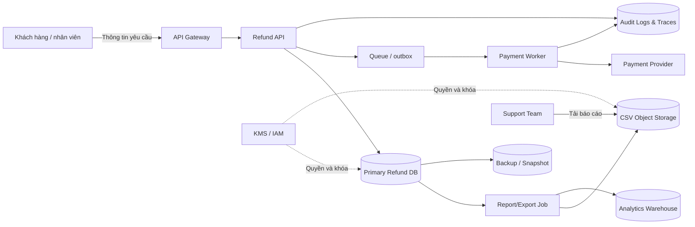
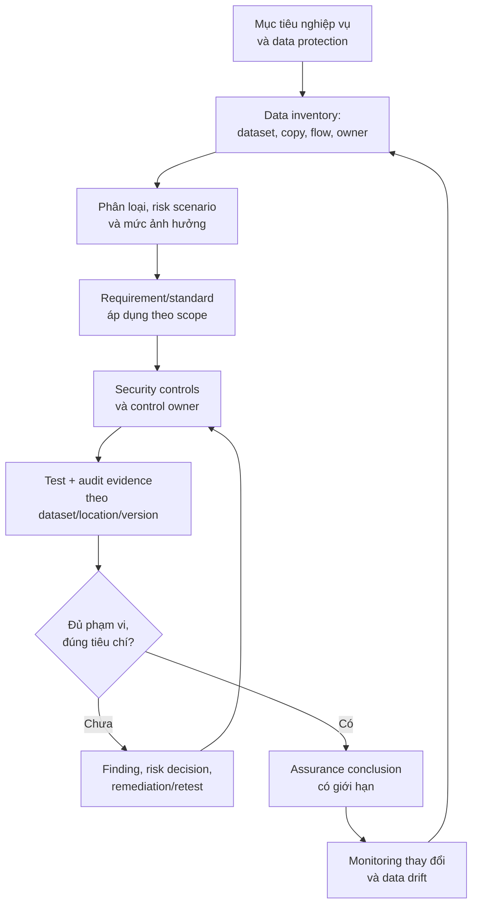
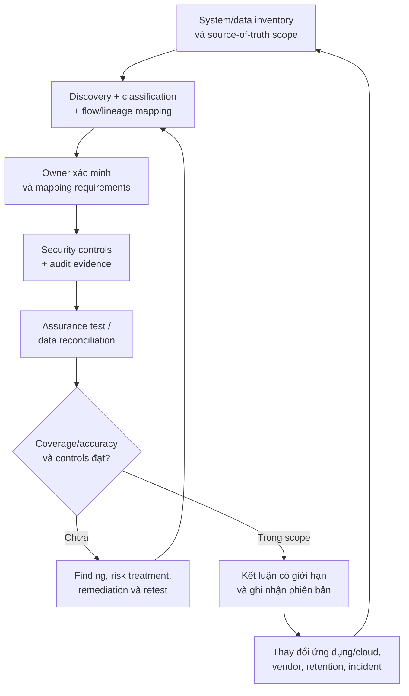

# Data inventory: kiểm kê dữ liệu để bảo vệ và chứng minh security assurance

## Mục tiêu học tập

Sau bài này, người học có thể:

1. Giải thích **Data inventory (kiểm kê dữ liệu)** là gì, tại sao không thể bảo vệ hoặc đánh giá đầy đủ những dữ liệu tổ chức chưa biết đang tồn tại.
2. Phân biệt **data inventory**, data catalog, asset register, data classification, data discovery, data flow map, lineage và hồ sơ hoạt động xử lý dữ liệu.
3. Xác định **tập dữ liệu, bản sao, trường nhạy cảm, nguồn gốc, mục đích, chủ sở hữu, hệ thống lưu/xử lý, bên nhận, quyền truy cập, thời hạn lưu và trạng thái bảo vệ**.
4. Lập inventory theo **vòng đời dữ liệu**: thu thập → truyền → sử dụng → chia sẻ → xuất bản → sao lưu → lưu giữ → xóa/ẩn danh.
5. Thiết kế cách **khám phá, đối chiếu và kiểm tra tính đầy đủ/chính xác** của kiểm kê ở database, object storage, log, queue, cache, máy trạm, CI/CD, cloud và dịch vụ bên thứ ba.
6. Liên kết bản ghi inventory với **risk scenarios, security requirements, controls, test cases, audit evidence và findings** của chương trình security assurance.
7. Xác định ownership, cập nhật liên tục theo thay đổi kiến trúc và quản trị những mục **chưa biết, chưa xác minh, sai phân loại hoặc ngoài phạm vi**.

Trong module **SECURITY_SECURITY_ASSURANCE**, mục tiêu là đánh giá **có bằng chứng** rằng hệ thống đáp ứng yêu cầu bảo mật, từ phân tích rủi ro và kiểm soát đến kiểm thử, audit và khắc phục. Data inventory là cơ sở để trả lời: **Tài sản dữ liệu cần bảo vệ đang ở đâu, đi qua những thành phần nào, ai chịu trách nhiệm, chúng được bảo vệ theo yêu cầu nào và bằng chứng đó có thực sự bao phủ hết phạm vi hay không?**

## 1. Data inventory là gì?

**Data inventory** là danh mục có cấu trúc, được duy trì và kiểm chứng về **các tập dữ liệu và nơi dữ liệu tồn tại hoặc được xử lý** trong một phạm vi xác định. Mỗi mục cần đủ thông tin để tổ chức đưa ra quyết định bảo vệ, quản lý vòng đời, đánh giá rủi ro và kiểm tra hiệu quả của security controls.

Một inventory tốt không chỉ ghi “có database khách hàng” mà còn xác định, ví dụ:

- Bảng hoặc tập hồ sơ chứa thông tin gì, mức nhạy cảm nào, mục đích nghiệp vụ và chủ sở hữu ra sao.
- Dữ liệu được tạo từ đâu; **các bản sao** nào tồn tại trong cache, object storage, export, backup, log, môi trường thử nghiệm và dịch vụ bên ngoài.
- Luồng đọc/ghi, tài khoản được phép truy cập hoặc giải mã, cách chia sẻ cho đối tác.
- Dữ liệu phải được **giữ, giảm thiểu, ẩn danh hoặc xóa** theo quy tắc nào; kiểm tra được kết quả đến mức nào.
- Những yêu cầu **bí mật, toàn vẹn, sẵn sàng, trách nhiệm giải trình và quyền riêng tư** liên quan.
- Ai xác nhận thông tin đó đúng và bằng chứng ở thời điểm nào.

### 1.1. Từ “có dữ liệu” tới “có thể bảo đảm”

Một hệ thống thanh toán có database được mã hóa và API dùng HTTPS. Nhóm vận hành kết luận: “Dữ liệu thanh toán đã an toàn”.

Tuy nhiên, nightly job có thể xuất **CSV sang một bucket khác**, log debug có thể ghi một phần mã định danh, và hệ thống phân tích có thể giữ **bản sao lâu hơn** hệ thống chính. Nếu không biết những nơi đó tồn tại, assurance reviewer khó kiểm tra:

1. Dữ liệu nào thuộc diện bảo vệ.
2. Kiểm soát nào **phải áp dụng cho từng bản sao và luồng**.
3. Kết quả kiểm tra nào thuộc **đúng tài sản, môi trường và thời kỳ**.
4. Bằng chứng thiếu chỗ nào và cần mở finding gì.

**Nguyên tắc:** Data inventory là **đầu vào để lựa chọn/kiểm tra security controls**, không phải bản thân một bằng chứng rằng mọi dữ liệu đã an toàn. Danh sách có thể rất đầy đủ nhưng các storage vẫn public; ngược lại, một database được mã hóa tốt vẫn không cứu được **bản sao chưa được kiểm kê**.

### 1.2. Inventory khác những hồ sơ liên quan thế nào?

| Khái niệm | Câu hỏi trả lời | Điểm khác biệt |
|---|---|---|
| **Data inventory** | Những tập dữ liệu nào tồn tại/được xử lý, ở đâu, do ai quản lý và trạng thái nào? | Hướng tới **khả năng quản trị, bảo vệ và truy vết tài sản dữ liệu** |
| **Data catalog** | Tập dữ liệu được mô tả, tìm và hiểu ra sao? Schema, thuật ngữ, cách dùng? | Có thể phục vụ discovery/analytics; chưa chắc có kiểm soát vòng đời/bằng chứng bảo mật |
| **Asset register** | Tài sản nào của tổ chức cần quản lý? | Rộng hơn dữ liệu: hệ thống, khóa, danh tính, máy chủ, phần mềm |
| **Data classification** | Dữ liệu thuộc mức nhạy cảm/giá trị nào? | Là **thuộc tính và quy trình đánh giá** áp vào inventory |
| **Data discovery** | Tìm những nơi dữ liệu tồn tại bằng cách nào? | Là **hoạt động**, không tự đảm bảo metadata đúng và có owner |
| **Data flow map/DFD** | Dữ liệu di chuyển qua thành phần, boundary và tác nhân nào? | Bổ sung **quan hệ và đường truyền** cho danh mục |
| **Data lineage** | Dữ liệu có nguồn gốc, biến đổi và phụ thuộc qua những bước nào? | Giúp truy hậu quả và bản sao dẫn xuất |
| **Record of processing / hồ sơ hoạt động xử lý** | Hoạt động xử lý thông tin liên quan tới cá nhân diễn ra để làm gì, ai tham gia? | Có mục tiêu quản trị/quyền riêng tư riêng; có thể liên kết nhưng không đồng nhất với inventory kỹ thuật |
| **CMDB / service inventory** | Hệ thống, dịch vụ và cấu hình nào đang chạy? | Giúp phát hiện hạ tầng nhưng không xác định đủ mọi nội dung dữ liệu |
| **Backup catalog** | Bản backup nào có thể khôi phục, ở đâu, dùng khóa nào? | Là **một nguồn** cho inventory vòng đời, không thay toàn bộ inventory |

Các hồ sơ có thể chia sẻ ID và metadata. Không nên tạo **nhiều bản sự thật khác nhau** rồi để chủ sở hữu và phân loại mâu thuẫn mà không có cơ chế đồng bộ.

## 2. Xác định đơn vị kiểm kê phù hợp

Một mục kiểm kê không nhất thiết là một **bảng database** hay một **file vật lý**. Đơn vị hữu ích thường là một **dataset hoặc nhóm dữ liệu có chung mục đích và yêu cầu bảo vệ**, kèm danh sách các vị trí lưu/xử lý và quan hệ với tài sản kỹ thuật.

### 2.1. Các mức nhìn dữ liệu

| Mức | Ví dụ | Khi nào cần? |
|---|---|---|
| **Domain/nhóm nghiệp vụ** | Customer, Payment, Employee | Phân trách nhiệm, lập phạm vi, đánh giá tác động |
| **Logical dataset** | Hồ sơ khách hàng, chỉ thị hoàn tiền, audit trail | Xác định classification, mục đích, yêu cầu bảo vệ |
| **Physical store** | DB schema/table, bucket/prefix, queue/topic, SaaS workspace | Triển khai/kiểm tra quyền và cấu hình thực tế |
| **Field/attribute** | Họ tên, mã khách, tài khoản ngân hàng, địa chỉ, token | Gắn mức nhạy cảm chính xác, masking, minimization |
| **Copy/representation** | CSV, snapshot, cache entry, log excerpt, warehouse extract | Phát hiện nơi dữ liệu bị phân tán, biến đổi hoặc giữ lâu |
| **Data flow/processing job** | API → DB; DB → export worker → partner | Xác định ranh giới tin cậy, bên nhận, security controls |
| **Key/access dependency** | KMS key, service identity, export link | Biết ai có khả năng đọc/giải mã hoặc xóa dữ liệu |

Một logical dataset có thể được lưu ở nhiều physical stores; một physical store có thể chứa nhiều logical datasets với **những mức nhạy cảm khác nhau**. Vì vậy, không đồng nhất “mỗi bucket = một tài sản dữ liệu” hoặc “mỗi bảng = một data owner”.

### 2.2. Phân biệt dữ liệu gốc, dữ liệu dẫn xuất và metadata

- **Dữ liệu gốc:** Hồ sơ khách hàng/đơn hàng được nhận theo chức năng chính.
- **Dữ liệu dẫn xuất:** Tổng hợp chi tiêu, báo cáo thống kê, đặc trưng phân tích hoặc embedding.
- **Bản sao:** Backup, snapshot, cache, read replica, data export.
- **Metadata:** ID, timestamp, location, quan hệ, thông tin truy cập. Metadata cũng có thể nhạy cảm.
- **Secrets:** API token, session credential, private key hoặc khả năng giải mã; không đưa secret material vào inventory.
- **Evidence:** Audit logs, approval records hoặc bằng chứng dùng để đối soát; có thể chứa dữ liệu nhạy cảm và cần quản lý vòng đời riêng.

**Dữ liệu biến đổi không luôn trở thành “không nhạy cảm”.** Bảng tổng hợp theo nhóm quá nhỏ, dữ liệu giả danh (*pseudonymized*) hoặc embedding vẫn có thể tạo nguy cơ tái nhận dạng hay lộ thông tin. Cần đánh giá theo **bản chất, ngữ cảnh sử dụng và khả năng liên kết**, không chỉ theo tên trường.

## 3. Bắt đầu từ mục tiêu nghiệp vụ và phạm vi bảo vệ

Trước khi dùng scanner, hãy xác định mục đích quản lý: **hệ thống nào, dữ liệu nào, thời kỳ nào và loại tổn thất nào quan trọng**.

### 3.1. Hồ sơ phạm vi tối thiểu

| Câu hỏi | Ví dụ minh họa |
|---|---|
| **Hệ thống nào?** | Refund Service và các thành phần phục vụ hoàn tiền |
| **Nghiệp vụ nào?** | Tạo, duyệt, thực thi, đối soát và lưu hồ sơ hoàn tiền |
| **Dữ liệu nào?** | Mã khách hàng, người nhận, số tiền, trạng thái duyệt, chứng cứ thanh toán |
| **Môi trường nào?** | Production, staging có dữ liệu thật, backup và vùng phân tích liên quan |
| **Ai tham gia?** | Customer portal, nhân viên, operator, Payment Provider, BI |
| **Phụ thuộc nào?** | API gateway, database, KMS, object storage, queue, SaaS, CI/CD |
| **Khoảng thời gian nào?** | Bản triển khai và thời điểm chụp hiện trạng, lịch review và lịch sử cần truy |
| **Giới hạn ban đầu?** | Một hệ thống vendor chưa có quyền lấy inventory, cần theo dõi là gap |

Không nên tự gộp toàn bộ “dữ liệu của doanh nghiệp” vào một file nếu tổ chức không thể xác minh. Có thể triển khai inventory **theo hệ thống/lĩnh vực/rủi ro**, nhưng phải ghi rõ các vùng chưa khảo sát, người phụ trách và kế hoạch mở rộng.

### 3.2. Phân loại theo tác động và yêu cầu

| Nhóm dữ liệu | Tổn thất cần xem xét | Security requirements gợi ý |
|---|---|---|
| Danh tính, thông tin liên hệ | Tiết lộ, chiếm danh tính, lộ dữ liệu cá nhân | Hạn chế truy cập, masking, mục đích sử dụng, lưu giữ/xóa |
| Thông tin thanh toán và người nhận | Sai người nhận, gian lận, rò rỉ | Toàn vẹn, maker–checker, bảo vệ khi truyền/lưu, đối soát |
| Access tokens và secrets | Đánh cắp quyền truy cập | Secret management, giới hạn quyền, tránh log, rotation/revocation |
| Dữ liệu giao dịch đã phê duyệt | Sửa dữ liệu sau phê duyệt | Versioning, immutable approval context, audit và test bất biến |
| Báo cáo tổng hợp/analytics | Rò rỉ hoặc suy diễn thông tin từ nhóm nhỏ | Đánh giá nguy cơ tái nhận dạng, quyền theo người dùng/mục đích |
| Audit và security logs | Thiếu chứng cứ, sửa/xóa log, lộ metadata | Integrity, retention, quyền đọc/sửa và kiểm tra mất log |
| Backup/snapshot | Lộ bản sao hoặc không thể restore | Encryption/key management, hạn lưu, thử phục hồi |
| Thông tin công khai | Bị thay nội dung hoặc giả mạo nguồn | Bảo vệ tính toàn vẹn và nguồn gốc, dù không cần giữ bí mật |

Mức phân loại như *Public, Internal, Confidential, Restricted* chỉ là **ví dụ đặt tên**. Tổ chức phải định nghĩa ngưỡng, cách quyết định, người duyệt và quy tắc kế thừa mức nhạy cảm từ dữ liệu nguồn; không gán tùy ý một nhãn “Confidential” rồi coi việc bảo vệ đã đạt.

### 3.3. Phân loại không chỉ là độ bí mật

**CIA** giúp thấy dữ liệu quan trọng theo những chiều khác nhau:

- **Confidentiality:** Ai không được xem? Hậu quả tiết lộ là gì?
- **Integrity:** Nội dung hoặc trạng thái nào không được sửa trái phép? Ai kiểm tra đối soát?
- **Availability:** Dữ liệu nào phải khôi phục trong mục tiêu RPO/RTO đã duyệt?

Với **audit trail**, tính toàn vẹn và khả năng truy xuất có thể rất quan trọng; với **bí mật API**, rò rỉ dù một trường ngắn cũng gây nguy cơ cao. Vì vậy inventory nên lưu **yêu cầu bảo vệ** thay vì dựa vào một nhãn mức độ duy nhất.

## 4. Khám phá dữ liệu theo vòng đời và luồng thực tế

### 4.1. Bản đồ ví dụ: nền tảng hoàn tiền



**Inventory phải khảo sát cả cạnh và nút**: dữ liệu đi từ ai đến đâu, được biến đổi như thế nào, có chứa cùng mức nhạy cảm không, ranh giới tin cậy nào bị vượt và ai có quyền đọc hoặc xuất tiếp.

### 4.2. Checklist theo mỗi giai đoạn

| Giai đoạn | Những câu hỏi cần trả lời |
|---|---|
| **Collect/ingest** | Nguồn gì, ai cung cấp, có thực sự cần mọi field không, input có được xác thực/kiểm tra? |
| **Transmit** | Những đường network và service boundary nào; nơi kết thúc TLS, bên nhận là ai? |
| **Store** | DB/table, object store, file system, log, queue, cache; khu vực và môi trường nào? |
| **Use/transform** | Job/ứng dụng nào đọc/ghi, field nào sinh ra, dữ liệu đầu ra kế thừa mức nhạy cảm nào? |
| **Share/export** | Nhân sự, đối tác, SaaS và downstream nào nhận dữ liệu; có quyền xuất/download/ủy quyền tiếp? |
| **Replicate/backup** | Snapshot, disaster recovery, read replica, staging và dữ liệu offsite nằm ở đâu? |
| **Retain/archive** | Thời hạn nào, căn cứ từ đâu, ai quyết định giữ lâu hơn? |
| **Delete/anonymize** | Xóa khỏi những nơi nào, có log/backup/derivative cần xử lý khác không? |
| **Recover** | Có thể phục hồi dữ liệu và khóa không; sau restore có tái xuất hiện dữ liệu đáng lẽ bị xóa? |

Một bản ghi inventory nên có thể trỏ tới **data flow ID** và **physical location ID**; nếu chỉ ghi “source = production DB”, sẽ không phát hiện được copy xuất ra file hoặc vendor.

### 4.3. Các nơi dễ bị bỏ sót

- Log debug, stack trace, APM, distributed traces và bản dump sự cố.
- Queue, dead-letter queue (DLQ), event replay storage, retry table và cache.
- File CSV/Excel xuất thủ công, file chia sẻ nội bộ, email attachment và máy trạm.
- Staging/test/CI environments có bản sao dữ liệu production.
- ETL/ELT, data lake, feature store, search index, analytics sandbox, data science notebook.
- Backup, snapshot, image máy ảo và bản sao nhiều vùng/tài khoản.
- Vendor SaaS, hệ thống chăm sóc khách hàng, dịch vụ support hoặc outsource.
- API response, webhook, báo cáo tải về và link ký sẵn còn hiệu lực.
- Tài liệu kiểm thử, ticket incident, screenshot, audit evidence chứa giá trị thực.
- Storage cũ, bảng không còn người dùng, những tài khoản cloud ngoài inventory chuẩn.

**Không suy rằng một bản sao không tồn tại chỉ vì không nằm trong source-code hoặc sơ đồ kiến trúc.** Cần đối chiếu với hiện trạng cloud, schema, storage, quyền truy cập và hoạt động vận hành.

## 5. Mẫu bản ghi Data inventory

Một inventory dùng được phải có **định danh ổn định, thông tin sở hữu, phạm vi và metadata kiểm chứng**.

### 5.1. Những trường nên có

| Nhóm | Trường quan trọng | Ý nghĩa assurance |
|---|---|---|
| **Identity** | `datasetId`, tên, mô tả, phiên bản | Không nhầm hai bản dữ liệu hoặc đổi tên theo môi trường |
| **Business** | Nghiệp vụ/mục đích, business owner, data owner | Biết ai đánh giá giá trị, mục đích và retention |
| **Content** | Loại dữ liệu, những field nhạy cảm, mức phân loại, CIA | Chọn requirements có căn cứ |
| **Source** | Hệ thống nguồn, provenance, lineage, mức tin cậy | Đối chiếu tính chính xác, theo dõi dữ liệu dẫn xuất |
| **Location** | Physical stores, môi trường, account/region, bucket/prefix/schema | Kiểm tra đúng control trên đúng nơi lưu |
| **Processing** | Hệ thống/process/job, luồng đọc/ghi, mục đích sử dụng | Xác định entry point, data flow và ranh giới |
| **Access** | Nhóm người và machine identities, quyền đọc/ghi/export/decrypt | Đánh giá least privilege, SoD và sharing |
| **Transfers** | Bên nhận/vùng/tài khoản khác, cách truyền, trách nhiệm vendor | Kiểm tra data sharing và phân chia trách nhiệm |
| **Lifecycle** | Tạo, retention rule, deletion/archive, backup, restore | Xác minh dữ liệu không được giữ hoặc mất ngoài kế hoạch |
| **Protection** | Encryption, key refs, DLP, masking, audit, backup, kiểm soát nghiệp vụ | Map các controls cần có |
| **Risk/assurance** | Risk ID, requirement/control ID, evidence ID, findings | Truy vết tới đánh giá có bằng chứng |
| **Data quality** | Last seen, last verified, source, confidence, completeness, review due | Phân biệt bản ghi còn tin cậy với suy đoán |
| **Governance** | System owner, steward, control owner, reviewer, status, exception | Biết ai cần hành động và thẩm quyền quyết định |

**Chú ý:** Không điền số tài khoản ngân hàng, mật khẩu, secret key hoặc thông tin cá nhân thật vào inventory để chứng minh chúng tồn tại. Inventory nên dùng **metadata, tên field/schema, tokenized identifiers hoặc kết quả scanner tổng hợp** và trỏ tới bằng chứng được bảo vệ.

### 5.2. Ví dụ YAML có thể tham khảo

Mẫu sau là **hồ sơ kỹ thuật minh họa**, không phải schema bắt buộc của data catalog hoặc phần mềm GRC. Giá trị không mô tả một hệ thống thật:

```yaml
dataInventory:
  id: DATA-REFUND-INSTRUCTION
  name: Approved refund instruction
  version: "1.0"
  status: verified-example

  business:
    purpose: Execute and reconcile authorized refunds
    processId: PROC-REFUND-PAYOUT
    businessOwnerRole: Payments Business Owner
    dataOwnerRole: Refund Data Owner
    systemOwnerRole: Refund Platform Owner

  content:
    classification: restricted
    categories:
      - customer-reference
      - beneficiary-payment-details
      - approval-and-execution-status
    sensitiveFields:
      - beneficiaryAccountReference
      - approvedAmount
      - approvalActorId
    protectionObjectives:
      confidentiality: high
      integrity: critical
      availability: business-defined

  provenance:
    authoritativeSource: REFUND-PRIMARY-DB
    createdBy: refund-api
    transformedBy:
      - payment-worker
      - refund-report-exporter
    relatedDataFlows:
      - FLOW-REFUND-APPROVAL
      - FLOW-REFUND-PAYOUT
      - FLOW-REFUND-CSV-EXPORT

  locations:
    - id: REFUND-PRIMARY-DB
      type: relational-database
      environment: production
      scopeRef: payments-prod-db/refunds
      dataRole: authoritative
    - id: REFUND-REPORT-BUCKET
      type: object-storage
      environment: production
      scopeRef: payments-report-bucket/refund-exports/
      dataRole: derived-copy
      reviewState: requires-validation
    - id: REFUND-BACKUP
      type: encrypted-backup
      environment: disaster-recovery
      scopeRef: backup-catalog/REFUND-DB
      dataRole: recoverable-copy

  access:
    readerRoles:
      - authorized-payments-operator
      - audited-report-service
    writerRoles:
      - refund-api
      - payment-worker
    privilegedAccessReviewId: IAM-REVIEW-REFUND
    secretMaterialIncluded: false

  lifecycle:
    retentionRuleRef: RETENTION-REFUND-RECORDS
    deletionWorkflowRef: DELETE-REFUND-DATA
    backupsIncluded: true
    downstreamDeletionDependencies:
      - REFUND-REPORT-BUCKET
      - REFUND-ANALYTICS

  security:
    requirementIds:
      - DATA-01
      - ENC-02
      - AUTHZ-05
      - AUDIT-03
    controlIds:
      - CTRL-REFUND-READ-AUTHZ
      - CTRL-REFUND-ENCRYPTION
      - CTRL-REFUND-EXPORT-AUDIT
    evidenceIds:
      - EV-DB-ENCRYPTION-CONFIG
      - EV-EXPORT-AUTHZ-TEST
      - EV-RETENTION-JOB-TEST
    openFindings:
      - FIND-EXPORT-COVERAGE-01

  verification:
    sources:
      - service-architecture-reviewed
      - database-schema-inspected
      - object-storage-scan
    lastObservedAt: "2026-11-25"
    lastVerifiedAt: "2026-11-26"
    reviewerRole: Data Protection Reviewer
    confidence: partial
    limitations:
      - Vendor analytics export not yet independently verified
```

Các giá trị như `EV-EXPORT-AUTHZ-TEST` chỉ là **tham chiếu**. Muốn kết luận control đạt, phải mở được kết quả test có **đối tượng, thời điểm, expected/actual result, bản triển khai và giới hạn**. Một trường `classification: restricted` trong YAML không chứng minh dữ liệu đã được mã hóa hay ai đó không thể tải file.

### 5.3. Không đánh đồng “unknown” và “not applicable”

Mỗi trường quan trọng nên có một trong các tình trạng có thể diễn giải:

| Tình trạng | Ý nghĩa | Quyết định phù hợp |
|---|---|---|
| **VERIFIED** | Có bằng chứng đủ mới, đúng scope để xác nhận | Có thể dùng cho kết luận trong giới hạn đó |
| **DISCOVERED** | Công cụ hoặc người khảo sát đã nhận diện nhưng chưa xác minh đầy đủ | Giao owner đối chiếu và phân loại |
| **DECLARED** | Chủ hệ thống tự khai; chưa có kiểm chứng độc lập | Có ích để bắt đầu, không suy ra toàn vẹn |
| **UNKNOWN** | Không biết hoặc chưa có dữ liệu xác minh | Ghi gap/rủi ro, điều tra bổ sung |
| **NOT_APPLICABLE** | Có căn cứ và người duyệt cho việc không áp dụng | Theo dõi điều kiện thay đổi |
| **STALE** | Bằng chứng/cấu hình có thể không còn phản ánh hiện tại | Tái quét/rà soát trước khi kết luận |
| **RETIRED** | Tài sản không còn vận hành theo quy trình đóng vòng đời | Xác nhận bản sao/backup/retention còn tồn tại hay không |

Không gán `NOT_APPLICABLE` chỉ vì scanner không có quyền nhìn vùng dữ liệu đó. **Không quan sát được không chứng minh là không tồn tại.**

## 6. Quy trình xây dựng Data inventory

### Bước 1 — Xác định chính sách, scope và người chịu trách nhiệm

Xác định:

1. Phạm vi hệ thống, môi trường, tenant, account, region và đối tác.
2. Những dữ liệu hoặc luồng có **mức ảnh hưởng cao** cần ưu tiên.
3. Data owners, system owners, security/privacy reviewers và vendor contacts.
4. Nguồn dữ liệu **authoritative** cho inventory ở từng lớp.
5. Thời điểm chụp, tiêu chí đủ/thiếu, lịch rà soát và triggers.

Nếu hệ thống lớn, có thể lập inventory theo **domain và độ ưu tiên rủi ro**, nhưng vẫn cần một danh sách các vùng chưa bao phủ, không tuyên bố “đã kiểm kê xong toàn tổ chức”.

### Bước 2 — Thu thập khai báo của chủ hệ thống

Phỏng vấn system owner, data owner, developers, SRE, DBA, analytics team và vendor manager. Yêu cầu:

- Nơi lưu dữ liệu chính/phụ, đường đọc/ghi, bản export và downstream.
- Mục đích dùng, nhóm người được quyền, luồng duyệt và chia sẻ.
- Luồng migration, cache, backup, debug, support, xử lý sự cố.
- Chính sách retention và xóa đã áp dụng thực tế ra sao.
- Những đường legacy hoặc “tạm thời” đang tồn tại.

Đây là **khai báo cần đối chiếu**, không phải bằng chứng đầy đủ. Người vận hành có thể không nhớ một bucket cũ hoặc bản export do một job khác tạo.

### Bước 3 — Khám phá kỹ thuật theo nguồn có quyền

| Nguồn khảo sát | Phát hiện hữu ích | Cần cẩn trọng |
|---|---|---|
| **Database metadata** | Schema/table/column, owner, tags, access grants | Không đọc dump dữ liệu thật nếu chỉ cần metadata |
| **Cloud inventory/config** | Bucket, volume, snapshot, database, region/account, encryption config | Quét đủ account/region; quyền scanner và tagging có thể thiếu |
| **Storage/object metadata** | Prefix, object types, timestamp, lifecycle rules, public/link access | Filename không luôn mô tả nội dung; object versions có thể ẩn |
| **Code/config review** | Connection strings, data export job, API routes, queue topics | Đường runtime, feature flags hoặc job ngoài repo có thể khác |
| **IaC/pipeline manifest** | Dịch vụ, storage, role và đường tạo artifact | Drift/manual changes và legacy resources |
| **Event/queue inventory** | Topic, subscription, DLQ, replay store, retention | Không xem dữ liệu đầy đủ của payload nếu không có quyền |
| **Logs/telemetry schema** | Các trường có thể chứa ID, secret hoặc dữ liệu cá nhân | Log sampling có thể làm bỏ sót; tránh nhân bản dữ liệu nhạy cảm |
| **DLP/sensitive-data discovery** | Dấu hiệu trường hoặc nội dung nhạy cảm | False positives, false negatives và phạm vi scanner |
| **Data warehouse/BI catalog** | Extract, transform, dashboard, dataset chia sẻ | Data lineage và quyền chia sẻ có thể nằm ở công cụ riêng |
| **Vendor contracts/config** | Bên xử lý, nơi nhận, quyền hỗ trợ, retention | Báo cáo vendor phải đúng dịch vụ/scope và mới |
| **Backup/DR catalog** | Snapshot, thời gian giữ, khóa, bản sao vùng khác | Bản backup đã mã hóa chưa chứng minh khả năng restore |

**Bảo mật hoạt động discovery:** Dùng tài khoản chỉ đọc và quyền tối thiểu phù hợp, kiểm soát truy cập kết quả quét, **không lưu raw secrets/PII trong báo cáo**, đặt giới hạn tải/quét tránh ảnh hưởng production và có phê duyệt cho các hoạt động nhạy cảm.

### Bước 4 — Chuẩn hóa và nối các bản sao

Một field như `customerId` có thể xuất hiện trong DB, event stream, CSV và log; cần quyết định:

- Các physical copies thuộc **logical dataset nào**?
- Bản nào là authoritative, bản nào được tái tạo, bản nào chỉ để điều tra?
- Quy trình nào chuyển đổi hoặc **ẩn danh/gộp dữ liệu**?
- Data owner của bản sao dẫn xuất có thay đổi trách nhiệm không?
- Quy tắc bảo vệ nào phải **kế thừa** và điều kiện nào cho phép hạ mức phân loại?
- Đã gắn ID cho **luồng dữ liệu** để kiểm chứng cả nơi gửi lẫn nơi nhận chưa?

Không tự hợp nhất những tài sản có **mục đích, owner hoặc retention khác** chỉ vì cùng schema. Chẳng hạn báo cáo hoàn tiền cho kiểm toán có nghĩa vụ giữ khác với cache phục vụ API.

### Bước 5 — Kiểm tra với người sở hữu và nguồn độc lập

Review cùng data/system owner các điểm: tên và mục đích, classification, nơi lưu, danh sách người nhận, trạng thái mã hóa/quyền, retention. Đối chiếu các khai báo với **cấu hình thực tế, luồng dữ liệu và lịch sử truy cập/triển khai**.

Ghi rõ:

- Điều nào **đã kiểm chứng**, cách kiểm chứng và ngày.
- Điều nào chỉ **do một bên tự khai**.
- Điều nào còn **thiếu quyền khảo sát**, cần vendor assurance hoặc ticket.
- Những sai khác phát hiện giữa tài liệu và hệ thống.

### Bước 6 — Mapping security controls và đánh giá gaps

Với từng dataset/location/flow, liên kết:

- Risk scenario và mục tiêu bảo mật.
- Requirement về access, encryption, masking, audit, minimization, backup, deletion.
- Control owner, cách hoạt động và evidence.
- Finding ID nếu bảo vệ thiếu, không thể kiểm chứng hoặc ngoài scope.

**Ví dụ:** Nếu CSV báo cáo chứa tài khoản người nhận được tạo ở object storage và có link tải, inventory phải kích hoạt kiểm tra **quyền tải, thời hạn link, encryption và retention**; kết luận “DB mã hóa rồi” không bao phủ trường hợp này.

### Bước 7 — Duy trì bằng cơ chế vận hành

Thiết lập:

- Lịch rà soát theo mức rủi ro và kỳ audit phù hợp.
- Trigger từ **thêm field, storage, vendor, API, ETL, backup, vùng triển khai hoặc policy**.
- Cơ chế báo mục không có owner, stale metadata và data discovery phát hiện ngoài inventory.
- Nơi lưu bằng chứng theo quyền/retention, trách nhiệm retest khi sửa.
- Đo **coverage và chất lượng**, không chỉ đếm số lượng bản ghi đã nhập.

## 7. Data flow, lineage và ranh giới tin cậy

Data inventory chỉ là danh mục nếu không có quan hệ. Với security assurance, cần biết **dữ liệu chuyển đi đâu, biến đổi ra sao và ai có thể truy cập ở mỗi bước**.

### 7.1. Bảng data flow minh họa

| Flow ID | Source | Destination | Dữ liệu chuyển | Boundary/rủi ro | Kiểm soát cần xác minh |
|---|---|---|---|---|---|
| `FLOW-01` | Customer browser | Refund API | Yêu cầu, định danh | Internet → application | TLS, authn/authz, input validation |
| `FLOW-02` | Refund API | Primary DB | Lệnh và trạng thái duyệt | Service → datastore | Least privilege, encrypt-at-rest, integrity |
| `FLOW-03` | DB/worker | Payment Provider | Thông tin thực thi | Tổ chức → vendor | Xác thực endpoint, tối thiểu hóa, audit, hợp đồng |
| `FLOW-04` | DB | CSV object storage | Báo cáo người nhận và trạng thái | DB → export/download | Export authz, link scope/expiry, retention |
| `FLOW-05` | DB | Backup/DR | Bản sao phục hồi | Region/account khác | Encryption/key access, restore test, retention |
| `FLOW-06` | API/worker | Log platform | Audit events và metadata | App → observability | Redaction, protected logs, event completeness |
| `FLOW-07` | DB | Analytics warehouse | Dataset phân tích | Production → analytics | Field minimization, classification, user access |

Tại mỗi boundary, phân biệt **đường truyền được bảo vệ** và **quyền của endpoint nhận**. TLS bảo vệ kênh khi truyền đúng cách nhưng không ngăn service nhận dữ liệu **xuất tiếp hoặc lưu sai quyền**.

### 7.2. Liên hệ với data lineage

Một hệ thống BI biến bảng thanh toán thành thống kê theo cửa hàng. Lineage giúp xác định:

1. Nguồn trường và độ tin cậy.
2. Quy tắc biến đổi, lọc, join, tổng hợp.
3. Tập dữ liệu mới có **kế thừa nhạy cảm hoặc còn nguy cơ suy diễn** không.
4. Khi nguồn sửa/xóa, downstream và backup nào cần đánh giá lại.
5. Khi có incident, **những dataset nào có thể bị ảnh hưởng theo đường phụ thuộc**.

Lineage có thể được khai báo bằng job manifest, ETL metadata hoặc hệ thống catalog; với luồng động phải đối chiếu **thực tế runtime** và quyền. Không suy rằng tuyến không xuất hiện trên sơ đồ có nghĩa nó không tồn tại.

### 7.3. Phát hiện “shadow data”

**Shadow data** là những dữ liệu tồn tại ngoài vị trí/quy trình quản lý được kỳ vọng, ví dụ một export nằm trong thư mục cá nhân hoặc bucket chưa được gán owner. Nó không nhất thiết được tạo với ý đồ xấu: có thể do debugging, thử nghiệm hoặc nhu cầu nghiệp vụ phát sinh.

Khi tìm thấy:

1. **Không xóa ngay khi chưa đánh giá** nếu còn nghĩa vụ giữ, điều tra hoặc phụ thuộc.
2. Xác định classification, nguồn, mục đích, người tạo và người truy cập.
3. Giới hạn rủi ro hiện tại bằng quyền/cấu hình phù hợp.
4. Cập nhật inventory và risk register; tạo finding nếu trái policy.
5. Xác định **giữ trong nơi được quản lý, chuyển đổi, giảm thiểu hay xóa** theo quyết định.
6. Xem lại **quy trình tạo export hoặc log** để tránh tái diễn.

## 8. Data inventory gắn với security controls như thế nào?

Inventory là **phần xác định phạm vi** của security assurance. Nó giúp người đánh giá biết điều khoản nào áp dụng và **có thực sự kiểm tra đủ các vị trí không**.

### 8.1. Chuỗi truy vết



### 8.2. Ma trận mẫu dữ liệu – rủi ro – control – evidence

| Tài sản/phạm vi | Risk scenario | Control cần xem | Evidence cần thu |
|---|---|---|---|
| Primary customer DB | Người ngoài quyền đọc/sửa hồ sơ | Authz, DB grants, encryption, integrity | Negative access tests, IAM/DB config, audit logs |
| Refund approval records | Lệnh bị đổi người nhận sau duyệt | Versioned approval, SoD, immutable business evidence | State-machine tests, approval events, worker tests |
| Export CSV | Link chia sẻ rộng hoặc file lưu lâu | Download authorization, encryption, lifecycle policy | IAM/bucket configuration, link test, retention job result |
| API/worker logs | PII/token vô tình ghi vào log | Redaction, log access control, retention, detection | Log schema review, redaction test, access review |
| Queue/DLQ | Thông điệp có dữ liệu nhạy cảm bị đọc ngoài quyền | Message ACL, retention, encryption, replay control | Broker config, negative access test, DLQ inventory |
| Backup/snapshot | Lộ bản sao hoặc mất khả năng khôi phục | Storage encryption, key protection, restore procedure | Backup catalog, KMS policy, restore drill |
| Analytics warehouse | Bản sao dẫn xuất chia sẻ sai nhóm | Least privilege, classification, minimization | Warehouse grants, lineage, export/access tests |
| Vendor processor | Dữ liệu truyền đến bên không được phép hoặc ngoài scope | Transfer authorization, vendor review, hợp đồng/bằng chứng phù hợp | Data flow record, approved vendor configuration, assurance evidence |

**Không nên** gắn một evidence ID “encrypted DB” cho tất cả các dòng chỉ vì dữ liệu xuất phát từ DB đó. Mỗi copy/boundary có **cấu hình, owner và rủi ro riêng**.

### 8.3. Mapping phải có tiêu chí kiểm tra

Ví dụ một yêu cầu:

> `DATA-EXPORT-01`: Mọi file export chứa dữ liệu khách hàng nhạy cảm trong production phải có owner, phân loại, người được phép tải, giới hạn vòng đời và bằng chứng bảo vệ khi lưu/truyền theo baseline áp dụng.

Để kiểm tra, assurance reviewer cần:

- **Population:** Tất cả export jobs, bucket/prefix, file share và các đường tải trong scope.
- **Control:** Policy xác minh quyền khi tạo/tải; cấu hình lưu trữ, encryption, lifecycle.
- **Test:** Tài khoản ngoài quyền không tải được; file hết hạn được xử lý đúng quy định; các trường không cần thiết được loại bỏ.
- **Evidence:** Config snapshot gắn account/region; negative download test; log truy cập; bản kiểm tra retention.
- **Limitations:** Vendor extract hoặc export thủ công chưa nằm trong mẫu số phải được công bố.

Nếu thiếu inventory của export jobs, **không thể kết luận đầy đủ** chỉ bằng việc test hai file mà team đã nhớ tên.

## 9. Kiểm kê phục vụ privacy, retention và deletion

Data inventory quan trọng cho quản lý vòng đời và quyền riêng tư, nhưng **không tự chứng minh tuân thủ một đạo luật cụ thể**. Yêu cầu pháp lý/hợp đồng áp dụng cần được người có thẩm quyền xác định theo hệ thống, loại dữ liệu, mục đích và khu vực có liên quan.

### 9.1. Mục đích và tối thiểu hóa

Với mỗi logical dataset, cần hỏi:

- Vì sao cần thu thập **từng nhóm trường**?
- Có thể dùng token, tham chiếu, tổng hợp hoặc giá trị giảm chi tiết thay bản gốc không?
- Hệ thống nào cần plaintext và hệ thống nào chỉ cần dữ liệu dẫn xuất?
- Những nhóm người/nhà cung cấp nào cần đọc dữ liệu; có quyền thấp hơn phù hợp không?
- Dữ liệu test/analytics có cần dùng bản production nguyên vẹn không?

Ví dụ một báo cáo xu hướng hoàn tiền có thể chỉ cần **số giao dịch và tổng tiền theo nhóm đủ lớn**, không cần tên, số tài khoản hoặc địa chỉ của từng khách hàng. Tuy nhiên phải đánh giá nguy cơ suy diễn nếu nhóm quá nhỏ hoặc có thể liên kết với nguồn khác.

### 9.2. Retention có nhiều đồng hồ khác nhau

Đừng coi retention của database chính tự động áp dụng cho mọi copy. Ví dụ:

| Vị trí | Mục đích lưu | Vấn đề cần xác minh |
|---|---|---|
| Primary transaction DB | Hỗ trợ nghiệp vụ, đối soát và nghĩa vụ lưu | Quy tắc retention có version và đúng loại record |
| Audit log | Điều tra, trách nhiệm giải trình | Không ghi dư, chống xóa/sửa, retention thích hợp |
| Export CSV | Hỗ trợ báo cáo tạm thời | TTL/lifecycle và quyền tải file |
| Analytics | Thống kê, dự báo | Minimization, re-identification risk và thời hạn riêng |
| Backup | Disaster recovery | Khả năng restore và cách dữ liệu đã xóa xuất hiện sau restore |
| Support ticket | Giải quyết sự cố | Attachment/screenshot chứa PII, quyền và hạn giữ |
| Vendor SaaS | Dịch vụ hợp đồng | Xác nhận xử lý, retention, xóa và quyền bên nhận |

Thời gian lưu **không có một giá trị mặc định** đúng cho mọi loại dữ liệu. Có thể có nghĩa vụ lưu bắt buộc, legal hold hoặc thời hạn do business owner phê duyệt. Inventory cần liên kết tới **quy tắc và người quyết định**, không chỉ điền “90 ngày” vì một mẫu cho sẵn.

### 9.3. Kiểm chứng xóa dữ liệu

Xóa ở primary DB có thể không đồng nghĩa xóa toàn bộ:

1. Xác định **data lineage và các bản sao** còn nằm trong scope.
2. Phân biệt xóa logic, xóa vật lý, ẩn danh và crypto-erasure; mỗi cách có điều kiện an toàn khác nhau.
3. Kiểm tra tác động tới **backup, read replica, cache, search index, export, event replay và vendor**.
4. Đảm bảo xóa không làm mất các bản ghi **cần giữ hợp pháp hoặc phục vụ điều tra** nếu quy định áp dụng.
5. Kiểm chứng bằng **workflow/run ID, expected vs actual, đối chiếu số lượng và danh sách exception**, không chỉ “DELETE trả thành công”.
6. Định nghĩa xử lý **dữ liệu tái xuất hiện sau restore**: ví dụ áp lại deletion tombstone/retention policy.

Việc dùng **crypto-erasure** (hủy khóa làm dữ liệu không thể giải mã) chỉ có thể đưa ra bảo đảm theo **mô hình khóa và bản sao** đã đánh giá. Nếu một DEK phục vụ nhiều record cần giữ, hủy khóa không phải cách xóa chọn lọc khả thi; nếu plaintext tồn tại nơi khác, hủy một khóa cũng không xóa bản sao đó.

### 9.4. Data residency và bên thứ ba

Khi dữ liệu chuyển sang account, region hoặc tổ chức khác, inventory nên ghi **nơi lưu/xử lý được xác minh, bên nhận, vai trò vận hành, mục đích, luồng onward transfer, quyền kiểm tra và điều kiện xóa/trả**.

Không tự suy “dữ liệu ở một region” chỉ từ cấu hình database, vì logs, support tooling, backups hoặc dịch vụ SaaS có thể vận hành ở nơi khác. Cần xem **phạm vi của chính dịch vụ và tài liệu/bằng chứng nhà cung cấp**; ghi nhận những nơi chưa được xác minh.

## 10. Quản trị ownership và phân chia trách nhiệm

Một record inventory không có owner dễ trở thành “bản kê vô chủ” và lỗi thời.

### 10.1. Trách nhiệm điển hình

| Vai trò | Trách nhiệm |
|---|---|
| **Business/data owner** | Xác định mục đích, giá trị, classification, retention và quyết định dùng/chia sẻ dữ liệu |
| **System owner** | Nhận diện toàn bộ thành phần và luồng của hệ thống, điều phối kiểm kê và bằng chứng |
| **Data steward/catalog owner** | Duy trì metadata, chất lượng, lineage, quy tắc chuẩn hóa ID và lịch rà soát |
| **DBA/cloud/storage owner** | Cung cấp cấu hình physical locations, quyền, backup, storage lifecycle và evidence |
| **Application/engineering owner** | Xác định field, schema, API, queue, ETL/export và logic xử lý dữ liệu |
| **Security control owner** | Xây và chứng minh controls: IAM, encryption, DLP, audit, monitoring |
| **Privacy/compliance advisor** | Hỗ trợ xác định yêu cầu bảo vệ, hồ sơ xử lý và nghĩa vụ áp dụng |
| **Vendor/third-party manager** | Theo dõi bên nhận, nghĩa vụ hợp đồng và assurance evidence đúng scope |
| **Risk owner** | Quản lý rủi ro khi thiếu/không bảo vệ dữ liệu, xử lý/chuyển cấp quyết định |
| **Security assurance / QA** | Kiểm tra tính đầy đủ/chính xác của inventory và hiệu quả controls liên quan |
| **Internal audit** | Đánh giá độc lập theo phạm vi được giao |

Không được mặc định một data steward có thẩm quyền **hạ phân loại thông tin**, hoặc một system owner có quyền **chấp nhận mọi rủi ro và miễn trừ nghĩa vụ**. Quyết định phải theo phân quyền thực tế.

### 10.2. RACI minh họa

RACI: **R** – trực tiếp thực hiện; **A** – chịu trách nhiệm cuối cùng; **C** – tham vấn; **I** – được thông báo.

| Hoạt động | Data owner | System owner | Data steward | Control owner | Security assurance |
|---|---|---|---|---|---|
| Xác định mục đích/phân loại dữ liệu | **A/R** | C | R | C | C |
| Liệt kê physical stores và data flows | C | **A** | R | R | C |
| Kiểm tra population và nguồn kỹ thuật | C | **A** | R | R | C |
| Đề xuất/kiểm tra controls theo classification | **A** về yêu cầu dữ liệu | R | C | **R** về kiểm soát | C |
| Duy trì inventory và theo dõi stale records | C | A | **R** | C | C |
| Đánh giá assurance độc lập theo kỳ | C | C | C | C | **A/R** |

Ma trận chỉ là ví dụ. Với rủi ro không đáp ứng kiểm soát, **risk owner** và người có thẩm quyền chấp nhận rủi ro phải được tham gia theo quy trình riêng, không suy ra từ ô RACI trong bảng này.

### 10.3. Shared responsibility

Khi dùng managed database, cloud storage hoặc SaaS, các bên có trách nhiệm khác nhau. Ví dụ:

- **Cloud provider:** Có thể cung cấp công cụ inventory, audit và bảo vệ một số lớp hạ tầng theo mô hình trách nhiệm được công bố.
- **Tổ chức sử dụng:** Vẫn chịu trách nhiệm xác định **dữ liệu nào đã tải lên, ai có quyền đọc, quyền KMS, file export, retention, cấu hình tenant và những dịch vụ đã tích hợp** trong phạm vi mình quản lý.
- **Vendor xử lý dữ liệu:** Có thể cung cấp báo cáo/bằng chứng về nơi lưu, bảo vệ và xóa trong phạm vi cam kết, nhưng bằng chứng đó cần được đánh giá về **dịch vụ, thời kỳ, vùng và ngoại lệ**.

Một báo cáo “provider có encryption at rest” không chứng minh file CSV của khách hàng **không được cấp public read**, hoặc không còn bản dữ liệu tại người nhận phụ.

## 11. Kiểm thử và audit tính đầy đủ/chính xác của inventory

**Tài liệu nói gì** và **dữ liệu đang ở đâu** phải được đối chiếu bằng phương pháp phù hợp. Bên đánh giá không thể chỉ hỏi chủ hệ thống “đã kê đủ chưa?” rồi đánh dấu PASS.

### 11.1. Ba lớp đánh giá

| Lớp | Câu hỏi | Bằng chứng |
|---|---|---|
| **Design effectiveness** | Quy trình kiểm kê có xác định scope, nguồn, owner, bản sao, yêu cầu phân loại và thời điểm rà soát hợp lý? | Inventory standard, metadata schema, DFD, procedure và review rules |
| **Implementation** | Có catalog/inventory thật, quyền discovery, các kết nối nguồn và người chịu trách nhiệm? | Bản cấu hình scanner, repository dữ liệu metadata, owner assignment, pipeline |
| **Operating effectiveness** | Trong kỳ, dataset/bản sao mới có được phát hiện, phân loại, kiểm tra và xử lý gaps đúng hạn? | Discovery runs, reconciliation, change links, review decisions, findings và retest |

Inventory đầy đủ hôm nay có thể **không còn đúng ngày mai** nếu CI/CD tạo thêm bucket hoặc ETL đẩy dữ liệu sang vendor mới mà không cập nhật metadata.

### 11.2. Các phép kiểm tra cần phối hợp

1. **Completeness:** Lấy inventory độc lập từ cloud/database/CI/CD/warehouse, đối chiếu những nơi phải có trong data inventory.
2. **Accuracy:** Chọn các record trong data inventory, xác minh owner, classification, physical location, IAM, retention và data flow.
3. **Timeliness:** Kiểm tra các thay đổi trong kỳ có được cập nhật và tái đánh giá đúng trigger.
4. **Coverage:** Bao phủ production, các môi trường có dữ liệu nhạy cảm, vendor, account, region, legacy, queue, backup và export.
5. **Data lineage:** Thử truy từ một trường nhạy cảm tới các downstream copies và ngược lại.
6. **Control mapping:** Với record nhạy cảm đã xác nhận, thử mở bằng chứng access/encryption/logging/deletion liên quan.
7. **Failure handling:** Scanner mất quyền, lỗi schema hoặc API timeout có được nhận biết là **degraded/unknown**, không bị tính thành “không có dữ liệu”?
8. **Remediation:** Những dataset chưa có owner hoặc lưu sai quyền được mở finding, sửa và retest chưa?

Không có một kích thước mẫu cố định bảo đảm đủ cho mọi inventory. Chọn mẫu theo **mức rủi ro, độ lớn, tần suất thay đổi, lịch sử lỗi và mục tiêu đánh giá**; đối với một số nguồn metadata có thể đối chiếu toàn bộ tự động, còn sự chính xác của phân loại/mục đích phải xác minh theo phương pháp riêng.

### 11.3. Kiểm thử Gherkin

```gherkin
Feature: Data inventory coverage and assurance

  Scenario: A new sensitive export store is detected
    Given refund exports contain restricted payment details
    And a new export bucket is created in an in-scope cloud account
    When the approved discovery and reconciliation job runs
    Then the bucket must be linked to an inventory record or gap finding
    And a responsible system owner must be identified
    And protection requirements must be evaluated for the new copy

  Scenario: A missing scanner region must not be counted as empty
    Given the discovery job should scan regions R1 and R2
    And the scanner loses permission to inspect region R2
    When the inventory coverage report is generated
    Then R2 must be marked as unknown or degraded
    And inventory completeness must not be reported as fully verified

  Scenario: A changed dataset requires classification review
    Given an analytics dataset was reviewed without bank details
    When a deployment adds a beneficiary-account field to the export
    Then the dataset must be flagged for classification review
    And downstream access and retention controls must be re-evaluated

  Scenario: Deletion includes dependent copies
    Given customer record C100 has a validated deletion instruction
    And applicable retention rules allow deletion
    When the deletion workflow completes
    Then primary and eligible downstream copies must be reconciled
    And retained or delayed copies must have documented reasons
    And the action must produce verifiable evidence

  Scenario: Data inventory evidence must match production
    Given the last storage access review covered release V1
    And release V2 adds a new download endpoint
    When assurance evaluates the current production environment
    Then the V1 evidence alone must not establish V2 download coverage
    And the new flow must be verified or recorded as a gap
```

Gherkin mô tả **expected behavior**; cần triển khai test được phép, ghi **actual result, thời gian, môi trường, data set/scope, phiên bản, người làm và giới hạn**. Một test chỉ tạo dữ liệu giả ở staging không thể tự chứng minh mọi đường production cũng đã được bao phủ.

### 11.4. Ví dụ về một công cụ kiểm tra đối chiếu

Pseudocode dưới đây minh họa **reconciliation** giữa inventory khai báo và danh sách storage đã khám phá, không đọc dữ liệu nhạy cảm:

```text
scope = load_approved_scope(accounts, regions, environments)
declared = load_inventory_records(scope)
discovered = collect_storage_metadata_with_read_only_access(scope)

if discovered.has_permission_errors or discovered.has_partial_results:
    record_coverage_gap(scope, discovered.failed_sources)
    mark_assurance_scope_as_degraded()
    # Không coi nguồn không đọc được là một tập rỗng.

for resource in discovered.confirmed_resources:
    linked = find_inventory_location_by_stable_id(declared, resource.id)

    if linked is None:
        create_discovery_finding(resource.id, "UNREGISTERED_DATA_LOCATION")
        assign_owner_or_escalate(resource)
        continue

    if location_or_classification_may_have_changed(linked, resource):
        require_owner_review_and_control_reassessment(linked, resource)

for item in declared:
    if not observed_in_complete_authoritative_sources(item, discovered):
        mark_for_investigation(item)  # Không tự xóa inventory entry.

publish_report_with_population_coverage_and_evidence_references()
```

**Lưu ý:** Thu thập metadata có thể bỏ qua dataset **bên trong một service quản lý kín** hoặc một bucket chứa nhiều logical datasets. Vì vậy thuật toán này chỉ hỗ trợ phần **physical resource discovery**; cần bổ sung schema/flow/catalog/vendor assessment và đánh giá nghiệp vụ.

## 12. Đo chất lượng, độ bao phủ và độ mới

### 12.1. Mỗi chỉ số cần một mẫu số chính xác

| Chỉ số | Ý nghĩa | Điều dễ gây nhầm |
|---|---|---|
| **Discovery coverage** | Nguồn, account, region, môi trường có scanner hoặc phương pháp kiểm tra hoạt động | Không chứng minh mọi nội dung dữ liệu đã được nhận diện |
| **Inventory registration coverage** | Các data locations đã biết có record và owner | Tài sản chưa khám phá có thể nằm ngoài mẫu số |
| **Classification coverage** | Dataset có mức phân loại được xác nhận | Nhãn tự khai chưa chắc đúng nội dung |
| **Lineage coverage** | Luồng/copy có mối quan hệ nguồn–đích được ghi | Luồng runtime động có thể còn thiếu |
| **Protection evidence coverage** | Dataset nhạy cảm có test/evidence cho controls áp dụng | Một test của DB không bao phủ bản export |
| **Retention rule coverage** | Dataset có rule được duyệt và đường xóa/giữ | Có rule không chứng minh việc xóa đã diễn ra |
| **Ownerless inventory rate** | Số location/dataset chưa có người chịu trách nhiệm | Owner ghi tên nhưng không còn vai trò thực tế |
| **Stale record rate** | Metadata đã quá hạn kiểm chứng hoặc có thay đổi sau lần xác nhận | Không cập nhật không đồng nghĩa không thay đổi |
| **Unresolved discovery gaps** | Những nơi chưa thể quét/xác minh hoặc shadow data chưa xử lý | Cần phân rủi ro, không chỉ đếm số |
| **Time to reconcile** | Thời gian từ phát hiện tài sản mới đến kiểm chứng và gắn controls | Hoàn tất ticket không đồng nghĩa đánh giá hiệu quả |

### 12.2. Ví dụ tính coverage có giới hạn

Giả sử cloud inventory độc lập phát hiện **150 storage locations thuộc phạm vi**, trong đó có **120 location đã liên kết với data inventory** và **30 chưa đăng ký**; trong 120 location đã liên kết, **10 chưa có owner**.

```text
Registration coverage = 120 / 150 = 80%
Unregistered known locations = 30
Locations without owner = 10
```

**80% không có nghĩa tổ chức biết 80% tất cả dữ liệu.** Nếu scanner không có quyền khảo sát một cloud account khác, mẫu số 150 chỉ phản ánh **các nguồn đã kiểm tra thành công**. Báo cáo phải nêu coverage của các account/region và những nơi chưa quan sát.

Đối với một số metric có thể dùng tỷ lệ **trên số tập dữ liệu**, **trên số nguồn lưu vật lý**, hoặc **trên các data flows**; ba mẫu số này không được trộn lẫn. Một dataset có năm bản sao tạo ra năm nghĩa vụ bảo vệ tại nơi lưu, nhưng có thể chỉ là một logical record.

### 12.3. Không đặt mục tiêu “nhiều record càng tốt”

Inventory có hàng nghìn record nhưng:

- Cùng dữ liệu xuất hiện nhiều lần vì không có ID ổn định.
- Data owner mặc định sai hoặc đã nghỉ việc.
- Hầu hết trường classification = UNKNOWN.
- Không biết export/download và data flow.
- Không có link tới security controls hoặc test evidence.

... thì có thể **kém hữu ích** hơn một inventory nhỏ hơn nhưng **đúng phạm vi, được kiểm chứng và ưu tiên crown jewels**. Hãy theo dõi **chất lượng, độ tin cậy, thời gian phản ứng với thay đổi và rủi ro của gaps**.

## 13. Continuous assurance và quản lý thay đổi

### 13.1. Những sự kiện buộc cập nhật inventory

- Thêm một trường chứa dữ liệu nhạy cảm, thay schema hoặc biến đổi ETL.
- Triển khai API/export mới, tạo bucket/prefix, queue/DLQ, cache hoặc log mới.
- Thay nhà cung cấp, tài khoản cloud, vùng lưu, hệ thống phân tích hoặc cách chia sẻ.
- Đưa bản dữ liệu production sang test/staging hoặc sử dụng dữ liệu cho mục đích mới.
- Thay encryption/key policy, phân quyền, access model, DLP hoặc data masking.
- Thay retention/deletion, backup/DR, cơ chế restore, legal hold hoặc kết thúc dịch vụ.
- Phát hiện lộ dữ liệu, lỗ hổng, access anomaly, audit finding hoặc ownerless resource.
- Migration, decommission, dữ liệu được chuyển vào kho lưu trữ cũ hoặc dừng một microservice.

**Change workflow** nên gắn câu hỏi: “Thay đổi này có tạo hoặc dịch chuyển dữ liệu, thay access, thêm nơi nhận, làm đổi phân loại hoặc retention không?” Nếu có, cần **inventory diff và security/privacy impact review**.

### 13.2. Kiểm tra inventory trong CI/CD và cloud

Có thể tích hợp:

1. Code review yêu cầu khai báo các **logical datasets/data flows** mới với người sở hữu.
2. IaC policy phát hiện resource lưu trữ mới không có metadata phân loại/owner bắt buộc.
3. Migration review đánh dấu cột mới có khả năng nhạy cảm để đánh giá.
4. Cloud event/config monitoring phát hiện bucket, replication, IAM, KMS và lifecycle thay đổi.
5. Warehouse/ETL metadata giúp cập nhật lineage và bản sao phân tích.
6. Periodic reconciliation phát hiện **drift** giữa tài liệu và hệ thống.
7. Security assurance gate yêu cầu chứng cứ phù hợp trước khi đánh dấu yêu cầu bảo vệ đã đạt.

Không phải mọi thay đổi đều nên tự động chặn release; quyết định **block, cảnh báo hoặc yêu cầu phê duyệt** phải dựa trên chính sách, ảnh hưởng và khả năng xác minh. Nhưng **không được coi check không chạy là PASS**.

### 13.3. Từ inventory tới xử lý findings

Một finding có thể xuất phát từ:

- **Unknown data owner** cho bucket chứa thông tin nhạy cảm.
- **Incomplete data flow**: CSV chuyển sang vendor chưa được đánh giá.
- **Incorrect classification**: tài liệu “internal” chứa dữ liệu restricted.
- **Missing retention**: bản export không có lifecycle rule.
- **Unverified control**: không có bằng chứng quyền tải hoặc mã hóa đúng scope.
- **Unscannable source**: scanner mất quyền tại region mới.
- **Data lineage gap**: không biết nơi nhận sau khi ETL thay đổi.

Mỗi finding nên có **risk scenario, phạm vi, tác động, owner, thời hạn, hành động khắc phục, tiêu chí retest và trạng thái evidence**. Khi khắc phục có thể gồm: cập nhật metadata, xóa bản sao được phép xóa, sửa IAM/config, bổ sung control hoặc đổi quy trình tạo dữ liệu. **Chỉ gán owner vào bản ghi** không đủ để kết luận rủi ro bảo vệ dữ liệu đã được xử lý.

### 13.4. Chu trình giám sát



## 14. Case study: báo cáo đã mã hóa DB nhưng CSV và log vẫn lộ

Một nền tảng hoàn tiền có hệ thống chính là **Refund API + Primary DB**. Nhóm DBA cung cấp ảnh cấu hình encryption và xác nhận backup hằng ngày. Nhóm bảo mật báo cáo “tất cả dữ liệu người nhận đã được bảo vệ khi lưu trữ”.

Một đợt kiểm kê độc lập phát hiện:

1. **Batch export job** mỗi đêm tạo file CSV chứa người nhận và số tiền. File nằm trong một bucket do nhóm BI quản lý và không có owner trong data inventory.
2. **Pre-signed download links** có thời gian tồn tại dài hơn nhu cầu nghiệp vụ; quyền tải không được ràng buộc đủ với người dùng/tenant ở bước phát link.
3. **Support log** chứa một phần thông tin người nhận do một cờ debug được bật từ đợt xử lý sự cố.
4. **Data warehouse** nhận file CSV, tạo dataset dẫn xuất cho báo cáo; mapping retention không tồn tại.
5. **DR snapshot** ở account khác có encryption, nhưng chưa có bằng chứng **key access/restore test**.
6. Bản sơ đồ kiến trúc chỉ vẽ API và DB; owner không biết **đường export thủ công** đã được vận hành bởi một vendor từ nhiều tháng trước.

### 14.1. Vì sao kiểm kê ban đầu không đạt?

| Khoảng trống | Sai ở phần nào của inventory? | Rủi ro/control cần xem |
|---|---|---|
| CSV bucket chưa có owner | Physical locations, data lineage, governance | Quyền truy cập, encryption, lifecycle, audit |
| Link tải tồn tại quá rộng | Sharing/access, download flow | Authorization, link expiry, monitoring |
| Log chứa dữ liệu nhạy cảm | Copies, classification, telemetry | Redaction, retention, log ACL |
| Warehouse nhận dataset dẫn xuất | Downstream lineage, purpose, retention | Minimization, sharing và data owner review |
| DR key/restore chưa thử | Backup lifecycle, availability | KMS access, restore drill, data reconciliation |
| Vendor export không được ghi nhận | Third-party boundary, owner, vendor assurance | Data sharing, chứng cứ scope, xóa và trách nhiệm |

Một phát hiện khác biệt quan trọng: **database đã mã hóa** là một phần bằng chứng cho **primary DB**, không chứng minh mọi nơi lưu hoặc mọi đường truy cập dữ liệu dẫn xuất đạt yêu cầu.

### 14.2. Kế hoạch sửa theo chuỗi bảo đảm

**Bước 1 — Mở rộng inventory có kiểm soát:** Gán dataset ID, liên kết CSV, warehouse, log, backup, vendor export với logical data; xác định phạm vi và confidence.

**Bước 2 — Đánh giá nguy cơ hiện tại:** Xem quyền tải, dữ liệu đã được truy cập/chia sẻ, logs của link, tài khoản vendor và thời gian tồn tại của file. Nếu có dấu hiệu lộ dữ liệu, kích hoạt quy trình xử lý sự cố theo policy.

**Bước 3 — Tạm giảm rủi ro:** Giới hạn quyền, dừng export không cần thiết, giảm TTL khi phù hợp; không xóa chứng cứ hoặc dữ liệu đang thuộc yêu cầu giữ.

**Bước 4 — Sửa controls:** Kiểm tra object-level authorization khi cấp/tải link, encryption/key policy, redaction, retention/lifecycle, vendor access và deletion workflow.

**Bước 5 — Bổ sung evidence:** Lấy config của từng location và account, test tài khoản ngoài quyền, verify log không lộ trường nhạy cảm, kiểm tra xóa theo lifecycle và restore với key version đúng.

**Bước 6 — Reconcile:** Đối chiếu bản đồ luồng với runtime, kiểm tra tất cả export jobs và bản sao đang tồn tại; ghi unknown và vendor limits.

**Bước 7 — Retest & report:** Security assurance xác nhận tiêu chí đạt trên bản đang chạy, ghi findings đã đóng/chưa đóng và residual risk của những vùng chưa kiểm chứng.

### 14.3. Claim–Argument–Evidence

Một kết luận thận trọng trước khắc phục:

> **Claim:** Dữ liệu trong Primary Refund DB production có cấu hình mã hóa tại nơi lưu theo phạm vi đã kiểm tra.
>
> **Argument:** Cấu hình của database và key management cho thấy những dữ liệu lưu qua lớp này được bảo vệ theo tiêu chuẩn đã áp dụng trong mô hình đánh giá.
>
> **Evidence:** DB configuration export, KMS policy snapshot, môi trường/phiên bản và ngày kiểm tra.
>
> **Limitations:** Chưa đủ bằng chứng để khẳng định **toàn vòng đời dữ liệu người nhận** được bảo vệ; các đường CSV, warehouse, debug log, vendor và restore/khóa DR cần đánh giá riêng.
>
> **Follow-up:** Ghi data-inventory gaps và control findings, chỉ định owner, risk review, kế hoạch sửa và retest.

Sau xử lý, claim có thể mở rộng đến những location/flows **đã được xác minh**. Việc đổi nhãn inventory thành `VERIFIED` không đủ nếu thiếu test security controls ở nơi lưu/đường tải.

## 15. Những sai lầm thường gặp

| Sai lầm | Vì sao không đủ? | Cách cải thiện |
|---|---|---|
| Chỉ lập danh sách database production | Bỏ qua logs, export, queue, backup, vendor, test/staging | Kiểm kê vòng đời và luồng dữ liệu |
| Một bucket được xem là một dataset | Có nhiều logical datasets và nhạy cảm khác nhau | Tách logical vs physical, link bằng ID |
| Đếm số bản ghi để kết luận hoàn tất | Không phản ánh mẫu số hay độ chính xác | Kiểm tra population và confidence/evidence |
| Scanner không thấy gì thì kết luận không có dữ liệu | Có thể mất quyền, sai scope, parse lỗi hoặc không hỗ trợ dịch vụ | Ghi UNKNOWN/DEGRADED và theo dõi gaps |
| Chỉ dựa vào khai báo của một chủ hệ thống | Có thể không biết bản export/legacy/vendor | Đối chiếu nguồn độc lập và runtime |
| Lưu secret/PII thô trong inventory | Chính inventory trở thành kho dữ liệu nhạy cảm mới | Metadata/ID, quyền tối thiểu và evidence có bảo vệ |
| Phân loại theo tên bảng hoặc tên file | Tên có thể sai nội dung, field mới đổi nhạy cảm | Kiểm tra schema/field và đánh giá ngữ cảnh |
| Coi dữ liệu tổng hợp luôn là vô danh | Có nguy cơ suy diễn/tái nhận dạng | Đánh giá nhóm nhỏ, khả năng liên kết và downstream |
| Đánh dấu “encrypted” cho mọi bản sao | Encryption của DB không bảo vệ CSV/link/warehouse | Kiểm tra theo location và access path |
| Có retention rule thì coi đã xóa | Job có thể lỗi, backup và vendor vẫn giữ bản sao | Deletion workflow, reconciliation và test |
| Dùng backup như bằng chứng availability | Có thể mất khóa hoặc restore sai dữ liệu | Restore drill, đối soát RPO/RTO |
| Quên phân chia trách nhiệm với SaaS | Dữ liệu bên nhận ngoài khả năng kiểm tra nội bộ | Vendor scope, contract/assurance và evidence |
| Gộp UNKNOWN vào NOT_APPLICABLE | Che giấu rủi ro chưa khảo sát | Trạng thái rõ và người xử lý |
| Đóng finding khi cập nhật spreadsheet | Security controls có thể chưa được sửa | Sửa thực tế, retest và lưu kết quả |
| Không kiểm kê sau thay đổi | Data flow, field và account mới ngoài danh mục | Trigger từ release/infra/vendor/incident |
| Tuyên bố “100% data protection” từ một dashboard | Mẫu số và coverage có thể sai | Claim giới hạn theo asset, thời điểm và evidence |

## 16. Bài tập thực hành

### Bài tập 1 — Lập inventory từ một kiến trúc

Một ứng dụng thương mại điện tử có: Web/App → API → Customer DB; Order API → Kafka → Fraud Worker; Report Job xuất CSV sang object storage; log được gửi tới SaaS observability; DB backup sang vùng dự phòng.

**Yêu cầu:** Lập bảng ít nhất **sáu logical/physical data assets** cùng classification, owner, environment, source, destination, retention rule reference và control/evidence cần có. Vẽ sơ đồ data flow có ít nhất hai trust boundaries.

**Gợi ý:** Không quên Kafka/DLQ, report CSV, log/trace, backup và khả năng sao chép sang môi trường test.

### Bài tập 2 — Phân biệt trạng thái đã biết và chưa biết

Cloud discovery phát hiện 80 buckets trên hai accounts. Data inventory có 65 buckets được đăng ký; 10 chưa có record, 5 thiếu owner. Một account thứ ba chưa thể quét vì scanner mất quyền.

**Yêu cầu:** Tính registration coverage **trên 80 buckets được quan sát**, giải thích vì sao không được nói “81,25% toàn công ty đã kiểm kê”; đề xuất trạng thái cho account thứ ba, finding cần tạo và tiêu chí retest sau khi cấp lại quyền.

**Gợi ý:**

```text
Observed registration coverage = 65 / 80 = 81,25%
Unknown population: account thứ ba chưa quét thành công.
```

### Bài tập 3 — Kiểm tra classification và data minimization

Một đội BI xuất bản báo cáo “tổng hoàn tiền theo cửa hàng”, nhưng mỗi hàng còn có mã khách hàng và số tài khoản nhận tiền để tiện debug.

**Yêu cầu:** Xác định logical dataset và physical copies; giải thích tại sao tên “tổng hợp” không tự làm dữ liệu trở thành công khai; đề xuất minimization, phân quyền, retention, thay đổi trong catalog và test chứng minh không còn trường nhạy cảm không cần thiết.

### Bài tập 4 — Viết acceptance criteria cho Data inventory

Security governance muốn triển khai quy tắc: “Mọi dữ liệu nhạy cảm của Refund Service phải có owner, classification, nơi lưu và kiểm soát mã hóa/quyền truy cập”.

**Yêu cầu:** Viết **sáu yêu cầu có ID** và test methods. Phải có trường hợp **storage mới**, **trường nhạy cảm mới**, **vendor**, **backup**, **retention** và **scanner bị mất quyền**.

**Gợi ý:** Mỗi test phải xác minh đúng scope và có actual result; không dùng một screenshot DB encrypted để chứng minh toàn bộ requirements.

### Bài tập 5 — Xử lý xóa dữ liệu qua nhiều bản sao

Một hồ sơ khách hàng đã đến thời hạn xóa theo chính sách được duyệt. Nó tồn tại trong primary DB, cache, search index, export CSV, audit log và encrypted backup. Một legal hold đang áp dụng cho một phần tài liệu liên quan.

**Yêu cầu:** Thiết kế quy trình xác định **phần được phép xóa, phần cần giữ, data owner/risk/privacy reviewer và bằng chứng**, có xử lý trường hợp restore làm dữ liệu đã xóa xuất hiện trở lại. Không được giả định tất cả bản sao đều có thể xóa ngay.

### Bài tập 6 — Kết luận assurance theo bằng chứng

Nhóm platform cung cấp: DB encryption config, sơ đồ API–DB, báo cáo 100% DB có owner. Tuy nhiên, scanner vừa tìm thấy object storage chứa CSV người nhận, chưa có quyền xem IAM của bucket và chưa có danh sách bên nhận dữ liệu.

**Yêu cầu:** Viết **Claim–Argument–Evidence–Limitations**, nêu findings và owner, đề xuất ít nhất năm kiểm tra bổ sung trước khi mở rộng kết luận sang toàn vòng đời dữ liệu.

### Bài tập 7 — Continuous inventory trong CI/CD

Một release bổ sung field `beneficiaryAccount` vào event stream; một job mới đẩy dữ liệu vào analytics SaaS. Code review chỉ tập trung vào API response, không cập nhật inventory.

**Yêu cầu:** Thiết kế change gate hoặc hậu kiểm có thể phát hiện **field mới, nơi nhận mới, classification drift và vendor boundary**; chọn evidence cần lưu, người phê duyệt và điều kiện tạo finding nếu không thể xác minh.

## 17. Checklist Data inventory phục vụ security assurance

- **Scope:** Đã xác định system/data domain, production, staging có dữ liệu thật, cloud accounts, region, vendor và thời điểm đánh giá chưa?
- **Dataset:** Có phân biệt logical data, physical locations, bản sao và dữ liệu dẫn xuất không?
- **Mục đích:** Có business purpose và owner được xác minh cho từng tập dữ liệu quan trọng không?
- **Phân loại:** Các trường nhạy cảm, metadata, privacy impact và CIA có được đánh giá theo ngữ cảnh không?
- **Data flow:** Có bản đồ nơi sinh, xử lý, truyền, xuất, đối tác nhận và điểm vượt trust boundary không?
- **Copies:** Logs, queue/DLQ, cache, CSV, analytics, backup, support artifacts, test data đã được xem xét chưa?
- **Access:** Ai có quyền đọc/ghi/export/decrypt/xóa; có service accounts, vendor và IAM kế thừa không?
- **Controls:** Có map được requirement/control ID tới đúng location và data flow không?
- **Evidence:** Có chứng cứ đúng môi trường/version, test case, expected/actual và giới hạn không?
- **Retention:** Có rule được duyệt, deletion workflow, bản sao cần giữ và cách kiểm chứng sau restore không?
- **Discovery:** Phương pháp khảo sát có đọc đủ nguồn và đánh dấu trường hợp mất quyền hoặc sai schema không?
- **Completeness:** Mẫu số, những account/vùng chưa quét, shadow data và các mục UNKNOWN có được báo cáo không?
- **Accuracy:** Owner, schema, classification, physical location và data sharing có được đối chiếu độc lập không?
- **Third parties:** Có ghi rõ bên nhận, mục đích, trách nhiệm và bằng chứng theo phạm vi của vendor không?
- **Governance:** Data owner, system owner, steward, control owner, risk owner và reviewer có vai trò/thẩm quyền rõ không?
- **Findings:** Những gap bảo vệ hoặc kiểm kê đã có action owner, quyết định rủi ro và retest chưa?
- **Continuous assurance:** Thay đổi schema, pipeline, data flows, vendor, retention hoặc cloud resources có kích hoạt update và kiểm tra lại không?

**Điều cần ghi nhớ:** Data inventory không chỉ là danh sách database và cũng không phải bằng chứng tự thân của an toàn dữ liệu. Nó là **bản đồ có chủ sở hữu và có thể kiểm chứng về dữ liệu, bản sao, luồng, mục đích, mức nhạy cảm và vòng đời**. Trong **security assurance**, inventory có giá trị khi giúp tổ chức chứng minh **security controls được chọn và kiểm thử trên đúng tài sản, đúng phạm vi và đúng phiên bản**, đồng thời làm lộ những điểm chưa biết, rủi ro còn lại và công việc cần khắc phục liên tục.
