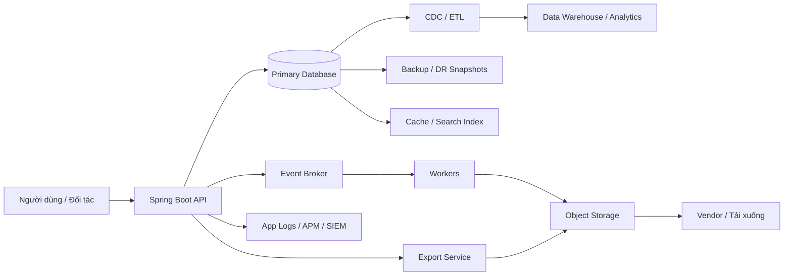
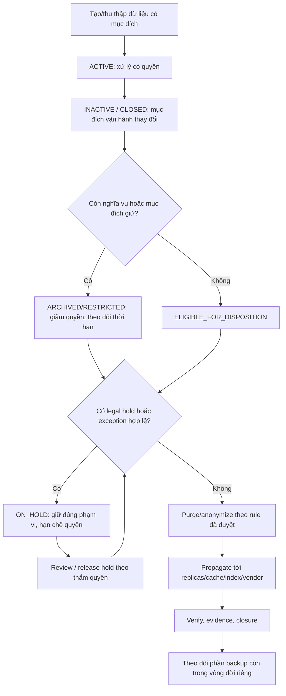
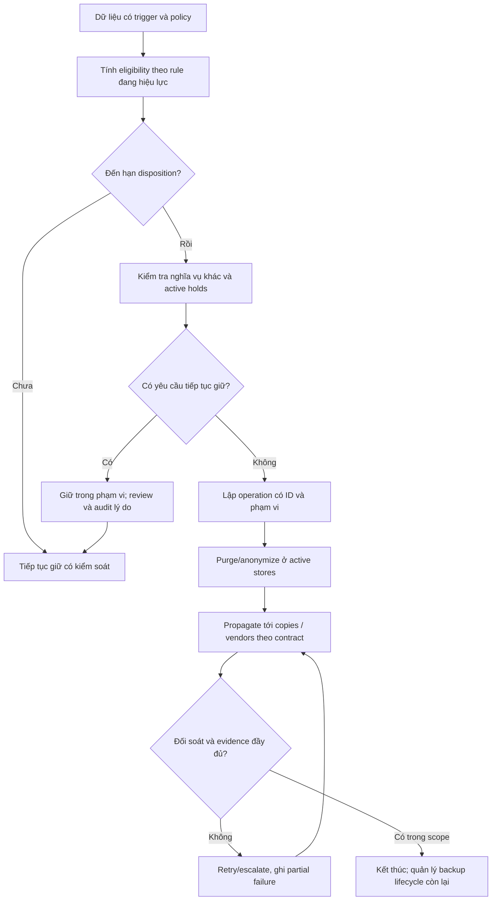
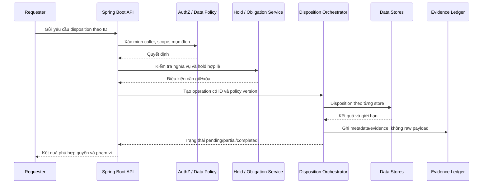

# Data retention: Thiết kế, thực thi và kiểm chứng vòng đời lưu giữ dữ liệu

## 1. Mục tiêu học tập

Sau bài học, người học có thể:

1. Giải thích **data retention** (lưu giữ dữ liệu) và lý do phải quản trị **lưu bao lâu, vì sao, ở đâu, ai được truy cập và điều gì xảy ra khi hết hạn**.
2. Phân biệt *retention*, *archiving*, *backup*, *data minimization*, *deletion/erasure*, *sanitization*, *anonymization* và *legal hold*; tránh coi việc xóa khỏi màn hình là xóa khỏi hệ thống.
3. Xây dựng **retention schedule** từ mục đích nghiệp vụ, loại tài sản, thời điểm kích hoạt (*retention trigger*), nghĩa vụ áp dụng và chính sách được phê duyệt.
4. Theo dõi các bản sao từ database, search index, object storage, logs, queue, cache, analytics, test data tới backup, nhà cung cấp và hệ thống khôi phục.
5. Thiết kế **lifecycle controls** để giữ đúng thời hạn, hạn chế truy cập, xóa khi đủ điều kiện, bảo vệ legal hold và kiểm tra được quá trình xử lý.
6. Phân tích các tình huống khó: yêu cầu xóa dữ liệu, thay đổi thời hạn, snapshot bất biến, dữ liệu phát sinh từ dữ liệu nguồn, khôi phục backup và phụ thuộc bên thứ ba.
7. Lập **risk–control–evidence mapping**, test positive/negative/failure và bằng chứng audit để đánh giá *design effectiveness* và *operating effectiveness*.
8. Áp dụng vào hệ thống Java/Spring Boot có giao dịch, lịch thanh toán, database, event broker, log, backup và công việc dọn dữ liệu định kỳ.

Bài thuộc chương **Data protection** của module **SECURITY_SECURITY_ASSURANCE**. Module hướng tới việc **đánh giá có bằng chứng rằng hệ thống đáp ứng các mục tiêu bảo mật**, từ đánh giá rủi ro, security requirements và controls đến kiểm thử, audit, khắc phục phát hiện, rồi duy trì security assurance trong phát triển và vận hành. Với data retention, câu hỏi then chốt không chỉ là “có chính sách lưu giữ không?” mà là **“mọi bản sao dữ liệu có thực sự tuân thủ chính sách ấy, và ta có đủ bằng chứng đúng phiên bản để khẳng định điều đó không?”**

## 2. Data retention là gì?

**Data retention** là việc xác định và kiểm soát **thời gian dữ liệu được giữ lại**, mục đích lưu giữ, điều kiện truy cập và việc xử lý khi thời hạn hoặc mục đích hợp lệ kết thúc.

Một chính sách retention có giá trị thực hành phải trả lời tối thiểu:

- **Dữ liệu nào?** Hồ sơ khách hàng, đơn hàng, giao dịch, nhật ký bảo mật, file xuất, bản sao dự phòng...
- **Giữ để làm gì?** Cung cấp dịch vụ, điều tra, bảo hành, kế toán, kiểm toán, nghĩa vụ hợp đồng hoặc nghĩa vụ pháp lý.
- **Thời điểm bắt đầu đếm?** Tạo bản ghi, hoàn tất giao dịch, đóng tài khoản, kết thúc hợp đồng, kết thúc vụ việc...
- **Giữ trong bao lâu?** Theo khoảng thời gian hoặc điều kiện được phê duyệt, có tham chiếu nguồn yêu cầu.
- **Ai được tiếp cận khi đang giữ?** Khác nhau giữa dữ liệu hoạt động, archive, audit evidence và backup.
- **Có ngoại lệ nào?** Legal hold, sự cố đang điều tra, tranh chấp hoặc nghĩa vụ bảo toàn thông tin có căn cứ.
- **Khi hết hạn thì sao?** Xóa, ẩn danh đủ điều kiện, chuyển trạng thái, ngăn sử dụng, chờ xử lý bản sao không thể xóa chọn lọc...
- **Đánh giá bằng cách nào?** Dữ liệu inventory, truy vấn, logs của job, test, đối soát các bản sao và evidence của nhà cung cấp.

**Lưu giữ quá lâu** làm tăng thời gian phơi nhiễm trước lộ dữ liệu, lạm dụng nội bộ, chiếm credential, tấn công ransomware và chi phí điều tra. **Xóa quá sớm** có thể làm mất thông tin cần thiết để cung cấp dịch vụ, giải quyết tranh chấp, phục hồi hoặc đáp ứng nghĩa vụ.

Vì vậy, mục tiêu không phải “xóa càng sớm càng tốt trong mọi trường hợp”, mà là **giữ đúng dữ liệu, đúng mục đích, đúng thời hạn và xử lý đúng khi điều kiện thay đổi**.

### 2.1. Data retention là một control theo vòng đời, không chỉ một cron job

Một tác vụ chạy mỗi đêm xóa các bản ghi có `created_at` cũ **không chứng minh chính sách retention được đáp ứng** nếu:

- Hệ thống dùng sai mốc bắt đầu đếm.
- Có giao dịch còn nghĩa vụ lưu giữ dài hơn.
- Một legal hold đang yêu cầu bảo toàn.
- Dữ liệu còn trong search index, logs, cache, object store hoặc nhà cung cấp.
- Bản ghi bị xóa khỏi bảng chính nhưng đã được xuất thành file tải xuống.
- Tác vụ thất bại mà không có phát hiện, retry và đối soát.
- Cơ chế xóa không tương thích với backup/recovery hoặc kiểm toán.

Do đó, data retention phải được thiết kế như **một chương trình policy + architecture + operations + verification**.

## 3. Phân biệt retention với các khái niệm gần nhau

| Khái niệm | Mục đích | Ví dụ | Điều không được suy diễn |
| --- | --- | --- | --- |
| **Retention** | Quy định việc tiếp tục giữ dữ liệu theo thời hạn/mục đích | Giữ hồ sơ giao dịch cho đến khi hết thời hạn theo policy | Không tự nói dữ liệu ở đâu hoặc đã xóa |
| **Archiving** | Di chuyển thông tin ít dùng sang môi trường lưu dài hạn/chi phí khác | Chuyển hồ sơ đóng sang kho archive được kiểm soát | Archive vẫn là **dữ liệu đang giữ**, không phải xóa |
| **Backup** | Cho phép khôi phục sau sự cố hoặc mất dữ liệu | Snapshot database và object storage | Backup không phải “kho dữ liệu vô hạn” để tránh retention |
| **Data minimization** | Hạn chế dữ liệu được thu thập/xử lý so với nhu cầu | Chỉ lưu mã giao dịch thay vì cả payload định danh | Thu ít không thay thế chính sách thời hạn |
| **Data deletion** | Xóa dữ liệu khỏi nơi lưu/tập bản ghi theo thiết kế | Purge bản ghi hết hạn trong database | Có thể còn bản sao và vấn đề xóa vật lý |
| **Erasure / sanitization** | Làm dữ liệu không còn có thể được truy cập hoặc phục hồi theo yêu cầu/mức bảo đảm | Làm sạch media trước hủy/điều chuyển | Cần xác định phương pháp, phạm vi và xác minh |
| **Anonymization** | Biến dữ liệu thành dạng không còn gắn với cá nhân theo tiêu chí phù hợp | Báo cáo thống kê đã loại khả năng tái định danh ở mức cần thiết | Chỉ hash ID thường là **pseudonymization**, không mặc định ẩn danh |
| **Pseudonymization** | Thay định danh trực tiếp bằng mã, còn khả năng liên kết theo điều kiện | Mã tham chiếu có bảng ánh xạ riêng | Vẫn có thể là dữ liệu cần bảo vệ và retention |
| **Legal hold** | Tạm bảo toàn tập dữ liệu có phạm vi vì yêu cầu pháp lý/điều tra hợp lệ | Giữ records liên quan tranh chấp dù kỳ thường đã hết | Không cho phép giữ vô thời hạn mọi dữ liệu khác |

Những cơ chế trên có quan hệ với nhau nhưng **phục vụ mục đích khác nhau**. Chẳng hạn, backup có thể chứa dữ liệu đã xóa ở database chính trong một khoảng thời gian do vòng đời backup; phải mô tả chính xác điều đó và kiểm soát khi phục hồi.

## 4. Từ risk assessment đến retention objectives

Một chương trình security assurance nên khởi đầu bằng **tài sản, mối đe dọa và nghĩa vụ** thay vì sao chép một con số retention cố định vào toàn bộ hệ thống.

Ví dụ:

| Tài sản | Kịch bản rủi ro | Mục tiêu kiểm soát |
| --- | --- | --- |
| Hồ sơ khách hàng | Dữ liệu cũ tồn tại quá lâu và bị truy cập trái phép | Không giữ trường cá nhân lâu hơn thời hạn/mục đích được phép |
| Ledger giao dịch | Xóa trước khi hết nghĩa vụ lưu chứng từ, mất khả năng đối soát | Giữ đúng những records cần thiết, có bảo vệ và khả năng truy vết |
| Security logs | Log mất quá sớm, không điều tra được sự cố | Bảo đảm log trọng yếu còn trong kỳ được xác định và không bị sửa trái phép |
| File export | Link và bản sao dữ liệu nhạy cảm tồn tại sau khi công việc kết thúc | Có expiry, giới hạn quyền và cơ chế purge sau thời hạn |
| Backup | Dữ liệu cũ hoặc bí mật bị lộ qua bản sao | Bảo vệ, giới hạn vòng đời và khôi phục đúng phạm vi |
| Data warehouse | Bản sao dữ liệu cá nhân vượt mục đích phân tích | Giữ đúng trường/khả năng liên kết được phê duyệt, có hạn và xóa/giảm định danh |
| Provider data | Vendor giữ thông tin sau chấm dứt dịch vụ | Có trách nhiệm, thời hạn và bằng chứng xử lý dữ liệu từ bên thứ ba |

### 4.1. Mục tiêu kiểm soát có thể kiểm chứng

Một phát biểu yếu:

> “Dữ liệu được lưu theo quy định.”

Phát biểu tốt hơn:

> Đối với từng loại dữ liệu trong phạm vi dịch vụ thanh toán, tổ chức phải xác định **mục đích, nguồn yêu cầu, retention trigger và thời hạn có hiệu lực**; mọi bản sao thuộc trách nhiệm quản lý phải được bảo vệ trong thời gian giữ, được xử lý khi hết hạn trừ ngoại lệ hợp lệ, và có **bằng chứng kiểm chứng theo môi trường, phiên bản và kỳ vận hành**.

Mục tiêu mạnh hơn vì xác định **đối tượng, đầu vào của policy, cơ chế xử lý và cách chứng minh**, nhưng không áp đặt một thời hạn tùy tiện.

## 5. Xác định thời hạn: pháp lý, hợp đồng, nghiệp vụ và an toàn

Thời hạn lưu giữ phụ thuộc **quốc gia/vùng tài phán, loại thông tin, ngành nghề, mục đích xử lý, hợp đồng và nghĩa vụ thực tế**. Không có một quy tắc toàn cầu như “mọi dữ liệu cá nhân giữ 30 ngày” hoặc “mọi log phải giữ 7 năm”.

Có thể phân loại nguồn:

1. **Nghĩa vụ bắt buộc:** pháp luật hoặc quy định áp dụng cho dữ liệu/quy trình.
2. **Nghĩa vụ hợp đồng:** thỏa thuận với khách hàng, bên xử lý dữ liệu hoặc nhà cung cấp.
3. **Mục đích nghiệp vụ hợp lệ:** vận hành dịch vụ, chăm sóc khách hàng, bảo hành, đối soát hoặc kiểm toán.
4. **Nhu cầu an toàn:** log để phát hiện/điều tra, backup để phục hồi, bằng chứng kiểm soát.
5. **Chính sách nội bộ đã duyệt:** tiêu chuẩn phân loại dữ liệu, lịch lưu trữ và các mốc rà soát.
6. **Ngoại lệ bảo toàn:** legal hold, tranh chấp, yêu cầu điều tra hợp lệ, nghĩa vụ chưa hoàn thành.

Các nguồn có thể tạo **điều kiện xung đột hoặc chồng lấn**. Người phụ trách dữ liệu, Legal/Privacy, nghiệp vụ và Security cần giải thích phạm vi áp dụng, giải quyết xung đột theo chính sách đúng thẩm quyền và lưu quyết định.

### 5.1. Hai lỗi đối lập

**Lỗi A — Xóa theo yêu cầu mà không xét nghĩa vụ:** Khách hàng đóng tài khoản; ứng dụng xóa toàn bộ lịch sử giao dịch ngay, trong khi có records phải được giữ theo nghĩa vụ áp dụng.

**Lỗi B — Giữ vô hạn do “có thể cần”:** Dịch vụ tiếp tục giữ mọi payload debug và ảnh giấy tờ đã hết mục đích chỉ vì “có thể cần kiểm toán”, không có căn cứ, hạn hoặc người sở hữu.

Cách xử lý tốt là **tách dữ liệu/field theo mục đích và nghĩa vụ**, giới hạn quyền đối với phần còn cần giữ, xóa các bản sao không còn cần thiết, đồng thời ghi lý do rõ.

### 5.2. Không tự áp một thời hạn minh họa thành nghĩa vụ

Trong bài học, các khoảng “7 ngày”, “90 ngày” hoặc “5 năm” có thể hữu ích để mô phỏng thuật toán. Nếu dùng, đó chỉ là **giá trị giả định phục vụ kiểm thử**, không phải diễn giải pháp luật Việt Nam hay một tiêu chuẩn bắt buộc. Hệ thống thật phải lấy thời hạn từ **retention schedule đã phê duyệt và nguồn yêu cầu có phiên bản**.

## 6. Retention schedule: hồ sơ điều hành trung tâm

**Retention schedule** là danh mục xác định **mỗi lớp dữ liệu được giữ trong điều kiện nào**, ai chịu trách nhiệm và cách xử lý khi hết hạn.

Một bản ghi nên có:

| Trường | Ý nghĩa |
| --- | --- |
| Data class / record type | Loại dữ liệu và mô tả cụ thể |
| Business purpose | Mục đích lưu giữ được phê duyệt |
| Legal/contract/policy basis | Nguồn nghĩa vụ, phiên bản, vùng áp dụng và chủ thể quyết định |
| Data owner | Người chịu trách nhiệm mục đích/phân loại/retention |
| System/location | Database, object store, SIEM, analytics, vendor hoặc backup |
| Retention trigger | Sự kiện bắt đầu tính thời gian, có nguồn xác minh |
| Retention period/condition | Khoảng thời gian hoặc điều kiện hết hạn |
| Disposition action | Purge, archive rồi purge, anonymize khi hợp lệ hoặc phương pháp khác |
| Hold/exception handling | Điều kiện và thẩm quyền tạm hoãn disposition |
| Access while retained | Ai được dùng dữ liệu và vì mục đích nào |
| Evidence/verification | Report, test và nhật ký chứng minh việc lưu/xóa đúng |
| Effective date/review | Phiên bản lịch có hiệu lực và trigger xem lại |

### 6.1. Ví dụ retention schedule giả định

**Các thời hạn trong bảng chỉ là dữ liệu minh họa cho hệ thống huấn luyện, không phải yêu cầu của một luật hay chuẩn.**

| Data class | Trigger | Thời hạn minh họa | Disposition | Owner |
| --- | --- | --- | --- | --- |
| API debug trace không chứa dữ liệu cần giữ | Thời điểm ghi trace | 14 ngày | Purge khỏi log store theo lifecycle | SRE |
| File CSV export phục vụ một ticket | Khi file được tạo | 48 giờ | Thu hồi link và purge object theo policy | Product/Service Owner |
| Cache response có dữ liệu cá nhân | Cache insertion/refresh | Phút hoặc giờ theo policy | Expire/invalidate và giới hạn nội dung | Engineering |
| Ticket hỗ trợ đã đóng | Ngày case đóng hợp lệ | 180 ngày | Xóa phần không còn cần, archive có kiểm soát phần cần giữ | Customer Support Owner |
| Hồ sơ giao dịch thuộc nghĩa vụ lưu chứng từ | Sự kiện kết thúc nghiệp vụ theo quy định áp dụng | Theo lịch pháp lý được xác nhận, không gán số giả | Lưu có bảo vệ, purge sau khi đủ điều kiện | Finance/Legal/Data Owner |
| Backup database | Thời điểm snapshot | Theo backup/DR policy đã duyệt | Hết hạn snapshot, xử lý đúng media/khóa | Platform/SRE |

**Không được copy các con số minh họa vào production.** Quan trọng hơn con số là **ngữ nghĩa trigger, phạm vi bản sao, đối tượng quyết định và bằng chứng thực thi**.

## 7. Retention trigger và cách xác định thời điểm hết hạn

Một lỗi phổ biến là dùng `created_at` làm điểm bắt đầu cho mọi dữ liệu. Trong thực tế, khoảng lưu có thể bắt đầu ở nhiều sự kiện:

- Ngày ghi record.
- Ngày giao dịch hoàn tất/đối soát xong.
- Ngày hợp đồng kết thúc.
- Ngày người dùng đóng tài khoản thành công.
- Ngày đóng ticket hoặc kết thúc điều tra.
- Ngày bản ghi có phiên bản mới thay thế bản cũ.
- Ngày nghĩa vụ cụ thể kết thúc hoặc điều kiện được xác nhận.
- Ngày tạo một bản sao tạm, như export hoặc cache.

Một cách mô tả:

\[
expiration\_time = retention\_trigger\_time + approved\_retention\_period
\]

Công thức chỉ đúng với chính sách **tính từ một thời điểm cộng thời lượng**. Một số quy tắc yêu cầu tính theo **cuối năm tài chính, thời điểm đạt điều kiện, hoặc sự kiện nghiệp vụ khác**; cần triển khai bộ quy tắc tương ứng thay vì cộng một hằng số.

### 7.1. Mốc thời gian phải có nguồn đáng tin

Không được tin “ngày đóng hồ sơ” do client tự gửi nếu có thể thay đổi thời hạn lưu tùy ý. Từ góc độ assurance, cần biết:

- Sự kiện nào khởi tạo đồng hồ retention?
- Actor/hệ thống nào có quyền tạo hoặc sửa mốc đó?
- Có thể ghi lùi ngày (*backdate*) hay sửa `completed_at` không?
- Có audit trail cho thay đổi trạng thái và mốc thời gian không?
- Nếu trạng thái được mở lại, policy nào quyết định đồng hồ có đặt lại hay giữ nguyên?
- Hệ thống dùng `Instant` theo UTC hay diễn giải lịch theo timezone/ngày pháp lý?
- Nếu định nghĩa “năm”/“tháng”, xử lý ngày nhuận, DST và lịch như thế nào?

Cần **định nghĩa chính xác trong policy**, không để một tác vụ dọn dữ liệu tự đoán.

### 7.2. Ngày đến hạn khác ngày được phép purge

Có những trường hợp record đã đến mốc hết kỳ thường nhưng **chưa được purge** vì legal hold hoặc nghĩa vụ khác vẫn còn hiệu lực. Nên phân biệt:

- `eligible_at`: mốc record có thể được xem xét disposition theo lịch.
- `hold_status`: có điều kiện giữ bổ sung hay không.
- `disposition_approved_at`: nếu chính sách yêu cầu phê duyệt.
- `purged_at`: thời điểm thực thi xóa ở một hệ lưu cụ thể.
- `replica_completed_at`: thời điểm các bản sao thuộc scope được xác minh.

Việc chỉ có `eligible_at < now` không có nghĩa được phép xóa ngay mọi nơi.

## 8. Data inventory và data-flow mapping

Muốn thực thi retention cần biết **dữ liệu đã đi đâu**. Không thể chỉ liệt kê “database chính” nếu ứng dụng gửi cùng dữ liệu sang nhiều đường khác.



Các bản sao cần rà soát:

1. **Transactional stores:** database chính, bảng history, audit/event store, materialized views.
2. **Storage thứ cấp:** read replica, cache, search index, document/object storage.
3. **Asynchronous data:** broker topics, dead-letter queues, retry payloads và outbox.
4. **Observability:** application logs, access logs, traces, crash dumps, SIEM và APM.
5. **Analytics:** ETL/CDC, data warehouse, lake, machine-learning datasets, derived features.
6. **User-facing artifacts:** exports, reports, downloads, notification attachments.
7. **Recovery media:** snapshots, backup, offline copies, disaster recovery.
8. **Non-production:** staging, sandbox, QA test fixtures, nhân bản dữ liệu thật.
9. **Third parties:** dịch vụ thanh toán, SaaS, nhà cung cấp hạ tầng và bên xử lý dữ liệu.
10. **Human workflows:** email attachments, shared drives, tài liệu điều tra và hồ sơ audit.

### 8.1. Data lineage hữu ích hơn danh sách sản phẩm

Với mỗi loại dữ liệu, ghi:

> **Nguồn tạo → nơi truyền/biến đổi → bản sao hiện có → người sở hữu → policy áp dụng → cách purge/giảm định danh → bằng chứng.**

Ví dụ, một thay đổi backend không chỉ thêm cột PII trong database. Nó có thể làm **payload JSON của event, log lỗi hoặc export CSV** cũng chứa PII. Nếu data inventory chưa cập nhật, không thể khẳng định retention bao phủ đầy đủ.

## 9. Các nguyên tắc thiết kế retention controls

### 9.1. Purpose limitation và data minimization

Giữ dữ liệu đúng mục đích; không dùng “có thể hữu ích về sau” làm lý do vô hạn. Nếu một báo cáo chỉ cần thống kê, xem xét **tổng hợp dữ liệu hoặc giảm định danh** thay vì giữ hồ sơ cá nhân dài hạn.

### 9.2. Policy có định danh và được phê duyệt

Thời hạn phải liên kết `policy_id`, phiên bản, nguồn yêu cầu, owner và ngày hiệu lực. Không để từng service hard-code thời hạn khác nhau không ai biết.

### 9.3. Separation of duties

Người có quyền thay policy retention, bật legal hold hoặc xóa kho archive có thể tác động lớn. Nên tách quyền phù hợp với mức rủi ro, yêu cầu approval và audit; không cho một job vận hành tự thay đổi cả điều kiện và bằng chứng của nó.

### 9.4. Least privilege trong thời gian giữ

Dữ liệu còn được lưu không đồng nghĩa còn được phép truy cập cho mọi mục đích. Sau khi ticket đóng, hồ sơ cần giữ để giải quyết tranh chấp có thể chuyển sang kho hạn quyền và không còn hiện trên trang hỗ trợ thường ngày.

### 9.5. Disposition phải hoàn tất xuyên bản sao

Một purge operation phải xác định nơi được xóa, nơi chỉ hết hạn theo vòng đời riêng và nơi cần chứng cứ từ vendor. **Không coi xóa bản ghi chính là xóa toàn bộ dữ liệu.**

### 9.6. Error handling và idempotency

Job phải an toàn khi retry, restart, mất kết nối và nhận trùng event. Không xóa nhầm record ngoài điều kiện; nếu xóa một phần, phải phát hiện và tiếp tục xử lý có kiểm soát.

### 9.7. Traceability và evidence

Mỗi claim “đã xóa theo policy” phải dẫn tới **loại dữ liệu, scope, policy version, job/run ID, kết quả, đối soát và giới hạn**. Không lưu nguyên dữ liệu đã xóa vào log chỉ để chứng minh xóa.

## 10. Lifecycle state machine: từ tạo đến disposition

Một quy trình thực tế thường có nhiều giai đoạn:



**Không phải tất cả dữ liệu đều phải đi qua archive.** Một bản cache ngắn hạn có thể expire trực tiếp; một chứng từ bắt buộc giữ có thể chuyển trạng thái hạn chế mà không di chuyển vật lý.

### 10.1. Legal hold không tự làm mới đồng hồ retention

Nếu bản ghi đã hết kỳ thường nhưng legal hold còn hiệu lực, hệ thống giữ lại theo ngoại lệ. Khi hold được gỡ, cần **đánh giá lại toàn bộ nghĩa vụ còn hiệu lực** và xử lý disposition. Không mặc nhiên bắt đầu lại một kỳ lưu thông thường hoàn toàn mới trừ khi chính sách có căn cứ yêu cầu.

### 10.2. Archival không đồng nghĩa giảm rủi ro nếu quyền vẫn rộng

Chuyển dữ liệu từ database sang object storage nhưng bucket vẫn cho developer, worker hoặc analytics dùng tự do **không giải quyết yêu cầu need-to-know hay bảo vệ retention**.

Archive cần policy về:

- Access theo purpose và role.
- Encryption/key management khi phù hợp.
- Immutable/WORM khi có căn cứ, với vòng đời đã xác định.
- Audit event và quyền truy xuất.
- Khả năng tìm/retrieve theo nghĩa vụ, nhưng không cho phép khai thác ngoài mục đích.
- Điều kiện disposition sau khi hết hạn.

## 11. Legal hold: giữ lại có phạm vi và bằng chứng

**Legal hold** hoặc một biện pháp bảo toàn có cơ sở tương tự có thể yêu cầu tạm giữ dữ liệu liên quan vụ việc, điều tra hoặc tranh chấp.

Một hệ thống nên ghi:

| Thuộc tính hold | Ý nghĩa |
| --- | --- |
| Hold ID/case ID | Định danh duy nhất cho yêu cầu bảo toàn |
| Authority/approver | Nguồn/đơn vị có quyền theo policy |
| Scope | Loại bản ghi, khách hàng, giao dịch, kỳ hoặc tập đối tượng liên quan |
| Reason | Mục đích và căn cứ bảo toàn |
| Effective time | Thời điểm hold có hiệu lực và phạm vi áp dụng |
| Current state | Active, under review, released, revoked theo quy trình |
| Owner/reviewer | Người kiểm tra sự cần thiết tiếp tục giữ |
| Access controls | Ai được xem, trích xuất hoặc xử lý dữ liệu đang hold |
| Release decision | Ai quyết định kết thúc và bằng chứng tương ứng |
| Audit/evidence | Thay đổi scope, phê duyệt, tác vụ purge bị chặn và lịch sử |

### 11.1. Một rule quan trọng: purge không được thắng hold

Khi một bản ghi đủ điều kiện hết hạn nhưng hold còn hiệu lực:

1. Tác vụ dọn kiểm tra hold theo nguồn được phê duyệt.
2. Bản ghi không bị purge trong scope hold.
3. Hệ thống ghi số lượng/ID kỹ thuật cần thiết, không lộ nội dung.
4. Hold được review theo chu kỳ hoặc trigger.
5. Khi release được phê duyệt, tác vụ đánh giá lại retention và các nghĩa vụ khác.
6. Nếu đủ điều kiện, disposition được thực hiện và xác minh.

Không nên để một cơ chế xóa hàng loạt hoặc TTL ở nhà cung cấp **bỏ qua hold** nếu hold phải áp dụng cho dữ liệu đó. Cần chọn kiến trúc/lifecycle tool có khả năng bảo toàn đúng phạm vi hoặc thiết kế bản lưu giữ hợp lệ.

### 11.2. Không dùng legal hold làm “công tắc giữ mãi”

Mở hold rộng toàn bộ dataset nhưng không có lý do, owner hoặc review có thể trở thành một đường **bỏ qua retention vô thời hạn**. Điều này tạo rủi ro bí mật và governance. Phải bảo đảm quyền tạo, thay và release hold được quản trị, truy vết và rà soát.

## 12. Các yêu cầu xóa dữ liệu và quyền của chủ thể dữ liệu

Một yêu cầu “xóa dữ liệu của tôi” không nhất thiết dẫn tới xóa mọi bản ghi ngay lập tức; mức độ và thời hạn xử lý phụ thuộc **phạm vi yêu cầu, xác thực người yêu cầu và các nghĩa vụ còn hiệu lực**.

Quy trình khái quát:

1. Tiếp nhận yêu cầu qua kênh được quản lý.
2. Xác minh danh tính/quyền đại diện phù hợp, tránh xóa hồ sơ người khác.
3. Tìm các loại dữ liệu và bản sao liên quan theo data inventory.
4. Đối chiếu mục đích xử lý và nghĩa vụ tiếp tục giữ, legal hold hoặc ngoại lệ.
5. Xác định phần có thể xóa, phần phải giữ có giới hạn và thời điểm xử lý.
6. Lập tác vụ disposition theo hệ thống, kể cả bên xử lý dữ liệu khi phù hợp.
7. Theo dõi tiến độ, xử lý lỗi, ghi bằng chứng mà không lưu thêm thông tin quá mức.
8. Thông báo kết quả/giới hạn theo chính sách và nghĩa vụ áp dụng.

### 12.1. Đóng tài khoản khác với xóa ledger

Ví dụ ngân hàng giả định:

- Tài khoản người dùng có thể bị đóng và không còn truy cập dịch vụ.
- Một số bản ghi hồ sơ/marketing có thể không còn mục đích và cần xóa/giảm định danh.
- Một số records giao dịch có thể phải lưu theo nghĩa vụ phù hợp.
- Dữ liệu còn giữ cần **giảm quyền truy cập và không tiếp tục sử dụng cho mục đích đã chấm dứt**.

**Đóng tài khoản không tự đồng nghĩa dữ liệu đã bị erasure**, và việc còn nghĩa vụ lưu chứng từ không có nghĩa được tiếp tục sử dụng dữ liệu để gửi quảng cáo.

## 13. Xử lý dữ liệu active database: soft delete và hard delete

### 13.1. Soft delete

Soft delete thường đặt một trường như `deleted_at`, `is_deleted` hoặc chuyển trạng thái hồ sơ.

**Ưu điểm:** hỗ trợ nghiệp vụ, phục hồi nhầm lẫn, đồng bộ và truy vết theo thiết kế.

**Giới hạn:** dữ liệu **vẫn tồn tại** trong database, snapshots, indexes; một truy vấn thiếu filter có thể trả dữ liệu đã “xóa”; người có quyền đọc trực tiếp DB vẫn xem được nếu chưa có controls khác.

Do đó, soft delete là **thay đổi trạng thái và khả năng hiển thị**, không mặc nhiên là xóa vĩnh viễn.

### 13.2. Hard delete và purge

Hard delete xóa bản ghi theo cơ chế của database/storage. Nhưng vẫn cần biết:

- Có **foreign keys** và bảng con/history chứa bản sao hoặc dữ liệu liên kết không?
- Có binlog/WAL/CDC, replica hoặc snapshot giữ dữ liệu không?
- Có search index/warehouse nhận payload trước đây không?
- Có archive hoặc legal hold phải được bảo toàn?
- Xóa vật lý từng block có được bảo đảm bởi database? Thường không thể suy diễn từ một lệnh SQL.
- Khi khôi phục backup, có thể xuất hiện lại bản ghi đã purge?

**Purge ở lớp ứng dụng** chỉ là một phần của vòng đời xóa; chính sách disposition phải mô tả **độ bảo đảm và phạm vi hoàn tất**.

### 13.3. Cần xác định tiêu chuẩn hoàn tất

Ví dụ hai mốc:

- **Operational deletion:** bản ghi không còn truy cập được qua các hệ thống hoạt động được xác định sau một chu kỳ xử lý có giới hạn.
- **Full lifecycle expiration:** những bản sao backup/snapshot liên quan đã hết vòng đời hoặc đã được xử lý theo phương pháp được duyệt; không còn khả năng tái xuất hiện ngoài policy.

Phải ghi rõ **trường hợp nào chứng minh mốc nào**, không báo xóa toàn bộ khi mới hoàn tất database chính.

## 14. Cache, search index, event broker và dead-letter queue

### 14.1. Cache

TTL có thể giúp dữ liệu cache hết hạn, nhưng cần xem:

- TTL gắn mốc nào và có được kéo dài khi truy cập lại?
- Có dữ liệu nhạy cảm trong key/value hay chỉ metadata?
- Người dùng mất quyền thì response cache cũ còn truy cập được không?
- Có bản sao cache replica, snapshot hoặc persistence trên đĩa không?
- Có cơ chế invalidation khi người dùng yêu cầu xóa không?

TTL là một loại **retention control** hữu ích nhưng cần kiểm chứng với kiến trúc và cấu hình thực tế.

### 14.2. Search index

Khi xóa bản ghi ở database, search index có thể vẫn lưu tên, số tài khoản một phần, nội dung ticket và metadata cho đến lần đồng bộ tiếp theo.

Cần:

1. Truy vết document ID đến record nguồn.
2. Phát event hoặc tiến hành reconciliation để update/delete.
3. Kiểm tra index pipeline nếu CDC thất bại.
4. Xác minh kết quả search không trả thông tin hết hạn và alias/index cũ không còn phục vụ.
5. Quản lý snapshot search riêng nếu có.

### 14.3. Event broker và outbox

Broker thường có cấu hình retention riêng theo topic, kích thước hoặc thời gian. Cần nhận diện **payload chứa dữ liệu cá nhân và thời hạn cần giữ**, không mặc định event luôn vô hại.

- Topic/queue retention phải có căn cứ, không để mặc định quá dài không được kiểm tra.
- Dead-letter queue có thể giữ nguyên payload lỗi rất lâu; cần retention và quyền truy cập riêng.
- Outbox và inbox/idempotency table có thời hạn riêng, đồng bộ với rủi ro retry và đối soát.
- Replayed event từ dữ liệu cũ không được tự làm sống lại bản ghi đã purge ngoài policy.
- Nếu event lịch sử cần cho audit, phải chọn cách **giảm dữ liệu nhạy cảm hoặc lưu bằng cơ chế phù hợp**, không giữ mọi payload vô hạn.

### 14.4. Log và trace

Application logs, APM, error tracking và SIEM có thể lưu PII qua query string, exception, request body hoặc debug payload. Data retention phải phối hợp với **log minimization**, policy lưu log và quyền đọc log. Một log job chỉ ghi “deleted 120 records” thường ít nhạy cảm hơn ghi toàn bộ họ tên/số tài khoản vừa bị xóa.

## 15. Backup, snapshots và disaster recovery

Backup phục vụ **khôi phục**, không phải kho vĩnh viễn tránh yêu cầu xử lý dữ liệu. Đồng thời, không phải hệ backup nào cũng hỗ trợ **xóa một record bên trong một snapshot bất biến** mà không phá toàn vẹn khả năng khôi phục.

### 15.1. Cần mô tả backup retention riêng

Một backup policy cần xác định:

- Những hệ thống/dữ liệu nào được backup.
- Tần suất, phiên bản, loại backup và chu kỳ hết hạn.
- Storage, region và quyền truy cập/giải mã.
- Cách bảo vệ trước bị xóa/sửa trái phép, ransomware và lộ bản sao.
- Khi record đã purge ở primary, backup còn chứa nó trong bao lâu.
- Các nghĩa vụ riêng về lưu chứng từ và legal hold có ảnh hưởng tới backup không.
- Cơ chế restore bảo đảm **không tái kích hoạt dữ liệu bị xóa trái policy**.
- Bằng chứng backup expiry, restore tests và media disposal.

**Không nên tuyên bố “xóa ngay khỏi mọi backup”** nếu hệ thống không hỗ trợ thao tác ấy. Cần ghi kiến trúc thực tế, giới hạn, lịch hết hạn và biện pháp bảo vệ bản sao.

### 15.2. Restore có thể làm hồi sinh dữ liệu hết hạn

Một failure mode:

1. Ngày D, người dùng được xử lý yêu cầu xóa theo policy tại database chính.
2. Ngày D+1, hệ thống phải restore từ snapshot trước D.
3. Snapshot chứa dữ liệu đã được purge ngày D.
4. Nếu ứng dụng đưa snapshot vào phục vụ mà không reconciliation, dữ liệu bị xóa có thể xuất hiện lại.

Một phương án cần thiết kế **reconciliation của các lệnh disposition đã được xác nhận**, có nhật ký/bằng chứng đủ tin cậy hoặc cơ chế suppression được bảo vệ, trước khi phục vụ dữ liệu phục hồi theo policy.

Không mặc định một danh sách tombstone duy nhất là giải pháp hoàn hảo; bản ghi suppression có thể cần giữ định danh tối thiểu, được bảo vệ và có vòng đời/nguồn xác minh riêng.

### 15.3. Snapshot immutability và hold

Snapshot bất biến giúp chống xóa phá hoại, nhưng có thể làm khó disposition từng đối tượng. Security Architect cần phân tích **mức bảo vệ, vòng đời backup, khả năng khôi phục, legal hold, giới hạn truy cập và thời điểm expiration**, sau đó lập luận rủi ro còn lại với dữ liệu thật.

## 16. Data warehouse, analytics, ML và dữ liệu phát sinh

Dữ liệu tạo từ dữ liệu nguồn không phải lúc nào cũng miễn retention.

Các tập cần xem:

- Bảng ETL và staging.
- Raw data lake, parquet/object partitions.
- Data warehouse và materialized views.
- Feature store và tập huấn luyện ML.
- Báo cáo phân tích/BI và file extract.
- Data products đã được chia sẻ cho một đội/bên ngoài.
- Bảng mapping giữa định danh gốc và mã giả danh.

### 16.1. Derived data vẫn có thể nhận diện

Ví dụ:

- Thay `customer_id` bằng hash nhưng giữ địa chỉ, ngày giao dịch, mẫu hoạt động và một bảng ánh xạ có thể **vẫn cho phép nhận diện lại**.
- Một bản tổng hợp có số liệu cho nhóm chỉ một khách hàng có thể tiết lộ thông tin của họ.
- Một embedding hoặc mô hình có thể gây rủi ro lộ thông tin trong điều kiện nhất định; không mặc định “đã đưa vào ML nên dữ liệu cá nhân biến mất”.

Cần đánh giá **khả năng tái định danh theo bối cảnh**, không chỉ thao tác kỹ thuật vừa làm.

### 16.2. Data contracts cho downstream

Một hợp đồng luồng dữ liệu có thể quy định:

| Thuộc tính | Ví dụ |
| --- | --- |
| Source | Transaction API / `transaction_completed` event |
| Data classes | Reference, amount, status, PII fields đã được duyệt |
| Purpose | Đối soát hoặc phân tích được phê duyệt |
| Consumer | Reconciliation service / analytics team |
| Allowed retention | Chính sách và điều kiện riêng theo purpose |
| Prohibited copies | Không đưa raw sensitive payload vào debug logs |
| Disposition signal | Record expiry, delete event, batch reconciliation |
| Evidence | Consumer config, purge report, reconciliation test |
| Responsible owner | Team dữ liệu/consumer và data owner |

Khi thêm consumer, retention review phải diễn ra **trước khi dữ liệu mới chảy sang hệ thống đó**.

## 17. Third-party retention và trách nhiệm dữ liệu

Nhà cung cấp thanh toán, SaaS, analytics, cloud storage hoặc external support có thể xử lý dữ liệu và giữ bản sao.

Một **shared-responsibility matrix** cần trả lời:

1. Bên nào là người quyết định mục đích/thời hạn và bên nào xử lý thay?
2. Hợp đồng, điều khoản và nghĩa vụ áp dụng yêu cầu gì về retention/disposition?
3. Có phụ nhà cung cấp hoặc subprocessors không?
4. Có thể yêu cầu xóa/chấm dứt xử lý ở mức record hoặc toàn bộ dataset không?
5. Nhà cung cấp có backup riêng và lịch hết hạn thế nào?
6. Khi hợp đồng chấm dứt, dữ liệu được xuất/chuyển/giữ/xóa ra sao?
7. Bằng chứng nào chứng minh thao tác xóa đã thực thi và còn giới hạn gì?
8. Nếu provider chỉ cung cấp tài liệu chung, có đủ hỗ trợ claim cho dữ liệu cụ thể này không?

### 17.1. Ví dụ chia sẻ

Ứng dụng gửi cho payment provider dữ liệu cần thiết để thực hiện lệnh. Provider có thể có nghĩa vụ lưu chứng từ riêng; application owner **không tự điều khiển mọi bản sao bên ngoài**.

Trong assurance cần:

- Ghi nguồn, mục đích, phạm vi, trách nhiệm hợp đồng.
- Không gửi thêm dữ liệu không cần thiết.
- Xác định retention của bản sao do ứng dụng kiểm soát và nghĩa vụ riêng của provider.
- Lưu bằng chứng đã yêu cầu hoặc nhận xác nhận disposition khi phù hợp.
- Công bố phần nào **nằm ngoài quyền kiểm chứng trực tiếp**.

Một chứng nhận hoặc một dòng trong hợp đồng **không tự chứng minh mọi record bên thứ ba đã được xóa**.

## 18. Secure deletion, media sanitization và cryptographic erasure

### 18.1. Xóa logic khác xóa khỏi phương tiện lưu trữ

Trên một số hệ thống, xóa file hoặc row làm metadata mất liên kết nhưng dữ liệu vật lý có thể còn một thời gian do filesystem, storage layers hoặc backup. Cần phân biệt **tính không thể truy cập theo ứng dụng** với **bảo đảm không thể phục hồi theo phương pháp sanitization**.

Đối với media tái sử dụng, hủy, chuyển quyền hoặc ngừng dịch vụ, tổ chức có thể tham khảo các hướng dẫn thích hợp về **media sanitization** (chẳng hạn họ hướng dẫn NIST SP 800-88 theo phiên bản được áp dụng), rồi chọn phương pháp tương xứng **loại media, dữ liệu, rủi ro và trách nhiệm nhà cung cấp**.

### 18.2. Cryptographic erasure

**Cryptographic erasure** dựa vào việc dữ liệu được mã hóa phù hợp và **khóa cần thiết để giải mã thực sự bị xử lý khiến dữ liệu không thể khôi phục theo mức bảo đảm mục tiêu**.

Nó không phải “chỉ cần rotate key”:

- Nếu khóa cũ, backup key, escrow hoặc bản plaintext còn tồn tại thì dữ liệu có thể vẫn đọc được.
- Nếu một khóa dùng chung cho nhiều dữ liệu còn cần giữ, hủy nó có thể gây mất dữ liệu hợp lệ.
- Chất lượng thuật toán, quản lý khóa, vùng lưu bản sao và xác minh hủy khóa quyết định mức assurance.
- Cần lưu bằng chứng key lifecycle và phạm vi data encryption, không chỉ một log “rotation succeeded”.

### 18.3. Ẩn danh không phải một lệnh SQL đơn giản

Xóa cột `name` và thay `customer_id` bằng hash không mặc định khiến dữ liệu “anonymous”. Cần đánh giá các thuộc tính còn lại, dữ liệu có thể liên kết chéo và khả năng nhận diện lại theo ngữ cảnh. Nếu chưa đủ tiêu chí, phải tiếp tục quản lý nó như dữ liệu có rủi ro liên quan.

## 19. Thiết kế retention engine: policy, eligibility, hold và disposition

Một kiến trúc có thể gồm:

1. **Policy registry:** mã policy, phiên bản, nguồn yêu cầu, hiệu lực, disposition rule.
2. **Data catalog:** lớp dữ liệu, location, owner, data lineage.
3. **Event/time source:** mốc bắt đầu giữ dựa trên hoạt động nghiệp vụ tin cậy.
4. **Eligibility evaluator:** xác định record đã đủ điều kiện hay chưa.
5. **Hold registry:** tập các holds còn hiệu lực với scope và thẩm quyền.
6. **Disposition orchestrator:** giao việc cho các stores/consumers, theo dõi retry và trạng thái.
7. **Adapters:** DB, object store, search, cache, analytics, vendor, backup lifecycle.
8. **Evidence ledger:** log quyết định/policy/run ID, kết quả, lỗi và ngoại lệ tối thiểu hóa dữ liệu.
9. **Reconciliation:** đối soát record đủ điều kiện với các bản sao chưa xử lý.
10. **Monitoring:** phát hiện backlog, drift, job thất bại và hold quá hạn review.

### 19.1. Quy trình decision trước khi purge



**Purge job không nên tự quyết định lý do pháp lý** bằng các chuỗi tên trường. Policy phải được owner có thẩm quyền xác định và có khả năng audit.

### 19.2. Trạng thái disposition rõ ràng

| Trạng thái | Ý nghĩa |
| --- | --- |
| `ACTIVE` | Dữ liệu còn phục vụ mục đích được phép |
| `RESTRICTED` | Mục đích chính thay đổi, dữ liệu còn phải giữ nhưng hạn quyền |
| `ELIGIBLE` | Đủ điều kiện xem xét disposition, chưa qua hold/obligation check cuối |
| `ON_HOLD` | Phải bảo toàn theo quyết định còn hiệu lực |
| `PURGE_REQUESTED` | Có operation được tạo với rule và scope rõ |
| `PARTIALLY_PURGED` | Một số bản sao đã xử lý, còn thất bại/chờ |
| `PURGED_IN_SCOPE` | Các stores đã định nghĩa trong scope xác nhận xử lý |
| `AWAITING_BACKUP_EXPIRY` | Dữ liệu hoạt động đã xóa; backup còn trong vòng đời hợp lệ |
| `CLOSED_VERIFIED` | Bằng chứng hỗ trợ kết luận hoàn tất theo định nghĩa đã công bố |

Tên trạng thái chỉ là ví dụ. Quan trọng là **không báo một màu xanh “deleted” khi vẫn có bản sao chưa xử lý**.

## 20. Ví dụ Java/Spring Boot: tính eligibility an toàn

Giả sử một dịch vụ lưu ticket hỗ trợ thanh toán. Retention policy được quản lý ngoài code; ticket hết kỳ thường sau sự kiện `closedAt`, nhưng không được purge nếu có nghĩa vụ/hold.

### 20.1. Pseudocode domain policy

```java
public record RetentionDecision(
        boolean eligible,
        boolean blockedByHold,
        String policyId,
        String policyVersion,
        Instant evaluatedAt,
        String reason) {}

public RetentionDecision evaluate(
        SupportCaseMetadata record,
        RetentionPolicy policy,
        Instant now) {

    if (record.closedAt() == null) {
        return new RetentionDecision(
            false, false, policy.id(), policy.version(),
            now, "case-not-closed");
    }

    // Method do policy engine triển khai theo lịch và nghĩa vụ áp dụng;
    // không mặc định createdAt + hằng số ngày.
    Instant eligibleAt = policy.computeEligibleAt(record.closedAt());

    if (now.isBefore(eligibleAt)) {
        return new RetentionDecision(
            false, false, policy.id(), policy.version(),
            now, "retention-not-expired");
    }

    // Hold check phải dùng nguồn đáng tin và cùng scope record.
    boolean held = retentionHoldService.hasActiveHold(
        record.tenantId(), record.caseId(), now);

    if (held) {
        return new RetentionDecision(
            false, true, policy.id(), policy.version(),
            now, "active-retention-hold");
    }

    if (otherObligationService.mustKeep(record, now)) {
        return new RetentionDecision(
            false, false, policy.id(), policy.version(),
            now, "other-obligation-active");
    }

    return new RetentionDecision(
        true, false, policy.id(), policy.version(),
        now, "eligible-for-controlled-disposition");
}
```

Đây là **pseudocode**; các interfaces chưa định nghĩa và không phải thư viện sẵn có trong Spring Boot. Mục đích là thể hiện **tách policy và quyết định**, không chỉ đưa một số ngày vào scheduler.

### 20.2. Điều bắt buộc xem trước khi dùng thật

- **Concurrency/race:** hold có thể được mở trong khi job đang xử lý; cần cơ chế kiểm soát nhất quán trước irreversible action.
- **Authorization:** ai được sửa `closedAt`, tạo policy hoặc mở hold?
- **Snapshot of policy:** nếu retention schedule thay đổi trong lúc chạy, operation phải ghi rule version dùng.
- **Time handling:** ngày và timezone, chính sách tính cuối tháng/năm, clock skew.
- **Atomicity:** disposition với DB và external copies không thể gói trong một transaction ACID đơn giản.
- **Idempotency:** retry không được purge thêm dữ liệu khác hoặc ghi kết luận sai.
- **Monitoring:** phát hiện job hỏng, quá hạn, mismatch và báo lỗi nghiêm trọng.
- **Data minimization:** evidence log chỉ chứa metadata vừa đủ, không lưu raw record.

### 20.3. Không tự động xóa dựa vào “điều kiện có vẻ đúng”

Ví dụ SQL nguy hiểm về mặt nghiệp vụ:

```sql
-- CHỈ MINH HỌA MỘT CÁCH LÀM SAI; KHÔNG CHẠY TRÊN HỆ THỐNG THẬT.
DELETE FROM support_case
WHERE created_at < :arbitrary_cutoff;
```

Nó không kiểm tra **ngày đóng, nghĩa vụ khác, legal hold, quan hệ với records khác hoặc bản sao**. Dễ gây xóa nhầm và báo cáo assurance sai.

### 20.4. Dùng ID và trạng thái thay vì xóa tức thời hàng loạt

Một pattern triển khai có thể:

1. Tìm tập record eligible bằng query có giới hạn và từ policy engine.
2. Tạo `DispositionOperation` với ID, policy version, scope, timestamp, risk guardrails.
3. Kiểm tra điều kiện và hold **ngay trước commit** theo mô hình nhất quán được thiết kế.
4. Đánh dấu dữ liệu cần ngăn truy cập khi disposition đã được duyệt, nếu quy trình có bước này.
5. Purge theo lô có size và rate limit; ghi kết quả có thể đối soát.
6. Gửi các tác vụ downstream bằng cơ chế đáng tin (outbox/event hoặc tương đương).
7. Retry các adapter thất bại; không báo `CLOSED_VERIFIED` khi còn bất nhất.
8. Xử lý backup theo vòng đời và restore suppression đã xác định.

Pattern này cần được **review transaction consistency và legal hold semantics** trước production; không dùng một implementation mẫu để suy ra tính pháp lý.

## 21. Database và dữ liệu có quan hệ: không để cascade xóa sai

Khi record chính liên quan các bảng khác, cần xác định **retention theo loại dữ liệu**, không mặc định cascade tất cả.

Ví dụ:

- `customer_profile` có dữ liệu marketing và liên hệ.
- `transaction_ledger` chứa bản ghi tài chính với nghĩa vụ riêng.
- `support_case` và `case_attachment` có retention từ ngày đóng case.
- `audit_event` có mục đích truy vết và kỳ lưu riêng.
- `idempotency_record` hỗ trợ chống lặp trong cửa sổ nghiệp vụ nhất định.
- `export_file` là bản sao ngắn hạn được tải về.

Nếu xóa `customer_profile` dẫn tới cascade xóa `transaction_ledger` đang phải giữ, đó là lỗi thiết kế dữ liệu và retention.

### 21.1. Tách định danh hoạt động khỏi chứng từ cần giữ

Một cách có thể xem xét là giữ **reference cần thiết cho đối soát** và loại bỏ hoặc giảm mức liên kết tới dữ liệu không còn cần, trong phạm vi obligations cho phép. Không được tùy tiện cắt liên kết làm mất tính toàn vẹn sổ cái, kiểm toán hoặc bằng chứng bắt buộc.

Cần phối hợp với **data model, foreign keys, referential integrity, backup, data owner và Legal/Finance**.

## 22. Kịch bản thực tế: Data retention cho hệ thống Java/Spring Boot

### 22.1. Kiến trúc giả định

Nền tảng chuyển tiền gồm:

- **Spring Boot Transfer API** tạo giao dịch và lịch thanh toán.
- **PostgreSQL** lưu tài khoản, lệnh chuyển, lịch, support cases.
- **Scheduler, broker và payment worker** xử lý lịch định kỳ.
- **Payment provider** để thực thi giao dịch.
- **Object storage** chứa file export và một số chứng từ.
- **Search index và analytics pipeline** phục vụ hỗ trợ/đối soát.
- **Central logging/SIEM**, backup snapshots và môi trường staging.
- **Data owner, SRE, AppSec, Legal/Privacy, Finance** có trách nhiệm khác nhau.

### 22.2. Ba lớp dữ liệu có retention khác nhau

| Data class | Vì sao giữ | Trigger | Vấn đề cần giải quyết |
| --- | --- | --- | --- |
| **Transaction records** | Đối soát, trách nhiệm và các nghĩa vụ áp dụng | Sự kiện nghiệp vụ theo lịch đã duyệt | Không xóa quá sớm hoặc ghi sai trạng thái |
| **Support case/attachments** | Giải quyết yêu cầu và xử lý tranh chấp | Case đóng/hoàn tất nhiệm vụ | Tách dữ liệu không cần khỏi phần có nghĩa vụ giữ |
| **Export CSV/diagnostic traces** | Hỗ trợ thao tác ngắn hạn | Thời điểm file/trace tạo | Không giữ các bản sao nhạy cảm không còn mục đích |

Không thể áp cùng rule cho cả ba. Một dữ liệu giao dịch phải giữ có thể vẫn có **bản sao export không được phép giữ lâu**.

### 22.3. Chuỗi sự kiện một support case

1. Khách hàng hỏi về một giao dịch và mở ticket T.
2. Support Portal được phép hiển thị thông tin cần biết, tạo log metadata.
3. Nhân viên export một báo cáo cho case T với approval phù hợp.
4. Ticket đóng, kích hoạt mốc retention theo policy của case.
5. File export có kỳ lưu riêng từ lúc tạo, ngắn hơn bản ghi giao dịch.
6. Analytics đã nhận một số dữ liệu cần dùng cho đối soát, có policy riêng.
7. Một legal hold áp dụng cho nhóm giao dịch liên quan tranh chấp nếu có căn cứ.
8. Khi case hết thời hạn nhưng hold còn hiệu lực, hồ sơ nằm trong scope hold được bảo toàn; file export không cần giữ theo hold không tự được giữ mãi.
9. Khi release hold, retention engine đánh giá lại nghĩa vụ và điều kiện rồi xử lý đúng bản sao.
10. Khi backup cũ được restore, reconciliation bảo đảm những disposition đã hoàn tất không bị đảo ngược trái chính sách.

Đây là **tình huống giả định để học**, không phải diễn giải quy định lưu giữ hồ sơ ngân hàng thực tế.

### 22.4. Risk–control–evidence matrix cho case

| Risk ID | Kịch bản | Control chính | Evidence cần có |
| --- | --- | --- | --- |
| RET-01 | File export tồn tại quá lâu và bị tải trái quyền | TTL/lifecycle, scoped access, disposition job | Export expiry test, object existence/access tests |
| RET-02 | Ticket cũ không bị purge | Eligibility engine, scheduler, monitoring | Query theo policy, job reports và reconciliation |
| RET-03 | Xóa giao dịch đang phải giữ | Data-class policies, hold/obligation check, approval | Negative deletion tests, review policy và audit trail |
| RET-04 | Backup restore làm hồi sinh bản ghi đã purge | Backup lifecycle, restore suppression/reconciliation | Restore exercise và kiểm tra dữ liệu đã disposition |
| RET-05 | Search index còn dữ liệu đã xóa | CDC/delete propagation, index reconciliation | Search result negative tests và lag metrics |
| RET-06 | Log/trace giữ raw customer payload | Logging minimization, lifecycle, access controls | Log inspection và SIEM retention config |
| RET-07 | Vendor tiếp tục giữ bản sao không rõ hạn | Contract/control responsibilities, verification | Vendor evidence đúng scope, deletion request trail |
| RET-08 | Legal hold không chặn batch purge | Hold registry, transaction/race controls, audit | Test hold trước/trong job, audit decision |
| RET-09 | Retention rule bị sửa để xóa sớm hoặc giữ vô hạn | Policy review, RBAC, change control | Policy version/provenance, change approvals |
| RET-10 | Staging chứa bản sao production không có TTL | De-identification, test-data governance | Inventory, access/expiry review và deletion tests |

### 22.5. Finding giả định: legal hold bị bỏ qua

Một thử nghiệm có kiểm soát tạo ticket T đã hết kỳ retention, sau đó đặt hold hợp lệ. Dọn dữ liệu vẫn xóa ticket vì SQL chỉ kiểm tra `closed_at` và tuổi hồ sơ.

Phân tích:

- **Finding:** purger không kiểm tra hold trong điều kiện cạnh tranh/nguồn policy phù hợp.
- **Risk:** có thể mất dữ liệu cần bảo toàn, giảm khả năng giải quyết tranh chấp và vi phạm nghĩa vụ áp dụng.
- **Root cause:** thiết kế tách cron job và hold registry, thiếu guard trước purge.
- **Treatment:** thêm bước policy/hold enforcement được thiết kế nhất quán, có logging và permission controls.
- **Verification:** test hold trước job, hold khi job đang xử lý, release hold, job retry và record có nghĩa vụ khác.
- **Evidence:** test reports theo build, policy/hold decision logs và database state.
- **Decision:** đánh giá residual risk và release gate theo thẩm quyền; không đóng finding khi chưa retest.

### 22.6. Finding giả định: dữ liệu không còn primary nhưng còn trên index

Một yêu cầu xóa đã purge profile trong PostgreSQL nhưng search index vẫn trả tên đầy đủ của khách hàng.

- **Phạm vi đã hoàn tất:** database chính.
- **Khoảng trống:** index chưa purge/đồng bộ.
- **Claim chưa đủ:** “customer record has been fully deleted from serving systems”.
- **Treatment:** delete propagation/reconciliation với index, giới hạn query access và xử lý backlog.
- **Retest:** tìm kiếm theo các trường và ID có liên quan không trả dữ liệu; xem alias và bản sao index.
- **Giới hạn:** backup và đối tác được báo cáo theo vòng đời và scope riêng.

Assurance cần diễn đạt **đúng phần đã chứng minh**, không phủ nhận nỗ lực xóa ở primary nhưng cũng không che việc index vẫn tiết lộ.

## 23. API và tác vụ xóa: quyền truy cập, an toàn và audit

Một endpoint yêu cầu xóa thường nhạy cảm vì kẻ tấn công có thể dùng nó làm **destructive operation**.

Các controls:

- Xác minh caller và quyền đối với dữ liệu yêu cầu.
- Kiểm tra requester có thật sự là chủ thể/người đại diện hợp lệ theo policy không.
- Ghi một **request/ticket** thay vì thực thi hard delete theo client-supplied `retentionDays`.
- Phân loại scope và đối chiếu nghĩa vụ/holds trước disposition.
- Phân tách quyền gửi yêu cầu với quyền thay policy hoặc cho phép xóa records trọng yếu.
- Chống replay/trùng các yêu cầu và bảo đảm idempotency theo operation ID.
- Áp dụng rate limits, giới hạn dữ liệu và kiểm soát lạm dụng.
- Không tiết lộ bản ghi của người khác trong thông báo kết quả.
- Có audit trail không chứa thông tin cần xóa ở mức dư thừa.
- Hỗ trợ xử lý partial failure, retry, escalation và case closure.

### 23.1. Một điểm thực thi được bảo vệ



Đây là **sequence khái niệm**. Trong thiết kế thật, cần quyết định nơi đặt atomic boundary và cách xử lý hold mới được mở trong quá trình job. Không có transaction phân tán đơn giản nào tự bảo đảm mọi external store đồng bộ tức thời.

## 24. Kiểm thử retention theo positive, negative và failure cases

Một retention control cần được kiểm thử **khả năng giữ đúng và xóa đúng**, không chỉ một nhánh thành công.

| Test ID | Tình huống | Kỳ vọng |
| --- | --- | --- |
| RET-T01 | Record chưa đến mốc retention | Không purge |
| RET-T02 | Record đã hết hạn, không có nghĩa vụ khác/hold | Tạo disposition, purge đúng scope |
| RET-T03 | Record hết kỳ thường nhưng có legal hold | Không purge, lưu decision/audit phù hợp |
| RET-T04 | Hold được release, không còn nghĩa vụ khác | Được xử lý theo rule và thời điểm áp dụng |
| RET-T05 | Client tự sửa `created_at`/`closed_at` trong request | Không ảnh hưởng rule nếu không có quyền/nguồn hợp lệ |
| RET-T06 | File export hết TTL | Không tải được, object được disposition theo policy |
| RET-T07 | Search index bị chậm đồng bộ | Không báo closed verified cho tới khi xử lý hoặc ghi partial |
| RET-T08 | Retry purge operation trùng | Không xóa dữ liệu khác hoặc tạo kết luận sai |
| RET-T09 | Worker crash sau xóa DB trước khi xóa object | Reconcile/retry đúng, trạng thái partial được ghi |
| RET-T10 | Hold mới mở ngay lúc purger chuẩn bị commit | Không vi phạm semantics bảo toàn được duyệt |
| RET-T11 | Restore từ snapshot trước purge | Dữ liệu hết hiệu lực không xuất hiện lại ngoài policy |
| RET-T12 | Backup snapshot hết vòng đời | Bị expire theo cấu hình, có bằng chứng phù hợp |
| RET-T13 | Retention schedule đổi phiên bản | Bản ghi chịu đúng rule hiệu lực; migration có kiểm soát |
| RET-T14 | Analytics/vendor đã nhận bản sao | Có xóa/giảm định danh/xác nhận phù hợp phạm vi |
| RET-T15 | User trái quyền gửi yêu cầu xóa của người khác | Bị từ chối, không có side effects |
| RET-T16 | Quy trình xóa có dữ liệu “không tìm thấy” | Kết quả không làm lộ thông tin nhạy cảm khác |
| RET-T17 | Job backlog/monitoring failure | Có cảnh báo và escalation; không âm thầm treo vô hạn |
| RET-T18 | Dữ liệu còn mục đích hợp lệ khác | Không purge trái policy, giải trình được lý do |

### 24.1. Ví dụ Gherkin

```gherkin
Feature: Policy-driven disposition with legal holds

  Scenario: A retained record is not deleted early
    Given support case T is closed
    And the approved retention period for T has not expired
    When the disposition worker evaluates T
    Then T is not purged
    And the decision refers to the applicable policy version

  Scenario: An active legal hold blocks an otherwise due deletion
    Given support case T is eligible for disposition
    And T is covered by an active authorized legal hold
    When the disposition worker evaluates T
    Then no protected T data is purged
    And the hold-blocked decision is recorded

  Scenario: A released hold allows policy reevaluation
    Given T has passed its normal retention period
    And the prior legal hold has been properly released
    And no other obligation requires T to be retained
    When the disposition worker reevaluates T
    Then a disposition operation for T can proceed
    And its results are tracked across the in-scope stores

  Scenario: Restoration does not reexpose a previously deleted record
    Given customer record C was lawfully disposed in the active system
    And a backup from before disposal is restored
    When the restored system is made available to users
    Then C is not exposed contrary to the applicable policy
```

Những scenarios này **chỉ định hành vi mong đợi**, không phải bằng chứng hệ thống đã chạy. Bằng chứng cần có test reports trên build/config và kết quả kiểm tra dữ liệu cụ thể trong môi trường hợp lệ.

## 25. Cách đánh giá hiệu quả thiết kế và vận hành

### 25.1. Design effectiveness

Câu hỏi: nếu kiến trúc vận hành theo thiết kế, có đạt retention objectives trong các kịch bản rủi ro quan trọng không?

Đầu vào:

- Data inventory/classification và data-flow diagram.
- Retention schedule đã duyệt, cơ sở nghĩa vụ và chủ sở hữu.
- Policy engine và retention triggers.
- Hold/exception workflow và quyền phê duyệt.
- Data lineage, downstream propagation và backup lifecycle.
- Access controls cho retained/archive data.
- Kịch bản đồng thời, restore, partial failure và idempotency.
- Verification plan có khả năng phân biệt việc xóa đúng/xóa sai.

Ví dụ thiết kế không xét **backup restore reintroduction** có thể thiếu khả năng đáp ứng mục tiêu xóa có kiểm soát dù purger DB được viết tốt.

### 25.2. Operating effectiveness

Câu hỏi: các controls **đã thực sự vận hành** theo mục tiêu trên phiên bản và kỳ đánh giá hay chưa?

Bằng chứng:

- Job schedules, deployment artifacts, runtime config, policy version.
- Disposition runs, số lượng eligible/processed/failed, đối soát chênh lệch.
- Database/index/object existence checks trong môi trường mục tiêu.
- Legal hold và release approvals, mẫu kiểm tra hành vi chặn.
- Backup expiration records và restore exercises.
- Kết quả notification tới consumer/vendor và response tương ứng.
- Security logs về quyền thay policy/xóa/khôi phục.
- Findings/retest sau khắc phục và residual-risk decisions.

### 25.3. Trạng thái kết luận

| Trạng thái | Ý nghĩa và cách báo |
| --- | --- |
| **Planned** | Có yêu cầu/thiết kế dự kiến, chưa triển khai |
| **Designed/reviewed** | Đã review kiến trúc; chưa chứng minh runtime |
| **Implemented** | Có code/config/job; cần test và evidence |
| **Verified in scope** | Các bản sao và tình huống được xác định đã đạt theo test |
| **Partial** | Chỉ một số stores được xử lý; không được báo xóa toàn bộ |
| **Failed** | Bằng chứng chỉ ra xóa sai, giữ quá hạn hoặc để lộ dữ liệu |
| **Insufficient evidence** | Không đủ căn cứ chứng minh đáp ứng |
| **Accepted exception** | Rủi ro chưa xử lý được phê duyệt có điều kiện; control không tự biến thành “đạt” |

## 26. Evidence: chứng minh retention mà không tạo bản sao mới

Một bài toán nghịch lý: **để chứng minh đã xóa dữ liệu, không nên lưu toàn bộ nội dung đã xóa vào bằng chứng**.

Một evidence record nên có:

| Trường | Ví dụ |
| --- | --- |
| Evidence/operation ID | `EV-RET-2026-DEMO-001` |
| Policy ID/version | `RET-SUPPORT-CASE-v3` |
| Record class/scope | Support cases trong một tenant/môi trường |
| Eligibility method | Trigger theo `closed_at` và obligations |
| Hold check | Số lượng blocked bởi active hold hoặc tham chiếu case hợp lệ |
| Execution scope | Primary DB, search, object store; backup có quy trình riêng |
| Build/config | Commit, job version, infrastructure config và store policy |
| Time range | Bắt đầu/kết thúc, UTC, kỳ review |
| Outcome | Eligible, processed, failed, retrying, in hold, awaiting backup expiry |
| Independent check | Query sample/aggregate, control audit hoặc reconciliation |
| Limitations | Vendor không xác minh trực tiếp, snapshot chưa hết tuổi |
| Owner/reviewer | Control owner, assessor, người quyết định rủi ro |
| Artifact protection | Link nội bộ có quyền, integrity và retention riêng |

### 26.1. Bằng chứng tối thiểu nhưng đủ liên kết

- Lưu **opaque ID hoặc hash phục vụ đối chiếu** nếu phù hợp, tránh nguyên PII.
- Không coi hash tự động vô danh; cần quản lý nếu có khả năng liên kết.
- Bảo vệ access và retention của **chính bằng chứng** để không tạo “shadow database”.
- Nếu cần chứng minh một record cụ thể, dùng liên kết tới request/ticket được kiểm soát và log trạng thái, không lưu lại nội dung record.
- Có phương pháp kiểm tra độc lập/hậu kiểm theo rủi ro để tránh tự tin hoàn toàn vào log của purger.

### 26.2. Một log “success” không đủ

Một service có thể ghi “purge successful” ngay khi database trả 200, trong khi search index và object storage thất bại. Assurance đòi hỏi **đối soát các bản sao trong scope và công bố giới hạn**, không chỉ trạng thái một API call.

## 27. Chính sách retention ở mức dữ liệu có nguồn và phiên bản

Ví dụ YAML minh họa cho bài học. **Thời hạn và nguồn bên dưới là placeholder, không phải quy định áp dụng cho một hệ thống thật.**

```yaml
retention_policy:
  id: "RET-SUPPORT-CASE"
  version: "v3"
  state: "approved"
  owner: "<data-owner>"
  effective_at: "<UTC-timestamp>"
  data_class: "support-case"
  classification: "<approved-data-classification>"
  purpose: "Hỗ trợ giao dịch và xử lý vấn đề khách hàng"

  source_requirements:
    - type: "business-policy"
      reference: "<approved-policy-id-and-version>"
    - type: "legal-or-contract-review"
      reference: "<review-record-if-applicable>"

  trigger:
    event: "support-case-closed"
    authoritative_field: "closed_at"
    source: "case-service"
    timezone_rules: "<approved-calendar-semantics>"

  duration:
    kind: "configured-period"
    value: "<approved-value>"
    unit: "<day-month-year-or-other-rule>"
    notes: "Chỉ được lấy từ retention schedule đã duyệt"

  disposition:
    method: "controlled-purge"
    in_scope_stores:
      - "support-database"
      - "support-search-index"
      - "case-attachments-object-store"
    backup_handling:
      policy: "<backup-lifecycle-policy-id>"
      reintroduction_protection: "<approved-restore-reconciliation>"

  exceptions:
    legal_hold:
      registry: "<hold-service>"
      approval_role: "<authorized-legal-or-records-owner>"
      review_due: "<approved-review-trigger>"
    other_obligations:
      evaluation: "<applicable-requirement-check>"

  control_owners:
    policy: "<records-or-data-owner>"
    application: "<engineering>"
    operations: "<platform-or-SRE>"
    assurance: "<assessor>"

  verification:
    - "Test retention eligibility and holds"
    - "Test search/object-store propagation"
    - "Verify backup expiration and restore behavior"
    - "Review job failure/backlog and independent reconciliation"

  evidence:
    last_assessed_build: "<build-id>"
    result: "not_yet_verified"
    limitations:
      - "<external-copies-or-scenarios-not-assessed>"

  reassessment_triggers:
    - "New data field, event, warehouse consumer, or provider"
    - "Retention law/contract/policy revision"
    - "New legal hold or disposal incident"
    - "Changes to backup/restore or encryption-key lifecycle"
```

### 27.1. Policy versioning không chỉ là ghi “v3”

Khi thay thời hạn, cần xét:

- Những records tạo **trước** ngày hiệu lực có áp dụng rule mới không?
- Có điều khoản chuyển tiếp, hold hoặc nghĩa vụ cũ cần giữ không?
- Có cần migration hoặc reevaluation để tránh dữ liệu quá hạn tồn đọng?
- Nếu giảm thời hạn, xử lý backlog thế nào để không quá tải hệ thống?
- Nếu tăng thời hạn, dữ liệu đã xóa **không thể tự phục hồi tùy ý** chỉ vì policy mới.
- Các bên downstream có áp đúng version và có bằng chứng không?

Một change request nên lưu **old rule, new rule, rationale, approvers, phạm vi records, test plan và rollout/rollback plan**.

## 28. Sở hữu trách nhiệm và RACI

Retention đòi hỏi **business/data governance + privacy/legal + engineering + security operations** phối hợp.

| Vai trò | Trách nhiệm |
| --- | --- |
| **Data Owner / Records Manager** | Xác định loại records, mục đích, retention schedule và điều kiện disposition |
| **Legal/Privacy/Compliance** | Làm rõ nghĩa vụ áp dụng, legal holds, giới hạn và thông báo khi cần |
| **Business/Service Owner** | Nêu hậu quả nếu mất dữ liệu hoặc giữ quá lâu, cân đối nhu cầu nghiệp vụ |
| **Risk Owner** | Sở hữu quyết định xử lý/chấp nhận residual risk theo thẩm quyền |
| **Security Architect** | Phân tích threats, trust boundaries, controls và dữ liệu sao chép |
| **Engineering/Data Engineering** | Triển khai policy enforcement, ETL/CDC, export/index, xóa và idempotency |
| **Platform/SRE/DBA** | Vận hành backup/snapshot, IAM, retention jobs, monitoring, restore |
| **AppSec/QA/Assessor** | Kiểm chứng thiết kế/vận hành, thu evidence, ghi findings và giới hạn |
| **Vendor/Contract Owner** | Quản lý nghĩa vụ dữ liệu và bằng chứng bên thứ ba |
| **Internal Audit** | Đánh giá độc lập records/control operation trong phạm vi được giao |

### 28.1. Ma trận RACI minh họa

**R**: thực hiện; **A**: chịu trách nhiệm cuối; **C**: tham vấn; **I**: được thông báo.

| Hoạt động | Data Owner | Legal/Privacy | Engineering/SRE | Assessor |
| --- | --- | --- | --- | --- |
| Phê duyệt retention schedule trong thẩm quyền | **A/R** | C | C | I |
| Xác định legal hold đúng phạm vi | C | **A/R** | C | I |
| Thiết kế và triển khai disposition | **A** | C | **R** | C |
| Bảo vệ backup và restore lifecycle | C | C | **A/R** | C |
| Kiểm thử và đánh giá evidence | I | C | C | **A/R** |
| Khắc phục finding | **A** | C | **R** | C |
| Chấp nhận residual risk | Risk owner có quyền riêng | C | C | C |

Bảng là ví dụ. Tổ chức phải **định nghĩa rõ người có thẩm quyền** duyệt chính sách, ngoại lệ, xóa dữ liệu và chấp nhận rủi ro. Một developer sửa job không mặc nhiên có quyền bỏ nghĩa vụ giữ hồ sơ.

## 29. Tích hợp retention vào SDLC và CI/CD

Retention nên được xem **ngay khi thiết kế dữ liệu mới**, không chỉ khi có yêu cầu xóa.

### 29.1. Design phase

- Data schema có thêm PII/transaction fields không?
- Mỗi trường/lớp dữ liệu dùng cho mục đích nào?
- Retention trigger và owner đã được xác định?
- Data-flow diagram đã có cache, event, log, analytics và backup?
- Có yêu cầu legal hold, immutable archive hoặc exception?
- Nguy cơ xóa sớm/lưu lâu được đưa vào threat model/risk register?

### 29.2. Pull request và release

- Thay đổi data schema có cập nhật data catalog/policy mapping?
- Endpoint mới có đưa payload ra log, export hoặc consumer mới?
- Có tests cho eligibility, holds và propagation?
- Job có quyền vừa đủ, không có đường bypass/xóa hàng loạt không kiểm soát?
- Có kế hoạch migration nếu retention rule thay đổi?
- Có khả năng rollback mà không tái đưa dữ liệu đã purge sai policy?
- Evidence có gắn build/config và kỳ đánh giá?

### 29.3. Production operations

- Theo dõi backlog, job failures, mức dữ liệu quá hạn và holds quá thời điểm review.
- Đối soát active stores, indexes, exports và vendor responses.
- Review quyền đọc retained/archive data và quyền sửa policy.
- Diễn tập restore có trường hợp disposition đã xảy ra.
- Xem xét drift: cloud lifecycle configuration bị sửa ngoài IaC.
- Ghi phát hiện, sửa, retest và cập nhật residual risk.
- Review định kỳ hoặc theo trigger khi đổi nghĩa vụ/nhà cung cấp/dữ liệu.

**Một CI job xanh không chứng minh mọi dữ liệu production đã hết hạn được xử lý.** Cần có operational evidence và đối soát theo kỳ.

## 30. Metrics: theo dõi hiệu quả mà không đánh lừa người ra quyết định

| Chỉ số | Mục đích | Cảnh báo |
| --- | --- | --- |
| Tỷ lệ data classes có policy, owner và trigger | Độ phủ quản trị | Có danh mục không đồng nghĩa mọi bản sao đã được tìm |
| Tỷ lệ stores/consumers có disposition mapping | Độ phủ data lineage | Thiếu hidden exports hoặc vendor copies |
| Records eligible nhưng chưa disposition | Backlog cần xử lý | Một số đang hold hoặc nghĩa vụ khác |
| Thời gian từ eligibility đến hoàn tất trong scope | Năng lực đáp ứng vòng đời | Phải phân loại theo data class và hold |
| Tác vụ purge thất bại/retry | Reliability của enforcement | Retry thành công không xóa bỏ nguyên nhân hệ thống |
| Holds hết mốc review | Rủi ro giữ dữ liệu không có review | Không thể tự động xóa hold hợp lệ khi chưa duyệt |
| Tỷ lệ kết quả downstream reconciliation đạt | Độ tin cậy về disposition propagation | Chỉ tính stores đã inventory có thể tạo coverage giả |
| Snapshot/backup quá hạn chưa expire | Phát hiện vòng đời backup sai | Bản bất biến còn nghĩa vụ có thể cần xét riêng |
| Policy/config drift | Biết deployment lệch baseline | Không ghi nhận drift không có nghĩa không tồn tại |
| Evidence freshness cho control trọng yếu | Độ tin cậy kết luận assurance | Bằng chứng mới nhưng không kiểm tra đúng claim vẫn yếu |
| Sự cố giữ quá hạn/xóa quá sớm | Chất lượng thiết kế và vận hành | Không có incident đã biết không chứng minh không có lỗi |

Một chỉ số kỹ thuật:

\[
DispositionCoverage = \frac{\text{số disposition operations được xác minh hoàn tất trong scope}}{\text{tổng operations đến hạn và đủ điều kiện disposition trong scope}}
\]

Chỉ có giá trị nếu **denominator** được tính đúng, excludes/holds minh bạch và **scope bản sao** được kiểm kê đầy đủ. Không báo “100% đã xóa” khi backup hoặc vendor vẫn nằm ngoài kết luận nhưng không được nói rõ.

## 31. Những sai lầm thường gặp

| Sai lầm | Hậu quả | Cách khắc phục |
| --- | --- | --- |
| Dùng một retention period cho mọi bảng | Xóa quá sớm hoặc giữ quá hạn | Policy theo data class/purpose/obligation |
| Dùng `created_at` cho mọi record | Sai retention trigger | Định nghĩa mốc nghiệp vụ đáng tin |
| Đánh dấu “đã xóa” khi chỉ soft delete | Dữ liệu vẫn còn và có thể bị đọc | Tách trạng thái/định nghĩa purge rõ |
| Chỉ xóa primary DB | Search, logs, exports, warehouse còn dữ liệu | Data lineage và deletion propagation |
| Coi archive là xóa | Archive vẫn chứa dữ liệu nhạy cảm | Access controls và disposition riêng |
| Coi backup là nơi lưu vĩnh viễn | Dữ liệu quá hạn tồn tại không kiểm soát | Backup lifecycle và restore reconciliation |
| Hứa xóa khỏi snapshot bất biến tức thì | Không phù hợp khả năng hệ thống | Mô tả giới hạn/expiry và bảo vệ bản sao |
| Mở legal hold vô hạn không review | Trở thành bypass retention | Hold scope, owner, approvals, review |
| Purger bỏ qua legal hold | Mất dữ liệu cần bảo toàn | Hold check nhất quán và negative tests |
| Để client quyết định retention days | Xóa sai hoặc giữ vô hạn do lạm dụng | Server-side approved policy |
| Policy hard-code trong mỗi service | Lệch nhau và khó cập nhật | Registry, version và owner |
| Không xử lý policy migration | Rule mới áp sai dữ liệu cũ | Impact assessment và migration plan |
| Chỉ có job log “success” | Không thấy downstream thất bại | Reconciliation và scope-based closure |
| Xóa mà không audit | Không chứng minh được xử lý đúng | Evidence metadata đủ nhưng tối thiểu |
| Log lại toàn bộ record để chứng minh xóa | Tạo bản sao PII mới | Privacy-preserving evidence |
| Hash ID là coi dữ liệu anonymous | Có thể tái định danh | Đánh giá khả năng liên kết theo ngữ cảnh |
| Hủy khóa chung để “xóa” một record | Mất dữ liệu khác hoặc không xóa vì khóa sao lưu | Key scoping/lifecycle và kiểm chứng |
| Không xem môi trường test | Production data còn trong staging | Test-data inventory, de-identification |
| Không xét vendor | Bản sao bên ngoài còn giữ lâu | Hợp đồng, data-sharing inventory, evidence |
| Không retest sau sửa purge job | Lỗi còn tồn tại hoặc xóa quá rộng | Retest cả điều kiện giữ và xóa |
| Thay thời hạn vì “muốn tiết kiệm storage” | Có thể mâu thuẫn nghĩa vụ | Review nguồn yêu cầu và phê duyệt |
| Xóa tức thì khi có yêu cầu của khách | Có thể phá nghĩa vụ lưu hồ sơ | Xác minh chủ thể, scope và obligations |
| Chỉ đo số record đã xóa | Không biết còn dữ liệu quá hạn hoặc xóa nhầm | Coverage, errors, legal holds và independent checks |

## 32. Checklist đánh giá data retention

- [ ] Đã xác định data classes, owners, purposes và classification?
- [ ] Có nguồn yêu cầu và **retention schedule** được phê duyệt, theo phiên bản?
- [ ] Trigger và semantics của mốc thời gian được xác định rõ, lấy từ nguồn tin cậy?
- [ ] Đã xem nghĩa vụ pháp lý, hợp đồng, nghiệp vụ và security needs liên quan?
- [ ] Đã phân biệt retention, archive, backup, soft delete, hard delete và sanitization?
- [ ] Có data-flow/data-lineage inventory bao gồm DB, event, cache, search, logs, object store, analytics, backups và vendors?
- [ ] Mỗi bản sao có disposition method, owner, môi trường và cách kiểm chứng?
- [ ] Retained data có access control theo mục đích, nhất là archive và backups?
- [ ] Có nguồn legal hold được phê duyệt, scope, quyền sửa và lịch review?
- [ ] Job không purge dữ liệu đang hold hoặc còn nghĩa vụ khác?
- [ ] Policy change có impact analysis, effective date, version và migration plan?
- [ ] Eligibility/purge có cơ chế chống race, retry, partial failure và idempotency?
- [ ] Search index/cache/queue/DLQ/exports được xử lý trong phạm vi policy?
- [ ] Backup lifecycle được ghi và restore không tái lộ dữ liệu đã disposition trái policy?
- [ ] Dữ liệu trong test/staging/analytics được giới hạn hoặc giảm định danh phù hợp?
- [ ] Vendor obligations và evidence/giới hạn được ghi rõ?
- [ ] Có positive, negative, failure tests cho giữ đúng và xóa đúng?
- [ ] Có đối soát độc lập giữa records đủ điều kiện và stores đã purge?
- [ ] Evidence có policy version, build/config, thời điểm, số lượng/kết quả và limitations?
- [ ] Không lưu raw dữ liệu đã xóa trong nhật ký chứng minh?
- [ ] Findings có remediation owner, hạn, retest và residual-risk decision?
- [ ] Có monitoring drift, purge backlog, legal-hold review và backup expiry?
- [ ] Kết luận assurance không nói “toàn bộ dữ liệu đã xóa” nếu scope chưa chứng minh?

Checklist là điểm bắt đầu cho **thiết kế và đánh giá kiểm soát**, không thay thế văn bản pháp luật/hợp đồng và hoạt động chuyên môn để xác định thời hạn thật.

## 33. Bài tập vận dụng

**Bài 1 — Phân biệt khái niệm.** Một ứng dụng đóng tài khoản bằng `is_deleted=true`, archive các giao dịch và giữ backup. Hãy chỉ rõ phần nào là soft delete, retention, archive, backup và phần nào chưa phải erasure.

**Bài 2 — Retention schedule.** Xây bảng cho support ticket, event logs, transaction ledger, CSV export và cache. Nêu trigger, purpose, owner, source requirement, disposition và evidence. Không sử dụng thời hạn pháp lý tự suy đoán.

**Bài 3 — Thiết kế điều kiện hết hạn.** Một ticket được tạo ngày X, đóng ngày Y rồi mở lại ngày Z. Giải thích vì sao dùng `created_at` có thể sai và cách định nghĩa trigger khi reopen theo policy.

**Bài 4 — Legal hold.** Ticket đã hết kỳ retention nhưng có hold do tranh chấp. Thiết kế decision flow, quyền mở/release hold, audit và tests bảo đảm không purge nhầm.

**Bài 5 — Dữ liệu đa bản sao.** Khách hàng yêu cầu xóa dữ liệu sau khi đóng tài khoản. Vẽ DFD gồm DB, search, object store, warehouse, logs, backup, payment provider và nêu cách đánh giá từng bản sao.

**Bài 6 — Restore reintroduction.** Một snapshot trước ngày purge được dùng để phục hồi. Hãy thiết kế cơ chế không tái hiển thị dữ liệu đã hết hiệu lực và bài kiểm chứng trong diễn tập restore.

**Bài 7 — Cryptographic erasure.** Một team cho rằng chỉ rotate KMS key là đã xóa toàn bộ dữ liệu. Hãy giải thích các điều kiện khiến nhận định sai và bằng chứng cần có để đánh giá crypto-erasure.

**Bài 8 — Quyền yêu cầu xóa.** Agent hỗ trợ có thể gửi request xóa mọi khách hàng bằng `customerId`. Phân tích rủi ro, quyền cần kiểm soát, xác minh requester, phê duyệt và idempotency.

**Bài 9 — Downstream failure.** Primary DB purge thành công nhưng search index đang lỗi. Viết bảng trạng thái disposition và assurance summary trung thực, nêu hành động và test cần chạy lại.

**Bài 10 — Legal obligation và quyền riêng tư.** Một khách hàng muốn xóa mọi bản ghi giao dịch nhưng có những records cần giữ theo nghĩa vụ áp dụng. Viết quy trình tách mục đích, hạn quyền, giải thích kết quả và bằng chứng.

**Bài 11 — CI/CD và schema change.** Developer thêm trường PII mới vào event gửi broker và ETL. Hãy lập impact analysis cho data inventory, policy, retention adapters, logs, vendor và tests.

**Bài 12 — Audit evidence.** Báo cáo ghi “cron job chạy thành công mỗi đêm”. Đề xuất evidence để chứng minh **xóa đúng dữ liệu và không xóa nhầm**, bao gồm policy version, holds, reconciliation, stores và restore.

**Bài 13 — Dashboard không gây hiểu lầm.** Tổ chức có 100% bảng database áp TTL nhưng chưa biết dữ liệu ở APM, warehouse và vendor. Hãy viết báo cáo trạng thái theo scope và đề xuất metrics.

**Bài 14 — Retention change.** Thời hạn của một lớp dữ liệu được điều chỉnh theo quyết định mới. Thiết kế impact review, quyền phê duyệt, migration, kiểm tra những records đã xóa và đối soát downstream.

## 34. Kết luận

**Data retention** là việc quản trị **dữ liệu nào còn cần giữ, giữ theo mục đích và nghĩa vụ nào, mốc tính thời hạn là gì, và xử lý ra sao khi không còn điều kiện tiếp tục giữ**. Nó không chỉ là thiết lập TTL hoặc một câu lệnh xóa: kết quả phụ thuộc vào **data inventory, retention schedule có phiên bản, legal holds, access controls, disposal across copies, backup/restore và trách nhiệm của các bên**.

Trong **SECURITY_SECURITY_ASSURANCE**, mục tiêu là duy trì chuỗi có thể truy vết **tài sản/rủi ro → yêu cầu lưu giữ → policy và retention trigger → control thực thi → kiểm thử/audit → bằng chứng → kết luận, giới hạn và residual risk → khắc phục và đánh giá lại**. Một kết luận đáng tin phải nói rõ **dữ liệu đã được xử lý ở đâu, bằng cách nào, trên phiên bản/kỳ nào, phần nào còn trong backup hoặc bên thứ ba và khi nào cần kiểm tra lại**, để tổ chức bảo vệ thông tin mà không phá mất những records có nghĩa vụ tiếp tục lưu.
