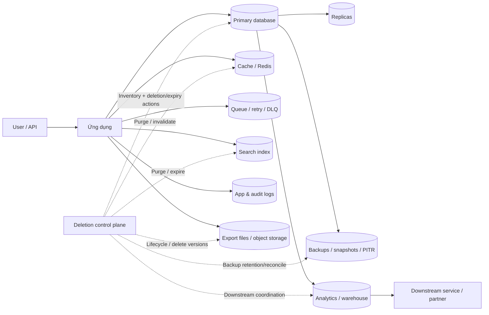
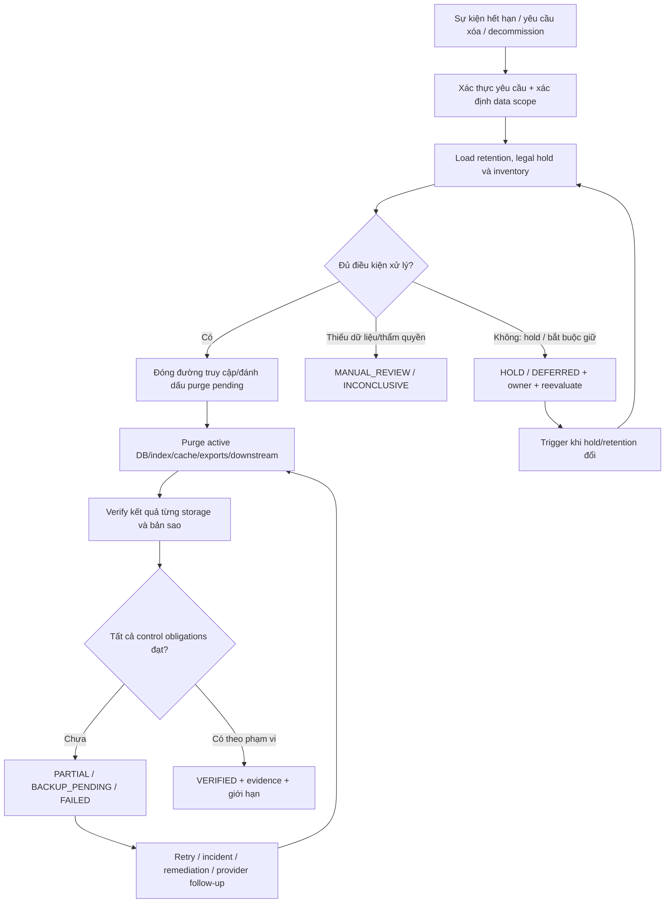
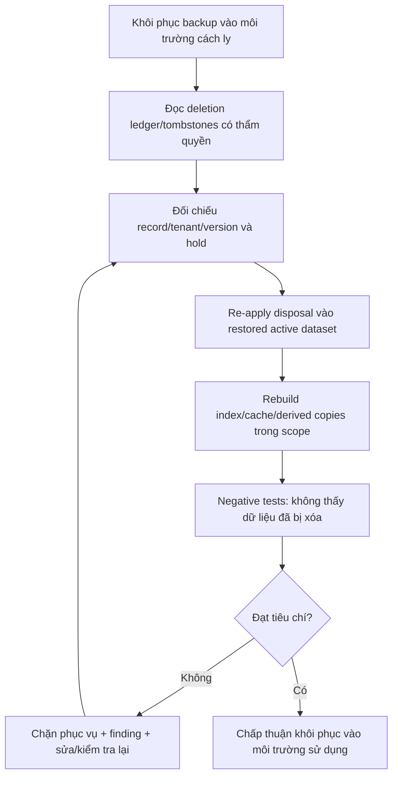
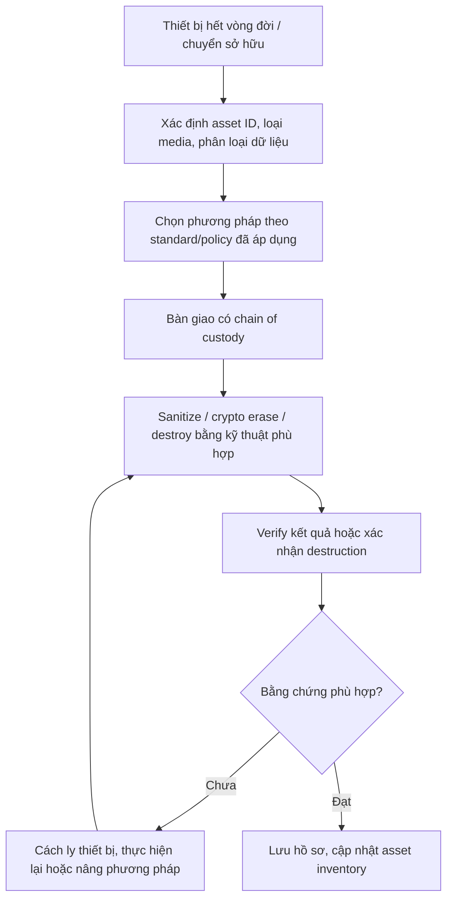
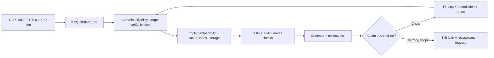

# Data disposal: loại bỏ và tiêu hủy dữ liệu an toàn trong security assurance

Một khách hàng yêu cầu xóa hồ sơ khỏi nền tảng thương mại điện tử. Đội phát triển chạy lệnh xóa bản ghi trong database và API trả về `200 OK`. Tuy nhiên, dữ liệu đó còn trong **file export ở object storage**, **search index**, **cache**, **bản sao trên hệ thống phân tích**, **database snapshot** và **backup có thể phục hồi**. Khi kiểm toán viên hỏi “Dữ liệu thực sự đã được loại bỏ khỏi những nơi nào, nơi nào còn lưu hợp lệ, khi nào chúng hết hạn và có bằng chứng gì?”, một dòng log “delete succeeded” không đủ để trả lời.

Đây chính là bài toán **data disposal**: xác định dữ liệu nào đến thời điểm không còn cần hoặc không được phép tiếp tục giữ, chọn phương pháp loại bỏ phù hợp với loại dữ liệu và phương tiện lưu trữ, thực hiện trên toàn bộ những bản sao thuộc phạm vi, kiểm chứng hiệu lực, bảo vệ bằng chứng và xử lý các giới hạn như legal hold hay backup chưa tới hạn hết hiệu lực.

Trong chương **Data protection** của module `SECURITY_SECURITY_ASSURANCE`, bài học đặt data disposal vào chuỗi **rủi ro → yêu cầu bảo vệ dữ liệu → security controls → kiểm thử/audit → bằng chứng → phát hiện và khắc phục → tái đánh giá liên tục**. Mục tiêu không phải chỉ xóa dữ liệu, mà là **chứng minh có cơ sở rằng dữ liệu được giữ và loại bỏ theo chính sách đã được phê duyệt, đúng phạm vi và đúng thời điểm**.

> **Điểm trọng tâm:** “Đã chạy `DELETE`”, “người dùng không còn nhìn thấy” và “không còn khả năng khôi phục dữ liệu theo mô hình đe dọa và phạm vi đã xác định” là **ba tuyên bố khác nhau**. Security assurance phải đánh giá đúng loại tuyên bố, không suy diễn từ một thao tác thành kết luận tuyệt đối.

## 1. Data disposal là gì?

**Data disposal** là quá trình quản trị và thực hiện việc **loại bỏ, xóa, khử khả năng truy cập/khôi phục hoặc tiêu hủy dữ liệu và vật mang dữ liệu** khi dữ liệu đến cuối vòng đời, không còn mục đích sử dụng hợp lệ hoặc cần xử lý theo yêu cầu được chấp nhận.

Disposal có thể diễn ra khi:

- Bản ghi hết thời hạn lưu trữ được quy định và không có căn cứ tiếp tục giữ.
- Người dùng hoặc chủ thể dữ liệu có yêu cầu xóa hợp lệ theo phạm vi và ngoại lệ áp dụng.
- Dự án, hợp đồng, tenant, môi trường thử nghiệm hoặc workload kết thúc.
- Thiết bị, ổ đĩa, băng từ hoặc phần cứng lưu trữ được tái sử dụng, trả nhà cung cấp, thanh lý hoặc tiêu hủy.
- Dữ liệu tạm, cache, file xuất, log hoặc bản sao trung gian đến hạn hết hiệu lực.
- Đơn vị thay đổi hệ thống và cần loại bỏ bản sao cũ sau migration, rollback window hoặc hết nghĩa vụ bảo quản.

**Data disposal là một hoạt động vòng đời và risk treatment**, không phải một lệnh cơ sở dữ liệu duy nhất. Nó cần kết hợp:

1. **Policy:** dữ liệu nào được giữ, bao lâu, khi nào có ngoại lệ.
2. **Inventory/lineage:** bản sao nào tồn tại, ai sở hữu, ở đâu.
3. **Controls:** loại bỏ hoặc làm mất khả năng truy cập theo phương pháp thích hợp.
4. **Workflow:** ai quyết định, phê duyệt, thực hiện, theo dõi và xác minh.
5. **Evidence:** chứng minh được những hành động đã diễn ra và giới hạn còn lại.
6. **Governance:** xử lý legal hold, phát hiện thất bại, nhà cung cấp và đánh giá lại sau thay đổi.

### Disposal khác gì deletion, retention và destruction?

| Thuật ngữ | Ý nghĩa chính | Ví dụ và giới hạn |
|---|---|---|
| **Retention (lưu giữ)** | Quy định thời gian và lý do duy trì dữ liệu | Hồ sơ giao dịch có lịch lưu giữ theo mục đích/nghĩa vụ đã xác định |
| **Logical deletion** | Ứng dụng/DB không còn cung cấp bản ghi như dữ liệu đang hoạt động | Xóa hàng trong bảng; WAL/snapshot/backup có thể còn |
| **Soft deletion** | Đánh dấu bản ghi không hoạt động nhưng vẫn giữ dữ liệu | `deleted_at`; **không phải** sanitization |
| **Purge** | Loại bỏ dữ liệu khỏi một tầng/lưu trữ cụ thể theo chính sách | Xóa bản ghi, file hoặc phiên bản object; cần biết nơi còn bản sao |
| **Sanitization** | Áp dụng phương pháp nhằm làm truy cập/khôi phục dữ liệu không còn khả thi theo mô hình đe dọa thích hợp | Clear, purge hoặc destroy trên phương tiện phù hợp |
| **Cryptographic erase** | Làm dữ liệu mã hóa trở nên không thể giải mã bằng cách loại bỏ vật liệu khóa thích hợp | Chỉ hiệu quả nếu mọi bản sao mục tiêu thực sự được mã hóa đúng khóa và không còn đường giải mã khác |
| **Media destruction** | Hủy vật mang dữ liệu theo phương pháp phù hợp | Thiết bị vật lý bị tiêu hủy; cần bằng chứng chain of custody |
| **Anonymization** | Chuyển dữ liệu thành dạng không còn nhận diện cá nhân theo tiêu chí và ngữ cảnh áp dụng | Khó chứng minh nếu còn bảng đối chiếu hoặc dữ liệu có thể liên kết lại |
| **De-identification/pseudonymization** | Giảm hoặc thay thế yếu tố nhận diện nhưng có thể vẫn liên kết lại | Không mặc nhiên tương đương xóa hoặc ẩn danh không thể đảo ngược |

**Xóa ở giao diện** có thể chỉ là soft delete. **Thu hồi quyền truy cập** có thể là biện pháp tạm thời nhưng không tự làm dữ liệu biến mất. **Mã hóa dữ liệu** bảo vệ bí mật, không tự xử lý thời hạn lưu giữ. Cần phân biệt từng cơ chế trước khi viết claim compliance.

## 2. Vì sao disposal là security control quan trọng?

Dữ liệu được giữ quá lâu hoặc có bản sao không được quản lý sẽ tăng **bề mặt phơi lộ**, chi phí vận hành, nguy cơ truy cập trái phép và độ khó khi ứng phó sự cố.

| Kịch bản rủi ro | Tài sản bị ảnh hưởng | Điểm yếu thường gặp | Mục tiêu disposal |
|---|---|---|---|
| Backup cũ bị lộ | Dữ liệu khách hàng đã ngừng sử dụng | Backup vẫn chứa dữ liệu, quyền truy cập quá rộng | Hạn chế thời gian lưu và quyền truy cập backup; xóa khi hết hạn |
| Tenant đã đóng còn file xuất | PII hoặc dữ liệu kinh doanh của tenant | Export lưu riêng trên bucket không nằm trong inventory | Tìm và xử lý mọi bản sao theo scope và retention policy |
| Ổ SSD đem thanh lý | Dữ liệu nội bộ trên thiết bị | Chỉ format/OS delete; remnant có thể còn | Dùng sanitization hoặc destruction phù hợp vật mang |
| Bản ghi bị đánh dấu `deleted` nhưng vẫn tìm thấy qua API | Dữ liệu người dùng | Một endpoint bỏ điều kiện lọc, cache/search index chưa cập nhật | Chặn truy cập ngay, sau đó purge đúng chính sách |
| Khóa mã hóa dùng chung quá rộng | Dữ liệu của nhiều khách hàng | Không thể crypto-erase một tenant mà không ảnh hưởng tenant khác | Thiết kế key scope/lifecycle phù hợp từ đầu |
| Dữ liệu đã “xóa” tái xuất hiện sau restore | Dữ liệu thuộc lệnh disposal trước đó | Backup restore không replay tombstone/deletion ledger | Reconcile xóa sau khôi phục trước khi dữ liệu phục vụ lại |
| Legal hold bị bỏ qua | Hồ sơ liên quan nghĩa vụ lưu giữ | Job xóa chạy chỉ theo tuổi dữ liệu | Kiểm tra hold/retention tại nguồn có thẩm quyền trước hành động không thể đảo ngược |

Control disposal hỗ trợ **confidentiality**, giảm dữ liệu không cần thiết và giúp chứng minh tuân thủ yêu cầu lưu giữ; đôi khi còn ảnh hưởng đến **integrity, accountability và availability**, bởi xóa nhầm hoặc xóa quá sớm có thể làm mất dữ liệu cần thiết.

**Disposal không có nghĩa “xóa càng nhanh càng tốt”.** Xóa khi còn nghĩa vụ bảo quản, đang có legal hold, hoặc thiếu approval có thể là lỗi nghiêm trọng ngang việc giữ dữ liệu trái phép.

## 3. Phạm vi dữ liệu cần bao phủ: một bản ghi, nhiều bản sao

Một yêu cầu “xóa hồ sơ khách hàng A” có thể liên quan hàng chục nơi lưu dữ liệu, nhiều loại hệ thống và nhà cung cấp.

### 3.1. Bản đồ tồn tại dữ liệu



Sơ đồ chỉ biểu diễn các đường phổ biến; hệ thống thực tế có thể có **CDN, email attachments, crash dumps, mobile offline copies, feature store, model-training datasets, monitoring, temporary build artefacts, test fixtures, thiết bị người dùng và hệ lưu trữ của đối tác**.

### 3.2. Ma trận inventory và lineage

| Vị trí | Bản sao tồn tại thế nào? | Owner cần xác định | Cách disposal và kiểm chứng |
|---|---|---|---|
| **Primary relational DB** | Bản ghi nghiệp vụ, bảng lịch sử, dữ liệu tách theo tenant | Application/data owner | Xóa/ẩn theo policy, kiểm tra foreign keys, query và quyền |
| **Replicas / read models** | Replication hoặc CDC từ DB chính | Platform + app owner | Xác nhận sự kiện xóa đã được áp dụng, không có bản sao còn phục vụ |
| **Caches** | Key/value, CDN cache, session cache | App + platform | Invalidate, TTL, verify không phục vụ dữ liệu cũ |
| **Search indexes** | Bản sao dùng tìm kiếm | Search/data owner | Delete/reindex, kiểm tra truy vấn sau cập nhật |
| **Queues / DLQ** | Message, retry payload, event lịch sử | Integration owner | Retention/TTL, purge khi được phép, tránh replay tạo dữ liệu lại |
| **Object storage / exports** | File report, ảnh, hồ sơ, bản export | Storage + product owner | Xóa đúng object và versions, lifecycle/retention lock review |
| **Backups / snapshots** | Full/incremental backup, PITR, immutable vault | Backup/DR owner | Hết hạn theo chính sách, hạn truy cập, test restore và chống tái xuất hiện |
| **Analytics / data lake** | Warehouse tables, derived datasets, marts, feature store | Data platform owner | Xóa theo khóa liên kết, recompute/purge derived copies khi cần |
| **Logs / telemetry** | Request body, IDs, stack traces, traces | Operations/SOC | Data minimization, retention, masking và xử lý theo loại log |
| **External recipients** | SaaS provider, processor, partner, vendor | Contract/privacy owner | Yêu cầu xử lý theo hợp đồng, xác nhận và bằng chứng trong phạm vi kiểm soát |
| **Physical media** | SSD/HDD, laptop, tape, removable media | IT asset owner | Sanitize/destroy theo đặc tính thiết bị, custody và chứng từ |
| **Developer/test copies** | DB dump, debugging export, fixture | Dev/platform owner | Scope, TTL, synthetic data và xóa khi hết nhiệm vụ |

**Một data lineage map là điều kiện để tuyên bố phạm vi.** Nếu không biết có bản sao nào, không thể cam kết “mọi bản sao đã bị tiêu hủy”. Nếu dữ liệu đã chia sẻ cho bên ngoài, cần tách rõ **quyền kiểm soát trực tiếp của tổ chức** và **nghĩa vụ/khả năng xác nhận từ bên nhận**.

### 3.3. Dữ liệu dẫn xuất và khả năng nhận diện lại

Ảnh thumbnail, báo cáo, vector embedding, tập huấn luyện, tổng hợp thống kê và bản log có thể chứa thông tin nguồn hoặc cho phép suy ra thông tin cá nhân. Tùy phương pháp tạo và mức độ khả năng liên kết lại, có thể cần đưa vào phạm vi disposal.

Không nên mặc định:

- Dữ liệu đã hash thì chắc chắn vô danh; hash ổn định có thể liên kết và dễ dò với không gian đầu vào nhỏ.
- Dữ liệu đã pseudonymize thì không còn dữ liệu cá nhân.
- Tập số liệu tổng hợp luôn vô hại nếu có nhóm nhỏ hoặc dữ liệu hiếm.
- Một embedding hoặc mô hình ML nhất định có hoặc không chứa thông tin có thể phục hồi, khi chưa đánh giá cụ thể.

Khi không thể xóa một phần dữ liệu dẫn xuất bằng thao tác thông thường, cần **đánh giá rủi ro, nghĩa vụ, phạm vi và phương án xử lý**; không tự tuyên bố dữ liệu đã “biến mất khỏi mọi mô hình”.

## 4. Retention policy là đầu vào quyết định disposal

Một hệ thống không thể biết *khi nào* xóa nếu không biết **vì sao giữ** dữ liệu và **điều gì ngăn xóa**.

### 4.1. Một retention schedule hữu ích gồm gì?

| Thuộc tính | Ý nghĩa | Ví dụ minh họa |
|---|---|---|
| **Data class / record type** | Nhóm bản ghi có cùng mục đích/nghĩa vụ | Hồ sơ hỗ trợ, đơn hàng, audit log, file export |
| **Business purpose** | Mục đích sử dụng đã xác định | Giao dịch, hỗ trợ, kiểm tra gian lận |
| **Authority / basis** | Chính sách, hợp đồng, nghĩa vụ pháp lý áp dụng | Văn bản và version được owner tuân thủ xác nhận |
| **Retention trigger** | Sự kiện bắt đầu đếm thời hạn | Ngày đóng yêu cầu hoặc ngày hợp đồng kết thúc |
| **Retention end / disposal eligibility** | Điều kiện đến hạn loại bỏ | Mốc được tính từ trigger theo policy |
| **Exceptions/holds** | Điều kiện cần hoãn hoặc cấm xóa | Legal hold, điều tra được phê duyệt, nghĩa vụ chưa kết thúc |
| **Systems and copies** | Những nơi dữ liệu tồn tại | DB, index, cache, backup, file export |
| **Disposal method** | Phương pháp phù hợp từng lớp | Logical purge, version purge, key destruction, media sanitize |
| **Owner / approver** | Vai trò quyết định và thực hiện | Data owner, Privacy/Legal, Operations |
| **Evidence / validation** | Bằng chứng cần có | Retention decision, job status, post-delete probes, provider record |

**Thời hạn giữ không phải con số tùy ý**; cần lựa chọn theo mục đích sử dụng, nghĩa vụ và đánh giá rủi ro. Trong ví dụ học tập có thể dùng `disposeAfter` để biểu thị **mốc đã được hệ thống có thẩm quyền tính hợp lệ trước đó**, thay vì hardcode một số ngày và giả định áp dụng toàn tổ chức.

### 4.2. Data minimization, retention và disposal liên quan nhau

- **Data minimization:** ngay từ đầu chỉ thu thập thông tin thực sự cần.
- **Purpose limitation:** mục đích xử lý giới hạn dữ liệu được dùng vào việc gì.
- **Retention:** giữ dữ liệu trong thời hạn có cơ sở và quản trị ngoại lệ.
- **Disposal:** loại bỏ hoặc khử khả năng sử dụng khi không còn căn cứ giữ.
- **Assurance:** chứng minh từng control hoạt động đúng trong phạm vi.

Giảm dữ liệu thu thập sẽ giảm gánh nặng xóa; nhưng vẫn phải có **lifecycle controls** cho bản sao phát sinh từ dữ liệu đã thu thập.

### 4.3. Legal hold, preservation và yêu cầu xóa

Khi có yêu cầu bảo quản hợp lệ hoặc một nghĩa vụ lưu giữ đang có hiệu lực, xóa không đúng thời điểm có thể gây hậu quả pháp lý và làm mất tính toàn vẹn hồ sơ. Ngược lại, giữ toàn bộ dữ liệu vô thời hạn chỉ vì “có thể cần cho kiểm toán” cũng không tự là cơ sở hợp lệ.

Quy trình cần:

1. Xác minh **chủ thể yêu cầu**, thẩm quyền và phạm vi dữ liệu.
2. Kiểm tra **retention schedule** và căn cứ nghĩa vụ cụ thể.
3. Kiểm tra **legal hold/preservation flag** từ nguồn do người có thẩm quyền quản lý.
4. Quyết định **xóa, hoãn, giới hạn xử lý hoặc xử lý từng phần** theo chính sách và nghĩa vụ áp dụng.
5. Ghi người có thẩm quyền, lý do, mốc đánh giá lại và bằng chứng.
6. Khi hold được gỡ, kích hoạt đánh giá disposal lại; không để flag tồn tại vô hạn do quên thao tác.

Quyền yêu cầu xóa dữ liệu theo pháp luật về quyền riêng tư **có điều kiện và ngoại lệ tùy khu vực pháp lý, loại dữ liệu và nghĩa vụ khác**. Không nên hứa mọi yêu cầu xóa sẽ dẫn đến loại bỏ ngay tất cả hồ sơ và backup; cần tham vấn bộ phận Privacy/Legal khi diễn giải nghĩa vụ cụ thể.

## 5. Các cách loại bỏ dữ liệu và giới hạn kỹ thuật

Cần chọn phương pháp theo **vật mang, kiến trúc, loại dữ liệu, mô hình đe dọa, khả năng của nhà cung cấp và mục tiêu bảo đảm**.

### 5.1. Logical delete, soft delete và purge ở ứng dụng

**Soft delete** thường đặt cờ `isDeleted=true` hoặc `deletedAt`. Nó hữu ích khi cần phục hồi thao tác nhầm, chống replay hoặc quản lý workflow, nhưng dữ liệu gốc **vẫn tồn tại** trong database và có thể bị lộ qua query lỗi, admin, backup hoặc log.

**Hard/logical delete** thường là thao tác loại bỏ bản ghi khỏi cấu trúc đang hoạt động. Trong relational DB, một `DELETE` đã commit có thể làm record không còn xuất hiện trong query thông thường; tuy nhiên dữ liệu có thể tồn tại trong **WAL/redo, MVCC pages, replicas, snapshots, backup và vùng lưu trữ chưa được ghi đè**.

**Application purge** có thể gồm xóa bảng phụ, file và index; đây là một workflow nhiều bước. Không nên đánh đồng “hàng đã bị xóa logic” với “phương tiện lưu trữ đã được sanitization”.

### 5.2. Clear, Purge, Destroy và môi trường lưu trữ

Các tài liệu hướng dẫn sanitization, chẳng hạn dòng hướng dẫn NIST về media sanitization, thường phân biệt các khái niệm **Clear, Purge và Destroy**. Cần kiểm tra phiên bản tài liệu và tiêu chí áp dụng của tổ chức khi xây một quy trình thật; bảng sau chỉ giải thích ở mức khái niệm, **không thay thủ tục kỹ thuật theo từng loại media**.

| Khái niệm | Mục tiêu chung | Ví dụ và giới hạn |
|---|---|---|
| **Clear** | Giảm khả năng phục hồi dữ liệu bằng những kỹ thuật phù hợp mức bảo vệ đã chọn | Ghi đè khi media/thiết bị hỗ trợ; phải kiểm tra phạm vi vùng dữ liệu |
| **Purge** | Làm khôi phục dữ liệu trở nên không khả thi theo mục tiêu kỹ thuật khắt khe hơn trên media phù hợp | Thiết bị hỗ trợ sanitize/crypto erase theo điều kiện; cần xác minh năng lực |
| **Destroy** | Làm vật mang dữ liệu không còn sử dụng được theo phương pháp tiêu hủy thích hợp | Hủy media dưới kiểm soát custody và xác nhận kết quả |

**Không phải mọi “format”, “factory reset”, “TRIM” hoặc lệnh xóa file đều là purge/sanitize đã được xác minh.** Tên nút trong giao diện quản trị cũng không phải kết luận kỹ thuật.

### 5.3. SSD, HDD, tape và bộ nhớ flash

Đặc tính media ảnh hưởng mạnh tới phương pháp:

- **HDD:** ghi đè có thể là một thành phần của clear ở thiết bị phù hợp, nhưng không tự bao phủ lỗi controller, remapped sectors hoặc bản sao nằm ở lớp storage khác.
- **SSD/flash:** wear leveling, over-provisioning và remapped blocks có thể khiến ghi đè logic không chạm mọi vị trí vật lý; cần xem lệnh sanitize của thiết bị, crypto-erasure hoặc tiêu hủy theo mục tiêu.
- **Tape/backup media:** cần quản lý cartridge, custody, retention và phương pháp tiêu hủy thích hợp, kể cả những băng không còn được hệ thống quản lý đọc trực tiếp.
- **Self-encrypting drives:** crypto-erase chỉ có giá trị khi mã hóa và quản lý key/metadata đáp ứng các điều kiện của phương pháp, không phải cứ có nhãn “encrypted” là đủ.
- **Thiết bị hỏng:** nếu không thể kiểm chứng sanitize bằng phần mềm, có thể cần phương án destruction có kiểm soát.

Cần tham khảo **hướng dẫn thiết bị và phiên bản media sanitization standard đã chọn**, thực hiện bởi bên có thẩm quyền và lưu bằng chứng. Không đưa các lệnh xóa/ghi đè có thể phá dữ liệu vào một bài demo rồi khuyên chạy trực tiếp trên production.

### 5.4. Cryptographic erase — xóa bằng cách phá khả năng giải mã

**Cryptographic erase** là làm dữ liệu mã hóa không còn khả năng giải mã theo mô hình đe dọa bằng cách **loại bỏ vật liệu khóa đủ cần thiết**. Nó có thể phù hợp với cloud, ổ tự mã hóa và dữ liệu theo tenant nếu kiến trúc key được thiết kế từ đầu.

Điều kiện để đưa ra claim mạnh:

1. **Mọi bản sao mục tiêu** đều được mã hóa bằng khóa/chuỗi khóa chịu tác động.
2. Không có **bản plaintext**, DEK unwrapped, key cache, phiên bản key hoặc backup key nào còn cho phép giải mã.
3. Khóa được bảo vệ trước đó, không bị sao chép/lộ sang nơi khác.
4. Phạm vi khóa phù hợp phạm vi disposal; tránh hủy key chung của nhiều tenant nếu sẽ làm mất dữ liệu cần giữ.
5. KMS/backup/replica/trust architecture có bằng chứng về thao tác và **tính không thể phục hồi** trong phạm vi quy trình.
6. Mô hình threat và giới hạn về key retention/caching đã được đánh giá.

**Ví dụ:** nếu mỗi tenant có một DEK riêng và không còn bản DEK/KEK đường vòng, có thể thiết kế xóa khóa gắn tenant để làm các bản mã hóa của tenant không thể giải mã. Nhưng nếu một KEK chung vẫn có thể giải mã DEK còn lưu trong backup, hoặc có file export plaintext, claim “đã crypto-erase mọi dữ liệu tenant” **không hợp lệ**.

Mất quyền gọi KMS khác với hủy key: **disable access** có thể đảo ngược; **key deletion/irrecoverability** có nghĩa khác. Một số KMS áp dụng thời gian chờ hủy khóa hoặc phục hồi trong cửa sổ chờ; cần kiểm tra trạng thái thực, không đánh dấu xong ngay khi gửi yêu cầu lên lịch xóa.

## 6. Đặc thù cloud, object storage và hệ thống managed

### 6.1. Object versioning và delete marker

Một object store có thể hỗ trợ versioning. Thao tác xóa tên object có thể chỉ tạo **delete marker** hoặc thay đổi phiên bản hiện hành, trong khi **những version trước** còn tồn tại cho người có quyền đọc version.

Các điểm cần review:

- Object versioning được bật ở bucket nào?
- Xóa một object có cần xử lý **non-current versions** không?
- Có multipart uploads, replica hoặc copy cross-region chưa hoàn tất?
- Retention lock, Object Lock/WORM hoặc legal hold có ngăn xóa không?
- Lifecycle policy có xử lý current/non-current versions và các ngoại lệ đúng không?
- CDN hoặc signed URL có vẫn cho phép tải nội dung trước khi revoke/cache hết hạn?
- Có bằng chứng sau xóa cho cả quyền đọc thông thường và quyền xem version phù hợp?

**Không xem `HTTP 404` qua URL hiện hành là bằng chứng mọi phiên bản object đã mất**, đặc biệt khi versioning và privileged APIs có thể truy cập những phiên bản cũ.

### 6.2. Database managed, replication và PITR

Trong managed database, ứng dụng thường không kiểm soát trực tiếp từng sector vật lý. Một câu lệnh SQL có thể được replication và phản ánh sang read replica, nhưng **PITR/WAL/logical backups/snapshots** vẫn giữ lịch sử theo retention.

Một mô hình phù hợp có thể là:

- Xóa khỏi **active dataset** và kiểm tra replicas/search/cache.
- Tách backup ở trạng thái **retained under controlled policy**, hạn chế quyền truy cập và backup expiry.
- Đảm bảo phục hồi từ backup phải **replay deletion ledger/tombstones** trước khi đưa dữ liệu lên phục vụ nếu yêu cầu đã xóa vẫn có hiệu lực.
- Đánh giá khả năng crypto erase hay purge chọn lọc theo năng lực nền tảng; không hứa selective physical purge khi provider không hỗ trợ.
- Lưu provider configuration, retention và các chứng cứ phù hợp, tránh tuyên bố có thể kiểm chứng byte vật lý mà tổ chức không có khả năng truy cập.

### 6.3. Shared responsibility và bằng chứng từ nhà cung cấp

| Hạng mục | Nhà cung cấp có thể chịu trách nhiệm | Khách hàng/ứng dụng vẫn cần làm |
|---|---|---|
| Physical media retirement | Quy trình sanitize/destruction trong hạ tầng được quản lý | Xác định yêu cầu dịch vụ/hợp đồng, kiểm tra bằng chứng provider phù hợp |
| Managed storage encryption | Cơ chế nền tảng, HSM/KMS theo dịch vụ | Thiết kế key scope, IAM, retention, copy/backup và disposal policy |
| Object lifecycle service | Công cụ xóa theo lịch/phiên bản | Cấu hình chính xác, giám sát lỗi và xác minh policy hiệu lực |
| Snapshot/backup management | Công cụ lưu/restore, thời hạn khả dụng | Chọn retention/hold, quyền truy cập, test không tái tạo dữ liệu đã xóa ngoài policy |
| Service decommission | Trả lại/hủy tài nguyên theo điều khoản dịch vụ | Kiểm kê tài nguyên, xóa credentials, kiểm chứng không còn tài sản orphan |
| Data processing by partner | Nghĩa vụ xử lý theo hợp đồng | Giao yêu cầu có thể truy vết và nhận xác nhận, quản lý phần còn lại |

**Certificate hoặc attestation của nhà cung cấp** có thể là một loại evidence hỗ trợ, nhưng phải xem **scope, dịch vụ, thời kỳ, phương pháp và giới hạn**. Không được suy ra một chứng chỉ trung tâm dữ liệu bao phủ chính xác mọi bản sao dữ liệu ứng dụng đã từng tạo.

## 7. Thiết kế policy disposal theo mục tiêu có thể kiểm chứng

Một chính sách nội bộ tốt nên mô tả **khi nào xử lý, cách xử lý, ai chịu trách nhiệm và trạng thái nào cho phép tuyên bố hoàn tất**.

### 7.1. Ví dụ các điều khoản bắt buộc

| Mã | Yêu cầu minh họa | Tiêu chí chứng minh |
|---|---|---|
| `REQ-DISP-01` | Mọi data class trong scope có retention owner và thời điểm đánh giá disposal | Inventory + retention schedule có phê duyệt |
| `REQ-DISP-02` | Trước hành động không thể đảo ngược, phải kiểm tra hold và nghĩa vụ retention còn hiệu lực | Decision trail từ nguồn authoritative |
| `REQ-DISP-03` | Dữ liệu active đến hạn phải được loại bỏ theo phương pháp được chỉ định, bao gồm bản sao dẫn xuất trong scope | Run logs, post-delete queries/probes, copy inventory |
| `REQ-DISP-04` | Backup/snapshot phải có thời hạn, quyền truy cập hạn chế và phương án tránh tái xuất hiện dữ liệu khi restore | Backup policy, expiry evidence, restore reconciliation test |
| `REQ-DISP-05` | Thiết bị/media nghỉ dùng phải được sanitization hoặc destruction theo loại và mức nhạy cảm | Asset ID, phương pháp, xác nhận, custody/certificate |
| `REQ-DISP-06` | Hoạt động disposal phải có ID, owner, status, exception và evidence phù hợp | Ledger, reviewer/reconciliation, audit package |
| `REQ-DISP-07` | Nếu disposal một phần thất bại, phải theo dõi, cảnh báo và khắc phục có kiểm chứng | Retry/dead-letter, ticket, retest, residual risk |
| `REQ-DISP-08` | Đường xử lý dữ liệu mới phải cập nhật lineage/retention trước khi phát hành | DFD review, data inventory, CI/config tests |

Đây là **các ID tự đặt cho bài học**, không phải điều khoản được trích từ một bộ tiêu chuẩn hay nghĩa vụ luật. Tổ chức cần quyết định **thời hạn, phạm vi, thẩm quyền, chế tài và phương pháp** phù hợp rủi ro và nghĩa vụ thật.

### 7.2. Ví dụ một phát biểu policy đủ rõ

> Đối với file export chứa dữ liệu khách hàng, chủ sở hữu hệ thống phải xác định thời điểm hết nhu cầu sử dụng và retention policy áp dụng. Khi đủ điều kiện disposal và không có hold hợp lệ, hệ thống phải thu hồi quyền tải, xử lý object cùng các phiên bản/bản sao thuộc phạm vi, ghi kết quả từ storage authoritative và xác minh không còn truy cập được theo chính sách. Backup và log thuộc lịch lưu giữ riêng phải được bảo vệ, theo dõi hết hạn và ghi rõ giới hạn kết luận.

Trong môi trường thực, cần bổ sung **mốc tối đa, cách xử lý phiên bản cũ, reviewer, SLA remediation, lưu bằng chứng, điều kiện ngoại lệ và mốc reevaluation**. Một policy không nên định nghĩa “xóa hoàn toàn mọi bản sao ngay lập tức” nếu nền tảng/backup model và nghĩa vụ không cho phép đáp ứng.

## 8. Vòng đời xử lý yêu cầu disposal và các trạng thái

Một quy trình đáng tin nên tách **quyết định đủ điều kiện**, **thao tác ở từng storage** và **xác minh tổng thể**.



### Các trạng thái nên phân biệt

| Trạng thái | Ý nghĩa thực tế | Có được kết luận tất cả dữ liệu đã bị xóa không? |
|---|---|---|
| `REQUESTED` | Yêu cầu được tiếp nhận, chưa đánh giá đủ điều kiện | Không |
| `HOLD` | Chưa được xóa vì hold hoặc nghĩa vụ còn hiệu lực | Không |
| `NOT_DUE` | Chưa đến thời điểm disposal theo policy | Không |
| `AUTHORIZED` | Đã qua bước xác minh yêu cầu và điều kiện | Chưa |
| `ACTIVE_PURGE_PENDING` | Đang xử lý bản đang sử dụng | Chưa |
| `ACTIVE_PURGED_BACKUP_RETAINED` | Tầng active đã được xác minh, backup còn lưu dưới chính sách | Chỉ được nói rõ phạm vi active; không nói mọi bản sao |
| `VERIFY_PENDING` | Đã gửi lệnh nhưng thiếu xác minh | Không |
| `PARTIAL_FAILED` | Một hoặc nhiều vị trí thất bại | Không |
| `VERIFIED_IN_SCOPE` | Các nghĩa vụ disposal thuộc phạm vi/tiêu chí đã được kiểm chứng | Được kết luận **trong phạm vi**, phải nêu giới hạn |
| `EXCEPTION_APPROVED` | Risk/retention exception có thẩm quyền, thời hạn | Không mặc định |

**Trạng thái API thành công và trạng thái hoàn tất disposal khác nhau.** Một API thường có thể trả mã nhận request `202 Accepted` cho workflow bất đồng bộ; không nên trả lời “irreversibly erased” trước khi có kiểm chứng phù hợp. Dù sử dụng mã trạng thái HTTP nào, cần tránh phát biểu không đúng độ hoàn thành.

### 8.1. Idempotency, concurrency và dữ liệu tạo lại

Disposal là tác vụ phân tán, dễ có retry, lỗi mạng hoặc race condition:

- Cùng một yêu cầu được gửi hai lần; cần **idempotency key** hoặc ledger để không xử lý nhầm.
- Người dùng tạo dữ liệu mới khi một yêu cầu purge cũ còn chạy; cần định nghĩa **record/version scope** và sự kiện nào thuộc yêu cầu.
- Consumer đọc queue cũ rồi **tái tạo bản ghi** sau khi đã xóa; dùng tombstone/version hoặc rule tránh resurrect.
- Backup restore đưa dữ liệu quay lại; phải replay deletion ledger trước khi mở traffic.
- Retry khiến file/record bị xóa rồi tạo lại bởi job khác; cần kiểm tra ownership và ordering.
- Khi disposal xung đột legal hold mới phát sinh, phải có quy tắc **re-check** trước bước không thể đảo ngược.

Một workflow tốt lưu **data identity, deletion intent, policy version, version/time boundary, storage targets và trạng thái từng target** để có thể tiếp tục sau lỗi mà không mất trace.

## 9. Tình huống thực hành: xóa dữ liệu tenant đã đóng

Giả sử tenant `tenant-A` kết thúc hợp đồng. Sau khi các nghĩa vụ lưu giữ và yêu cầu bảo quản được xem xét, nhóm quản trị xác định một tập dữ liệu có thể disposal.

### 9.1. Lập data disposal plan

| Asset / copy | Dữ liệu thuộc scope | Phương pháp phù hợp | Điều kiện PASS và evidence |
|---|---|---|---|
| `customer-db` | Hồ sơ active của tenant A đến hạn | Application purge và ràng buộc tenant | Query/record count, transaction log, release/job ID |
| `customer-db-replica` | Replicated records | Xác minh event xóa đã đồng bộ | Replica state hoặc read-after-propagation có kiểm soát |
| `search-index` | Chỉ mục tenant A | Delete/reindex phù hợp | Index query và sự kiện đồng bộ |
| `redis-cache` | Key chứa tenant A | Invalidate hoặc chờ TTL đã phê duyệt | Key probe, config TTL, không phục vụ cache cũ |
| `export-bucket` | CSV/PDF xuất từ tenant A | Revoke access và xử lý mọi object versions cần xóa | Version inventory, lifecycle/deletion confirmations |
| `analytics-warehouse` | Bản sao/derived rows | Purge/recompute hoặc phương án được phê duyệt | Downstream ack và query theo lineage |
| `message-queue` | Job/DLQ có payload tenant A | Retention/consume/purge theo mô hình queue | Queue retention, queue health, test replay |
| `backup-vault` | Backups có dữ liệu lịch sử | Retention được bảo vệ; expiry/restore reconciliation | Backup policy, backup inventory, expire evidence |
| `audit-log` | Sự kiện kiểm toán có thể chứa IDs | Giữ tối thiểu theo lịch riêng, giảm nhạy cảm | Log field review, retention config, access controls |
| `partner-processor` | Bản sao theo hợp đồng xử lý | Gửi yêu cầu phù hợp và nhận xác nhận theo thẩm quyền | Contract/reference, request/response evidence |

Không phải mọi dữ liệu của tenant A đều tự có cùng **retention trigger**. Giao dịch, hóa đơn, audit và marketing records có thể có mục đích/chu kỳ khác nhau. Vì vậy plan cần chỉ rõ **data class** và ngoại lệ, không chỉ một `tenantId` toàn cục.

### 9.2. Kiểm soát thất bại ở các trust boundary

Một hệ thống có thể cho phép API delete nhưng để `export-worker` hoặc job phân tích tạo lại bản sao. Do đó, cần xác định:

- Workload nào được **ra lệnh disposal** và workload nào chỉ được thực hiện các thao tác kỹ thuật?
- Ai có thể đặt/gỡ **legal hold**, ai được duyệt override, và có audit?
- API job có thể xóa dữ liệu tenant khác bằng cách sửa payload không?
- Consumer có xác minh **deletion intent** và đúng dataset/version trước khi purge?
- Có bảo vệ chống kẻ tấn công gửi request xóa hàng loạt hoặc dùng quyền quá rộng không?
- Hệ thống dùng retry/DLQ để **không âm thầm bỏ sót** một target đã lỗi?
- Khi restore backup, hệ thống có chặn truy cập trước khi kiểm tra lại những deletion intents còn hiệu lực?

Data disposal cần bảo vệ **tính bí mật của dữ liệu còn giữ** và **tính toàn vẹn trước yêu cầu xóa trái phép**. Một control xóa tự động quá mạnh nhưng không xác thực/ủy quyền cũng có thể trở thành công cụ tấn công phá hoại.

## 10. Java 17: quyết định đủ điều kiện disposal theo policy

Ví dụ sau là một lớp **business-policy decision**, không thao tác xóa vật lý. Nó giả định mốc `disposeAfter` đã được tính từ retention schedule có thẩm quyền. Policy từ chối thao tác thiếu thông tin, đang legal hold hoặc chưa đến hạn.

```java
import java.time.Instant;

record DataRecord(
        String recordId,
        String tenantId,
        Instant disposeAfter,
        boolean legalHold,
        boolean processingClosed) {}

enum DisposalDecision {
    ELIGIBLE,
    NOT_DUE,
    ON_HOLD,
    NEEDS_REVIEW
}

final class DisposalEligibilityPolicy {
    private DisposalEligibilityPolicy() {}

    static DisposalDecision evaluate(DataRecord record, Instant now) {
        if (record == null || now == null
                || record.recordId() == null
                || record.recordId().isBlank()
                || record.tenantId() == null
                || record.tenantId().isBlank()
                || record.disposeAfter() == null) {
            return DisposalDecision.NEEDS_REVIEW;
        }

        // Legal hold được ưu tiên, kể cả khi retention đã hết hạn.
        if (record.legalHold()) {
            return DisposalDecision.ON_HOLD;
        }

        // Chỉ disposal sau khi workflow xử lý đã đóng.
        if (!record.processingClosed()) {
            return DisposalDecision.NEEDS_REVIEW;
        }

        return now.isBefore(record.disposeAfter())
                ? DisposalDecision.NOT_DUE
                : DisposalDecision.ELIGIBLE;
    }
}
```

**Cần hiểu đúng phạm vi:** `ELIGIBLE` chỉ là **quyết định theo bộ dữ liệu đầu vào**, chưa chứng minh request đã được người có thẩm quyền duyệt, legal hold được đọc từ nguồn đúng, data class đầy đủ hoặc dữ liệu đã bị xóa. Hệ thống thật còn cần bảo vệ quyền gọi API, kiểm tra nguồn metadata, đối soát giữ dữ liệu theo nghĩa vụ, chống race condition và kiểm tra lại hold trước những bước không thể đảo ngược.

Mốc `disposeAfter` **không được client tự gửi để ép xóa sớm**. Bộ tính retention phải đọc từ policy/metadata có nguồn gốc, bao gồm loại dữ liệu và sự kiện bắt đầu lưu giữ, với cơ chế version hóa khi chính sách thay đổi.

### JUnit 5: các tình huống cho phép và chặn

```java
import static org.junit.jupiter.api.Assertions.assertEquals;
import java.time.Instant;
import org.junit.jupiter.api.Test;

class DisposalEligibilityPolicyTest {
    private static final Instant NOW =
            Instant.parse("2026-11-28T00:00:00Z");

    @Test
    void allowsOnlyAfterValidRetentionEnd() {
        DataRecord eligible = new DataRecord(
                "record-42", "tenant-A",
                NOW.minusSeconds(1), false, true);

        assertEquals(DisposalDecision.ELIGIBLE,
                DisposalEligibilityPolicy.evaluate(eligible, NOW));
    }

    @Test
    void deniesWhenRetentionStillActive() {
        DataRecord notDue = new DataRecord(
                "record-42", "tenant-A",
                NOW.plusSeconds(3600), false, true);

        assertEquals(DisposalDecision.NOT_DUE,
                DisposalEligibilityPolicy.evaluate(notDue, NOW));
    }

    @Test
    void legalHoldOverridesRetentionExpiry() {
        DataRecord held = new DataRecord(
                "record-42", "tenant-A",
                NOW.minusSeconds(3600), true, true);

        assertEquals(DisposalDecision.ON_HOLD,
                DisposalEligibilityPolicy.evaluate(held, NOW));
    }

    @Test
    void missingRetentionMetadataRequiresReview() {
        DataRecord unknown = new DataRecord(
                "record-42", "tenant-A", null, false, true);

        assertEquals(DisposalDecision.NEEDS_REVIEW,
                DisposalEligibilityPolicy.evaluate(unknown, NOW));
    }

    @Test
    void openBusinessProcessRequiresReview() {
        DataRecord open = new DataRecord(
                "record-42", "tenant-A",
                NOW.minusSeconds(1), false, false);

        assertEquals(DisposalDecision.NEEDS_REVIEW,
                DisposalEligibilityPolicy.evaluate(open, NOW));
    }
}
```

Hàm này cố ý **không thao tác xóa** để tách phần **quyết định policy** khỏi phần **thực thi và verify**. Unit tests chứng minh các nhánh logic giả định, không chứng minh workflow production xử lý được replica, backup hoặc storage và không thể thay assessment về các nghĩa vụ bảo quản cụ thể.

### Không quên concurrency và authorization

Khi triển khai thật, giữa `evaluate` và `delete` có thể xuất hiện một **legal hold mới**, hoặc record đã bị cập nhật. Vì vậy nên thiết kế thao tác **đối soát có phiên bản hoặc transactional guard** tại nguồn có thẩm quyền, không gọi policy một lần rồi vô điều kiện xóa sau nhiều phút.

Người dùng không được phép tạo request xóa tenant khác chỉ bằng cách gửi `tenantId` hoặc `recordId`. API phải xác thực người yêu cầu và đánh giá **authorization đối với chính hành động disposal**; worker chỉ thực thi intent đã được cấp quyền và xác minh.

## 11. Kiểm soát trạng thái từng target và điều kiện đóng yêu cầu

Một yêu cầu disposal thường không thể hoàn thành trong một giao dịch duy nhất. Cần **sổ cái disposal** lưu trạng thái theo từng hệ thống, gồm cả nơi còn retention hợp lệ.

```text
Request DISP-2026-0042
  recordScope   : tenant-A / customer-profile / policy-v3
  decision      : ELIGIBLE
  activeDB      : VERIFIED_PURGED
  replica       : VERIFIED_PURGED
  searchIndex   : VERIFIED_PURGED
  objectVersions: VERIFY_PENDING
  cache         : VERIFIED_INVALIDATED
  analytics     : FAILED_RETRYABLE
  backup        : RETAINED_UNTIL_POLICY_EXPIRY
  legalHold     : NONE_AT_LAST_CHECK
  aggregate     : PARTIAL / INCONCLUSIVE
```

Đây là dữ liệu minh họa. Tùy nghĩa vụ, việc đóng yêu cầu với backup còn tồn tại dưới chế độ retention có kiểm soát có thể đòi **trạng thái riêng**, giải thích và follow-up; không ghi đơn giản `ALL_COPIES_IRREVERSIBLY_DESTROYED`.

### Chứng cứ của từng bước

| Giai đoạn | Evidence phù hợp | Không đủ nếu chỉ có |
|---|---|---|
| **Authorization** | Yêu cầu hợp lệ, người/role có thẩm quyền, scope | Client gửi `userId` hoặc `tenantId` |
| **Retention/hold decision** | Policy version, retention trigger, legal hold check, reviewer | Timestamp `created_at` đơn lẻ |
| **Execution** | Job ID, target system, action, result, timestamp, retry | Một thông báo `DELETE called` |
| **Verification** | Query/probe không còn truy cập trong active scope, version inventory, callback từ provider | API trả `200` hoặc `404` ở một đường |
| **Backup handling** | Backup retention config, vault inventory, expiry/restore controls | Câu “backup sẽ tự xóa” không có bằng chứng |
| **Closure** | Tổng hợp trạng thái, scope, exceptions, approvals, residual risk | Checkbox hoàn thành trong ticket |

Có thể sử dụng **hash/commitment hoặc evidence ID** để chứng minh tính toàn vẹn audit record, nhưng không được đưa hash định danh cá nhân dễ liên kết vào kho log phổ biến nếu không có đánh giá riêng. Evidence cần ghi dữ liệu đủ để truy vết mà không biến ledger thành một kho dữ liệu nhạy cảm mới.

## 12. Backup, restore và vấn đề “dữ liệu hồi sinh”

Một trong những lỗi nguy hiểm nhất là tin rằng xóa khỏi database active đồng nghĩa dữ liệu không thể xuất hiện lại.

### 12.1. Backup retention có thể khác active deletion

Một bản backup immutable có thể giữ dữ liệu lịch sử trong thời gian đã phê duyệt để đáp ứng mục tiêu phục hồi hoặc nghĩa vụ lưu trữ. Nếu không hỗ trợ selective deletion, việc sửa trực tiếp backup có thể phá tính toàn vẹn của bản backup và gây ảnh hưởng đến khả năng khôi phục.

Biện pháp hợp lý tùy bối cảnh gồm:

- Giới hạn **retention window** phù hợp mục đích/điều kiện bảo quản.
- Bảo vệ backup bằng IAM, encryption và giám sát truy cập đặc quyền.
- Quản lý danh sách **backup generations/snapshots** và thời điểm hết hạn.
- Nếu có thể thiết kế crypto-erase theo scope, kiểm chứng key management cẩn trọng.
- Ghi rõ backup còn lưu **không phục vụ mục đích kinh doanh thường ngày**, với các điều kiện ngoại lệ đã xác định.
- Xây **restore reconciliation** để dữ liệu đã disposal không tái xuất hiện khi backup được khôi phục.

### 12.2. Restore reconciliation bằng deletion ledger



**Deletion ledger phải được bảo vệ như một control trọng yếu**: mất ledger có thể khiến dữ liệu hồi sinh, còn bị sửa trái phép có thể gây xóa dữ liệu không được phép. Ledger nên chứa **định danh tối thiểu, record/version scope, quyết định, timestamps, policy version và trạng thái**; không cần lưu nguyên hồ sơ đã xóa.

### 12.3. Các kiểm thử restore cần có

1. Restore một bản backup có dữ liệu thuộc request disposal từ trước.
2. Trước khi mở dịch vụ, chạy reconciliation từ ledger authoritative.
3. Kiểm tra những record/file/index thuộc scope không còn được phục vụ.
4. Kiểm tra các bản ghi **không thuộc scope** vẫn toàn vẹn.
5. Xác nhận xử lý đúng legal hold và những record chưa đến hạn.
6. Ghi thời gian, bản backup, phiên bản ứng dụng, dữ liệu kiểm thử, kết quả và reviewer.
7. Xác định những loại backup không thể test trực tiếp và giới hạn kết luận.

Không nên thử restore dữ liệu nhạy cảm thật vào môi trường thiếu kiểm soát chỉ để tạo evidence. Có thể dùng dataset thử nghiệm được quản lý, môi trường cô lập và phương pháp đánh giá tương xứng.

## 13. Media disposal: custody, sanitization và xác minh

Với thiết bị vật lý, có thể có các rủi ro khác hẳn xóa trong cloud: mất thiết bị, thay linh kiện, thiết bị hỏng không thể chạy lệnh sanitize, third-party recycling.

### Quy trình vật lý minh họa



| Trường cần lưu | Ví dụ |
|---|---|
| Asset ID, serial và loại media | Mã thiết bị, model, SSD/HDD/tape |
| Data classification | Nội bộ, nhạy cảm, có dữ liệu khách hàng |
| Chế độ xử lý | Tái sử dụng nội bộ, trả nhà cung cấp, tiêu hủy |
| Phương pháp được duyệt | Clear/Purge/Destroy theo standard đã chọn |
| Operator, reviewer, nhà cung cấp | Người thực hiện và xác minh, vai trò của vendor |
| Thời điểm và địa điểm | Ngày thao tác, nơi chuyển giao, chain of custody |
| Kết quả và giới hạn | Thành công/thất bại, thiết bị hỏng, verification method |
| Evidence/certificate | Record hoặc certificate có scope và định danh phù hợp |

**Chứng chỉ tiêu hủy không đồng nghĩa bảo đảm tuyệt đối** nếu không thể liên hệ nó với đúng thiết bị/media và quy trình. Kiểm tra vendor scope, custody, điểm bàn giao, tính hợp lệ của chứng từ và sai lệch kiểm kê.

## 14. Kiểm thử disposal: đánh giá gì để có assurance?

Security assurance cần đánh giá cả **đúng quyết định không xóa** và **đúng khả năng loại bỏ dữ liệu cần xóa**. Chỉ test đường “happy path” là không đủ.

### 14.1. Ma trận negative và positive tests

| Test ID | Kịch bản | Kết quả mong đợi | Evidence cần có |
|---|---|---|---|
| `TEST-DISP-01` | Bản ghi đến hạn, không hold, request có quyền | Tạo intent và xử lý đủ các target thuộc scope | Job report, verification theo storage |
| `TEST-DISP-02` | Chưa đến hạn retention | Không chạy thao tác xóa không được phép | Policy unit/integration test |
| `TEST-DISP-03` | Legal hold còn hiệu lực | Chặn disposal, ghi owner và reevaluation | Hold source, decision trail |
| `TEST-DISP-04` | Thiếu retention metadata/owner | `NEEDS_REVIEW` hoặc fail-safe, không tự xóa | Failure-mode test |
| `TEST-DISP-05` | Caller yêu cầu xóa tenant khác | Từ chối; không enqueue job và không đụng dữ liệu | Authorization negative test |
| `TEST-DISP-06` | Query chính đã xóa nhưng cache/index chưa cập nhật | Không lộ dữ liệu qua đường phụ sau mốc được quy định | End-to-end probes |
| `TEST-DISP-07` | Object store có nhiều versions | Không còn truy cập version thuộc scope sau xử lý | Version inventory + provider responses |
| `TEST-DISP-08` | Một storage adapter lỗi tạm | Retry an toàn, trạng thái PARTIAL, không báo hoàn tất | Failure injection + ledger |
| `TEST-DISP-09` | Gửi trùng disposal request | Idempotent, không xóa dữ liệu mới ngoài scope | Duplicate request test |
| `TEST-DISP-10` | Message cũ được replay sau purge | Không tạo lại bản ghi/file đã bị disposition | Queue replay test |
| `TEST-DISP-11` | Restore backup chứa record đã xóa | Reapply ledger trước serving; không tái xuất hiện | Restore reconciliation test |
| `TEST-DISP-12` | Crypto erase dùng key chung hoặc còn bản key | Không được kết luận an toàn cho target; cần review | Key topology/backup review |
| `TEST-DISP-13` | KMS key đang ở pending-deletion state | Trạng thái không báo irreversible trước thời điểm thích hợp | Provider/KMS state evidence |
| `TEST-DISP-14` | Media không xác minh sanitize được | Giữ thiết bị cách ly/chuyển phương pháp khác | Asset/custody/verification record |
| `TEST-DISP-15` | Hold phát sinh giữa eligibility check và purge | Re-check theo mô hình và ngăn bước không thể đảo ngược khi cần | Concurrency/transaction test |
| `TEST-DISP-16` | Downstream processor chưa xác nhận | Tình trạng PENDING và escalation, không báo “mọi bên đã xóa” | Request/response tracking |
| `TEST-DISP-17` | Xóa một tenant, tenant khác vẫn cần dữ liệu | Không ảnh hưởng dữ liệu ngoài scope | Isolation/regression test |
| `TEST-DISP-18` | Audit log hoặc tombstone bị sửa/xóa trái quyền | Có kiểm soát/giám sát, bảo vệ tính toàn vẹn và retention | Access test, audit review |

**Bằng chứng nên có cả trường hợp được phép và bị chặn.** Nếu chỉ test “sau xóa không còn query được”, có thể không phát hiện hệ thống đang cho phép người thiếu quyền xóa dữ liệu bất kỳ — một rủi ro nghiêm trọng về integrity/availability.

### 14.2. Phân biệt design, implementation và operating effectiveness

| Mức assurance | Câu hỏi | Bằng chứng phù hợp |
|---|---|---|
| **Design effectiveness** | Retention/hold/inventory/method/copy scope có đủ để đáp ứng risk scenario không? | Policy, DFD, data map, threat model, design review |
| **Implementation effectiveness** | Code, workflow, storage lifecycle, backup controls, IAM có thực thi thiết kế? | Config, code review, integration tests, provider settings |
| **Operating effectiveness** | Trong kỳ, các disposal requests và media disposal có xử lý nhất quán/đúng hạn? | Job population, decisions, exceptions, retries, certificates, audit samples |
| **Remediation effectiveness** | Sau finding, vấn đề gốc đã được sửa và xác minh trong môi trường thực? | Regression tests, deployment, reconciled state, follow-up review |

Một test `DELETE` trên staging không chứng minh **mọi storage production đã purge**. Một certificate từ vendor chứng minh phạm vi xử lý thiết bị có thể hỗ trợ media disposal, nhưng không thay bằng chứng xóa file export từ ứng dụng.

### 14.3. Quality attributes của evidence

Bằng chứng tốt cần:

- **Relevance:** hỗ trợ đúng điều khoản, loại dữ liệu và phương pháp disposal.
- **Completeness:** bao phủ tất cả targets/copies đã xác định hoặc nêu rõ còn thiếu.
- **Provenance:** biết hệ thống, operator, thời gian, release/job ID, nguồn log/config.
- **Reliability:** kiểm soát quyền sửa/xóa evidence; có cách phát hiện thiếu record.
- **Freshness:** phù hợp kỳ đánh giá và chính sách đang có hiệu lực.
- **Repeatability:** có procedure/criteria để kiểm tra lại khi cần.
- **Confidentiality:** tránh đưa dữ liệu đã xóa hoặc credential vào chính hồ sơ chứng minh.
- **Limitations:** nói rõ không thể chứng minh điều gì, nhất là với managed storage và backup.

## 15. Claim – Argument – Evidence cho data disposal

Một case bảo đảm có thể diễn đạt theo **phạm vi có thể chứng minh**:

| Thành phần | Ví dụ |
|---|---|
| **Risk** | `RISK-DISP-01`: bản sao dữ liệu tenant đã kết thúc còn có thể bị truy cập trái phép |
| **Claim** | Với loại dữ liệu và những storage targets được xác định, mọi record đủ điều kiện đã được xử lý theo retention/hold policy, active copies được xác minh purge và backup còn lưu được kiểm soát tới hạn |
| **Argument** | Inventory đầy đủ trong scope; eligibility lấy từ nguồn authoritative; worker có authorization, các target có executor; verification/backup expiry có evidence |
| **Controls** | Eligibility gate, copy-specific purge, object lifecycle, backup retention, ledger/restore reconciliation, media sanitization |
| **Evidence** | Approved policy, data map, job report, post-delete probes, version inventory, KMS/provider logs, restore tests, media certificate |
| **Assumptions** | Inventory/lineage chính xác, provider thực hiện cam kết, không còn bản sao ngoài tầm kiểm soát chưa được ghi |
| **Limitations** | Dữ liệu chia sẻ cho một downstream vendor chưa có xác nhận; một loại backup chờ hết hạn |
| **Conclusion** | Đạt/chưa đạt/chưa đủ bằng chứng **theo hệ thống, dữ liệu, thời kỳ và mức xử lý đã nêu** |
| **Residual risk** | Bản sao ở đối tác/backup còn lưu, các lỗ hổng workflow hoặc nguồn chứng cứ chưa đầy đủ |



**Claim “đã xóa toàn bộ dữ liệu và không ai có thể khôi phục bằng bất kỳ công nghệ nào” gần như không thể được biện hộ chỉ từ log ứng dụng.** Thay vào đó, phải ghi điều gì đã được sanitization/removed theo phương pháp, mô hình threat, các bản sao/ngoại lệ và mức tin cậy của evidence.

## 16. YAML: mẫu disposal register phục vụ audit

Dưới đây là **mẫu dữ liệu minh họa**, không phải hồ sơ đã hoàn tất thực tế:

```yaml
disposal_case_id: "DISP-2026-0042"
module: "SECURITY_SECURITY_ASSURANCE"
control_ids: ["CTRL-DISP-01", "CTRL-DISP-02"]
risk_ids: ["RISK-DISP-01"]
request:
  source: "approved-retention-event"
  requested_at: "<ISO-8601>"
  requester_ref: "<authorized-actor-or-system>"
  authorization_ref: "<approval-or-policy-decision>"
scope:
  tenant_ref: "<minimized-tenant-reference>"
  data_classes: ["customer-profile", "export-file"]
  record_version_cutoff: "<policy-scoped-version-or-date>"
  systems: ["customer-db", "search-index", "cache",
            "export-object-store", "analytics", "backup-vault"]
  out_of_scope:
    - "Legally retained transaction records"
retention:
  schedule_id: "<approved-retention-schedule>"
  schedule_version: "<version>"
  retention_trigger_ref: "<event-reference>"
  eligible_at: "<ISO-8601>"
  legal_hold_check:
    source: "<authoritative-hold-register>"
    checked_at: "<ISO-8601>"
    state: "NONE"
    proof_ref: "<policy-decision-evidence>"
execution:
  idempotency_key: "<stable-request-id>"
  workflow_version: "<workflow-build>"
  status: "PARTIAL"
  target_results:
    - system: "customer-db"
      operation: "ACTIVE_PURGE"
      result: "VERIFIED"
      evidence_ref: "<db-post-delete-check>"
    - system: "search-index"
      operation: "REMOVE_DERIVED_COPY"
      result: "VERIFIED"
      evidence_ref: "<search-probe-report>"
    - system: "export-object-store"
      operation: "DELETE_ALL_IN_SCOPE_VERSIONS"
      result: "VERIFY_PENDING"
      evidence_ref: "<object-version-inventory>"
    - system: "analytics"
      operation: "PURGE_DERIVED_ROWS"
      result: "FAILED_RETRYABLE"
      evidence_ref: "<retry-job>"
    - system: "backup-vault"
      operation: "RETAIN_UNTIL_POLICY_EXPIRY"
      result: "BACKUP_RETAINED"
      expiration_evidence_ref: "<retention-settings>"
      restoration_control_ref: "<restore-reconciliation-test>"
assurance:
  evaluated_at: "<ISO-8601>"
  assessed_scope: ["active-copies", "backup-controls"]
  result: "INCONCLUSIVE"
  limitations:
    - "Object version check and analytics purge remain open"
    - "Backup expiry has not yet occurred"
  findings: ["<finding-ids>"]
residual_risk:
  owner: "<authorized-risk-owner>"
  action: "<approved-treatment-plan>"
  review_due: "<date>"
reassessment_triggers:
  - "New copy/storage path or changed retention rule"
  - "Restore, incident, vendor change or purge job failure"
```

Tách `execution.status`, kết quả **từng target**, và `assurance.result` giúp tránh việc một job báo `SUCCESS` trong khi một downstream adapter chưa xóa xong. `BACKUP_RETAINED` là thông tin cần được quản lý, không tự chuyển thành `VERIFIED` cho một claim yêu cầu tiêu hủy mọi bản sao.

Trong ứng dụng thực tế cần gắn ledger với **đúng record/tenant/version** mà không lưu dữ liệu nhạy cảm đã bị xử lý; chú ý chính sách retention của chính ledger và quyền truy cập của auditor.

## 17. Audit chương trình disposal: kiểm tra phạm vi và population

Auditor không chỉ chọn một số job thành công để xem log. Phải xác định **population những dữ liệu/yêu cầu cần disposal trong kỳ**, bao gồm cả trường hợp hệ thống lẽ ra phải khởi tạo job nhưng **không có job nào được tạo**.

### 17.1. Các câu hỏi khởi đầu

1. Tất cả **data classes** trong scope đã có owner, retention schedule và phương pháp disposal?
2. Có bao nhiêu bản ghi/hồ sơ **đủ điều kiện hết hạn** trong kỳ?
3. Bao nhiêu yêu cầu xóa hợp lệ đã nhận, bao nhiêu bị hoãn vì hold/nghĩa vụ, bao nhiêu chưa giải quyết?
4. Data lineage có bao phủ môi trường và các bản sao mới không?
5. Job xóa có bao gồm **thất bại, retry, partial và bypass** hay dashboard chỉ tổng hợp successful runs?
6. Có dữ liệu đã xóa **tái xuất hiện** sau restore hoặc từ DLQ/ETL không?
7. Các storage providers/partners có bằng chứng phù hợp với phần trách nhiệm của họ?
8. Ai kiểm tra quyết định hold, ngoại lệ, hoàn tất và residual risk?

### 17.2. Sampling và kết luận

Ví dụ có **150 case disposal thuộc phạm vi** trong kỳ và auditor kiểm tra **20 case**. Nếu phát hiện **3 case** không có chứng cứ xử lý object versions, kết luận chắc chắn trong mẫu là **3/20 case đã kiểm tra thiếu evidence**. Không tự suy ra 15% của toàn bộ 150 case sai nếu mẫu không được thiết kế theo phương pháp thống kê thích hợp.

Quan trọng hơn, **population có thể thiếu** những bản ghi đến hạn nhưng không được scheduler phát hiện. Vì vậy cần đối soát **retention schedule + nguồn dữ liệu + deletion queue/ledger** trước khi đánh giá tỷ lệ.

### 17.3. Mô tả finding mẫu

| Mục | Ví dụ `FND-DISP-03` |
|---|---|
| **Criteria** | `REQ-DISP-03`: file export đến hạn phải được loại bỏ khỏi active storage cùng các phiên bản thuộc phạm vi |
| **Condition** | Job xử lý key hiện hành nhưng một số non-current versions vẫn được đọc bằng quyền version-specific |
| **Evidence** | Storage version inventory, policy config, test trong môi trường được phép |
| **Risk** | Dữ liệu đã được coi là xóa vẫn có thể bị truy xuất qua quyền đặc biệt hoặc key cũ |
| **Root cause cần xác minh** | Disposal adapter chỉ xóa current object; lifecycle versioning không được đưa vào test |
| **Owner** | Storage/Platform team và application data owner |
| **Remediation** | Mở rộng scope xử lý versions, cập nhật lifecycle policy và test hồi quy |
| **Verification** | Kiểm tra các versions thuộc phạm vi, quyền truy cập, config production và các job sau sửa |
| **Residual risk** | Replica/export copies khác có thể cần review bổ sung |

Đóng finding cần **retest có bằng chứng** sau khi kiểm tra trạng thái triển khai thực tế, không chỉ sửa mô tả policy hoặc merge PR. Nếu phát hiện dữ liệu bị lộ, cần cân nhắc kích hoạt incident/privacy response phù hợp ngoài quy trình finding thông thường.

## 18. Chỉ số quản trị và cách tránh tỷ lệ ảo

| Metric | Cách hiểu | Giới hạn |
|---|---|---|
| **Retention coverage** | Tỷ lệ data classes trong scope có owner và schedule hợp lệ | Có lịch lưu chưa chứng minh disposal thực thi |
| **Disposal eligibility detection** | Bản ghi đến hạn được phát hiện / toàn bộ bản ghi đến hạn trong phạm vi đã kiểm tra | Mẫu số dễ thiếu nếu lineage/inventory kém |
| **Active-copy verified purge rate** | Targets active có xác minh purge / targets active cần xử lý | Không nói gì về backup, versions hoặc vendor nếu ngoài scope |
| **End-to-end case verification** | Case đáp ứng toàn bộ tiêu chí closure đã định / các case cần đóng trong kỳ | Cần phân loại backup/hold và ngoại lệ |
| **Partial/failed task count** | Số job chưa hoàn thành, thất bại hoặc chờ chứng cứ | Phải xét mức nhạy cảm và độ trễ |
| **Time to verified disposal** | Thời gian từ khi đủ điều kiện tới xác minh closure theo policy | Phân biệt do hold, retry, nhà cung cấp và kỳ backup |
| **Backup expiry compliance** | Bản sao backup hết hạn đúng retention policy | Phụ thuộc inventory, bất biến và provider evidence |
| **Media destruction traceability** | Media disposal có đủ asset ID, custody, method và proof | Certificate không chứng minh mọi bản sao dịch vụ đã xóa |
| **Restore resurrection findings** | Số lần dữ liệu đã disposal xuất hiện lại sau restore/replay | Ít sự cố không chứng minh không còn rủi ro |
| **Unmapped data stores** | Số storage/luồng dữ liệu chưa có disposal owner và phương pháp | Mức rủi ro khác nhau theo tài sản |

Ví dụ **giả định**, trong một kỳ có 80 case đến hạn, 68 case đã xác minh toàn bộ active targets và 12 case còn partial. Khi đó **active-case verification coverage = 68/80 = 85%**. Đây **không phải** tỷ lệ “85% dữ liệu đã bị tiêu hủy không thể phục hồi”; cần nêu chính xác **định nghĩa closure, phạm vi target, cách xử lý backup và giới hạn dữ liệu nguồn**.

Một dashboard tốt nên tách: **eligible cases**, **authorized**, **active purged**, **backup retained/expired**, **third-party pending**, **verified**, **held**, **failed** và **unknown**. Gộp tất cả thành `DELETE_SUCCESS` sẽ làm mất khả năng quản lý rủi ro.

## 19. Governance: ai quyết định, ai xóa, ai xác minh?

| Vai trò | Trách nhiệm chính |
|---|---|
| **Data/business owner** | Xác định mục đích, data classification, điều kiện giữ và nhu cầu disposal |
| **Privacy/Legal/Compliance** | Hỗ trợ giải thích nghĩa vụ bảo quản, yêu cầu xóa, legal hold và ngoại lệ pháp lý |
| **Application owner/developer** | Implement eligibility/authorization, deletion workflows, tombstone, kiểm thử các đường nghiệp vụ |
| **Data platform/DB owner** | Quản lý replica, warehouse, CDC, search, retention và xác minh logical purge |
| **Backup/DR owner** | Retention vault, access restrictions, restore reconciliation và expiry evidence |
| **Cloud/storage/KMS owner** | Object versions, lifecycle, IAM, key hierarchy/rotation/deletion và provider evidence |
| **IT asset/media custodian** | Thiết bị, chain of custody, sanitization/destruction và chứng từ |
| **Security/AppSec** | Threat modeling, control design, negative tests, impact và review giải pháp bù đắp |
| **Risk owner** | Quyết định residual risk/exception theo thẩm quyền, không mặc nhiên là người thực thi xóa |
| **Auditor/independent assessor** | Đánh giá scope, completeness, reliability của bằng chứng và remediation |

Phải có phân tách nhiệm vụ phù hợp rủi ro: người thực thi xóa **không nhất thiết** được tự phê duyệt xóa mọi dữ liệu nhạy cảm, tự giải phóng legal hold và tự kết luận đã hoàn thành. Khi tổ chức nhỏ không thể tách hoàn toàn, cần biện pháp bù đắp và hậu kiểm độc lập theo chính sách.

## 20. Continuous disposal assurance trong SDLC và vận hành

Data disposal cần bắt đầu từ **thiết kế hệ thống**, không chờ đến khi khách hàng yêu cầu xóa. Mỗi đường lưu dữ liệu mới là một trách nhiệm retention/disposal mới.

| Giai đoạn | Hoạt động | Bằng chứng |
|---|---|---|
| **Thiết kế** | Data inventory/lineage, retention triggers, hold rules, disposal methods, trust boundaries | DFD, data classification, risk/requirement mapping |
| **Coding/PR** | Xác thực/ủy quyền thao tác xóa, idempotency, tombstones, adapter tests | PR review, unit/negative tests |
| **CI/CD** | Quét hardcoded sensitive data, kiểm tra lifecycle/config, test purge/restore | Build reports, policy/config diffs |
| **Pre-release** | Xác định new tables/indexes/queues/exports và data processors; cập nhật runbook | Release checklist, new data store mapping |
| **Production** | Scheduler, job ledger, retries, access restrictions, backup expiry, alerts | Job population, audit events, metrics, provider reports |
| **Incident/restore** | Kiểm tra dữ liệu tái xuất hiện, khóa/secret, tác động tới retention | Restore tests, incident/finding evidence |
| **Decommission** | Thu hồi workloads, data copies, backups theo lịch, media/partner obligations | Asset list, destruction records, closure and exceptions |

### Trigger tái đánh giá disposal

- Thêm DB table, object bucket, queue, search index, feature store hoặc logging field mới.
- Chia sẻ dữ liệu cho đối tác hoặc tạo export/analytics mới.
- Đổi retention schedule, data classification, hợp đồng, nghĩa vụ hoặc legal hold.
- Thay nền tảng DB/backup/cloud provider hoặc bật object versioning.
- Đổi encryption/key hierarchy có tác động tới crypto erase.
- Có finding, incident, thất bại job, restore làm dữ liệu tái xuất hiện.
- Chuyển tenant, hợp đồng hết hạn, service retire hoặc thiết bị sắp thanh lý.

**Continuous assurance không chỉ là theo dõi job thành công.** Nó cần **đối chiếu population, đánh giá độ tin cậy evidence, test negative/failure cases và kiểm tra lại khi phạm vi/kiến trúc đổi**.

## 21. Những ngộ nhận dễ gây sai lệch

| Ngộ nhận | Vì sao sai | Cách làm phù hợp |
|---|---|---|
| “API xóa trả `200` nghĩa là mọi bản sao đã tiêu hủy.” | API có thể chỉ nhận job hoặc xóa DB chính | Theo dõi targets, verify và báo kết quả có phạm vi |
| “Soft delete là data disposal an toàn.” | Bản ghi vẫn tồn tại, có thể truy cập qua đường khác | Phân biệt ẩn khỏi UI và purge/sanitize |
| “`DELETE FROM` xóa từng byte khỏi ổ.” | MVCC, WAL, backup, snapshot có thể còn | Xác định lớp lưu trữ và phương pháp bảo đảm |
| “TRIM/format luôn xóa sạch SSD.” | Flash wear leveling và triển khai thiết bị khác nhau | Chọn sanitize/destroy theo media và yêu cầu |
| “Có mã hóa thì không cần disposal.” | Key có thể vẫn còn, dữ liệu có thể plaintext ở nơi khác | Key/copy inventory và lifecycle disposal |
| “Xóa KMS key là crypto erase ngay lập tức.” | Key có thể còn trong pending window, cache hoặc backup | Verify key state, topology và phạm vi |
| “Object key `404` nghĩa là mọi phiên bản không còn.” | Delete marker và non-current versions có thể tồn tại | Kiểm tra version inventory và policies |
| “Backup không thể chọn xóa nên bỏ qua.” | Dữ liệu còn trong backup tạo residual risk | Retention, bảo vệ, expiry và restore reconciliation |
| “Giữ dữ liệu vô thời hạn vì có thể cần audit.” | Thiếu mục đích/chu kỳ rõ tạo data hoarding | Retention schedule có căn cứ và kiểm soát hold |
| “Mọi yêu cầu xóa phải xóa ngay toàn bộ.” | Có thể tồn tại nghĩa vụ/ngoại lệ cần giữ | Verify request, retention và hold theo quy định |
| “Xóa tenant khỏi DB đủ cho cả analytics và exports.” | Derived copies và downstream vẫn tồn tại | Lineage map, per-target disposal và xác minh |
| “Khách hàng xóa dữ liệu thì ledger không được lưu.” | Ledger có thể cần để bảo đảm chống tái xuất hiện | Lưu metadata tối thiểu, hạn chế truy cập và retention riêng |
| “Nhà cung cấp có chứng nhận là mọi bản sao đã xóa.” | Scope/period của certificate có thể khác | Kiểm tra provider evidence theo dịch vụ và target |
| “Không có tìm thấy dữ liệu qua một API là proof of destruction.” | Các đường privileged/backup/physical có thể còn | Claim theo mô hình threat và evidence nhiều lớp |
| “Ticket `Done` là finding đã đóng.” | Không chứng minh fix đã chạy và xóa hiệu lực | Deployment-linked retest, kiểm tra root cause |
| “Có ngoại lệ được duyệt tức đạt control.” | Risk acceptance không biến yêu cầu chưa đạt thành PASS | Ghi trạng thái, thời hạn, residual risk và review |

## 22. Bài tập tình huống tự kiểm tra

Một nền tảng học trực tuyến triển khai tính năng “Delete my account”. Yêu cầu đã được xác thực hợp lệ và không có hold theo dữ liệu hiện có. Đội phát triển xóa hồ sơ khỏi bảng `users` và thông báo thành công. Một tuần sau, kiểm toán phát hiện:

- Search index vẫn chứa email và tên người dùng.
- Object storage có hai bản PDF export; key hiện hành biến mất nhưng bản cũ vẫn đọc được bằng version ID.
- Một backup immutable sẽ còn tới ngày hết hạn theo lịch đã phê duyệt.
- Job phân tích được replay từ dead-letter queue và tạo lại một bản dữ liệu.
- Log ứng dụng lưu request body chứa email.
- Đội vận hành đề xuất xóa toàn bộ encryption key của bucket, dù bucket chứa dữ liệu những khách hàng khác.

**Hãy giải quyết:**

1. Viết ít nhất **bốn risk scenarios** về confidentiality, integrity, availability và nghĩa vụ retention.
2. Lập bảng **data copies và owner**, phân loại nơi cần active purge, nơi cần expiry theo policy và nơi cần đối chiếu với bên thứ ba.
3. Giải thích tại sao `DELETE users` và `404` đối với object key hiện hành **không đủ** cho claim “đã xóa”.
4. Đề xuất controls để ngăn **data resurrection** từ queue/backup restore.
5. Khi nào được dùng **cryptographic erase**? Vì sao hủy key chung là lựa chọn nguy hiểm?
6. Thiết kế ít nhất **sáu tests** gồm negative authorization, legal hold, versioning, search, replay và restore.
7. Viết một **Claim – Argument – Evidence** có giới hạn, nêu backup còn lưu, audit log và những việc chưa hoàn tất.
8. Chỉ định owner, finding, phương án xử lý và **bằng chứng đóng** cho từng gap.

**Gợi ý đối chiếu:** phải xử lý search và các object versions; queue cần tombstone/version guard; backup cần retention/restore reconciliation; log cần giảm dữ liệu nhạy cảm và lịch lưu riêng; không xóa key dùng chung vì có thể làm mất khả năng truy cập dữ liệu của người khác. Claim nên là “active copies đã purge trong những hệ thống đã kiểm tra; backup vẫn được giữ có kiểm soát tới hạn” **chỉ sau khi** có evidence thích hợp, không dùng “đã xóa vĩnh viễn tất cả”.

## 23. Checklist đánh giá Data disposal

- [ ] **Scope và owner:** data classes, tenants, hệ thống, môi trường, đối tác, media và người chịu trách nhiệm được xác định.
- [ ] **Retention:** mục đích, lịch lưu, trigger, mốc hết hạn và nguồn có thẩm quyền rõ.
- [ ] **Legal hold:** kiểm tra trước thao tác xóa không thể đảo ngược; có thẩm quyền và quy trình gỡ hold.
- [ ] **Data lineage:** bao gồm primary DB, replica, cache, index, queue/DLQ, analytics, export, backup, logs và downstream copies thuộc phạm vi.
- [ ] **Authorization:** yêu cầu và tác vụ xóa phải được xác thực, phân quyền theo tenant/resource, chống giả request.
- [ ] **Disposal method:** phân biệt logical delete, secure sanitization, crypto erase và destruction phù hợp medium/threat model.
- [ ] **Physical media:** đúng thiết bị, chain of custody, phương pháp đã chọn và bằng chứng xác minh/certificate phù hợp.
- [ ] **Cloud storage:** đánh giá versions, delete marker, object lock/legal hold, replicas và lifecycle config.
- [ ] **Keys:** nếu dùng crypto erase, xác minh key hierarchy, scope, mọi bản sao/key còn lại và thời điểm không thể phục hồi.
- [ ] **Backups:** retention, quyền truy cập, backup expiry và restore reconciliation được kiểm tra.
- [ ] **Logs/ledger:** giảm dữ liệu nhạy cảm, bảo vệ tính toàn vẹn, có retention riêng.
- [ ] **Workflow:** request ID, idempotency, retry, dead-letter, per-target state và cơ chế chống data resurrection.
- [ ] **Concurrency:** dữ liệu hoặc hold thay đổi trong quá trình xóa được xử lý an toàn.
- [ ] **Testing:** cả đủ điều kiện và chưa đến hạn, hold, wrong tenant, copy/versions, storage error, replay, restore và out-of-scope records.
- [ ] **Evidence:** gắn policy version, data scope, target, actor/job, release, thời gian, kết quả và verification method.
- [ ] **Assurance:** tách design, implementation, operating effectiveness; nêu rõ limitations và residual risk.
- [ ] **Findings:** lỗi/thiếu evidence có owner, hạn, plan, trạng thái và deployment-linked retest.
- [ ] **Exceptions:** có căn cứ, người chấp thuận, biện pháp bù đắp và ngày xem lại.
- [ ] **Metrics:** denominator đầy đủ; không đánh đồng job success với verified end-to-end disposal.
- [ ] **Continuous update:** thêm data flow, đổi backup/provider, retention, key scope, incident hay restore đều trigger review.
- [ ] **Claim đúng phạm vi:** chỉ tuyên bố dữ liệu đã xử lý ở các hệ thống/phiên bản/copies đã kiểm chứng, không nói quá bằng chứng.

**Ghi nhớ:** **Data disposal** là một security control xuyên suốt vòng đời dữ liệu, kết hợp **retention đúng, quyết định xóa có thẩm quyền, hiểu toàn bộ bản sao, phương pháp xử lý theo media/storage, kiểm chứng hậu xử lý và quản trị ngoại lệ**. Trong `SECURITY_SECURITY_ASSURANCE`, điều quan trọng không phải chỉ biết thao tác “xóa”, mà là **chứng minh được dữ liệu nào đã bị loại bỏ bằng cách nào, nơi nào vẫn còn giữ hợp lệ, rủi ro nào chưa được giải quyết và khi nào phải đánh giá lại**. Chuỗi **risk → requirement → control → disposal execution → test/audit → evidence → finding/remediation → reassessment** biến lời hứa “chúng tôi đã xóa dữ liệu” thành một kết luận assurance có giới hạn và có căn cứ.
