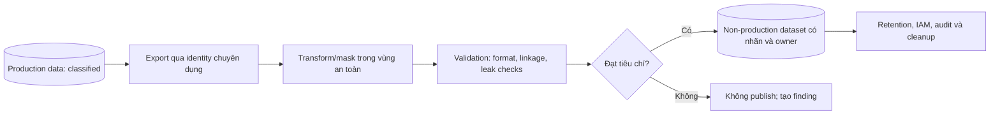
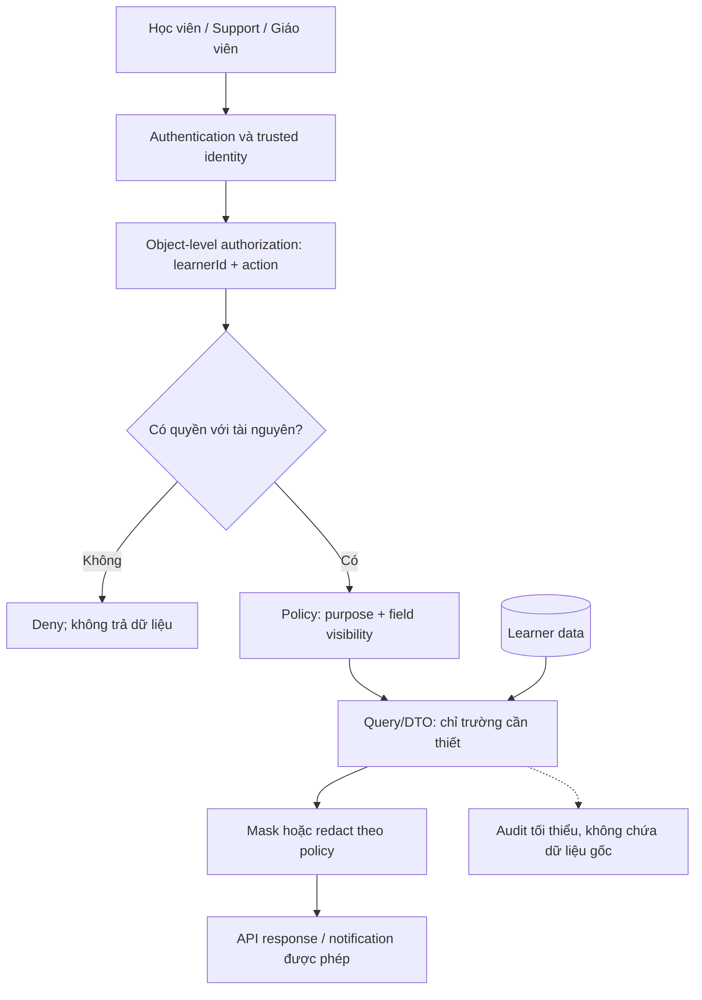

# Data masking

## Mục tiêu học tập

Sau bài học này, bạn có thể:

- Giải thích **data masking (che giấu dữ liệu)** là gì, mục tiêu giảm phơi bày thông tin, phạm vi có thể bảo vệ và những điều masking **không thể thay thế**.
- Phân biệt **static data masking**, **dynamic data masking**, **redaction**, **tokenization**, **pseudonymization**, **anonymization**, **encryption** và **data minimization**.
- Lựa chọn phép che dữ liệu theo **phân loại, mục đích xử lý, vai trò, tài nguyên, ngữ cảnh và threat scenario**; đánh giá nguy cơ khôi phục hoặc suy luận giá trị gốc.
- Thiết kế các luồng Spring Boot không để lọt dữ liệu nguyên gốc qua API, serialization, logs, traces, exports, analytics hoặc môi trường thử nghiệm.
- Viết yêu cầu và kiểm thử **positive/negative**, bao gồm phân quyền, các định dạng đầu vào, thiếu chính sách, lỗi tích hợp và trường hợp che dữ liệu không đủ.
- Áp dụng **Claim – Argument – Evidence** để chứng minh masking được thực thi trên đúng bản build, môi trường và đường dữ liệu, đồng thời quản lý findings và residual risk.

## 1. Data masking là gì?

**Data masking** là kỹ thuật biến đổi hoặc thay thế cách biểu diễn một giá trị để **giới hạn lượng thông tin gốc bị lộ** đối với người, dịch vụ hoặc môi trường không có nhu cầu xem đầy đủ. Ví dụ: với email `lan.nguyen@example.edu`, giao diện hỗ trợ học viên có thể chỉ hiển thị `l***@example.edu`. Mục tiêu không nhất thiết là làm giá trị hoàn toàn không thể nhận diện; đôi khi chỉ cần một phần thông tin đủ để nhân viên hỗ trợ nhận biết đúng hồ sơ mà không thấy toàn bộ dữ liệu.

Trong nền tảng học tập:

- Học viên có quyền xem địa chỉ email của chính mình có thể thấy giá trị đầy đủ trong một chức năng được cho phép.
- Nhân viên hỗ trợ chỉ cần xác nhận người học đã liên kết đúng địa chỉ liên hệ; họ có thể chỉ thấy email được mask, **nếu** policy cho phép.
- Người vận hành phân tích lỗi API cần biết request ID và loại lỗi, **không** cần xem bảng điểm hoặc token xuất hiện trong payload.
- Bộ dữ liệu dùng để demo hoặc kiểm thử có thể phải thay giá trị nhận diện thật bằng dữ liệu giả hoặc đã biến đổi.

Trong chương **Data protection** của module **SECURITY_SECURITY_ASSURANCE**, masking chỉ hữu ích khi được xem như một **security control có thể kiểm chứng**: vì sao dữ liệu cần che, ai được thấy dạng nào, ở đâu phép che diễn ra, đường nào còn giá trị gốc và bằng chứng nào cho thấy quy tắc đã thực thi đúng.

**Nguyên tắc cốt lõi:** *masking giảm phơi bày, nhưng không tự giải quyết quyền truy cập*. Nếu một giáo viên không được phép xem hồ sơ học viên B, trả về điểm số đã che một phần **không phải** lý do để cho phép giáo viên A truy cập hồ sơ B. Cần **authorization theo đối tượng** trước, sau đó mới quyết định trường nào được hiển thị và ở mức chi tiết nào.

### 1.1. Ví dụ ngắn về mức phơi bày

| Trường gốc | Dạng trả về minh họa | Mục đích | Phần vẫn bị lộ |
| --- | --- | --- | --- |
| `lan.nguyen@example.edu` | `l***@example.edu` | Hỗ trợ nhận biết địa chỉ mà không hiển thị toàn bộ local part. | Chữ đầu, domain; có thể suy luận nếu tập người nhỏ. |
| `0912345678` | `******5678` | Xác nhận bốn số cuối của số điện thoại. | Bốn số cuối; vẫn có giá trị nhận dạng trong một số bối cảnh. |
| `GRADE: 8.75` | `[REDACTED]` | Log hoặc phản hồi không được phép tiết lộ điểm. | Có thể còn tiết lộ sự tồn tại của trường, nếu policy cho phép. |
| `learnerId=42` | ID tham chiếu ngẫu nhiên có thời hạn | Giảm khả năng suy ra ID tuần tự trong báo cáo. | Nếu còn ánh xạ hoặc metadata khác, vẫn có thể liên kết người học. |
| JWT access token | `[REDACTED]` | Không để secret/token xuất hiện trong log. | Không nên giữ lại prefix/suffix nếu không có lý do bảo mật phù hợp. |

Những kết quả này là **minh họa**, không phải mẫu mask an toàn chung. Một số trường như **credential, khóa bí mật hoặc mã dùng để xác thực** nên được **loại bỏ hoàn toàn** khỏi log và báo cáo, thay vì tiết lộ “bốn ký tự cuối” theo thói quen. Cần xem dữ liệu, mục đích và khả năng suy luận trong tình huống cụ thể.

## 2. Masking khác những kỹ thuật bảo vệ dữ liệu nào?

Thuật ngữ “che dữ liệu” thường bị dùng rất rộng. Trong assurance cần mô tả **đúng phép biến đổi**, vì khả năng khôi phục giá trị gốc và threat được xử lý là khác nhau.

| Kỹ thuật | Cách hoạt động thường gặp | Có thể hoàn nguyên? | Điểm cần kiểm chứng |
| --- | --- | --- | --- |
| **Display/partial masking** | Giữ một phần, thay phần còn lại bằng ký hiệu hoặc giá trị giả. | Có thể suy luận hoặc khôi phục trong tập nhỏ; giá trị gốc vẫn ở nguồn. | Mask ở đúng điểm trả dữ liệu, không lộ qua trường khác. |
| **Static data masking** | Tạo bộ dữ liệu đã biến đổi để dùng ở môi trường/đích khác. | Phụ thuộc phương pháp; có thể giữ liên kết hoặc bị đoán ngược. | Kiểm tra **toàn bộ bản sao**, liên kết giữa bảng và độ khó tái nhận diện. |
| **Dynamic data masking** | Thay hình thức dữ liệu ở thời điểm đọc/trả kết quả theo policy. | Dữ liệu nguồn giữ nguyên, chủ thể có quyền khác vẫn có thể đọc bản gốc. | Thực thi đúng role/resource/context trên **mọi đường truy cập**. |
| **Redaction/suppression** | Bỏ trường hoặc thay toàn bộ bằng `[REDACTED]`. | Bản trình bày không chứa giá trị gốc; nguồn có thể vẫn giữ. | Kiểm tra không rò trong metadata, logs, lỗi và đường phụ. |
| **Tokenization** | Thay giá trị bằng token và có thể lưu ánh xạ trong vault. | Có thể nếu vault/khóa ánh xạ cho phép. | Vault, quyền detokenize, audit, thời hạn và vòng đời token. |
| **Pseudonymization** | Thay thuộc tính định danh bằng mã khác, giữ khả năng liên kết khi có thông tin bổ sung. | Có thể liên kết lại bởi bên giữ thông tin bổ sung hoặc qua phân tích. | Tách/bảo vệ khóa ánh xạ, nguy cơ liên kết giữa các bộ dữ liệu. |
| **Anonymization** | Biến đổi sao cho cá nhân không thể được nhận diện một cách hợp lý trong bối cảnh đánh giá. | Mục tiêu là không thể tái nhận diện hợp lý, nhưng cần đánh giá thường xuyên. | Nguy cơ tái nhận diện khi kết hợp dữ liệu phụ và thay đổi công nghệ. |
| **Encryption** | Chuyển dữ liệu thành ciphertext với khóa phù hợp. | Có, nếu có quyền và khóa giải mã. | Quản lý khóa, thuật toán, xác thực/toàn vẹn, quyền giải mã. |
| **Data minimization** | Không thu thập, không trả hoặc không giữ dữ liệu không cần thiết. | Không áp dụng nếu dữ liệu không tồn tại tại nơi nhận. | Schema, truy vấn và pipeline thật có tránh chuyển dữ liệu thừa không? |

**Masking không đồng nghĩa anonymization.** Giữ bốn số cuối điện thoại, vài ký tự email hoặc cùng một token ổn định có thể cho phép liên kết với nguồn khác. Một bộ dữ liệu dùng thử đã thay tên bằng `Student-001` nhưng giữ nguyên ngày sinh, điểm, lớp và thời gian nộp bài vẫn có thể nhận dạng lại người học.

### 2.1. Hai trường hợp cần chọn kỹ thuật khác masking

**Trường hợp A – không được biết giá trị:** Nếu nhân viên hỗ trợ không cần biết điểm của học viên, tốt hơn là **không truy vấn/không trả trường điểm** thay vì chỉ gửi `"grade": "***"`. Điều này giúp giảm cả nguy cơ rò rỉ qua serialization, cache và logging.

**Trường hợp B – cần bảo vệ khi lưu và truyền:** Mã hóa phù hợp vẫn cần thiết cho dữ liệu nhạy cảm ngay cả khi UI hiển thị dạng che. Mask ở giao diện **không bảo vệ** file backup bị tải trái phép, một service account có quyền đọc toàn bộ DB hoặc đường API phụ trả bản ghi thô.

## 3. Thiết kế masking theo rủi ro, vai trò và mục đích

Trước khi áp dụng một thư viện tạo dấu sao, cần xác định:

1. **Tài sản và mức phân loại:** email liên hệ, số điện thoại, kết quả học tập, hồ sơ chứng chỉ, giấy tờ định danh, credential hay dữ liệu tổng hợp?
2. **Security objective:** bảo vệ confidentiality, privacy, integrity hay giảm tác động nếu nhân viên hỗ trợ xem nhầm dữ liệu?
3. **Chủ thể và vai trò:** chính học viên, giáo viên phụ trách lớp, support, Operator, auditor, vendor hay service account?
4. **Hành động và phạm vi:** tìm kiếm, đọc một hồ sơ, xuất hàng loạt, cập nhật, gửi thông báo, ghi log, phân tích hay tải file?
5. **Mục đích chính đáng:** điều gì thật sự cần để hoàn thành tác vụ? Có thể bỏ trường hoàn toàn không?
6. **Điểm kiểm soát:** masking diễn ra khi query, xây DTO, render, xuất CSV, ghi log hay tại DB view? Có đường bypass không?
7. **Khả năng suy luận:** các ký tự được giữ lại có giúp nhận diện khi ghép với tên, lớp nhỏ, thời gian và dữ liệu khác không?
8. **Bằng chứng:** test và quan sát runtime nào chứng minh đúng đối tượng nhận được đúng mức dữ liệu?

### 3.1. Ma trận mục đích và mức hiển thị minh họa

| Chủ thể/luồng | Email | Số điện thoại | Điểm cá nhân | Hồ sơ proofing |
| --- | --- | --- | --- | --- |
| **Học viên xem tài khoản của mình** | Đầy đủ nếu chức năng và phiên được phép. | Đầy đủ hoặc chỉ xác nhận tùy tác vụ. | Xem điểm của chính mình theo nghiệp vụ. | Chỉ thông tin trạng thái cần thiết, tránh trả tài liệu gốc. |
| **Giáo viên được phân công lớp** | Chỉ trường liên hệ thực sự cần và được phê duyệt. | Có thể mask hoặc không cung cấp. | Chỉ dữ liệu lớp/học viên thuộc quyền. | Không mặc định truy cập. |
| **Nhân viên hỗ trợ** | Dạng mask để xác nhận hồ sơ khi phù hợp. | Có thể chỉ bốn số cuối nếu mục đích cho phép. | Không trả mặc định. | Chỉ trạng thái/đường xử lý được ủy quyền. |
| **Operator debug sự cố** | Ưu tiên không đưa vào logs/traces. | Không ghi. | Không ghi. | Không ghi tài liệu, sinh trắc hay secret. |
| **Analytics được phê duyệt** | Ưu tiên bỏ hoặc pseudonymize có đánh giá. | Thường không cần. | Chỉ dữ liệu/độ chi tiết phù hợp mục đích. | Không mặc định truy cập. |
| **API public** | Không có dữ liệu cá nhân không được công bố. | Không có. | Chỉ nội dung có căn cứ công khai. | Không có. |

Ma trận **không cấp quyền tự động** cho từng vai trò. Thẩm quyền xem một hồ sơ còn phụ thuộc người học, lớp, tenant, thời điểm, mục đích và các quy định áp dụng. Đôi khi **ẩn cả trường** an toàn và đơn giản hơn che một phần.

### 3.2. Viết requirement có thể kiểm chứng

Ví dụ `DP-MASK-01`:

> Đối với chức năng hỗ trợ học viên trên production, tài khoản support được phân quyền theo hồ sơ chỉ được nhận **email đã che phần local part** và **số điện thoại đã che theo chính sách**; các trường điểm, tài liệu identity proofing và credential **không được đưa vào response**. Người không có quyền với hồ sơ phải bị từ chối trước khi dữ liệu được trả.

Để đủ cho kiểm thử, yêu cầu cần thêm: định nghĩa chính xác định dạng che; handling cho `null`, dữ liệu sai định dạng và Unicode; danh sách endpoint/response; mức dữ liệu được phép lộ; owner của rule; điều kiện đổi quyền; bằng chứng và trạng thái khi policy không khả dụng.

## 4. Các kỹ thuật masking và giới hạn cụ thể

### 4.1. Che một phần bằng ký tự

Ví dụ email `l***@example.edu` hoặc điện thoại `******5678`. Dễ triển khai và hữu ích để đối chiếu hồ sơ, nhưng **domain email, chữ đầu và bốn số cuối là thông tin thật**, không thể xem như không tiết lộ dữ liệu cá nhân.

Lỗi thường gặp:

- Hàm mask dựa vào vị trí byte/UTF-16 mà không xét Unicode hoặc định dạng biến thể.
- Chuỗi rất ngắn (`a@b.co`) vô tình lộ hết phần đáng lẽ phải che.
- Format khác nhau giữa UI, API, PDF, email thông báo và log.
- Tưởng rằng mask ở React/Vue đã chặn người dùng đọc full value trong HTTP response.
- Sử dụng cùng một giá trị đã che như **bí mật để xác thực người gọi**; vài ký tự còn lại có thể bị đoán.

**Tiêu chí:** định nghĩa rõ phần nào được giữ, trong trường hợp nào **redact toàn bộ** và không cho đầu vào sai định dạng rơi về “trả nguyên giá trị”.

### 4.2. Redaction và suppression

Redaction thay toàn bộ giá trị bằng token hiển thị như `[REDACTED]`; suppression loại hẳn trường khỏi payload. Cần phân biệt:

- `"identityDocument": "[REDACTED]"`: cho biết **trường tồn tại** nhưng không lộ nội dung.
- Không có trường `identityDocument`: giảm dữ liệu gửi tới nơi nhận.
- `"identityDocument": null`: có thể biểu thị không có dữ liệu, không nhất thiết là bị hạn quyền.

Điều này ảnh hưởng đến **semantics**, UX và privacy; API contract phải tránh để người dùng suy đoán nhầm. Những API công khai không nên tiết lộ sự tồn tại của hồ sơ nếu chính sự tồn tại ấy là thông tin nhạy cảm.

### 4.3. Substitution và format-preserving masking

Với dữ liệu thử nghiệm, có thể thay email thật bằng giá trị hợp lệ về định dạng và thay tên bằng tên giả. Lợi ích là ứng dụng vẫn chạy các luồng kiểm thử. Nhưng phải xem:

- Thay thế có thể vô tình tạo email/số điện thoại **thật của người khác**, khiến hệ thống test gửi thông báo ra ngoài.
- Giữ cùng định dạng/độ dài giúp test, nhưng cũng giữ thông tin phụ hoặc dễ bị phân tích.
- Nếu thay từng bảng độc lập, quan hệ giữa hồ sơ học viên và điểm có thể mất; nếu dùng một ánh xạ chung ổn định thì tăng nguy cơ **linkability**.
- Với định dạng dữ liệu đặc biệt, cần đảm bảo generated values không trùng với giá trị thật và không được dùng để xác thực.

**Đối với test:** ưu tiên tạo **synthetic data** từ đầu nếu đủ yêu cầu; static masking bản sao production chỉ khi thực sự cần và có kế hoạch bảo vệ pipeline cũng như kết quả.

### 4.4. Deterministic masking, hashing và tokenization

Đôi khi analytics cần giữ khả năng join các bản ghi của cùng người. Một mã thay thế **ổn định** cho cùng nguồn có thể hỗ trợ, nhưng tạo nguy cơ liên kết qua nhiều datasets.

Không nên dùng **hash thường của email hoặc số điện thoại** rồi kết luận đã ẩn danh. Không gian giá trị có thể dự đoán được, cho phép dictionary/guessing attack; kết quả ổn định còn cho phép theo dõi chéo. Nếu cần pseudonym ổn định, phải xem thiết kế với **khóa bí mật được quản lý**, domain separation theo mục đích, quyền truy cập và mức rủi ro; dùng primitive đã được đánh giá, không tự phát minh thuật toán.

Tokenization với vault có thể hỗ trợ thay ID gốc khi chia sẻ, nhưng **quyền detokenize**, log truy cập vault, tenant binding, rotation, backup và nguy cơ lộ bảng ánh xạ đều cần controls. **Pseudonym không tự là dữ liệu vô danh.**

## 5. Static data masking: bảo vệ môi trường ngoài production

**Static data masking (SDM)** tạo một **bản sao đã biến đổi** trước khi chia sẻ hoặc đưa dữ liệu sang môi trường khác. Mục tiêu thường là hỗ trợ kiểm thử, đào tạo, demo hay phân tích được phê duyệt mà không cấp dữ liệu nguyên gốc.

### 5.1. Một pipeline SDM có kiểm soát



**Điểm quan trọng:** bước `Export` và `Transform` có thể xử lý dữ liệu production **chưa mask**; toàn bộ pipeline trung gian phải được bảo vệ ở mức phù hợp. Không được sao chép DB production vào một bucket test có quyền rộng rồi mới bắt đầu chạy masking.

### 5.2. Checklist kiểm chứng chất lượng

1. **Scope đầy đủ:** bảng, object, log, attachment, image, free-text, file export, snapshot và các cột mới đã được kiểm kê chưa?
2. **Data subject linkage:** khi một học viên xuất hiện ở nhiều bảng, đã thay những định danh cần che mà vẫn giữ integrity của quan hệ cần thiết cho test chưa?
3. **Dữ liệu tự do:** các trường nhận xét của giáo viên có thể chứa tên, email, số điện thoại hoặc thông tin đặc biệt không theo cấu trúc.
4. **Uniqueness/format:** các trường cần duy nhất, date-range, checksum, foreign key, phân phối dữ liệu, edge cases có được bảo toàn cho mục đích test không?
5. **Dữ liệu thật còn sót:** sample kiểm tra và các phép dò độc lập có phát hiện số định danh thật, raw email, token, URL tải nhạy cảm hoặc tên hiếm không?
6. **Đường gửi thông báo:** email/SMS/payment/webhook trên staging đã được sandbox hóa để không gửi tới người thật chưa?
7. **Isolation:** tài khoản, IAM, network, secrets và quyền debug của non-production có phù hợp độ nhạy còn lại không?
8. **Provenance:** dữ liệu đến từ bản production nào, biến đổi bằng rule/version gì, ai duyệt và kết quả xác minh lưu đâu?
9. **Retention:** bản sao trung gian, output, backup và artifact lỗi đã được dọn theo chính sách chưa?

**Một vài test không tìm thấy PII không chứng minh toàn bộ dữ liệu đã an toàn.** Phải đánh giá mức bao phủ, false negative, tính liên kết và nguy cơ tái nhận diện trong bối cảnh thực tế.

### 5.3. Dữ liệu synthetic so với dữ liệu đã mask

| Lựa chọn | Ưu điểm | Hạn chế |
| --- | --- | --- |
| **Synthetic data được tạo mới** | Không cần đưa bản ghi người thật vào pipeline; dễ quản lý mục đích. | Có thể thiếu edge cases, phân phối hoặc quan hệ phức tạp. |
| **Static masked clone** | Có thể giữ cấu trúc/quan hệ gần production để test migration hoặc performance. | Phải bảo vệ quá trình tạo; vẫn có rủi ro rò rỉ, suy luận và phân loại sai. |
| **Subset được kiểm soát** | Giảm khối lượng dữ liệu và bề mặt phơi bày. | Bản ghi còn lại có thể vẫn chứa dữ liệu nhạy cảm; subset không phải masking. |
| **Redacted/minimized dataset** | Loại bỏ hẳn trường không cần dùng cho mục đích. | Test phụ thuộc trường bị bỏ có thể không còn thực tế. |

Quyết định nên dựa trên **rủi ro, nhu cầu kiểm thử và bằng chứng**. Không mặc định rằng tạo dữ liệu giả từ production luôn cần thiết hoặc luôn an toàn hơn synthetic data.

## 6. Dynamic data masking: giới hạn hiển thị ở thời điểm truy cập

**Dynamic data masking (DDM)** giữ dữ liệu gốc tại nguồn nhưng trình bày giá trị che theo **quyền của chủ thể và ngữ cảnh truy cập**. Nó có thể được triển khai tại DB/view, API/service hoặc một tầng bảo vệ riêng.

### 6.1. Một luồng truy cập có điểm kiểm soát rõ



Sơ đồ thể hiện **ý định thiết kế**, chưa phải kết quả chứng minh. Dù UI thấy email đã mask, dữ liệu raw vẫn có thể tồn tại ở database, các caches, queue, traces hoặc service nội bộ; cần đánh giá các trust boundaries tương ứng.

### 6.2. Ưu tiên thực thi tại điểm có thể tin cậy

| Vị trí mask | Lợi ích | Nguy cơ cần chú ý |
| --- | --- | --- |
| **Frontend/UI** | Giúp người dùng nhìn đúng dạng che; cải thiện UX. | Nếu API đã gửi raw, người dùng vẫn thấy qua network/DevTools. Không phải control bảo vệ đầy đủ. |
| **API/service DTO** | Có thể kết hợp authorization, business purpose và field-level policy. | Cần bao phủ mọi controller, export, debug serialization và error responses. |
| **Database view/column masking** | Giảm dữ liệu lộ qua một số vai trò truy vấn trực tiếp. | Owner/admin/role khác có thể bypass; driver và quyền DB phải được xem xét. |
| **Data access/projection** | Không đưa trường không cần vào memory hoặc tầng trên. | SQL/query phụ, repository khác có thể vẫn truy cập raw. |
| **Proxy/gateway** | Tập trung một số quy tắc response. | Không nhìn hết semantics nghiệp vụ; lỗi route, streaming, compression hoặc schema mới có thể bypass. |

Tùy rủi ro, nên kết hợp **lọc dữ liệu ngay từ truy vấn**, **authorization tại server**, **masking trước serialization** và **IAM của dữ liệu nguồn**. Không xem “có một điểm che” là đảm bảo mọi đường đã được kiểm soát.

### 6.3. Thay đổi chính sách và fail-safe

Nếu không xác định được nhãn dữ liệu hoặc quyền hiển thị do policy store không khả dụng, không nên mặc định cho full value. Quy tắc thường phù hợp là **từ chối, bỏ trường hoặc yêu cầu review** tùy business process và thiết kế đã phê duyệt; phải test hành vi khi policy timeout, cache cũ hoặc service lỗi.

Nếu một người dùng **được phép** xem bản gốc, phải có mục đích, điều kiện và quyền rõ ràng; “nút xem đầy đủ” không được tự động bật chỉ vì user đã đăng nhập.

## 7. Ví dụ Java/Spring Boot: trả về dữ liệu liên hệ đã che

### 7.1. Tình huống và yêu cầu

Service `learning-progress-api` cung cấp chức năng nhân viên hỗ trợ xem thông tin liên hệ để hỗ trợ học viên. Nhân viên phải được **phân công xử lý hồ sơ** trước khi có quyền truy cập; họ chỉ cần email và số điện thoại dạng che, không cần điểm hay hồ sơ proofing.

Các yêu cầu:

| ID | Control statement | Tiêu chí kiểm chứng |
| --- | --- | --- |
| `MASK-AUTH-01` | Chỉ tài khoản support có quyền trên `learnerId` mới được xem bản liên hệ hỗ trợ. | Support không được phân công bị từ chối; test không có dữ liệu trả. |
| `MASK-FIELD-02` | Response hỗ trợ chỉ chứa các trường được phép và email/phone đã mask bằng rule phía server. | Không chứa raw email/phone, grade hoặc proofing payload. |
| `MASK-SRC-03` | Định dạng che và quyền hiển thị được lấy từ policy đáng tin, không tin tham số `showFull=true` từ client. | Request cố bật full value không làm đổi mức hiển thị. |
| `MASK-LOG-04` | Logs, traces và lỗi của đường hỗ trợ không chứa dữ liệu liên hệ thô hoặc token. | Test/log review end-to-end, truy vết sự kiện tối thiểu. |
| `MASK-OPS-05` | Khi thay API, DTO, policy hoặc logging, các phép kiểm liên quan phải được chạy lại. | CI/release evidence và post-deploy verification phù hợp. |

### 7.2. Hàm mask định dạng hiển thị

Ví dụ Java đơn giản, có xử lý `null` và chuỗi không đúng định dạng theo cách **redact toàn bộ**:

```java
@Component
public class ContactMasker {
    public String maskEmail(String raw) {
        if (raw == null) return null;

        int at = raw.lastIndexOf('@');
        if (at <= 0 || at == raw.length() - 1) {
            return "[REDACTED]";
        }
        // Giữ ký tự Unicode đầu tiên của local part để hỗ trợ nhận biết.
        int firstCodePointEnd = raw.offsetByCodePoints(0, 1);
        String first = raw.substring(0, firstCodePointEnd);
        String domain = raw.substring(at + 1);

        // Ví dụ cố định: không biểu thị độ dài local part.
        return first + "***@" + domain;
    }

    public String maskPhone(String raw) {
        if (raw == null) return null;

        // Ví dụ dành cho dữ liệu số ASCII đã chuẩn hóa ở tầng nhập liệu.
        String digits = raw.replaceAll("[^0-9]", "");
        if (digits.length() < 4) return "[REDACTED]";
        return "******" + digits.substring(digits.length() - 4);
    }
}
```

Đoạn mã chỉ minh họa **dạng hiển thị**, không phải thư viện masking chuẩn để áp dụng cho mọi quốc gia/định dạng. Trong hệ thống thực, cần xác thực/chuẩn hóa đầu vào, xét Unicode, địa chỉ email quốc tế, số quốc tế, dữ liệu hỏng, domain nhạy cảm và **mức thông tin được phép tiết lộ**. Hàm trả domain và chữ đầu email vẫn có thể hỗ trợ suy luận danh tính. Đối với dữ liệu cực kỳ nhạy cảm, **redact hoặc không trả trường** có thể phù hợp hơn.

### 7.3. Tránh trả entity gốc ra API

Thiết kế DTO hỗ trợ có thể giữ chỉ những trường cần thiết:

```java
public record SupportLearnerView(
        String supportReference,
        String maskedEmail,
        String maskedPhone
) {}

@Service
public class LearnerSupportService {
    private final LearnerRepository learners;
    private final ContactMasker masker;

    public LearnerSupportService(LearnerRepository learners,
                                 ContactMasker masker) {
        this.learners = learners;
        this.masker = masker;
    }

    @Transactional(readOnly = true)
    @PreAuthorize("@supportAccess.canViewContact(authentication, #learnerId)")
    public SupportLearnerView getContactForSupport(long learnerId) {
        SupportContactProjection p = learners
                .findSupportContactByLearnerId(learnerId)
                .orElseThrow(() -> new ResourceNotFoundException());

        return new SupportLearnerView(
                p.supportReference(),
                masker.maskEmail(p.email()),
                masker.maskPhone(p.phone())
        );
    }
}
```

Các loại `LearnerRepository`, `SupportContactProjection`, `ResourceNotFoundException` và bean `supportAccess` là **thành phần giả định của ứng dụng**; cần tự định nghĩa tương ứng. Phương thức `canViewContact` phải đối chiếu **authentication tin cậy, vai trò và phân công hồ sơ thực**, không chỉ `hasRole('SUPPORT')`. `@EnableMethodSecurity` phải được kích hoạt và lời gọi đi qua cơ chế bảo vệ thật của Spring. Trong thiết kế tốt hơn, projection chỉ lấy đúng email/phone/reference, không tải toàn bộ entity có điểm, tài liệu định danh và thuộc tính khác.

**Không** trả entity JPA rồi hy vọng `@JsonIgnore` hoặc frontend sẽ che đủ: annotation/DTO có thể bị bỏ qua ở một endpoint phụ, serializer khác, background export hoặc logger mặc định. Cần chỉ rõ schema, đường vào và tầng thực thi.

### 7.4. Test masking cùng authorization

Giả sử fixture ở server có học viên `42`, email `lan.nguyen@example.edu`, số điện thoại `0912345678`; tài khoản `support-a` được phân công xử lý hồ sơ, `support-b` không được phân công.

```java
@SpringBootTest
@AutoConfigureMockMvc
class SupportContactMaskingIT {
    @Autowired
    MockMvc mockMvc;

    @Test
    @WithMockUser(username = "support-a", roles = "SUPPORT")
    void assignedSupportOnlyReceivesMaskedContact() throws Exception {
        mockMvc.perform(get("/api/learners/42/support-contact"))
            .andExpect(status().isOk())
            .andExpect(jsonPath("$.maskedEmail")
                       .value("l***@example.edu"))
            .andExpect(jsonPath("$.maskedPhone")
                       .value("******5678"))
            .andExpect(jsonPath("$.grade").doesNotExist())
            .andExpect(jsonPath("$.proofingDocument").doesNotExist())
            .andExpect(content().string(
                not(containsString("lan.nguyen@example.edu"))));
    }

    @Test
    @WithMockUser(username = "support-b", roles = "SUPPORT")
    void unrelatedSupportMustBeDenied() throws Exception {
        mockMvc.perform(get("/api/learners/42/support-contact"))
            .andExpect(status().isForbidden());
    }
}
```

Đây là **mẫu test**, giả định controller/fixture/security filters tồn tại, sử dụng các static imports tương ứng của JUnit, MockMvc, Spring Security Test và Hamcrest. Phải kiểm tra cả tình huống **không xác thực, quyền vừa thu hồi, learnerId thuộc tenant khác, dữ liệu `null`/không hợp lệ và request cố yêu cầu full value**. Test từ chối không thể chỉ dựa vào mã `403` nếu thất bại thực chất do security filter cấu hình nhầm hoặc endpoint không tồn tại; cần đối chứng tài khoản hợp lệ và quan sát policy được thực thi.

Những test về response **không chứng minh logs hoặc DB không chứa raw data**. Để chứng minh `MASK-LOG-04`, phải dùng một phép kiểm riêng bắt và xem log/traces từ nguồn đến sink, cũng như review cấu hình HTTP access logging và exception handlers.

## 8. Masking trong log, tracing, monitoring và thông báo

Logs và traces thường là nguồn rò dữ liệu không chủ đích vì được truy cập bởi nhiều nhân viên, công cụ và nhà cung cấp. Masking ở API response **không** ngăn log ghi request body trước khi service xử lý.

### 8.1. Ưu tiên không ghi dữ liệu thô

Một audit event hỗ trợ nghiệp vụ có thể là:

```json
{
  "eventType": "SUPPORT_CONTACT_VIEW",
  "actorRef": "support-a",
  "learnerRef": "opaque-learner-reference",
  "decision": "PERMIT_MASKED",
  "correlationId": "request-123",
  "classification": "CONFIDENTIAL"
}
```

Đây là dữ liệu giả minh họa. Event nên phản ánh **hành động và quyết định**, không chứa email gốc, điểm, token hay tài liệu proofing. Ngay cả `actorRef`, `learnerRef` và địa chỉ mạng có thể là dữ liệu cá nhân hoặc metadata nhạy cảm nên cần phân quyền log và retention theo chính sách.

### 8.2. Những đường log cần kiểm tra

| Nguồn | Nguy cơ | Kiểm chứng cần có |
| --- | --- | --- |
| **HTTP access/request logging** | Query string hoặc request body chứa PII/credential. | Kiểm tra cấu hình filter/proxy, payload thực và đường fallback. |
| **Application debug logs** | Developer in nguyên entity bằng `toString()`. | Review code, test log không có raw field, cấp quyền thay đổi log level. |
| **Exception/stack trace** | Exception message, SQL args hoặc validation input lộ dữ liệu. | Test lỗi, xem response và sink, không chỉ happy path. |
| **Distributed tracing/APM** | Span attributes chứa headers, parameters hoặc payload. | Review trace enrichment và cài đặt exporter/vendor. |
| **Metrics** | User ID/email được gắn thành label có cardinality cao. | Kiểm tra metric series/labels, bỏ định danh không cần. |
| **Notifications/tickets** | Email, SMS, issue tracker gửi thông tin thô cho bên không cần biết. | Test template, danh sách người nhận, DLP và retention. |
| **Dead-letter queues** | Job lỗi được sao chép nguyên dữ liệu nhạy cảm. | Kiểm tra payload, quyền xem DLQ, retry và TTL. |

**Regex redaction sau khi log đã gửi ra ngoài không đủ mạnh**: dữ liệu có thể đã nằm trong agent buffer, stdout, collector hay backup. Lựa chọn tốt hơn là **không xây log event chứa raw field**, kiểm soát schema và mask trước khi phát sự kiện; có defense-in-depth tại sink khi phù hợp.

### 8.3. Một số sai lầm của masking theo pattern

- Pattern bỏ sót Unicode, khoảng trắng, phân tách số điện thoại, token format mới hoặc dữ liệu tự do.
- Pattern rộng quá mức làm hỏng dữ liệu cần điều tra, nhưng cũng không chứng minh không còn PII.
- Dữ liệu lộ trong **header hoặc exception** dù body được mask.
- Một bản log đã mask được copy vào ticket rồi chứa thêm screenshot có dữ liệu thật.
- Mặc định `toString()` của record/entity đưa field gốc vào logs ở nhánh lỗi.

Vì vậy test cần dùng **tập dữ liệu đa dạng**, kiểm soát lượng log thu thập và có người review chất lượng, không chỉ đo “số lần regex thay thế ký tự”.

## 9. Data masking cho exports, reports và bên thứ ba

Khi dữ liệu rời hệ thống nguồn (CSV, PDF, email, BI report, API đối tác), **đường che có thể khác** đường hiển thị trên màn hình. Trước khi xuất, cần xác định mục đích và người nhận có quyền xem dạng nào.

### 9.1. Một bảng quyết định xuất dữ liệu

| Tình huống | Quy tắc mong đợi | Test/evidence |
| --- | --- | --- |
| Giáo viên xuất điểm lớp đang phụ trách | Chỉ các trường được phê duyệt, đúng học viên/lớp; trường liên hệ che/bỏ theo mục đích. | Test object-level authz, schema CSV và content sample theo fixture. |
| Giáo viên thử đổi `courseId` | **Từ chối**, không cho xuất bản mask để bù lỗi quyền. | Negative test và chứng cứ job/file không được tạo. |
| Support tải báo cáo liên hệ | Đúng trường đã mask, giới hạn record count/scope. | Test authz, format, quota, download và audit. |
| Vendor nhận dữ liệu qua API | Áp dụng data sharing contract, mục đích và trường tối thiểu, mask/tokenize khi phù hợp. | Contract mapping, integration test, partner test, logs về delivery. |
| Analytics đọc bộ dữ liệu đã pseudonymize | Giới hạn linkability; mapping key được bảo vệ ở nơi riêng. | Review mô hình dữ liệu, quyền vault, kiểm thử join/re-identification. |
| Gửi thông báo lỗi export | Không đính kèm bản ghi thô vào ticket/log/email. | Error-path test và template review. |

### 9.2. Một số điểm đặc biệt của CSV/PDF

**CSV:** Không chỉ mask các cột nhận diện; phải kiểm soát **nội dung không mong muốn** trong cell, encoding và cách dữ liệu có thể được xử lý bởi ứng dụng bảng tính. Một trường văn bản do người dùng cung cấp bắt đầu bằng ký tự đặc biệt có thể gây **CSV formula injection** khi mở trong spreadsheet. Cần có chiến lược xuất dữ liệu an toàn được kiểm chứng riêng; masking PII không tự giải quyết vấn đề này.

**PDF:** Một đoạn chữ được phủ hình chữ nhật đen có thể **vẫn tồn tại trong text layer, metadata hoặc nội dung gốc**. Cần dùng redaction đúng kỹ thuật tạo file và thử **extract/copy/search** nội dung đã che, không chỉ kiểm tra bằng mắt. Ảnh chụp PDF đã che chưa chứng minh file gốc thực sự không còn dữ liệu.

**Download URL:** Một URL được đặt thời hạn ngắn là control giảm phơi bày, nhưng **không mask nội dung**. Quyền tải, scope, replay và khả năng chia sẻ URL vẫn phải được đánh giá. Cần kiểm tra quyền ở đường tải, không chỉ khi tạo job.

## 10. Rủi ro tái nhận diện và dữ liệu dẫn xuất

### 10.1. Mask vẫn có thể cho phép suy luận

Giả sử lớp chỉ có ba học viên và dashboard xuất điểm theo ngày nộp. Dù đã thay tên bằng `A`, `B`, `C`, giáo viên khác có thể đối chiếu lịch nộp bài hoặc một bảng công khai để suy ra người tương ứng. Tương tự, địa chỉ email `l***@example.edu` có thể đủ nhận diện nếu trong bộ phận chỉ có một người tên bắt đầu bằng L ở domain đó.

Các nguồn tái nhận diện phổ biến gồm:

- **Dữ liệu bổ trợ:** danh sách lớp, lịch công bố, vị trí, timestamp hoặc nguồn bên ngoài.
- **Giá trị hiếm:** độ tuổi hoặc điểm số cực trị, lớp có một học viên.
- **Pseudonym ổn định:** cùng token xuất hiện ở nhiều báo cáo cho phép theo dõi chéo.
- **Độ dài/định dạng:** giữ nguyên cấu trúc hoặc chiều dài tiết lộ thuộc tính của giá trị gốc.
- **Sai khác giữa các lần xuất:** so sánh bản xuất trước và sau để suy ra người được thêm/bớt.
- **Mối quan hệ:** mạng xã hội, nhóm lớp, giao dịch, các khóa ngoại và liên kết dữ liệu.

### 10.2. Đánh giá hiệu quả theo người tấn công giả định

Một đánh giá masking tốt cần nêu rõ **attacker model**: người nhận biết thêm gì, có thể truy vấn lặp lại không, có quyền truy cập dataset liên quan không, có thể đối chiếu public data không. Độ “khó đoán ngược” phải được xem xét theo bối cảnh, không dựa vào việc chuỗi trông nhiều dấu sao.

Khi mục tiêu là **không thể nhận diện người học một cách hợp lý**, chỉ partial masking thường không đủ. Cần xem các biện pháp như giảm độ chi tiết, tổng hợp an toàn, hạn chế truy vấn, che những nhóm quá nhỏ, giới hạn người nhận và đánh giá nguy cơ tái nhận diện. Nếu chưa đánh giá, **không tự tuyên bố dữ liệu đã được anonymized**.

## 11. Data masking và vòng đời dữ liệu

Masking có thể xảy ra ở một bước, trong khi dữ liệu gốc tiếp tục tồn tại ở nơi khác. Cần theo dõi:

1. **Collection:** chỉ thu dữ liệu cần thiết; tránh tạo nhiều giá trị nhạy cảm vô ích.
2. **Primary storage:** phân loại, quyền truy cập và mã hóa phù hợp; masking không thay thế các controls này.
3. **Processing:** quyết định trường nào được đưa vào các bước tiếp theo; tránh log raw dữ liệu trong transform.
4. **Delivery:** API, UI, CSV/PDF, notifications và vendor phải có mức hiển thị nhất quán theo mục đích.
5. **Copy/backup:** bản sao chưa mask và intermediate datasets phải có owner, quyền, retention.
6. **Test/analytics:** đánh giá static masking hoặc synthetic data, không mặc định test environment là nơi có thể để raw production.
7. **Retention/deletion:** masking **không phải xóa dữ liệu gốc**; khi hết mục đích vẫn phải xử lý lifecycle, backups, token vault và bản sao theo nghĩa vụ.
8. **Reclassification:** thay loại dữ liệu, mục đích, đối tác hay khả năng suy luận có thể làm yêu cầu masking thay đổi.

### 11.1. Dữ liệu dẫn xuất phải được đánh giá lại

Một báo cáo đã mask email nhưng giữ `learnerId` tuần tự và `courseId` có thể vẫn thuộc nhóm dữ liệu cá nhân; không nên tự hạ nhãn từ `CONFIDENTIAL` xuống `PUBLIC`. Ngược lại, một báo cáo thống kê đã được biến đổi và kiểm chứng đầy đủ có thể có yêu cầu xử lý khác, nhưng **declassification cần quyết định có căn cứ và chủ phê duyệt**.

Chỉ dùng `max(classification)` cho mọi phép biến đổi cũng không phải thuật toán phân loại hoàn chỉnh: kết hợp nhiều nguồn có thể **làm tăng rủi ro**, còn giảm thiểu/ẩn danh được kiểm chứng có thể làm thay đổi rủi ro. Cần dùng **owner, mục đích và đánh giá khả năng nhận diện**.

## 12. Kiểm soát, chủ sở hữu và thẩm quyền

| Vai trò | Trách nhiệm với data masking | Bằng chứng |
| --- | --- | --- |
| **Data owner/business owner** | Xác định mục đích, trường nào cần xem, ai được phép, duyệt yêu cầu masking theo phân loại. | Data handling decision, chính sách trường/role, phạm vi. |
| **Privacy/Legal/Compliance** | Đánh giá dữ liệu cá nhân, chia sẻ, retention và nghĩa vụ áp dụng. | Review mục đích và hạn xử lý, đánh giá privacy khi cần. |
| **Security architect** | Threat model, lựa chọn control phù hợp và các đường bypass. | Design review, trust boundaries, control mapping. |
| **Developer** | Triển khai filtering/DTO/masking, test edge cases, sửa findings. | Code review, unit/integration tests, schema snapshot. |
| **Platform/DB Operator** | Quản lý quyền DB, IAM, log sink, backup và môi trường thử nghiệm. | Effective permissions, config/runtime checks, backup policies. |
| **Vendor/partner owner** | Giới hạn dữ liệu gửi và kiểm tra trách nhiệm của nhà cung cấp. | Contract, integration test, data transfer logs phù hợp. |
| **Assurance reviewer/auditor** | Kiểm tra design, implementation, operating effectiveness; xác định thiếu bằng chứng. | CAE, audit findings, re-test và kết luận phạm vi. |
| **Risk owner** | Xử lý residual risk và ngoại lệ trong thẩm quyền. | Risk decision, điều kiện, hạn xem lại. |

Không nên cho một nhân sự tự **hạ classification → bỏ masking → phê duyệt chia sẻ → tự xác nhận PASS** trong một thay đổi rủi ro cao. Cần phân tách nhiệm vụ hoặc kiểm soát bù trừ hợp lệ.

### 12.1. Quy trình thay đổi rule masking

- Đề xuất thay đổi phải chỉ rõ **dữ liệu, mục đích, vai trò nhận, nguồn nhãn và hậu quả nếu lộ**.
- Review thay đổi policy và data flow: endpoint, DTO, export, log, vendor, test data.
- Phân định **thay đổi giảm mức che** (tiết lộ nhiều hơn) với **thay đổi định dạng** đơn thuần; thay đổi giảm mức che có thể cần phê duyệt mạnh hơn.
- Cập nhật control statement, test cases, schema và privacy/data handling record.
- Deploy, kiểm tra runtime và giám sát sau phát hành; xác minh có instance/pipeline cũ còn hoạt động không.
- Ghi finding khi vi phạm; ngoại lệ nếu được phép phải có scope/hạn/residual risk, không đổi kết quả FAIL thành PASS.

## 13. Threat-to-control mapping và tiêu chí kiểm chứng

| Threat ID | Kịch bản | Controls cần thiết | Verification |
| --- | --- | --- | --- |
| `T-MASK-01` | Support đọc email đầy đủ vượt nhu cầu. | Field-level policy, response DTO đã mask, object authorization. | Test support đúng/sai hồ sơ, kiểm tra JSON không có raw email. |
| `T-MASK-02` | Client yêu cầu `showFull=true` để bypass che. | Chỉ server xác định mức hiển thị; bỏ qua thuộc tính client không tin cậy. | Negative test query/body/header override. |
| `T-MASK-03` | Stack trace/log tiết lộ điểm hoặc tài liệu proofing. | Minimized structured audit, lọc payload và log sink permissions. | Error-path test từ source đến log collector, review metadata. |
| `T-MASK-04` | CSV export bỏ qua policy của UI. | Export schema theo purpose/recipient, authz theo tài nguyên và masking tại server. | Test nội dung CSV/PDF, quyền tải, metadata, URL expiry. |
| `T-MASK-05` | Bản sao production dùng cho test còn định danh thật. | Synthetic/SDM pipeline được kiểm chứng, protected transformation zone. | Coverage discovery, leakage sample, referential integrity, permissions. |
| `T-MASK-06` | Pseudonym ổn định bị liên kết với nguồn khác. | Phân vùng token/key theo mục đích, giới hạn dữ liệu phụ trợ, đánh giá linkability. | Adversarial re-identification review, vault IAM, mapping audit. |
| `T-MASK-07` | Chính sách masking bị lỗi và trả dữ liệu thô. | Fail-safe policy evaluation, default deny/redact, alert và re-test. | Test timeout/missing label/unknown role; post-deploy validation. |
| `T-MASK-08` | File PDF phủ đen bằng hình nhưng vẫn có text gốc. | Redaction ở file content, xử lý metadata/embedded text. | Extract/search/copy thử; review output PDF của đúng build. |

Những mã ID là **ví dụ nội bộ**, không phải mã chuẩn bắt buộc. Một threat có thể cần nhiều controls; data masking thường chỉ là **một lớp** trong chương trình data protection.

## 14. Claim – Argument – Evidence cho data masking

Một claim assurance phải nói rõ **điều gì được chứng minh**, với **dữ liệu nào, người nhận nào và luồng nào**. Tránh claim quá rộng như “PII của ứng dụng đã được mask toàn bộ”.

### 14.1. Claim có giới hạn

**Claim:** “Trên bản phát hành R của `learning-progress-api`, trong các đường hỗ trợ hồ sơ đã kiểm kê, tài khoản support được phân công chỉ nhận thông tin liên hệ dạng mask theo chính sách; tài khoản không có quyền không được nhận dữ liệu, và audit event của những đường này không lưu thông tin liên hệ nguyên gốc.”

**Argument:**

1. Data inventory và classification xác định chính xác những trường liên hệ nhạy cảm, nguồn và endpoints thuộc phạm vi.
2. Quyền truy cập theo đối tượng được kiểm tra **trước** truy vấn/response; quy tắc mask/omit được lấy từ policy tin cậy phía server.
3. DTO/projection chỉ giữ những trường cần thiết và đã mask trước serialization; không có đường phụ được biết đến trả entity raw.
4. Positive/negative tests và review code chứng minh hành vi API với các identity và fixtures được chọn.
5. Kiểm tra log/traces/error paths xác minh payload không chứa raw contact ở những nguồn và sink đã được kiểm.
6. Evidence gắn với build, cấu hình và thời điểm deploy; những luồng chưa kiểm được nêu rõ trong trạng thái assurance.

**Evidence:**

| Lập luận | Evidence cần có | Giới hạn |
| --- | --- | --- |
| Biết đúng nơi có dữ liệu | Data inventory, schema, API contract, DFD, catalog nhãn và owner. | Discovery có thể bỏ sót endpoint ít dùng hoặc trace vendor. |
| Authorization thật | Access policy, fixture theo quan hệ support–hồ sơ, test negative/positive. | `403` có thể do lỗi route/CSRF nếu thiếu đối chứng. |
| Masking DTO đúng | Code review, unit tests các format, integration JSON tests, schema diff. | Chưa chứng minh CSV, PDF, batch và error paths khác. |
| Logging không lộ | Test từ source đến sink và review log/tracing config trên môi trường phù hợp. | Một mẫu log không bao phủ tất cả nhánh lỗi. |
| Runtime khớp bản test | Build ID, release record, effective config, API smoke/security check sau deploy. | Runtime có thể drift khi flag hoặc policy thay đổi. |
| Vòng đời và ngoại lệ | Owner approval, findings, risk decision, re-test và retention record. | Approval không tự chứng minh control có hiệu lực. |

**Giới hạn claim:** kết luận “không thấy raw trong 20 response đã thử” khác với “không có đường nào có thể tiết lộ raw”. Phải nêu rõ scope, tập test, mức bao phủ, nguồn nhận và các giả định chưa kiểm chứng.

### 14.2. Mẫu hồ sơ verification

```yaml
control_id: "MASK-FIELD-02"
system: "learning-platform"
service: "learning-progress-api"
scope:
  environment: "production"
  release: "<deployed-build-id>"
  endpoints:
    - "GET /api/learners/{learnerId}/support-contact"
  sensitive_fields: ["email", "phone", "grades", "proofing-records"]
  recipient_roles: ["assigned-support-agent"]
policy_ref: "<approved-field-visibility-policy>"
data_owner_role: "learning-data-owner"
implementer_role: "backend-engineer"
reviewer_role: "security-assurance-reviewer"
expected_behavior:
  - "Assigned support receives policy-defined masked contact"
  - "Unassigned support is denied"
  - "Raw grade/proofing/credential values are absent"
  - "Error and audit paths do not emit raw contact data"
verification:
  - test: "Positive and negative authorization + masked JSON output"
    evidence_ref: "<actual-ci-run>"
    result: "INSUFFICIENT_EVIDENCE"
  - test: "Error and log-to-sink leakage check"
    evidence_ref: "<actual-observation>"
    result: "INSUFFICIENT_EVIDENCE"
  - test: "Post-deploy effective configuration review"
    evidence_ref: "<actual-runtime-record>"
    result: "INSUFFICIENT_EVIDENCE"
assurance_result: "INSUFFICIENT_EVIDENCE"
open_findings: []
unknowns:
  - "Support CSV export path has not yet been checked"
reassess_on:
  - "API schema, data classification, authorization or log pipeline change"
```

Đây là **mẫu minh họa**, không phải chứng nhận đã thực thi. Khi chưa có artifact thật từ build/môi trường liên quan thì **không điền PASS**. Bản ghi assurance không được chứa raw email, tài liệu proofing hoặc secret chỉ để “chứng minh” masking; có thể dùng fixtures an toàn và bằng chứng đã lọc, với đường truy cập an toàn để kiểm tra khi thực sự cần.

### 14.3. Phân biệt ba trạng thái

| Trạng thái | Khi nào dùng | Hành động |
| --- | --- | --- |
| **PASS trong phạm vi** | Test/review phù hợp, không có sai lệch trọng yếu được biết đến và evidence còn hiệu lực cho claim đã xác định. | Lưu bằng chứng, scope và trigger kiểm tra lại. |
| **FAIL** | Test/quan sát xác nhận dữ liệu raw bị trả hoặc ghi trái yêu cầu. | Tạo finding, đánh giá ảnh hưởng, khắc phục, re-test; có thể kích hoạt incident response. |
| **INSUFFICIENT_EVIDENCE** | Không rõ population, chưa test export/log/runtime, policy unavailable hoặc artifact không đáng tin. | Thu thập bổ sung; chưa tuyên bố đạt. |

Ngoại lệ chính sách được phê duyệt đúng thẩm quyền phải có trạng thái riêng, phạm vi, thời hạn và residual risk. **Ngoại lệ không biến một control masking đang FAIL thành PASS.**

## 15. Continuous assurance, phát hiện drift và metrics

Masking là control dễ lỗi thời khi schema và luồng dữ liệu đổi. Cần tái kiểm tra khi:

- Thêm cột/field nhạy cảm hoặc đổi schema của entity/DTO/GraphQL.
- Thêm endpoint xuất dữ liệu, report, download, email template hoặc API đối tác.
- Chuyển cơ chế authentication/authorization, thêm role, tenant hoặc support workflow.
- Thay library serializer, global exception handler, log filter, APM/trace exporter.
- Bật debug logging, thay data pipeline, data warehouse hoặc job nền.
- Đưa production copy sang staging hoặc thêm vendor xử lý dữ liệu.
- Điều chỉnh classification, privacy requirement, retention hoặc mục đích.
- Phát hiện giá trị gốc ở log, backup, ticket, file export hoặc môi trường thử nghiệm.

### 15.1. Những chỉ số có ích

| KPI/KRI | Câu hỏi | Hạn chế |
| --- | --- | --- |
| Tỷ lệ đường dữ liệu nhạy cảm có owner và policy masking/omit | Có biết phạm vi thực sự cần che không? | Dashboard có thể bỏ sót luồng ngoài catalog. |
| Tỷ lệ API/export nhạy cảm có negative test theo tài nguyên | Có phát hiện trường hợp người không đúng quyền nhận dữ liệu không? | Test pass không chứng minh mọi endpoint đã kiểm kê. |
| Số dữ liệu raw bị phát hiện trong logs/exports/test datasets | Có rò rỉ trái chính sách qua đường phụ không? | Scanner có false positive/negative, cần xác nhận. |
| Tỷ lệ SDM jobs được xác minh leak check và provenance | Pipeline chuyển dữ liệu sang non-prod có được kiểm soát không? | Kiểm tra pattern không đủ cho dữ liệu tự do/khả năng suy luận. |
| Số changes ảnh hưởng masking chưa có re-test | Evidence có mất hiệu lực khi hệ thống đổi không? | Phải tính cả thay đổi cấu hình ngoài Git. |
| Thời gian từ finding đến khắc phục đã xác minh | Lỗ hổng phơi bày được giải quyết kịp thời không? | Ticket đóng không thay thế kiểm tra runtime. |
| Tỷ lệ permissions tới data source và token vault được review | Người có thể bypass masking có được hạn quyền không? | Cần kiểm tra effective permissions, không chỉ danh sách được phê duyệt. |
| Số ngoại lệ quá hạn hoặc thiếu bù trừ | Có đang giữ sai khác không được kiểm soát? | Ngoại lệ hợp lệ vẫn chứa residual risk. |

Chọn chỉ số dựa trên **quyết định cần đưa ra**, có nguồn, mẫu số population và owner. “100% API đã mask” không đáng tin nếu chỉ đo những API đã gắn annotation do chính developer khai báo mà không đối chiếu toàn bộ inventory.

## 16. Những sai lầm phổ biến

| Sai lầm | Hậu quả | Cách cải thiện |
| --- | --- | --- |
| Che ở frontend nhưng gửi raw data qua API. | Người gọi xem được giá trị đầy đủ qua HTTP response. | Mask/omit tại backend, kết hợp object authorization. |
| Coi email có dấu sao là anonymous. | Dữ liệu còn linkable và có thể bị suy luận. | Đánh giá re-identification theo bối cảnh; không đổi nhãn tùy tiện. |
| Chỉ kiểm vai trò `SUPPORT`, không kiểm hồ sơ được giao. | Người hỗ trợ đọc thông tin của học viên khác. | Phân quyền theo chủ thể–tài nguyên trước masking. |
| Đánh dấu `PUBLIC` khi không có classification. | Dữ liệu chưa review bị trả raw. | Fail-safe, yêu cầu quyết định nhãn đáng tin. |
| Reuse entity ở nhiều endpoint rồi mong `@JsonIgnore` giải quyết. | Serializer/DTO/exports khác vẫn có thể lộ. | Projection/response DTO và schema tests theo từng đường. |
| Chỉ kiểm happy path, bỏ logs và error handler. | Request lỗi/trace tiết lộ dữ liệu nguyên gốc. | Test cả nhánh lỗi và nguồn log-to-sink. |
| Thay tên nhưng giữ date/grade/unique ID trong test DB. | Có thể tái nhận diện học viên thật. | Synthetic/SDM có kiểm chứng liên kết và nguy cơ suy luận. |
| Hash thường email rồi công bố “đã ẩn danh”. | Dễ dictionary attack hoặc liên kết nhiều dữ liệu. | Chọn cơ chế pseudonym phù hợp, bảo vệ khóa và scope. |
| Dùng cùng token ổn định cho nhiều đối tác. | Bên nhận có thể ghép dữ liệu giữa các ngữ cảnh. | Giới hạn token theo mục đích và quyền, đánh giá linkability. |
| Vẽ hình đen lên PDF. | Text layer hoặc metadata còn nội dung gốc. | Redaction thật và thử extract/copy/search. |
| Tắt audit hoàn toàn để tránh lộ thông tin. | Mất khả năng điều tra, không biết ai truy cập. | Audit tối thiểu có schema được duyệt và bảo vệ log. |
| Chỉ kiểm thông tin che trong staging rồi kết luận production. | Policy/config/role/logging runtime có thể khác. | Gắn test với build, môi trường và kiểm tra sau deploy. |
| Mask data rồi cho rằng không cần retention/deletion. | Bản gốc, token vault và bản sao vẫn tồn tại. | Xử lý vòng đời dữ liệu và điều kiện xóa riêng. |
| Ngoại lệ được duyệt thì tự chuyển FAIL sang PASS. | Che giấu residual risk và lỗ hổng chưa sửa. | Ghi ngoại lệ riêng, re-test trước khi đóng finding. |

## 17. Bài tập tình huống: che dữ liệu trên chức năng hỗ trợ và xuất điểm

**Bối cảnh:** nền tảng học tập Java/Spring Boot có ba đường xử lý:

1. `GET /api/learners/{learnerId}/support-contact`: controller trả entity `Learner` đầy đủ; frontend dùng JavaScript thay email/số điện thoại bằng dấu sao.
2. `POST /api/courses/{courseId}/grades/exports`: giáo viên xuất bảng điểm qua worker; trong CSV, tên học viên được thay bằng `Student-001` nhưng giữ ID nội bộ, ngày nộp bài, email và điểm.
3. `POST /api/support/cases`: khi validation lỗi, exception logger ghi nguyên request body, bao gồm email, số định danh và ghi chú của học viên.

Ngoài ra, đội QA tạo một bản sao DB production trong staging, chạy script chỉ thay `first_name` và `last_name`. Một nhà cung cấp báo cáo đề nghị nhận các CSV đã “mask” qua bucket chung có URL chia sẻ dài hạn. Dashboard bảo mật báo `100% masking enabled` vì frontend hiển thị các trường che đúng format.

### 17.1. Nhiệm vụ thực hành

1. Liệt kê ít nhất **sáu threat scenarios**, phân biệt lộ qua API, export, logs, staging, storage và nguy cơ tái nhận diện.
2. Xác định các trường **phải bỏ**, **có thể mask một phần**, **chỉ được trả khi có quyền đầy đủ** trong chức năng support. Lập ma trận role–resource–purpose.
3. Viết lại requirement cho endpoint support: kiểm quyền theo học viên tại server, response DTO, quy tắc mask và fail-safe. Nêu negative tests bắt buộc.
4. Thiết kế lại static masking pipeline cho QA; nguồn dữ liệu nào phải được discover và kiểm chứng trước khi phát hành dataset cho staging?
5. Giải thích vì sao `Student-001` không bảo đảm ẩn danh khi vẫn giữ những trường có thể liên kết. Đề xuất kiểm tra tái nhận diện theo tập đối tượng và nguồn phụ trợ.
6. Viết các test cho **CSV và PDF**: schema không chứa trường ngoài mục đích, quyền theo lớp, xử lý dữ liệu/metadata, redaction thực chất và an toàn khi mở bằng spreadsheet.
7. Lập kế hoạch kiểm tra **request log, exception, tracing, queue, DLQ và vendor sink**, mô tả evidence nào hỗ trợ kết luận log không chứa dữ liệu thô.
8. Thiết kế một **Claim – Argument – Evidence** cho masking endpoint support; chỉ rõ đâu là design review, implementation test, operating evidence và residual risk.
9. Xác định vì sao KPI `100% masking enabled` chưa có căn cứ. Đề xuất population đầy đủ và hai chỉ số có khả năng phát hiện coverage thiếu.
10. Nếu phát hiện bucket chung cho phép người ngoài đọc CSV trái chính sách, hãy phân biệt **control FAIL** với kết luận “đã xảy ra rò rỉ thực tế”. Ai chịu trách nhiệm điều tra và bằng chứng nào cần bảo toàn?

### 17.2. Gợi ý đối chiếu

**Mask trên frontend không ngăn lộ API response.** Mask tên ở CSV nhưng vẫn giữ email, ID và timestamp có thể làm dữ liệu nhận diện được. Staging clone chỉ thay tên cũng không đủ cho những trường nhạy cảm khác hoặc free-text; transform pipeline phải được bảo vệ ngay từ khi nhận dữ liệu gốc.

**Đối với người không có quyền**, trả phiên bản đã che của tài nguyên vẫn có thể vi phạm authorization; cần **từ chối**. Với người có quyền support, chỉ trả các trường đã được duyệt, được che/loại bỏ ở phía server; kiểm thử cả success và error paths. Log và trace có thể rò dữ liệu dù response đã đúng.

**Các bằng chứng cần có** gồm inventory, policy trường theo role/purpose, API/CSV tests, code review, log-to-sink check, quyền bucket và runtime identity, SDM leak assessment, vendor data-sharing controls, release/config và remediation re-test. Nếu chưa đánh giá một đường quan trọng, trạng thái phù hợp là `INSUFFICIENT_EVIDENCE`; nếu đã kiểm chứng file nhạy cảm truy cập công khai thì là `FAIL` cho yêu cầu liên quan, nhưng cần điều tra thêm để xác định có bị truy cập trái phép thực tế hay không.

## Tổng kết

**Data masking** giới hạn những phần dữ liệu gốc được tiết lộ cho một chủ thể hoặc môi trường cụ thể. Hiệu quả phụ thuộc vào **threat/risk scenario, quyền theo tài nguyên, mục đích xử lý, cách biến đổi, nơi thực thi và nguy cơ tái nhận diện**. Masking không tự thay thế **authorization, encryption, data minimization, retention** hoặc chính sách chia sẻ dữ liệu.

Trong chương trình **security assurance**, phải nối được **classification và mục đích → yêu cầu mức hiển thị → masking/omission ở đúng điểm → kiểm thử API, export, logs và bản sao → evidence theo build/runtime → xử lý finding và tái kiểm tra khi thay đổi**. Chỉ khi bằng chứng đủ cho phạm vi đã công bố mới có thể kết luận control đạt; những đường chưa kiểm hoặc dữ liệu chưa xác định phải được ghi rõ thay vì mặc định an toàn.
