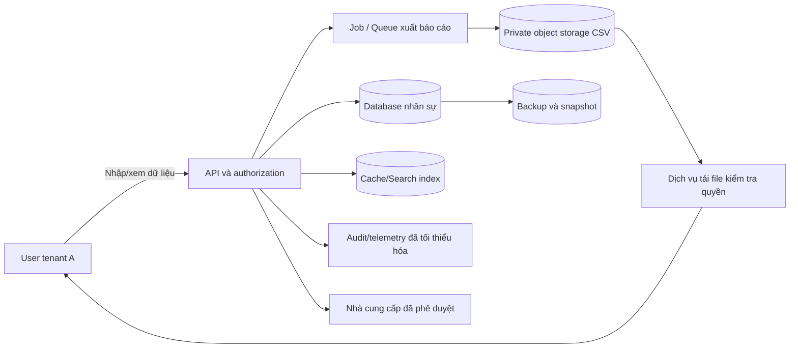
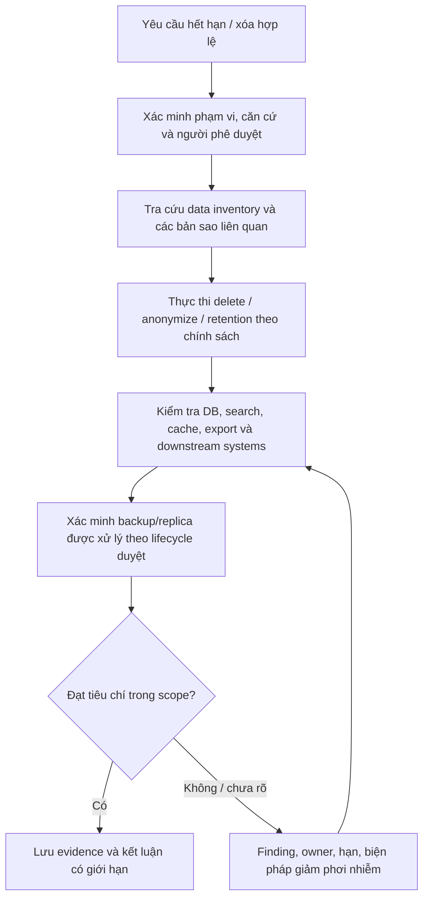

# Bằng chứng bảo vệ dữ liệu: chứng minh security controls có hiệu lực xuyên suốt vòng đời dữ liệu

## 1. Vì sao bảo vệ dữ liệu phải được chứng minh bằng bằng chứng?

Một dịch vụ có thể công bố “mọi dữ liệu đã được mã hóa”, “chỉ nhân viên được phân quyền mới truy cập được” hoặc “dữ liệu được xóa khi hết hạn”. Những tuyên bố này có vẻ tích cực nhưng **chưa đủ để kết luận dữ liệu thực sự được bảo vệ**. Một kho lưu trữ có thể bật mã hóa nhưng cấp quyền đọc công khai; một API có thể kiểm tra đăng nhập nhưng trả hồ sơ ngoài tenant; hoặc một chức năng xóa có thể chỉ bỏ bản ghi chính trong khi tệp xuất và bản sao dữ liệu vẫn tồn tại ngoài chính sách.

**Bằng chứng bảo vệ dữ liệu (data protection evidence)** là các kết quả quan sát, phép thử, bản ghi cấu hình, hồ sơ quy trình và quyết định được quản lý có thể kiểm tra lại, giúp trả lời **dữ liệu nào được bảo vệ, trước rủi ro gì, bằng security controls nào, tại hệ thống/phiên bản/thời điểm nào và hiệu lực đã được chứng minh đến đâu**.

Trong chương **Data protection** của module **SECURITY_SECURITY_ASSURANCE**, bài này đặt bằng chứng vào một chuỗi assurance có thể truy vết:

> **Tài sản và luồng dữ liệu → mục tiêu/rủi ro → yêu cầu → thiết kế security controls → triển khai → kiểm thử/audit → evidence → finding → khắc phục/retest → đánh giá rủi ro còn lại → giám sát liên tục.**

Đây là trọng tâm của việc **xây dựng cách đánh giá có bằng chứng rằng hệ thống đáp ứng các mục tiêu bảo mật**, từ phân tích rủi ro và yêu cầu tới kiểm thử, audit và vận hành. Không được xem một chính sách đã ký hoặc một công cụ đã bật là bằng chứng thay thế cho hiệu lực của kiểm soát.

### Kết quả học tập

Sau khi học, người học có thể:

1. Phân biệt **bằng chứng thiết kế, triển khai, hoạt động và khắc phục** trong bảo vệ dữ liệu.
2. Lập data inventory, data flow và phạm vi kiểm chứng bao gồm dữ liệu gốc, bản sao, export, log, cache, backup và bên thứ ba.
3. Thiết kế phép thử và thu thập bằng chứng cho **phân quyền, mã hóa/khóa, giảm thiểu dữ liệu, kiểm soát truyền tải/chia sẻ, lưu giữ/xóa, giám sát và phục hồi**.
4. Đánh giá bằng chứng theo **completeness, accuracy, provenance, freshness, integrity, independence và giới hạn kết luận**.
5. Xử lý finding, xác minh remediation và báo cáo kết luận assurance theo rủi ro còn lại một cách trung thực.

## 2. Xác định mục tiêu bảo vệ: dữ liệu phải an toàn theo nghĩa nào?

**Data protection** không đồng nghĩa duy nhất với mã hóa. Mục tiêu cần kết hợp thuộc tính bảo mật, nhu cầu nghiệp vụ và những nghĩa vụ phù hợp bối cảnh.

| Mục tiêu | Rủi ro minh họa | Điều kiện cần đánh giá |
| --- | --- | --- |
| **Confidentiality – Bí mật** | Nhân viên tenant A đọc bảng lương tenant B. | Chỉ chủ thể được phép truy cập đúng phạm vi, kể cả API, export, backup và log. |
| **Integrity – Toàn vẹn** | Tài khoản nhận lương bị thay bởi người không có quyền. | Quyền sửa/phê duyệt, ghi nhận thay đổi, đối soát, kiểm tra dữ liệu không bị chỉnh trái phép. |
| **Availability – Sẵn sàng** | Không thể truy cập hoặc phục hồi dữ liệu lúc xử lý lương. | Backup, restore và khả năng đạt RTO/RPO do chủ sở hữu nghiệp vụ phê duyệt. |
| **Accountability – Truy vết** | Không xác định được ai xuất dữ liệu nhạy cảm. | Audit events có actor/action/resource/outcome, quyền bảo vệ log và phản ứng khi cần. |
| **Data minimization – Giảm thiểu** | API trả trường lương, số định danh không cần thiết. | Chỉ thu thập, xử lý, chia sẻ các trường và bản ghi cần cho mục đích được phê duyệt. |
| **Retention/deletion – Vòng đời dữ liệu** | Hồ sơ hết nhu cầu nhưng bản sao/export tồn tại không kiểm soát. | Quy tắc lưu, hết hạn, xóa và chứng cứ xử lý ở những nơi dữ liệu hiện diện. |
| **Purpose/recipient control** | Dữ liệu được gửi đến đối tác hoặc dùng cho mục đích chưa được duyệt. | Danh sách mục đích/recipient, thỏa thuận, quyền chia sẻ và bằng chứng đối soát. |

Các yêu cầu về quyền riêng tư, căn cứ xử lý, thời hạn, thông báo, yêu cầu của chủ thể dữ liệu hoặc chuyển dữ liệu xuyên biên giới **phụ thuộc pháp luật, hợp đồng và phạm vi được xác định là áp dụng**. Bài này không tự áp đặt một thời hạn hoặc nghĩa vụ pháp lý chung cho mọi hệ thống. Khi thiết kế assurance, cần ghi **nguồn nghĩa vụ, chủ sở hữu diễn giải, tiêu chí chấp nhận và bằng chứng** tương ứng.

### 2.1. Tuyên bố mạnh phải có bằng chứng tương xứng

So sánh:

- “Database dùng mã hóa lưu trữ”: có thể được hỗ trợ bởi **cấu hình mã hóa hiệu lực**, nếu phạm vi database được xác định.
- “Mọi dữ liệu khách hàng không bao giờ bị lộ”: gần như không thể chứng minh tuyệt đối qua vài cấu hình; cần thu hẹp thành các control objectives và tình huống kiểm chứng cụ thể.
- “Người sai tenant không thể tải CSV ở các API thuộc bản phát hành X”: có thể kiểm chứng bằng **negative tests, quyền object storage, data flow và bằng chứng gắn build/môi trường**, cùng giới hạn phạm vi test.

**Assurance conclusion tốt là kết luận được giới hạn chính xác**, không tuyên bố “100% an toàn” khi chưa có căn cứ.

## 3. Phân loại bốn tầng bằng chứng

| Tầng bằng chứng | Nó thể hiện điều gì? | Ví dụ trong bảo vệ dữ liệu | Chưa đủ để suy ra |
| --- | --- | --- | --- |
| **Design evidence** | Có yêu cầu, thiết kế và phân công kiểm soát. | Data-flow diagram, classification, threat model, control specification, policy. | Control đã chạy đúng trong production. |
| **Implementation evidence** | Mã, cấu hình hoặc quy trình đã được triển khai. | Commit, IaC, DB grant, storage policy, secret-manager configuration. | Các đường bypass đã bị chặn và không có drift. |
| **Operating effectiveness evidence** | Control thực sự đạt tiêu chí trong phạm vi/thời kỳ được kiểm tra. | Negative API test, restore drill, kiểm tra quyền hiệu lực, event-to-alert test, deletion verification. | Mọi tài sản và mọi thời điểm ngoài phạm vi đều đạt. |
| **Remediation/decision evidence** | Sai lệch được xử lý, retest, đánh giá và có quyết định. | Finding, owner, action ticket, before/after, retest, risk acceptance đúng quyền. | Rủi ro bằng 0 hoặc ngoại lệ không cần theo dõi. |

Một kết quả “scanner xanh” chứng minh **các rule và đối tượng scanner đã quét** đạt theo cấu hình của công cụ tại thời điểm đó. Nó không tự xác minh logic quyền nghiệp vụ, dữ liệu nằm trong log hay hiệu lực xóa dữ liệu ở hệ thống khác.

### 3.1. Phân biệt tuyên bố, bằng chứng và kết luận

**Claim:** “Bản export CSV luôn chỉ truy cập được bởi người đúng tenant”.

**Control:** backend kiểm tra tenant/role trên export, kho đối tượng không công khai, thời hạn link và quyền dịch vụ giới hạn.

**Evidence:** test tenant A không tải được export B, kiểm tra runtime resource policy, test signed link hết hạn, test đường job và cache.

**Conclusion:** “Đã xác minh trong build B, staging tương đương theo các cấu hình được ghi và đường export được liệt kê; endpoint mới chưa nằm trong phạm vi”. Nếu người khác không thể kiểm tra lại **đường từ claim tới kết luận**, gói evidence chưa hoàn chỉnh.

## 4. Đầu tiên phải biết dữ liệu ở đâu: inventory và data flow

Không thể chứng minh bảo vệ dữ liệu đầy đủ nếu danh mục chỉ có **database chính**. Dữ liệu có thể xuất hiện trên nhiều bản sao, định dạng và ranh giới tin cậy:

- Form, mobile/web client, API request và response.
- Database giao dịch, data warehouse, hệ thống phân tích và search index.
- Cache, message queue, event stream, dead-letter queue và worker memory.
- Tệp CSV/PDF, kho export, object storage, liên kết tải và CDN.
- Log, traces, metrics labels, crash dump, công cụ hỗ trợ khách hàng.
- Backup, snapshot, bản sao phục hồi và môi trường thử nghiệm.
- Công cụ BI, SaaS tích hợp, nhà cung cấp gửi email, xử lý thanh toán và đối tác.
- Thiết bị nhân viên, máy trạm phát triển, test fixture hoặc kho artifact khi bị copy ngoài quy trình.

### 4.1. Mẫu thông tin tối thiểu của data inventory

| Trường | Ý nghĩa và ví dụ |
| --- | --- |
| **Data asset ID** | `DA-HR-PAYROLL-01` cho bảng lương tenant A/B. |
| **Classification** | Nhạy cảm/hạn chế theo chính sách tổ chức; xác định trường dữ liệu và hệ quả. |
| **Owner/steward** | Người quyết định mục đích, quyền, lưu giữ và chấp nhận rủi ro theo thẩm quyền. |
| **Data location** | Database, object storage, log pipeline, backup và hệ thống đối tác liên quan. |
| **Environment & tenant** | Production/staging/test, region/location, tenant/resource scope. |
| **Source và recipient** | Dữ liệu được thu từ đâu, chuyển tới hệ thống/người nhận nào và vì sao. |
| **Processing purpose** | Trả lương, xuất báo cáo, hỗ trợ khách hàng, đối soát. |
| **Retention & deletion rule** | Căn cứ và mốc lưu/xóa được phê duyệt cho từng loại dữ liệu. |
| **Security requirements** | Confidentiality, integrity, availability, audit, quyền chia sẻ và nghĩa vụ cụ thể. |
| **Control và evidence refs** | IDs nối kiểm soát, phép thử, ngoại lệ và hồ sơ liên quan. |

### 4.2. Data flow và trust boundary



Sơ đồ là **mô hình giả định**. Với từng mũi tên, cần kiểm tra **dữ liệu nào, ai khởi tạo, biện pháp bảo vệ trên đường truyền, bên nhận, khóa/credential, thời hạn lưu và quyền truy cập**. Điểm quan trọng không chỉ là dữ liệu “đi qua” mà là **nơi nó có thể được sao chép, biến đổi hoặc tồn tại lâu hơn dự kiến**.

### 4.3. Chứng minh inventory đầy đủ

Đối chiếu **ứng dụng và schema**, resource inventory từ cloud, cấu hình pipelines, network/service integrations, storage objects, backup catalog và kết quả phát hiện dữ liệu có kiểm soát. Không chỉ lấy một bảng Excel do nhóm tự điền rồi kết luận đầy đủ.

Nếu công cụ chưa quét một region hoặc job cũ không có owner, phải đánh dấu **unverified/unknown**, ghi kế hoạch xử lý và không đưa tài sản đó ra ngoài mẫu số một cách im lặng. Quy tắc `N/A` chỉ hợp lệ nếu có lý do chứng minh kiểm soát không áp dụng.

## 5. Data classification và yêu cầu bảo vệ theo mức độ nhạy cảm

Một hệ thống có thể phân loại `public`, `internal`, `confidential` và `restricted`; tên mức chỉ là ví dụ, tổ chức phải dùng taxonomy của mình. Thông tin quan trọng hơn nhãn là **hậu quả, nhóm dữ liệu, nơi lưu, người được phép và controls bắt buộc**.

| Nhóm dữ liệu giả định | Hậu quả khi lộ/chỉnh sai | Yêu cầu/control ví dụ | Evidence trọng yếu |
| --- | --- | --- | --- |
| Hồ sơ lương và thông tin tài chính nhân viên | Lộ đời tư, gian lận, sai chi trả. | Tenant isolation, quyền chi tiết, bảo vệ export, audit và retention. | Negative authorization tests, review grants, DLP/redaction và log. |
| Thông tin đăng nhập, secret, API key | Chiếm quyền và tác động lan rộng. | Secret manager, least privilege, rotation/revocation, không ghi log. | Secret scan, IAM/key access review, kiểm thử thu hồi an toàn. |
| Thông tin danh mục sản phẩm công khai | Rủi ro bí mật thấp hơn nhưng toàn vẹn vẫn quan trọng. | Phê duyệt cập nhật, chống sửa trái quyền, tính sẵn sàng. | Role tests, change audit, rollback/restore khi cần. |
| Audit log | Có thể chứa định danh, hành vi nhạy cảm; mất log gây khó điều tra. | Redaction, chống sửa/xóa trái quyền, retention theo mục đích. | Event-to-log tests, permissions, integrity và access review. |
| Backup/snapshot | Chứa dữ liệu gốc hoặc nhiều phiên bản, có thể bị đọc/chỉnh. | IAM, encryption, tách sự cố, retention và restore test. | Effective policy, key management, restore drill. |

**Dữ liệu có thể đổi độ nhạy theo ngữ cảnh.** Một trường không nhạy khi đứng riêng có thể trở nên nhạy khi được kết hợp với các trường khác hoặc liên kết với cá nhân. Việc hiển thị dữ liệu đã che trên UI **không tự bảo vệ** API/raw export/backup.

### 5.1. Phân loại không thay cho quyền thực thi

Gắn cột `confidential` trong metadata là **design evidence**. Để chứng minh giảm rủi ro, cần kiểm tra policy và hành vi: ai đọc được, trường nào được xuất, đối tác nào nhận, dữ liệu được lưu đến khi nào, có logging và kiểm soát xử lý sai lệch không.

## 6. Bảo vệ dữ liệu khi truyền: evidence cần nhìn vào hiệu lực

**Encryption in transit** nhằm bảo vệ tính bí mật và toàn vẹn của dữ liệu trên những đường truyền được xác định. Chỉ báo “HTTPS enabled” không đủ chứng minh mọi kết nối đều an toàn nếu một job nội bộ hoặc webhook đối tác vẫn gửi dữ liệu qua đường không đáp ứng chính sách.

### 6.1. Yêu cầu cần đặc tả

- Đường truyền nào cần bảo vệ: browser–API, service–service, database connections, webhook, file transfer, backup replication.
- Cấu hình giao thức/thuật toán và xác thực endpoint phù hợp **tiêu chuẩn được phê duyệt tại thời điểm triển khai**, không chốt phiên bản lỗi thời chỉ vì ví dụ tài liệu.
- Bên nhận có xác minh danh tính máy chủ/chứng thư, hostname và ranh giới trust không?
- Dữ liệu có được truyền tới đúng đối tác, destination và region đã được quản trị cho phép không?
- Có xử lý lỗi chứng thư, hết hạn, cấu hình sai hoặc kết nối không thể xác minh bằng **failure behavior an toàn** không?

### 6.2. Gói bằng chứng

| Bằng chứng | Mục đích | Giới hạn |
| --- | --- | --- |
| Data-flow inventory và config network/TLS | Chỉ ra các luồng phải mã hóa và quy tắc. | Cấu hình khai báo chưa chắc đúng runtime. |
| Kiểm tra kết nối thực tế từ điểm client phù hợp | Xác nhận handshake, certificate/endpoint verification và trạng thái theo policy. | Chỉ tại tuyến/môi trường/thời điểm được thử. |
| Negative test khi endpoint/chứng thư không hợp lệ | Chứng minh client không chấp nhận nguồn giả/sai tin cậy. | Không bao trùm mọi loại MITM và mọi client. |
| Kết quả scan/cấu hình cho service nội bộ | Xác minh coverage của các service routes. | Cần đối chiếu service không có trong inventory. |
| Log thay chứng thư/rotation | Truy vết thay đổi và phát hiện trước/sau khi hết hạn. | Một ticket hoàn tất không chứng minh endpoint đã phục vụ chứng thư mới. |

**Không đưa private key, bearer token, mật khẩu hoặc nội dung nhạy cảm** vào file báo cáo kiểm thử TLS. Lưu artifact theo mã evidence và phân quyền phù hợp.

## 7. Bảo vệ khi lưu trữ: mã hóa, quản lý khóa và quyền dữ liệu

### 7.1. Cần phân biệt ba biện pháp

1. **Encryption at rest:** bảo vệ một số kịch bản đọc dữ liệu lưu trữ ngoài cơ chế được phép; cần hiểu nhà cung cấp kiểm soát những gì và ai có khả năng giải mã.
2. **Key management:** ai có quyền tạo/sử dụng/luân chuyển/thu hồi khóa, chính sách phân quyền, logging, khả năng truy cập khi disaster recovery.
3. **Data access authorization:** chỉ chủ thể có quyền mới được API, database hoặc storage trả dữ liệu; mã hóa không thay kiểm tra quyền khi ứng dụng giải mã dữ liệu hợp lệ.

**Ví dụ:** database có mã hóa, nhưng API trả hồ sơ tenant B cho token thuộc tenant A. Cấu hình encryption có thể vẫn “Pass”, nhưng **control confidentiality tổng thể thất bại** do authorization. Không được dùng pass của một control để xóa finding của control khác.

### 7.2. Những câu hỏi khi kiểm chứng encryption at rest

| Mục | Câu hỏi | Bằng chứng |
| --- | --- | --- |
| **Coverage** | Database, object storage, snapshot, backup, tệp tạm và export nào thuộc yêu cầu? | Inventory gắn classification và config per asset. |
| **Effective state** | Dữ liệu mới và các bản ghi cũ có thực sự nằm trong phạm vi mã hóa theo cơ chế được duyệt không? | Runtime config và kiểm tra phù hợp nền tảng. |
| **Key permissions** | Ai có thể dùng/quản trị khóa hoặc thay policy? Có quyền quá rộng? | Effective IAM/ACL, access review, negative test được phép. |
| **Rotation/lifecycle** | Quy trình thay khóa, revoke và ứng phó compromise có được thử? | Runbook, event, test chuyển đổi/khôi phục. |
| **Logging** | Có audit cho việc dùng khóa/thay policy quan trọng theo quy tắc không? | Event-to-log và quyền bảo vệ log. |
| **Disaster recovery** | Có thể lấy khóa hợp lệ và giải mã backup trong kịch bản hạ tầng chính không còn? | Restore drill với giả định sự cố phù hợp. |
| **Exceptions** | Tài sản nào chưa đáp ứng, vì sao và tới bao giờ? | Approved exception, compensating controls và risk owner. |

**Không bao giờ xuất bí mật khóa để “chứng minh khóa có thật”.** Bằng chứng thích hợp thường là metadata/configuration đã che thông tin cần thiết, quyền hiệu lực, log hoạt động và kết quả phép thử.

### 7.3. Tokenization, masking, pseudonymization và anonymization

| Kỹ thuật | Tác dụng | Điều không được suy ra |
| --- | --- | --- |
| **Masking/redaction** | Che hoặc bỏ những trường không cần hiển thị. | Dữ liệu gốc đã bị xóa khỏi nguồn hoặc không tồn tại trong log khác. |
| **Tokenization** | Thay giá trị bằng token qua cơ chế được thiết kế; có thể cần vault/mapping bảo vệ. | Token luôn vô nghĩa nếu hệ thống giải token bị lộ hoặc ánh xạ không an toàn. |
| **Pseudonymization** | Thay định danh trực tiếp bằng mã/biện pháp làm giảm khả năng nhận diện trực tiếp. | Dữ liệu không còn là dữ liệu cá nhân trong mọi bối cảnh; việc liên kết lại vẫn có thể khả thi. |
| **Anonymization** | Mục tiêu loại bỏ khả năng nhận diện theo tiêu chí và ngữ cảnh áp dụng. | Chỉ xóa tên/email là đủ; cần đánh giá khả năng tái nhận diện và dữ liệu kết hợp. |
| **Field-level encryption** | Bảo vệ một số trường trong kho dữ liệu. | Query/API/ứng dụng có quyền giải mã tự động an toàn với mọi chủ thể. |

**Evidence** có thể là test trường nào bị che trên API/UI/export/log, quyền tới vault/key, đánh giá khả năng liên kết lại, giới hạn tái nhận diện và kết quả review nghiệp vụ. Tránh tuyên bố “đã ẩn danh” chỉ dựa trên phép thay tên bằng mã nếu vẫn có khả năng gắn lại cá nhân.

## 8. Phân quyền dữ liệu: quyền thực tế mới là bằng chứng then chốt

Control truy cập dữ liệu phải bảo vệ **mỗi tài nguyên và mỗi đường truy xuất**, bao gồm người dùng, service account, job nền, API tích hợp, data warehouse và backup.

### 8.1. Thiết kế kiểm soát theo tài nguyên và tenant

Giả sử người dùng tenant A yêu cầu `GET /exports/{exportId}`. Việc token hợp lệ chỉ chứng minh xác thực. Ứng dụng phải xác minh:

1. Principal thực sự là ai, thuộc tenant/role nào theo nguồn tin cậy?
2. Export được tạo cho tenant và owner nào, có còn tồn tại hợp lệ không?
3. Người dùng có quyền **xem/tải** đối tượng này ở trạng thái hiện tại không?
4. Job và storage có cho phép tải trực tiếp khi bỏ qua backend không?
5. Cache hoặc liên kết tạm có làm vượt quyền hoặc kéo dài thời gian truy cập không?
6. Nếu dependency kiểm tra quyền lỗi, hệ thống **fail securely** cho dữ liệu nhạy cảm hay cho qua mặc định?

### 8.2. Một đặc tả requirement có thể test

> **REQ-DATA-AUTH-01:** Người dùng thuộc tenant A không thể đọc, tìm kiếm, xuất hoặc tải dữ liệu thuộc tenant B thông qua mọi entry point được liệt kê trong phạm vi phát hành. Các yêu cầu thiếu quyền, sai tenant hoặc không xác minh được ngữ cảnh quyền phải bị từ chối mà không tiết lộ payload hoặc metadata nhạy cảm.

| Test ID | Tình huống | Expected | Evidence |
| --- | --- | --- | --- |
| **T-AUTH-01** | User tenant A đọc bản ghi A có quyền. | Chỉ trả trường/record được phép. | Build, API, principal giả, response đã che. |
| **T-AUTH-02** | User A thay ID thành bản ghi tenant B. | Từ chối và không trả dữ liệu B. | Negative test, expected/actual, thời điểm. |
| **T-AUTH-03** | Cùng tenant nhưng role không được export. | Từ chối ở backend dù gửi request trực tiếp. | Role mapping và API test. |
| **T-AUTH-04** | Truy cập object storage bằng danh tính không được cấp quyền. | Không tải được file ngoài quyền. | Effective resource policy + negative test. |
| **T-AUTH-05** | Quyền bị thu hồi nhưng cache/session hoặc job còn chạy. | Tuân theo quy tắc revoke đã duyệt, không tiếp tục truy cập trái phép. | Timeline thay quyền, cache/job result. |
| **T-AUTH-06** | Policy service timeout hoặc claim tenant không tin cậy. | Từ chối hoặc suy giảm an toàn theo chính sách đã duyệt. | Fault injection có kiểm soát. |

**Bằng chứng chỉ có ý nghĩa khi gắn với đúng phiên bản và môi trường**; một test pass ở staging không tự kết luận quyền runtime production của object storage cũng đúng.

### 8.3. Data access review là một nguồn evidence, không phải tất cả

Reviewer có thể xác nhận người dùng còn cần role “HR Reader”; đây là evidence về **nhu cầu cấp quyền**. Nhưng để chứng minh thực thi, cần kiểm tra **entitlement hiệu lực, quyền kế thừa/direct grants, API authorization và hành vi sau revoke**. Khi đánh giá quyền đặc biệt hoặc service account phải có sponsor, phạm vi, thời hạn và kiểm soát độc lập khi yêu cầu.

## 9. Data minimization và bảo vệ dữ liệu trong quá trình xử lý

Bảo vệ dữ liệu không chỉ là ngăn người lạ. Hệ thống cũng phải giới hạn **dữ liệu sử dụng và chia sẻ bởi những người đang có quyền**, theo mục đích đã được duyệt.

### 9.1. Những đường dễ thu thập dữ liệu quá mức

- API trả toàn bộ model/entity khi client chỉ cần tên và mã định danh.
- Chức năng export cho tải tất cả trường, không lọc theo vai trò hoặc mục đích.
- Log lỗi ghi toàn bộ request/response hoặc token.
- Công cụ analytics nhận dữ liệu cá nhân thật trong event properties không cần thiết.
- Môi trường dev/test dùng bản sao production không được bảo vệ.
- Customer support chụp màn hình hồ sơ nhạy cảm đưa vào ticket không có phân quyền.
- Data warehouse duy trì lịch sử thô không giới hạn vì “để phân tích sau”.

### 9.2. Cách thiết kế bằng chứng

| Control objective | Phép kiểm chứng | Giới hạn cần công bố |
| --- | --- | --- |
| API chỉ trả các trường được phép. | Schema contract tests và negative tests theo role/tenant. | Test phải bao phủ cả search, list, detail, export. |
| Log không chứa secrets hoặc dữ liệu nhạy cảm không cần thiết. | Sinh sự kiện thử có dữ liệu giả dễ nhận biết, kiểm tra log/traces/error. | Không quét được mọi nhánh code nếu thiếu coverage. |
| Dữ liệu thử không sử dụng dữ liệu thật trái chính sách. | Review fixture, nguồn dữ liệu và kiểm tra pipeline bảo vệ. | Dữ liệu được masking vẫn có thể tái nhận diện. |
| Chia sẻ cho đúng recipient/mục đích. | Danh mục integration, approval, test destination và audit transmission. | Không suy rằng nhà cung cấp tuân thủ mọi nghĩa vụ từ một hợp đồng chung. |
| Quyền hỗ trợ có phạm vi và thời hạn. | JIT/ticket records, effective grants và access audit. | Ticket tồn tại chưa chứng minh quyền đã hết hạn. |

### 9.3. Ví dụ Java: tránh trả nguyên entity dữ liệu nhạy cảm

Đoạn Java sau **minh họa ở mức ứng dụng**, không phải module hoàn chỉnh có thể build nguyên văn. Kiểm tra quyền trên từng record phải xảy ra ở service/data access; DTO chỉ là **một lớp giảm thiểu dữ liệu trả ra**.

```java
public record EmployeeSummary(
        String displayName,
        String department) {}

public EmployeeSummary getEmployeeSummary(
        VerifiedPrincipal actor,
        UUID employeeId) {

    EmployeeRecord record = employeeRepository.findById(employeeId)
        .orElseThrow(() -> new NotFoundException("Not found"));

    // Không được tin tenantId hoặc role do client tự truyền.
    if (!permissionService.canReadEmployee(actor, record)) {
        throw new NotFoundException("Not found");
    }

    // Chỉ chuyển những trường thực sự cần theo hợp đồng API.
    // Số định danh, tài khoản nhận lương và lương không có trong DTO.
    return new EmployeeSummary(
        record.displayName(),
        record.department());
}
```

**Giới hạn:** code giả định `VerifiedPrincipal` là danh tính đã xác minh, `permissionService` kiểm tra đúng đối tượng, và `employeeRepository`/logging không có đường truy cập trái quyền. Trong hệ thống thực, cần kiểm tra mọi endpoint khác, xử lý lỗi, phân trang, cache, serialisation, quyền truy vấn và dữ liệu gửi đến các downstream consumers. Không dùng việc trả DTO ít trường để thay thế authorization.

## 10. Chia sẻ dữ liệu, API bên thứ ba và trách nhiệm chung

Khi dữ liệu chuyển tới nhà cung cấp hoặc hệ thống khác, cần xem cả **phép chuyển** và **điều kiện sử dụng/lưu giữ ở bên nhận** theo nghĩa vụ áp dụng. Data protection không kết thúc tại gateway của doanh nghiệp.

### 10.1. Những câu hỏi khi tích hợp

1. Recipient là ai, dưới tư cách nào và nhận những trường nào cho mục đích gì?
2. Có phê duyệt, hợp đồng và điều khoản trách nhiệm phù hợp không?
3. Dữ liệu đi qua endpoint/region nào; có yêu cầu lưu trữ, chuyển vùng hay giới hạn người nhận được xác định không?
4. Cơ chế xác thực hệ thống, quyền API, mã hóa truyền tải, rotation/revoke hoạt động ra sao?
5. Bên nhận có giữ bản sao, log, backup hoặc chuyển tiếp cho bên khác không?
6. Khi kết thúc tích hợp, có khả năng thu hồi credential và xác minh dữ liệu được xử lý theo nghĩa vụ không?
7. Nếu nhà cung cấp bị sự cố, ai liên hệ, ai có quyền quyết định hạn chế luồng và evidence nào có sẵn?

### 10.2. Bằng chứng cần có

**Design:** data-sharing inventory, data processing/contract refs khi áp dụng, recipient map, risk assessment.

**Implementation:** endpoint/credential configuration, access scope, secret management, redaction, dữ liệu gửi trong schema contract.

**Operation:** thử payload theo dữ liệu giả, log giao dịch có kiểm soát, kiểm tra bất thường, vendor evidence cho phạm vi họ chịu trách nhiệm.

**Decision:** phê duyệt tích hợp, findings, ngoại lệ và lịch đánh giá lại.

**Báo cáo audit của nhà cung cấp không thay thế kiểm thử cấu hình phía bạn.** Một chứng chỉ cấp cho hạ tầng nhà cung cấp không chứng minh ứng dụng gửi đúng tối thiểu dữ liệu hoặc đã bảo vệ API key của chính mình.

## 11. Retention, deletion và quyền xử lý dữ liệu: kiểm chứng điều khó thấy

### 11.1. Xóa không chỉ là thao tác trên bảng chính

Một yêu cầu xóa/hết hạn dữ liệu có thể ảnh hưởng:

- Database primary/replica, search index, cache.
- File CSV export, object storage và các link còn hiệu lực.
- Analytics/BI tables, data warehouse và third-party processors.
- Log, queue, dead-letter queue, traces, test fixtures.
- Backup/snapshot bất biến, bản sao khôi phục và các đợt restore.

**Tính đúng của deletion** phải được đánh giá theo **nghĩa vụ và chính sách lưu giữ áp dụng**. Không mặc định rằng phải xóa tức thời ở mọi backup bất biến nếu cơ chế/luật/retention yêu cầu khác, nhưng phải minh bạch về **thời điểm hết hạn, kiểm soát truy cập, không dùng lại dữ liệu đã yêu cầu xóa, và cơ chế xóa khi vòng đời bản sao kết thúc**.

### 11.2. Chuỗi bằng chứng deletion



### 11.3. Những loại evidence phù hợp

| Điều cần chứng minh | Ví dụ evidence | Ranh giới kết luận |
| --- | --- | --- |
| Xác định dữ liệu phải xóa | Request hợp lệ, asset map và mục đích/retention rule. | Inventory có thể còn thiếu nguồn cũ. |
| Workflow đã thực hiện | Job ID, event, time, approver, destination status. | Job success chưa chứng minh tất cả bản sao. |
| Dữ liệu active không còn truy xuất được | Query kiểm tra từ nguồn, search/cache lookup, API negative test. | Chỉ những nguồn và điều kiện test. |
| Đường export/recipient được xử lý | Object delete/expiry record, partner confirmation khi phù hợp. | Confirmation cần xem scope và độ tin cậy. |
| Backup tuân theo chính sách | Backup catalog, retention/expiry policy, restore-handling controls. | Không đồng nghĩa dữ liệu đã bị xóa vật lý tức thời trong mọi bản. |
| Deletion failure đã xử lý | Finding, owner, retry/dead-letter, retest. | Không đóng chỉ vì có ticket. |

**Không chụp lại dữ liệu cá nhân thật rồi đính vào ticket để chứng minh xóa.** Có thể dùng record ID giả, count, trạng thái và test fixture được bảo vệ; nếu cần xem dữ liệu thực, giới hạn quyền và log truy cập bằng chứng.

## 12. Backup, snapshot và disaster recovery cũng là data protection

Backup bảo vệ tính sẵn sàng và toàn vẹn nhưng đồng thời tạo thêm **bản sao nhạy cảm** cần bảo vệ bí mật, quản lý khóa, truy cập và retention.

| Control objective | Thiết kế | Kiểm chứng hiệu lực |
| --- | --- | --- |
| Chỉ người/role đủ quyền được đọc/khôi phục bản sao. | IAM/PAM, account riêng, approver và audit. | Effective grants + negative test, diễn tập cấp quyền DR. |
| Bản sao được bảo vệ khỏi đọc trái quyền. | Mã hóa phù hợp, quản lý khóa và phân vùng kho. | Runtime config và quyền sử dụng key. |
| Giảm nguy cơ xóa/sửa đồng thời bản chính và backup. | Cơ chế tách quyền/vùng/rủi ro theo kiến trúc, các bảo vệ bất biến khi phù hợp. | Test/rà soát khả năng phục hồi khi một vùng hoặc quyền bị sự cố. |
| Có thể phục hồi theo mục tiêu được duyệt. | Runbook, hạ tầng, nhân sự, phụ thuộc keys/secrets. | Restore drill đo thời gian và mức mất dữ liệu so với RTO/RPO. |
| Data retention/deletion phù hợp cả backup. | Vòng đời backup và quy tắc xử lý dữ liệu khi restore. | Policy version, catalog, expiry/test và hồ sơ ngoại lệ. |

**“Backup job succeeded” chỉ hỗ trợ kết luận bản sao được tạo**, không đủ chứng minh dữ liệu có thể sử dụng đúng thời gian, quyền thực tế đạt hoặc bản sao tồn tại trong điều kiện mất khóa/mất vùng. Một restore drill đại diện có giá trị hơn nhưng vẫn phải nêu những kịch bản chưa thử.

## 13. Audit, DLP, monitoring và bằng chứng phát hiện sự cố

Một control phát hiện cần đủ chuỗi **signal → detection logic → alert → triage → response → evidence**. Bật log nhưng không ghi đúng sự kiện hoặc không có người nhận cảnh báo chưa chứng minh khả năng phát hiện.

### 13.1. Những sự kiện đáng theo dõi theo rủi ro

- Export dữ liệu nhạy cảm, tải số lượng lớn, truy cập sai tenant và bị từ chối.
- Thay quyền đọc/xuất, cấp role quản trị, truy cập break-glass.
- Dữ liệu gửi tới đích hoặc recipient mới không nằm trong inventory.
- Thay storage policy từ private sang public, KMS/IAM drift và vô hiệu hóa audit.
- Deletion job thất bại, backup restore bất thường hoặc dữ liệu di chuyển ngoài quy trình.
- Hoạt động service account bất thường so với workload được duyệt.

### 13.2. Chứng minh detection không gây thêm rò rỉ

Log nên có thông tin cần thiết như **actor ID, action, resource reference, tenant scope, outcome, time và correlation ID** theo chính sách, nhưng không tự ghi raw token, mật khẩu, toàn bộ hồ sơ, nội dung bảng lương hoặc payload không cần thiết.

**Test end-to-end:** tạo một hoạt động thử với dữ liệu giả và mốc thời gian, kiểm tra event có vào log, rule phát cảnh báo, đội trực nhận/triage và hành động được ghi. Đồng thời kiểm tra **quyền sửa/xóa log**, retention, lỗi khi pipeline ngừng và khả năng khôi phục tín hiệu.

### 13.3. Vai trò của DLP

**Data Loss Prevention (DLP)** có thể hỗ trợ phát hiện/chặn một số kiểu dữ liệu bị truyền qua những kênh đã tích hợp, nhưng:

- DLP chỉ thấy những nguồn/đường mà công cụ có quyền và kỹ thuật quan sát.
- Dữ liệu mã hóa, định dạng lạ hoặc logic nghiệp vụ có thể tạo khoảng trống.
- False positive/negative và độ trễ phản ứng cần được đo.
- DLP không thay thế authorization, classification, minimization hoặc quyền storage.

Evidence cho DLP là **policy/config, test theo các mẫu dữ liệu giả, phạm vi kênh quan sát, false positive/negative được đánh giá và hành động sau cảnh báo**. Không tuyên bố “không thể thất thoát dữ liệu” chỉ vì sản phẩm DLP đã được mua.

## 14. Viết bằng chứng tốt: provenance, completeness, integrity và freshness

### 14.1. Metadata tối thiểu cho một evidence item

| Trường | Ý nghĩa |
| --- | --- |
| **Evidence ID** | Định danh ổn định để nối risk, control, test và finding. |
| **Claim/control/requirement refs** | Chính xác điều gì đang được xác minh. |
| **Asset và data classification** | Tài sản, tenant, loại dữ liệu, hệ thống/region trong phạm vi. |
| **Environment, build, config version** | Staging/production, commit/artifact, rule version, runtime state. |
| **Source và collection method** | Công cụ/API/report nào; truy vấn hoặc phương pháp lọc, quyền truy xuất. |
| **Collected/executed at** | Mốc thời gian, khoảng bao phủ và người thực hiện. |
| **Expected và actual** | Pass/fail/unknown, quan sát thực, giới hạn và bất thường. |
| **Integrity/provenance** | Nguồn được chứng thực, lịch sử sửa, kho bảo vệ, digest khi phù hợp. |
| **Reviewer/assessor** | Ai xác minh tính phù hợp, đủ độc lập khi chính sách yêu cầu. |
| **Exceptions/finding/decision refs** | Phần chưa đạt, việc khắc phục và người có thẩm quyền quyết định. |

**Hash chỉ giúp xác minh nội dung không bị thay đổi kể từ mốc tạo hash đáng tin**; nó không tự chứng minh nguồn dữ liệu đúng, phạm vi đủ hay reviewer có thẩm quyền.

### 14.2. Sáu câu hỏi đánh giá chất lượng evidence

1. **Completeness:** tất cả data assets/flows/tenants thuộc phạm vi đã xuất hiện chưa? Những nguồn không truy cập được được báo thế nào?
2. **Accuracy:** kết quả phản ánh **quyền/cấu hình/hành vi có hiệu lực** hay chỉ trạng thái mong muốn trong tài liệu/IaC?
3. **Freshness:** có thay đổi release, khóa, IAM, retention hoặc provider kể từ lúc thu thập không?
4. **Provenance:** có biết nguồn, collector, thời gian, bộ lọc, tính xác thực và lịch sử sửa không?
5. **Reproducibility:** assessor khác có thể kiểm tra lại với cùng điều kiện và dữ liệu giả thích hợp không?
6. **Protection:** bằng chứng có chứa dữ liệu nhạy cảm, key, token, danh sách lỗi chưa sửa hoặc kiến trúc cần hạn chế quyền không?

### 14.3. Tránh dùng một con số tổng thay cho phạm vi

Một dashboard ghi “99% encrypted assets” có thể che đi 1% là **kho toàn bộ bảng lương xuất CSV**. Vì thế báo cáo cần cả **coverage, asset impact, risk severity, known gaps và phần chưa xác minh**.

## 15. Thiết kế evidence plan theo vòng đời dữ liệu

| Giai đoạn | Yêu cầu kiểm soát | Cách kiểm chứng | Hồ sơ evidence |
| --- | --- | --- | --- |
| **Collect** | Chỉ nhận trường dữ liệu cần thiết, đúng nguồn và mục đích. | API/schema test, review data form và validation. | Requirement, schema, test report, phê duyệt mục đích. |
| **Transmit** | Bảo vệ data flow đến đúng endpoint theo tiêu chuẩn. | Runtime TLS/endpoint tests, negative trust checks. | Network flow, kết quả kiểm tra, config. |
| **Store** | Giới hạn quyền, encryption/key management, phân loại. | IAM/DB/storage effective checks, negative access. | Policy snapshot, test, key audit metadata. |
| **Use/process** | Kiểm soát tenant/resource, giảm thiểu và toàn vẹn. | Authorization + output schema tests, workflow review. | Build, test, reviewer, dữ liệu giả. |
| **Share/export** | Recipient và phạm vi đúng, file/link không công khai. | Export/download tests, storage policy, đối chiếu recipient. | Report, decision, integration catalog. |
| **Log/monitor** | Không lộ bí mật, đủ phát hiện và phản ứng. | Event-to-alert test, log redaction review. | Event ID, alert/ticket và response trace. |
| **Retain** | Dữ liệu tồn tại trong thời hạn/điều kiện đã duyệt. | Review lifecycle rule, inventory/retention audit. | Policy, catalog, sample evidence. |
| **Delete** | Xử lý bản chính và các bản sao theo nghĩa vụ đã duyệt. | Job verification, lookups, downstream confirmation. | Deletion manifest, test, exception. |
| **Backup/restore** | Bảo vệ bản sao và đáp ứng khả năng khôi phục. | Runtime IAM, key access, restore drill. | Drill report, RTO/RPO, finding. |

Đây không phải một checklist “tick một lần là xong”. Data flow thay đổi khi thêm analytics SDK, cache mới, provider mới hoặc cơ chế xuất báo cáo; **evidence plan phải thay theo thay đổi và rủi ro**, không chỉ theo chu kỳ cố định.

### 15.1. Tích hợp vào Secure SDLC và CI/CD

- Khi **thiết kế**: cập nhật data inventory, classification, threat model, yêu cầu và test plan cho đường dữ liệu mới.
- Khi **viết code/IaC**: review thay đổi policy, schema, API response, secrets, log và backup/retention config.
- Trong **CI**: chạy kiểm tra schema/minimization, test âm phân quyền, secret scan và các config checks phù hợp.
- Trước **release**: kết hợp evidence theo đúng artifact, dữ liệu và môi trường; những finding vượt ngưỡng phải chuyển cấp/phê duyệt đúng thẩm quyền.
- Sau **deploy**: kiểm tra effective policy và critical paths, phát hiện drift, theo dõi log/incident và các trường hợp phát sinh.

**Pipeline xanh** chỉ chứng minh những điều kiện đã thực sự chạy; nếu job backup hoặc storage public policy không nằm trong scope của gate, không thể tuyên bố chúng đã được xác minh.

## 16. Mẫu evidence manifest và assessment record

Các đoạn YAML sau là **mẫu mô tả phục vụ học tập**, không phải schema chính thức của một công cụ SIEM, GRC, cloud hoặc tiêu chuẩn quốc tế. Mã, ngày và dữ liệu đều giả định.

### 16.1. Manifest cho một đợt đánh giá bảo vệ dữ liệu

```yaml
manifest_id: "EVM-HR-DP-2026-Q4"
assessment_id: "ASSURE-HR-DP-010"
service: "HR SaaS multi-tenant"
classification: "restricted"
period: "2026-Q4"
scope:
  environments: ["production-review", "staging-tests"]
  tenants: ["tenant-A", "tenant-B"]
  data_assets: ["DA-HR-PAYROLL-01", "DA-HR-EXPORT-02"]
  flows: ["api", "export", "object-storage", "audit", "backup"]
  exclusions:
    - "Kho lưu trữ của đối tác C chưa cung cấp đủ evidence"
source_inventory:
  data_catalog_ref: "INV-HR-01"
  data_flow_ref: "DFD-HR-02"
  snapshot_at: "2026-11-28T09:00:00+07:00"
  reconciliation_ref: "EV-RECON-03"
evidence:
  - id: "EV-DP-01"
    control_ref: "CTRL-DATA-AUTH-01"
    type: "negative_authorization_test"
    source: "Integration test runner"
    asset: "API export"
    environment: "staging"
    build_ref: "BUILD-HR-124"
    executed_at: "2026-11-28T10:00:00+07:00"
    result: "fail"
    storage_ref: "protected-evidence-store:EV-DP-01"
    finding_ref: "FIND-DP-01"
  - id: "EV-DP-02"
    control_ref: "CTRL-STORAGE-PRIVATE-01"
    type: "effective_policy_check"
    source: "Runtime storage policy API"
    asset: "HR export object storage"
    environment: "production"
    captured_at: "2026-11-28T11:00:00+07:00"
    result: "pass_for_checked_resource"
    storage_ref: "protected-evidence-store:EV-DP-02"
  - id: "EV-DP-03"
    control_ref: "CTRL-RESTORE-01"
    type: "restore_drill_report"
    source: "Operations rehearsal"
    result: "not_yet_verified"
    limitation: "Chưa diễn tập sau khi đổi hệ thống quản lý khóa"
    action_ref: "ACT-DR-03"
governance:
  assessor_role: "Security assurance reviewer"
  risk_owner_role: "HR product risk owner"
  open_finding_refs: ["FIND-DP-01"]
  decision_ref: "DECISION-HR-DP-010"
  access_policy: "Evidence có phân quyền theo need-to-know"
  retention: "Theo nghĩa vụ/chính sách áp dụng"
```

**Đừng sao chép nguyên cấu hình minh họa vào production.** Đường `protected-evidence-store:...` là mã tham chiếu, không chứa token/URL nhạy cảm. Tệp manifest ghi danh sách artifact nhưng **không chứng minh tự thân** mỗi artifact có nguồn gốc đúng; cần truy xuất và kiểm chứng tệp gốc theo quyền.

### 16.2. Một record đánh giá control riêng lẻ

```yaml
assessment_item_id: "DP-CHECK-EXPORT-001"
data_asset_id: "DA-HR-EXPORT-02"
requirement_id: "REQ-DATA-AUTH-01"
control_id: "CTRL-DATA-AUTH-01"
control_version: "v1.2"
risk_refs: ["R-DP-01"]
assertion: "Không có truy cập CSV chéo tenant qua các endpoint được kiểm tra"
expected:
  wrong_tenant_download: "denied"
  unauthenticated_storage_read: "denied"
  unauthorized_role_export: "denied"
verification:
  environment: "staging"
  build_id: "BUILD-HR-124"
  test_refs: ["T-AUTH-02", "T-AUTH-03", "T-AUTH-04"]
  runtime_policy_ref: "EV-DP-02"
  tester_role: "Security QA"
  result: "failed"
  observed: "T-AUTH-02 trả dữ liệu CSV khác tenant"
  evidence_refs: ["EV-DP-01", "EV-DP-02"]
  limitations:
    - "Chưa kiểm thử mọi job và các vùng production"
remediation:
  finding_id: "FIND-DP-01"
  action_owner_role: "Backend engineering lead"
  plan: "Thêm kiểm tra tenant trên export resource và retest"
  state: "open"
  retest_ref: null
risk_decision:
  current_residual: "Chưa hạ vì control chưa đạt"
  target_residual: "Đánh giá sau khi retest có bằng chứng"
  decision_authority: "Risk owner/cấp được ủy quyền"
```

Mẫu thể hiện rõ sự khác nhau giữa **expected, observed, result, remediation và risk decision**. Không đổi trạng thái `failed` thành `passed` chỉ vì engineering đã lên kế hoạch hoặc merge code mà không có retest tương ứng.

## 17. Case study: chứng minh dữ liệu bảng lương được bảo vệ

### 17.1. Bối cảnh và mục tiêu

Giả sử nền tảng **HR SaaS đa tenant** xử lý hồ sơ nhân viên và bảng lương. Người dùng thuộc tenant A có thể xem/xuất dữ liệu của tenant A theo vai trò. Backend dùng database, cache, queue xuất CSV, object storage, log và backup. Một đối tác được phép nhận một tập trường phục vụ đối soát, theo phạm vi đã duyệt.

Mục tiêu:

- **Bí mật:** không đọc được dữ liệu khác tenant hoặc qua storage/link ngoài quyền.
- **Toàn vẹn:** chỉ người có quyền mới thay đổi thông tin chi trả; thao tác cần ghi nhận và đối soát.
- **Sẵn sàng:** có khả năng phục hồi dữ liệu theo RTO/RPO đã được duyệt.
- **Giảm thiểu/vòng đời:** API/export/log/partner nhận đúng trường cần thiết; dữ liệu hết hạn được xử lý theo retention/deletion rule.
- **Truy vết:** người chịu trách nhiệm có thể xác định ai đã xuất dữ liệu hoặc thay quyền theo phạm vi evidence.

### 17.2. Ma trận rủi ro – control – evidence

| Risk ID | Threat scenario | Control objective | Test/evidence kỳ này | Kết luận có căn cứ |
| --- | --- | --- | --- | --- |
| **R-DP-01** | Tenant A tải CSV tenant B qua ID. | Kiểm tra quyền tại backend và storage. | Negative test T-AUTH-02 trả CSV khác tenant; storage riêng tư. | **Failed**: lỗi backend, không được lấy storage pass che lỗi. |
| **R-DP-02** | Log xuất chứa trường lương hoặc bearer token. | Log tối thiểu, bảo vệ nguồn/đích. | Redaction test cho API thường đạt, chưa kiểm tra job retry error. | **Partial/unverified** cho đường lỗi job. |
| **R-DP-03** | DB hoặc backup đọc trái quyền/khóa rộng. | Encryption, IAM/key access tối thiểu. | DB encryption có runtime evidence; key grants chưa đối soát. | **Partial**, chưa chứng minh quyền giải mã đầy đủ. |
| **R-DP-04** | Job tạo export không xóa CSV hết thời hạn. | Retention/deletion trên mọi export paths. | Lifecycle rule khai báo, chưa kiểm tra object cũ và downstream. | **Implemented, unverified**. |
| **R-DP-05** | Dịch vụ lương không restore được sau thay KMS. | Backup và restore đạt mục tiêu nghiệp vụ. | Backup success nhưng restore drill chưa làm. | **Unverified** về khả năng khôi phục. |
| **R-DP-06** | Đối tác nhận cả dữ liệu không phục vụ đối soát. | Minimum fields, recipient restriction. | Payload contract test đạt với hai schema; thiếu bản đồ partner logs. | **Pass trong test scope**, còn gap bên nhận. |
| **R-DP-07** | Một quyền admin có thể xóa audit logs. | Phân quyền và chống sửa/xóa trái quyền. | IAM policy review cho thấy role rộng chưa có negative test. | **Finding/unknown effectiveness**, cần xác minh. |

### 17.3. Không thể cộng bảy control statuses để tuyên bố an toàn

Giả sử đội báo “5/7 nhóm bảo vệ dữ liệu đã có evidence”, nhưng **R-DP-01 là lộ bảng lương chéo tenant** và **R-DP-05 không có restore drill**. Số lượng artifact không phản ánh hậu quả. Báo cáo phải nêu:

1. Những tài sản và luồng bị ảnh hưởng, bao gồm dữ liệu nhạy cảm của tenant nào.
2. Control nào **fail thực tế**, control nào **thiếu bằng chứng**.
3. Đường nào có biện pháp giảm phơi nhiễm; thời gian/phiên bản áp dụng.
4. Cần xử lý sự cố hay chỉ finding? Có dấu hiệu dữ liệu thật đã bị truy cập không?
5. Người nào có quyền chặn/giới hạn phát hành, xử lý hoặc chấp nhận phần rủi ro trong phạm vi được phép.

### 17.4. Tình huống khắc phục lỗi export

Khi T-AUTH-02 xác nhận CSV tenant B bị trả cho user A:

1. **QA** lưu test report có request/response đã che dữ liệu, principal thử, build, endpoint và thời điểm.
2. **Security/assessor** kết nối finding với risk và xác định các đường detail/list/export/download/job/cache phải xem.
3. **Engineering/Operations** áp dụng giảm phơi nhiễm theo quyền: có thể tạm vô hiệu export hoặc thu hẹp quyền cho tới khi sửa.
4. **Engineering** sửa backend authorization trên đối tượng export, nguồn tenant tin cậy và các đường bypass; kiểm tra storage link, cache và tác vụ nền.
5. **QA** retest trên artifact và cấu hình được xác định, bao gồm negative và positive cases, xác minh không tạo lỗi chức năng khác.
6. **Risk owner/authority** xem evidence và rủi ro còn lại, quyết định release hoặc hạn chế hoạt động theo quy định.
7. **Assurance team** cập nhật control catalog, risk register, finding và trigger giám sát/review khi có endpoint mới.

**Merge PR hoặc đóng ticket không phải bằng chứng đã khắc phục ở production.** Cần xác minh bản triển khai và hành vi ở phạm vi có ảnh hưởng.

### 17.5. Tình huống deletion sau khi đóng tài khoản tenant

Một khách hàng yêu cầu kết thúc hợp đồng và xử lý dữ liệu theo nghĩa vụ áp dụng. Data inventory cho thấy bản ghi ở DB, search index, CSV export, job queue và backup. Nếu workflow chỉ xóa DB, assessor phải đánh giá **những bản sao còn lại, thời hạn, cơ chế hạn chế truy cập và kế hoạch xử lý**. Có thể tồn tại retention bắt buộc đối với một số hồ sơ, khi đó kết luận cần nêu rõ **được giữ gì, vì sao, bao lâu và ai có quyền**, không tuyên bố “đã xóa mọi dấu vết” trái thực tế.

## 18. Phát hiện, khắc phục và đánh giá residual risk

### 18.1. Findings phải gắn với dữ liệu và hậu quả

Một finding có chất lượng nên chứa:

| Trường | Ý nghĩa |
| --- | --- |
| **Finding ID, date, owner** | Mã, thời điểm phát hiện và người chịu trách nhiệm. |
| **Asset/data scope** | Tài sản, tenant, loại dữ liệu và môi trường chịu ảnh hưởng. |
| **Observed failure** | Hành vi thực tế khác điều kiện đã phê duyệt như thế nào? |
| **Risk/control/requirement refs** | Liên kết mục tiêu và cơ chế cần đạt. |
| **Evidence refs** | Kết quả test/config/audit với nguồn, version và thời điểm. |
| **Impact/exposure** | Hậu quả và phạm vi, các giả định chưa xác minh. |
| **Immediate mitigation** | Giới hạn quyền, tắt đường export, thu hồi key hay chuyển cấp phù hợp. |
| **Remediation plan** | Chủ sở hữu, action, hạn và điều kiện xác minh đóng. |
| **Retest result** | Evidence sau khi sửa trong đúng môi trường và đường dữ liệu. |
| **Risk decision** | Rủi ro còn lại, ngoại lệ hợp lệ nếu có, người phê duyệt đúng thẩm quyền. |

Nếu phát hiện có dấu hiệu **truy cập dữ liệu trái phép đang diễn ra**, đánh giá và kích hoạt quy trình **incident response** theo tiêu chí của tổ chức, không đợi hết chu kỳ audit hoặc chuyển finding thành ticket thông thường.

### 18.2. Current và target residual risk

- **Inherent risk:** nguy cơ được đánh giá trước các controls theo giả định đã công bố.
- **Current residual risk:** rủi ro còn lại dựa trên controls **hiện có và hiệu lực có căn cứ**.
- **Target residual risk:** mức kỳ vọng khi hành động sửa/thiết kế bổ sung hoàn tất và được xác minh.

| Trạng thái control | Current residual | Target residual |
| --- | --- | --- |
| Chưa có kiểm soát đúng đường truy cập. | Giữ mức phản ánh thực trạng đang biết. | Có thể xác định mục tiêu sau thiết kế. |
| Đã phê duyệt thiết kế/merge code, chưa triển khai. | **Không tự giảm** vì mới có kế hoạch/code. | Ghi mức dự kiến có giả định. |
| Đã deploy nhưng chưa retest. | Không tự kết luận đạt; xem evidence còn thiếu. | Mức dự kiến nếu test đạt. |
| Retest và effective checks đạt trong scope. | Có thể đánh giá lại với căn cứ và reviewer phù hợp. | Cập nhật nếu còn bước giảm rủi ro khác. |
| Drift hoặc finding mới làm control mất hiệu lực. | Cần đánh giá lại ngay theo hậu quả. | Kế hoạch/điều kiện mới. |

**Không cộng điểm giảm rủi ro cơ học** khi nhiều controls dựa trên cùng key, identity claim hoặc storage policy. Các điểm lỗi chung có thể khiến “phòng thủ nhiều lớp” thất bại đồng thời.

### 18.3. Ngoại lệ không thay thế nghĩa vụ bắt buộc

Nếu có yêu cầu ngoại lệ, cần scope, lý do, rủi ro, biện pháp bù đắp có kiểm chứng, người phê duyệt, hạn, trigger và lịch rà soát. Không dùng giấy chấp nhận rủi ro để **vượt pháp luật, hợp đồng hoặc kiểm soát không được miễn trừ**. Khi không thể đáp ứng điều kiện hợp lệ, quyết định có thể là **không phát hành, giới hạn chức năng, chuyển đổi giải pháp hoặc chuyển cấp**.

## 19. RACI: ai chịu trách nhiệm tạo và xác minh bằng chứng?

**R** là người thực hiện; **A** chịu trách nhiệm giải trình cuối cùng trong hoạt động; **C** tham vấn và **I** được thông báo. Ma trận sau là **ví dụ**, cần điều chỉnh theo phân cấp và loại dữ liệu thật:

| Hoạt động | Lãnh đạo (LD) | Product/data risk owner (PO) | Security/GRC (SEC) | Engineering (ENG) | QA/Assessor (QA) | Platform/Ops (OPS) | Data/Privacy steward (DATA) |
| --- | :---: | :---: | :---: | :---: | :---: | :---: | :---: |
| Xác lập mục tiêu và rủi ro chấp nhận được | **A** | **R** | **R** | C | C | C | C |
| Phân loại, phạm vi và data inventory | I | **A** | C | R | C | R | **R** |
| Định nghĩa yêu cầu/retention/recipient | I | **A** | C | R | C | C | **R** |
| Thiết kế API authorization, minimization và data controls | I | C | C | **A/R** | C | R | C |
| Triển khai storage/key/backup controls | I | C | C | R | C | **A/R** | C |
| Xây test/evidence plan và kiểm chứng hiệu lực | I | C | C | R | **A/R** | R | C |
| Đối chiếu asset coverage và evidence completeness | I | C | **A** | R | **R** | R | R |
| Khắc phục finding code/API | I | C | C | **A/R** | R | R | C |
| Tổng hợp kết luận assurance | I | C | **A** | R | **R** | R | C |
| Chấp nhận residual risk trong thẩm quyền | I | **A** | **R** | C | C | C | C |
| Xử lý quyết định vượt thẩm quyền sản phẩm | **A** | **R** | **R** | C | C | C | C |
| Rà soát hiệu lực chương trình và nghĩa vụ mới | **A** | R | **R** | C | C | C | R |

Mỗi hàng ví dụ có một A để rõ người giải trình. Trong thực tế, **owner của dữ liệu** có thể là người quyết định mục đích và retention; **engineering** triển khai; **QA** xác minh; **risk owner/cấp có thẩm quyền** quyết định rủi ro còn lại. Đừng để người viết code đồng thời tự phê duyệt ngoại lệ rủi ro lớn nếu chính sách yêu cầu độc lập.

Nhà cung cấp thực hiện một control cũng không loại bỏ trách nhiệm của tổ chức trong việc quản lý rủi ro, kiểm tra hợp đồng và **đối chiếu bằng chứng tích hợp của chính mình**.

## 20. Các chỉ số theo dõi hiệu lực bảo vệ dữ liệu

KPI/KRI phải có **mẫu số, nguồn, thời điểm, phạm vi và giới hạn diễn giải**; nếu không, một tỷ lệ cao có thể do kiểm kê thiếu.

| Chỉ số minh họa | Phương pháp đo | Sai lầm thường gặp |
| --- | --- | --- |
| **Data asset inventory coverage** | Data assets thuộc phạm vi được đối chiếu/định danh / tổng data assets phát hiện trong kỳ. | Bỏ cache, export, region hoặc bên thứ ba khỏi mẫu số. |
| **Classification coverage** | Data assets có classification/owner được phê duyệt / tổng data assets thuộc scope. | Có nhãn nhưng không có control tương ứng. |
| **High-risk flow verification** | Luồng nhạy cảm đã kiểm tra truyền tải, recipient, auth và scope / tổng luồng phải test. | Chỉ test UI chính, bỏ batch/export. |
| **Effective access verification** | Tài sản nhạy cảm có test quyền và runtime policy hiện hành / tổng tài sản cần xác minh. | Test staging nhưng kết luận cho production. |
| **Encryption/key evidence validity** | Tài sản yêu cầu mã hóa có config và quyền khóa được xác minh / tổng tài sản thuộc yêu cầu. | Có encryption flag, không kiểm tra IAM/key. |
| **Data minimization test coverage** | API/export/log contracts thuộc phạm vi có test trường cấm/cho phép / tổng interfaces liên quan. | Chỉ đếm số test, không xem endpoint thiếu. |
| **Retention/deletion verification** | Data flows/requests đến hạn có chứng cứ xử lý cả bản sao áp dụng / tổng thuộc phạm vi đến hạn. | Delete job success nhưng bỏ search/cache/export. |
| **Restore assurance coverage** | Kịch bản DR quan trọng đã drill đạt RTO/RPO / tổng kịch bản được yêu cầu. | Backup job thành công được coi như restore pass. |
| **Unverified controls và stale evidence** | Controls chưa test, report hết hiệu lực do release/thay đổi. | Gắn “Pass” cho hồ sơ thiếu/đã cũ. |
| **High-risk finding aging** | Finding quá hạn chưa retest, phân loại theo hậu quả/tài sản. | Đóng ticket trước khi kiểm chứng runtime. |
| **Detection-to-response** | Thời gian từ sự kiện kiểm thử tới alert, triage và action. | Không đo trường hợp event không được ghi. |
| **Supplier/data-sharing completeness** | Tích hợp trong scope có inventory/evidence trách nhiệm/recipient / tổng tích hợp phát hiện. | Chỉ tính nhà cung cấp có hợp đồng, bỏ giao tiếp ngầm. |

### 20.1. Ví dụ kết luận số liệu trung thực

Một dự án báo “97/100 data assets đã có mã hóa”. Nhưng ba tài sản chưa đạt gồm kho export dữ liệu lương, kho backup và một hệ thống staging có bản sao production. Không được kết luận **“97% dữ liệu an toàn”**.

Đúng hơn là: **“97/100 tài sản đã đối chiếu có bằng chứng mã hóa trong phạm vi hiện tại; ba tài sản chưa có evidence phù hợp, trong đó hai ảnh hưởng trực tiếp dữ liệu rất nhạy cảm; cần ưu tiên giới hạn truy cập, xác minh quyền và kế hoạch khắc phục. Inventory ngoài các nguồn đã quét vẫn đang được đối soát.”**

### 20.2. Sampling và giới hạn

Auditor có thể lấy mẫu để đánh giá độ tin cậy của nhiều triệu bản ghi hoặc nhiều assets. Cần ghi **phương pháp lấy mẫu, kích thước, tiêu chí nhóm rủi ro, khoảng thời gian, nguồn dữ liệu và phạm vi suy luận**. Các đường có tác động cao như API xuất chéo tenant có thể cần **kiểm thử toàn bộ entry point quan trọng** thay vì dựa vào vài mẫu ngẫu nhiên.

## 21. Sai lầm thường gặp khi lập bằng chứng bảo vệ dữ liệu

| Sai lầm | Vì sao không đủ assurance? | Cách cải thiện |
| --- | --- | --- |
| “Có mã hóa” được xem là đã bảo vệ toàn bộ bí mật. | Quyền API/DB/storage vẫn có thể trả dữ liệu trái phép. | Kiểm tra encryption **và** authorization trên đường gây hại. |
| Chỉ kiểm kê database chính. | Bỏ export, log, cache, backup, partner và dữ liệu thử. | Data flow inventory, reconciliation các nguồn. |
| Chỉ đưa policy được ký vào hồ sơ. | Chứng minh đã đặt yêu cầu, chưa chứng minh thực hiện. | Thêm runtime config, negative tests và event evidence. |
| Không ghi scope/build/môi trường. | Không biết test đại diện cho bản phát hành nào. | Evidence metadata, provenance và giới hạn. |
| Coi IaC cấu hình private là storage runtime private. | Có thể có drift hoặc quyền kế thừa. | Kiểm tra effective resource/identity policy và truy cập âm. |
| Chỉ kiểm tra đường UI, không kiểm tra export/job/storage. | BOLA và bypass ở đường phụ. | Threat model, negative tests và edge coverage. |
| Coi masking/pseudonymization là anonymization tuyệt đối. | Dữ liệu vẫn có khả năng tái liên kết. | Đánh giá khả năng nhận diện theo ngữ cảnh và bảo vệ ánh xạ. |
| Ghi payload, bearer token hoặc khóa vào log/report. | Bằng chứng trở thành nguồn rò rỉ. | Dữ liệu giả, che và kho evidence được phân quyền. |
| Coi deletion job success là đã xóa ở mọi nơi. | Search/cache/export/backups và bên nhận còn tồn tại. | Kiểm chứng theo data inventory và retention policy. |
| Coi backup success là DR đã đạt. | Có thể không có khóa, quyền hoặc restore runbook hiệu quả. | Restore drill theo điều kiện đại diện. |
| Có DLP rồi tuyên bố không thể lộ dữ liệu. | DLP không thấy mọi đường và có false negatives. | Đo coverage và kết hợp access/endpoint controls. |
| Thiếu nhà cung cấp trong evidence. | Không biết nơi nhận/lưu bản sao và trách nhiệm của họ. | Data-sharing inventory và kiểm chứng shared responsibility. |
| Đóng finding khi code merged hoặc ticket Done. | Runtime vẫn fail hoặc chưa test. | Retest đúng artifact và scope, cập nhật risk. |
| Dùng N/A cho nguồn chưa quét. | Ẩn gap khỏi denominator. | Unknown/unverified, action owner và hạn. |
| Dashboard chỉ có pass percentage. | Lỗi ảnh hưởng lớn bị che bởi rule nhỏ. | Báo impact, evidence coverage, finding và giới hạn. |

## 22. Bài tập thực hành: xây gói Data Protection Assurance cho dịch vụ đa tenant

**Bối cảnh:** một dịch vụ thanh toán và quản lý nhân sự nhiều tenant sử dụng API, database, queue, tệp export, object storage, search, audit logs, backup và một đối tác gửi thông báo. Nhóm bảo mật có các kết quả sơ bộ:

- Storage đã bật mã hóa nhưng một service role có quyền đọc mọi tenant.
- Một API export kiểm tra role ở giao diện nhưng chưa test người sai tenant gọi trực tiếp.
- Hệ thống test dùng bộ dữ liệu đã masking, chưa đánh giá khả năng tái liên kết.
- Log từ job thất bại có thể chứa trường nhạy cảm; chưa có test redaction.
- Deletion workflow xóa database nhưng không theo dõi CSV được tạo tuần trước.
- Backup job thành công; chưa diễn tập restore sau thay KMS.
- Nhà cung cấp thông báo nhận nhiều trường hơn hợp đồng API dự kiến.
- Dashboard báo 98% encryption compliance nhưng chưa kiểm kê được một bucket cũ.

**Nhiệm vụ:**

1. **Lập data inventory và flow:** liệt kê các bản sao, asset ID, owner, classification, nguồn và recipient. Vẽ trust boundary.
2. **Mô tả rủi ro:** tối thiểu bảy kịch bản về bí mật, toàn vẹn, sẵn sàng, minimization, retention và truy vết. Gắn mục tiêu và risk owner.
3. **Viết các yêu cầu:** tối thiểu tám requirement IDs có tiêu chí pass/fail; tránh “hệ thống phải an toàn” chung chung.
4. **Lập bảng control/evidence:** phân biệt policy/design/implementation/operating/remediation; mỗi requirement có test và artifact ref.
5. **Tạo test plan:** ít nhất mười ca gồm wrong tenant, wrong role, direct storage, API schema field minimization, log redaction, key permission, partner payload, deletion paths và restore drill.
6. **Kiểm tra completeness:** giải thích cách đối soát cloud inventory, application data flow, storage catalog, pipeline và partner; ghi nguồn chưa truy cập được là Unknown.
7. **Soạn evidence manifest:** dùng mẫu YAML, có source, time, build, data class, expected/actual, limitation và protected storage reference.
8. **Xử lý finding:** với service role đọc mọi tenant và CSV chưa được xóa, xác định giảm phơi nhiễm, remediation owner, hạn, retest, risk decision và điều kiện release.
9. **Đánh giá residual risk:** nếu code sửa export đã merge nhưng retest chưa chạy, phân biệt current và target. Nếu test chỉ đạt staging, nêu phần chưa chứng minh ở production.
10. **Báo cáo quản trị:** chỉ ra những điều đã có bằng chứng đạt, fail, partial, unknown và quyết định cần chuyển cấp. Không lấy encryption percentage làm kết luận toàn bộ bảo vệ dữ liệu.

**Tiêu chí tự đánh giá:** người kiểm tra độc lập có thể theo đường **data asset → risk → requirement → control → test/evidence → finding → remediation → residual risk → authorized decision**, hiểu chính xác phạm vi và độ tin cậy của từng kết luận. Hồ sơ phải tránh dữ liệu cá nhân thật, tokens và keys.

## 23. Câu hỏi tự kiểm tra

**1. Tại sao mã hóa dữ liệu khi lưu trữ không chứng minh API ngăn truy cập trái quyền?**  
Vì API có thể giải mã và trả dữ liệu sau đó. Cần kiểm tra authorization ở backend, quyền database và mọi đường export/storage liên quan.

**2. Khác nhau giữa design evidence và operating effectiveness evidence?**  
Design thể hiện cơ chế **dự kiến**; operating effectiveness thể hiện control **thực sự hoạt động** theo tiêu chí trên asset, môi trường, phiên bản và khoảng thời gian đã kiểm tra.

**3. Một kết quả test pass ở staging có đủ cho production không?**  
Không mặc định. Cần xem khác biệt build, IAM, dữ liệu, network, key, storage và điều kiện vận hành; ghi giới hạn evidence.

**4. Tại sao cần kiểm kê backup, cache và log dù dữ liệu gốc đã được bảo vệ?**  
Vì các nơi này có thể chứa bản sao nhạy cảm, tồn tại lâu hơn, có quyền khác và tạo đường lộ/không xóa được dữ liệu.

**5. Tokenization hoặc pseudonymization có tự biến dữ liệu thành ẩn danh tuyệt đối không?**  
Không. Nếu token được giải được hoặc có nguồn liên kết lại, rủi ro tái nhận diện vẫn tồn tại; cần đánh giá theo khả năng và ngữ cảnh thực.

**6. Sau khi người dùng yêu cầu xóa, một deletion job báo thành công có đủ kết luận không?**  
Chưa. Cần xác nhận phạm vi các bản sao, dữ liệu active, search/cache/export và backup/retention theo nghĩa vụ áp dụng; báo rõ những phần chưa kiểm chứng.

**7. Backup job xanh có chứng minh RTO/RPO đạt không?**  
Không. Phải diễn tập restore, đo thời gian và mức mất dữ liệu, so sánh mục tiêu đã được phê duyệt.

**8. DLP đã bật có nghĩa không còn khả năng thất thoát dữ liệu không?**  
Không. DLP có giới hạn quan sát, phát hiện sai và đường dữ liệu chưa được bao phủ; cần kết hợp authorization, minimization, monitoring và kiểm chứng.

**9. Khi nào có thể đóng finding sau khi sửa lỗi BOLA?**  
Khi triển khai vào đúng asset/môi trường, negative/positive tests và effective policy đạt theo phạm vi, có bằng chứng, người xác minh và risk decision liên quan.

**10. Evidence hash có chứng minh bằng chứng được thu từ nguồn thật và đủ phạm vi không?**  
Không. Hash giúp phát hiện nội dung thay đổi kể từ mốc tham chiếu; provenance và completeness cần bằng chứng bổ sung.

**11. Khi nào phải đánh giá lại bằng chứng bảo vệ dữ liệu?**  
Khi thêm data flow/recipient, đổi schema, tenant model, IAM/KMS, endpoint, logging, retention, nhà cung cấp, phiên bản release, finding/sự cố hoặc evidence hết hiệu lực.

**12. Cách tốt nhất để báo cáo phần chưa xác minh?**  
Ghi rõ Unknown/Unverified với asset, rủi ro, lý do thiếu, owner, kế hoạch, hạn và biện pháp giảm phơi nhiễm nếu cần. Không đổi thành Pass hoặc N/A để làm đẹp chỉ số.

## 24. Ghi nhớ

**Bằng chứng bảo vệ dữ liệu không phải một bộ ảnh chụp cài đặt “mã hóa đã bật”, mà là khả năng chứng minh các mục tiêu bảo mật trên từng vòng đời và đường dữ liệu thực tế.** Muốn đánh giá đúng phải biết dữ liệu ở đâu, được chia sẻ cho ai, giữ bao lâu, có bản sao nào, ranh giới tin cậy nào và control nào thực thi điều kiện truy cập, tính toàn vẹn, sẵn sàng, minimization và deletion.

Trong **SECURITY_SECURITY_ASSURANCE**, chuỗi **data inventory/classification → risk/threat → security requirement → control design/implementation → negative test/audit/restore/deletion verification → evidence → finding/remediation → residual risk → decision → continuous monitoring** giúp chuyển các tuyên bố bảo vệ dữ liệu thành **kết luận giới hạn rõ, có nguồn gốc, có chủ sở hữu và có thể kiểm tra lại**. Chỉ khi cả những khoảng trống và rủi ro còn lại được ghi trung thực, tổ chức mới có cơ sở để chứng minh và cải thiện mức độ bảo vệ dữ liệu trong phát triển và vận hành.
