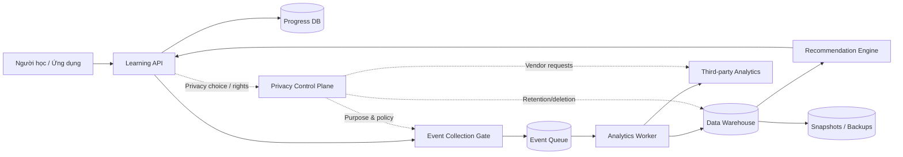
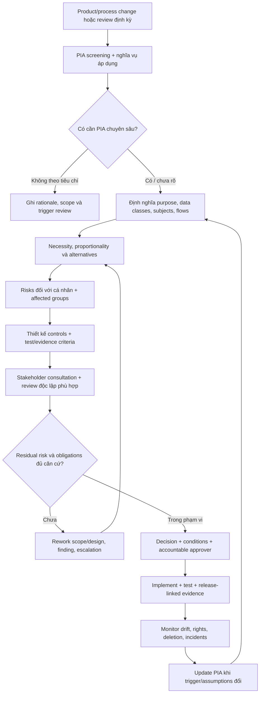
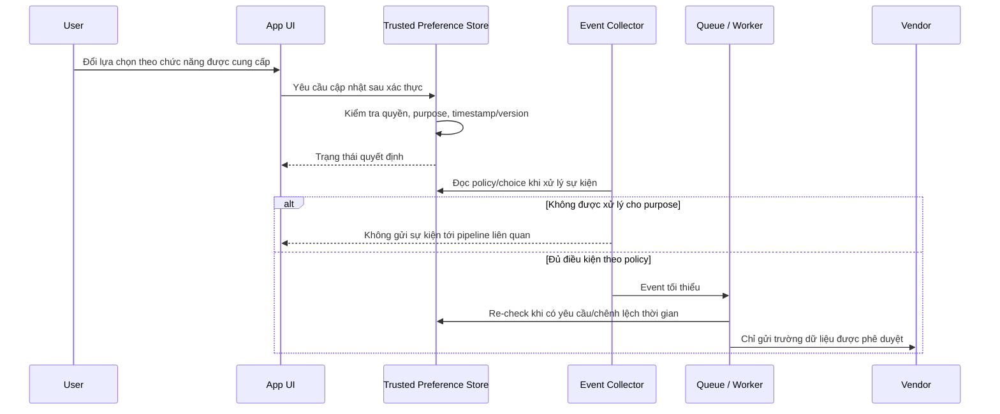
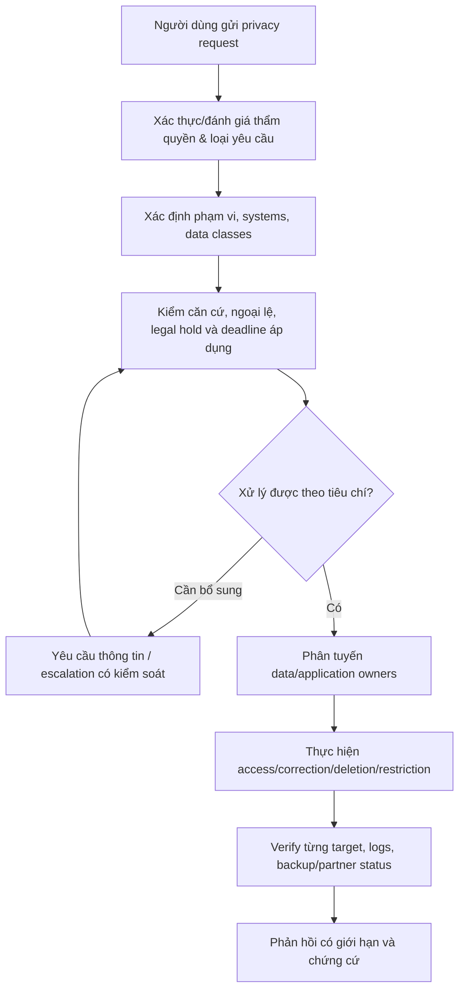
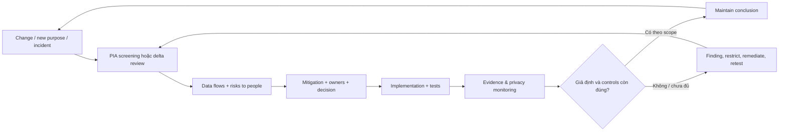

# Privacy impact assessment: đánh giá tác động quyền riêng tư có bằng chứng

Một nền tảng học tập dự kiến thêm tính năng **cá nhân hóa nội dung**. Đội phát triển muốn thu sự kiện người học xem bài, thời gian học, thiết bị, vị trí chính xác và nội dung tìm kiếm, sau đó gửi bản sao dữ liệu tới một nhà cung cấp phân tích. Kiểm thử bảo mật cho thấy API dùng HTTPS, database có mã hóa và các endpoint đã kiểm tra quyền. Tuy vậy, những câu hỏi vẫn chưa được trả lời:

- Có thực sự cần **vị trí chính xác** để gợi ý bài học không, hay chỉ cần ngôn ngữ hoặc múi giờ?
- Người học đã được thông tin rõ về **mục đích mới** và những bên nhận dữ liệu chưa?
- Nếu một người không muốn bị phân tích hành vi, sản phẩm sẽ xử lý lựa chọn ấy theo nghĩa vụ và chính sách áp dụng thế nào?
- Dữ liệu học tập có thể bị dùng để tạo **suy luận nhạy cảm**, phân nhóm thiếu công bằng hoặc gây bất lợi cho người học không?
- Khi xóa tài khoản hoặc đổi lựa chọn, dữ liệu trong queue, warehouse, model và bên xử lý có được xử lý đúng không?
- Ai chịu trách nhiệm xem xét **tác động đối với con người**, quyết định rủi ro còn lại và chứng minh các biện pháp giảm thiểu đang hoạt động?

**Privacy impact assessment (PIA)** được sử dụng để trả lời các câu hỏi đó **trước khi triển khai hoặc thay đổi đáng kể hoạt động xử lý dữ liệu**. PIA không phải chỉ là bảng kiểm “đã mã hóa dữ liệu” và cũng không phải văn bản pháp lý được ký để hợp thức hóa một thiết kế đã quyết định từ trước.

Trong chương **Privacy assurance** của module `SECURITY_SECURITY_ASSURANCE`, PIA là ví dụ điển hình của phương pháp **đánh giá có bằng chứng**: xuất phát từ bối cảnh xử lý và rủi ro đối với cá nhân, xác định yêu cầu riêng tư, lựa chọn controls, kiểm tra hiệu lực, ghi kết luận có giới hạn, theo dõi finding và tái đánh giá liên tục khi hệ thống thay đổi.

> **Nguyên tắc cốt lõi:** Một PIA tốt không chứng minh “sản phẩm hoàn toàn bảo vệ quyền riêng tư”. Nó chứng minh **những hoạt động xử lý nào đã được xác định, tác động nào đã được xem xét, cơ sở và sự cần thiết được đánh giá ra sao, controls nào giảm rủi ro, bằng chứng nào còn thiếu, ai ra quyết định và những điều kiện nào cần đánh giá lại**.

## 1. Privacy impact assessment là gì?

**PIA** là một quy trình có cấu trúc để **mô tả hoạt động xử lý dữ liệu, xác định tác động tiềm tàng lên quyền và lợi ích của các cá nhân bị ảnh hưởng, đánh giá rủi ro và lựa chọn biện pháp phòng ngừa/giảm thiểu**, sau đó ghi lại kết luận, trách nhiệm và bằng chứng theo dõi.

Một PIA thông thường phải giúp tổ chức:

1. Biết **đang xử lý dữ liệu gì**, về ai, từ đâu, cho mục đích nào và trong bao lâu.
2. Hiểu **các bên tham gia**, dòng dữ liệu, hệ thống, bộ xử lý thứ ba và ranh giới tin cậy.
3. Đánh giá **cơ sở xử lý, tính cần thiết, tính tương xứng**, sự minh bạch và những quyền/lựa chọn liên quan theo nghĩa vụ thực sự áp dụng.
4. Phân tích **tác động đối với cá nhân**, kể cả những rủi ro không bắt nguồn từ tấn công mạng.
5. Xem xét **phương án ít xâm lấn hơn** trước khi chốt thiết kế.
6. Lựa chọn **privacy controls**, đặt owner, deadline và acceptance criteria.
7. Kiểm chứng **design, implementation và operating effectiveness** của controls có liên quan.
8. Đưa ra **quyết định có thẩm quyền**, công khai giới hạn nội bộ và đánh giá lại khi thay đổi.

**PIA là quy trình ra quyết định**, còn **PIA report/record** là sản phẩm ghi nhận. Chỉ có report mẫu với nhiều ô được đánh dấu không đủ nếu các giả định, biện pháp và bằng chứng không khớp với xử lý dữ liệu thực tế.

### 1.1. PIA và DPIA

Trong thực hành, người ta có thể gặp cả `PIA` và `DPIA` (*Data Protection Impact Assessment*).

| Thuật ngữ | Cách hiểu hữu ích | Không nên suy luận |
|---|---|---|
| **PIA** | Đánh giá tác động riêng tư theo chương trình quản trị, có thể áp dụng cho nhiều hoạt động xử lý | Không phải mọi PIA đều là thủ tục pháp lý bắt buộc |
| **DPIA** | Thuật ngữ thường được dùng trong những chế độ bảo vệ dữ liệu có yêu cầu đánh giá theo điều kiện và thủ tục cụ thể | Không mặc nhiên đồng nghĩa với bất kỳ biểu mẫu PIA nội bộ nào |
| **Privacy risk assessment** | Phân tích kịch bản rủi ro với con người và mức độ ảnh hưởng | Không tự thay đánh giá đầy đủ về purpose, necessity, bên nhận và quyền |
| **Security assessment** | Đánh giá đe dọa, lỗ hổng và hiệu lực bảo mật | Không tự bao phủ việc xử lý đúng mục đích, profiling hoặc lựa chọn của cá nhân |
| **Compliance review** | Đối chiếu hoạt động với các nghĩa vụ áp dụng | Không tự khẳng định tác động tới cá nhân đã được hiểu/giảm thiểu |

**Căn cứ pháp lý, ngưỡng bắt buộc, hồ sơ và thủ tục tham vấn khác nhau theo hệ quy định, loại hoạt động, đối tượng dữ liệu và địa bàn áp dụng.** Một chương trình PIA có thể hỗ trợ DPIA nếu được thiết kế đúng, nhưng không được mặc định “đã làm PIA nội bộ” đồng nghĩa hoàn thành mọi nghĩa vụ DPIA của từng khu vực pháp lý.

Khi xây quy trình thật, cần để bộ phận **Privacy/Legal** xác định nghĩa vụ áp dụng và kiểm tra phiên bản nguồn pháp lý hiện hành, thay vì suy ra trực tiếp từ ví dụ học thuật.

## 2. Privacy assurance khác security assurance ở điểm nào?

Privacy và security liên quan chặt chẽ nhưng không trùng nhau. Một hệ thống có thể bảo mật tốt trước truy cập trái phép mà vẫn gây tác động xấu vì **thu thập quá nhiều dữ liệu, dùng sai mục đích hoặc tạo quyết định thiếu công bằng**.

| Câu hỏi | Security assurance thường nhấn mạnh | Privacy assurance cần đánh giá thêm |
|---|---|---|
| **Bảo vệ điều gì?** | Confidentiality, integrity, availability, authenticity, accountability | Quyền, kỳ vọng và lợi ích của cá nhân trong toàn bộ vòng đời xử lý |
| **Rủi ro nguồn gốc ở đâu?** | Attacker, vulnerability, misconfiguration, insider misuse | Cả xử lý **được cấp phép về mặt kỹ thuật** nhưng thiếu cần thiết, thiếu minh bạch hoặc quá xâm lấn |
| **Control tiêu biểu** | Authorization, encryption, logging, segmentation | Minimization, purpose limitation, choice handling, transparency, retention, rights workflow; cùng security controls |
| **Tiêu chí đạt** | Chặn đúng hành vi trái quyền, phát hiện/khắc phục sự cố | Chứng minh xử lý phù hợp mục đích, cần thiết, minh bạch, quản lý tác động và quyền theo yêu cầu |
| **Bằng chứng** | Threat model, negative tests, IAM/config, logs | PIA, data map, purpose decision, notice/choice, risk rationale, rights tests, vendor review và security evidence |

Ví dụ: **mã hóa vị trí chính xác** làm giảm nguy cơ dữ liệu bị đọc trái quyền, nhưng **không chứng minh cần thu vị trí chính xác** để gợi ý bài học. Ngược lại, bỏ vị trí chính xác khỏi thiết kế giảm cả rủi ro quyền riêng tư lẫn giá trị của dữ liệu có thể bị lộ.

**Privacy-by-design không có nghĩa bỏ security.** Một thiết kế thu ít dữ liệu nhưng để ai cũng đọc được vẫn không đạt. PIA nên liên kết với security threat modeling nhưng hỏi thêm **“Tại sao phải xử lý dữ liệu này, xử lý có tương xứng không và cá nhân có thể bị ảnh hưởng thế nào?”**.

## 3. Khi nào cần làm hoặc cập nhật PIA?

Tổ chức nên có **screening process** để biết hoạt động nào cần PIA chuyên sâu, hoạt động nào chỉ cần quyết định sàng lọc được ghi lại. Ngưỡng bắt buộc về mặt pháp lý phải được xác minh theo hệ quy định có liên quan; không dùng danh sách dưới đây như tuyên bố pháp lý phổ quát.

### 3.1. Những tín hiệu nên kích hoạt screening

- Thu thập **loại dữ liệu mới**: vị trí, sinh trắc học, dữ liệu sức khỏe, nội dung trao đổi hoặc dữ liệu về trẻ em.
- Xử lý **quy mô lớn**, liên tục, hoặc theo dõi hành vi qua nhiều dịch vụ/ngữ cảnh.
- **Profiling, scoring, recommendation, automated decision** có thể tạo ảnh hưởng đáng kể.
- Kết hợp nhiều datasets làm tăng nguy cơ **tái nhận diện hoặc suy luận nhạy cảm**.
- Dùng dữ liệu cũ cho **mục đích mới** hoặc chuyển sang đối tượng nhận mới.
- Mở đường **third-party sharing, cross-border transfer** hoặc tích hợp provider phân tích.
- Thay đổi retention, khả năng xóa, quyền người dùng, cách thông báo hoặc chính sách lựa chọn.
- Áp dụng nhận dạng thiết bị, fingerprinting, behavioral telemetry, geolocation hoặc giám sát nhân viên.
- Xử lý dữ liệu liên quan nhóm dễ bị tổn thương, quyền tiếp cận dịch vụ, giáo dục hoặc tài chính.
- Xảy ra incident, audit finding hoặc thay đổi luật/hợp đồng làm cơ sở đánh giá trước đây không còn chính xác.

Một thay đổi nhỏ về giao diện chưa chắc cần PIA đầy đủ, nhưng **một trường dữ liệu mới trong log** cũng có thể cần review nếu nó làm xuất hiện thông tin nhạy cảm hoặc bên nhận mới.

### 3.2. PIA nên bắt đầu lúc nào?

**Trước khi lựa chọn thiết kế khó đảo ngược và trước khi bắt đầu xử lý có liên quan.** Nếu chờ đến ngày release, đội ngũ có thể đã tạo data warehouse, gửi dữ liệu tới vendor hoặc đào tạo model mà chưa đánh giá khả năng xóa/sửa.

Nên gắn PIA với:

| Thời điểm | Câu hỏi và quyết định |
|---|---|
| **Discovery / product proposal** | Mục đích, tác động và có phương án không cần dữ liệu cá nhân không? |
| **Architecture / design** | Data flow, trust boundaries, minimization, transparency, rights và retention? |
| **Vendor procurement** | Bên thứ ba cần dữ liệu nào, vai trò/trách nhiệm và điều kiện xử lý nào? |
| **Development / PR** | Data schema và controls có giữ đúng phạm vi PIA đã duyệt không? |
| **Pre-release** | Các finding và bằng chứng trọng yếu đã được xử lý/đánh giá trước triển khai chưa? |
| **Production** | Dữ liệu xử lý thực tế, quyền/lựa chọn, retention, logs và incidents có phù hợp giả định? |
| **Major change** | Có phải làm mới PIA hoặc mở phần bổ sung theo delta không? |

**PIA không phải một giấy phép vĩnh viễn.** Nếu sau sáu tháng đội ngũ thêm vị trí chính xác hoặc đổi mục đích dùng dữ liệu, kết luận cũ cần được xem xét lại.

## 4. Một PIA hoàn chỉnh gồm những phần nào?

| Thành phần | Câu hỏi bắt buộc trong review | Đầu ra/bằng chứng |
|---|---|---|
| **Processing ID, owner, scope** | Ai chịu trách nhiệm, hệ thống/tenant/môi trường nào? | Registry và scope statement |
| **Purpose / benefit** | Mục đích cụ thể, có lợi ích gì, ai được hưởng? | Product rationale và approved purpose |
| **Subjects / data classes** | Dữ liệu của ai, loại nào, nhạy cảm ra sao? | Inventory/schema và classification |
| **Processing operations** | Thu, lưu, kết hợp, suy luận, chia sẻ, xóa thế nào? | Data-flow diagram và lifecycle |
| **Necessity/proportionality** | Mỗi field và hoạt động có cần, có giải pháp ít xâm lấn hơn? | Alternative analysis và minimization decision |
| **Applicable obligations** | Điều kiện pháp lý/chính sách/thông báo và quyền nào áp dụng? | Privacy/Legal review và source references |
| **Third parties / transfer** | Ai nhận, ở đâu, vai trò gì, có subprocessor không? | Vendor/processor assessment, contracts, transfer map |
| **Risk scenarios** | Cá nhân có thể chịu hậu quả nào, do cơ chế nào? | Risk register với impact pathways |
| **Risk treatment** | Những controls nào giảm khả năng/hậu quả? | Mitigation plan, owner, acceptance criteria |
| **Assessment/evidence** | Control được kiểm tra trên scope, bản phát hành và kỳ nào? | Tests, configs, runbooks, audit samples |
| **Consultation** | Những người nào cần được tham vấn, ý kiến ra sao? | Stakeholder feedback, quyết định xử lý ý kiến |
| **Residual risk / decision** | Rủi ro còn lại được chấp thuận hoặc phải thay thiết kế? | Decision log, approver, conditions |
| **Monitoring/review** | Trigger nào làm PIA không còn hiệu lực? | Review date, change signals, findings |

Không yêu cầu một biểu mẫu phức tạp nhất có thể. Điều quan trọng là **mỗi câu trả lời đủ rõ để xác minh và ra quyết định**, tránh những câu như “Privacy: compliant” nhưng không biết tiêu chí, người đánh giá hay phạm vi.

## 5. Xác định mục đích và căn cứ xử lý

### 5.1. Purpose phải đủ cụ thể

Ví dụ cùng dùng sự kiện `lesson_viewed`:

| Purpose | Xử lý có thể cần | Câu hỏi PIA riêng |
|---|---|---|
| **Khôi phục tiến độ học** | ID bài học, tiến độ và mốc cập nhật | Có cần lưu toàn bộ clickstream không? |
| **Phân tích hiệu quả tính năng** | Số liệu tổng hợp theo bài/nhóm | Có thể tổng hợp sớm, bỏ ID người học không? |
| **Gợi ý bài học cá nhân** | Những chủ đề đã học và tương tác phù hợp | Có lựa chọn, thời hạn, giải thích và cách tắt đúng yêu cầu không? |
| **Chống lạm dụng/dò mật khẩu** | Dấu hiệu an ninh, giới hạn cần thiết | Có tách scope và retention khỏi mục đích marketing không? |
| **Marketing/advertising** | Tập sự kiện và liên kết theo mục đích tiếp thị | Có căn cứ/choice/notice/third-party controls tương ứng không? |

Không dùng nhãn chung “cải thiện trải nghiệm” để hợp thức hóa mọi trường dữ liệu và mọi cách tái sử dụng. **Mỗi mục đích cần có phạm vi, dữ liệu cần thiết, quyền người dùng và thời hạn xử lý riêng**.

### 5.2. Cơ sở xử lý và nghĩa vụ không thể giả định

PIA cần xác định **căn cứ xử lý hợp lệ theo hệ quy định/chính sách áp dụng**, nhưng không phải hoạt động nào cũng có cùng điều kiện. Những câu hỏi thường gồm:

- Hoạt động được tổ chức cho phép dựa trên **căn cứ cụ thể nào**?
- Có cần **đồng ý (consent)** theo nghĩa vụ áp dụng không; nếu có, cách thu, chứng minh, thay đổi và rút lại?
- Nếu dựa trên căn cứ khác, điều kiện, quyền phản đối hoặc hạn chế liên quan là gì?
- Thông báo về dữ liệu/mục đích/bên nhận đã được cung cấp ở thời điểm và hình thức phù hợp?
- Có sử dụng dữ liệu để ra quyết định, profiling hoặc tiết lộ với một bên khác vượt mục đích ban đầu?
- Có nhóm cá nhân hoặc dữ liệu đòi hỏi bảo vệ bổ sung?
- Hệ thống có đáp ứng quy trình yêu cầu truy cập/sửa/xóa/hạn chế theo phạm vi nghĩa vụ không?

**Không mặc định “có consent là được làm bất cứ điều gì”.** Việc đồng ý, khi là cơ sở phù hợp, không loại bỏ yêu cầu minh bạch, hạn chế mục đích, an toàn và các nghĩa vụ khác có thể áp dụng. Đồng thời, không áp đặt consent là căn cứ duy nhất cho tất cả hoạt động như bảo mật tài khoản hay nghĩa vụ lưu giữ.

### 5.3. Purpose change là một trigger quan trọng

Nếu dữ liệu tiến độ học từng được thu để **khôi phục bài đang học**, sau đó được dùng để **chấm điểm mức độ tập trung của nhân viên** cho nhà tuyển dụng, thay đổi mục đích có thể làm tăng rủi ro đáng kể, dù bảng dữ liệu và các khóa mã hóa không đổi.

PIA cần review lại **bên nhận, quyền lực giữa các bên, khả năng gây bất lợi, mục đích và căn cứ xử lý**, thay vì chỉ xem có thêm field hay server hay không.

## 6. Kiểm tra tính cần thiết và tương xứng

Đây là phần quan trọng khiến PIA khác bảng checklist an ninh.

### 6.1. Necessity: có thật sự cần dữ liệu này?

Đối với mỗi field/operation, hỏi:

1. Nó phục vụ **mục đích cụ thể nào**?
2. Nếu bỏ field này, mục tiêu có đạt được ở mức chấp nhận được không?
3. Có thể dùng **thống kê tổng hợp, dữ liệu ít chi tiết hoặc dữ liệu tổng hợp tại thiết bị** không?
4. Có thể rút ngắn **thời gian giữ** hoặc chỉ xử lý khi người dùng kích hoạt tính năng?
5. Có cần chia sẻ **raw events** cho bên ngoài hay có thể chỉ gửi kết quả đã giảm chi tiết?
6. Nếu công cụ thu thêm dữ liệu mặc định, có thể tắt tracking hoặc filter ở điểm đầu vào không?

**Không coi “dữ liệu có thể hữu ích trong tương lai” là một mục đích đủ cụ thể.**

### 6.2. Proportionality: mức xâm lấn có tương xứng?

Ví dụ hệ thống muốn gợi ý bài học:

| Phương án | Lợi ích dự kiến | Rủi ro riêng tư | Hướng quyết định minh họa |
|---|---|---|---|
| Thu GPS chính xác và mọi từ khóa tìm kiếm | Có thể suy luận ngữ cảnh chi tiết | Tái nhận diện, suy luận lịch trình và thông tin nhạy cảm | Yêu cầu chứng minh thật rõ; nếu không cần thì loại bỏ |
| Thu chủ đề bài học và lịch sử tương tác giới hạn | Hỗ trợ gợi ý theo nhu cầu học | Profiling, purpose creep, over-retention | Giới hạn field, retention và choice theo yêu cầu |
| Tính gợi ý ngay trên thiết bị | Có thể giảm dữ liệu tập trung | Rủi ro ở thiết bị và logic vẫn cần xem | Đánh giá feasibility, không mặc định luôn tốt nhất |
| Chỉ dùng số liệu tổng hợp theo lớp | Hỗ trợ phân tích xu hướng | Có thể tái nhận diện với nhóm nhỏ | Threshold, aggregation, no drill-down theo rủi ro |
| Gợi ý không dựa trên hành vi cá nhân | Không cần hồ sơ hoạt động cá nhân | Ít cá nhân hóa hơn | Là lựa chọn thay thế để so sánh |

Một PIA nên **ghi quyết định giữa các lựa chọn**, không chỉ mô tả phương án đã chọn. Có thể chấp nhận một phần rủi ro vì lợi ích hợp lệ trong phạm vi được phép, nhưng phải giải thích **vì sao mức xâm lấn là cần thiết và các controls giảm rủi ro đủ phù hợp**.

### 6.3. Privacy by design / by default

- **Minimize:** chỉ lấy dữ liệu tối thiểu cho purpose được phê duyệt.
- **Separate:** tách danh tính trực tiếp khỏi events khi phù hợp, quản lý join keys chặt chẽ.
- **Aggregate:** giảm chi tiết trước khi chia sẻ nếu mục đích cho phép.
- **Limit:** giới hạn quyền xem, thời hạn, tái sử dụng và forwarding.
- **Inform:** thông báo dễ hiểu và đặt chức năng quyền/lựa chọn có thể sử dụng.
- **Control:** workflow thay đổi choice và thực thi đối với những lần xử lý tiếp theo khi yêu cầu.
- **Demonstrate:** chứng minh config và hành vi thật, không chỉ có tài liệu.

**Pseudonymization** có thể giảm một số rủi ro nhưng **không tự biến dữ liệu thành vô danh** khi còn khả năng nối với chủ thể. Một ID ổn định trên nhiều nền tảng đôi khi **tăng** khả năng theo dõi, dù không chứa tên thật.

## 7. Vẽ data flow và xác định trách nhiệm

Đối với tính năng cá nhân hóa của nền tảng nhiều tenant, giả định có những thành phần sau:



Mỗi mũi tên cần được giải thích: **ai gửi**, **thuộc tính nào**, **vì mục đích nào**, **ai điều khiển bước xử lý**, **lưu ở đâu**, **ai nhận** và **khi nào dữ liệu được xóa hoặc tổng hợp**.

### 7.1. Bảng data inventory mẫu

| Data item | Nguồn | Mục đích dự kiến | Rủi ro / quyết định |
|---|---|---|---|
| `tenantId` | Authentication context đáng tin | Cách ly dữ liệu, định tuyến và policy | Không lấy từ client để nới quyền |
| `learnerRef` | ID được hệ thống quản lý | Gắn tiến độ/đối chiếu quyền trong phạm vi cần thiết | Tránh chia sẻ khóa nối trực tiếp cho vendor nếu không cần |
| `lessonId` | Server-side event | Ghi tiến độ, gợi ý nội dung | Có thể phù hợp nếu giới hạn scope và retention |
| `eventTime` | Thời gian event được xác thực/đối chiếu | Thứ tự sự kiện hoặc báo cáo tổng hợp | Độ chi tiết có cần chính xác đến mili-giây không? |
| `searchQuery` | Người học nhập | Có thể liên quan tìm kiếm tức thời | Không mặc định lưu nguyên văn; có thể chứa nội dung nhạy cảm |
| `preciseLocation` | Device permissions | Không cần cho gợi ý bài học theo giả định | Loại bỏ khỏi event schema |
| `deviceFingerprint` | SDK bên thứ ba | Tracking xuyên phiên | Review riêng mức cần thiết, căn cứ và tính minh bạch |
| `performanceScore` | Dữ liệu dẫn xuất từ tương tác | Gợi ý tiến độ học | Nguy cơ suy luận sai, sử dụng gây bất lợi |
| `consentOrChoiceState` | Privacy settings đã xác minh | Áp dụng lựa chọn theo cơ chế thích hợp | Có source, thời điểm, version của lựa chọn |
| `vendorEventId` | SDK/API vendor | Đối soát dữ liệu chuyển đi | Nguy cơ liên kết chéo giữa hệ thống |

**Inventory phải bao gồm dữ liệu dẫn xuất, mapping tables, logs, cache và backup**, không chỉ các bảng `users`/ `events`. Nếu mô hình gợi ý được huấn luyện bằng dữ liệu nhiều tenant, cần đánh giá thêm **khả năng tiết lộ thông tin giữa tenant**, lifecycle và yêu cầu xóa/sửa.

### 7.2. Ranh giới tin cậy trong PIA

| Boundary | Câu hỏi privacy | Control và chứng cứ gợi ý |
|---|---|---|
| Client → API | App/SDK có thu thêm field ngoài mục đích không? | SDK/config review, packet/schema tests, app notice |
| API → collection gate | Purpose/choice được quyết định từ nguồn đáng tin không? | Server-side policy, negative tests, config |
| Gate → queue | Queue có payload nhạy cảm, retry và DLQ lưu bao lâu? | Message schema, IAM, retention và logging review |
| Queue → warehouse | Có tenant isolation, minimization và kiểm soát truy vấn? | SQL policy, access tests, data inventory |
| Warehouse → recommendation engine | Model có tạo suy luận/nhóm gây bất lợi? | Design assessment, evaluation, human oversight theo impact |
| Worker → vendor | Bên nhận xử lý dữ liệu gì, vào mục đích nào, có chuyển tiếp? | Vendor review, contract, API field tests, retention |
| Warehouse → backups | Khi thay choice/xóa account, dữ liệu cũ còn ở đâu? | Backup retention/restore reconciliation |
| Logs → Operations | Log có chứa query, token hoặc learner ID quá chi tiết? | Log minimization, retention, access audit |

Sự thật rằng vendor dùng HTTPS chỉ giúp bảo vệ đường truyền; **không trả lời liệu dữ liệu có nên được chia sẻ, ai được dùng và để làm gì**.

## 8. Xác định tác động đối với cá nhân

Trong privacy impact assessment, rủi ro cần được mô tả bằng **kịch bản nguyên nhân → xử lý dữ liệu → hậu quả với cá nhân**. Không chỉ gắn nhãn `HIGH` vì hệ thống có PII.

### 8.1. Các nhóm tác động thường gặp

| Tác động | Kịch bản minh họa |
|---|---|
| **Mất quyền kiểm soát thông tin** | Cá nhân không biết việc profile hành vi tiếp tục sau khi họ tắt tính năng |
| **Theo dõi ngoài mong đợi** | Dữ liệu sự kiện được liên kết trên nhiều ứng dụng và mục đích |
| **Tái nhận diện** | Bản ghi pseudonymous được nối với thông tin công khai/nhóm nhỏ |
| **Thiệt hại tài chính hoặc gian lận** | Bên trái quyền nhận được hồ sơ cá nhân và dùng để lừa đảo |
| **Tổn hại danh tiếng/đời sống** | Suy luận nhạy cảm từ lịch sử học được tiết lộ hoặc hiểu sai |
| **Phân biệt đối xử/loại trừ** | Điểm dự đoán làm người học bị hạn chế tiếp cận cơ hội không có cơ chế xem xét |
| **Mất tính tự chủ** | Hệ thống nhắm mục tiêu ảnh hưởng hành vi mà người dùng không hiểu được |
| **Thiếu chính xác hoặc không thể sửa** | Hồ sơ học tập sai không được chỉnh sửa, ảnh hưởng kết quả phục vụ |
| **Gánh nặng thực thi quyền** | Người dùng khó truy cập/sửa/xóa dữ liệu vì các bản sao phân tán |
| **Nguy cơ an toàn hoặc phơi lộ vị trí** | Vị trí chính xác tiết lộ lịch trình, nơi ở hoặc môi trường nhạy cảm |

Rủi ro đối với **tổ chức** như bị phạt, mất doanh thu, uy tín kém có thể quan trọng cho governance, nhưng **không được dùng để thay thế đánh giá tác động đối với cá nhân**. Một vụ lộ dữ liệu ít ảnh hưởng doanh thu vẫn có thể rất nghiêm trọng với một nhóm người nhỏ.

### 8.2. Đường tác động (impact pathway)

Ví dụ:

```text
Dữ liệu được thu          : lịch sử xem bài + thời gian cụ thể
Thao tác xử lý            : kết hợp với ID ổn định và báo cáo theo người học
Bên có khả năng truy cập  : người quản lý chương trình/vendor analytics
Sự kiện rủi ro            : hồ sơ được dùng ngoài mục đích gợi ý bài học
Hậu quả cá nhân           : suy luận sai về năng lực, mất cơ hội hoặc bị giám sát
Điều kiện làm nặng rủi ro : thiếu notice, không có đường sửa, scope quá rộng
Biện pháp giảm thiểu      : tổng hợp, cấm dùng secondary purpose, RBAC, kiểm soát báo cáo
Evidence cần có           : schema, reports permissions, data-use policy, negative tests
```

Rủi ro privacy có thể xuất hiện **ngay cả khi mọi người truy cập đều là nhân viên có quyền kỹ thuật**, vì sử dụng dữ liệu sai mục đích vẫn gây hậu quả.

## 9. Phương pháp đánh giá privacy risk

Một PIA nên định nghĩa **thang đo, giả định, dữ liệu đầu vào và cách ra quyết định** trước khi chấm điểm. Không cần cố gắn giá trị tiền tệ vào mọi hậu quả với cá nhân.

### 9.1. Các yếu tố xác định severity

- **Loại và mức nhạy cảm:** dữ liệu cá nhân, hành vi, sức khỏe, sinh trắc, vị trí, nội dung riêng tư.
- **Phạm vi và khả năng liên kết:** một trường dữ liệu hay dữ liệu kết hợp nhiều nguồn; có thể tái nhận diện không?
- **Thời gian và khả năng đảo ngược:** hậu quả diễn ra một lần hay kéo dài; có cách sửa/khôi phục không?
- **Quyền lực bất cân xứng:** người lao động, trẻ em, người phụ thuộc vào dịch vụ, nhóm dễ bị ảnh hưởng.
- **Mức tự chủ:** cá nhân có biết, hiểu và thực sự kiểm soát việc xử lý không?
- **Độ rộng tác động:** số người chịu ảnh hưởng và mức nghiêm trọng với từng nhóm.
- **Mức bất lợi:** thiệt hại vật chất, danh tiếng, quyền tiếp cận dịch vụ hoặc an toàn.

Không giảm nhẹ tác động rất nghiêm trọng với một nhóm nhỏ chỉ vì số người bị ảnh hưởng ít.

### 9.2. Các yếu tố xác định likelihood

- Dữ liệu có thực sự được thu/di chuyển theo luồng mô tả?
- Ai có khả năng truy cập hoặc tái sử dụng, quyền đó có bị hạn chế không?
- Đường xử lý có hoạt động liên tục hay chỉ theo sự kiện hiếm?
- Hệ thống có kiểm tra purpose/choice ở server-side và giám sát việc thực thi không?
- Có vendor, cross-system identifiers hoặc mô hình phân tích làm tăng khả năng liên kết?
- Kinh nghiệm incident/finding hoặc những test bypass cho thấy điều gì?
- Các controls phụ thuộc vào cùng một nguồn dữ liệu/quy trình có thể đồng thời thất bại không?

Không coi xác suất có số phần trăm chính xác nếu không có cơ sở đo. Một thang **Low / Medium / High / Unknown** với rationale có thể hữu ích hơn `risk=7.42` không giải thích được.

### 9.3. Inherent và residual privacy risk

- **Inherent risk:** đánh giá kịch bản trước khi xem xét hiệu quả của các biện pháp giảm thiểu thuộc phạm vi đánh giá.
- **Residual risk:** rủi ro còn lại khi các controls đã được chọn **thực sự có hiệu lực** theo giả định và bằng chứng.

Ví dụ loại bỏ GPS chính xác có thể giảm mạnh tác động của tình huống lộ vị trí, trong khi mã hóa GPS chỉ hạn chế một số đường lộ. Nhưng không nên tự ghi “risk giảm 80%” nếu phương pháp đánh giá không có căn cứ.

### 9.4. Risk register mẫu

Các mức độ trong bảng **giả định để học**, không phải đánh giá pháp lý hay kết quả của một hệ thống có thật.

| Risk ID | Kịch bản tác động với cá nhân | Mức trước giảm thiểu | Treatment | Residual assessment cần làm |
|---|---|---|---|---|
| `PRIV-01` | Thu GPS chính xác không cần thiết, có thể suy ra lịch trình | High | Bỏ GPS khỏi schema/SDK | Test xác nhận không còn gửi GPS, kể cả logs |
| `PRIV-02` | Tái nhận diện từ ID ổn định và clickstream | High | Hạn linking, aggregate và tách mapping table | Đánh giá khả năng nối dữ liệu và access review |
| `PRIV-03` | Event tiếp tục gửi sau khi chọn dừng tính năng theo policy | High | Server-side processing gate và đồng bộ choice | Negative tests, event pipeline evidence |
| `PRIV-04` | Vendor dùng event cho mục đích ngoài phạm vi | High | Giảm fields, vendor review và giới hạn xử lý | Contract/evidence, API schema audit, monitoring |
| `PRIV-05` | Profile sai làm gợi ý bất lợi khó chỉnh sửa | Medium/High | Transparency, sửa dữ liệu, giới hạn quyết định tự động | UX tests, correction workflow, outcome monitoring |
| `PRIV-06` | Tenant A nhìn được thống kê tenant B | High | Tenant isolation, aggregation thresholds | Cross-tenant negative tests và query review |
| `PRIV-07` | Dữ liệu cũ tồn tại trong backup/warehouse sau yêu cầu xử lý hợp lệ | High/Unknown | Retention/disposal plan và restore reconciliation | Data lineage, expiry evidence, restore tests |
| `PRIV-08` | Log/debug chứa raw search queries | Medium/High | Redaction, minimization và retention | Log inspection, sampling và config review |

**Không tự hạ rủi ro còn lại xuống Low chỉ vì control được thiết kế.** Sau thiết kế cần bằng chứng triển khai và vận hành. Nếu thiếu, có thể ghi `RESIDUAL_UNKNOWN`, `TREATMENT_PENDING` hoặc kết luận tương đương theo phương pháp đã chọn.

## 10. Từ PIA risks sang requirements và privacy controls

Một PIA hữu ích tạo ra **yêu cầu kiểm chứng được**, không chỉ lời khuyên chung “tăng cường quyền riêng tư”.

| Requirement (ví dụ) | Control cụ thể | Cách kiểm chứng |
|---|---|---|
| `REQ-PRIV-01`: không thu vị trí chính xác cho recommendation | Schema allowlist, SDK config và ingress filtering | Field/schema tests, payload capture được ủy quyền |
| `REQ-PRIV-02`: không dùng events ngoài approved purpose | Purpose tagging và policy gate tại collector/consumer | Wrong-purpose test, review downstream use |
| `REQ-PRIV-03`: xử lý choice đúng theo nghĩa vụ/chính sách đã xác định | Trusted choice store, suppression và propagation | Opt-out/withdrawal/changed-choice integration tests |
| `REQ-PRIV-04`: giảm khả năng liên kết trực tiếp | Controlled pseudonymous IDs và join key isolation | Key mapping access test, linkability review |
| `REQ-PRIV-05`: tenant isolation trong warehouse/model | Tenant-aware IAM/query/pipeline validation | Cross-tenant model/query negative tests |
| `REQ-PRIV-06`: retention/disposal theo data class | TTL, backup schedule, deletion ledger và replay guards | Expiration/deletion/restore tests |
| `REQ-PRIV-07`: provider chỉ nhận dữ liệu trong phạm vi | Minimized export schema, vendor governance | Contract review, outbound API inspection |
| `REQ-PRIV-08`: cá nhân có đường yêu cầu/sửa dữ liệu theo phạm vi nghĩa vụ | Rights workflow và service ownership | E2E request/correction tests, response audit |
| `REQ-PRIV-09`: profiling quan trọng có đường kiểm soát rủi ro | Explainability, review/appeal khi cần theo tiêu chí | UX/decision audit, escalation test |
| `REQ-PRIV-10`: dữ liệu và processing paths mới kích hoạt review | Data schema/change review gate và PIA version link | PR/CI evidence, release checklist |

**Controls phải bám theo impact pathway.** Nếu rủi ro là **xử lý sai mục đích**, một control encryption chỉ bảo vệ dữ liệu khỏi một số bên trái quyền; nó **không giải quyết trực tiếp** việc đội sản phẩm được quyền truy cập nhưng dùng dữ liệu cho mục đích ngoài phạm vi. Control phù hợp hơn là **purpose limitation, policy enforcement, access segmentation, monitoring và governance**.

### 10.1. Phân loại tác dụng

- **Preventive:** không thu field không cần; chặn processing sai purpose; giới hạn sharing; đặt privacy defaults phù hợp.
- **Detective:** đối chiếu schema thực tế, monitoring nguồn dữ liệu mới, audit đường vendor, phát hiện chính sách lựa chọn không được thực thi.
- **Corrective:** xóa/bổ sung hạn chế cho dữ liệu thu sai, sửa model/profile, phản hồi yêu cầu cá nhân, xử lý vendor và finding.
- **Governance:** PIA review, approval, vendor due diligence, retention schedule, consultation và reassessment.

Một PIA tốt thường cần cả bốn nhóm vì chỉ một technical control khó bao phủ mọi tác động tới cá nhân.

## 11. Vòng đời thực hiện PIA end-to-end



### Bước 1 — Screening: xác định có cần PIA sâu không

Đọc mô tả product, loại dữ liệu, nhóm người, quy mô, provider, scoring/profiling, địa bàn và thay đổi từ trạng thái cũ. Ghi **quyết định screening, rationale, reviewer và thời điểm**.

Nếu chưa rõ có thuộc ngưỡng bắt buộc theo một chế độ dữ liệu hay không, không tự ghi `NOT_REQUIRED`; cần **escalate tới Privacy/Legal**. Một kết luận “không cần PIA chuyên sâu” vẫn cần trigger đánh giá lại khi scope thay đổi.

### Bước 2 — Mô tả hoạt động xử lý và dữ liệu

Xác định **input, transformations, storage, output, disclosures, retention, deletion**, người chịu trách nhiệm cho mỗi bước và các môi trường dùng dữ liệu thật/giả.

Đừng chỉ dựa vào mô tả của product: kiểm tra schema, SDK, logging, analytics, vendor API, queue/DLQ, backups, feature flag và data catalog để phát hiện **processing thực tế**.

### Bước 3 — Đánh giá cơ sở, necessity và alternatives

Với từng purpose/field, ghi phương án ít xâm lấn, điều kiện hợp lệ và vì sao có/không lựa chọn. Những dữ liệu không cần hoặc gây rủi ro không tương xứng có thể được **loại khỏi scope ngay từ thiết kế**, thay vì tạo thêm control để giữ chúng.

### Bước 4 — Tham vấn stakeholders

Tùy trường hợp, tham vấn **Product, Data owner, Engineering, Security, Privacy/Legal, Compliance, Operations, Procurement và đại diện nhóm bị ảnh hưởng** theo cơ chế phù hợp. Mục tiêu là phát hiện các tác động người thiết kế chưa nhìn thấy.

Không nhất thiết phải công khai raw dữ liệu nhạy cảm cho mọi bên tham vấn. Cần phương án bảo vệ bí mật, tổng hợp phản hồi và ghi **ý kiến chưa được xử lý**.

### Bước 5 — Risk assessment và mitigation

Mỗi risk có **cause, affected group, impact, likelihood/severity rationale, control, owner, deadline và validation method**. Nếu một nhóm cá nhân chịu rủi ro riêng, không chỉ lấy điểm trung bình toàn bộ người dùng.

### Bước 6 — Review và quyết định

Người có thẩm quyền xem **rủi ro còn lại, bằng chứng, nghĩa vụ chưa đạt và điều kiện phát hành**. Kết luận có thể là:

- **APPROVED_FOR_SCOPE** với điều kiện đã ghi rõ và theo quy trình nội bộ.
- **APPROVED_WITH_CONDITIONS** khi chính sách/nghĩa vụ cho phép, có owner, deadline và giới hạn trước mỗi bước xử lý.
- **REWORK_REQUIRED** khi thiếu minimization, purpose hoặc controls cốt lõi.
- **BLOCKED / NOT_AUTHORIZED** nếu xử lý dự kiến không được phép hoặc mức rủi ro không thể chấp nhận theo quy định áp dụng.
- **INCONCLUSIVE** khi thiếu thông tin/đánh giá bắt buộc.

Không sử dụng risk acceptance nội bộ để **vượt nghĩa vụ pháp lý bắt buộc**, cũng không tự coi chữ ký của một manager là bằng chứng control đã triển khai. Những tình huống yêu cầu tham vấn cơ quan hay thủ tục đặc biệt phải được Privacy/Legal xác định theo chế độ áp dụng.

### Bước 7 — Triển khai, kiểm tra và theo dõi

PIA phải liên kết đến **issue/PR/config/test**, không dừng ở quyết định.

Ví dụ quyết định “không thu GPS” cần được hỗ trợ bởi **schema allowlist, test outbound SDK payload, test ingestion rejection và log inspection**, sau đó kiểm tra lại khi SDK hoặc tracking config thay đổi.

## 12. Case study: PIA cho cá nhân hóa lộ trình học

### 12.1. Bối cảnh

Giả định nền tảng `learning-platform` muốn gợi ý bài học bằng lịch sử tương tác. Người dùng đến từ nhiều tenant, trong đó có nhóm người học nhỏ tuổi ở một số chương trình. Kiến trúc có `learning-api`, `event-collector`, `analytics-worker`, `data-warehouse`, `recommendation-engine`, vendor phân tích và backup.

Đề xuất ban đầu muốn thu:

```text
learnerId, tenantId, lessonId, searchQueryRaw,
preciseLatitude, preciseLongitude, deviceFingerprint,
eventTimeMillis, progressScore, productExperimentId
```

Cần review **từng field**. Một schema chưa được phát hành không phải bằng chứng các field đều đã được thu; ngược lại, những SDK bật mặc định có thể thu field ngoài tài liệu đề xuất.

### 12.2. Quyết định thiết kế sau PIA

| Thành phần | Đề xuất ban đầu | Phương án điều chỉnh giả định | Rationale |
|---|---|---|---|
| Vị trí | GPS chính xác | **Không thu** | Không cần cho mục đích gợi ý trong giả định |
| Search text | Raw query vào data warehouse | Chỉ xử lý tức thời; không xuất raw query nếu không cần | Có thể chứa nội dung nhạy cảm |
| Identity | Dùng learner ID trực tiếp qua mọi hệ | Pseudonymous event ID + mapping table hạn chế | Giảm liên kết trực tiếp, vẫn phải đánh giá re-identification |
| Event time | Timestamp mili-giây | Độ chi tiết cần thiết theo use case | Giảm khả năng suy luận lịch trình |
| Vendor | Toàn bộ raw events | Số liệu tổng hợp/minimized fields theo quyết định hợp lệ | Giới hạn third-party exposure |
| Retention | Lưu vô thời hạn cho phân tích | Lịch theo data class và mục đích được duyệt | Hạn dữ liệu dư và nghĩa vụ disposal |
| Choice | UI toggle không gắn backend | Trusted choice state + suppression ở collector và consumer | Tránh thu trái policy khi client cũ |
| Profiling | Điểm gợi ý có thể được dùng cho đánh giá người học | Giới hạn mục đích, xem xét tác động và quyền sửa/phản hồi | Tránh use beyond intended purpose |
| Tenant | Một shared dataset không có kiểm soát tenant rõ | Tenant-aware access/query/test | Giảm cross-tenant disclosure |
| Backup/restore | Chỉ nói “xóa từ DB” | Restore reconciliation và expiry theo policy | Tránh dữ liệu hồi sinh |

**Các phương án này là quyết định minh họa**, không phải kết luận pháp lý rằng mô hình cá nhân hóa cụ thể luôn hợp lệ. PIA thật phải đánh giá thêm nhóm bị ảnh hưởng, hoàn cảnh sử dụng, nghĩa vụ và chứng cứ thực tế.

### 12.3. Risk-to-control-to-evidence mapping

| Risk | Control | Kiểm thử/đánh giá | Bằng chứng | Trạng thái minh họa |
|---|---|---|---|---|
| `PRIV-01`: GPS không cần | Drop GPS từ SDK, allowlist server-side | Inspect emitted/ingested fields | SDK config, payload test | `VERIFY_PENDING` |
| `PRIV-02`: tái nhận diện | Pseudonymization + access limitation | Linkability review, join key access | Key mapping policy, query tests | `PARTIAL` |
| `PRIV-03`: choice bị bỏ qua | Privacy gate trên server và consumer | Disabled/changed-choice negative tests | CI result, event trace | `NOT_TESTED` |
| `PRIV-04`: vendor secondary use | Minimize outbound schema + review | Data contract test và vendor assessment | Contract, outbound audit | `INCONCLUSIVE` |
| `PRIV-05`: profiling bất lợi | Purpose restriction, transparency, feedback workflow | UX/decision impact review | Design rationale, sampled findings | `REVIEW_REQUIRED` |
| `PRIV-06`: cross-tenant | Tenant-aware authorization | Cross-tenant data/aggregation tests | SQL/policy review, integration report | `NOT_TESTED` |
| `PRIV-07`: xóa không đủ | Retention, delete propagation, restore guards | Request/deletion/restore tests | Ledger, expiry/restore evidence | `PARTIAL` |
| `PRIV-08`: log chứa query raw | Field redaction, log schema control | Inspect logs, trace/redaction test | Logging config, safe sample | `VERIFY_PENDING` |

Không có căn cứ để ghi PIA `APPROVED` cho toàn bộ scope chỉ từ bảng này: nhiều controls mới là dự kiến và có nguy cơ quyền riêng tư cao chưa có evidence. **Đây chính là giá trị của PIA:** phơi bày những quyết định chưa đủ căn cứ trước release.

## 13. Privacy choice và purpose enforcement trong hệ thống

Chính sách về choice/consent/objection tùy hoạt động và nghĩa vụ. Tuy nhiên, khi tổ chức đã xác định **một lựa chọn phải tác động tới hoạt động xử lý**, việc thực thi phải nằm ở **điểm xử lý đáng tin**, không chỉ ở frontend.

### 13.1. Vòng xử lý một lựa chọn



Đây là **sơ đồ nguyên lý**, không quy định mọi trường hợp đều cần consent. Khi áp dụng thật, cần tính đến **cache TTL, event ordering, lựa chọn có hiệu lực từ lúc nào, dữ liệu đã được chuyển trước đó và nghĩa vụ xử lý dữ liệu lịch sử**.

### 13.2. Các lỗi thường gặp

- Frontend tắt checkbox nhưng SDK vẫn gửi sự kiện.
- Client cũ không có UI mới vẫn gửi đầy đủ raw payload.
- Backend tin `choice=true` từ request, thay vì lấy từ nguồn authoritative.
- Worker xử lý message cũ sau khi người dùng cập nhật lựa chọn.
- Event phục vụ mục đích A được tái sử dụng cho mục đích B mà không có quyết định mới.
- Vendor nhận raw dữ liệu dù hợp đồng/chính sách nội bộ chỉ cho phép aggregate.
- Hệ thống không lưu version của notice/choice, khó chứng minh trạng thái tại thời điểm xử lý.

**Không nên dùng một boolean `consented` để biểu diễn mọi mục đích và mọi loại xử lý.** Tùy nghĩa vụ, có thể cần choice hoặc permission theo purpose, data category, thời gian, khu vực/đối tượng và lịch sử thay đổi.

## 14. Ví dụ Java 17: gate cho event analytics theo PIA

Đây là **minh họa một privacy control kỹ thuật** được suy ra từ PIA, không phải thư viện đánh giá tính hợp pháp. Ví dụ giả định **analytics cá nhân hóa cần có một choice cho phép theo chính sách của sản phẩm**; việc chọn cơ sở xử lý có hợp lệ không phải do hàm Java quyết định.

Đầu vào `TrustedContext` phải được xây từ các nguồn đã xác minh **trên server**, không nhận nguyên vẹn từ payload client. Gate chỉ cho phép event **được thiết kế để cần thiết**, đúng tenant/purpose, không chứa loại dữ liệu đã bị PIA loại bỏ.

```java
import java.util.Objects;

enum EventCategory {
    PSEUDONYMOUS_LESSON_USAGE,
    PRECISE_LOCATION,
    RAW_SEARCH_TEXT
}

enum ProcessingChoice {
    ALLOWED,
    DENIED,
    UNKNOWN
}

enum CollectionDecision {
    PERMIT,
    DENY,
    REVIEW_REQUIRED
}

record TrustedContext(
        String authenticatedTenant,
        String approvedPurpose,
        boolean purposeReviewed,
        boolean retentionConfigured,
        boolean noticeAligned,
        ProcessingChoice choice) {}

record CandidateEvent(
        String serverValidatedTenant,
        String requestedPurpose,
        EventCategory category,
        boolean necessaryForPurpose) {}

final class PrivacyEventGate {
    private PrivacyEventGate() {}

    static CollectionDecision decide(
            TrustedContext context,
            CandidateEvent event) {

        if (context == null || event == null
                || context.choice() == null
                || event.category() == null
                || context.authenticatedTenant() == null
                || context.authenticatedTenant().isBlank()
                || context.approvedPurpose() == null
                || context.approvedPurpose().isBlank()) {
            return CollectionDecision.REVIEW_REQUIRED;
        }

        // Đầu vào phải qua xử lý server-side, không lấy tenant từ client.
        if (!Objects.equals(
                    context.authenticatedTenant(),
                    event.serverValidatedTenant())
                || !Objects.equals(
                    context.approvedPurpose(), event.requestedPurpose())
                || !"lesson-personalization".equals(
                    context.approvedPurpose())) {
            return CollectionDecision.DENY;
        }

        if (!context.purposeReviewed()
                || !context.retentionConfigured()
                || !context.noticeAligned()
                || !event.necessaryForPurpose()) {
            return CollectionDecision.DENY;
        }

        // Những field bị loại khỏi scope PIA không được đi tiếp.
        if (event.category() == EventCategory.PRECISE_LOCATION
                || event.category() == EventCategory.RAW_SEARCH_TEXT) {
            return CollectionDecision.DENY;
        }

        if (context.choice() == ProcessingChoice.DENIED) {
            return CollectionDecision.DENY;
        }
        if (context.choice() == ProcessingChoice.UNKNOWN) {
            return CollectionDecision.REVIEW_REQUIRED;
        }

        return event.category()
                == EventCategory.PSEUDONYMOUS_LESSON_USAGE
                ? CollectionDecision.PERMIT
                : CollectionDecision.DENY;
    }
}
```

**Ranh giới quan trọng của ví dụ:**

- `REVIEW_REQUIRED` phải được xử lý theo **fail-safe behavior**; nó **không** là quyết định tiếp tục gửi event.
- `purposeReviewed` và `noticeAligned` chỉ là cờ từ workflow đã xác minh, **không tự chứng minh xử lý hợp lệ**.
- `choice` phải có nguồn đáng tin, version và timestamp; không dùng `choice=ALLOWED` do client tự gửi.
- `PSEUDONYMOUS_LESSON_USAGE` vẫn có thể là dữ liệu cá nhân nếu có khả năng liên kết với một người.
- Gate này **không thực hiện** cryptographic protection, data subject rights, vendor governance, deletion, linkability assessment hoặc kiểm tra fairness.
- Việc `context.authenticatedTenant` và `event.serverValidatedTenant` khớp **không chứng minh** identity/job/tenant đã được xác minh nếu nguồn cấp chúng không đáng tin.
- Dù code chạy đúng, vẫn cần kiểm tra SDK/client, queue, direct ingestion, backfill, batch import và outbound vendor path để tránh bypass.

### JUnit 5: kiểm thử các trường hợp không phù hợp

```java
import static org.junit.jupiter.api.Assertions.assertEquals;
import org.junit.jupiter.api.Test;

class PrivacyEventGateTest {
    private static TrustedContext allowedContext() {
        return new TrustedContext(
                "tenant-A", "lesson-personalization",
                true, true, true, ProcessingChoice.ALLOWED);
    }

    private static CandidateEvent minimalEvent() {
        return new CandidateEvent(
                "tenant-A", "lesson-personalization",
                EventCategory.PSEUDONYMOUS_LESSON_USAGE, true);
    }

    @Test
    void allowsOnlyApprovedMinimalPurposeEvent() {
        assertEquals(CollectionDecision.PERMIT,
                PrivacyEventGate.decide(
                        allowedContext(), minimalEvent()));
    }

    @Test
    void deniesPreciseLocationEvenWhenChoiceAllows() {
        var location = new CandidateEvent(
                "tenant-A", "lesson-personalization",
                EventCategory.PRECISE_LOCATION, true);
        assertEquals(CollectionDecision.DENY,
                PrivacyEventGate.decide(allowedContext(), location));
    }

    @Test
    void deniesCrossTenantInput() {
        var otherTenant = new CandidateEvent(
                "tenant-B", "lesson-personalization",
                EventCategory.PSEUDONYMOUS_LESSON_USAGE, true);
        assertEquals(CollectionDecision.DENY,
                PrivacyEventGate.decide(allowedContext(), otherTenant));
    }

    @Test
    void deniesSecondaryPurpose() {
        var marketing = new CandidateEvent(
                "tenant-A", "ad-targeting",
                EventCategory.PSEUDONYMOUS_LESSON_USAGE, true);
        assertEquals(CollectionDecision.DENY,
                PrivacyEventGate.decide(allowedContext(), marketing));
    }

    @Test
    void refusesDeniedOrUnknownChoice() {
        var denied = new TrustedContext(
                "tenant-A", "lesson-personalization",
                true, true, true, ProcessingChoice.DENIED);
        var unknown = new TrustedContext(
                "tenant-A", "lesson-personalization",
                true, true, true, ProcessingChoice.UNKNOWN);

        assertEquals(CollectionDecision.DENY,
                PrivacyEventGate.decide(denied, minimalEvent()));
        assertEquals(CollectionDecision.REVIEW_REQUIRED,
                PrivacyEventGate.decide(unknown, minimalEvent()));
    }

    @Test
    void deniesWhenRetentionOrNecessityIsMissing() {
        var missingRetention = new TrustedContext(
                "tenant-A", "lesson-personalization",
                true, false, true, ProcessingChoice.ALLOWED);
        var unnecessary = new CandidateEvent(
                "tenant-A", "lesson-personalization",
                EventCategory.PSEUDONYMOUS_LESSON_USAGE, false);

        assertEquals(CollectionDecision.DENY,
                PrivacyEventGate.decide(
                        missingRetention, minimalEvent()));
        assertEquals(CollectionDecision.DENY,
                PrivacyEventGate.decide(
                        allowedContext(), unnecessary));
    }

    @Test
    void requiresContextAndKnownChoice() {
        assertEquals(CollectionDecision.REVIEW_REQUIRED,
                PrivacyEventGate.decide(null, minimalEvent()));
        assertEquals(CollectionDecision.REVIEW_REQUIRED,
                PrivacyEventGate.decide(allowedContext(), null));
    }
}
```

Các unit tests chỉ chứng minh **logic đã viết trong demo**. Để bảo đảm hoạt động xử lý thật phù hợp PIA, cần **integration/end-to-end tests** về nguồn choice, SDK payload, queue/backfill, vendor data contract, retention, notice, database và các đường bypass. Không ghi `PIA PASSED` chỉ vì bảy unit tests màu xanh.

## 15. Test plan cho privacy controls

Một PIA có giá trị khi mỗi mitigation quan trọng có **tiêu chí thực nghiệm hoặc assessment method**.

| Test ID | Risk/requirement | Tình huống | Kết quả kỳ vọng |
|---|---|---|---|
| `TEST-PIA-01` | Minimization | Client có GPS nhưng SDK/collector được cấu hình cho gợi ý bài học | Không gửi/ingest vị trí chính xác |
| `TEST-PIA-02` | Data overcollection | Client cũ gửi field ngoài allowlist | Server chặn/loại field không được phép, không lưu trong log |
| `TEST-PIA-03` | Purpose limitation | Event được gửi với purpose mới chưa phê duyệt | Không tái sử dụng/forward trái policy |
| `TEST-PIA-04` | Choice handling | Người dùng chuyển trạng thái được xác nhận theo policy | Các bước xử lý có liên quan tôn trọng trạng thái mới |
| `TEST-PIA-05` | Choice provenance | Payload tự báo `allowed=true` nhưng nguồn trusted không cho phép | Không tăng quyền xử lý |
| `TEST-PIA-06` | Event replay | Event cũ được consumer xử lý sau khi scope/choice đổi | Xử lý đúng rule về hiệu lực, không mặc định dùng rule cũ |
| `TEST-PIA-07` | Tenant isolation | User/worker của tenant A truy vấn biểu đồ tenant B | Từ chối, không lộ dữ liệu hay aggregate đặc thù |
| `TEST-PIA-08` | Third-party sharing | SDK/vendor outbound request được tạo | Chỉ field và purpose đã phê duyệt; không raw query |
| `TEST-PIA-09` | Retention | Event hết thời hạn, không có hold hợp lệ | Xử lý theo policy và xác minh active copies |
| `TEST-PIA-10` | Deletion propagation | Yêu cầu xóa hợp lệ áp dụng tới warehouse/index | Xóa hoặc xử lý phần thuộc phạm vi; có trạng thái theo target |
| `TEST-PIA-11` | Restore/backups | Restore bản backup có record đã disposal | Không phục vụ lại dữ liệu đã xóa ngoài policy |
| `TEST-PIA-12` | Access/correction | Người dùng gửi yêu cầu về dữ liệu của mình | Workflow xác thực, tìm và xử lý đúng theo nghĩa vụ |
| `TEST-PIA-13` | Profiling harm | Dữ liệu thiếu/sai dẫn tới recommendation bất lợi | Cơ chế giới hạn, review/feedback hoặc chỉnh sửa hoạt động như thiết kế |
| `TEST-PIA-14` | Transparency | UI/notice không khớp với mục đích SDK hiện hành | Release guard phát hiện mismatch, không ngầm bỏ qua |
| `TEST-PIA-15` | Data leakage | Logs, metrics, traces có search query hoặc stable IDs không cần thiết | Redaction/minimization và retention được áp dụng |
| `TEST-PIA-16` | Vendor change | Vendor bật trường tracking hoặc subprocessor mới | Change review và PIA trigger trước khi mở scope |
| `TEST-PIA-17` | Group inference | Thống kê cho cohort cực nhỏ | Biện pháp aggregation/query limits theo risk assessment |
| `TEST-PIA-18` | Authorization of deletion | Caller yêu cầu xóa dữ liệu người/tenant khác | Từ chối trước khi tạo tác dụng phụ |
| `TEST-PIA-19` | Purpose policy failure | Preference store/policy service lỗi | Hành vi an toàn theo thiết kế, không fail-open cho xử lý nhạy cảm |
| `TEST-PIA-20` | Evidence provenance | Chạy test ở version cũ rồi deploy schema mới | Evidence được đánh dấu cần đánh giá lại, không tự ghi VERIFIED |

**Test plan không thay phần phân tích tác động với con người.** Một số rủi ro như phân biệt đối xử, chilling effect hoặc suy luận sai có thể cần **nghiên cứu ngữ cảnh, kiểm tra kết quả mô hình, tham vấn, đánh giá quy trình và monitoring**, không thể chỉ giải quyết bằng một unit test.

## 16. Bảo vệ quyền của người liên quan trong thực tế

Tùy nghĩa vụ và bối cảnh, cá nhân có thể có những **quyền hoặc cơ chế yêu cầu** liên quan đến thông tin, truy cập, sửa, xóa, hạn chế xử lý, phản đối, portability hoặc xử lý quyết định tự động. Không phải mọi quyền đều áp dụng giống nhau cho mọi dữ liệu, mọi nước và mọi cơ sở xử lý.

PIA phải xác định **quyền nào áp dụng** và **hệ thống phải thực thi như thế nào**.

### 16.1. Ví dụ workflow yêu cầu về dữ liệu



Các điểm cần kiểm tra:

- **Không lộ dữ liệu** cho người giả mạo đang gửi yêu cầu truy cập.
- Có thể **định vị dữ liệu** dù user dùng nhiều device, tenant hoặc ID thay đổi.
- Xác định **phạm vi của yêu cầu**, không tự xóa dữ liệu của người khác hoặc dữ liệu cần giữ hợp lệ.
- Theo dõi **đối tác/processor** và phân chia trách nhiệm.
- Không để dữ liệu được khôi phục từ backup rồi quay lại phục vụ ngoài phạm vi.
- Cơ chế giao tiếp và giải thích cho người dùng phải **đúng trạng thái xử lý**, không hứa “xóa mọi bản sao ngay” khi có exceptions.

### 16.2. Tính khả dụng của lựa chọn

Nếu policy hoặc nghĩa vụ yêu cầu một lựa chọn, PIA cần xem liệu người dùng có thể **hiểu và thực hiện** lựa chọn ấy không. Một trang cài đặt khó tìm, ngôn ngữ gây hiểu lầm hoặc hành động rút lại chỉ tồn tại trên một nền tảng có thể làm suy giảm hiệu lực của control.

Kiểm thử UX/flow là evidence hỗ trợ privacy assurance bên cạnh test backend.

## 17. Third parties, processors và chuyển dữ liệu

Dòng dữ liệu tới SaaS, analytics provider, cloud processor hoặc đối tác nghiên cứu có thể làm thay đổi tác động privacy ngay cả khi dữ liệu được mã hóa khi truyền.

### 17.1. Câu hỏi cần review

- Bên nhận là ai, có vai trò và trách nhiệm gì **theo quan hệ thực tế và quy định áp dụng**?
- Họ nhận những field và data classes nào, **cho mục đích nào**?
- Có dùng dữ liệu để quảng cáo, cải thiện mô hình riêng hoặc chia sẻ tiếp với subprocessor không?
- Có luồng lưu trữ hoặc truy cập từ **khu vực pháp lý khác** cần điều kiện bổ sung?
- Thời gian giữ, cơ chế xóa và xử lý yêu cầu của cá nhân thế nào?
- Có audit rights, security controls, incident notification và mô hình phân chia trách nhiệm?
- Khi chấm dứt hợp đồng, có bằng chứng data return/disposal theo thỏa thuận?
- Nếu vendor cập nhật SDK/subprocessor/API schema, PIA có trigger review lại không?

### 17.2. Mẫu bảng vendor flow

| Vendor/flow | Dữ liệu gửi | Mục đích đã phê duyệt | Control | Evidence |
|---|---|---|---|---|
| `analytics-provider-A` | Chỉ số tổng hợp, không raw query | Thống kê hiệu quả bài học | Schema allowlist, agreement, access restrictions | Contract/version, outbound capture, provider review |
| `cloud-storage-B` | File export/backup theo tenant | Lưu trữ/DR | IAM, encryption, retention, deletion | Config, access tests, lifecycle/restore tests |
| `notification-provider-C` | Địa chỉ nhận và nội dung thông báo tối thiểu | Gửi thông báo theo chức năng | Field minimization và policy giao nhận | API contract, send logs, deletion policy |

Đây chỉ là ví dụ cấu trúc, không xác định nhà cung cấp cụ thể có hoạt động đúng. **Bản hợp đồng đã ký là evidence về cam kết**, không phải bằng chứng mọi log, subprocessor hay deletion request thực tế đều đã xử lý phù hợp.

## 18. PIA cho AI, profiling và automated decision

Các ứng dụng học máy có thể tạo **privacy impacts** không nhìn thấy trực tiếp từ data schema.

Ví dụ một mô hình gợi ý đánh giá “người học thiếu động lực” dựa trên tần suất đăng nhập. Nếu kết quả bị chuyển cho người quản lý và dùng để quyết định cơ hội tham gia chương trình, **mục đích và hậu quả đã đổi**.

### Các câu hỏi PIA bổ sung

1. **Model input:** có dữ liệu riêng tư hoặc dữ liệu được suy ra không được chủ thể biết?
2. **Training data lineage:** dữ liệu từ đâu, sử dụng lại theo cơ sở/purpose nào?
3. **Inference:** mô hình có suy luận thuộc tính nhạy cảm từ dữ liệu tưởng là không nhạy cảm?
4. **Output use:** kết quả có dẫn tới quyết định ảnh hưởng cá nhân không, ai có thẩm quyền sử dụng?
5. **Bias/error:** nhóm nào có nguy cơ bị ảnh hưởng không cân xứng khi dữ liệu thiếu hoặc sai?
6. **Explainability/contestation:** có cơ chế giải thích, chỉnh sửa, xem xét hoặc phản hồi theo tiêu chí áp dụng?
7. **Model memorization/re-identification:** có khả năng mô hình tiết lộ thông tin học từ dataset?
8. **Deletion/update:** yêu cầu thay dữ liệu nguồn ảnh hưởng thế nào tới derived data, features và model artefacts?
9. **Vendor/model provider:** input/output có bị dùng cho mục đích thứ cấp hoặc retention ngoài phạm vi không?
10. **Monitoring:** khi model/version/purpose đổi, ai đánh giá lại impact pathways?

**Không thể khẳng định chỉ cần ẩn danh `userId` thì model không có privacy risk.** Rủi ro liên quan nội dung/suy luận, khả năng liên kết dữ liệu, người nhận kết quả và bối cảnh quyết định.

Tùy use case, PIA có thể cần kết hợp **fairness/algorithmic impact assessment**, threat modeling, data governance và human oversight; không nên ép một biểu mẫu privacy thay mọi phương pháp đánh giá liên quan.

## 19. Claim – Argument – Evidence cho một PIA

Một PIA tốt tạo cơ sở cho **assurance case**, trong đó các khẳng định được hỗ trợ bởi lập luận và bằng chứng.

| Thành phần | Minh họa cho tính năng cá nhân hóa |
|---|---|
| **Claim** | Trong scope/release đã đánh giá, luồng thu event phục vụ gợi ý bài học chỉ xử lý các trường đã được review, áp dụng choice phù hợp và hạn chế truy cập theo tenant |
| **Argument** | Purpose/necessity được xem xét; schema allowlist kiểm soát đầu vào; server gate dùng trusted choice; các worker/vendor paths có controls; retention và rights workflows được triển khai |
| **Evidence về governance** | PIA version, risk register, Privacy/Legal review, quyết định alternative, reviewer/approval record |
| **Evidence về implementation** | SDK/schema diff, collector policy, warehouse IAM, vendor contract, retention config |
| **Evidence kiểm thử** | Negative payload/choice/cross-tenant tests, deletion/restore tests, release-linked CI |
| **Evidence vận hành** | Actual event schema, IAM/access records, change alerts, requests, retention jobs, incidents |
| **Assumptions** | Inventory đầy đủ, choice store/IdP đúng, vendor tuân thủ phần trách nhiệm đã cam kết |
| **Limitations** | Một SDK mobile cũ chưa test, một vendor subprocessor chưa xác minh, model artefact cần review thêm |
| **Conclusion** | Đạt/chưa đạt/chưa đủ bằng chứng trong phạm vi, không suy rộng sang mọi mục đích hoặc mọi sản phẩm |

**Claim – Argument – Evidence (CAE)** giúp người đánh giá trả lời “Bằng chứng này chứng minh chính xác điều gì?”. Ví dụ unit test `PrivacyEventGate` hỗ trợ logic chặn field, nhưng **không chứng minh** SDK production đã ngừng thu GPS, vendor không nhận raw query hay hoạt động profiling là hợp lệ.

### 19.1. Design, implementation và operating effectiveness

| Mức | Câu hỏi | Ví dụ chứng cứ |
|---|---|---|
| **Design effectiveness** | Nếu thực thi đúng, controls có giảm được impact pathways được xác định không? | PIA rationale, data flow, necessity/alternative analysis, architecture |
| **Implementation effectiveness** | Controls đã có trên đúng đường thu, lưu, chia sẻ, xóa và giao diện chưa? | Code/config, API/schema tests, UX review, deployment |
| **Operating effectiveness** | Trong kỳ, purpose/choice/retention/vendor flows có hoạt động đúng và nhất quán? | Event samples, access logs, rights cases, lifecycle jobs, audit records |
| **Remediation effectiveness** | Sau finding, nguyên nhân và đường bypass cũ đã được sửa chưa? | Root-cause review, regression tests, production verification |

**Có PIA đã ký ≠ đã có privacy assurance vận hành.** Ngược lại, security tests xanh không tự chứng minh mục đích xử lý và quyền người dùng đã được đánh giá.

## 20. Hồ sơ PIA minh họa bằng YAML

Ví dụ sau là **mẫu dữ liệu học tập**, không phải report pháp lý hay bằng chứng thực tế. Những trường `PENDING` và placeholder cần được giữ nguyên cho tới khi có nguồn xác minh.

```yaml
pia_id: "PIA-LEARNING-004"
module: "SECURITY_SECURITY_ASSURANCE"
title: "Personalized learning recommendations"
status: "IN_PROGRESS"
assessment:
  version: "1.0-draft"
  scope: "recommendation event flow"
  environment: "production"
  proposed_release: "<build-or-release-id>"
  screening:
    required_by_internal_policy: true
    legal_threshold_review: "PENDING"
    rationale: "Profiling, cross-system data flows, third-party analytics"
  purpose:
    id: "lesson-personalization"
    description: "Recommend next lessons based on limited learning history"
    approved: "PENDING"
    necessity_review_ref: "<alternatives-and-minimization-record>"
  processing_basis:
    source_of_authority: "<privacy-legal-review-reference>"
    outcome: "PENDING"
    relevant_rights_and_choices: "<applicable-requirements>"
data_subjects:
  - "Learners"
  - "Potentially vulnerable learners in some programs"
data_inventory:
  included:
    - "pseudonymous learner reference"
    - "lesson interaction category"
  rejected_pending_reassessment:
    - "precise GPS location"
    - "raw search query in analytics"
  derived:
    - "recommendation feature vector"
    - "lesson recommendation output"
flows:
  internal: ["learning-api", "event-collector", "event-queue",
             "warehouse", "recommendation-engine", "backups"]
  external: ["<approved-analytics-provider-or-none>"]
  cross_border_review: "PENDING"
retention:
  data_class_schedule_ref: "<approved-schedule>"
  deletion_propagation_test: "<test-or-pending>"
  restore_reconciliation: "<test-or-pending>"
risks:
  - id: "PRIV-01"
    impact: "Unnecessary precise location collection"
    inherent: "HIGH"
    mitigation: "Remove from SDK and ingestion schema"
    verification: "PENDING"
  - id: "PRIV-03"
    impact: "Processing continues after applicable choice change"
    inherent: "HIGH"
    mitigation: "Trusted choice gate and propagation"
    verification: "PENDING"
  - id: "PRIV-04"
    impact: "Unexpected third-party secondary use"
    inherent: "HIGH"
    mitigation: "Minimized export and vendor governance"
    verification: "PENDING"
consultation:
  product: "<product-owner>"
  engineering: "<engineering-owner>"
  security: "<appsec-reviewer>"
  privacy_legal: "<authorized-reviewer>"
  affected_people_feedback: "<when-applicable-or-not-performed-reason>"
control_evidence:
  - control_id: "CTRL-PIA-MINIMIZE"
    tests: ["TEST-PIA-01", "TEST-PIA-02"]
    evidence_refs: ["<sdk-and-schema-test-report>"]
    assessment_result: "NOT_TESTED"
  - control_id: "CTRL-PIA-CHOICE"
    tests: ["TEST-PIA-04", "TEST-PIA-05"]
    evidence_refs: ["<release-linked-integration-report>"]
    assessment_result: "NOT_TESTED"
open_findings:
  - "<finding-or-none>"
residual_risk:
  state: "NOT_ASSESSED"
  owner: "<authorized-risk-owner>"
decision:
  status: "PENDING"
  approver: "<authorized-privacy-decision-maker>"
  conditions: ["Review high-impact profiling and vendor flow"]
reassessment_triggers:
  - "New event field, SDK or processing purpose"
  - "New vendor or cross-border path"
  - "Model, retention, user choice or data rights change"
  - "Incident, complaint, audit finding or material risk change"
```

**Giá trị của hồ sơ nằm ở traceability:** các ID risk liên kết requirement, control, test, implementation và evidence. Trạng thái `NOT_TESTED` không được thay bằng `PASS` chỉ vì chủ sở hữu đã viết giải pháp trong kiến trúc.

Không lưu raw personal data, token, secret hoặc bản sao sự kiện nhạy cảm không cần thiết trong PIA report. Nên dùng **tham chiếu có kiểm soát** tới bằng chứng gốc cùng chính sách retention và quyền truy cập thích hợp.

## 21. Finding, remediation và quyết định residual privacy risk

PIA có thể phát hiện thiếu sót trước release hoặc trong vận hành. Các tình trạng phải được ghi rõ để tránh đánh đồng **đã sửa trên giấy** với **đã chứng minh hiệu lực**.

### 21.1. Finding mẫu: purpose gate không được thực thi ở queue consumer

| Thành phần | Tình huống giả định |
|---|---|
| **Finding ID** | `FND-PIA-004` |
| **Criteria** | `REQ-PRIV-03`: mọi đường personalization trong phạm vi phải xử lý lựa chọn theo chính sách đã phê duyệt |
| **Condition** | Collector có kiểm tra choice nhưng `analytics-worker` tiếp tục xử lý event cũ sau khi choice thay đổi, không có rule về thời điểm hiệu lực |
| **Evidence** | Code review, replay test và record của preference store trong môi trường được phép |
| **Impact** | Người dùng có thể tiếp tục bị phân tích vượt phạm vi lựa chọn áp dụng |
| **Root cause cần xác minh** | Policy chỉ đặt ở ingress, thiếu behavior cho backfill/replay |
| **Owner** | Analytics team cùng Privacy/Platform |
| **Immediate treatment** | Tạm giới hạn đường xử lý liên quan nếu cần theo đánh giá rủi ro |
| **Remediation** | Thiết kế choice version/effective-time, consumer policy, ledger và test replay |
| **Verification** | Integration test trước/sau đổi trạng thái, deployment evidence, bảo đảm không sinh output ngoài scope |
| **Residual risk** | Event đã chia sẻ trước đó, vendor/backup có thể cần review riêng |

**Không tự kết luận “đã sửa” khi ticket chuyển `DONE`.** Cần xác nhận source code, config và pipeline đã thay trên môi trường/release liên quan và test chứng minh không còn hành vi trái phạm vi.

### 21.2. Khi không thể giảm thiểu ngay

Một số giải pháp có thể phải **hoãn triển khai, giảm scope, dùng workaround hoặc bỏ tính năng** nếu residual impact không chấp nhận được. Nếu một tổ chức có quy trình risk acceptance, quyết định phải phân biệt:

- Rủi ro nào được người có thẩm quyền chấp nhận và theo điều kiện nào?
- Những nghĩa vụ nào **không thể được miễn** bằng phê duyệt nội bộ?
- Có cần tham vấn bổ sung hoặc bước phê duyệt đặc biệt theo chế độ áp dụng?
- Thời hạn, biện pháp bù đắp và trigger review lại?
- Sản phẩm có được phép triển khai **toàn bộ hay chỉ một scope hạn chế**?

Một quyết định chấp nhận rủi ro **không làm hoạt động xử lý không hợp lệ trở thành hợp lệ**, cũng không biến evidence thiếu thành `PASS`.

## 22. Chất lượng evidence và cách audit PIA

Auditor cần xem xét cả **PIA process** và **controls được PIA yêu cầu**.

### 22.1. Kiểm tra completeness của population

Nếu chương trình có 24 hoạt động xử lý mới trong kỳ, không nên chỉ đọc 8 PIA reports đã được tạo. Trước hết phải đối chiếu **product change records, data catalog, new vendors, SDK schema changes, new analytics pipelines và incidents** để tìm những hoạt động lẽ ra phải được screening nhưng không xuất hiện.

Một tập reports hiện có **không đại diện tự động cho toàn bộ các hoạt động xử lý thuộc phạm vi**.

### 22.2. Đánh giá quality of evidence

| Thuộc tính | Câu hỏi audit | Evidence có thể dùng |
|---|---|---|
| **Relevance** | Test có kiểm tra đúng purpose/impact path? | Requirement-to-test map, negative test |
| **Completeness** | Có bao phủ SDK, API, queue, warehouse, vendor và backups? | Inventory, DFD, integration coverage |
| **Provenance** | Bằng chứng do ai/công cụ nào tạo, tại release nào? | PR/release ID, CI report, reviewer record |
| **Integrity** | Evidence có thể bị sửa hoặc thiếu mẫu mà không phát hiện? | Access controls, immutable audit, source reconciliation |
| **Freshness** | Có còn áp dụng sau SDK/vendor/schema/policy change? | Change log, evidence validity policy |
| **Independence** | Chỗ cần review độc lập có được tổ chức đúng? | Assessor role, approval separation |
| **Privacy of evidence** | Việc thu thập evidence có gây thêm phơi lộ PII? | Redaction, synthetic test data, retention |
| **Limitations** | Report có nêu rõ điều chưa kiểm tra và residual risk? | Open gaps, assumptions, signed conclusion |

### 22.3. Sampling và kết luận

Giả sử auditor chọn 10 PIA trong 18 PIA đã hoàn tất và thấy 2 trường hợp thiếu bằng chứng về vendor data flow. Điều chắc chắn từ tập đã chọn là **2/10 PIA được kiểm tra thiếu loại bằng chứng đó**. Không suy ra tỷ lệ sai trong toàn bộ 18 nếu không có phương pháp lấy mẫu thống kê phù hợp.

Quan trọng hơn, nếu có những thay đổi **chưa được screening**, mẫu chỉ lấy từ PIA reports sẵn có sẽ bỏ sót chúng. Cần **population completeness test** trước khi khẳng định chương trình hoạt động tốt.

### 22.4. Phân biệt bằng chứng tài liệu và hành vi

- **Privacy notice** cho thấy nội dung thông báo được soạn, không tự chứng minh SDK thực tế chỉ thu đúng nội dung đó.
- **Vendor agreement** cho thấy cam kết/điều khoản, không tự chứng minh mọi request xuất dữ liệu đúng schema.
- **Unit test** cho thấy một hàm logic hoạt động, không tự chứng minh worker production gọi hàm ở tất cả đường xử lý.
- **Deletion ticket** cho thấy công việc được yêu cầu, không tự chứng minh dữ liệu trong index, backup hay provider đã được xử lý.
- **PIA approval** cho thấy một quyết định quản trị theo hồ sơ, không tự chứng minh mọi control đã vận hành hiệu quả trong kỳ.

## 23. Metrics cho chương trình PIA

Metrics cần giúp cải tiến **việc phát hiện processing activities, chất lượng đánh giá, mức hoàn tất mitigation và hiệu quả vận hành**, không được biến thành điểm “% quyền riêng tư an toàn”.

| Chỉ số | Cách tính/ý nghĩa | Lưu ý |
|---|---|---|
| **Screening coverage** | Processing changes đã screening / processing changes thuộc scope | Cần inventory nguồn chính xác |
| **Required PIA completion** | PIA bắt buộc/được quy định nội bộ đã hoàn tất theo tiêu chí / PIA cần làm | Hoàn tất tài liệu khác verified controls |
| **Critical mitigation verification** | Biện pháp quan trọng đã được test có bằng chứng / biện pháp quan trọng cần kiểm chứng | Test relevance và freshness phải được review |
| **Open high-impact risks** | Risk scenarios ảnh hưởng lớn còn chưa có treatment/decision | Không đánh đồng một risk high với nhiều low |
| **Evidence freshness** | Bằng chứng đúng version/period theo policy / evidence cần có | Không nói thay hiệu lực của controls |
| **Change-to-reassessment latency** | Thời gian từ thay đổi processing tới đánh giá PIA phù hợp | Chỉ đo tốc độ điều phối |
| **Rights workflow verification** | Yêu cầu trong scope có kết quả/verification đúng theo tiêu chí | Phải xét ngoại lệ, nghĩa vụ và scope |
| **Vendor flow coverage** | Outbound flows có owner/purpose/evidence / toàn bộ outbound flows thuộc scope | Third-party inventory có thể thiếu |
| **Data minimization findings** | Số fields/paths xử lý ngoài purpose hoặc không có rationale | Cần phân loại mức tác động |
| **Repeat privacy incidents/findings** | Các lỗi tái xuất hiện sau remediation | Dùng để phân tích root cause, không chỉ đếm sự cố |

Ví dụ **giả định**, một quý ghi nhận **24 thay đổi xử lý** cần screening, đã screening **18** nên coverage = **18/24 = 75%**. Trong số đó, có **8 hoạt động cần PIA chuyên sâu**, và **6 PIA đã hoàn tất theo tiêu chí kiểm chứng** nên completion = **6/8 = 75%**. Hai tỷ lệ cùng là 75% nhưng **khác mẫu số, ý nghĩa và mức bảo đảm**.

Không được báo “privacy is 75% safe”. Mặt khác, nếu 6 thay đổi chưa screening liên quan sinh trắc học hoặc nhóm dễ bị tổn thương, chương trình có thể đang thiếu hụt trọng yếu dù chỉ số tổng nhìn có vẻ chấp nhận được.

## 24. Governance và trách nhiệm PIA

| Vai trò | Trách nhiệm thực tế |
|---|---|
| **Product/process owner** | Nêu purpose/benefit, xác định processing scope và quyết định business alternatives |
| **Data owner** | Xác định data classes, nguồn, người nhận, retention và mục đích sử dụng |
| **Engineering/architect** | Vẽ data flows, thiết kế controls, version schema, thực thi và thu evidence |
| **Privacy/DPO hoặc vai trò tương đương khi áp dụng** | Tư vấn nghĩa vụ, PIA methodology, privacy risks, conditions và escalation |
| **Legal/Compliance** | Xem cơ sở xử lý, nghĩa vụ khu vực/hợp đồng, yêu cầu tham vấn hoặc hạn chế |
| **AppSec/Security** | Threat modeling, security controls, negative tests, incident và technical assurance |
| **Vendor/Procurement owner** | Due diligence, data contracts, subprocessor/transfer changes và verification |
| **Operations/Data platform** | Warehouse/backup/log/retention/rights workflows, monitoring, lifecycle evidence |
| **Risk owner / accountable decision-maker** | Quyết định theo thẩm quyền, duyệt treatment/residual risk, điều kiện triển khai |
| **Auditor/independent assessor** | Đánh giá chất lượng scope, method, evidence và effectiveness, theo đúng nhiệm vụ |

**Người đưa ra đề xuất xử lý dữ liệu không nên tự mình định nghĩa toàn bộ tiêu chí, tự phê duyệt mọi residual risk và tự kết luận audit đã đạt** nếu chính sách yêu cầu review độc lập.

### 24.1. PIA là hoạt động liên chức năng

Privacy không thể hoàn toàn giao cho “đội pháp lý viết văn bản”, cũng không thể chỉ để một backend developer kiểm tra mã hóa. Nó cần dữ liệu từ **những người hiểu mục đích, tác động với cá nhân, flow kỹ thuật, quyền truy cập, nhà cung cấp và khả năng kiểm chứng**.

### 24.2. Quản lý phiên bản và quyết định

Một PIA record nên có `pia_id`, `revision`, `scope`, `release`, `processing purpose`, `data classes`, `risk_ids`, `control_ids`, `finding_ids`, `decision`, `approver`, `reviewed_at` và **trigger cập nhật**.

Không ghi đè lịch sử: cần biết **tại thời điểm release-X**, PIA được quyết định theo scope/version nào và sự khác biệt với release-Y là gì.

## 25. Continuous privacy assurance trong SDLC và vận hành

Một PIA chỉ có giá trị lâu dài khi những giả định và controls được đưa vào **thay đổi phần mềm, data governance và operations**.

### 25.1. Gắn PIA với DevSecOps

| Giai đoạn | Hoạt động liên quan PIA | Evidence |
|---|---|---|
| **Product discovery** | Purpose, affected groups, screening, alternative evaluation | Proposal, screening decision, assumptions |
| **Design/threat modeling** | Data-flow inventory, privacy impact scenarios, controls | DFD, PIA draft, data minimization decisions |
| **PR/code review** | Thay schema, SDK, telemetry, purpose tag, choice gate | PR, linked PIA/risk IDs, diff review |
| **CI/test** | Schema allowlist, authorization, privacy gate, retention/rights tests | Unit/integration test reports theo commit |
| **Vendor changes** | Rà processor, fields, transfer và contract | Vendor assessment, schema/endpoint inspection |
| **Release** | Xác minh mitigation, open findings, scoped decision | Release gate, PIA approval/conditions |
| **Production** | Monitor schema drift, rights requests, vendor flows, retention, errors | Logs đã tối thiểu hóa, IAM records, job evidence |
| **Incident / complaint** | Reassess impact, notify/escalate khi cần, fix root cause | Finding/IR report và verified retest |
| **Major change** | Re-screen/re-open PIA khi purpose/data/model/scope đổi | New PIA revision, delta and decision |

### 25.2. Trigger reassessment

- SDK hoặc backend bắt đầu thu **field mới**.
- Bổ sung **mục đích** xử lý hoặc bên nhận dữ liệu.
- Đổi thiết kế **profiling, AI model, scoring hoặc automated action**.
- Thay notice, choice, quyền người dùng hoặc retention/deletion workflow.
- Thêm tenant, nhóm dễ bị tổn thương, môi trường hoặc quốc gia xử lý.
- Vendor sử dụng subprocessor mới hoặc đổi điều kiện xử lý.
- Incident, complaint, audit finding, lỗ hổng hoặc evidence cho thấy controls không hoạt động.
- Chính sách/nguồn nghĩa vụ thay đổi hoặc risk assumptions không còn đúng.

Một thay đổi có thể chỉ cần **delta review**, nhưng phải giữ được liên kết tới PIA gốc và cập nhật những risk/controls/evidence bị ảnh hưởng.

### 25.3. Vòng phản hồi



## 26. Các ngộ nhận phổ biến

| Ngộ nhận | Vì sao sai | Cách nghĩ đúng |
|---|---|---|
| “Có HTTPS và encryption là privacy compliant.” | Bảo mật truyền/lưu không chứng minh mục đích, necessity hay quyền | Kết hợp security và privacy assessments |
| “Không có tên/email thì không phải personal data.” | ID, hành vi hoặc dữ liệu kết hợp vẫn có thể nhận diện | Đánh giá linkability và re-identification |
| “PIA chỉ cần sau khi dự án xong.” | Chỉnh thiết kế khi dữ liệu đã thu/chia sẻ rất khó | Làm từ discovery và review theo delta |
| “Một mẫu PIA ký xong là bảo đảm mọi release.” | Scope và data flows có thể thay đổi | Version và continuous reassessment |
| “Có consent là xử lý gì cũng được.” | Nghĩa vụ và phạm vi mục đích vẫn tồn tại | Xem cơ sở xử lý và điều kiện cụ thể |
| “Mọi hoạt động đều bắt buộc có consent.” | Cơ sở/điều kiện khác nhau theo hệ quy định và use case | Legal/Privacy review cho từng purpose |
| “Có pseudonymous ID là đã ẩn danh hoàn toàn.” | Khả năng nối data/khóa liên kết vẫn có thể tồn tại | Đánh giá tính tái nhận diện và access |
| “Không có hacker thì không có privacy risk.” | Xử lý hợp lệ về kỹ thuật vẫn có thể quá mức hoặc sai purpose | Đánh giá impact với cá nhân |
| “Một checkbox opt-out là đủ.” | Backend/worker/vendor có thể không thực thi | Test propagation, provenance và failure modes |
| “Xóa khỏi DB nghĩa là đã xóa hết.” | Index, queue, log, backup, vendor còn copies | Data lineage và disposal verification |
| “Vendor có contract thì mọi xử lý đã đúng.” | Contract không tự chứng minh data flows thực tế | Evidence outbound schema và provider review |
| “PIA PASS vì tất cả unit tests xanh.” | Tests chỉ bao phủ logic đã viết và môi trường chọn | CAE gắn purpose, controls, runtime evidence |
| “Risk acceptance làm một xử lý không hợp lệ thành hợp lệ.” | Quyết định nội bộ không loại nghĩa vụ bắt buộc | Escalation/decision đúng thẩm quyền |
| “Báo 100% screening là 100% an toàn.” | Screening chỉ phân loại quy trình, không chứng minh controls | Tách metric và residual risk |
| “Dữ liệu được huấn luyện vào model thì không còn thông tin cá nhân.” | Có thể có inference, memorization, derived data risks | AI/privacy impact review cụ thể |
| “PIA là nhiệm vụ riêng của pháp lý.” | Cần nguồn từ product, engineering, security và data | Cross-functional assessment có evidence |

## 27. Bài tập tình huống tự đánh giá

Một doanh nghiệp có ứng dụng giáo dục cho nhiều tenant. Nhóm sản phẩm muốn dự đoán những người học có nguy cơ bỏ khóa học bằng lịch sử đăng nhập, điểm kiểm tra, nội dung search và **GPS chính xác**. Dữ liệu sẽ được chuyển tới một vendor để huấn luyện mô hình. Tính năng sau này dự kiến cung cấp danh sách “người học nguy cơ cao” cho giảng viên.

Tình trạng hiện tại:

- Đội kỹ thuật có schema và TLS, nhưng chưa chứng minh GPS là cần thiết.
- Notice chỉ nói “phân tích để cải thiện trải nghiệm”; không mô tả use case và bên nhận chi tiết.
- Choice ở frontend không được kiểm tra ở `analytics-worker`.
- Model inference có thể được dùng để phân công hỗ trợ hoặc loại người học khỏi một số ưu đãi.
- Dữ liệu trong warehouse tồn tại lâu hơn retention đã mô tả.
- Vendor sẽ dùng một số trường để “cải thiện dịch vụ” của họ nhưng chưa phân định scope.
- CI chỉ có unit tests cho API authentication; không có test choice, purpose hoặc deletion.
- Người duyệt đề xuất ghi `PIA: APPROVED` vì “dữ liệu đã được mã hóa”.

**Hãy thực hiện:**

1. Xác định **processing purpose(s)**, nhóm người bị ảnh hưởng và loại dữ liệu cần review.
2. Vẽ data flow từ client đến API, queue, warehouse, vendor, model output và giảng viên.
3. Làm **necessity/proportionality review** cho GPS, raw search query, điểm học và vendor sharing.
4. Nêu ít nhất **sáu impact pathways** cho người học: tái nhận diện, suy luận sai, phân biệt đối xử, mất quyền kiểm soát, chia sẻ ngoài mục đích, over-retention...
5. Viết **risk register** gồm inherent impact, mitigations, owner và residual risk cần kiểm chứng.
6. Đề xuất controls cho **purpose/choice enforcement, minimization, tenant isolation, vendor governance, retention, rights và profiling oversight**.
7. Thiết kế **negative tests** cho payload GPS, choice `DENIED`, wrong tenant, event replay và late deletion.
8. Tạo một **assurance case Claim – Argument – Evidence** có giới hạn; chỉ rõ bằng chứng còn thiếu.
9. Đưa ra kết luận PIA phù hợp ở thời điểm hiện tại: `APPROVED_FOR_SCOPE`, `REWORK_REQUIRED`, `BLOCKED` hay `INCONCLUSIVE`? Giải thích cách xác định người có thẩm quyền và các nghĩa vụ cần kiểm tra.
10. Xác định trigger để **mở lại PIA** nếu vendor đổi mục đích hoặc mô hình bắt đầu ảnh hưởng quyết định về quyền lợi người học.

**Gợi ý đối chiếu:** TLS và authentication không xử lý việc GPS có cần thiết hay không. Thay vì thu tất cả field rồi cố bảo vệ, cần so sánh phương án bỏ GPS, giảm chi tiết dữ liệu, hạn vendor processing và thiết lập controls cho profiling. Khi chưa xác định cơ sở/điều kiện xử lý và còn nhiều controls chưa chứng minh, không nên ghi `APPROVED` không điều kiện. Cần ghi rõ **người bị ảnh hưởng, khả năng gây bất lợi và phạm vi bằng chứng**.

## 28. Checklist thực hiện Privacy impact assessment

- [ ] Xác định **PIA ID, processing owner, scope, môi trường, release và review trigger**.
- [ ] Thực hiện **screening**; căn cứ có/không cần PIA sâu được ghi và kiểm tra theo nghĩa vụ áp dụng.
- [ ] Mục đích xử lý cụ thể, có lợi ích và giới hạn rõ; không dùng nhãn bao trùm “cải thiện trải nghiệm”.
- [ ] Xác định **data subjects**, nhóm dễ bị ảnh hưởng và mục đích liên quan tới từng nhóm.
- [ ] Có inventory **data fields, derived data, identifiers, sources, recipients, environments** và retention.
- [ ] Data-flow diagram bao gồm SDK, API, queue, batch, analytics, vendor, log, backup và storage phụ thuộc.
- [ ] Cơ sở/điều kiện xử lý, notice, lựa chọn và rights phù hợp đã được Privacy/Legal review.
- [ ] Necessity/proportionality và **alternatives ít xâm lấn hơn** được so sánh có lý do.
- [ ] Không mặc định pseudonymization, encryption hoặc consent giải quyết mọi rủi ro.
- [ ] Đánh giá **impact đối với cá nhân**, không chỉ chi phí/phạt/rủi ro danh tiếng của tổ chức.
- [ ] Risk register mô tả causes, affected groups, impact pathways, severity/likelihood rationale và residual risk.
- [ ] Controls giảm thiểu gắn `risk_id → requirement_id → control_id → test_id → evidence_ref`.
- [ ] Có owner/acceptance criteria cho **minimization, purpose enforcement, choice, retention, deletion, tenant access và vendor flow**.
- [ ] Khi profiling/AI gây tác động đáng kể, đánh giá thêm inference, fairness, error, outcome use và review/feedback.
- [ ] Third-party, subprocessor, transfer và hợp đồng được review theo scope/phiên bản thực tế.
- [ ] Có positive/negative tests cho choice, purpose, GPS/raw data, tenant, replay, rights, deletion/restore và fail-safe.
- [ ] Evidence gắn code/config, pipeline, môi trường, thời gian và release; bảo vệ khỏi PII leakage.
- [ ] Phân biệt **design, implementation, operating và remediation effectiveness**.
- [ ] Stakeholders phù hợp được tham vấn, ý kiến quan trọng được xử lý hoặc ghi lý do.
- [ ] Findings/limitations không bị ẩn; có owner, ưu tiên, deadline, remediation và retest.
- [ ] Decision có **người có thẩm quyền, trạng thái, điều kiện và căn cứ**; risk acceptance không vượt nghĩa vụ bắt buộc.
- [ ] Có trigger reassessment khi purpose, field, vendor, AI model, nhóm người, khu vực, quyền hoặc retention thay đổi.
- [ ] Báo cáo tách **screening coverage, PIA completion, verified controls**; không quy đổi thành “% an toàn”.
- [ ] Assurance claim chỉ kết luận **điều đã được chứng minh trong đúng phạm vi và kỳ đánh giá**.

**Ghi nhớ:** **Privacy impact assessment** là phương pháp **hiểu và giảm tác động của hoạt động xử lý dữ liệu lên con người trước và trong suốt vòng đời hệ thống**. Trong `SECURITY_SECURITY_ASSURANCE`, PIA nối **mục đích xử lý → data flow → necessity/proportionality → rủi ro với cá nhân → privacy controls → assessment/evidence → decision → remediation → reassessment**. Một tài liệu PIA chỉ có giá trị bảo đảm khi những quyết định của nó được thực hiện, kiểm thử và giám sát đúng phạm vi; vì vậy **“đã viết PIA” không đồng nghĩa “đã chứng minh privacy assurance”**.
