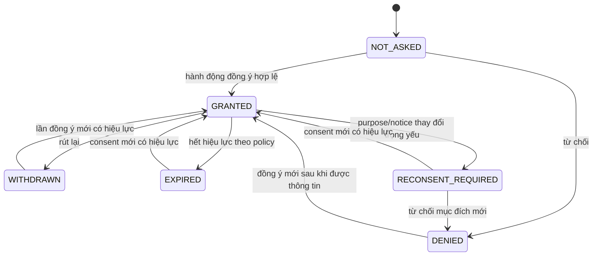
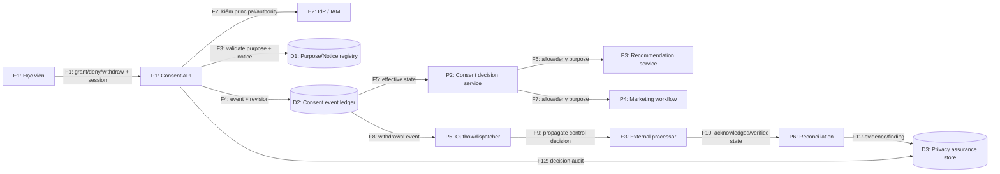
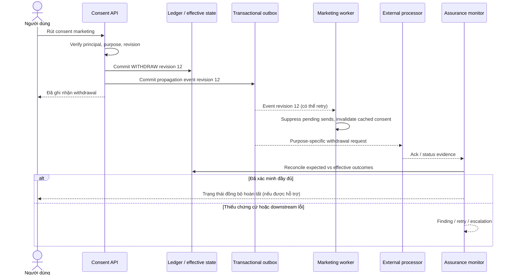

# Consent trong Privacy Assurance: thiết kế sự đồng ý, chứng minh và quản lý vòng đời

## 1. Consent là gì và tại sao cần assurance?

**Consent (sự đồng ý)** trong bảo vệ dữ liệu là một **hành vi thể hiện sự lựa chọn của chủ thể dữ liệu** đối với một hoặc nhiều mục đích xử lý dữ liệu được mô tả rõ, theo các điều kiện của **pháp luật và chính sách áp dụng**. Một checkbox được tích hay một API nhận giá trị `true` **không tự đủ** để khẳng định có consent hợp lệ.

Trong chương **Privacy assurance** của module **SECURITY_SECURITY_ASSURANCE**, câu hỏi trọng tâm không chỉ là “đã có nút Đồng ý chưa?”, mà là:

- Consent có phải **căn cứ xử lý phù hợp** cho mục đích này không, hay một căn cứ khác mới thích hợp?
- Người dùng có **thực sự được lựa chọn**, nhận đủ thông tin, hiểu từng mục đích và có thể từ chối không?
- Tổ chức chứng minh được **ai, đồng ý điều gì, phiên bản thông báo nào, vào thời điểm nào, qua phương thức nào** không?
- Trạng thái consent có được **áp dụng đúng tại mọi dịch vụ**, bao gồm batch jobs, analytics, nhà cung cấp bên ngoài và dữ liệu đã đồng bộ?
- Khi người dùng **rút lại sự đồng ý**, hệ thống ngừng xử lý dựa trên consent đó và có bằng chứng kiểm chứng hiệu lực ra sao?
- Các trường hợp trẻ em, người đại diện, dữ liệu nhạy cảm, nhiều bên kiểm soát hoặc quy định theo quốc gia có được đánh giá theo căn cứ thực tế không?
- Ai đánh giá control, thu thập evidence, xử lý findings và quyết định residual risk?

Ví dụ, một nền tảng học tập Java/Spring Boot quản lý hồ sơ học viên, bài nộp, điểm thi và cung cấp tính năng đề xuất khóa học. Hệ thống có thể **cần** xử lý một số thông tin để cung cấp dịch vụ hoặc đáp ứng nghĩa vụ, trong khi việc sử dụng dữ liệu học tập cá nhân để tạo **gợi ý tiếp thị tùy chọn** có thể phải được đánh giá trên **một mục đích và căn cứ xử lý riêng**. Không được trộn lẫn tất cả vào một nút “Đồng ý điều khoản”.

**Privacy assurance** đánh giá chuỗi **mục tiêu quyền riêng tư → hoạt động xử lý → căn cứ xử lý → yêu cầu consent → control triển khai → kiểm thử → bằng chứng → finding và giám sát**. Đạt consent control trong một giao diện không chứng minh mọi hoạt động xử lý của tổ chức tuân thủ pháp luật hoặc an toàn.

### Mục tiêu học tập

Sau bài học, người học có thể:

1. Phân biệt consent với **privacy notice**, điều khoản sử dụng, xác thực, hợp đồng, lựa chọn UI và các căn cứ xử lý khác.
2. Thiết kế consent **cụ thể theo mục đích, được thông tin đầy đủ, có lựa chọn và có khả năng rút lại** theo chính sách/luật áp dụng.
3. Mô hình hóa **purpose registry, consent records, event history, policy version và trạng thái hiệu lực**.
4. Thiết kế kiểm soát **enforcement, propagation, withdrawal và evidence** cho Java/Spring Boot, event processing và third party.
5. Phân tích threat scenarios, dark patterns, bản ghi thiếu bằng chứng, lỗi đồng bộ hoặc sử dụng dữ liệu ngoài mục đích.
6. Xây dựng test matrix và assurance package để hỗ trợ audit, xử lý finding và continuous assessment.

> **Nguyên tắc:** Consent là một **quyết định của chủ thể dữ liệu trong bối cảnh cụ thể**, không phải cờ boolean dùng chung mọi mục đích. “Có consent record” chưa chứng minh sự đồng ý hợp lệ hoặc tất cả hệ thống đã tôn trọng quyết định đó.

## 2. Consent không phải căn cứ xử lý duy nhất

Trước khi xin sự đồng ý, phải **xác định hoạt động xử lý, mục đích và căn cứ pháp lý áp dụng**. Tùy pháp luật, xử lý dữ liệu có thể dựa trên sự đồng ý hoặc căn cứ khác với điều kiện riêng. **Không được mặc định consent là căn cứ bắt buộc hoặc tối ưu cho mọi xử lý**, cũng không tự thay đổi căn cứ để né quyền của người dùng.

| Hoạt động minh họa ở LMS | Câu hỏi về căn cứ | Vì sao cần phân loại |
| --- | --- | --- |
| Đăng nhập và xác minh quyền truy cập | Dữ liệu nào cần để cung cấp dịch vụ, bảo mật và đáp ứng yêu cầu? | Không nên thiết kế “rút consent bảo mật” khiến service không thể giữ những log bắt buộc dựa trên căn cứ hợp pháp khác. |
| Lưu bài thi và điểm học tập | Quan hệ học vụ/hợp đồng hoặc nghĩa vụ nào làm phát sinh nhu cầu xử lý? | Nếu xử lý thiết yếu, dùng consent tùy chọn như căn cứ duy nhất có thể tạo lựa chọn không thực chất. |
| Gửi email gợi ý khóa học ngoài phạm vi bắt buộc | Consent hoặc cơ chế tiếp thị nào được luật/quy định áp dụng yêu cầu? | Người dùng phải có cách lựa chọn phù hợp và hệ thống tôn trọng phạm vi đã chọn. |
| Phân tích hành vi học tập cho mô hình đề xuất tùy chọn | Mục đích, dữ liệu, người nhận, mức ảnh hưởng và căn cứ là gì? | Consent cho một mục đích không tự mở rộng sang huấn luyện mô hình, profiling hoặc chia sẻ thứ cấp. |
| Chuyển dữ liệu sang vendor analytics | Ai là controller/processor, vai trò, mục đích, nơi xử lý? | Bằng chứng contract hoặc SDK được cài không thay điều kiện consent và shared responsibility nếu cần. |
| Lưu audit để điều tra truy cập trái phép | Có căn cứ và thời hạn lưu riêng được phê duyệt không? | Rút consent cho marketing không mặc nhiên làm xóa dấu vết audit cần thiết theo căn cứ khác. |

### Cần ghi “legal basis mapping” trước khi viết UI

Một **processing register** nên liên kết mỗi xử lý với: data categories, subject categories, mục đích, bên xử lý, lawful basis, thời gian, quyền liên quan, nghĩa vụ về thông báo/chấp thuận, retention và security controls.

**Lưu ý pháp lý:** Những yêu cầu về consent khác nhau giữa hệ thống pháp luật và loại xử lý. Ví dụ các khái niệm GDPR thường mô tả consent **freely given, specific, informed, unambiguous**, nhưng hệ thống ở Việt Nam hoặc xử lý dữ liệu xuyên biên giới phải đối chiếu **văn bản có hiệu lực, đối tượng, loại dữ liệu và nghĩa vụ riêng**. Bài này cung cấp **phương pháp engineering/assurance**, không thay ý kiến pháp lý hoặc kết luận mức tuân thủ cho một tổ chức cụ thể.

## 3. Các tính chất cốt lõi của consent đáng tin

Một consent phù hợp thường cần chứng minh các tính chất tương ứng với **khung pháp lý đã chọn**:

| Tính chất | Câu hỏi assurance | Ví dụ đạt về mặt thiết kế | Dấu hiệu không đạt |
| --- | --- | --- | --- |
| **Tự nguyện / freely given** | Người dùng có lựa chọn thực sự, không bị ép bởi điều kiện không cần thiết? | Từ chối marketing không làm mất chức năng học tập thiết yếu. | “Đồng ý chia sẻ dữ liệu cho quảng cáo, nếu không không được xem điểm” dù không có căn cứ ràng buộc. |
| **Cụ thể / specific** | Consent dành cho mục đích xác định, không gộp không liên quan? | Tách “email giới thiệu khóa học” và “cá nhân hóa đề xuất”. | Một checkbox mở mọi use case hiện tại và tương lai. |
| **Được thông tin / informed** | Thông báo rõ ai xử lý, dữ liệu gì, mục đích, chia sẻ, quyền và cách rút? | Nội dung dễ hiểu, liên kết chi tiết, version chính xác. | Mô tả mơ hồ “để cải thiện trải nghiệm”, không xác định xử lý. |
| **Hành động khẳng định / unambiguous** | Có hành vi chọn đồng ý có thể chứng minh? | Checkbox tùy chọn **không tích sẵn**, nút cho từng purpose. | Coi im lặng, lướt trang hoặc checkbox pre-ticked là đồng ý khi luật đòi opt-in. |
| **Khả năng rút lại** | Người dùng có thể thay đổi lựa chọn và hệ thống thực hiện? | Trang Preferences hoạt động, withdrawal event và verified enforcement. | Có nút “Rút” nhưng analytics job vẫn chạy nhiều tuần không có kiểm soát. |
| **Không đánh tráo mục đích** | Chỉ xử lý trong scope đã thông báo và được chấp nhận? | Marketing consent không tự cho phép profiling với bên thứ ba. | Dùng consent chung để bán/chia sẻ dữ liệu ngoài mục đích. |
| **Bằng chứng có thể kiểm tra** | Có chứng cứ về nội dung, thời gian, actor, nguồn, hành động và hiệu lực? | Consent ledger, notice version, API events, test report. | Chỉ lưu `consent=true`, không rõ đồng ý nội dung gì. |

**Không mặc định mọi quy tắc trên có cùng câu chữ pháp lý ở mọi nước.** Đội privacy/legal phải chốt những yêu cầu bắt buộc cho từng mục đích/nhóm dữ liệu; security assurance biến chúng thành **tiêu chí đo và test**.

## 4. Phân biệt consent với notice, acknowledgement và preference

| Khái niệm | Nó có ý nghĩa gì? | Điều không được suy ra |
| --- | --- | --- |
| **Privacy notice** | Thông báo minh bạch về việc xử lý dữ liệu. | Chỉ hiển thị notice không tự chứng minh đã có consent. |
| **Acknowledgement** | Xác nhận đã nhận/đọc một thông tin hoặc điều khoản. | “Tôi đã đọc” không nhất thiết là “tôi đồng ý xử lý mục đích X”. |
| **Terms of service acceptance** | Chấp nhận điều khoản sử dụng dịch vụ. | Không tự bao trùm mọi mục đích xử lý dữ liệu cá nhân. |
| **Consent** | Lựa chọn theo mục đích của chủ thể dữ liệu đáp ứng yêu cầu áp dụng. | Không tạo quyền xử lý mọi dữ liệu vô thời hạn. |
| **Preference** | Lựa chọn tùy biến giao diện/marketing/cookie. | Preference không nhất thiết là consent có giá trị pháp lý nếu thiếu những điều kiện khác. |
| **Opt-out / objection** | Cơ chế phản đối/ngừng một loại xử lý theo căn cứ/quy định áp dụng. | Không phải lúc nào tương đương withdrawal của consent. |
| **Authentication** | Chứng minh người yêu cầu đang kiểm soát credential. | User đăng nhập hợp lệ không nghĩa đã đồng ý marketing. |
| **Authorization** | Xác định quyền user/service trên tài nguyên. | Admin được sửa cấu hình không có quyền “đồng ý thay” người dùng nếu thiếu thẩm quyền. |

### Ví dụ cụ thể

Người dùng đăng ký tài khoản học trực tuyến và chấp nhận **điều khoản học tập**. Điều này không tự chứng minh người dùng đã đồng ý **chia sẻ tiến độ học cho đối tác quảng cáo**. Nếu hệ thống yêu cầu consent riêng cho mục đích đó, phải có **hành động riêng, notice version, ledger và cơ chế withdrawal**.

Mặt khác, nút “Tắt thông báo push” có thể là preference vận hành của thiết bị; cần đánh giá căn cứ xử lý và luật truyền thông tương ứng thay vì mặc định nó là GDPR consent hoặc toàn bộ privacy decision.

## 5. Xây dựng purpose inventory trước khi xin consent

Để tránh gộp consent, hãy tạo **purpose registry**: một mục đích được định danh, có người chịu trách nhiệm, dữ liệu, căn cứ và các hệ thống tham gia.

| Purpose ID | Hoạt động | Data categories | Nguồn và nơi xử lý | Tiêu chí cần thiết |
| --- | --- | --- | --- | --- |
| `PUR-LEARNING-CORE` | Cung cấp khóa học, lưu bài nộp/điểm. | Student ID, course enrollment, submission, grades. | LMS, DB, storage, giáo viên được phân quyền. | Xác lập căn cứ phù hợp; không mặc định phải chọn opt-in tùy chọn. |
| `PUR-COURSE-RECOMMEND` | Cá nhân hóa gợi ý khóa học tùy chọn. | Lịch sử học và tương tác cần thiết. | Recommendation service, analytics pipeline. | Nếu dùng consent làm căn cứ: choice riêng, điều kiện có hiệu lực, withdrawal. |
| `PUR-MARKETING-EMAIL` | Gửi email giới thiệu khóa học. | Địa chỉ liên hệ và lựa chọn kênh. | Messaging service và email provider. | Xem luật/quy tắc marketing; tách khỏi nội dung giao dịch cần thiết. |
| `PUR-PRODUCT-ANALYTICS` | Đo mức sử dụng nhằm cải tiến dịch vụ. | Event được tối thiểu hóa, pseudonymous IDs nếu phù hợp. | Analytics SDK/warehouse. | Xác định mục đích, căn cứ, có cần consent SDK/tracker hay không. |
| `PUR-SECURITY-AUDIT` | Phát hiện truy cập trái phép, điều tra. | Security events, actor/resource/time. | Audit store, SOC. | Xác định căn cứ khác nếu phù hợp, retention và giới hạn truy cập. |

Các dòng **là ví dụ mô hình hóa**, không khẳng định căn cứ pháp lý cụ thể của hệ thống thật. Mỗi purpose phải có **version** và **ngữ nghĩa ổn định**: nếu mở rộng mục đích “cá nhân hóa trong LMS” thành “chia sẻ hồ sơ cho đối tác quảng cáo”, không giữ nguyên ID/consent cũ rồi gọi là vẫn hợp lệ.

### Checklist của một purpose

- Mục tiêu và hoạt động xử lý được mô tả theo từ ngữ người dùng hiểu được?
- Data categories, subject groups, recipient, controller/processor roles và transfer boundaries có rõ?
- Lawful basis/consent requirement đã được bộ phận có thẩm quyền xác định?
- Consent có **bắt buộc riêng, lựa chọn optional, granularity** nào?
- Điều kiện bắt đầu và ngừng xử lý theo hiệu lực consent là gì?
- Dữ liệu đã thu trước đây, retention, xóa và tương tác với các căn cứ khác sẽ xử lý thế nào?
- Ai sở hữu purpose/control, ai triển khai và ai đánh giá?

## 6. Consent theo mục đích, loại dữ liệu và bên nhận

**Granularity (độ chi tiết lựa chọn)** cần đủ để người dùng không phải chấp nhận mục đích không liên quan chỉ để dùng một chức năng.

### Một ví dụ phân tách lựa chọn

| Lựa chọn trên giao diện | Purpose ID | Hệ thống phải làm gì khi từ chối? |
| --- | --- | --- |
| “Gửi email giới thiệu khóa học phù hợp.” | `PUR-MARKETING-EMAIL` | Không gửi email quảng bá dựa trên consent bị từ chối; vẫn gửi thông báo thiết yếu nếu có căn cứ khác. |
| “Sử dụng lịch sử học để gợi ý khóa học trong ứng dụng.” | `PUR-COURSE-RECOMMEND` | Dừng sử dụng dữ liệu cho cá nhân hóa theo consent; cung cấp giao diện không cá nhân hóa khi phù hợp. |
| “Cho phép analytics cookies/tracker không thiết yếu.” | `PUR-PRODUCT-ANALYTICS` nếu căn cứ áp dụng yêu cầu. | Không tải/kích hoạt trackers phụ thuộc consent trước khi có hiệu lực. |

**Không thể gộp** ba lựa chọn trên thành một cờ `allowPersonalDataProcessing` mà vẫn dễ chứng minh purpose limitation. Một cờ chung làm khó việc withdrawal, audit, khắc phục và xử lý nhà cung cấp.

### Không được thay đổi ý nghĩa một purpose âm thầm

Nếu cần xử lý thêm dữ liệu/recipient hoặc mục đích materially khác, đánh giá:

1. Thay đổi có nằm trong **scope đã được thông báo/đồng ý** không?
2. Căn cứ xử lý có còn phù hợp và có cần **fresh consent** không?
3. Notice/purpose version mới có cần hiển thị, review hoặc phê duyệt?
4. Các event/đồng bộ cũ và bằng chứng sẽ được đối chiếu ra sao?

Consent ở version v1 không tự trở thành consent cho version v2 nếu v2 mở rộng mục đích ngoài phạm vi ban đầu.

## 7. Trải nghiệm người dùng: consent không được thiết kế để đánh lừa

**Dark patterns** là cách trình bày giao diện khiến người dùng khó từ chối hoặc khó hiểu hệ quả. Một control privacy tốt phải kiểm **hành vi thực tế của UI**, không chỉ backend lưu được checkbox.

| Thiết kế có vấn đề | Tác động | Điều nên kiểm |
| --- | --- | --- |
| Checkbox consent tùy chọn đã tích sẵn. | Không phản ánh hành động khẳng định khi luật yêu cầu opt-in. | Mặc định unset/off, test initial UI state. |
| “Chấp nhận tất cả” nổi bật, từ chối bị ẩn qua nhiều bước. | Lựa chọn không cân bằng, người dùng bị dẫn dắt. | Độ rõ, số thao tác, bố cục tương đương theo tiêu chí áp dụng. |
| Nội dung purpose mơ hồ hoặc chỉ hiển thị bằng ngôn ngữ pháp lý khó hiểu. | Không informed; người dùng không hiểu dữ liệu được dùng. | Usability review, ngôn ngữ phù hợp, purpose-specific copy. |
| Từ chối làm hỏng chức năng học tập không liên quan. | Có thể tạo điều kiện cưỡng ép. | End-to-end test trải nghiệm khi deny/withdraw. |
| Nút rút lại chỉ tồn tại trong email khó tìm. | Rút lại khó hơn so với đồng ý. | Journey tests và support/escalation. |
| Sau withdrawal lại hiện popup liên tục ép bật lại. | Undue pressure; trải nghiệm người dùng và choice integrity kém. | Frequency cap và non-coercive UX review. |
| Thay wording nhưng giữ notice version. | Evidence không tái tạo được nội dung lúc user đồng ý. | Versioned notices, change control, snapshots/hash. |
| Dùng tiếng Anh khi nhóm người dùng không hiểu. | Giảm tính informed. | Locale/version mapping, accessibility tests. |

### Ví dụ nội dung UI ngắn và minh bạch

> **Gợi ý khóa học cá nhân hóa — Tùy chọn**  
> Nếu bạn chọn đồng ý, chúng tôi dùng lịch sử khóa học và tương tác trong ứng dụng để gợi ý khóa học có thể phù hợp. Bạn vẫn dùng được các chức năng học tập cơ bản nếu từ chối. Bạn có thể thay đổi lựa chọn tại **Cài đặt quyền riêng tư**. Xem chi tiết về dữ liệu, thời hạn và bên xử lý trong thông báo quyền riêng tư phiên bản được liên kết.

Đây là **ví dụ diễn đạt**, chưa đủ một notice hoàn chỉnh: nội dung cần được privacy/legal duyệt, xem recipient, retention, nơi xử lý và nghĩa vụ riêng.

### Kiểm cả accessibility

Consent controls cần dùng được bằng bàn phím, trình đọc màn hình, trên mobile; các nút có label rõ, không sử dụng màu sắc làm cách phân biệt duy nhất, không bắt người dùng từ chối bằng hành động khó tiếp cận. **A/B testing marketing** không được âm thầm đổi logic consent hoặc tạo điều kiện gây hiểu nhầm.

## 8. Consent lifecycle: grant, deny, withdraw, expire, re-consent

Consent là một **chuỗi quyết định theo thời gian**. Đặt một boolean trên bảng `users` bỏ lỡ thay đổi purpose, notice và propagation.

| State minh họa | Ý nghĩa | Tác dụng với xử lý dựa trên consent |
| --- | --- | --- |
| `NOT_ASKED` | Chưa ghi nhận lựa chọn hợp lệ. | Không khởi chạy xử lý yêu cầu opt-in chỉ vì chưa có câu trả lời. |
| `GRANTED` | Có bằng chứng người có thẩm quyền đồng ý mục đích/version cụ thể. | Có thể xử lý trong phạm vi và điều kiện đã duyệt. |
| `DENIED` | Người dùng từ chối mục đích cụ thể. | Không xử lý theo consent đó; ghi nhận để tránh hỏi lặp gây áp lực. |
| `WITHDRAWN` | Một consent trước đó đã được rút lại. | Dừng hoạt động tương lai phụ thuộc consent, xử lý propagation và dữ liệu theo policy. |
| `EXPIRED` | Hết hiệu lực theo policy/luật hoặc thời hạn thiết lập. | Yêu cầu đánh giá/re-consent trước khi tiếp tục hoạt động phụ thuộc consent. |
| `RECONSENT_REQUIRED` | Mục đích/thông báo thay đổi cần quyết định mới. | Không dùng consent cũ cho phần xử lý mới chưa được chấp thuận. |
| `UNDER_REVIEW` | Chủ thể/đại diện/quy trình không đủ bằng chứng để kết luận. | Không tự quy đổi trạng thái sang GRANTED; escalation đúng thẩm quyền. |

**Không nhất thiết hệ thống thật phải dùng chính các tên state này.** Quan trọng là phải có **ngữ nghĩa, chuyển trạng thái, điều kiện hiệu lực và bằng chứng** đủ rõ.



**Quy tắc quan trọng:** Khi từng có `GRANTED` rồi chuyển `WITHDRAWN`, không xóa hết lịch sử để trở lại `NOT_ASKED`; cần giữ **tối thiểu evidence hợp pháp** để giải thích vì sao dữ liệu từng được xử lý và thời điểm hệ thống ngừng hoạt động.

## 9. Các mốc thời gian khác nhau trong consent

| Thời điểm | Ý nghĩa | Vì sao quan trọng? |
| --- | --- | --- |
| `displayedAt` | Lúc notice/consent UI được hiển thị. | Chưa chứng minh user đã chọn. |
| `decidedAt` | Lúc người dùng gửi hành động grant/deny/withdraw. | Phân biệt việc người dùng làm và hệ thống nhận. |
| `recordedAt` | Lúc server ghi nhận thành công. | Đối chiếu transaction và event ordering. |
| `effectiveAt` | Mốc quyết định có hiệu lực theo policy. | Xác định lúc phải ngừng xử lý hoặc bắt đầu cho phép. |
| `propagatedAt` | Lúc downstream đã nhận và áp dụng trạng thái. | Không nhầm “đã gửi event” với “đã thi hành”. |
| `verifiedAt` | Lúc hệ thống/assessor xác minh enforcement thực tế. | Bằng chứng về outcome cuối cùng. |
| `expiredAt` | Mốc hết hiệu lực nếu có theo căn cứ đã duyệt. | Ngăn dùng lựa chọn quá hạn. |

**Khác biệt giữa `effectiveAt` và `propagatedAt` cần được xử lý kỹ**: nếu withdrawal đã có hiệu lực nhưng batch consumer chưa nhận event, service không được tiếp tục xử lý consent-gated data một cách không giới hạn. Có thể dùng central decision store, deny-by-default theo phiên bản, policy check tại điểm sử dụng, hoặc cơ chế quarantine trong thời gian đồng bộ; phương án cụ thể phải theo **risk và độ trễ cho phép được duyệt**.

## 10. Ai có thể đồng ý? Chủ thể, người đại diện và thẩm quyền

Không phải một API request có `userId` và `consent=true` là đủ. Hệ thống cần chứng minh **actor có thẩm quyền quyết định cho subject**.

| Trường hợp | Rủi ro | Assurance cần có |
| --- | --- | --- |
| Người dùng trưởng thành quyết định cho mình | Account/session bị chiếm hoặc client giả request. | Principal đã xác thực, CSRF/session controls, intent binding và audit. |
| Phụ huynh/người giám hộ quyết định khi pháp luật yêu cầu | Người tự nhận đại diện nhưng không có thẩm quyền; độ tuổi sai. | Xác minh mối quan hệ/quyền đại diện, độ tuổi, điều kiện pháp lý theo jurisdiction. |
| Trẻ vị thành niên có năng lực quyết định theo phạm vi pháp luật | Áp nhầm một ngưỡng tuổi chung, bỏ qua trường hợp cần phối hợp. | Quy tắc tuổi, loại dữ liệu, mục đích và consent/permission workflow đã được legal xác định. |
| Nhân viên nhà trường thao tác thay học viên | Nhân viên có role support nhưng không có quyền đồng ý thay. | Representation policy rõ; tách tác vụ admin và quyết định chủ thể. |
| Guest/đại diện của tổ chức | Quyền đại diện hết hạn hoặc không đúng scope. | Sponsor/organization relationship, audit và thời hạn ủy quyền. |
| Workload/API gửi consent event | Bot tự gán consent cho người dùng. | Service chỉ được **ghi sự kiện từ luồng có evidence nguồn**, không tạo quyết định thay chủ thể tùy ý. |

**Không tự chọn ngưỡng tuổi cố định** cho mọi môi trường và loại xử lý; pháp luật về trẻ em/người đại diện và xử lý dữ liệu nhạy cảm có thể khác nhau. Điều kiện cần được legal/privacy xác định cụ thể và kiểm thử bằng dữ liệu giả trong môi trường được phép.

### Ví dụ rủi ro khi tin request body

Một endpoint `POST /consents` chấp nhận `subjectId` do client gửi và không so với authenticated principal. Học viên A có thể gửi ID của B để bật gợi ý/quảng cáo cho B. Đây vừa là lỗi **authorization** vừa là lỗi **consent evidence provenance**: server đã tạo bản ghi trông hợp lệ nhưng không phản ánh lựa chọn của đúng chủ thể.

## 11. Consent record: lưu gì để chứng minh?

Một record chỉ có `marketingConsent=true` là không đủ. Một **consent ledger** nên lưu dữ liệu **đủ để tái tạo claim**, nhưng không thu thập thêm PII một cách không cần thiết.

| Trường | Mục đích | Bài kiểm tra |
| --- | --- | --- |
| `consentEventId` | Định danh duy nhất sự kiện, hỗ trợ audit/idempotency. | Retry không tạo quyết định mâu thuẫn. |
| `subjectId` và namespace | Xác định chủ thể dữ liệu theo hệ thống có authority. | Không map nhầm do email/username thay đổi. |
| `actorId` và authority | Ai thực hiện quyết định, cho mình hay với tư cách đại diện? | Kiểm token, subject binding và representation. |
| `purposeId` và `purposeVersion` | Chính xác mục đích được lựa chọn. | Không dùng grant v1 cho purpose v2 ngoài scope. |
| `noticeId`/`noticeVersion`/`contentDigest` | Nội dung người dùng đã được cung cấp lúc quyết định. | Có thể truy xuất đúng wording/locale/version; digest có nguồn tin cậy. |
| `decision` | GRANT, DENY, WITHDRAW, EXPIRE hoặc hành động được định nghĩa. | Không ghi im lặng thành GRANT. |
| `decidedAt`, `recordedAt`, `effectiveAt` | Thứ tự và hiệu lực. | Clock/timezone, event ordering và race. |
| `channel`/`collectionMethod` | Web UI, mobile, support flow, authenticated API. | Đúng phương thức, không có đường bypass. |
| `proofReference` | Tham chiếu bằng chứng xác thực và quyền đại diện phù hợp. | Không lưu raw access token/secret. |
| `policyVersion` và `legalBasisReference` | Tiêu chí được áp dụng tại thời điểm. | Assessor đối chiếu đúng version. |
| `correlationId` và `sourceSystem` | Theo dõi propagation tới processors. | Có thể so request, ledger và downstream effects. |
| `recordIntegrity` và access metadata | Giảm nguy cơ sửa sự kiện sau khi xảy ra. | Restricted writes, append-only semantics, audit và backup. |

**Bảo vệ quyền riêng tư của chính ledger:** IP, device fingerprint hay user-agent không nên được thu vô hạn chỉ để “tăng bằng chứng”. Chọn metadata theo **necessity, proportionality, retention và luật áp dụng**. Không giữ bản chụp màn hình toàn bộ phiên hoặc thông tin xác thực nếu một notice snapshot/version và server-side event có thể đáp ứng yêu cầu.

### Event history và effective state

Một thiết kế thực dụng có thể gồm:

- **Immutable/append-only event history** trong phạm vi quyền ghi được kiểm soát: quyết định đã xảy ra và tham chiếu.
- **Current effective state** được tính ra cho mỗi (subject, purpose, scope), có version/revision để API kiểm nhanh.
- **Processing decisions** tại điểm dùng dữ liệu: dựa trên hiệu lực hiện tại, không dựa vào bản sao stale không giới hạn.
- **Propagation records** tới từng processor/consumer và reconciliation outcomes.

“Append-only” là mục tiêu kiến trúc, **không tự bảo đảm chống sửa log**; cần access controls, integrity/backup, review và khả năng phát hiện thay đổi không được phép.

## 12. DFD: dữ liệu và quyết định consent đi qua đâu?



### Trust boundaries cần làm rõ

1. **Browser/mobile → API:** User input là không tin cậy; chống CSRF khi cookie-based, bảo vệ session, kiểm actor-subject binding.
2. **API → IAM:** Authentication không tự xác minh quyền đại diện; cần policy và nguồn có thẩm quyền.
3. **API → purpose registry:** Registry phải được versioned/approved; không để client tùy ý tạo purpose.
4. **Ledger → decision:** Cần xác định nhất quán, revision và hành vi khi không đọc được effective state.
5. **Service → processor:** Vendor nhận đúng purpose/subject, có hợp đồng, kiểm ownership và transmission/security.
6. **Event → evidence:** Event delivered/acknowledged không mặc nhiên nghĩa dữ liệu đã ngừng được xử lý; cần verification theo scope.

**Sơ đồ DFD là artifact phục vụ threat modeling**, không tự chứng minh control đang hoạt động. Assurance cần kiểm runtime, config, API, data pipeline và vendor evidence.

## 13. Threat modeling: khi consent bị giả mạo hoặc không được tôn trọng

| Threat ID | Kịch bản | Rủi ro | Control chính |
| --- | --- | --- | --- |
| `THR-CON-01` | Checkbox pre-selected hoặc wording ép buộc khiến người dùng không chủ động đồng ý. | Consent có thể không hợp lệ; xâm phạm quyền lựa chọn. | UX/notice review, opt-in tests, legal approval. |
| `THR-CON-02` | Client gửi `subjectId` của người khác để thay consent. | Giả mạo lựa chọn và xử lý sai dữ liệu. | Server principal binding, BOLA negative tests. |
| `THR-CON-03` | Marketing service chỉ kiểm consent tại đăng ký, không kiểm trước từng chiến dịch. | Gửi sau withdrawal. | Effective-state gate trước mỗi send, change events. |
| `THR-CON-04` | Recommendation cache tiếp tục cá nhân hóa sau rút lại. | Xử lý tiếp ngoài scope. | Cache invalidation, stale-revision handling, monitoring. |
| `THR-CON-05` | Người dùng đồng ý purpose v1, hệ thống tự mở rộng sang vendor v2. | Mục đích mới chưa được chấp thuận. | Purpose/notice version, compatibility review, re-consent. |
| `THR-CON-06` | Ledger bị admin sửa ngầm để hiển thị GRANTED. | Evidence giả, xử lý dữ liệu không có căn cứ. | Append-only controls, privileged audit, integrity checks. |
| `THR-CON-07` | Withdraw event mất trong queue/retry nhưng UI báo “đã rút hoàn tất”. | Downstream tiếp tục xử lý. | Outbox, reconciliation, user-facing status trung thực. |
| `THR-CON-08` | SDK analytics tải và gửi data trước khi consent được quyết định. | Thu thập ngoài ý muốn từ đầu trang. | Pre-init gating, network tests, tag manager policy. |
| `THR-CON-09` | Consent của phụ huynh giả hoặc quan hệ đại diện hết hiệu lực. | Xử lý dữ liệu trẻ em không đủ thẩm quyền. | Representation verification, legal criteria và audit. |
| `THR-CON-10` | Nhân viên support bật consent thay học viên mà không có authority. | Choice integrity và evidence sai. | Role segregation, approval/proof, negative tests. |
| `THR-CON-11` | Tracking qua một API hoặc batch job không được gắn purpose. | Bypass consent enforcement. | Processing inventory, purpose tags, route/job review. |
| `THR-CON-12` | Rút consent bị hiểu thành xóa mọi bản ghi audit theo căn cứ khác. | Mất bằng chứng/khả năng tuân thủ. | Basis-specific data lifecycle, retention review. |
| `THR-CON-13` | Legal basis được gán lại tùy ý sau withdrawal để tiếp tục marketing. | Né quyền rút lại và thiếu minh bạch. | Approved basis registry, change review, legal assessment. |
| `THR-CON-14` | User không hiểu language hoặc UI không accessibility. | Quyết định thiếu informed/không thực chất. | Localized notices, usability/accessibility tests. |

**Cách ghi finding:** Nếu thử nghiệm chứng minh tracker gửi dữ liệu trước khi có opt-in theo rule áp dụng, ghi finding với network trace, notice/policy, environment, expected/actual và dữ liệu test giả. Không tự coi mọi cookie hoặc request là vi phạm nếu chưa xác định purpose, chức năng, căn cứ và yêu cầu pháp lý tương ứng.

## 14. Consent enforcement: kiểm ở điểm sử dụng dữ liệu

**Chỉ lưu consent tại lúc người dùng click là không đủ.** Mỗi hoạt động xử lý phụ thuộc consent phải có **một decision point** xác định trạng thái hiệu lực ở đúng subject, purpose, phiên bản và ngữ cảnh.

| Điểm xử lý | Câu hỏi enforcement | Ví dụ test |
| --- | --- | --- |
| **Backend API** | Service nhận đúng principal/purpose? Consent có hiệu lực trước khi xử lý? | Không gửi dữ liệu recommendation khi DENIED hoặc WITHDRAWN. |
| **Frontend/SDK** | Tracker không tải/gửi trước opt-in; withdrawal ngừng hoạt động? | Browser network trace trước/sau choice. |
| **Batch/ETL** | Job có kiểm ở thời điểm chạy? Có loại bỏ subject đã withdraw? | Dataset/batch test với grant→withdraw race. |
| **Cache/materialized view** | Consent revision mới có invalidation phù hợp? | Withdraw rồi verify không còn personalize từ cache. |
| **Email marketing** | Trước khi send có suppression/gate cập nhật? | Queue message từ trước withdrawal không vẫn được gửi sai. |
| **Third-party processor** | Event truyền đến, provider thực hiện và có acknowledgement/evidence? | Reconciliation, sample test, provider report. |
| **Model training/derived output** | Purpose, dữ liệu đầu vào và khả năng xử lý khi withdraw được định nghĩa? | Data lineage, legal/privacy assessment, removal/retraining policy theo kỹ thuật và nghĩa vụ. |

### Chọn default khi thiếu consent

Khi **hoạt động phụ thuộc consent hợp lệ** mà server không xác minh được trạng thái, mặc định **không thực hiện xử lý phụ thuộc consent** hoặc đưa vào hàng đợi/quarantine theo thiết kế. Không gán `GRANTED` chỉ vì consent service lỗi.

**Không áp dụng “deny all processing” bừa bãi:** Có những xử lý thiết yếu hoặc được phép theo **căn cứ khác**. Các activity đó phải được định danh rõ và kiểm bằng **basis-specific controls** để tránh vừa vi phạm quyền riêng tư vừa làm hỏng dịch vụ.

### Những điều kiện vận hành cần đo

- Decision latency, availability và hướng giảm tải/caching được chấp nhận.
- Thời hạn stale tối đa và cách xử lý event đến không đúng thứ tự.
- Consistency giữa ledger, effective state và downstream stores.
- Phạm vi person/tenant/recipient/region, không chỉ purpose name.
- Quy trình xử lý lỗi, retry, dead-letter, backfill và evidence về hiệu lực.

## 15. Withdrawal: “rút lại” phải có kết quả đo được

Withdrawal không phải một nút UI trang trí. Với xử lý dựa trên consent, hệ thống phải đánh giá **hành vi tương lai, hoạt động đang chờ, dữ liệu đã thu và các hệ thống phụ thuộc** theo yêu cầu áp dụng.

### Quy trình tám bước

1. **Nhận quyết định có thẩm quyền:** Xác thực principal/representation và mục đích cần rút.
2. **Ghi hiệu lực tại authority:** Tạo sự kiện `WITHDRAW` có revision và mốc thời gian; không cho stale GRANT ghi đè.
3. **Áp policy ngay tại điểm quyết định:** Consent-gated services không tiếp tục tạo processing mới trái hiệu lực.
4. **Phát sự kiện tới consumers:** Sử dụng outbox/dispatcher hoặc cơ chế đáng tin tương đương; idempotent.
5. **Xử lý in-flight và queued work:** Cancel/suppress các tác vụ chưa gửi; xác định chính sách cho tác vụ đang chạy.
6. **Thông báo processors:** Truyền chính xác subject/purpose, lấy acknowledgement và kiểm outcome khi có thể.
7. **Xử lý dữ liệu đã thu:** Đánh giá dừng sử dụng, xóa, ẩn danh, giữ theo căn cứ khác hoặc retention/contract theo quyết định privacy/legal và yêu cầu áp dụng.
8. **Verify và report:** Kiểm API, queue, SDK, dữ liệu, vendor; ghi thời gian/giới hạn/finding và trạng thái công khai trung thực.

### Withdrawal không luôn có nghĩa xóa mọi dữ liệu ngay lập tức

Rút lại consent thông thường làm thay đổi **khả năng tiếp tục xử lý dựa trên consent đó** theo các quy định áp dụng, nhưng **không tự động** đồng nghĩa phải xóa toàn bộ dữ liệu từ trước hoặc dữ liệu được giữ hợp lệ theo căn cứ khác. Cần đánh giá riêng yêu cầu xóa, retention, giao dịch đã hoàn thành, audit và nghĩa vụ hợp đồng/pháp lý.

Ví dụ, người dùng rút consent cho **marketing gợi ý khóa học**. Hệ thống phải ngừng marketing phụ thuộc consent. Nhưng **hồ sơ điểm thi** và các log bảo vệ an ninh có thể thuộc xử lý khác đã được xác định căn cứ riêng; không nên tự xóa để “cho chắc”.

### Khi không thể hoàn thành tức thời

Nếu quyền được rút đã có hiệu lực nhưng downstream còn pending, UI nên phân biệt **“Đã ghi nhận lựa chọn”** với **“Đã hoàn tất đồng bộ/kiểm chứng”** khi sự phân biệt cần thiết. Không đưa ra lời hứa sai về việc đã xóa mọi dữ liệu hoặc vendor đã ngừng xử lý khi chưa có bằng chứng; đồng thời không trì hoãn thực thi vô hạn dưới tên “đang xử lý”.

## 16. Quản lý version và tránh replay lựa chọn cũ

Một consent có thể bị xử lý sai nếu nhiều tabs/devices hoặc events hoạt động cạnh tranh. Ví dụ:

- 09:00 người dùng GRANT.
- 09:05 người dùng WITHDRAW trên mobile.
- 09:06 một request GRANT bị giữ từ tab desktop gửi trễ.

Nếu backend chỉ lấy event “đến sau cùng” mà không kiểm **user intent, trạng thái/rule version, idempotency và thứ tự logic**, request cũ có thể bật lại consent ngoài ý muốn.

### Quy tắc thiết kế

| Vấn đề | Biện pháp cần xem | Test |
| --- | --- | --- |
| Retry request | Idempotency key gắn với actor/subject/purpose/action. | Retry cùng request không tạo nhiều GRANT khác nhau. |
| Concurrent updates | Optimistic locking/revision hoặc transaction serialization. | Hai requests cùng expectedRevision, chỉ một commit hoặc conflict. |
| Delayed old events | Sequence/version monotonic, consumer bỏ event lỗi thời. | WITHDRAW revision 7 đến trước GRANT revision 6. |
| Consent UI cũ | Check notice/purpose version và yêu cầu re-consent nếu đã thay scope. | Request từ tab cũ không vô tình chấp nhận purpose version mới. |
| Multi-region replication | Quy tắc authority/consistency và effectiveAt rõ. | Eventual consistency không cho xử lý consent-gated trái trạng thái mới. |
| Consent mới sau withdrawal | Một **hành động opt-in mới hợp lệ** với notice đúng, không phục hồi event cũ. | User thật GRANT sau khi đã được thông tin lại. |
| Audit trail | Lưu cả failed attempts và conflicts theo dữ liệu tối thiểu. | Có thể giải thích thứ tự decision/revision trong incident. |

**Lựa chọn policy cho offline UX rất quan trọng:** Nếu thiết bị offline, không hiển thị “đã rút thành công trên server” khi quyết định còn cục bộ. Đồng bộ sau reconnect cần phân biệt user intent mới và request cũ; giải quyết conflict theo quy trình có lợi cho bảo vệ quyền riêng tư phù hợp mục tiêu và luật áp dụng.

## 17. Mô hình dữ liệu cho consent ledger và effective state

Một cách tổ chức thực tế là tách các loại bản ghi:

| Thành phần | Chức năng | Vì sao tách? |
| --- | --- | --- |
| **Purpose registry** | ID, version, mô tả mục đích, legal basis policy, data categories, owner, trạng thái. | Không để tên mục đích tự thay nghĩa. |
| **Notice repository** | Nội dung đã duyệt, ngôn ngữ, version và digest. | Tái tạo điều gì đã được cung cấp khi user quyết định. |
| **Consent events** | Lịch sử GRANT/DENY/WITHDRAW cùng actor/subject/time/reference. | Truy vết, điều tra và xử lý tranh chấp. |
| **Effective consent state** | Quyết định hiện hành theo subject + purpose + scope + revision. | API/consumer kiểm nhanh và nhất quán. |
| **Outbox/propagation** | Các thay đổi cần gửi đến processor và kết quả thực hiện. | Không mất sự kiện khi database commit nhưng queue send lỗi. |
| **Processing register** | Mục đích, nguồn dữ liệu, hệ thống dùng, căn cứ xử lý và retention. | Biết hệ thống nào thực sự cần enforcement. |
| **Assurance evidence** | Test report, reviews, findings, provider acknowledgements. | Phân biệt operational log và đánh giá control. |

### SQL minh họa (cấu trúc giản lược)

Đây là một thiết kế dữ liệu ví dụ theo kiểu PostgreSQL. Nó **không đầy đủ để triển khai production**; cần thiết kế schema migration, indexes, partition/retention, mã hóa, RBAC, control ngăn sửa event và các ràng buộc theo policy.

```sql
CREATE TABLE consent_events (
    event_id            UUID PRIMARY KEY,
    subject_id          UUID NOT NULL,
    actor_id            UUID NOT NULL,
    purpose_id          VARCHAR(120) NOT NULL,
    purpose_version     VARCHAR(40) NOT NULL,
    notice_version      VARCHAR(40) NOT NULL,
    decision            VARCHAR(20) NOT NULL
                        CHECK (decision IN ('GRANT','DENY','WITHDRAW')),
    revision            BIGINT NOT NULL,
    decided_at          TIMESTAMPTZ NOT NULL,
    recorded_at         TIMESTAMPTZ NOT NULL DEFAULT now(),
    authority_reference VARCHAR(200),
    source_channel      VARCHAR(40) NOT NULL,
    idempotency_key     VARCHAR(200) NOT NULL,
    correlation_id      UUID NOT NULL,
    UNIQUE (subject_id, purpose_id, revision),
    UNIQUE (subject_id, purpose_id, idempotency_key)
);

CREATE TABLE effective_consents (
    subject_id       UUID NOT NULL,
    purpose_id       VARCHAR(120) NOT NULL,
    purpose_version  VARCHAR(40) NOT NULL,
    notice_version   VARCHAR(40) NOT NULL,
    decision         VARCHAR(20) NOT NULL,
    revision         BIGINT NOT NULL,
    effective_at     TIMESTAMPTZ NOT NULL,
    PRIMARY KEY (subject_id, purpose_id)
);

CREATE TABLE consent_outbox (
    outbox_id        UUID PRIMARY KEY,
    event_id         UUID NOT NULL REFERENCES consent_events(event_id),
    recipient_system VARCHAR(120) NOT NULL,
    status           VARCHAR(20) NOT NULL,
    created_at       TIMESTAMPTZ NOT NULL DEFAULT now(),
    acknowledged_at  TIMESTAMPTZ,
    verified_at      TIMESTAMPTZ
);
```

### Những giới hạn của schema trên

- Một bản ghi `actor_id` giống `subject_id` có thể hợp lý với self-consent; đại diện cần **authority proof** và scope riêng.
- ID của subject phải có namespace rõ, không dùng email làm khóa ổn định khi có thể đổi chủ.
- Khóa `UNIQUE(subject,purpose,idempotency_key)` chống trùng request nhưng ứng dụng phải kiểm **payload cùng key có cùng nội dung**; không được trả thành công cho action mâu thuẫn chỉ vì key trùng.
- Một purpose có nhiều region/recipient/tenant hoặc consent theo ngữ cảnh có thể cần khóa **scope** bổ sung; không cố nhét mọi sự đồng ý vào cặp subject/purpose.
- `effective_consents` là **projection**, phải khớp event ledger và xử lý khởi tạo row/transaction concurrency an toàn.
- Outbox cần có retry count, errors, dead-letter, consumer revision và kiểm outcome; status “ACKNOWLEDGED” chưa chắc “VERIFIED”.
- Append-only cần **database permissions, audit, retention, integrity checks và backups**, không chỉ dựa vào quy ước viết code.
- Dữ liệu phục vụ proof có thể phải giữ trong **thời hạn hợp pháp khác nhau** với dữ liệu của recommendation/marketing.

## 18. API contract: không cho client tự tạo sự đồng ý thay người khác

Giả sử `consent-service` chạy Spring Boot và lấy principal từ một IdP tin cậy. Một API minh họa:

```text
POST /api/privacy/consents/PUR-COURSE-RECOMMEND/decisions
Authorization: Bearer <valid-access-token-for-consent-api>
Idempotency-Key: <unique-client-action-id>
Content-Type: application/json

{
  "decision": "GRANT",
  "noticeVersion": "notice-recommendation-2026-01",
  "expectedRevision": 7
}

Response (conceptual):
{
  "purposeId": "PUR-COURSE-RECOMMEND",
  "decision": "GRANTED",
  "revision": 8,
  "recorded": true,
  "downstreamPropagation": "PENDING"
}
```

**Không có `subjectId` tùy ý trong body.** API resolve subject từ principal đã xác thực và identity link có authority. Nếu thao tác cho người đại diện được hỗ trợ, nên có **endpoint/flow riêng** với bằng chứng đại diện được xác minh, không cho client nhập bất kỳ subject ID rồi tin.

### Những quy tắc phải rõ trong contract

1. `decision` chỉ nhận các action được policy cho phép; `GRANT` không đồng nghĩa một JSON boolean từ frontend tự động hợp lệ.
2. `noticeVersion` phải khớp nội dung người dùng được hiển thị. Server đối chiếu với **approved registry**, không tin client tự tạo version.
3. `expectedRevision` giúp phát hiện stale tab/concurrent action; khi conflict, trả lỗi phù hợp và yêu cầu UI lấy state mới, không âm thầm ghi đè.
4. `Idempotency-Key` gắn với principal, purpose, payload và thời hạn phù hợp; server trả cùng outcome khi retry thật sự giống nhau.
5. Server ghi decision cùng event/outbox **trong một transaction** hoặc thiết kế có bảo đảm tương đương.
6. API trả rõ điều gì đã được **recorded**, điều gì đang **propagating** và điều gì đã **verified**, không hứa sai.
7. Xác thực/authorization, CSRF (với cookie-based sessions), rate limit, anti-replay, TLS và audit áp dụng theo kiến trúc.

**Đây là một contract minh họa**, không phải API đặc tả pháp lý hay cam kết rằng mọi công nghệ phải cung cấp đúng trường này.

## 19. Java/Spring Boot: ghi consent decision có transaction và audit

Đoạn mã minh họa một **dịch vụ quản lý quyết định**; các interface `IdentityLinkRepository`, `ConsentRepository`, `PurposeRegistry`, `OutboxRepository`, `ConsentEvent` thuộc ứng dụng giả định.

### 19.1. Service ghi nhận quyết định

```java
// Pseudocode: types and repositories are application-defined.
@Service
public class ConsentDecisionService {
    private final IdentityLinkRepository identities;
    private final PurposeRegistry purposes;
    private final ConsentRepository consents;
    private final ConsentEventRepository events;
    private final ConsentOutboxRepository outbox;
    private final Clock clock;

    @Transactional
    public ConsentReceipt decide(
            VerifiedPrincipal principal,
            String purposeId,
            ConsentCommand command,
            String idempotencyKey) {

        // Never accept a user-supplied arbitrary subjectId here.
        UUID subjectId = identities.requireActiveSubject(principal);
        Purpose policy = purposes.requireApprovedPurpose(purposeId);

        if (!policy.isConsentBased()) {
            throw new InvalidPurposeException(
                "This purpose is not managed by optional consent");
        }
        if (!policy.currentNoticeVersion()
                   .equals(command.noticeVersion())) {
            throw new StaleNoticeException("Notice version changed");
        }
        policy.requireValidDecision(command.decision());
        policy.requireAuthorizedActor(principal, subjectId);

        // Idempotency lookup checks equality of the original command too.
        ConsentReceipt replay = events.findSameRequest(
            subjectId, purposeId, idempotencyKey, command);
        if (replay != null) {
            return replay;
        }

        ConsentState state = consents.lockOrCreateForUpdate(
            subjectId, purposeId);
        if (state.revision() != command.expectedRevision()) {
            throw new ConsentConflictException(
                "Consent has changed; refresh before deciding");
        }

        long nextRevision = state.revision() + 1;
        Instant now = clock.instant();

        ConsentEvent event = ConsentEvent.from(
            principal, subjectId, policy, command,
            idempotencyKey, nextRevision, now);
        events.append(event);
        consents.updateEffectiveState(state, event);
        outbox.enqueueForRequiredRecipients(event);

        return ConsentReceipt.recorded(
            purposeId, event.decision(), nextRevision,
            "PENDING");
    }
}
```

**Giới hạn và giả định cần kiểm:**

- `VerifiedPrincipal` phải do **authentication server-side** cung cấp, không do request tự đặt. `requireAuthorizedActor` phải hỗ trợ **representation** nếu có, không tự suy người có role admin được consent thay chủ thể.
- `lockOrCreateForUpdate` phải thực hiện **atomicity thực tế** cả khi chưa có row; row-lock/unique constraints và retry transaction conflicts cần được thiết kế.
- `events.findSameRequest` cần so hash/nội dung command và authority; retry không được bỏ qua expectedRevision khi payload khác.
- `GRANT` chỉ được nhận từ **một luồng user-intent và notice phù hợp**. Server-side request hợp lệ chưa tự chứng minh UI không pre-ticked hoặc không có dark patterns; cần UI test và notice evidence.
- Mã không bao gồm network/CSRF/cookie config, expiry/re-consent, representation delegation, encryption, audit integrity hoặc privacy-law-specific restrictions.
- Outbox đảm bảo có **ý định gửi event trong transaction**, không chứng minh mọi processor đã áp dụng quyết định.

### 19.2. Consent-gated processing ở điểm sử dụng

Một service recommendation chỉ được dùng dữ liệu cho purpose phụ thuộc consent nếu có decision hiệu lực phù hợp.

```java
// Pseudocode: processing must be gated per subject and purpose.
@Service
public class RecommendationService {
    private final ConsentDecisionPoint consentDecisionPoint;
    private final LearningHistoryRepository learningHistory;

    public Recommendations forStudent(UUID studentId) {
        ConsentDecision decision = consentDecisionPoint.check(
            studentId, "PUR-COURSE-RECOMMEND");

        if (!decision.isCurrentlyGranted()) {
            return Recommendations.nonPersonalized();
        }

        // Verify scope/version and data access before each consent-based use.
        LearningHistory history = learningHistory.readForRecommendation(
            studentId, decision.authorizedScope());
        return Recommendations.from(history);
    }
}
```

**Quan trọng:** Mã minh họa quyết định consent, **không thực hiện authorization thay người gọi**. Nếu học viên A yêu cầu recommendation của B, API trước đó phải xác minh actor có quyền truy cập subject B theo chính sách; không được để consent của B trở thành cách bypass object authorization.

### 19.3. Tại sao cần gate ở batch jobs?

Một ETL chạy ban đêm có thể đọc dữ liệu từ warehouse mà không gọi API `RecommendationService`. Nếu chỉ có gate ở backend web, job vẫn tạo output cá nhân hóa sau withdrawal. Control owner phải kiểm kê **data flows/jobs/materialized datasets** và áp dụng consent decision phù hợp, kể cả khi xử lý bất đồng bộ và historical data.

## 20. Propagation và reconciliation với hệ thống khác

Một sự đồng ý có thể được lưu ở `consent-service` nhưng hệ thống analytics và email marketing dùng bản sao local. **Sự khác biệt trạng thái theo thời gian** là một rủi ro vận hành cần được quản trị.



### Các trạng thái cần phân biệt trong monitoring

| Trạng thái | Ý nghĩa | Có thể kết luận gì? |
| --- | --- | --- |
| `RECORDED` | Authority đã lưu withdrawal và effective state. | Quyết định hiện hành đã đổi ở nguồn. |
| `QUEUED` | Event được lưu để gửi. | Chưa chắc consumer đã nhận. |
| `DELIVERED` | Transport báo đã giao payload. | Chưa chắc business logic đã thực hiện. |
| `ACKNOWLEDGED` | Consumer xác nhận receipt/processing theo protocol. | Cần đọc semantics của acknowledgement. |
| `VERIFIED` | Có phép kiểm tra kết quả ngừng xử lý theo scope. | Có thể hỗ trợ claim downstream đạt trong scope/time. |
| `FAILED/UNKNOWN` | Không giao, lỗi, thiếu data hoặc outcome không chắc chắn. | Mở finding/escalation, **không báo hoàn tất**. |

**At-least-once delivery** với idempotent consumers thường thực tế hơn việc tự tuyên bố “exactly once” end-to-end. Mỗi event cần revision, source identity, purpose và xử lý event cũ. Cần giám sát **queue lag, dead-letter, replay, drift, provider outage và mất telemetry**.

### Consent withdrawal khác deletion request

Withdrawal có thể yêu cầu **ngừng xử lý dựa trên consent**. Một yêu cầu xóa dữ liệu hoặc quyền khác có điều kiện, thời hạn và ngoại lệ riêng. Nếu cần gửi hai loại yêu cầu tới processor, nên biểu diễn **hai workflow có loại action khác nhau** thay vì dùng một event mơ hồ `DELETE_OR_STOP`.

## 21. Consent trên frontend: cookies, trackers và third-party SDK

Nếu kiến trúc web dùng scripts/trackers phụ thuộc consent, cần kiểm **request và storage thực tế trên thiết bị**.

### Một trình tự kiểm tra

1. Mở phiên giả mới, clear storage/cookies thích hợp, chưa chọn consent.
2. Quan sát network: SDK/tracker thuộc scope consent đã bị **ngăn khởi tạo và gửi dữ liệu** trước GRANT chưa?
3. Nhấn **Từ chối**, refresh trang, mở tab mới; bảo đảm không có request thuộc purpose bị từ chối.
4. Nhấn **Đồng ý** với một purpose; chỉ tracker/processing thuộc purpose đó hoạt động.
5. **Rút lại** lựa chọn; kiểm tiếp request, SDK lifecycle, cookies/storage và hoạt động server-side liên quan.
6. Kiểm SSR, hydration, tag manager, mobile webview, script fallback, localization và các trang legacy.
7. Ghi network traces từ **dữ liệu test** cùng policy version, browser/build, timestamp, expected/actual.

### Tránh hai suy luận sai

**(1) “Không có cookie” không chứng minh không xử lý dữ liệu:** Tracking có thể dùng localStorage, fingerprint, server-side event hoặc SDK gửi trực tiếp.

**(2) “Có cookie” không tự đồng nghĩa phải xin cùng một loại consent:** Cookie có thể phục vụ session/security/những chức năng cần thiết, và luật về tracker có thể khác nhau theo ngữ cảnh. Cần inventory mục đích, căn cứ pháp lý và loại dữ liệu thay vì coi mọi cookie ngang nhau.

## 22. Consent với dữ liệu trẻ em, đại diện và dữ liệu nhạy cảm

Những bối cảnh này cần **privacy/legal assessment riêng**, không thể dựa vào một checkbox chung:

| Chủ đề | Vấn đề | Control/evidence cần cân nhắc |
| --- | --- | --- |
| **Trẻ em** | Năng lực tự quyết và vai trò của người đại diện khác nhau theo luật/độ tuổi/mục đích. | Age/representation policy có căn cứ, process kiểm thẩm quyền, evidence và withdrawal. |
| **Hồ sơ học viên nhạy cảm** | Điểm, sức khỏe/nhu cầu hỗ trợ đặc biệt hoặc dữ liệu cá nhân có thể đòi bảo vệ cao. | Data classification, purpose limitation, access control, retention, DPIA khi cần. |
| **Người đại diện** | Một người có thể quyết định hợp lệ cho một số mục đích, không phải mọi mục đích. | Relationship scope, validity, revocation of authority, audit. |
| **Quyết định có hệ quả lớn** | Profiling/automated decisions có thể ảnh hưởng cơ hội học tập. | Fairness/impact review, giải thích, alternative paths, kiểm điều kiện luật. |
| **Nhiều chủ thể trong dữ liệu** | Một bản video lớp học có hình ảnh nhiều học viên. | Xác định quyền và nghĩa vụ với từng chủ thể, không mặc định consent của một người bao trùm tất cả. |

**Ví dụ:** Một giáo viên ghi video lớp học và tải lên nền tảng. Việc giáo viên đồng ý điều khoản dịch vụ không tự chứng minh consent của tất cả học viên xuất hiện trong video, hoặc rằng consent là căn cứ xử lý cần/đủ cho mọi hoạt động. Cần làm rõ controller, mục đích ghi hình, notice, rights, luật áp dụng và cơ chế truy cập.

### Không tự động xóa tất cả dữ liệu khi học viên rút consent

Học viên rút consent cho **đề xuất cá nhân hóa** không tự động xóa **bài thi, điểm số, hồ sơ lớp** nếu các dữ liệu này có căn cứ lưu và mục đích khác. Ngược lại, data derived for marketing/recommendation không được tiếp tục sử dụng ngoài các điều kiện cho phép chỉ vì được tạo ra trước thời điểm withdrawal.

## 23. Mục đích thứ cấp, analytics và huấn luyện mô hình

Các use case mới như **data analytics, profiling hoặc huấn luyện AI** có thể khác mục đích ban đầu. Cần lập **purpose compatibility và legal-basis assessment** trước khi sử dụng:

| Tình huống | Câu hỏi cần trả lời |
| --- | --- |
| Dùng log học tập cho gợi ý khóa học | Người dùng đã được thông tin về dữ liệu, cách cá nhân hóa và xử lý liên quan chưa? |
| Gửi dữ liệu cho vendor mới | Recipient, transfer, contract/roles và conditions có thay đổi đáng kể? |
| Dùng dữ liệu đã pseudonymize | Có còn là dữ liệu cá nhân trong bối cảnh và có thể liên kết lại? |
| Huấn luyện mô hình từ bài nộp | Purpose, quyền, độ nhạy cảm, thời hạn, lựa chọn, rủi ro sao chép/nhớ dữ liệu? |
| Xử lý consent withdrawal sau khi data đã được tổng hợp | Phải ngừng những hoạt động nào; kết quả đã tạo có thể/được phép giữ thế nào? |
| Chuyển purpose từ cá nhân hóa trong app sang quảng cáo ngoài app | Có cần notice/căn cứ/consent mới? Có đường từ chối tương đương? |

**Đừng suy rằng “ẩn danh” chỉ bằng cách xóa cột tên**. Pseudonymous IDs và các tập dữ liệu học tập hiếm có thể cho phép nhận dạng lại. Cần kiểm **re-identification risk**, dữ liệu liên kết, access và biện pháp bảo vệ theo bối cảnh.

Nếu hệ thống đã huấn luyện mô hình, việc withdrawal và các yêu cầu xóa dữ liệu cần phương án **kỹ thuật và pháp lý được đánh giá riêng**; không hứa “xóa ngay ảnh hưởng trong mọi tham số mô hình” nếu công nghệ không có cơ chế đã được chứng minh.

## 24. Third-party processors và consent responsibility

Trong hệ sinh thái học tập, dữ liệu có thể đi qua email platform, analytics provider, cloud storage, vendor chống gian lận, identity proofing, hệ thống thanh toán.

### Trách nhiệm cần được xác định bằng hợp đồng/vai trò thật

| Trách nhiệm | Bên kiểm soát mục đích/phương tiện xử lý (khi áp dụng) | Bên xử lý theo chỉ dẫn (khi áp dụng) |
| --- | --- | --- |
| Xác định lawful basis và purpose | Xác định và chứng minh theo nghĩa vụ được giao. | Thực hiện trong phạm vi chỉ dẫn và nghĩa vụ riêng áp dụng. |
| Notice/consent collection | Thiết kế hoặc bảo đảm cách thu hợp lệ, versioned. | Có thể hỗ trợ UI/API theo hợp đồng và instructions. |
| Consent enforcement | Kiểm soát mọi data flows do mình quyết định. | Chặn processing vượt chỉ dẫn, thực thi withdrawal theo nghĩa vụ. |
| Evidence | Có bản ghi quyết định, mapping, assessments. | Cung cấp log/ack/report cần thiết theo hợp đồng. |
| Incident/withdrawal | Điều phối sự kiện, giao tiếp và nghĩa vụ chủ thể. | Thông báo, hỗ trợ, xử lý theo trách nhiệm. |
| Data retention/deletion | Xác định yêu cầu và căn cứ, quản lý quyền dữ liệu. | Trả/xóa/giữ theo chỉ dẫn/nghĩa vụ được phép, có bằng chứng. |

Đây là **sơ đồ trách nhiệm khái quát**, không mặc định mọi vendor chỉ là processor. Có thể có **joint controllers, independent controllers hoặc vai trò khác** theo thực tế. Tổ chức phải xác định chính xác trước khi triển khai event và hợp đồng.

### Bằng chứng third-party cần xem

- Danh mục processors, purposes, categories, vùng/địa điểm xử lý và trách nhiệm đã được phê duyệt.
- Hợp đồng, processing instructions, subprocessor changes, retention, incident/termination terms.
- API/notification contract về consent changes, semantics của ACK và scope.
- Những đường vendor SDK thu dữ liệu **trước hoặc ngoài** hệ thống consent trung tâm.
- Tốc độ propagation, monitoring, đối soát sample và xử lý lỗi.
- Báo cáo độc lập của provider, phạm vi/ngoại lệ và customer complementary controls.

**Có chứng nhận bảo mật của vendor không chứng minh consent của người dùng hợp lệ**, cũng không chứng minh vendor đã nhận đầy đủ withdrawal events.

## 25. Consent trong DPIA và threat modeling quyền riêng tư

**DPIA/đánh giá tác động bảo vệ dữ liệu** (khi cần theo luật hoặc risk policy) nên xem consent như một phần của **processing design**, không thay toàn bộ privacy risk assessment.

Các góc nhìn có ích:

- **Unawareness:** người dùng không biết dữ liệu đang được thu/khai thác.
- **Non-compliance:** purpose/notice không khớp căn cứ, thiếu consent hoặc nghĩa vụ.
- **Unlinkability:** việc liên kết các nguồn dữ liệu có cần và hợp lệ không, có giảm được tính nhận dạng?
- **Information disclosure:** dữ liệu được chia sẻ ra ngoài hoặc lộ từ ledger/log.
- **Intervenability:** người dùng có khả năng rút lại, sửa lựa chọn, yêu cầu quyền liên quan?
- **Policy/consent enforcement gap:** hệ thống có bỏ qua mục đích hoặc tiếp tục xử lý khi withdrawal?
- **Third-party dependency:** liệu tổ chức có quyền và evidence để kiểm soát vendor, subprocessor và vùng dữ liệu?

Có thể sử dụng threat modeling theo luồng dữ liệu hoặc phương pháp như **LINDDUN** để phát hiện privacy threats. **Không đồng nhất LINDDUN với STRIDE**: STRIDE nhấn mạnh security threats; privacy threats có phạm vi và mục tiêu khác. Hai phương pháp có thể bổ trợ nhau theo bối cảnh.

### Data flow worksheet ví dụ

| Flow | Mục đích | Tín hiệu consent/căn cứ | Risk scenario | Assessment |
| --- | --- | --- | --- | --- |
| Browser → recommendation API | Gợi ý tùy chọn | Consent decision hiện hành. | A giả gửi userId B. | Authz + consent gate negative tests. |
| Grade DB → feature pipeline | Tổng hợp lịch sử học. | Purpose/basis mapping. | Job đọc dữ liệu ngoài scope. | ETL inventory, data lineage, sample tests. |
| Consent API → ledger | Evidence/audit. | Decision actor, notice version. | Ledger bị sửa/replay. | Write permission, integrity/idempotency tests. |
| Outbox → vendor | Propagate withdrawal. | Event revision, processor scope. | Event thất lạc/vendor không thực hiện. | Reconciliation và provider evidence. |

## 26. Control baseline mẫu cho Consent

Các control IDs là **ví dụ nội bộ**, không phải mã chính thức của NIST/ISO hoặc luật bảo vệ dữ liệu.

| ID | Control cần đạt | Tiêu chí kiểm chứng |
| --- | --- | --- |
| **CON-01** | Có processing/purpose inventory và lawful-basis review. | Mỗi flow có owner, dữ liệu, mục đích, căn cứ và phạm vi. |
| **CON-02** | Consent được dùng khi phù hợp; không gộp tùy ý với xử lý căn cứ khác. | Legal/privacy assessment, UI copy và service controls. |
| **CON-03** | Purpose-specific, informed và choice rõ. | Notice version, UX tests, accessibility và localization. |
| **CON-04** | Không pre-tick hoặc suy opt-in từ im lặng khi quy định yêu cầu hành động khẳng định. | Initial UI state, automation/user journey evidence. |
| **CON-05** | Chỉ actor có authority mới quyết định cho subject/scope. | Principal binding, representation tests và access review. |
| **CON-06** | Consent ledger lưu proof/version/timestamps/decision có integrity controls. | Schema, audit, idempotency tests và restore. |
| **CON-07** | Effective consent theo purpose/revision, xử lý được concurrency. | Concurrent requests, stale-tab và replay tests. |
| **CON-08** | Services phụ thuộc consent có gate ở mọi processing path. | API, batch, cache, mobile, legacy route inventory và negative tests. |
| **CON-09** | Tracker/SDK phụ thuộc opt-in không thu trước consent. | Network traces và SDK lifecycle tests. |
| **CON-10** | Withdrawal được ghi, thực thi và kiểm chứng phù hợp scope. | Authority state, suppression, negative processing tests. |
| **CON-11** | Processor/vendor nhận propagation và có evidence hiệu lực. | Outbox, ACK/reconcile, provider reports, failed delivery tests. |
| **CON-12** | Consent thay đổi purpose/notice phải có impact review và re-consent khi cần. | Version/compatibility matrix, stale consent tests. |
| **CON-13** | Dữ liệu sau withdrawal được xử lý theo căn cứ/retention đã duyệt. | Data lineage, suppression/deletion assessments, legal decision. |
| **CON-14** | Trẻ em/đại diện/dữ liệu nhạy cảm được xử lý theo rule riêng nếu áp dụng. | Authority evidence, age/representation tests, privacy review. |
| **CON-15** | Findings, exceptions, risk acceptance và retest có thẩm quyền. | Finding register, approvals, expiry và closure evidence. |
| **CON-16** | Có continuous monitoring, drift detection và evidence freshness. | Job/queue health, purpose coverage, exception reviews. |

**Không chấm “16/16 PASS” khi chỉ có màn hình checkbox**. Mỗi control phải có scope, expected result, test và bằng chứng độc lập ở mức phù hợp rủi ro.

## 27. Test matrix cho consent controls

Kiểm thử consent phải chứng minh **cả lựa chọn đúng và việc hệ thống tôn trọng lựa chọn** ở các điểm xử lý. Với tác vụ bất đồng bộ, test cần xác minh **trạng thái dữ liệu/queue/vận hành cuối**, không chỉ một HTTP status hoặc banner UI.

| Test ID | Tình huống | Expected result/evidence |
| --- | --- | --- |
| **TC-CON-01** | Người dùng mới chưa chọn purpose marketing. | Không tạo event GRANT; không xử lý marketing phụ thuộc consent. |
| **TC-CON-02** | Mở UI consent tùy chọn lần đầu. | Các lựa chọn yêu cầu opt-in chưa tích sẵn; wording/notice version đúng. |
| **TC-CON-03** | Từ chối marketing, tiếp tục dùng LMS. | Tính năng học tập độc lập vẫn hoạt động; marketing không gửi. |
| **TC-CON-04** | Đồng ý chỉ recommendation, từ chối marketing. | Chỉ purpose recommendation được GRANTED và hoạt động tương ứng. |
| **TC-CON-05** | Kiểm lại notice/version/locale từ một consent event. | Tái tạo đúng nội dung đã hiển thị, time, source, purpose và actor. |
| **TC-CON-06** | Học viên A gửi `subjectId` của B hoặc giả actor ID. | Không sửa quyết định của B; server bind principal đúng. |
| **TC-CON-07** | Support/admin cố bật consent thay người dùng khi thiếu authority. | Từ chối; audit security event và review. |
| **TC-CON-08** | Người đại diện hết quyền hoặc sai phạm vi. | Không được grant cho subject; không suy từ role chung. |
| **TC-CON-09** | Gửi `GRANT` với notice version cũ sau khi purpose đổi đáng kể. | Trả conflict/re-consent; không chấp nhận scope mới ngầm. |
| **TC-CON-10** | Gửi cùng request hai lần do retry. | Idempotent, không tạo hai decision mâu thuẫn. |
| **TC-CON-11** | Hai tabs gửi GRANT và WITHDRAW với cùng expectedRevision. | Có conflict/serialization rõ; không mất user decision. |
| **TC-CON-12** | Event GRANT revision 3 đến sau WITHDRAW revision 4. | Consumer không quay ngược về GRANTED. |
| **TC-CON-13** | Consent service không truy vấn được state. | Xử lý phụ thuộc consent bị chặn/giảm theo failure policy, không auto-grant. |
| **TC-CON-14** | Frontend load analytics SDK khi chưa có lựa chọn. | Không phát sinh network call/storage cho tracker thuộc scope opt-in. |
| **TC-CON-15** | Người dùng rút consent trong một tab và truy cập ở tab khác. | Processing decisions lấy effective state đủ mới; không bypass bằng cache cũ. |
| **TC-CON-16** | Marketing job đã enqueue trước khi user rút. | Suppression/gate trước gửi thực thi; có bằng chứng không gửi sai. |
| **TC-CON-17** | Batch ETL chạy sau withdrawal, dùng dữ liệu từ bản snapshot cũ. | Tôn trọng consent theo scope/hiệu lực; không tiếp tục tạo output cấm. |
| **TC-CON-18** | Recommendation service dùng cache đã tạo trước withdrawal. | Không sử dụng dữ liệu personalization trái điều kiện; cache được invalidated hoặc gate đúng. |
| **TC-CON-19** | Outbox dispatcher lỗi mạng rồi retry tới vendor. | Event không mất, idempotent, có retry/escalation, trạng thái minh bạch. |
| **TC-CON-20** | Vendor nhận ACK nhưng không áp dụng withdrawal. | Reconciliation phát hiện và tạo finding; không báo VERIFIED sai. |
| **TC-CON-21** | Người dùng withdraw rồi thực hiện opt-in **mới hợp lệ**. | Có event GRANT mới gắn purpose/notice, không replay event cũ. |
| **TC-CON-22** | User yêu cầu rút consent marketing và xóa toàn bộ điểm thi. | Hệ thống tách quyết định consent với quyền xóa/retention/căn cứ khác; không xóa bừa. |
| **TC-CON-23** | Processing register thêm vendor hoặc mục đích mới. | Impact review, control mapping và notice/re-consent khi cần trước sử dụng. |
| **TC-CON-24** | Bot thay đổi `consent=true` trực tiếp trong DB. | Quyền ghi bị chặn/ghi audit hoặc phát hiện; projection có thể đối soát ledger. |
| **TC-CON-25** | Evidence chỉ có cờ GRANTED, không có notice và actor authority. | Assessor kết luận NOT VERIFIED cho claim vượt phạm vi evidence. |
| **TC-CON-26** | User dùng keyboard/screen reader để từ chối và rút lại. | Lựa chọn có thể tiếp cận, hiểu và hoàn tất mà không bị ép. |
| **TC-CON-27** | Consent status cập nhật ở API nhưng một phiên mobile offline còn pending. | UI không hứa sai đồng bộ, reconciliation/retry và conflict handling đúng. |
| **TC-CON-28** | Job telemetry/connector ngừng chạy, dashboard báo không có vi phạm. | Có monitoring về mất coverage; không coi “0 findings” là PASS. |
| **TC-CON-29** | Account trẻ em cần người đại diện theo policy nhưng client tự claim quan hệ. | Không grant trước khi verification/authority workflow đạt. |
| **TC-CON-30** | Một processing flow có căn cứ khác nhưng được gắn nhầm consent gate. | Processing/basis mapping được review; không gây xóa/đình chỉ sai hoặc né consent. |

### Test coverage có chiều sâu

Phải xét:

- **Actor:** user, support, delegated parent/guardian, admin, bot, unauthenticated.
- **State:** NOT_ASKED, GRANTED, DENIED, WITHDRAWN, EXPIRED và RECONSENT_REQUIRED.
- **Purpose:** từng purpose, từng version, thay đổi recipient/data category.
- **Kênh:** web, mobile, tablet, API, batch, SDK, vendor, portal support.
- **Tình huống lỗi:** race, retry, stale cache, queue down, missing audit, network outage, idempotency collision.
- **Outcome:** processing thực tế có/không diễn ra, data flows, queued sends và retention theo căn cứ.

Một test `TC-CON-10` PASS chỉ chứng minh một phần **idempotency**; không chứng minh notice hợp lệ, withdrawal propagation hay legal basis đã được đánh giá.

## 28. Bằng chứng Privacy Assurance: một gói audit đầy đủ

| Evidence artifact | Nội dung tối thiểu | Hạn chế/sai sót thường gặp |
| --- | --- | --- |
| **Purpose and basis register** | Data categories, purpose ID/version, căn cứ, system, owner, thời hạn và recipients. | Không có flow inventory hoặc căn cứ đổi mà không review. |
| **Consent notice snapshots** | Nội dung từng version, locale, ngày hiệu lực, hash/reference. | Chỉ lưu bản hiện tại, không tái tạo được wording lịch sử. |
| **UX test records** | State mặc định, hành vi grant/deny, withdrawal, accessibility. | Chỉ nhìn screenshot, không thử dark patterns và mobile flows. |
| **Consent ledger sample** | Subject được pseudonymize, actor authority, purpose, event, timestamps, version, nguồn. | `consent=true` không xác định nội dung/quyền. |
| **Backend decision test** | Grant/deny/withdraw, concurrency, validation và effective state. | Test chỉ ở controller, processing bypass qua batch. |
| **SDK/network traces** | Tracker được bật/tắt theo lựa chọn. | Thiếu cookies/server-side tracking hoặc test chỉ một trang. |
| **Processing inventory/lineage** | Các nơi sử dụng dữ liệu và dữ liệu thứ cấp phát sinh. | Vendor hoặc ETL ngoài scope. |
| **Outbox/reconciliation reports** | Sent, ACK, verified, retry, failure, queue lag và recipient. | “Sent” bị đánh đồng “processor đã ngừng xử lý”. |
| **Vendor documentation** | Contract, instruction, independent report scope, data handling/retention. | Chứng nhận chung thay claim consent thực tế. |
| **Privacy impact/legal assessment** | Phạm vi, luật áp dụng, yêu cầu chuyên biệt, quyết định và review. | Không có cơ sở để biết consent cần cho purpose nào. |
| **Findings and retests** | Expected/actual, impact, owner, mitigation, retest trên bản sửa. | Đóng ticket chỉ vì code merge, thiếu evidence hiệu lực. |
| **Change and monitoring records** | Purpose revisions, provider changes, stale event, drift, exception expiry. | Dashboard “0 violations” khi log/queue không hoạt động. |

### Chất lượng evidence

Một auditor/assessor phải kiểm:

1. **Relevance:** artifact chứng minh **đúng control và purpose**, không chỉ hoạt động hệ thống nói chung?
2. **Scope:** production hay staging, service/tenant/locale/region nào, data flow nào?
3. **Provenance:** nguồn/công cụ/người tạo, authenticity và khả năng đối chiếu?
4. **Completeness:** tất cả routes, SDK, processors, batch jobs trọng yếu có được bao phủ?
5. **Freshness:** evidence còn phù hợp build, notice, purpose và vendor hiện tại?
6. **Repeatability:** người khác có thể kiểm lại với dữ liệu test/steps được quản lý?
7. **Privacy/security:** evidence có chứa raw PII, cookies, tokens hoặc giấy tờ không cần thiết không?
8. **Limitations:** những phần chưa kiểm, các giả định pháp lý và bất định về vendor?

**Một ledger đầy đủ không tự chứng minh hiệu lực consent** nếu UI ép buộc, notice sai hoặc processor tiếp tục xử lý sau rút lại. Evidence cần kết nối **ý định → quyết định → enforcement → hiệu quả thực tế**.

## 29. Assessment state, findings và xử lý ngoại lệ

| Trạng thái | Ý nghĩa đối với consent | Hành động |
| --- | --- | --- |
| **PASS** | Control đã đáp ứng tiêu chí trong phạm vi/thời điểm đã kiểm. | Lưu evidence và trigger review. |
| **FAIL** | Có evidence không đáp ứng yêu cầu áp dụng. | Finding, risk assessment, remediation/containment, retest. |
| **NOT VERIFIED** | Thiếu nguồn, test, phạm vi hoặc provider evidence. | Thu thêm evidence; không kết luận PASS. |
| **N/A** | Control không áp dụng theo xử lý/căn cứ/kiến trúc đã xác minh. | Ghi rationale, reviewer và re-evaluation trigger. |
| **EXCEPTION / ACCEPTED GAP** | Control áp dụng nhưng chưa đạt, có quyết định hợp thẩm quyền **nếu được phép**. | Giữ gap minh bạch, owner/hạn, compensating controls và monitoring. |

### Mẫu finding có bằng chứng

| Trường | Ví dụ |
| --- | --- |
| Finding ID | `FIND-CON-04` |
| Control | `CON-10/11` – withdrawal enforcement và propagation. |
| Phạm vi | `PUR-MARKETING-EMAIL`, release R, marketing worker và email provider. |
| Expected | Sau thời điểm consent rút có hiệu lực, không gửi chiến dịch phụ thuộc consent. |
| Actual | Job queued trước withdrawal tiếp tục gửi trên một số đối tượng. |
| Evidence | Synthetic subject, event revisions, queue trace, provider send logs đã ẩn dữ liệu. |
| Impact | Xử lý ngoài lựa chọn; cần đánh giá quy mô/sự kiện và nghĩa vụ liên quan. |
| Owner | Privacy control owner + marketing platform owner. |
| Remediation | Gate effective consent trước send, suppression và reconciliation. |
| Retest | `TC-CON-16/19/20` và regression/monitoring trên build đã sửa. |
| Decision | Risk/legal/release/incident authority theo thẩm quyền. |

**Không tự kết luận** đã phát sinh vi phạm pháp luật từ một kỹ thuật lỗi trước khi xác định yêu cầu, phạm vi và căn cứ. Tuy nhiên, nếu control đã phê duyệt không hoạt động, đây vẫn là finding cần điều tra và xử lý.

### Ngoại lệ không hợp thức hóa consent thiếu điều kiện

Một exception record cần có requirement, scope, risk, evidence, compensating controls, owner, approver, effective/expiry, remediation và retest. **Nếu quy định áp dụng không cho phép bỏ qua consent bắt buộc**, risk owner không thể tự ký văn bản để “chấp nhận” việc xử lý đó. Có thể cần **tạm dừng processing**, thay thiết kế hoặc chọn phương án hợp pháp khác có review thực chất.

## 30. RACI: ai sở hữu consent và privacy assurance?

Consent đòi hỏi phối hợp giữa privacy/legal, sản phẩm, engineering, data team, vendor và assessor. Một workflow được tự động hóa vẫn cần **human owner**.

| Vai trò | Trách nhiệm |
| --- | --- |
| **Privacy/consent program owner** | Duy trì tiêu chí theo mục đích, quy trình consent, scope, control register và đánh giá lại. |
| **Legal/privacy specialist (DPO khi áp dụng)** | Xem căn cứ xử lý, thông báo, nghĩa vụ địa phương/trẻ em, quyền rút và ngoại lệ. |
| **Product/design owner** | Thiết kế UI lựa chọn rõ, không gây hiểu nhầm, đáp ứng accessibility. |
| **Application/consent service owner** | Triển khai API, principal binding, ledger, state machine và decision points. |
| **Data/analytics/marketing owner** | Gắn đúng purpose cho jobs, SDK, campaign, caches và data lineage. |
| **Platform/DevSecOps** | Bảo vệ event bus, storage, IAM, secrets, CI/CD, monitoring/retry. |
| **Third-party owner** | Quản lý processor contracts, instructions, scope, evidence, subprocessor và incidents. |
| **Security/privacy assessor** | Kiểm tra control, evidence, test, findings và giới hạn độc lập phù hợp. |
| **Risk/business owner** | Đánh giá ảnh hưởng, điều phối treatment/chấp nhận rủi ro trong thẩm quyền. |
| **Incident responder** | Containment, điều tra tác động dữ liệu và phối hợp xử lý khi phát sinh sự cố. |

### Ma trận RACI minh họa

R = Responsible (thực hiện); A = Accountable (chịu trách nhiệm cuối cùng theo quyền hạn); C = Consulted; I = Informed.

| Hoạt động | Privacy owner | Product/Engineering | Data/Vendor owner | Assessor | Risk/legal authority |
| --- | :---: | :---: | :---: | :---: | :---: |
| Chọn purpose, yêu cầu consent và lawful basis | **R** | C | C | C | **A** |
| Duyệt notice và consent UX | **A** | **R** | C | C | C |
| Triển khai ledger, API và enforcement | **A** | **R** | R | C | I |
| Review processor/recipient và propagation | **A** | R | **R** | C | C |
| Thiết kế/thi hành assessment độc lập | C | C | C | **A/R** | I |
| Khắc phục gap và cung cấp retest evidence | **A** | **R** | R | C | C |
| Quyết định residual risk hoặc ngoại lệ nếu được phép | C | C | C | C | **A/R** |
| Review thay purpose, vendor hoặc luật áp dụng | **R** | C | C | C | **A** |

**Đây là RACI ví dụ**, không một cơ cấu pháp lý chung. Trong thực tế, legal decision và risk acceptance có thể thuộc hai vai trò khác nhau; cần điều chỉnh owner/accountable authority và bổ sung release authority khi thích hợp. Người thực thi không mặc nhiên có quyền tự “công nhận consent hợp pháp”.

## 31. Case study: đã rút consent nhưng email vẫn gửi

### Bối cảnh

Nền tảng học tập có `consent-service`, `marketing-worker` và một vendor gửi email. Lúc 10:00, học viên A rút consent cho `PUR-MARKETING-EMAIL`. API trả thành công, ledger có `WITHDRAWN`. Nhưng một chiến dịch được enqueue trước đó vẫn được worker gửi lúc 10:15. Vendor trả trạng thái “delivered”.

### Phân tích kiểm soát

| Lớp | Quan sát | Kết luận |
| --- | --- | --- |
| UI | Học viên có nút rút, có hành động rõ. | Đủ hỗ trợ một phần lựa chọn và accessibility nếu test khác cũng đạt. |
| Consent ledger | `WITHDRAWN` có timestamp và revision. | Quyết định tại authority được ghi, chưa chứng minh downstream. |
| Marketing worker | Đọc snapshot consent lúc enqueue, không kiểm trước send. | **Finding ở point-of-use enforcement**. |
| Event bus | Withdrawal event đến trễ hoặc worker bỏ qua. | Cần điều tra event ordering/queue/retry, không tự quy tất cả do vendor. |
| Vendor | Đã gửi email theo request còn hiệu lực ở workflow. | Cần đối chiếu instruction, suppression và provider logs. |
| Assurance evidence | API unit test PASS nhưng thiếu batch/queued-message test. | Test coverage không đủ để tuyên bố withdrawal end-to-end đạt. |

### Remediation theo security/privacy assurance

1. **Containment:** tạm ngưng chiến dịch/queue hoặc áp suppression theo quyết định được phê duyệt, bảo vệ tác động người dùng.
2. **Scope investigation:** tìm các email/subject bị ảnh hưởng và căn cứ xử lý, đánh giá nghĩa vụ sự cố và quyền người dùng với privacy/legal.
3. **Root cause:** xem authoritative effective state, snapshot caching, consent revisions, delayed events và vendor contract.
4. **Design correction:** kiểm consent ở **thời điểm gửi**, có revision/suppression, event ordering và failure mode không auto-grant.
5. **Vendor control:** bổ sung propagation, acknowledgement semantics và reconciliation với các send logs nếu được phép.
6. **Regression:** chạy `TC-CON-15/16/19/20`, test race, queue outage và lỗi connection; xác minh không gửi sai trên synthetic subjects.
7. **Evidence:** lưu notice/decision/revision, request IDs, build, test reports, reviewer và limitation; không lưu email/PII thật ngoài scope.
8. **Closure:** assessor xác minh bản sửa, control owner cập nhật register, risk owner đánh giá residual risk và trigger reassessment.

### Claim đúng sau khắc phục

“Trên build X ở môi trường kiểm chứng Y, marketing-worker đã loại bỏ các message có consent WITHDRAWN trước điểm gửi; test queued-before-withdraw, delayed event, retry và vendor acknowledgement PASS. Chưa có đủ bằng chứng về mọi vendor historical processing trước mốc khắc phục nên phạm vi kết luận được giới hạn.”

Đây là kết luận **có căn cứ, phạm vi và giới hạn**; tốt hơn nhiều so với “API rút đồng ý chạy được nên hoàn tất compliance”.

## 32. Các chỉ số cho continuous consent assurance

| KPI/KRI | Câu hỏi theo dõi | Rủi ro diễn giải |
| --- | --- | --- |
| **Purpose registry coverage** | Bao nhiêu processing flows có purpose, basis, owner và recipient rõ? | Mẫu số inventory thiếu tạo coverage cao giả. |
| **Consent-to-processing traceability** | Có thể đi từ record tới jobs/SDK/vendors liên quan? | Chỉ có consent table chưa chứng minh enforcement. |
| **Withdrawal propagation latency** | Từ effective withdrawal đến processor áp dụng mất bao lâu? | Trung bình che các trường hợp outlier nghiêm trọng. |
| **Verified withdrawal completion** | Tỷ lệ events được kiểm kết quả đúng scope? | ACK không tự là verification. |
| **Consent-gated negative-test coverage** | Bao nhiêu routes/jobs/SDK được test deny/withdraw? | Test xanh không bao phủ legacy flow. |
| **Consent event integrity failures** | Bất đồng event/state, duplicate hoặc replay bị phát hiện? | Không có alert có thể do thiếu sensor. |
| **Notice/version drift** | Có giao diện xử lý purpose version sai? | Mỗi locale và thiết bị cần inventory đúng. |
| **Vendor synchronization exceptions** | Số lỗi, độ tuổi, recipient và impact. | Vendor không trả data sẽ khiến số đo sai. |
| **Accessibility and UX failures** | User có thể dễ hiểu, từ chối/rút lại qua các kênh? | Tối ưu click-through không đồng nghĩa consent tự nguyện. |
| **Findings retested** | Bao nhiêu lỗi đã được kiểm kết quả thực sau remediation? | Ticket closed không là evidence đủ. |
| **Exceptions past expiry** | Có gap bị giữ quá hạn hoặc thiếu authority? | “Đã chấp nhận” không nghĩa hợp pháp hay đã giảm rủi ro. |
| **Evidence freshness** | Chứng cứ còn đúng notice, build, processing inventory, vendor version? | Một report mới có thể vẫn thiếu độ sâu/đúng scope. |

### Trigger cần đánh giá lại

- Thêm purpose, data category, recipient, AI/analytics use case hoặc tracker.
- Thay notice, wording, locale, giao diện grant/deny/withdraw.
- Thay căn cứ xử lý hoặc thay đổi luật/quy định/interpretation liên quan đã được legal đánh giá.
- Đổi IdP, subject namespace, representation/age rules hoặc recovery.
- Thêm data pipeline, event queue, batch ETL, cache, marketing platform, mobile SDK.
- Thay vendor, region, contract, subprocessor hoặc cơ chế ACK/deletion.
- Có sự cố gửi sau withdrawal, bị mất event, consent bị sửa trái quyền, dark patterns hoặc dữ liệu lộ.
- Evidence/approval hết hạn, control owner đổi, exception quá hạn hoặc test pipeline bị skip.

**Continuous assurance không đòi retest toàn bộ mỗi lần đổi một trường.** Nó đòi **impact assessment** để xác định control/claim/evidence nào chịu ảnh hưởng và không dùng kết luận PASS cũ ngoài phạm vi.

## 33. Sai lầm phổ biến khi thiết kế consent

| Sai lầm | Tại sao không đúng? | Cách xử lý |
| --- | --- | --- |
| “Mọi dữ liệu đều phải dùng consent.” | Có nhiều căn cứ xử lý tùy luật; consent không phải lựa chọn toàn năng. | Processing register và legal-basis assessment. |
| “Tick điều khoản sử dụng nghĩa là đồng ý mọi mục đích.” | Notice/terms không tự là consent riêng cho secondary processing. | Tách purpose và consent controls. |
| “Consent=true đủ để kiểm toán.” | Thiếu purpose, notice, actor, version, time, evidence nguồn. | Versioned ledger và proof metadata. |
| “Im lặng hoặc checkbox tích sẵn là lựa chọn tự nguyện.” | Không đáp ứng cơ chế opt-in khi pháp luật yêu cầu affirmative action. | UX/initial-state tests. |
| “Có nút từ chối nhưng nằm rất sâu là được.” | Có thể là dark pattern và lựa chọn không thực chất. | Accessibility, parity và journey review. |
| “Client có userId nên được ghi consent cho user đó.” | BOLA, giả mạo quyết định. | Server-side principal/representation validation. |
| “Version notice không quan trọng.” | Không tái tạo được điều người dùng đã chọn. | Approved notice snapshots/digests và versioning. |
| “Một consent cho mọi analytics/AI trong tương lai.” | Mục đích có thể mở rộng ngoài phạm vi ban đầu. | Purpose compatibility review và re-consent khi cần. |
| “Đã lưu WITHDRAWN là mọi nơi ngừng xử lý.” | Batch, cache, SDK, vendor và queue có thể bypass. | Point-of-use gating, propagation và reconciliation. |
| “Outbox gửi event thành công nghĩa vendor tuân thủ.” | Transport ACK chưa chứng minh data processing đã dừng. | Effective outcome verification và provider evidence. |
| “Rút consent nghĩa xóa toàn bộ dữ liệu.” | Những purpose/căn cứ/retention khác cần được tách. | Basis-specific lifecycle và quyền dữ liệu riêng. |
| “Không có cookies thì không tracking.” | Có SDK, localStorage, server events hoặc fingerprint. | Kiểm network/lineage và purpose của mọi phương thức. |
| “Admin có quyền sửa user là được đồng ý thay họ.” | Role kỹ thuật không tự trao quyền đại diện chủ thể. | Authority/representation policy và audit. |
| “Không có findings tức consent hoạt động.” | Coverage thiếu, queue down hoặc scan bị tắt. | Monitor sensor health và synthetic end-to-end tests. |
| “Ký exception nghĩa biến FAIL thành PASS.” | Risk acceptance không chứng minh control hiệu quả hoặc cho phép bỏ luật. | Giữ trạng thái gap và thẩm quyền/expiry rõ. |

## 34. Bài tập tình huống và gợi ý trả lời

### Tình huống A — Checkbox marketing tích sẵn

Một LMS hiển thị checkbox “Nhận email quảng cáo” đã bật từ đầu. Khi user chỉ nhấn “Tạo tài khoản”, DB lưu `marketingConsent=true`.

**Câu hỏi:** Bằng chứng này có đủ chứng minh consent hợp lệ?

**Gợi ý:** Không thể kết luận như vậy khi quy tắc áp dụng yêu cầu hành động opt-in rõ. Cần xem legal basis, wording, mặc định UI, event và thử nghiệm người dùng chưa tương tác. Không dùng DB flag để che thiết kế pre-ticked.

### Tình huống B — API rút thành công, batch vẫn xử lý

User rút consent recommendation nhưng một job ETL chạy bằng snapshot ban đêm vẫn huấn luyện mô hình trên dữ liệu của user.

**Câu hỏi:** Control nào đã thất bại?

**Gợi ý:** Point-of-use consent enforcement, data lineage, possibly withdrawal propagation; lập finding, kiểm purpose và scope, ngăn processing sai, review dữ liệu/model output theo privacy/legal policy, bổ sung test batch/revision.

### Tình huống C — Nhân viên hỗ trợ đồng ý thay học viên

Support gọi `POST /consents` với ID học viên vì người đó đã nhờ qua điện thoại; API chỉ kiểm role ADMIN.

**Câu hỏi:** Điều gì cần được chứng minh?

**Gợi ý:** Authority và subject intent, proof của người yêu cầu/đại diện, permission scope và audit; admin role không tự hợp thức hóa consent thay người. Test BOLA và representation.

### Tình huống D — Analytics vendor gửi ACK rồi tiếp tục nhận sự kiện

Vendor ACK withdrawal nhưng sau đó network trace cho thấy SDK vẫn gửi event tracking.

**Câu hỏi:** Vendor có đạt control không?

**Gợi ý:** Chưa. ACK chỉ là một bước; cần kiểm SDK gating, event processing thực tế, contract/instructions, reconciliation, dừng luồng và retest. Giữ evidence và scope của finding.

### Tình huống E — Thay mục đích v1 thành v2

Hệ thống từng xin consent để cá nhân hóa gợi ý trong app. Team mở rộng thành phân phối dữ liệu cho đối tác quảng cáo nhưng giữ ID và version cũ.

**Câu hỏi:** Tổ chức cần làm gì trước khi triển khai?

**Gợi ý:** Legal/privacy impact assessment, purpose/version/notice review, cân nhắc consent mới/khác căn cứ nếu phù hợp, mapping recipient/data flows, cập nhật test và không mặc nhiên dùng grant cũ.

### Tình huống F — Học viên rút marketing và yêu cầu xóa điểm

User nhấn “Rút lại” trong cài đặt quảng bá và cho rằng mọi bài thi phải bị xóa.

**Câu hỏi:** Quyền nào đang được thực hiện và hệ thống phải giải thích gì?

**Gợi ý:** Phân biệt withdrawal của purpose marketing với quyền xóa dữ liệu/căn cứ xử lý hồ sơ học vụ, retention và nghĩa vụ liên quan. Có kênh xử lý quyền dữ liệu riêng, thông báo trung thực và lập quyết định có căn cứ.

### Tình huống G — Hai thiết bị gửi request đối nghịch

Thiết bị A rút consent tại revision 6, thiết bị B offline gửi lại GRANT từ revision 4 khi online.

**Câu hỏi:** Thiết kế nào ngăn tự bật lại consent?

**Gợi ý:** ExpectedRevision, transaction locking, idempotency, event ordering, kiểm notice version và user-intent; request stale phải conflict hoặc được xử lý theo policy phù hợp thay vì ghi đè tự động.

### Tình huống H — Trẻ em và người đại diện

Một trường yêu cầu consent cho mục đích tùy chọn, phụ huynh A gửi yêu cầu thay trẻ B nhưng chưa xác minh quan hệ.

**Câu hỏi:** Có thể chấp nhận chỉ vì tài khoản A đã login?

**Gợi ý:** Không. Cần legal policy theo độ tuổi/mục đích, xác minh relationship/authority, scope, validity và audit; cân nhắc quyền/lựa chọn của trẻ theo quy định áp dụng.

## 35. Checklist cuối bài và tài liệu tham khảo

Trước khi tuyên bố một **consent assurance control** đáp ứng yêu cầu, hãy kiểm:

1. **Processing inventory:** Đã xác định data, purpose, recipient, controller/processor roles và hệ thống liên quan?
2. **Legal basis:** Có quyết định căn cứ theo luật, phạm vi và người có thẩm quyền, không dùng consent tùy tiện?
3. **Purpose granularity:** Các mục đích không liên quan có lựa chọn riêng, không trộn vào một boolean?
4. **Information:** Notice có wording, language, recipient/data categories, version, hiệu lực và quyền phù hợp?
5. **Voluntariness:** Từ chối không gây bất lợi không chính đáng; UI không pre-tick/dark patterns?
6. **Affirmative action:** Đã chứng minh người dùng thực hiện hành vi cho mục đích đang xin consent?
7. **Authority:** Principal/subject binding và representative/children checks có thẩm quyền?
8. **Ledger:** Có actor, subject, purpose, decision, notice/policy version, timestamp và nguồn đủ, nhưng không lộ secrets/PII thừa?
9. **Integrity:** Event history, quyền ghi, idempotency, revision, concurrency và audit chống sửa trái phép?
10. **Effective state:** Consent decision có version, time, failure behavior và point-of-use enforcement?
11. **Frontend:** Tracker/SDK/cookie thuộc mục đích có được gate đúng trước/sau lựa chọn?
12. **Backend:** API, cache, batch, queue, export và data pipeline có coverage cả negative paths?
13. **Withdrawal:** Có đường rút dễ dùng, ghi nhận và chặn processing tương lai theo consent?
14. **Propagation:** Các processor nhận, áp dụng và có evidence, không nhầm ACK với VERIFIED?
15. **Data lifecycle:** Withdrawal, deletion, retention, anonymization và căn cứ khác được xử lý riêng?
16. **Scope changes:** Purpose/notice/vendor/data/model mới có đánh giá impact và re-consent khi cần?
17. **Sensitive groups:** Trẻ em, đại diện, dữ liệu nhạy cảm và accessibility được xét theo luật/rủi ro?
18. **Test evidence:** Có positive/negative/failure/race/propagation tests theo build, environment, policy và scope?
19. **Findings:** FAIL/NOT VERIFIED/N/A/EXCEPTION rõ, có owner/remediation, legal/risk decision và retest?
20. **Continuous assurance:** Có monitor queue lag, revision drift, stale evidence, provider changes và incident triggers?

**Ghi nhớ:** Consent không phải “tờ giấy đã ký” hay “checkbox đã tick”, mà là **một quyết định có mục đích, thẩm quyền, phiên bản và hiệu lực**. Khi một hoạt động cần consent, **privacy assurance** phải chứng minh được **sự lựa chọn có căn cứ → ghi nhận đáng tin → thực thi đúng mọi đường xử lý → rút lại hiệu quả → bằng chứng và giám sát liên tục**. Phân tích rủi ro, căn cứ pháp lý và quyền của chủ thể phải dẫn dắt thiết kế, không bị thay bằng sự tiện lợi của một API hay SDK.

### Tài liệu tham khảo định hướng

- **NIST Privacy Framework:** cách tổ chức privacy risk management, data processing, governance và kiểm soát theo mục tiêu.
- **NIST SP 800-53 / SP 800-53A:** các security/privacy controls và phương pháp assessment (examine, interview, test) theo phạm vi áp dụng.
- **ISO/IEC 27701:** tham khảo hệ thống quản lý thông tin quyền riêng tư, vai trò và quy trình bảo vệ dữ liệu; kiểm phiên bản được tổ chức lựa chọn.
- **ISO/IEC 27001 và 27002:** governance và bảo vệ thông tin, change management, supplier controls, audit và evidence.
- **GDPR (khi áp dụng):** các quy định về consent, minh bạch, rút lại sự đồng ý, quyền của chủ thể và điều kiện liên quan; cần đối chiếu văn bản chính thức và guidance của cơ quan có thẩm quyền.
- **Pháp luật bảo vệ dữ liệu cá nhân áp dụng tại Việt Nam và các nước liên quan:** tham khảo văn bản hiện hành, hiệu lực, phạm vi, yêu cầu theo loại dữ liệu, chủ thể và hoạt động chuyển/xử lý; không dùng bài giảng làm tư vấn pháp lý.
- **OWASP Privacy by Design và Application Security Verification Standard (ASVS):** các thực hành bảo vệ riêng tư và kiểm thử kiểm soát ứng dụng theo phạm vi.
- **OWASP Cheat Sheets về access control, logging, session management:** hỗ trợ kiểm principal, authority và bằng chứng; không thay đánh giá tính hợp lệ của consent.
- **LINDDUN Privacy Threat Modeling:** một phương pháp xác định privacy threats theo luồng dữ liệu, có thể bổ sung security threat modeling.

Các mẫu SQL, Java, YAML/API, control IDs, ngưỡng, sơ đồ và tình huống trong bài **chỉ phục vụ học tập**, không khẳng định một tổ chức cụ thể đã tuân thủ pháp luật hoặc được chứng nhận. Khi triển khai thật, cần kiểm chứng **pháp luật/phiên bản, risk, điều kiện consent, nguồn evidence, kết quả xử lý và người có thẩm quyền phê duyệt**.
