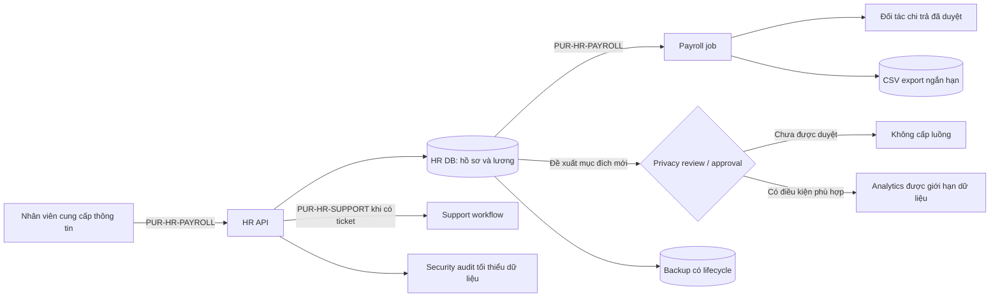
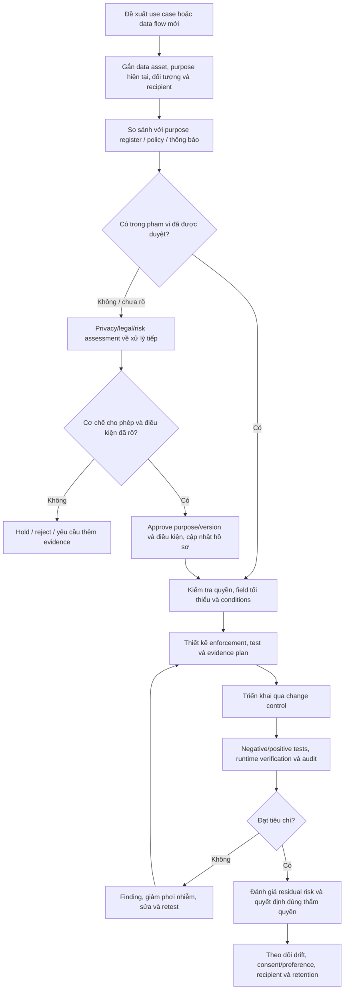
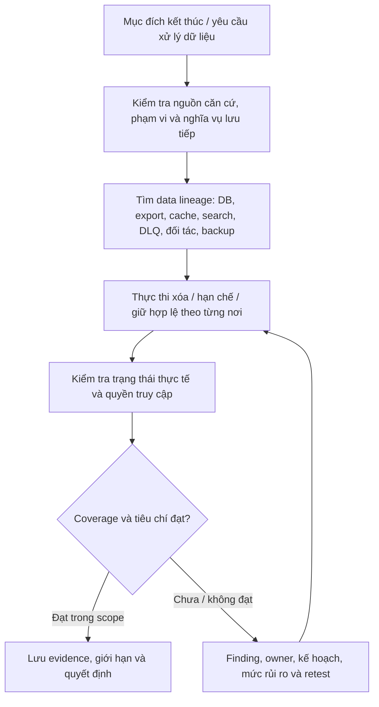

# Purpose limitation: Giới hạn mục đích xử lý dữ liệu và bằng chứng Privacy Assurance

## 1. Vì sao “sử dụng dữ liệu đúng mục đích” cần được chứng minh?

Một dịch vụ SaaS nhân sự thu thập tên, số liên lạc, thông tin tài khoản nhận lương và hồ sơ nhân viên để **quản lý nhân sự, tính và chi trả lương**. Một thời gian sau, đội sản phẩm muốn dùng cùng bộ dữ liệu để **huấn luyện mô hình dự đoán nhân viên nghỉ việc**, đội marketing muốn phân nhóm khách hàng để gửi quảng cáo, còn đội hỗ trợ muốn xem bản ghi lương để xử lý yêu cầu kỹ thuật.

Các hoạt động này đều có thể diễn ra sau khi người dùng đã đăng nhập hợp lệ và database được mã hóa. Tuy nhiên, **quyền đọc dữ liệu và khả năng truy cập kỹ thuật không tự trao quyền sử dụng dữ liệu cho một mục đích mới**. Một nhân viên có quyền vận hành báo cáo lương không nhất thiết được phép lấy dữ liệu đó làm đầu vào marketing hoặc phân tích hành vi.

**Purpose limitation (giới hạn mục đích)** là nguyên tắc quản trị việc **thu thập và xử lý dữ liệu cá nhân cho những mục đích đã được xác định rõ, được phép và minh bạch theo yêu cầu áp dụng**, đồng thời kiểm soát việc **sử dụng tiếp** để không tự mở rộng sang các mục đích không được phép. Một tổ chức cần biết:

1. Dữ liệu **được thu thập nhằm mục đích gì**, có nguồn căn cứ và người chịu trách nhiệm nào.
2. Mỗi hoạt động sử dụng/chia sẻ/biến đổi dữ liệu **phục vụ mục đích đã được chấp thuận nào**.
3. Khi xuất hiện mục đích mới, cần **đánh giá, phê duyệt và thực hiện nghĩa vụ liên quan** trước khi xử lý hay không.
4. Hệ thống có **security/privacy controls và bằng chứng thực tế** để thực thi ranh giới mục đích hay chỉ có lời cam kết.

Trong chương **Privacy assurance** của module **SECURITY_SECURITY_ASSURANCE**, bài này liên kết nguyên tắc mục đích với mục tiêu **đánh giá có bằng chứng rằng hệ thống đáp ứng các mục tiêu bảo mật**, từ rủi ro, yêu cầu, security controls đến kiểm thử, audit, phát hiện sai lệch, khắc phục và giám sát liên tục trong phát triển/vận hành.

**Kết quả học tập:** sau bài này, bạn có thể thiết kế purpose register, gắn mục đích vào data flow và xử lý thứ cấp, phân biệt mục đích với cơ sở pháp lý/đồng ý, đánh giá thay đổi mục đích theo yêu cầu áp dụng, thiết kế purpose-aware controls, thu thập evidence có nguồn gốc và đánh giá residual risk.

> **Phạm vi pháp lý:** các khái niệm “mục đích xác định”, “xử lý tiếp tương thích”, “căn cứ xử lý”, “đồng ý”, “quyền của chủ thể dữ liệu” và nghĩa vụ thông báo có quy định khác nhau tùy khu vực pháp lý, loại dữ liệu, quan hệ giữa các bên và luật/hợp đồng đang áp dụng. Bài này dạy phương pháp thiết kế và assurance, **không khẳng định một điều khoản pháp luật cụ thể áp dụng cho mọi hệ thống**. Khi triển khai thật, bộ phận pháp lý/privacy phải xác nhận nghĩa vụ hiện hành và ghi nguồn căn cứ vào hồ sơ.

## 2. Purpose limitation khác những khái niệm gần kề

| Khái niệm | Câu hỏi cần trả lời | Ví dụ | Điều nó không tự chứng minh |
| --- | --- | --- | --- |
| **Purpose specification** | Vì sao dữ liệu được thu thập/xử lý? | Tính lương theo hợp đồng dịch vụ của tenant A. | Dữ liệu được sử dụng đúng mục đích trong runtime. |
| **Purpose limitation** | Có giữ hoạt động xử lý trong mục đích được phép, kể cả sử dụng tiếp không? | Dữ liệu lương không tự chuyển sang marketing. | Tất cả controls bảo mật khác đều đạt. |
| **Lawful basis / authorization to process** | Căn cứ hoặc điều kiện pháp lý/hợp đồng nào cho phép xử lý? | Căn cứ được xác định cho từng mục đích và hoàn cảnh. | Mục đích mơ hồ tự trở thành cụ thể. |
| **Consent** | Khi cơ chế đồng ý được yêu cầu/áp dụng, chủ thể đã lựa chọn thế nào? | Đồng ý sử dụng dữ liệu cho một tính năng tùy chọn. | Mọi mục đích đều nhất thiết dựa trên đồng ý; việc đồng ý tự mở mọi quyền truy cập. |
| **Transparency/notice** | Chủ thể dữ liệu được thông tin về những hoạt động gì? | Thông tin dễ hiểu về xử lý, chia sẻ và thời hạn theo nghĩa vụ. | Nội dung thông báo đúng với đường dữ liệu đang vận hành. |
| **Data minimization** | Với một mục đích, dữ liệu thu/đọc/trả có vượt nhu cầu không? | Chỉ cần mã nhân viên và số tiền khi đối soát. | Mục đích xử lý đã được phê duyệt. |
| **Access control** | Ai/đơn vị nào có quyền thực hiện thao tác trên tài nguyên? | Support chỉ xem hồ sơ khi có ticket hợp lệ. | Mọi truy cập hợp lệ về kỹ thuật đều phục vụ mục đích hợp lệ. |
| **Storage limitation/retention** | Giữ dữ liệu đến thời điểm/điều kiện nào? | Xóa hoặc hạn chế dữ liệu khi mục đích kết thúc, trừ lưu giữ có căn cứ khác. | Mọi lần sử dụng trong thời gian lưu đều đúng mục đích. |
| **Security assurance** | Controls có được thiết kế, triển khai và vận hành theo tiêu chí với bằng chứng không? | Negative test chặn job analytics trái mục đích. | Tự quyết định mọi yêu cầu pháp lý mà không cần nguồn áp dụng. |

**Một hệ thống có thể đạt mã hóa và phân quyền nhưng vẫn không đạt giới hạn mục đích.** Ví dụ đội phân tích có quyền truy cập database do quản trị viên cấp, nhưng dùng dữ liệu nhân sự để nghiên cứu thương mại không nằm trong các mục đích được phép.

Ngược lại, việc mục đích xử lý hợp lệ **không loại bỏ** yêu cầu bảo mật: API phục vụ tính lương vẫn phải cách ly tenant, hạn chế quyền, bảo vệ dữ liệu khi truyền/lưu, ghi audit phù hợp và có khả năng phục hồi.

### 2.1. “Xác định mục đích” cần cụ thể đến đâu?

Các câu như “phân tích dữ liệu”, “nâng cao chất lượng dịch vụ”, “phục vụ nhu cầu kinh doanh” dễ trở thành **giấy phép quá rộng** nếu không có diễn giải, giới hạn và cơ chế phê duyệt. Một mục đích hữu ích cho kiểm chứng phải trả lời được:

- **Kết quả nghiệp vụ:** tính lương, gửi thông báo lịch hẹn, phát hiện truy cập bất thường, xử lý khiếu nại.
- **Đối tượng và dữ liệu:** hồ sơ nào, trường nào, thuộc cá nhân/tenant nào?
- **Hoạt động:** thu thập, tra cứu, tổng hợp, tạo mô hình, chia sẻ, lưu giữ, xóa.
- **Bên thực hiện/nhận:** đội nội bộ, nhà cung cấp hoặc tenant nào?
- **Phạm vi và điều kiện:** môi trường, loại giao dịch, thời hạn, giới hạn thao tác.
- **Nguồn cho phép và nghĩa vụ:** ai đã xác định, điều kiện áp dụng, thông báo/đồng ý hoặc cơ chế khác nếu cần.

Mục đích không phải là **tên một microservice**. Cùng một dịch vụ báo cáo có thể thực hiện mục đích tính lương, thống kê vận hành và phân tích sản phẩm với yêu cầu khác nhau.

## 3. Thành phần của một mục đích xử lý có thể kiểm chứng

Một tổ chức nên duy trì **purpose catalog/register** với định danh ổn định. Ví dụ:

| Trường | Nội dung cần ghi | Ví dụ giả định |
| --- | --- | --- |
| `purpose_id` | Định danh duy nhất, có phiên bản. | `PUR-HR-PAYROLL-01`. |
| `purpose_name` | Mô tả dễ hiểu, không quá rộng. | Tính lương và tạo bảng chi trả cho tenant A. |
| `purpose_owner` | Người chịu trách nhiệm về nhu cầu và giới hạn xử lý. | Chủ sở hữu dịch vụ nhân sự. |
| `data_subject_groups` | Nhóm cá nhân liên quan. | Nhân viên được tenant quản lý. |
| `data_categories` | Loại/trường dữ liệu cần thiết. | ID nhân viên, kỳ lương, khoản chi trả, tài khoản nhận. |
| `operations` | Hành vi xử lý nằm trong phạm vi. | Tra cứu, tính toán, chuyển thông tin chi trả, đối soát. |
| `systems_and_flows` | Ứng dụng, dữ liệu nguồn/đích và nơi tạo bản sao. | HR DB, payroll job, bank integration, audit logs. |
| `recipients` | Bên nhận hoặc loại bên nhận có căn cứ. | Bộ phận chi trả, đối tác xử lý được phê duyệt. |
| `legal_policy_basis_ref` | Kết quả xác định căn cứ/điều kiện áp dụng bởi người có thẩm quyền. | `LEGAL-HR-01`, `POL-PRIVACY-02`. |
| `notice_consent_refs` | Thông báo và lựa chọn liên quan khi có yêu cầu. | Phiên bản thông báo, lựa chọn và ngày hiệu lực. |
| `retention_rule_ref` | Tiêu chí lưu/giữ/xóa dữ liệu của mục đích. | `RET-PAYROLL-01`. |
| `allowed_roles_and_clients` | Chủ thể/dịch vụ được xử lý, theo nhiệm vụ. | Payroll operator và approved job. |
| `restrictions` | Mục đích khác không được mặc định dùng dữ liệu. | Không tự dùng dữ liệu lương để quảng cáo. |
| `evidence_and_review` | Test, audit, owner, hạn và trigger. | `EV-PUR-01`; khi thay data flow hoặc recipient. |

**Không để `purpose_id` trở thành chuỗi tùy ý do client tự truyền mà hệ thống mặc định tin.** Catalog chỉ tạo cấu trúc để điều khiển và giải trình; việc sử dụng đúng mục đích còn phụ thuộc **người yêu cầu, luồng xử lý, dữ liệu và chính sách hiệu lực**.

### 3.1. Một tập dữ liệu có thể phục vụ nhiều mục đích

Dữ liệu ngày sinh nhân viên có thể phục vụ tính quyền lợi, xác minh điều kiện nghiệp vụ và thống kê nhân sự. Nhưng mỗi trường hợp có **mục tiêu, tập người truy cập, mức dữ liệu cần thiết, retention và điều kiện cho phép** khác nhau. Không nên gắn nhãn “dataset HR approved” rồi cấp tự do cho mọi nhóm.

### 3.2. Một mục đích có thể trải qua nhiều thành phần

Mục đích tính lương có thể đi qua API → database → queue → job → storage → kết nối ngân hàng → audit. Nếu chỉ bảo vệ API đầu vào mà không kiểm tra bản sao CSV, service account hoặc luồng xuất bên thứ ba, chứng cứ sẽ thiếu **coverage**. Khi hệ thống tích hợp mới, purpose register và data lineage phải được cập nhật.

## 4. Bắt đầu từ data inventory và luồng sử dụng thực tế

**Mục đích đã ghi trong chính sách** không bảo đảm mọi nơi chứa dữ liệu đều tuân thủ. Để tạo bằng chứng, cần xác định **nguồn, bản sao, biến đổi, người nhận và các mục đích hiện đang gắn với từng luồng**.

### 4.1. Phạm vi dữ liệu cần xem

- Form, trình duyệt/mobile app, API request/response và đường webhook.
- Database chính, replica, cache, search index, data warehouse và BI.
- Queue, event stream, dead-letter, ETL/ELT pipelines, batch jobs.
- CSV/PDF export, file download, object storage, CDN và đường chia sẻ.
- Log, traces, metrics, crash reports, support ticket và screenshot.
- Backup/snapshot, môi trường thử nghiệm và data fixture.
- SaaS analytics, hệ thống gửi email/thông báo, đối tác thanh toán, nhà cung cấp bên ngoài.
- Tập dữ liệu phục vụ huấn luyện/đánh giá mô hình, feature store, embedding hoặc output có thể chứa dữ liệu cá nhân.

### 4.2. Sơ đồ data–purpose lineage



Sơ đồ minh họa hai mục đích xử lý nghiệp vụ, một luồng security audit và một **đường sử dụng tiếp chưa tự được phép**. Trong thực tế, mỗi cạnh phải ghi nguồn/dữ liệu, mục đích, recipient, thời gian, điều kiện, quyền và bằng chứng. Dòng “được phê duyệt” trên sơ đồ là một **quyết định thiết kế**, chưa chứng minh pipeline đang vận hành đúng.

### 4.3. Phân biệt data lineage và purpose lineage

**Data lineage** mô tả dữ liệu đến từ đâu, trải qua phép biến đổi và nơi đến nào. **Purpose lineage** nối **mỗi lần xử lý** với mục đích được xác nhận, thông báo/cơ sở áp dụng và điều kiện sử dụng. Một record có thể có lineage nguồn tốt nhưng vẫn bị dùng cho một mục đích chưa được phê duyệt.

Thí dụ: pipeline lấy dữ liệu từ bảng lương, loại tên và tính tổng. Data lineage có thể hoàn chỉnh; tuy nhiên, vẫn cần đánh giá liệu **mục đích phân tích mới**, dữ liệu nhóm nhỏ có khả năng tái nhận diện, thời hạn, người nhận và chính sách có phù hợp không.

### 4.4. Kiểm kê phải có đối soát

Kết hợp app architecture, schema, API catalog, cloud storage inventory, job schedule, BI catalog, integration register, dữ liệu phát hiện bởi công cụ và xác nhận của owner. Không lấy danh sách do một đội tự khai rồi kết luận 100% completeness.

Các nguồn chưa truy cập được phải ghi **Unknown/Unverified**, không tự loại khỏi mẫu số. Khi kiểm kê phát hiện một pipeline cũ không có owner hoặc data copy ngoài mục đích được duyệt, mở finding để xác minh và xử lý.

## 5. Phân biệt mục đích, lawful basis và lựa chọn của chủ thể dữ liệu

### 5.1. Purpose không tự tạo căn cứ xử lý

Một mục đích có mô tả cụ thể như “đào tạo mô hình dự đoán nghỉ việc” **không tự đồng nghĩa hoạt động đã được phép**. Ngược lại, một tổ chức có căn cứ xử lý nhất định **không nên mô tả mục đích vô hạn** như “mọi hoạt động có ích cho công ty”.

Hồ sơ nên tách:

1. **Purpose ID và mục tiêu cụ thể:** điều gì được thực hiện.
2. **Căn cứ/điều kiện xử lý theo phạm vi áp dụng:** ai đánh giá, quy định/hợp đồng nào, hiệu lực và điều kiện.
3. **Thông báo/minh bạch:** người liên quan được thông tin thế nào khi có yêu cầu.
4. **Consent/preference:** chỉ khi cơ chế đồng ý/lựa chọn liên quan; ghi phạm vi, phiên bản, thời điểm, chứng cứ và xử lý thay đổi lựa chọn.
5. **Controls:** cách hạn chế luồng và quyền xử lý theo điều kiện vừa xác nhận.

**Không mặc định mọi xử lý dữ liệu cá nhân đều dựa trên consent.** Cũng không mặc định consent có thể chữa mọi sai lệch hoặc quyền do luật bắt buộc; phải phân tích theo hệ thống pháp lý và quan hệ xử lý đang áp dụng. Nếu xử lý dựa vào đồng ý thì phạm vi, tính tự nguyện và các yêu cầu khác của việc đồng ý cần được xác minh theo quy định liên quan.

### 5.2. Vì sao một checkbox chưa đủ?

Một checkbox giao diện có thể là bằng chứng về **một sự kiện người dùng**, nhưng để phục vụ assurance phải biết:

- Ai đã chọn, khi nào, ở phiên bản thông báo/câu hỏi nào?
- Tùy chọn đó gắn với mục đích và dữ liệu nào?
- Mặc định là gì; người dùng có thực sự có quyền lựa chọn trong trường hợp áp dụng?
- Khi lựa chọn thay đổi/được rút lại theo cơ chế có hiệu lực, những pipelines nào phải cập nhật và trong bao lâu?
- Có dữ liệu từ **nguồn khác** mà lựa chọn này không bao phủ không?

Khi luật/hợp đồng yêu cầu một cơ chế khác (ví dụ thông báo hoặc quyền phản đối), evidence phải phản ánh **đúng nghĩa vụ được xác định**, không cố ép mọi xử lý vào checkbox.

### 5.3. Tổ chức nhiều vai trò xử lý

Với SaaS, khách hàng doanh nghiệp, nhà cung cấp phần mềm và đối tác có thể mang các vai trò pháp lý/quan hệ hợp đồng khác nhau theo từng hoạt động. Không nên gán một vai trò chung cho mọi dữ liệu hay mọi tenant khi chưa đánh giá.

Ví dụ một doanh nghiệp có thể yêu cầu dịch vụ xử lý dữ liệu lương theo chỉ dẫn, nhưng nhà cung cấp muốn dùng telemetry cho phát triển sản phẩm của riêng mình. Hoạt động sau cần **mục đích, thẩm quyền và điều kiện đánh giá riêng**, không tự suy rằng mọi dữ liệu trong dịch vụ đều được phép tận dụng.

## 6. Sử dụng tiếp (further processing) và thay đổi mục đích

### 6.1. Khi nào là sử dụng cho mục đích khác?

Một luồng xử lý mới có thể:

- Dùng **cùng dữ liệu** nhưng tạo sản phẩm/kết quả nghiệp vụ khác.
- Bổ sung recipient, đối tác hoặc đội nhận dữ liệu.
- Tạo tập dữ liệu tổng hợp, mô hình ML, bản xuất hoặc dữ liệu liên kết mới.
- Thay đối tượng được đánh giá hoặc phạm vi tenant.
- Dùng dữ liệu lâu hơn, chi tiết hơn hoặc theo cách người dùng không dự kiến.

Những thay đổi về hạ tầng thuần túy **không nhất thiết luôn tạo mục đích mới** (ví dụ thay database provider nhưng vẫn thực hiện đúng phép xử lý được duyệt); tuy nhiên vẫn cần đánh giá recipient, region, retention, kiểm soát và nghĩa vụ liên quan.

### 6.2. Tư duy đánh giá tính tương thích, không dùng một đáp án cho mọi nơi

Một số khuôn khổ pháp lý có cơ chế xem xét việc xử lý tiếp **có tương thích với mục đích ban đầu hay không** theo các yếu tố như mối liên hệ giữa hai mục đích, ngữ cảnh thu thập, kỳ vọng hợp lý, tính chất dữ liệu, tác động và biện pháp bảo đảm. Cách áp dụng, ngoại lệ và vai trò của căn cứ xử lý **khác nhau theo khu vực pháp lý**.

Các câu hỏi thực hành cho privacy review:

| Yếu tố | Câu hỏi | Tín hiệu cần xem |
| --- | --- | --- |
| **Liên hệ mục đích** | Hoạt động mới có gắn tự nhiên với mục đích ban đầu hay là một kết quả kinh doanh khác? | Purpose catalog, mô tả chức năng và dữ liệu đầu ra. |
| **Ngữ cảnh/kỳ vọng** | Dữ liệu được cung cấp trong quan hệ nào, các bên có thể dự đoán kiểu sử dụng này không? | Thông báo, hợp đồng, lựa chọn, tương tác khi thu thập. |
| **Tính chất dữ liệu** | Có dữ liệu nhạy cảm, thông tin liên quan cá nhân dễ bị tổn hại không? | Classification, data fields, nhóm đối tượng. |
| **Hậu quả** | Sử dụng mới có tạo profile, quyết định quan trọng, chia sẻ rộng hoặc rủi ro phân biệt đối xử không? | Privacy risk assessment, threat model, impact scenarios. |
| **Safeguards** | Có thể giảm dữ liệu, phân nhóm, ẩn danh thực chất, giới hạn quyền/recipient và thời hạn không? | Control design và test/evidence tương ứng. |
| **Điều kiện cho phép** | Cần căn cứ mới, thông báo/cập nhật lựa chọn, phê duyệt hoặc dừng xử lý không? | Kết luận privacy/legal có thẩm quyền và refs. |

Không tự kết luận “tương thích” chỉ vì **dữ liệu đã có sẵn**, vì xử lý mới có lợi cho công ty hoặc vì đã áp dụng mã hóa. Ngược lại, không mặc định mọi thao tác xử lý khác đều bất hợp pháp; cần xác định bối cảnh, cơ chế pháp lý áp dụng, điều kiện và bằng chứng.

### 6.3. Cổng quyết định trước khi mở luồng mới

**Proposed → Assessed → Approved with conditions / Rejected / Needs more evidence → Implemented → Verified → Monitored.** Những hoạt động có ý nghĩa riêng về luật/hợp đồng cần kết luận của vai trò có thẩm quyền. Nếu thiếu nguồn căn cứ, kết quả phải là **Unverified/hold**, không gắn `approved` chỉ vì ticket đã được tạo.

Đối với yêu cầu có rủi ro cao, privacy review có thể yêu cầu **đánh giá tác động quyền riêng tư** theo nghĩa vụ được xác định và thiết kế giảm rủi ro trước triển khai. Đừng dùng tên gọi DPIA/PIA như dấu xác nhận hoàn thành nếu chưa biết mẫu đánh giá nào đã được thực hiện và các hành động nào còn mở.

## 7. Thiết kế security/privacy controls bảo đảm ranh giới mục đích

### 7.1. Các lớp kiểm soát bổ trợ

| Lớp | Điều kiện thiết kế | Phép kiểm chứng |
| --- | --- | --- |
| **Purpose governance** | Mục đích có ID, owner, căn cứ, approval và phiên bản. | Review purpose register, decision, phạm vi và trigger. |
| **Data inventory/lineage** | Mỗi nguồn/đích/biến đổi gắn mục đích và recipient. | Đối soát data flow với runtime jobs, storage và BI inventory. |
| **Access/ABAC** | Principal được phép hành động theo role, tenant, resource **và purpose context**. | Negative test role đúng nhưng mục đích không phù hợp vẫn bị chặn. |
| **Data minimization** | Mỗi mục đích có data fields/phạm vi tối thiểu. | Schema contract tests, field-level filters, export checks. |
| **Pipeline enforcement** | ETL/job chỉ đọc nguồn và ghi đích đã duyệt theo purpose-specific service identity. | Effective IAM/DB grants, pipeline run tests, config drift detection. |
| **Recipient/egress control** | Chỉ đưa đúng dữ liệu tới đúng destination/đối tác theo điều kiện. | Destination validation, payload test, partner inventory và log. |
| **Consent/preference enforcement** | Khi có liên quan, lựa chọn có hiệu lực ở đúng luồng/tại đúng thời điểm. | End-to-end test thay đổi/thu hồi lựa chọn và hậu quả trong pipeline. |
| **Retention/deletion** | Dữ liệu và bản sao có thời hạn/phương án xử lý đúng từng mục đích. | Lifecycle rule, job evidence và kiểm tra các bản sao. |
| **Audit/detection** | Ghi việc truy cập/sử dụng nhạy cảm và phát hiện lệch mục đích. | Event-to-alert test, hiệu chỉnh rule và response ownership. |
| **Change/release gate** | Luồng, schema, recipient, use case mới đi qua privacy review theo ngưỡng. | PR/change records, test report, release decision và runtime diff. |

**Không có một middleware “purpose check” duy nhất bảo đảm tất cả.** Việc sử dụng dữ liệu còn diễn ra ở database jobs, warehouse, file xuất, đội con người và bên thứ ba. Cần nhiều lớp kiểm soát với điểm thực thi phù hợp, đồng thời đánh giá những điểm lỗi chung.

### 7.2. Mô hình kiểm soát theo mục đích

Giả sử hệ thống có:

- `PUR-PAYROLL`: tính lương, dùng mức lương, tài khoản nhận và kỳ trả lương.
- `PUR-SUPPORT`: hỗ trợ kỹ thuật theo ticket, ưu tiên metadata và dữ liệu đã che.
- `PUR-ANALYTICS`: thống kê sử dụng sản phẩm bằng tập dữ liệu được phê duyệt, không tự lấy bảng lương thô.

Một service đang có quyền `SELECT` trên bảng HR không có nghĩa được xử lý cho cả ba mục đích. Kiểm soát cần kết hợp **entitlement, data category, tenant, source/destination và decision record**; nếu không xác định được context đáng tin cho thao tác nhạy cảm, hệ thống phải xử lý an toàn theo policy thay vì mặc định cho phép.

### 7.3. Mục đích không phải một nhãn tự khai

Đặt header `X-Purpose: analytics` không có giá trị tự chứng minh. Ứng dụng có thể dùng **purpose ID từ workflow/job đã đăng ký, client/service identity được ràng buộc, ticket hoặc quyết định đã xác minh** để kiểm tra chính sách. Payload do client tự truyền chỉ là **đề nghị**, phải được đối chiếu.

Ví dụ đội kỹ thuật có role xem log để điều tra sự cố không tự được xuất dữ liệu lương ra máy cá nhân để tạo dashboard không thuộc điều tra. **Chủ thể, phạm vi và hành vi** đều cần điều kiện đúng.

## 8. Tích hợp purpose limitation trong chính sách truy cập dữ liệu

### 8.1. Phân biệt RBAC và purpose-aware enforcement

**Role-Based Access Control (RBAC)** kiểm tra vai trò. **Attribute-Based Access Control (ABAC)** có thể bổ sung tenant, loại tài nguyên, hành động, tình trạng ticket, thời gian và **purpose context**. Tuy nhiên, một nhãn purpose chỉ có tác dụng nếu đã xác minh:

1. Nguồn gốc và tính hợp lệ của purpose ID cho **use case thực tế**.
2. Quyền của người/service để thực hiện mục đích đó.
3. Data asset và field được phép cho mục đích.
4. Đường xuất/recipient, retention và những điều kiện đi kèm.
5. Trạng thái phê duyệt/đồng ý khi áp dụng, thay đổi hoặc thu hồi.
6. Hành vi khi policy service không khả dụng hoặc thông tin không nhất quán.

### 8.2. Mẫu decision table

| Principal và tình huống | Role | Purpose | Data asset | Quyết định kỳ vọng |
| --- | --- | --- | --- | --- |
| Payroll job có đăng ký, tenant A, kỳ lương hiện tại. | Payroll processor | `PUR-PAYROLL` | Trường dữ liệu phục vụ chi trả của A. | Allow nếu mọi điều kiện khác đạt; ghi audit phù hợp. |
| Cùng job nhưng gửi toàn bộ bảng nhân viên sang kho marketing. | Payroll processor | `PUR-MARKETING` do request khai | Dữ liệu lương thô. | Deny nếu không có căn cứ/quyền/recipient được duyệt. |
| Nhân viên support xử lý ticket tenant A. | Support | `PUR-SUPPORT` | Metadata phục vụ chẩn đoán của A. | Allow theo ticket/TTL và chính sách dữ liệu đã che. |
| Support không có ticket, yêu cầu bảng lương tenant B. | Support | `PUR-SUPPORT` | Lương của B. | Deny; role support không đủ. |
| Analytics job đã được phê duyệt chỉ nhận metric tổng hợp. | Analytics service | `PUR-ANALYTICS` | Dataset thống kê đã được đánh giá. | Allow theo policy, schema và recipient được duyệt. |
| Job analytics truy cập trực tiếp database lương không qua gate. | Analytics service | `PUR-ANALYTICS` | Bảng lương thô. | Deny theo IAM/DB policy, tạo tín hiệu khi cần. |

**Một decision table là design evidence**, chưa chứng minh runtime thực thi đúng. Kiểm tra thêm service identity, quyền DB, cache, data warehouse, APIs, object storage và các đường không đi qua application service.

## 9. Quy trình duyệt và kiểm chứng một purpose change



### 9.1. Phân vai trong phê duyệt

- **Business/data owner** nêu nhu cầu, kết quả và giới hạn.
- **Privacy/legal** xác định điều kiện và nghĩa vụ áp dụng, tính tương thích/đồng ý/thông báo khi liên quan.
- **Security architecture/engineering** tìm data flows và thiết kế kiểm soát.
- **QA/assessor** xác minh policy enforcement, completeness và evidence.
- **Risk owner/cấp được ủy quyền** quyết định phần rủi ro còn lại trong giới hạn quyền; không được miễn trừ yêu cầu bắt buộc bằng chữ ký nội bộ.

### 9.2. Change record cần có gì?

Mô tả purpose cũ/mới, data categories, nhóm đối tượng, recipient, thời gian lưu, kết quả review pháp lý/privacy, phương án thông báo/đồng ý khi cần, control changes, các test cases, evidence refs, quyết định và lịch theo dõi. Không kết luận đủ điều kiện chỉ vì người tạo yêu cầu là “chủ dự án”.

## 10. Tình huống xuyên suốt: HR SaaS và sáu mục đích xử lý

Giả định nền tảng nhân sự đa tenant quản lý hồ sơ, lịch làm việc và chi trả lương. Tenant A và B là hai doanh nghiệp độc lập, mỗi tenant có nhân viên, HR operator và payroll operator riêng. Sản phẩm có database, ETL, warehouse, API export, hệ thống hỗ trợ, email provider và kho audit.

### 10.1. Purpose register mẫu

| ID | Mục đích mô tả | Dữ liệu/recipient | Giới hạn và kiểm chứng |
| --- | --- | --- | --- |
| **PUR-01 Payroll** | Tính và chi trả lương nhân viên thuộc tenant. | Thông tin chi trả, kỳ lương, đối tác được duyệt. | Chỉ đúng kỳ/tenant; quyền job, encryption, export audit, retention. |
| **PUR-02 HR operations** | Quản lý hồ sơ, hợp đồng và lịch làm việc. | Hồ sơ liên quan và các role HR. | Các quyền theo nhiệm vụ, field và tenant; access review. |
| **PUR-03 Customer support** | Giải quyết ticket khách hàng đang yêu cầu hỗ trợ. | Metadata tối thiểu và dữ liệu được che, support có thời hạn. | Ticket hợp lệ, access logs, không đọc lương thô mặc định. |
| **PUR-04 Security monitoring** | Phát hiện truy cập trái phép, điều tra sự cố. | Audit events đã giảm thiểu; người/đội ứng phó theo quyền. | Chỉ trường cần điều tra, retention và log permissions theo chính sách. |
| **PUR-05 Product analytics** | Phân tích sử dụng tính năng để cải thiện trải nghiệm. | Sự kiện sử dụng được chọn, không tự lấy lương thô. | Privacy review và minh bạch/điều kiện áp dụng, schema tests, không mở mục đích khác. |
| **PUR-06 Employee attrition AI (proposed)** | Dự đoán nguy cơ nghỉ việc bằng dữ liệu nhân sự. | Có thể cần hồ sơ, lương và thông tin nhạy cảm. | **Chưa mặc định được phép**; đánh giá riêng mục đích, hậu quả, tính tương thích, nguồn căn cứ và safeguards. |

**Không suy ra rằng PUR-04 hoặc PUR-05 đương nhiên hợp lệ trong mọi hệ thống pháp lý**. Bảng chỉ mô tả những loại mục đích cần được đăng ký, đánh giá và kiểm chứng theo nghĩa vụ áp dụng. Dấu “proposed” cho mục đích AI nhắc rằng **khả năng làm được kỹ thuật không đồng nghĩa có quyền thực hiện**.

### 10.2. Luồng xung đột mục đích

Engineering tạo job `daily-hr-export` để tính chi trả. Một analyst có quyền `read_dataset` đề nghị bật thêm consumer đọc CSV sang warehouse rồi xây mô hình phân loại nhân viên. Nếu không có cổng đánh giá, đường mới sẽ thừa hưởng quyền và dữ liệu của mục đích payroll.

**Finding giả định:** `FIND-PUR-04` — hệ thống analytics có thể đọc dữ liệu lương thô nhờ service role chia sẻ, trong khi chỉ có quy trình cho phép báo cáo chi trả. Việc data warehouse có mã hóa không khắc phục rủi ro **sử dụng sai mục đích**.

**Phương án xử lý:** giới hạn/cô lập quyền analytics theo chính sách; đánh giá mục đích mới với data owner/privacy; xác định điều kiện cho phép, scope và nhu cầu dữ liệu; chỉ mở luồng sau thiết kế/approval/tests. Nếu phát hiện đã có truy cập thật trái phạm vi, đánh giá kích hoạt ứng phó sự cố và nghĩa vụ xử lý theo bối cảnh.

### 10.3. Kết quả kiểm tra giả định

| Control/test | Quan sát | Kết luận phù hợp |
| --- | --- | --- |
| Payroll API đúng tenant và đúng role. | Positive/negative tests đạt ở staging build X. | **Pass trong phạm vi test**, không kết luận mọi production data flow. |
| Analytics job thiếu quyền đọc lương thô. | IAM staging chặn; production chưa đối chiếu effective grants. | **Pass staging / production unverified**. |
| Support chỉ xem metadata theo ticket. | UI chặn nhưng API direct trả thêm trường lương. | **Failed** đối với field minimization và purpose scope. |
| Security log không chứa token. | Test đường login đạt, lỗi job retry chưa được thử. | **Partial/unverified** cho đường retry. |
| Purpose AI mới chưa được privacy review. | Backlog dự kiến, chưa chạy pipeline. | **Pending review**, không gọi là approved. |
| Hạn xử lý dữ liệu export. | Rule lifecycle khai báo, tệp cũ ở region phụ chưa kiểm tra. | **Implemented, unverified** về retention toàn phạm vi. |

Kết quả đúng không phải “4 trong 6 chức năng đạt” mà là **control nào đang fail, hậu quả gì, đâu là dữ liệu/tenant/recipient bị ảnh hưởng, bằng chứng nào thiếu và owner nào xử lý**.

## 11. Mẫu purpose catalog ở dạng YAML

Đây là **schema học tập**, không phải cấu hình chạy được của một framework hoặc khuôn pháp lý cụ thể. ID, tổ chức, kỳ và nội dung minh họa chỉ được dùng để học cách quản lý bằng chứng.

```yaml
purpose_id: "PUR-HR-PAYROLL-01"
purpose_version: "1.2"
name: "Tính và chi trả lương"
service: "HR SaaS"
status: "approved_for_defined_scope"
owner:
  business_role: "Payroll product owner"
  privacy_review_role: "Privacy/legal lead"
  implementation_role: "Payroll engineering lead"
scope:
  tenants: ["tenant-A", "tenant-B"]
  data_subjects: ["employee"]
  data_categories:
    - "employee_id"
    - "pay_period"
    - "pay_amount"
    - "approved_payment_destination"
  operations: ["read", "calculate", "generate_payment", "approved_export"]
  systems: ["hr-api", "payroll-db", "payroll-job", "private-export-store"]
  recipients: ["approved-payments-provider"]
  exclusions: ["marketing-model-training", "unapproved-analytics-export"]
governance:
  policy_refs: ["POL-PRIVACY-01", "POL-DATA-PROTECTION-02"]
  legal_basis_assessment_ref: "PRIVACY-ASSESSMENT-PAYROLL-01"
  notice_ref: "NOTICE-HR-01"
  consent_ref: null  # Không mặc định mục đích này dựa vào consent
  retention_rule_ref: "RET-PAYROLL-01"
  approval_ref: "DEC-PUR-001"
  effective_from: "2026-11-28"
controls:
  requirement_refs: ["REQ-PUR-01", "REQ-DATA-MIN-01"]
  consumer_identities: ["svc-payroll-prod"]
  tenant_and_resource_authorization: true
  allowed_destination_refs: ["DST-PAYMENT-01"]
  schema_contract_ref: "SCHEMA-PAYROLL-01"
  evidence_refs: ["EV-PUR-01", "EV-AUTH-03"]
review:
  triggers:
    - "Data category/recipient mới"
    - "Mục đích xử lý tiếp"
    - "Thay đổi tenant model hoặc nhà cung cấp"
    - "Finding hoặc incident"
  next_due: "Theo chu kỳ và nghĩa vụ được duyệt"
```

Mẫu chỉ chứng minh **có cấu trúc mô tả và quyết định dự kiến**, chưa chứng minh dữ liệu thực sự đi đúng luồng. Ví dụ `tenant_and_resource_authorization: true` là một claim; phải kiểm tra effective permissions và API/job hành vi. Những tham chiếu `NOTICE-*` hay `LEGAL-*` cần dẫn tới hồ sơ thật khi vận hành, không phải chuỗi ID tự khai.

### 11.1. Không sửa ngầm mục đích cũ

Khi thay mục đích, giữ **version, quyết định, phạm vi hiệu lực và dữ liệu nào được xử lý dưới phiên bản nào**. Không chỉnh dòng “Payroll” thành “Payroll & marketing” rồi coi dữ liệu đã thu từ trước tự động được phép dùng cho marketing. Những bước chuyển đổi phải đi qua đánh giá xử lý tiếp và điều kiện áp dụng.

## 12. Ví dụ Java: kiểm tra role, tenant, tài sản và purpose context

Ví dụ dưới đây dùng **Java minh họa**, không phải dự án Spring có thể biên dịch nguyên văn. `VerifiedPrincipal` đã được xác thực bởi framework; `ApprovedWorkContext` do một workflow có phê duyệt tạo ra, không phải header `X-Purpose` do client gửi; `PurposePolicy` cần được triển khai và kiểm thử theo dữ liệu/chính sách thật.

```java
public EmployeePayrollView getPayroll(
        VerifiedPrincipal actor,
        ApprovedWorkContext work,
        UUID employeeId) {

    EmployeeRecord employee = employeeRepository.findById(employeeId)
        .orElseThrow(() -> new NotFoundException("Not found"));

    // Ngữ cảnh tenant từ nguồn đã xác thực và tài nguyên trong DB.
    if (!membership.canRead(actor, employee.tenantId())) {
        throw new AccessDeniedException("Access denied");
    }

    // Mục đích phải do workflow được kiểm chứng ràng buộc:
    // không tin một chuỗi purpose tùy ý từ request.
    boolean allowed = purposePolicy.permits(
        actor.localPrincipalId(),
        work.verifiedPurposeId(),
        "payroll.read",
        employee.dataCategory(),
        employee.tenantId(),
        work.approvedDestination());

    if (!allowed || !work.isValidNow()) {
        audit.recordPurposeDenied(actor.subjectRef(), employeeId);
        throw new AccessDeniedException("Access denied");
    }

    audit.recordPurposeAllowed(actor.subjectRef(), employeeId);
    return mapper.toMinimalPayrollView(employee);
}
```

**Giới hạn quan trọng:** kiểm tra ở service này chỉ bảo vệ đường đi qua nó. DB grants, queue, job, export link, data warehouse và backup cần controls tương ứng. Cũng cần kiểm tra **policy stale, TTL của phê duyệt, role thay đổi khi job đang chạy, caching, dữ liệu trả về tối thiểu, error/log redaction và không thất bại theo kiểu fail-open**.

### 12.1. Không biến purpose ID thành mật khẩu thần kỳ

Nếu người dùng có thể gọi `work.verifiedPurposeId()` bằng cách tự thay tham số, policy check chỉ là hình thức. Để có giá trị, ngữ cảnh mục đích cần được **ràng buộc với workflow đã duyệt, service identity, request/job ID và điều kiện hiệu lực**; hệ thống có thể cần xác minh điều kiện ở nhiều điểm như API, job runner và nơi xuất dữ liệu.

## 13. Kiểm thử mục đích bằng positive, negative và change tests

Mỗi purpose-aware control phải có **điều kiện đạt/không đạt và test case** từ lúc thiết kế. Chỉ kiểm tra “pipeline chạy thành công” không chứng minh pipeline chỉ dùng những dữ liệu được phép, đúng bên nhận, thời gian và mục đích.

### 13.1. Test matrix theo risk scenario

| Test ID | Tình huống | Kết quả mong đợi | Bằng chứng bắt buộc |
| --- | --- | --- | --- |
| **PUR-T01** | Payroll job được duyệt đọc dữ liệu kỳ lương tenant A. | Chỉ dữ liệu/trường đúng scope; không thêm dữ liệu tenant B. | Principal thử, policy version, job/build, expected/actual. |
| **PUR-T02** | Payroll operator cố dùng cùng dữ liệu cho dashboard marketing. | Không truy cập/đưa dữ liệu sang sink marketing nếu chưa có quyết định phù hợp. | Runtime IAM/DB grants, negative pipeline test. |
| **PUR-T03** | Support có ticket tenant A lấy metadata phục vụ sự cố. | Cho phép trường tối thiểu, trong thời hạn ticket. | Ticket context, data minimization result, audit event. |
| **PUR-T04** | Support không có ticket hoặc xem lương thô tenant B. | Từ chối, không lộ payload hoặc metadata không cần thiết. | Negative API test và quyền hiệu lực. |
| **PUR-T05** | Analyst tự đặt `purposeId=payroll` trong request. | Không đủ điều kiện; hệ thống kiểm tra workflow/identity đã duyệt. | Test forged purpose context và decision trace. |
| **PUR-T06** | Job analytics dùng service account chung với payroll. | Không đọc dữ liệu lương thô qua quyền kế thừa. | Effective cloud/DB policy, unauthorized query test. |
| **PUR-T07** | Đổi recipient hoặc đích dữ liệu sang kho bên ngoài. | Change gate phát hiện/phân loại và chặn khi chưa có approval phù hợp. | PR/config diff, egress policy, change decision. |
| **PUR-T08** | Thêm trường nhạy cảm vào API/CSV mà contract không cần. | Schema/field test fail, không phát hành dữ liệu ngoài scope. | Schema diff, output test và request ID. |
| **PUR-T09** | Người dùng đổi lựa chọn liên quan đến một purpose tùy chọn (nếu áp dụng). | Các xử lý liên quan phản ánh thay đổi theo nghĩa vụ và quy tắc hiệu lực. | Preference event, propagation trace, targeted test. |
| **PUR-T10** | Pipeline privacy policy/metadata service không khả dụng. | Xử lý nhạy cảm không tự mở quyền; có tín hiệu lỗi và phương án khôi phục. | Fault-injection được phép, response và alert. |
| **PUR-T11** | CSV được tạo xong và mục đích/thời hạn chia sẻ kết thúc. | Link và quyền truy cập được xử lý theo retention và policy đã duyệt. | Runtime lifecycle check, negative download test. |
| **PUR-T12** | Dataset nhân sự được đưa vào training pipeline mới. | Không chạy trước khi qua cổng đánh giá và điều kiện cho phép; data minimization đúng khi được duyệt. | Data lineage, approval và pipeline gate results. |
| **PUR-T13** | Có bản sao trong cache, log hoặc DLQ từ use case cũ. | Dữ liệu được xử lý theo mục đích, retention và giới hạn phù hợp cho từng bản sao. | Asset-specific checks, deletion/retention evidence. |
| **PUR-T14** | Thay phiên bản purpose rule hoặc mở tenant mới. | Không tự cấp quyền sang tenant khác; regression tests chạy đúng scope. | Policy/build IDs, tenant tests, reviewer. |
| **PUR-T15** | Mẫu dữ liệu được tổng hợp quá ít người và có thể tái nhận diện. | Cơ chế bảo vệ/anonymization claim không được chấp nhận khi chưa kiểm chứng. | Privacy risk review, reidentification assessment có kiểm soát. |
| **PUR-T16** | Phát hiện job gửi sai dữ liệu đến đối tác dù API chính đạt. | Truy vết finding, dừng/giới hạn luồng theo quyền, khắc phục và retest. | Partner/destination evidence, job log, incident decision nếu áp dụng. |

**Lưu ý:** các test ở bảng cần dùng tài khoản và dữ liệu **giả/đã kiểm soát**; không cố tạo truy cập trái phép vào tài sản ngoài quyền chỉ để thu thập evidence. Fault injection hoặc thay policy cần chạy trên môi trường được phép với phương án rollback và giám sát.

### 13.2. Kiểm tra đầy đủ entry point

Test API cần bao gồm **list, detail, search, export, download, batch, webhook, cache và những đường truy xuất trực tiếp khi chúng thuộc phạm vi**. Test logic ứng dụng đơn lẻ chưa chứng minh IAM/warehouse hoặc pipeline bên thứ ba đạt giới hạn mục đích.

Một test pass ở **build X, staging** có giá trị tại phạm vi đã kiểm tra; nếu production sử dụng role, cấu hình, policy version hoặc dataset khác, cần đối chiếu và kiểm chứng bổ sung trước khi ra kết luận.

### 13.3. Kiểm tra quyết định có thể giải thích

Khi policy trả `deny`, assessor cần biết **rule nào, mục đích nào, actor/resource nào, điều kiện nào không đạt** ở mức không làm lộ bí mật. Khi trả `allow`, cần có bằng chứng các điều kiện quan trọng thực sự đã được xét; một log `PURPOSE_CHECK=SUCCESS` mà không xác định scope có giá trị hạn chế.

## 14. Đặc tả bằng chứng: không chỉ có tick “purpose approved”

### 14.1. Tứ giác cần chứng minh

Một tuyên bố đáng tin về purpose limitation cần tối thiểu:

1. **Mục đích được quản trị:** rõ ràng, có nguồn cho phép, phiên bản, scope và người phê duyệt đúng quyền.
2. **Dữ liệu có thể truy vết:** biết loại, nguồn, biến đổi, nơi lưu, bản sao và recipient.
3. **Hành vi xử lý được kiểm soát:** quyền thực tế, pipeline, schema, chia sẻ, retention và lựa chọn người dùng khi áp dụng.
4. **Bằng chứng vận hành và xử lý sai lệch:** test, audit, findings, remediation/retest, residual risk và lịch theo dõi.

Thiếu một góc không tự chứng minh vi phạm ở mọi hoàn cảnh, nhưng có thể làm kết luận **Unverified/Partial** thay vì Pass. Đặc biệt, **thiếu evidence** cần được phân biệt với **evidence cho thấy thất bại**.

### 14.2. Bằng chứng theo loại

| Evidence ID/nhóm | Nội dung cần có | Được dùng để kiểm chứng | Giới hạn thường gặp |
| --- | --- | --- | --- |
| **EV-PUR-REG** | Purpose catalog, versions, owner, scope, legal/privacy review refs. | Mục đích được định nghĩa và quản lý. | Không chứng minh runtime. |
| **EV-PUR-NOTICE** | Thông báo, phiên bản, thời điểm hiệu lực và cơ chế cung cấp khi áp dụng. | Minh bạch theo nghĩa vụ xác định. | Không tự chứng minh người dùng nhận/hiểu theo mọi điều kiện. |
| **EV-PUR-CHOICE** | Consent/preference event theo scope nếu áp dụng. | Có lựa chọn và trạng thái theo mục đích. | Checkbox không chứng minh luồng thực tôn trọng lựa chọn. |
| **EV-PUR-INV** | Data inventory, nguồn/đích, tenant và reconciliation. | Những tài sản và luồng thuộc phạm vi. | Thiếu nguồn cũ làm coverage không đủ. |
| **EV-PUR-LINEAGE** | DFD/pipeline lineage, data categories, transforms, recipients. | Đường xử lý gắn với mục đích. | Sơ đồ dự kiến có thể khác runtime. |
| **EV-PUR-ACCESS** | Effective IAM/DB/group/service account policy. | Quyền được cấp theo luồng và role. | Quyền có thể rộng hơn hành vi test đơn lẻ. |
| **EV-PUR-TEST** | Positive/negative tests và expected/actual theo build/environment. | Control ngăn sai mục đích trong scope đã thử. | Không chứng minh toàn bộ production. |
| **EV-PUR-SCHEMA** | API/ETL field mapping, minimization contract và test. | Data fields có phù hợp nhu cầu xử lý? | Không thấy dữ liệu xuất từ đường không test. |
| **EV-PUR-SHARE** | Integration catalog, data-sharing approval, destination checks. | Bên nhận/đường truyền được quản lý. | Partner có thể lưu bản sao khác cần evidence riêng. |
| **EV-PUR-RET** | Retention rules, lifecycle configuration, deletion tests. | Các bản sao được xử lý theo vòng đời được duyệt. | Job “success” không chứng minh mọi nguồn đã xóa. |
| **EV-PUR-AUDIT** | Audit events, alert rules và response trace. | Phát hiện/ứng phó với lệch mục đích. | Log bật nhưng không có triage là chưa đủ. |
| **EV-PUR-ACTION** | Finding, owner, due date, remediation, retest và decision. | Khép vòng assurance, rủi ro còn lại được xem xét. | Ticket Done không đồng nghĩa control đạt. |

### 14.3. Metadata tối thiểu của một evidence item

Mỗi artifact nên nêu **evidence ID, purpose/control/requirement/risk refs, asset và data classification, tenant/recipient, thời gian, môi trường, build/config version, phương pháp và nguồn thu thập, người thực hiện, expected/actual, giới hạn và tham chiếu finding**. Khi lưu evidence nhạy cảm, sử dụng kho phân quyền và mã tham chiếu thay vì đưa raw record/token vào báo cáo.

**Provenance và integrity khác nhau.** Hash có thể chứng minh artifact không bị thay đổi so với mốc đã tạo hash đáng tin, nhưng không chứng minh tool đã xuất đúng toàn bộ data assets hoặc người review có thẩm quyền. Cần kiểm tra cả phạm vi nguồn, bộ lọc truy vấn, thời điểm và lịch sử sửa.

## 15. Mẫu evidence manifest cho Privacy Assurance

Mẫu YAML sau minh họa **cách quản lý bằng chứng theo use case/purpose**. Không phải schema được pháp luật hay một vendor bắt buộc. Các IDs, ngày và trạng thái mang tính giả định:

```yaml
manifest_id: "EVM-PUR-HR-2026-Q4"
assessment_id: "ASSURE-PRIVACY-006"
service: "HR SaaS multi-tenant"
assessment_scope:
  environments: ["production-config-review", "staging-test"]
  tenants: ["tenant-A", "tenant-B"]
  purpose_ids: ["PUR-01", "PUR-03", "PUR-05"]
  data_assets: ["HR-DB", "EXPORT-CSV", "ANALYTICS-WAREHOUSE"]
  period: "2026-Q4"
  exclusions:
    - "Một pipeline đối tác cũ chưa có runtime access"
data_inventory:
  inventory_ref: "INV-HR-DATA-07"
  lineage_ref: "LINEAGE-HR-03"
  reconciled_at: "2026-11-28T09:00:00+07:00"
  unresolved_assets: ["LEGACY-PARTNER-01"]
artifacts:
  - evidence_id: "EV-PUR-REG-01"
    control_ref: "CTRL-PUR-GOV-01"
    source: "Purpose register và approval record"
    collected_at: "2026-11-28T09:10:00+07:00"
    type: "design_governance"
    result: "pass_for_reviewed_scope"
    storage_ref: "protected-evidence-store:EV-PUR-REG-01"
  - evidence_id: "EV-PUR-TEST-02"
    control_ref: "CTRL-PUR-API-01"
    source: "Negative API test runner"
    environment: "staging"
    build_ref: "HR-BUILD-124"
    executed_at: "2026-11-28T10:00:00+07:00"
    type: "operating_effectiveness"
    result: "fail"
    finding_ref: "FIND-PUR-02"
    storage_ref: "protected-evidence-store:EV-PUR-TEST-02"
  - evidence_id: "EV-PUR-IAM-03"
    control_ref: "CTRL-PUR-PIPELINE-01"
    source: "Production effective IAM and warehouse grants"
    collected_at: "2026-11-28T11:00:00+07:00"
    type: "runtime_configuration"
    result: "unverified"
    limitation: "Chưa có quyền đọc policy của một legacy job"
    action_ref: "ACT-PUR-03"
review:
  assessor_role: "Privacy assurance reviewer"
  legal_privacy_role: "Privacy/legal lead"
  risk_owner_role: "HR product risk owner"
  finding_refs: ["FIND-PUR-02"]
  open_actions: ["ACT-PUR-03"]
  decision_ref: "DEC-PUR-006"
  next_review: "Theo trigger thay đổi hoặc kỳ được phê duyệt"
protection:
  evidence_classification: "restricted"
  access: "Need-to-know review/audit only"
  retention: "Theo nghĩa vụ và chính sách áp dụng"
```

**Quan trọng:** `result: pass_for_reviewed_scope` ở một artifact và `result: fail` ở artifact khác **không mâu thuẫn** nếu chúng kiểm chứng các claim khác nhau. Kết luận cuối phải theo **rủi ro/đường dữ liệu**, không lấy số lượng Pass trừ Fail thành một chỉ số an toàn tổng thể. Một manifest chỉ chứa tham chiếu: cần đọc được artifact gốc để xác minh nội dung trong phạm vi được phép.

## 16. Secondary use: analytics, mô hình AI và thống kê

### 16.1. Vì sao việc biến đổi dữ liệu không tự hợp thức hóa mục đích mới?

Nhiều dự án tái sử dụng dữ liệu thô dưới dạng “ẩn danh”, “embedding”, “feature”, “thống kê” hoặc “mô hình”. Định dạng đầu ra thay đổi **không tự quyết định** hoạt động có còn liên quan tới dữ liệu cá nhân hoặc có đúng mục đích được phép hay không:

- Một chuỗi ID giả vẫn có thể liên kết lại cá nhân qua bảng ánh xạ.
- Nhóm thống kê có quá ít người có thể bộc lộ thông tin thành viên.
- Một model có thể tiết lộ dữ liệu thông qua đầu ra, ghi nhớ hoặc khả năng suy luận thuộc tính khi có điều kiện.
- Logs của training pipeline, notebook, feature store và backup có thể giữ dữ liệu thô dù bảng chính đã xóa.
- Dữ liệu khách hàng của tenant A không tự trở thành tài sản dùng chung cho mọi tenant.

### 16.2. Các câu hỏi privacy review cho use case AI

| Vấn đề | Câu hỏi bắt buộc | Bằng chứng phù hợp |
| --- | --- | --- |
| **Purpose** | Đầu ra mô hình phục vụ kết quả nào? Có phải mục đích thu thập ban đầu? | Purpose specification và use-case review. |
| **Permission/conditions** | Tổ chức có quyền dùng tập dữ liệu đó cho training/evaluation không? | Legal/privacy determination, data source provenance. |
| **Necessity** | Có cần dữ liệu mức cá nhân hay có thể dùng aggregated/synthetic data? | Data minimization analysis, schema tests. |
| **Tenant/recipient** | Dữ liệu một tenant có bị dùng để tạo kết quả cho tenant khác không? | Contract/scope review, controls ở training và inference. |
| **Risk/impact** | Output/profile tạo hậu quả cho cá nhân, đặc biệt các quyết định nhạy cảm không? | Privacy impact/risk analysis có owner. |
| **Retention/deletion** | Dữ liệu huấn luyện, checkpoint, dataset copy, logs được giữ/xử lý khi nào? | Data lineage và lifecycle/deletion evidence. |
| **Security** | Ai có quyền vào training data, artifacts và model endpoints? | IAM, access review, negative tests và output tests. |
| **Transparency** | Thông báo và lựa chọn nào phải cập nhật khi áp dụng? | Versioned notice/choice và triển khai đã kiểm chứng. |

### 16.3. Ví dụ quyết định có điều kiện

Một đội muốn thống kê tần suất người dùng mở chức năng lịch làm việc. Họ đề xuất chỉ giữ **số lần mở tính năng theo nhóm đủ lớn**, loại thông tin tài khoản và không liên kết kết quả về cá nhân. Đây có thể là phương án ít dữ liệu hơn việc lấy **bảng lương thô** để làm analytics. Tuy nhiên, việc có thể xử lý **được phép hay không** vẫn cần căn cứ theo mục đích, nguồn dữ liệu, pháp luật/hợp đồng và thiết kế cụ thể. Assessor phải kiểm tra tập dữ liệu thực, kích thước nhóm, recipient và rủi ro tái nhận diện; không mặc định “aggregation” đồng nghĩa ẩn danh chắc chắn.

## 17. Vòng đời lưu giữ, kết thúc mục đích và xóa dữ liệu

### 17.1. Khi mục đích kết thúc thì sao?

Việc hoàn tất một hoạt động không nhất thiết có nghĩa mọi dữ liệu phải bị xóa ngay lập tức. Có thể có **nghĩa vụ lưu trữ, yêu cầu phục hồi, giải quyết tranh chấp hoặc mục đích khác đã được phép**. Nhưng phải tránh cách suy diễn “vì có một lý do lưu dữ liệu nên mọi đội đều tiếp tục dùng dữ liệu”.

Từng mục đích cần có:

- **Retention rule/trigger:** thời điểm hoặc điều kiện bắt đầu/kết thúc thời hạn theo căn cứ đã duyệt.
- **State transition:** dữ liệu còn được dùng tích cực, chỉ lưu hạn chế, lưu phục vụ nghĩa vụ khác, hay cần xóa/ẩn danh theo tiêu chí?
- **Access restriction:** khi purpose A kết thúc nhưng cần giữ vì purpose B, ai còn được truy cập và cho hoạt động nào?
- **Backup/replica handling:** lịch lifecycle, giới hạn quyền và cách xử lý dữ liệu khi khôi phục.
- **Downstream notification:** hệ thống nhận, đối tác, warehouse, export và search index được xử lý thế nào.
- **Evidence:** job, asset coverage, reconciliation, result, exceptions, verification và quyết định.

### 17.2. Không nhầm xóa ở DB với xóa toàn bộ luồng



**Cảnh báo:** backup bất biến hoặc dữ liệu phải lưu theo nghĩa vụ có thể cần cơ chế xử lý khác xóa trực tiếp. Không nên tuyên bố “xóa vật lý mọi bản” khi thực tế có bản sao còn tồn tại; thay vào đó trình bày trung thực **cái gì đã xóa, cái gì được giữ hợp lệ, bị hạn chế ra sao, còn tới khi nào và có bằng chứng gì**.

### 17.3. Ví dụ: dữ liệu lương được giữ cho nghĩa vụ nhưng không dùng marketing

Khi khách hàng đóng tenant, một số bản ghi lương có thể cần lưu theo thời hạn đã được xác nhận. **Purpose limitation** yêu cầu tránh tái sử dụng bộ bản ghi ấy cho chiến dịch marketing mới chỉ vì dữ liệu chưa bị xóa. ACL và service identities cần phân tách các mục đích; audit có thể ghi các truy cập còn hợp lệ, và retention/deletion được đánh giá theo từng loại bản sao.

## 18. Nhà cung cấp, cross-tenant data use và downstream recipients

### 18.1. Mục đích không dừng ở ranh giới ứng dụng

Nếu ứng dụng gửi dữ liệu tới nhà cung cấp gửi email, công cụ đo lường, hệ thống thanh toán hoặc bên nhận phân tích, cần chứng minh:

1. **Recipient nào** được phép nhận, để thực hiện mục đích gì.
2. **Những trường nào** thực được gửi; có dữ liệu không cần thiết không.
3. **Hợp đồng/chỉ dẫn/trách nhiệm** được xác định theo quan hệ và nghĩa vụ áp dụng.
4. **Dữ liệu có thể chuyển tiếp** cho bên khác không, theo điều kiện nào.
5. **Đường truyền, quyền API, nơi lưu và retention** đã được đánh giá và kiểm chứng đến đâu.
6. **Khi đổi nhà cung cấp, dừng tích hợp, thay purpose hoặc xử lý yêu cầu xóa**, có cơ chế quản lý bản sao và credentials không.
7. Có **bằng chứng từ nhà cung cấp** phù hợp phạm vi, thời điểm và quyền kiểm tra của tổ chức hay không.

Một báo cáo kiểm toán của nhà cung cấp có thể hỗ trợ kết luận trong **phạm vi dịch vụ được kiểm tra**, nhưng không tự chứng minh phần tích hợp của tổ chức gửi đúng trường, đúng tenant hoặc đúng purpose.

### 18.2. “Dùng dữ liệu tenant A để cải thiện sản phẩm cho tenant B” phải được xét riêng

Một SaaS đa tenant có thể có nhiều mục đích phân tích hợp lệ hoặc không hợp lệ tùy bối cảnh, nhưng **không mặc định** dữ liệu một tenant được dùng cho tất cả tenant vì cùng hạ tầng. Cần xem quyền/điều kiện xử lý, thông báo, mục đích, data categories, rủi ro tái nhận diện, scope và recipient. Cơ chế tổng hợp/ẩn danh phải **được kiểm chứng**, không chỉ mang tên “anonymous data”.

### 18.3. Evidence cần giữ

**Data sharing record** có purpose ID, tenant/source, recipient, fields/schema version, transfer authorization, transport security, retention, test/delivery record, contact và người duyệt. Nếu yêu cầu áp dụng bao gồm giới hạn chuyển dữ liệu qua vùng/khu vực, đối chiếu nơi nhận thực tế và căn cứ đã duyệt, không suy luận từ tên nhà cung cấp.

## 19. Incident, finding, remediation và residual risk

### 19.1. Dấu hiệu purpose control thất bại

- Export payroll xuất hiện trong một kho analytics không được đăng ký.
- Support xem lương thô không có ticket/approval dù role cho phép qua API.
- Consent/preference có thay đổi nhưng job marketing vẫn sử dụng trạng thái cũ ngoài điều kiện cho phép.
- Data fields vượt contract được gửi tới recipient mới mà không qua privacy review.
- Dataset dùng trong training tiếp tục tồn tại ngoài lifecycle được duyệt.
- Privacy review ghi approved nhưng pipeline triển khai khác data schema hoặc environment đã đánh giá.

Khi phát hiện **sử dụng dữ liệu trái phạm vi với dấu hiệu thiệt hại hoặc truy cập trái phép**, đội liên quan cần đánh giá **kích hoạt incident response**, bảo toàn chứng cứ và các nghĩa vụ theo bối cảnh. Không đợi hết chu kỳ review rồi mới chuyển cấp.

### 19.2. Một finding đầy đủ nên gồm

| Trường | Nội dung |
| --- | --- |
| `finding_id`, `risk_id`, `requirement_id` | Định danh và điều khoản bị sai khác. |
| `purpose_id`, `purpose_version` | Mục đích dự kiến, mục đích mới, trạng thái approval. |
| Data asset/tenant/subject group | Những dữ liệu và cá nhân nào có thể bị ảnh hưởng. |
| Observed processing | Nguồn, pipeline, recipient, thời điểm và hành vi thực sự. |
| Expected state | Yêu cầu và điều kiện được duyệt phải như thế nào. |
| Evidence refs, confidence | Test/log/config/decision có nguồn gốc và các giới hạn. |
| Exposure and consequence | Khả năng dữ liệu đã sử dụng/chia sẻ ngoài mục đích, hậu quả và điều chưa rõ. |
| Immediate containment | Giới hạn quyền, dừng luồng, thu hồi credential, khoanh vùng theo quyền. |
| Action owner, due date | Người/đội sửa, thời hạn và quy trình chuyển cấp. |
| Verification criteria | Những kiểm tra runtime, pipeline, dữ liệu đã gửi, reprocessing cần thực hiện. |
| Risk decision | Cấp chấp thuận, ngoại lệ hợp lệ nếu có, residual risk và review trigger. |

### 19.3. Quy trình đóng một finding

1. Xác nhận kịch bản và **phạm vi dữ liệu thật**; nếu thiếu evidence, ghi rõ.
2. Giới hạn phơi nhiễm theo thẩm quyền và đánh giá xử lý sự cố nếu cần.
3. Sửa **nguồn gốc lỗi** (ví dụ service IAM quá rộng, thiếu purpose gate, mapping nhầm tenant), không chỉ xóa một bản export.
4. Tìm các luồng/tài sản **cùng điều kiện lỗi** và kiểm tra lặp lại.
5. Triển khai đúng artifact/môi trường; retest cả positive/negative, effective permission, data schema và recipient.
6. Xem dữ liệu đã sử dụng/chia sẻ trước thời điểm sửa cần biện pháp gì theo nghĩa vụ.
7. Cập nhật evidence, finding status, risk register; chỉ đóng khi có người xác minh và điều kiện được đáp ứng.

**Một pull request đã merge hoặc một ticket “Done” không chứng minh mục đích xử lý đã được kiểm soát ở runtime.**

### 19.4. Current khác target residual risk

| Trạng thái | Current residual | Target residual |
| --- | --- | --- |
| Analytics pipeline đọc lương thô ngoài quyền được duyệt. | Phản ánh đường đang phơi nhiễm. | Kỳ vọng sau khi chặn/sửa IAM, review mục đích. |
| Đã có thiết kế cổng purpose mới. | **Chưa tự giảm**. | Có thể mô tả mức dự kiến và điều kiện. |
| Đã merge/deploy nhưng chưa retest production. | Không kết luận pass nếu thiếu runtime evidence. | Duy trì mục tiêu sau xác minh. |
| Effective IAM/negative tests và data flow review đạt. | Có cơ sở đánh giá lại **trong scope đã test**. | Cập nhật theo bước tiếp theo. |
| Xuất hiện job phụ hoặc recipient chưa kiểm kê. | Đánh giá lại theo rủi ro mới. | Cập nhật action và kiểm tra. |

Nếu các controls dùng chung một identity/policy yếu, không được **cộng mức giảm rủi ro nhiều lần như thể độc lập**. Khi quyết định ngoại lệ, không dùng một chữ ký nội bộ để bỏ qua nghĩa vụ pháp lý/hợp đồng hoặc yêu cầu không được miễn trừ.

## 20. Gói quyết định và RACI cho Privacy Assurance

Một ma trận RACI minh họa sau dùng **R = Responsible**, **A = Accountable**, **C = Consulted**, **I = Informed**. Mỗi hoạt động có **một A**; `A/R` là một vai trò vừa thực hiện vừa chịu trách nhiệm giải trình. Tổ chức phải điều chỉnh theo trách nhiệm, quan hệ xử lý và quyền thực tế:

| Hoạt động | Lãnh đạo (LD) | Business/Data owner (DATA) | Privacy/Legal (PRIV) | Security/GRC (SEC) | Engineering (ENG) | QA/Assessor (QA) | Platform/Ops (OPS) |
| --- | :---: | :---: | :---: | :---: | :---: | :---: | :---: |
| Xác định purpose nghiệp vụ, dữ liệu và recipient | I | **A/R** | C | C | R | C | C |
| Xác định nghĩa vụ/căn cứ và điều kiện cho purpose | I | C | **A/R** | C | C | C | I |
| Duyệt thay đổi purpose trong phạm vi được ủy quyền | I | **A** | **R** | C | C | C | I |
| Quản lý purpose register và data lineage | I | **A** | R | C | R | C | R |
| Thiết kế controls và ranh giới access/pipeline | I | C | C | **R** | **A/R** | C | R |
| Triển khai IAM, retention, data pipeline controls | I | C | C | C | R | C | **A/R** |
| Kiểm thử rule, wrong purpose, tenant, schema và egress | I | C | C | C | R | **A/R** | R |
| Kiểm chứng completeness và kết luận assurance | I | C | R | **A** | R | **R** | C |
| Khắc phục lỗi privacy/data pipeline do ứng dụng | I | C | C | C | **A/R** | R | R |
| Quyết định residual risk trong thẩm quyền | I | **A** | **R** | R | C | C | C |
| Quyết định vượt thẩm quyền hoặc nguồn lực lớn | **A** | R | **R** | R | C | C | C |
| Rà soát chương trình, nghĩa vụ và hiệu lực định kỳ | **A** | R | **R** | R | C | C | C |

**Chú ý:** Privacy/Legal xác nhận những điều kiện chuyên môn pháp lý; risk owner có quyền quyết định rủi ro trong giới hạn nhưng **không được tự miễn trừ nghĩa vụ bắt buộc**. Với quan hệ khách hàng–nhà cung cấp, cần xác định ai có quyền đưa ra chỉ dẫn xử lý dữ liệu cho từng purpose. Engineering không được tự coi quyền technical admin là quyền tạo purpose mới.

### 20.1. Thiết kế bằng chứng cho quyết định

Hồ sơ phê duyệt cần có người thực sự được ủy quyền, ngày, bản mô tả mục đích, điều kiện áp dụng, nguồn tư vấn, các hạn chế, test/evidence plan, thời hạn hiệu lực hoặc trigger đánh giá lại. Nếu người duyệt không hiểu các data fields, downstream recipients hoặc tác động, cần **bổ sung thông tin/reviewer**, không ký hình thức.

## 21. Đo hiệu quả Purpose Limitation theo phạm vi và rủi ro

| Chỉ số | Cách định nghĩa có mẫu số | Giới hạn |
| --- | --- | --- |
| **Processing-to-purpose coverage** | Hoạt động xử lý thuộc scope đã gắn purpose được duyệt / tổng hoạt động xử lý phát hiện. | Thiếu inventory làm mẫu số thấp giả. |
| **Purpose specification completeness** | Purpose đang dùng có owner, scope, basis/conditions, recipient và retention rõ / tổng purpose đang dùng. | Có tài liệu không chứng minh runtime. |
| **Secondary-use review coverage** | Use case sử dụng tiếp được đánh giá/ra quyết định trước triển khai / tổng use case cần review. | Nhiều luồng mới không được khai báo có thể bị bỏ qua. |
| **Purpose-enforcement test coverage** | Đường dữ liệu trọng yếu có negative/positive tests phù hợp / tổng đường trong scope. | Chỉ test API nhưng thiếu ETL/BI. |
| **Runtime purpose access verification** | Data assets quan trọng đã kiểm tra effective role/policy và mục đích / tổng assets phải kiểm chứng. | Chỉ có IaC hoặc staging không đủ cho production. |
| **Consent/preference propagation** | Sự kiện lựa chọn liên quan được áp dụng đúng hạn theo quy tắc / tổng sự kiện đến hạn trong scope. | Chỉ áp dụng nơi lựa chọn có liên quan; không mặc định mọi use case cần consent. |
| **Unauthorized use findings** | Finding mục đích sai chưa xử lý/đã xác minh, theo hậu quả và tuổi. | Số finding tăng có thể do phát hiện tốt hơn. |
| **Recipient/data sharing coverage** | Tích hợp có approved purpose/recipient/field map / tổng tích hợp phát hiện. | Audit của nhà cung cấp không chứng minh client-side config. |
| **Purpose-based retention evidence** | Data assets đã kiểm chứng hết hạn/đóng purpose theo rule / tổng assets đến hạn trong scope. | Delete job success không chứng minh mọi bản sao. |
| **Unverified or stale evidence** | Controls thiếu evidence còn đại diện sau change / tổng controls cần đánh giá. | Thiếu bằng chứng không nên biến thành Pass. |
| **Review decision latency** | Thời gian use case đề xuất → quyết định có căn cứ, phân theo mức rủi ro. | Nhanh nhưng bỏ legal/privacy review không phải cải tiến. |
| **Recurrent wrong-purpose access** | Lỗi tái diễn cùng nguyên nhân sau sửa, theo use case/đội. | Cần review root cause, không chỉ phạt theo số ticket. |

### 21.1. Ví dụ một dashboard gây hiểu nhầm

Giả sử có **40 luồng dữ liệu** trong inventory, **32 luồng** có purpose ID và các bản ghi approval; tám luồng còn lại gồm một export lương cũ, hai kết nối đối tác, một training pipeline và một số job không rõ owner. Không thể nói “80% privacy compliance” từ 32/40, bởi:

1. Chưa biết **inventory có đầy đủ** hay chưa.
2. Gắn ID không có nghĩa purpose **được phép và đúng điều kiện**.
3. Những luồng chưa đánh giá có thể chứa dữ liệu đặc biệt nhạy cảm và hậu quả lớn.
4. Cần tách **coverage**, hiệu lực runtime, findings và risk.

Một báo cáo trung thực là: “32/40 luồng phát hiện đã có purpose mapping; tám luồng thiếu xác nhận có owner/action và ưu tiên theo mức rủi ro. Trong số 32 luồng, các runtime checks chỉ bao phủ phạm vi đã kiểm chứng. Chưa có căn cứ kết luận hệ thống đáp ứng đầy đủ nguyên tắc giới hạn mục đích”.

## 22. Các lỗi thường gặp khi thực hiện Purpose Limitation

| Sai lầm | Vì sao không đủ assurance? | Cách làm tốt hơn |
| --- | --- | --- |
| Ghi mục đích “phục vụ mọi hoạt động kinh doanh”. | Không xác định được phạm vi hoặc kiểm thử. | Mô tả kết quả, dữ liệu, người nhận, scope và điều kiện cụ thể. |
| Có dữ liệu rồi mặc định được dùng cho mục đích mới. | Bỏ qua giới hạn sử dụng tiếp và nghĩa vụ liên quan. | Đánh giá purpose change trước khi mở luồng. |
| Cho rằng consent luôn bắt buộc, hoặc luôn đủ. | Nhầm mục đích, điều kiện pháp lý, sự tự nguyện và quyền khác. | Privacy/legal xác định nguồn cho phép theo bối cảnh. |
| Cho người gọi tự đặt `purpose=approved`. | Nhãn dễ giả mạo, không ràng buộc workflow. | Verified purpose context và policy effective. |
| Chỉ dùng RBAC role Admin/Analyst. | Quyền dữ liệu không gắn kết quả nghiệp vụ/recipient. | Tách data/tenant/purpose/role/field và điều kiện. |
| Chỉ review database chính. | Bỏ cache, logs, CSV, backup, warehouse và đối tác. | Inventory và lineage theo toàn vòng đời. |
| “Đã mã hóa” được dùng làm lý do cho reuse. | Mã hóa không quyết định mục đích được phép. | Purpose governance và kiểm chứng sử dụng thực tế. |
| Chỉ review UI, bỏ ETL/BI và service accounts. | Hệ thống nền có thể bypass kiểm soát. | Effective IAM/DB grants, negative pipeline tests. |
| Analytics được coi là ẩn danh chỉ vì xóa tên. | Dữ liệu có thể liên kết lại hoặc nhóm nhỏ. | Đánh giá tái nhận diện/nguồn gốc và bảo vệ bổ sung. |
| Không kiểm tra mục đích của third-party sharing. | Dữ liệu được chuyển cho recipient không được duyệt. | Data sharing records, schema/egress tests, supplier review. |
| Chỉ lưu approval email, không có tests. | Chứng minh ý định nhưng không chứng minh control hiệu quả. | Evidence từ runtime, test và policy change log. |
| Dùng N/A khi chưa xem được legacy dataset. | Che mất nguồn rủi ro khỏi báo cáo. | Unknown/unverified, owner, hạn và containment. |
| Đổi purpose register mà không version. | Không biết dữ liệu cũ được thu theo điều kiện nào. | Versioned decisions, effective date và migration plan. |
| Đóng ticket khi đã merge code. | Runtime vẫn còn quyền hoặc pipeline sai. | Retest đúng môi trường, ghi expected/actual. |
| Không tách current và target residual risk. | Kỳ vọng được tính thành hiệu lực thực. | Chỉ hạ current khi có bằng chứng thích hợp. |
| Lưu raw payroll/token trong test report. | Evidence trở thành điểm lộ dữ liệu. | Dữ liệu giả, redaction và kho phân quyền. |

## 23. Bài tập thực hành: purpose mapping cho dịch vụ đặt lịch y tế

**Tình huống:** một SaaS hỗ trợ đặt lịch, gửi nhắc hẹn, lưu thông tin liên hệ và một số dữ liệu sức khỏe theo chức năng được duyệt. Dữ liệu đi qua API, database, hàng đợi email/SMS, support ticket, analytics warehouse, crash logs và backup. Hệ thống đang muốn đưa dữ liệu lịch hẹn sang một nhà cung cấp AI để dự đoán khả năng hủy lịch.

Trong đợt review, nhóm nhận thấy:

- Một API trả thông tin sức khỏe vào payload nhắc hẹn dù template chỉ cần thời gian và mã lịch.
- Nhóm support có role đọc hồ sơ, nhưng ticket workflow không kiểm soát trường hợp không có yêu cầu hỗ trợ.
- Analytics warehouse có dữ liệu từ hai tenant và dịch vụ dùng chung một role đọc rộng.
- Nhà cung cấp email giữ lại bản sao payload lâu hơn thời gian ứng dụng dự kiến; chưa đối chiếu điều kiện hợp đồng và retention.
- Mô hình AI mới chưa được đánh giá mục đích, dữ liệu đầu vào, tác động và nghĩa vụ liên quan.
- Consent/preference cho thông báo tùy chọn có thay đổi nhưng một job vẫn dùng bản snapshot cũ.
- Log lỗi có thể chứa trường sức khỏe, trong khi data inventory chỉ ghi database.
- Pipeline xóa hồ sơ chỉ cập nhật database, chưa đối chiếu cache/warehouse/backup.

### Nhiệm vụ học tập

1. **Định nghĩa purpose catalog:** tối thiểu năm purpose IDs, phân biệt đặt lịch, nhắc hẹn, hỗ trợ, security monitoring, analytics và AI proposed. Ghi cụ thể kết quả, data fields, source, recipients, owner, điều kiện và retention.
2. **Vẽ data-purpose lineage:** liệt kê mọi bản sao và mũi tên; gắn mục đích/phạm vi cho các đường API → DB → queue → provider → warehouse.
3. **Phân tích mục đích mới:** giải thích vì sao AI prediction cần privacy review, các yếu tố đánh giá sử dụng tiếp, giới hạn quyền và bằng chứng cần có trước khi được triển khai.
4. **Đặc tả controls:** tối thiểu tám controls cho tenant isolation, purpose-aware access, minimization, recipient/egress, consent/preference khi áp dụng, logs, retention và backup.
5. **Lập test matrix:** tối thiểu mười ca positive/negative; bao gồm sai tenant, sai role, forged purpose, no-ticket support, extra fields, partner payload, stale preferences, deletion và AI job chưa duyệt.
6. **Tạo evidence manifest:** nêu requirement/control/risk refs, asset, người thu thập, nguồn, thời điểm, build, môi trường, result, limitation và protected storage.
7. **Phân loại finding:** đâu là Failed, Partial, Implemented-unverified và Unknown; tránh dùng một nhãn “Compliant” chung.
8. **Đề xuất xử lý:** owner, containment, remediation, retest, risk owner/cấp quyết định cho ít nhất ba findings nghiêm trọng.
9. **Báo cáo cho lãnh đạo:** công bố coverage, thiếu bằng chứng, các recipients chưa xác minh và residual risk; nêu vì sao “pipeline mã hóa đã bật” không kết luận mục đích đúng.
10. **Change scenario:** một phiên bản mới thêm trường ghi chú bác sĩ vào thông báo SMS; trình bày trigger và các bước cần làm trước release.

**Tiêu chí đạt:** reviewer độc lập có thể lần theo **data asset → purpose → nguồn cho phép/điều kiện → data flow/recipient → control → test/evidence → finding → remediation → residual risk → quyết định có thẩm quyền**. Không có bước nào dựa vào token thật, dữ liệu bệnh nhân thật hoặc việc tự suy đoán luật áp dụng.

## 24. Câu hỏi tự kiểm tra

**1. Privacy purpose limitation có đồng nghĩa với bảo mật bằng mã hóa không?**  
Không. Mã hóa giảm một số rủi ro lộ dữ liệu; giới hạn mục đích kiểm soát **vì sao và trong điều kiện nào** dữ liệu được thu thập và sử dụng tiếp. Cần cả hai khi phù hợp.

**2. Có nên ghi “phát triển kinh doanh” là mục đích duy nhất cho mọi dữ liệu không?**  
Không nên. Mục đích mơ hồ khó xác minh, dễ che việc tái sử dụng. Cần kết quả cụ thể, nhóm dữ liệu, recipient, người chịu trách nhiệm và điều kiện.

**3. Có căn cứ xử lý có nghĩa tự được dùng dữ liệu cho mọi purpose không?**  
Không. Căn cứ, purpose specification, scope, minh bạch và các điều kiện áp dụng phải được xem riêng theo hoạt động.

**4. Mọi xử lý dữ liệu cá nhân đều phải dùng checkbox consent?**  
Không mặc định. Cơ chế cho phép và nghĩa vụ khác nhau theo phạm vi luật/hợp đồng; khi consent có liên quan cần chứng minh lựa chọn được quản lý và thực thi đúng.

**5. Một analyst có quyền SELECT trong database thì có thể làm mọi báo cáo không?**  
Không. Technical access không tự tạo quyền **sử dụng dữ liệu cho bất kỳ mục đích nào**. Cần purpose, scope, recipient và quy tắc thực thi.

**6. Vì sao không tin một header `X-Purpose` tự khai?**  
Vì nó có thể bị thay đổi. Purpose context phải ràng buộc vào workflow/permission/identity và quyết định được kiểm chứng.

**7. Việc thay nhà cung cấp database có luôn là mục đích mới không?**  
Không nhất thiết; mục đích nghiệp vụ có thể giữ nguyên. Nhưng cần review recipients, vùng lưu trữ, quyền, các điều kiện hợp đồng và controls thay đổi.

**8. Đã xóa tên khỏi dataset thì dữ liệu có chắc chắn ẩn danh không?**  
Không. Có thể còn ID liên kết, nhóm quá nhỏ và khả năng tái nhận diện từ các nguồn khác; cần đánh giá theo dữ liệu/ngữ cảnh.

**9. Một privacy approval đã ký có chứng minh pipeline chạy đúng không?**  
Không. Đó là governance/design evidence; cần kiểm tra runtime IAM, schemas, data recipients, logs và hành vi theo build/môi trường.

**10. Tại sao phải kiểm tra backup khi một purpose kết thúc?**  
Vì bản sao có thể tồn tại và cần được xử lý theo chính sách/ nghĩa vụ áp dụng. Không tự tuyên bố xóa mọi bản sao khi backup còn tồn tại theo retention hợp lệ.

**11. Nếu negative test fail trên export chéo tenant nhưng mục đích payroll đã phê duyệt, có được kết luận Pass không?**  
Không. Mục đích được duyệt không thay thế authorization. Finding bảo mật cần xử lý và retest; privacy assurance phải nêu giới hạn và rủi ro.

**12. Khi nào được hạ current residual risk?**  
Khi có bằng chứng phù hợp rằng controls hiện tại thực sự có hiệu lực trong phạm vi cần thiết và người có trách nhiệm đánh giá lại; không chỉ khi đã duyệt thiết kế hoặc merge code.

**13. Khi nào phải xem lại mục đích đã định nghĩa?**  
Khi thay dữ liệu, logic xử lý, use case, tenant, recipient, nhà cung cấp, retention, model/analytics, thông báo/lựa chọn, nghĩa vụ áp dụng hoặc xuất hiện finding/sự cố.

**14. Một gói evidence có hash và screenshot đẹp có đủ không?**  
Chưa. Cần biết nguồn, tập dữ liệu/luồng bao phủ, phương pháp, thời gian, build, effective state, người xác minh, kết quả và giới hạn. Hash không tự chứng minh accuracy hoặc completeness.

## 25. Tổng kết

**Purpose limitation là giới hạn mục đích thu thập và xử lý, đặc biệt khi dữ liệu được sử dụng tiếp, chia sẻ, biến đổi hoặc giữ lại sau khi use case thay đổi.** Bài toán không thể giải quyết chỉ bằng mã hóa, role-based access hoặc một bản thông báo chung. Cần biết **vì sao dữ liệu được xử lý, mục đích nào đã được xác định và cho phép theo điều kiện áp dụng, ai quyết định, dữ liệu có đi đến đúng recipient và chỉ gồm những trường cần thiết không**.

Trong **SECURITY_SECURITY_ASSURANCE**, cách xây dựng bằng chứng có hệ thống là **purpose catalog/version → data inventory & purpose lineage → privacy/legal review → control design → runtime authorization, minimization, sharing và retention → positive/negative tests & audit → evidence/provenance → finding/remediation/retest → residual risk → quyết định và theo dõi liên tục**. Chỉ khi phân biệt rõ **“mục đích đã khai báo”, “đã phê duyệt”, “đã triển khai” và “đã được chứng minh hoạt động đúng”**, tổ chức mới có thể giải trình trung thực việc bảo vệ dữ liệu trong phát triển và vận hành.
