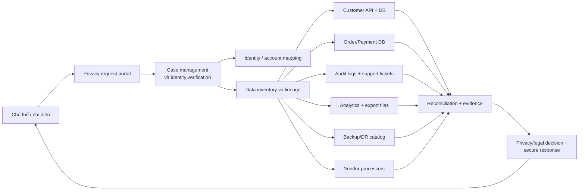
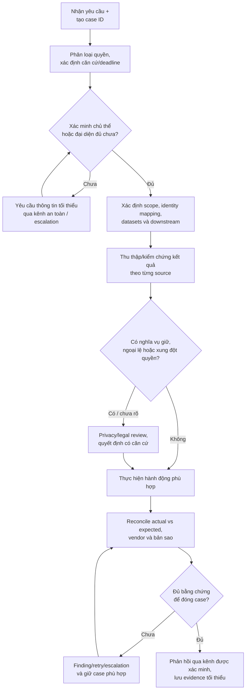
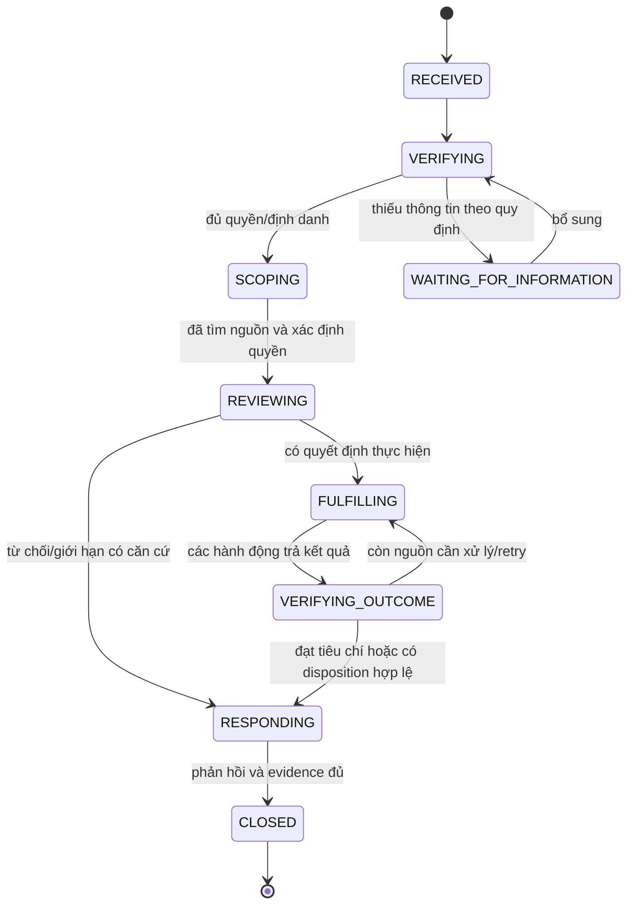
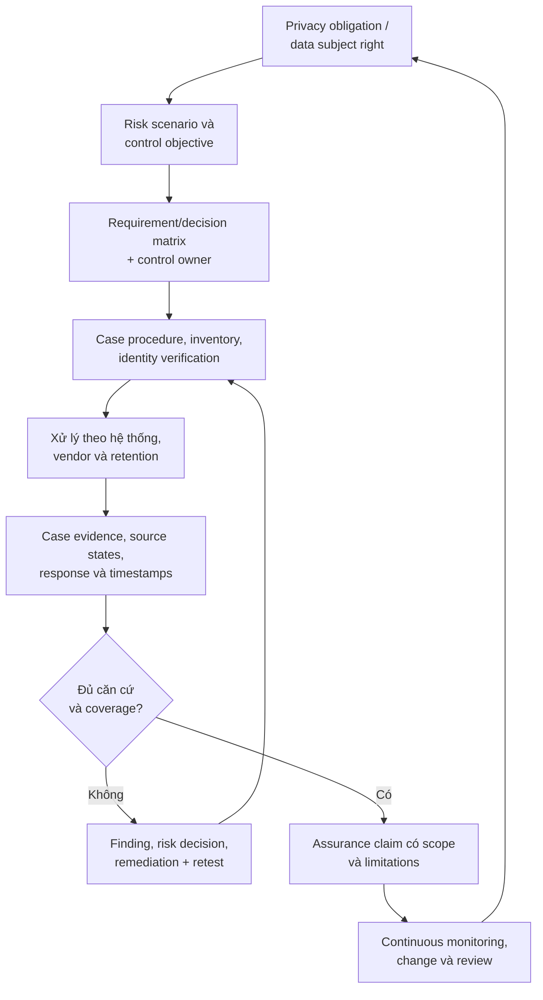
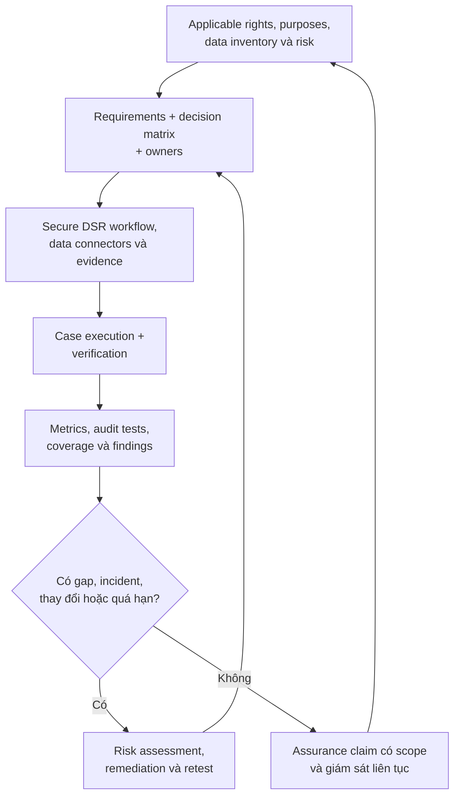

# Data subject rights: bảo đảm thực thi quyền của chủ thể dữ liệu có bằng chứng

## Mục tiêu học tập

Sau bài học, người học có thể:

1. Giải thích **data subject rights (quyền của chủ thể dữ liệu)** và vai trò của chúng trong **privacy assurance**, thay vì coi việc tiếp nhận yêu cầu là một biểu mẫu hành chính đơn thuần.
2. Phân biệt các nhóm quyền thường gặp — **được thông tin, truy cập, sửa, xóa, hạn chế xử lý, phản đối, rút lại sự đồng ý, nhận/chuyển dữ liệu, và những bảo vệ liên quan quyết định tự động** — đồng thời xác định điều kiện áp dụng từ nghĩa vụ thực tế.
3. Thiết kế quy trình xử lý **data subject request (DSR/DSAR)** có bước tiếp nhận, xác minh danh tính/thẩm quyền, xác định phạm vi, tìm dữ liệu, đánh giá ngoại lệ, thực hiện và xác minh kết quả.
4. Dùng **data inventory, data lineage, purpose, retention và danh sách bên nhận** để xác định tất cả bản sao/đường xử lý cần xem xét, bao gồm ứng dụng, log, backup, analytics, SaaS và nhà xử lý dữ liệu.
5. Phòng tránh việc **tiết lộ dữ liệu cho người mạo danh**, xóa sai dữ liệu, bỏ sót bản sao, phản hồi không đầy đủ hoặc giữ dữ liệu quá quy định.
6. Thiết lập **control owners, quy tắc quyết định, deadline có căn cứ, evidence package, kiểm thử và audit trail** để chứng minh quyền được thực hiện đúng trong phạm vi xác định.
7. Đo chất lượng xử lý yêu cầu, quản trị ngoại lệ/rủi ro còn lại và cải tiến liên tục khi hệ thống, nhà cung cấp hoặc quy định thay đổi.

Module **SECURITY_SECURITY_ASSURANCE** tập trung vào việc đánh giá có bằng chứng rằng hệ thống đáp ứng mục tiêu bảo mật, từ phân tích rủi ro và yêu cầu đến security controls, kiểm thử, audit và khắc phục. Trong chương **Privacy assurance**, quyền của chủ thể dữ liệu là một bài toán điển hình: **quy định quyền** chưa đủ, **có giao diện nộp yêu cầu** cũng chưa đủ. Tổ chức cần chứng minh đã nhận đúng yêu cầu, xác định đúng dữ liệu/chủ thể, đưa ra quyết định đúng căn cứ và thực hiện kết quả trên các hệ thống liên quan.

## 1. Data subject rights là gì?

**Chủ thể dữ liệu (data subject)** thường được hiểu là **cá nhân mà dữ liệu cá nhân có liên quan tới**, theo khái niệm và phạm vi của quy định áp dụng. Quyền của chủ thể dữ liệu là những khả năng pháp lý hoặc cam kết được tổ chức thừa nhận, cho phép cá nhân **biết, yêu cầu, kiểm soát hoặc phản đối một số hình thức xử lý dữ liệu liên quan tới mình**, tùy điều kiện.

Ví dụ: một khách hàng có thể yêu cầu được cung cấp thông tin về dữ liệu đang được xử lý, sửa số điện thoại sai, hoặc xem xét yêu cầu xóa dữ liệu không còn cần thiết. Tuy nhiên, dữ liệu liên quan tới một giao dịch có thể đồng thời chịu **nghĩa vụ lưu giữ, yêu cầu chống gian lận hoặc quyền của cá nhân khác**; không thể tự động xóa mọi thứ chỉ vì một người bấm nút “Delete my data”.

### 1.1. Các thuật ngữ thường gặp

| Thuật ngữ | Ý nghĩa | Điểm cần phân biệt |
|---|---|---|
| **Data subject** | Cá nhân mà dữ liệu cá nhân liên quan đến | Danh tính phải được xác định đúng ngữ cảnh và quy định áp dụng |
| **Personal data** | Thông tin có thể liên quan hoặc giúp nhận diện một cá nhân theo định nghĩa áp dụng | Không chỉ là tên/số giấy tờ; ID, hành vi và metadata có thể liên quan |
| **Controller / bên quyết định mục đích và phương tiện xử lý** | Bên có trách nhiệm xác định mục đích và cách xử lý theo mô hình pháp lý tương ứng | Tên gọi, nghĩa vụ và quan hệ cụ thể phụ thuộc luật/hợp đồng |
| **Processor / bên xử lý thay mặt** | Bên xử lý theo vai trò và chỉ dẫn hợp lệ trong mô hình tương ứng | Không mặc định tự quyết định mọi yêu cầu xóa hoặc cung cấp dữ liệu |
| **Data subject request (DSR)** | Yêu cầu thực hiện một quyền liên quan dữ liệu | Có thể gồm truy cập, sửa, xóa, phản đối hoặc các quyền khác |
| **DSAR (Data Subject Access Request)** | Thường chỉ **yêu cầu truy cập dữ liệu** của chủ thể | Không nên gọi mọi yêu cầu quyền riêng tư là DSAR nếu cần phân loại chính xác |
| **Privacy notice** | Thông tin tổ chức cung cấp về hoạt động xử lý và quyền tương ứng | Đăng notice không chứng minh quy trình thực hiện quyền hoạt động |
| **Data inventory / lineage** | Bản đồ tập dữ liệu, nơi lưu, bản sao, nguồn và đích | Là đầu vào tìm đúng dữ liệu, không tự chứng minh đã xử lý yêu cầu |
| **Evidence of fulfillment** | Bằng chứng quyết định và hành động đáp ứng yêu cầu | Phải thể hiện đúng người, đúng scope, kết quả và những giới hạn |

**Quyền riêng tư không hoàn toàn đồng nghĩa với bảo mật thông tin.** Bảo mật bí mật, toàn vẹn và sẵn sàng của dữ liệu là điều kiện quan trọng, nhưng privacy assurance còn cần xét **mục đích, minh bạch, sự phù hợp của việc sử dụng, quản lý vòng đời và khả năng thực thi quyền**.

### 1.2. Vì sao đây là vấn đề security assurance?

Xử lý một yêu cầu dữ liệu có thể tạo ra rủi ro bảo mật mới:

- **Yêu cầu truy cập giả mạo** có thể trở thành cách lấy trọn lịch sử giao dịch của nạn nhân.
- **Yêu cầu xóa giả mạo** có thể phá dữ liệu và khả năng điều tra.
- **Yêu cầu sửa dữ liệu** có thể làm thay đổi thông tin thanh toán hoặc kết quả nghiệp vụ.
- **File xuất để giao cho chủ thể** có thể bị lưu trên bucket công khai hoặc link tải không giới hạn.
- **Phản hồi từ nhiều hệ thống** có thể vô tình chứa dữ liệu của người khác, secret, access token hoặc thông tin điều tra cần bảo vệ.
- **Xóa khỏi hệ thống chính nhưng không xử lý bản sao** có thể khiến tổ chức đưa ra cam kết sai.

Vì thế, quy trình phải được bảo vệ bằng **authentication/identity verification, authorization, least privilege, kiểm tra chéo khi cần, audit logs và test đúng đối tượng**.

## 2. Phạm vi các quyền: đừng biến ví dụ thành nghĩa vụ áp dụng chung

Các hệ thống pháp luật và thỏa thuận có thể quy định **những quyền, điều kiện, ngoại lệ, thời hạn và trách nhiệm khác nhau**. Những mô tả dưới đây là **bản đồ khái niệm phục vụ thiết kế controls**, không phải ý kiến pháp lý hay kết luận rằng mọi quyền đều áp dụng đồng nhất tại mọi quốc gia.

Đối với hệ thống cụ thể, bộ phận privacy/legal/compliance có thẩm quyền cần xác định:

1. Quy định nào áp dụng theo **địa điểm, loại chủ thể, mục đích xử lý, bên chịu trách nhiệm và hoạt động cụ thể**.
2. Những quyền nào tổ chức có nghĩa vụ đáp ứng hoặc đã cam kết cung cấp.
3. Điều kiện thực hiện, ngoại lệ hợp lệ, yêu cầu nhận diện/đại diện, quy tắc tính **deadline** và cơ chế thông báo.
4. Trách nhiệm của controller, processor, nhà cung cấp và các bên nhận dữ liệu.
5. Phương thức lưu bằng chứng, xử lý tranh chấp và tiêu chí kết thúc yêu cầu.

### 2.1. Bản đồ các nhóm quyền thường gặp

| Nhóm quyền | Mục đích thường gặp | Cần kiểm tra trước khi thực hiện |
|---|---|---|
| **Được thông tin/minh bạch** | Hiểu cách và mục đích tổ chức xử lý dữ liệu | Notice đúng hoạt động, đúng phiên bản, dễ tiếp cận; các trường hợp thông báo theo quy định |
| **Truy cập / biết dữ liệu được xử lý** | Nhận thông tin hoặc bản sao dữ liệu liên quan tới mình theo phạm vi quyền | Danh tính, phạm vi dữ liệu, dữ liệu của bên khác, khả năng che thông tin cần thiết |
| **Sửa/đính chính/bổ sung** | Chỉnh dữ liệu không chính xác hoặc chưa đầy đủ | Nguồn dữ liệu có thẩm quyền, bằng chứng sửa, rủi ro gian lận, các bản sao dẫn xuất |
| **Xóa/erasure** | Loại bỏ dữ liệu trong điều kiện phù hợp | Nghĩa vụ giữ, legal hold, tranh chấp, dữ liệu chung nhiều chủ thể, backup/restore |
| **Hạn chế xử lý** | Tạm dừng hoặc giới hạn một số cách dùng dữ liệu | Những xử lý còn được phép, trạng thái và cơ chế enforce tại downstream |
| **Phản đối một số xử lý** | Yêu cầu ngừng cách sử dụng cụ thể theo căn cứ áp dụng | Mục đích và cơ sở xử lý, quyết định được phê duyệt, ngoại lệ phù hợp |
| **Rút lại sự đồng ý** | Ngừng xử lý dựa trên sự đồng ý theo điều kiện áp dụng | Hoạt động nào dựa vào consent, hiệu lực tương lai, xử lý có căn cứ khác |
| **Nhận/chuyển dữ liệu (portability)** | Nhận dữ liệu theo định dạng/đường truyền được quy định khi đủ điều kiện | Phạm vi và nguồn dữ liệu, định dạng, bảo mật chuyển giao, chủ thể/bên nhận |
| **Quyền liên quan quyết định tự động** | Đề nghị thông tin, xem xét hoặc can thiệp đối với một số quyết định | Loại quyết định, điều kiện quyền, khả năng giải thích và quy trình review |
| **Khiếu nại/đề nghị giải quyết** | Yêu cầu tổ chức hoặc cơ quan có thẩm quyền xem xét vấn đề | Kênh tiếp nhận, người phụ trách và quy trình đúng thẩm quyền |

**Không đánh đồng:**

- **Rút consent** không nhất thiết tương đương **xóa toàn bộ dữ liệu**; có thể còn xử lý theo căn cứ phù hợp khác hoặc nghĩa vụ lưu giữ.
- **Được truy cập** không mặc định được nhận mọi log nội bộ, dữ liệu người khác hoặc secret không liên quan; phải xác định scope và giới hạn theo căn cứ áp dụng.
- **Portability** không nhất thiết bao phủ mọi dữ liệu suy luận/dẫn xuất và không phải lúc nào cũng được thực hiện theo cùng định dạng.
- **Xóa** không luôn là xóa vật lý tức thì trên tất cả bản sao, đặc biệt với backup và hồ sơ buộc giữ; cần làm rõ kết quả thực tế và các giới hạn.

### 2.2. Ma trận quyền theo hoạt động xử lý

Một tổ chức nên lập ma trận riêng, ví dụ:

| Hoạt động | Loại dữ liệu | Mục đích và căn cứ được xác định | Quyền cần đánh giá | Bên ra quyết định |
|---|---|---|---|---|
| Tạo tài khoản | Email, liên hệ, account ID | Cung cấp tài khoản | Truy cập, sửa, xóa theo điều kiện | Account privacy owner |
| Giao dịch thanh toán | Lệnh, người nhận, chứng cứ | Thực hiện và đối soát giao dịch | Truy cập, đính chính và yêu cầu khác theo nghĩa vụ | Payments data owner + privacy/legal |
| Thông báo marketing | Kênh và lựa chọn liên hệ | Hoạt động truyền thông được phép | Rút consent/đổi preference/phản đối khi áp dụng | Marketing/privacy owner |
| Phát hiện gian lận | Event, fingerprint, audit metadata | Bảo vệ tài khoản và chống lạm dụng | Quyền theo điều kiện với ngoại lệ được đánh giá | Fraud/security + privacy/legal |
| Báo cáo phân tích | Dataset dẫn xuất | Phân tích theo mục đích | Truy cập, phản đối, xóa/giới hạn tùy trường hợp | Analytics data owner |
| Ticket hỗ trợ | Hội thoại và attachment | Giải quyết yêu cầu dịch vụ | Truy cập, sửa/xóa nếu phù hợp | Support data owner |

**Đây là bài tập quản trị**, không phải bảng quyết định pháp lý đã hoàn chỉnh. Nhóm privacy phải xác nhận cả những trường hợp **không áp dụng**, ngoại lệ, mối liên hệ giữa dữ liệu chung và giới hạn cung cấp.

## 3. Mô hình rủi ro của quy trình quyền chủ thể dữ liệu

Phải nhìn quy trình từ hai chiều: **nếu từ chối hoặc đáp ứng sai quyền** thì chủ thể chịu thiệt gì; và **nếu đáp ứng cho người không có quyền** thì có thể gây lộ hoặc mất dữ liệu thế nào.

### 3.1. Những kịch bản cần threat model

| Risk scenario | Điểm yếu có thể có | Control nên xem xét |
|---|---|---|
| Kẻ mạo danh gửi yêu cầu truy cập | Chỉ kiểm tra email trong biểu mẫu | Xác minh chủ thể/đại diện dựa trên rủi ro, giao qua kênh đã kiểm chứng |
| Người dùng cùng tên bị ghép sai hồ sơ | Tìm kiếm bằng tên hoặc email cũ không đối chiếu | Identity resolution, unique subject IDs, kiểm tra false matches |
| Export chứa hồ sơ của tenant khác | Query thiếu tenant/object authorization | Filter ở server, test cross-tenant, independent review khi rủi ro cao |
| Yêu cầu xóa bị thực thi sai người | Xác minh yếu; job nhận sai ID | Authorization và kiểm soát target, dry-run, confirmation/review |
| Request bị quên quá hạn | Mailbox thủ công, không có owner/deadline | Case workflow, reminder/escalation, monitoring |
| Xóa primary DB nhưng còn bản sao | Data inventory/lineage thiếu | Cross-system orchestration, reconciliation, vendor follow-up |
| Tổ chức xóa hồ sơ bắt buộc giữ | Quy tắc retention/legal hold không được kiểm tra | Decision engine có đánh giá và phê duyệt đúng thẩm quyền |
| Consent đã rút nhưng marketing tiếp tục gửi | Downstream không nhận preference | Propagation, suppression, end-to-end tests |
| Nhân viên tải toàn bộ dữ liệu nhạy cảm vào ticket | Quy trình evidence không có data minimization | Least privilege, encrypted workspace, secure delivery |
| Vendor không xác nhận đã xử lý yêu cầu | Không có contract/process owner | Processor coordination, SLA theo nghĩa vụ, evidence |
| Quy trình báo “completed” dù job lỗi | Tin HTTP 200 hoặc ticket đóng | Expected/actual, source-state verification và retry/escalation |
| Người quản trị tự duyệt/xóa evidence | Thiếu separation of duties | Phân quyền, audit integrity, kiểm tra độc lập |

### 3.2. Bất biến bảo mật và riêng tư

Một yêu cầu DSR tốt thường phải duy trì những bất biến như:

```text
Một yêu cầu liên quan chủ thể S:
  request.targetSubject == verifiedSubjectOrAuthorizedRepresentation
  searchScope không vượt quá đối tượng dữ liệu và mục đích được phép
  discloseData chỉ thực hiện khi quyền và kênh nhận đã được kiểm chứng
  action phải dựa trên rule/exception được xác định cho dữ liệu cụ thể
  every required downstream location có disposition có thể kiểm chứng
  closedCase phải có quyết định, trạng thái, thời điểm và giới hạn rõ
```

Không phải mọi yêu cầu đều phải được **chấp thuận toàn phần**. Một kết quả có thể là đáp ứng toàn phần, một phần, từ chối có căn cứ hoặc chờ bổ sung thông tin trong điều kiện được phép. **Sự đúng đắn của quyết định và cách thông báo** quan trọng hơn tỷ lệ tự động chấp thuận.

## 4. Data inventory là nền tảng của thực thi quyền

Nếu không biết dữ liệu liên quan tới cá nhân nằm ở đâu, tổ chức khó chứng minh đã tìm đủ, sửa đủ hoặc xóa đủ.

### 4.1. Bản đồ luồng dữ liệu ví dụ



Data inventory cần lưu ít nhất **logical dataset ID, physical locations, người sở hữu, mục đích, retention, bên nhận, phân loại và nguồn phát hiện**; lineage cần chỉ ra **bản sao/dữ liệu dẫn xuất**. Không mặc định toàn bộ dữ liệu nằm trong một Customer DB.

### 4.2. Những nguồn thường bị bỏ quên

| Nguồn | Dữ liệu có thể liên quan | Câu hỏi khi thực hiện quyền |
|---|---|---|
| **Account/customer DB** | Hồ sơ cơ bản, danh tính liên kết | Có đủ aliases/IDs và thay đổi lịch sử không? |
| **Order/payment services** | Giao dịch và thông tin bên liên quan | Quyền của một người có ảnh hưởng quyền người khác/nghĩa vụ lưu không? |
| **Support/helpdesk SaaS** | Ticket, email, bản chụp, nội dung hội thoại | Vendor có cách tìm/sửa/xóa và export đúng phạm vi không? |
| **Logs/APM/traces** | IP, device ID, user ID, nội dung lỗi, correlation | Có dữ liệu cá nhân nào; có giới hạn disclosure/retention hợp lệ? |
| **Warehouse/BI/search index** | Dữ liệu dẫn xuất và bản sao tra cứu | Lineage, pseudonymization, propagation sau sửa/xóa như thế nào? |
| **CSV/export/shared drive** | File tải thủ công, bản báo cáo đã chia sẻ | Ai có quyền, thời hạn link, bên nhận tiếp theo? |
| **Queue/DLQ/replay storage** | Event và payload chưa xử lý | Làm sao ngăn message cũ tái đưa dữ liệu bị xóa vào DB? |
| **Cache/read replicas** | Bản sao phục vụ hiệu năng | TTL, invalidation và quyền truy cập có nhất quán? |
| **Backups/snapshots** | Dữ liệu lịch sử phục hồi | Retention, restore guard, khả năng xóa chọn lọc thực tế? |
| **Vendor/partner** | Dữ liệu đã chuyển ra khỏi hệ thống | Ai gửi yêu cầu, ai xác nhận, phạm vi/bằng chứng theo hợp đồng? |
| **Test/staging/incident artifacts** | Dữ liệu sản xuất sao chép để thử/điều tra | Có tài liệu và quyền riêng hay nằm ngoài inventory? |

### 4.3. Khớp chủ thể với dữ liệu

Một cá nhân có thể có:

- Nhiều account IDs, email/điện thoại thay đổi hoặc đăng ký lại.
- Dữ liệu được tạo trước khi liên kết tài khoản mới.
- Hồ sơ với vai trò **người mua, người nhận, nhân viên hỗ trợ hoặc đại diện công ty**.
- Transaction chứa cả **dữ liệu của người khác**.
- Dữ liệu đã được giả danh, tổng hợp hoặc lưu ở hệ thống không dùng cùng một ID.

**Identity resolution** phải xác định bản ghi nào **thực sự thuộc phạm vi quyền của chủ thể S**, ghi cả kết quả khớp chắc chắn và trường hợp chưa chắc. **Không tìm thấy theo một email không chứng minh cá nhân không có dữ liệu trong hệ thống.**

Tìm kiếm toàn bộ theo tên dễ sinh **false positive**; chỉ tìm ID đăng nhập hiện tại dễ sinh **false negative**. Cần kết hợp nguồn authoritative, lịch sử liên kết, quy tắc nghiệp vụ và kiểm tra thủ công có kiểm soát.

## 5. Quy trình xử lý DSR/DSAR từ đầu đến cuối

Một quy trình có khả năng assurance cần nêu **đầu vào, trạng thái, điểm ra quyết định, owner, hạn theo nghĩa vụ và bằng chứng từng bước**.

### 5.1. Tổng quan quy trình



### 5.2. Bước 1 — Tiếp nhận và đăng ký

Đầu vào có thể đến từ portal, email, văn bản, kênh hỗ trợ hoặc đại diện được phép. Tổ chức cần định nghĩa **cách nhận diện và chuyển tiếp** yêu cầu để không bỏ sót một yêu cầu hợp lệ chỉ vì nó không dùng đúng biểu mẫu tiện lợi nhất.

Hồ sơ ban đầu nên ghi:

- **Case ID**, kênh nhận, thời điểm, người tiếp nhận.
- Nội dung yêu cầu và **loại quyền được đề nghị** (có thể nhiều quyền trong một case).
- Chủ thể và thông tin liên hệ cần thiết ở mức tối thiểu.
- Bên được yêu cầu thực hiện, hệ thống và ngữ cảnh nếu đã biết.
- **Quy tắc thời hạn áp dụng**, trigger tính hạn và những ngoại lệ được phép theo quy trình.
- Trạng thái ban đầu, người chịu trách nhiệm và lịch sử trao đổi.

**Không tự áp một deadline cố định cho mọi yêu cầu.** Hạn xử lý, cách tính ngày, điều kiện bổ sung thời gian, tạm dừng hoặc gia hạn phụ thuộc quy định và hoàn cảnh thực tế; phải được privacy/legal owner xác định và cấu hình kiểm chứng được.

### 5.3. Bước 2 — Xác minh chủ thể và thẩm quyền

Mục tiêu là bảo đảm **dữ liệu được cung cấp hoặc thay đổi cho đúng người có quyền**, đồng thời **không thu thập quá nhiều giấy tờ** so với rủi ro và quy định.

Nên đánh giá:

- Chủ thể đã đăng nhập qua **kênh xác thực đáng tin** chưa? Tài khoản có thật sự đại diện đúng hồ sơ không?
- Yêu cầu có tác động **cao** (xuất dữ liệu nhạy cảm, xóa không dễ đảo ngược, sửa người thụ hưởng) cần xác minh bổ sung gì?
- Người đại diện có **ủy quyền/quan hệ hợp lệ**, đúng phạm vi và còn hiệu lực không?
- Đối với người chưa thành niên hoặc tình huống bảo hộ, quy tắc nào thực sự áp dụng?
- Kênh trao đổi và **kênh trả kết quả** có được xác minh riêng khi cần không?
- Những thông tin xác minh được giữ bao lâu và ai được truy cập?

**Không gửi toàn bộ dữ liệu để “nhờ người yêu cầu xác nhận xem đúng không” trước khi xác minh danh tính.** Điều đó có thể biến cơ chế kiểm tra thành rò rỉ dữ liệu.

### 5.4. Bước 3 — Xác định phạm vi và điều kiện quyền

Phân biệt:

1. **Yêu cầu gì?** Truy cập, sửa, xóa, rút consent, phản đối, portability, thông tin hoặc quyền khác.
2. **Thuộc ai?** Cá nhân, tài khoản, vai trò người đại diện, dữ liệu của người khác có liên quan.
3. **Dữ liệu nào?** Logical datasets, time range, mục đích, data flows và bản sao.
4. **Bên nào chịu trách nhiệm?** Controller/processor, business owner, vendor, hệ thống liên quan.
5. **Quy định nào áp dụng?** Điều kiện, ngoại lệ, deadline, cách phản hồi.
6. **Kết quả nào phải tạo?** Thông tin/bản sao, cập nhật, ngừng xử lý, hạn chế, hành động xóa, quyết định có lý do.

Không suy đoán rằng một cá nhân yêu cầu “xóa mọi thứ” thì tổ chức được phép xóa **hồ sơ kế toán buộc giữ** hoặc **audit evidence của sự cố đang điều tra**. Đồng thời, không thể dùng lý do “cần lưu vì kinh doanh” chung chung để bác bỏ một quyền đang áp dụng mà chưa đánh giá căn cứ.

### 5.5. Bước 4 — Tìm dữ liệu và thu thập kết quả

Từ data inventory và identity mapping:

- Sinh **search plan** theo dataset/location/owner.
- Truy vấn hoặc gửi yêu cầu cho đội hệ thống **qua quyền tối thiểu**.
- Kiểm tra **completeness và accuracy** của mỗi nguồn; ghi quyền truy cập scanner hoặc API bị lỗi.
- Kết nối kết quả bằng ID đáng tin; phân loại dữ liệu thuộc **người yêu cầu, người khác hoặc dữ liệu chung**.
- Với một yêu cầu truy cập, đánh giá **redaction và phạm vi disclosure** được phép.
- Với sửa/xóa/hạn chế, xác định **tất cả những hệ thống phải nhận quyết định và cách xác minh**.
- Ghi **source state, thời điểm snapshot, phiên bản và nguồn bằng chứng**.

Phải định nghĩa cả **đường dữ liệu không có kết quả**: đã kiểm tra nguồn nào, có tìm đúng key/schema không, có bị mất kết nối hoặc thiếu quyền không. “Không có kết quả” từ một nguồn bị lỗi không thể được coi là “không có dữ liệu”.

### 5.6. Bước 5 — Quyết định phạm vi đáp ứng và ngoại lệ

Nhóm có thẩm quyền đánh giá:

- Điều kiện của quyền áp dụng **đã được đáp ứng chưa**?
- Có nghĩa vụ giữ, legal hold, tranh chấp, dữ liệu về người khác hay trường hợp cần giới hạn?
- Có dữ liệu thuộc **mục đích/căn cứ khác** vẫn được xử lý hợp lệ không?
- Có cần **ẩn trường hoặc cung cấp một phần** thay vì tiết lộ toàn bộ không?
- Có nghĩa vụ **thông báo cho bên nhận hoặc phối hợp processor** không?
- Có thể giải quyết bằng **sửa nguồn authoritative**, dừng xử lý theo mục đích, hoặc bằng hành động kỹ thuật khác?

**Không để workflow tự động tự “sáng tạo” ngoại lệ pháp lý** từ những từ khóa hoặc nhãn data class. Hãy lưu **decision record**, tham chiếu căn cứ và reviewer đủ thẩm quyền; khi còn nghi ngờ, chuyển cấp thay vì âm thầm từ chối hoặc xóa.

### 5.7. Bước 6 — Thực hiện và đối chiếu

Một hành động `DELETE` trả HTTP 200, một ticket được đóng hoặc một email gửi cho vendor **không chứng minh đã hoàn tất**:

- Với **truy cập**, kiểm tra nội dung đúng chủ thể, đúng phạm vi, đã che dữ liệu không được phép và giao cho đúng kênh.
- Với **sửa**, đọc lại dữ liệu từ nguồn authoritative, xác minh bản sao/analytics/recipient cần cập nhật.
- Với **xóa**, đối chiếu nguồn/bản sao đủ điều kiện, xử lý retention và backup/replay theo chính sách.
- Với **rút consent/phản đối**, xác minh những luồng theo mục đích liên quan đã thay đổi hành vi, không chỉ đổi một cờ ở UI.
- Với **portability**, kiểm tra format, phạm vi dữ liệu đủ điều kiện, phương thức truyền và bên nhận.
- Với yêu cầu **cung cấp thông tin**, xác nhận nội dung notice/phản hồi đúng hoạt động và phiên bản.

Ghi **expected vs actual, hệ thống nào thành công, nguồn nào chưa xác minh, thời điểm, owner và kế hoạch xử lý**.

### 5.8. Bước 7 — Phản hồi và đóng case

Đóng khi:

1. Có **quyết định có căn cứ** cho từng phần quyền/yêu cầu.
2. Có bằng chứng rằng **hành động trong phạm vi phải thực hiện** đã hoàn thành hoặc có trạng thái chưa hoàn thành được xử lý hợp lệ.
3. Có người kiểm tra/approver theo mức rủi ro, đặc biệt với disclosure nhạy cảm hoặc xóa lớn.
4. Phản hồi dùng **kênh đã xác minh, mức bảo vệ phù hợp**, nêu kết quả và giới hạn theo yêu cầu.
5. Đã lưu evidence tối thiểu, không chép dữ liệu cá nhân thô không cần thiết vào ticket.
6. Những nghĩa vụ theo dõi tiếp (vendor, backup, delayed deletion) vẫn có **owner và trigger**, không biến mất sau khi gửi email.

## 6. Định danh, xác minh đại diện và an toàn của kênh phản hồi

### 6.1. Xác minh dựa trên rủi ro, tránh hai cực đoan

**Xác minh quá yếu:** Bất kỳ người nào biết email của nạn nhân đều có thể nhận file lịch sử thanh toán.

**Xác minh quá mức:** Yêu cầu tất cả người dùng gửi ảnh giấy tờ nhạy cảm cho một yêu cầu chỉnh lỗi nhỏ trong tài khoản đã xác thực, không có căn cứ rõ.

Thiết kế tốt cân bằng:

| Tình huống | Khả năng xác minh phù hợp để cân nhắc | Những rủi ro cần xử lý |
|---|---|---|
| Người dùng đăng nhập sửa thông tin ít rủi ro | Session đáng tin, reauth nếu policy yêu cầu | Session bị chiếm, sửa dữ liệu người khác |
| Người dùng yêu cầu bản sao hồ sơ nhạy cảm | Kiểm chứng account identity, kênh giao riêng, step-up theo rủi ro | Disclosure cho attacker |
| Người yêu cầu qua email không đăng nhập | Quy trình identity verification được phê duyệt | Email giả mạo/chiếm hộp thư |
| Người đại diện yêu cầu thay | Xác nhận quyền đại diện, scope, hiệu lực và danh tính bên nhận | Phê duyệt vượt thẩm quyền |
| Yêu cầu xóa tài khoản doanh nghiệp có nhiều nhân viên | Kiểm tra chủ thể và quyền quyết định đối với dữ liệu liên quan | Xóa dữ liệu của người khác hoặc tài sản doanh nghiệp |
| Đề nghị chuyển dữ liệu sang bên thứ ba | Kiểm tra người yêu cầu, bên nhận và kênh an toàn | Gửi sai đích, tiết lộ dữ liệu không đủ điều kiện |

**MFA của tài khoản** có thể nâng độ tin cậy của request, nhưng không tự chứng minh người đăng nhập có quyền **nhận dữ liệu của cá nhân khác** hoặc đại diện đúng phạm vi; vẫn cần **authorization và logic nghiệp vụ**.

### 6.2. Secure delivery — giao kết quả không làm lộ dữ liệu

Với file xuất dữ liệu:

- Chỉ tạo **đúng tập dữ liệu đủ điều kiện**, áp dụng redaction và kiểm tra nhạy cảm.
- Không để file nằm vĩnh viễn trong public bucket, ticket attachment hoặc thư mục chia sẻ rộng.
- Dùng **kênh giao đã xác minh**, TLS và bảo vệ dữ liệu tại nơi lưu phù hợp.
- Với link tải, xét **giới hạn thời gian, phạm vi, xác thực người tải, khả năng thu hồi và audit** theo rủi ro.
- Có cơ chế xử lý file tồn tại sau khi request đóng, backup của kho export và người được phép xem file.
- Không đưa **access token, mật khẩu, recovery codes hoặc secret** vào hồ sơ phản hồi nếu không có căn cứ và cơ chế an toàn phù hợp.
- Log bằng chứng **file ID, người nhận/kênh, thời điểm và trạng thái**, không lưu bản sao nguyên dữ liệu trong log giám sát.

### 6.3. Tách phê duyệt khỏi thực hiện ở trường hợp nhạy cảm

**Separation of duties** có thể áp dụng cho yêu cầu truy cập dữ liệu nhạy cảm hoặc xóa quy mô lớn:

- Request handler thu thập và chuẩn bị.
- Privacy reviewer xác định phạm vi/quyết định.
- Operator hoặc workflow thực thi theo quyền giới hạn.
- Independent verifier xác nhận expected vs actual khi cần.

Một người có thể kiêm vai trò ở hệ thống nhỏ, nhưng phải đánh giá rủi ro **tự truy xuất dữ liệu + tự phê duyệt + tự xóa evidence**, và áp kiểm soát bù trừ nếu phù hợp.

## 7. Thực thi từng nhóm quyền: điểm khác nhau kỹ thuật

### 7.1. Quyền truy cập và cung cấp bản sao

Quy trình nên:

1. Xác định **những thông tin/dữ liệu được quyền cung cấp** theo nghĩa vụ áp dụng.
2. Thu thập dữ liệu từ nguồn phù hợp, theo **identity mapping đã xác minh**.
3. Phân loại dữ liệu thuộc chính chủ thể, thuộc **người khác**, và dữ liệu chung.
4. Rà soát trường nhạy cảm cần **che hoặc giới hạn** theo căn cứ.
5. Tạo bản cung cấp có **định dạng, khả năng đọc và bảo vệ kênh nhận** phù hợp.
6. Ghi nguồn, thời kỳ, giới hạn và bằng chứng quyết định.

**Một API query trả 200 không chứng minh bản cung cấp đủ, đúng hoặc không lộ dữ liệu bên thứ ba.** Cần test positive/negative, sampling/review và đối chiếu danh sách nguồn.

### 7.2. Quyền sửa/đính chính

Ví dụ một cá nhân báo email hoặc địa chỉ sai. Hệ thống cần:

- Xác minh yêu cầu và **nguồn dữ liệu có thẩm quyền**.
- Xác định trường nào có thể người dùng tự sửa và trường nào cần chứng cứ/đánh giá.
- Kiểm tra tính toàn vẹn nghiệp vụ: không cho sửa **người nhận thanh toán đã được phê duyệt** mà không kích hoạt quy trình duyệt lại.
- Cập nhật authoritative source, đồng bộ đến **search index, cache, analytics, vendor** nếu thuộc phạm vi và nghĩa vụ.
- Giữ dấu vết chỉnh sửa theo chính sách, không làm sai kết quả giao dịch lịch sử.
- Kiểm tra lại trạng thái thực tế; không dừng ở “ticket fixed”.

**Đính chính** dữ liệu không chính xác và **viết lại lịch sử giao dịch** là hai mục tiêu khác nhau. Một số bản ghi cần lưu rõ **bản gốc, sửa đổi và căn cứ**, thay vì xóa dấu vết quan trọng.

### 7.3. Quyền xóa

Yêu cầu xóa đặt ra nhiều câu hỏi nhất:

| Lớp dữ liệu | Cách xem xét | Bằng chứng phù hợp |
|---|---|---|
| Primary DB | Record nào đủ điều kiện xóa; có retention/hold? | Deletion decision, job result, post-state check |
| Cache/search index | Có invalidation/reindex, bản cũ còn đọc được? | Cache expiry/invalidation và query test |
| Queue/DLQ/outbox | Có event cũ tái ghi dữ liệu sau xóa? | Replay scenario test, tombstone/processing guard |
| CSV/export | Bản nào nằm trên storage, link tải còn hiệu lực? | Storage scan, access/lifecycle test |
| Analytics/warehouse | Dữ liệu dẫn xuất và bản sao có thể truy tới cá nhân không? | Lineage review, cleanup/rebuild evidence |
| Support tickets | Attachment chứa dữ liệu, retention khác? | Ticket system response, rule/exception record |
| Vendor | Bên nhận nào, nghĩa vụ phối hợp ra sao? | Vendor request/acknowledgment và kiểm chứng theo hợp đồng |
| Backup/DR | Có thể xóa chọn lọc? Khi restore có dữ liệu trở lại? | Backup retention, restore procedure, re-apply deletion logic |
| Audit/records phải giữ | Có nghĩa vụ giữ, tính toàn vẹn hoặc sự cố? | Decision/legal hold reference, access restrictions |

Không nên tuyên bố **“đã xóa hoàn toàn mọi bản sao”** khi việc xóa từ backup không khả thi hoặc chưa xác minh vendor. Trong những hoàn cảnh được phép, có thể quản lý bằng **giới hạn truy cập, giữ tới thời điểm hết retention, không dùng cho hoạt động thông thường và bảo đảm xử lý sau restore**; tuy nhiên tính hợp lệ của cách làm cần được privacy/legal đánh giá.

**Crypto-erasure** (hủy khóa để dữ liệu mã hóa không còn giải mã được) chỉ có ý nghĩa nếu **phạm vi khóa, bản sao plaintext, backup và khả năng phục hồi** được kiểm soát đúng. Hủy một key chung có thể làm mất dữ liệu còn buộc giữ; xóa key ở một vùng không loại bỏ bản sao plaintext ở vùng khác.

### 7.4. Hạn chế xử lý

“Restriction” không nhất thiết là xóa. Tùy nghĩa vụ, hệ thống có thể cần **đánh dấu trạng thái hạn chế**, giới hạn những xử lý được phép và ngăn downstream dùng dữ liệu cho mục đích bị hạn chế.

Kiểm tra:

- Trạng thái hạn chế áp trên **logical subject và từng mục đích**, không chỉ một màn hình UI.
- API, job batch, warehouse query và vendor có nhận biết trạng thái?
- Những xử lý vẫn được phép có bị chặn nhầm hoặc bypass?
- Có căn cứ và quy trình **bỏ hạn chế** khi điều kiện thay đổi?
- Có log hành vi/phát hiện xử lý trái restriction không?

### 7.5. Phản đối và rút lại consent

Hai tình huống không đồng nhất:

- **Rút consent:** Cần ngừng những hoạt động dựa vào sự đồng ý theo phạm vi áp dụng, sau khi xác minh quyết định và điều kiện.
- **Phản đối:** Cần đánh giá hoạt động xử lý, cơ sở, quyền và ngoại lệ được phép theo quy định áp dụng.

Một suppression flag trong Customer DB chưa chứng minh **marketing SaaS, scheduled email, recommendation engine hoặc bản export** đã cập nhật. Cần test end-to-end như **không còn gửi email thuộc hoạt động phải ngừng** trong tình huống thử, cùng quy trình xử lý thông điệp đã xếp hàng.

### 7.6. Portability / nhận và chuyển dữ liệu

Khi quyền áp dụng:

1. Xác định tập dữ liệu **đủ điều kiện** và định dạng hoặc cơ chế truyền được quy định.
2. Xác minh chủ thể và bên nhận nếu gửi trực tiếp.
3. Tạo file có **schema nhất quán, dễ xử lý bằng máy** khi yêu cầu, kèm mô tả field cần thiết.
4. Không vô tình đưa dữ liệu của người thứ ba hoặc secrets vào gói xuất.
5. Bảo vệ đường truyền, hạn link, audit và thời hạn lưu file.
6. Lưu **actual delivery result** hoặc lý do không thể chuyển trực tiếp trong phạm vi quy định.

Không tự suy portability là quyền truy cập API quản trị toàn hệ thống hoặc đòi tất cả dữ liệu suy luận nội bộ mà chưa đánh giá điều kiện của quyền.

### 7.7. Yêu cầu liên quan quyết định tự động

Tùy quy định áp dụng, chủ thể có thể được bảo vệ đối với một số quyết định tự động có ảnh hưởng xác định. Assurance cần kiểm tra:

- Hệ thống nào tạo quyết định, mục đích, loại tác động và **người sở hữu mô hình/quy tắc**.
- Có cơ chế cung cấp thông tin, giải thích ở mức cần thiết hoặc xem xét lại theo nghĩa vụ không.
- Nếu phải có **human review**, người review có thẩm quyền, dữ liệu và khả năng thay đổi quyết định thật không.
- Input dữ liệu sai có thể được sửa và ảnh hưởng downstream ra sao.
- Kết quả review, quyết định cuối và các hạn chế bảo mật/quyền người khác được ghi có căn cứ.

Một nút “Request human review” không chứng minh **con người đã đánh giá thực chất** nếu workflow vẫn tự động trả lại cùng một kết quả mà không có quyết định có trách nhiệm.

## 8. Kiến trúc thực thi: case orchestration, policy và data actions

Ở quy mô nhiều microservices, nên có một luồng điều phối rõ ràng thay vì cho portal gọi trực tiếp `DELETE` lên mọi bảng.

### 8.1. Các thành phần trách nhiệm

| Thành phần | Vai trò | Kiểm soát cần có |
|---|---|---|
| **Request intake** | Nhận yêu cầu, tạo ID, ngữ cảnh kênh | Chống spam/lạm dụng, không lộ dữ liệu |
| **Identity/authority verification** | Xác minh chủ thể/đại diện | Risk-based checks, audit, chống bypass |
| **Rights decision service/workflow** | Xác định phạm vi và điều kiện áp dụng | Policy version, privacy/legal review, exception handling |
| **Data inventory/identity graph** | Tìm datasets/locations/aliases | Completeness, freshness, source trust |
| **System connectors** | Truy vấn/sửa/xóa/giới hạn ở nguồn | Least privilege, scope filter, idempotency và error handling |
| **Vendor coordination** | Gửi/nhận xác nhận có kiểm soát | Contract/scope, timeouts, audit và escalation |
| **Reconciliation/verification** | So expected vs actual và phát hiện bản sao bỏ sót | Evidence, trạng thái nguồn, test failure paths |
| **Secure response** | Tạo/giao thông tin hoặc quyết định | Redaction, authz người nhận, link lifecycle, audit |
| **Case/audit store** | Lưu quyết định, hành động và kết quả | SoD, quyền tối thiểu, integrity, retention |

### 8.2. State machine của một yêu cầu



Đây là sơ đồ khái niệm; thực tế cần thêm trạng thái **escalated, deadline-at-risk, blocked, partially-fulfilled, withdrawn** hoặc trạng thái khác theo quy trình. Tránh để trạng thái `CLOSED` chỉ phản ánh “workflow kết thúc” trong khi **vendor chưa xác minh hoặc một system connector đã thất bại**.

### 8.3. Pseudocode xử lý có kiểm tra thất bại

```text
case = registerRequest(channel, requestMetadata)
assignOwnerAndDetermineApplicableDeadline(case)

subject = verifySubjectOrRepresentative(case)
if subject.notVerified:
    requestMinimumNecessaryProofOrEscalate(case)
    stopWithoutDisclosingOrChangingPersonalData()

decisionScope = privacyPolicyReview(
    case.requestedRights,
    subject,
    applicableRules,
    knownExceptions
)
plan = buildSearchPlan(dataInventory, subject.identifiers, decisionScope)

if plan.hasUnknownSources or plan.hasIncompleteInventory:
    recordCoverageGap(case, plan.unknownSources)
    escalateByRiskAndDeadline(case)

for source in plan.confirmedSources:
    result = executeAuthorizedSourceAction(
        case.id,
        subject,
        source,
        decisionScope,
        idempotencyKeyFor(case.id, source.id)
    )
    recordEvidenceMetadata(case, source, result)

    if result.isFailed or result.isUnverifiable:
        openFindingOrRetryUnderControlledPolicy(case, source)
    else:
        independentlyCheckExpectedVersusActual(case, source, result)

reviewAllSystemAndVendorDispositions(case)
if not hasSufficientBasisToConclude(case):
    doNotMarkFullyFulfilled()
    escalateIncompleteOrPartiallyFulfilledCase()
else:
    sendDecisionOrDataViaVerifiedSecureChannel(case)
    closeWithEvidenceAndExplicitLimitations(case)
```

**Lưu ý:** Pseudocode là quy trình logic, không phải mã được phép kết nối production. Những thao tác không thể đảo ngược như xóa/đổi dữ liệu phải có **căn cứ, phê duyệt và kiểm chứng đủ mạnh**; không “thử xóa thật” trên tài khoản khách hàng khi chưa được phép.

## 9. Ví dụ cấu hình chính sách xử lý quyền

Mẫu YAML dưới đây minh họa **hồ sơ vận hành có cấu trúc**, không phải cấu hình pháp lý tự động hoặc schema chuẩn của một sản phẩm cụ thể. Các trường định hướng quyết định; mọi quy tắc cần được tổ chức phê duyệt.

```yaml
privacyRightsProcedure:
  id: PROC-DSR-CUSTOMER-01
  version: "1.0"
  status: illustrative
  systemId: CUSTOMER-PAYMENTS-PLATFORM
  policyOwnerRole: Privacy Governance Lead
  systemOwnerRole: Customer Platform Owner
  dataOwnerRole: Customer Data Owner
  riskOwnerRole: Privacy Risk Owner

  scope:
    environments:
      - production
      - staging-containing-personal-data
    identityTypes:
      - customer
      - verified-representative
    rights:
      - access
      - rectification
      - erasure-where-applicable
      - processing-restriction-where-applicable
      - withdraw-consent-where-applicable
      - portability-where-applicable

  intake:
    createUniqueCaseId: true
    acceptedChannelsReference: DSR-CHANNELS-POLICY
    deadlineRuleReference: DSR-APPLICABLE-TIME-LIMITS
    notificationPolicyReference: DSR-COMMUNICATION-POLICY

  verification:
    requireSubjectOrRepresentativeVerification: true
    verificationMethodReference: DSR-IDENTITY-ASSURANCE
    privilegedDisclosureNeedsAdditionalReview: true
    minimizeVerificationData: true

  discovery:
    inventoryReference: CUSTOMER-DATA-INVENTORY
    subjectIdentityGraphReference: CUSTOMER-IDENTITY-MAPPING
    mustReview:
      - primary-account-database
      - payment-transactions
      - support-saas
      - analytics-and-exports
      - logs-and-backups
      - downstream-vendors
    onMissingSource: record-gap-and-escalate

  decision:
    applicableRightsAndExceptionsReference: APPROVED-PRIVACY-DECISION-MATRIX
    legalHoldCheckRequired: true
    thirdPartyDataReviewRequired: true
    logDecisionAndReasonReference: DSR-CASE-DECISION

  fulfillment:
    authorizedServiceIdentitiesOnly: true
    idempotentActions: true
    sourceResultVerification: true
    vendorAcknowledgementTracking: true
    deletionAfterRestoreReference: DSR-RESTORE-RECONCILIATION

  delivery:
    verifiedRecipientChannelOnly: true
    redactUnrelatedSensitiveData: true
    exportLinkLifecycleReference: DSR-SECURE-EXPORT-LIFECYCLE

  assurance:
    requiredTests:
      - DSR-IMPERSONATION-REJECTED
      - DSR-CROSS-TENANT-EXPORT-REJECTED
      - DSR-INCOMPLETE-SOURCE-NOT-PASS
      - DSR-LEGAL-HOLD-DECISION
      - DSR-DOWNSTREAM-CONSENT-PROPAGATION
      - DSR-RESTORE-REPLAY-PROTECTION
      - DSR-VENDOR-EVIDENCE-TRACKING
    evidencePackageReference: DSR-CASE-EVIDENCE
    reviewTriggers:
      - New data source or vendor
      - Change to retention or legal requirements
      - New identity or authorization workflow
      - Failed request, breach, or audit finding
```

Để đưa mẫu này vào vận hành cần có **bộ quy tắc được chuyên môn privacy/legal xác nhận** và hệ thống thực thi đã kiểm tra. Một dòng `sourceResultVerification: true` không chứng minh verification đã xảy ra; nó mới nói **phải có cơ chế và bằng chứng**.

### 9.1. Một bản ghi của một case

| Trường | Dùng để chứng minh |
|---|---|
| `caseId` và `requestType` | Định danh và phân loại yêu cầu |
| `receivedAt`, `deadlineRuleId`, `dueAt` | Quản lý hạn theo điều kiện được xác nhận |
| `subjectReference` / `representativeAuthorityRef` | Chủ thể và thẩm quyền, không nhất thiết lưu hồ sơ định danh thô |
| `verificationLevelAndTime` | Đã xác minh bằng phương pháp phù hợp, thời điểm nào |
| `dataSearchPlanId` / `inventoryVersion` | Nguồn và bản sao nào được tìm, theo inventory nào |
| `decisionId` / `reasonCode` | Điều kiện quyền/ngoại lệ đã được xét ra sao |
| `sourceDispositions` | Kết quả từng hệ thống: đã làm, giữ có căn cứ, failed, unknown |
| `vendorAcknowledgments` | Bên nhận nào đã có xác nhận phù hợp |
| `responseDeliveryRef` | Kênh giao, phạm vi, thời điểm và kết quả |
| `findings` / `exceptions` / `retestRefs` | Khoảng trống và cách quản lý |
| `closedAt` / `closureReviewer` | Căn cứ và trách nhiệm kết thúc |

Hồ sơ case cần **bảo vệ quyền đọc và thời gian lưu**. Không nên làm DSR case management trở thành **kho tập trung các bản sao PII nhạy cảm** nếu hệ thống chỉ cần tham chiếu kết quả đã kiểm tra.

## 10. Ngoại lệ, retention, legal hold và quyền của người khác

### 10.1. Giải quyết xung đột mà không tùy tiện từ chối

Yêu cầu xóa có thể xung đột với:

- Hồ sơ phải giữ theo **nghĩa vụ hoặc điều kiện thực sự áp dụng**.
- Dữ liệu đang thuộc **legal hold, tranh chấp hoặc cuộc điều tra** có căn cứ.
- **Quyền của người khác** trong hợp đồng, giao dịch hoặc hội thoại.
- **Tính toàn vẹn sổ giao dịch**, khả năng đối soát và chứng cứ bảo mật cần giữ trong giới hạn phù hợp.
- Khả năng kỹ thuật của backup hoặc data store đa chủ thể, cần xác định biện pháp xử lý hợp lệ.

Nhóm privacy/legal có thẩm quyền phải đánh giá **những phần được xóa, phần cần giữ, căn cứ và thời hạn**, không dùng danh sách ngoại lệ vô hạn. Trong một số trường hợp có thể **hạn chế truy cập hoặc ngừng dùng cho mục đích không cần thiết** thay vì xóa hồ sơ bắt buộc giữ.

### 10.2. Tách quyết định pháp lý và thao tác kỹ thuật

| Thành phần | Ai xác định? | Bằng chứng |
|---|---|---|
| Có quyền được thực hiện trong tình huống này không? | Privacy/legal owner theo thẩm quyền | Decision rule/version và case review |
| Dữ liệu nào thuộc phạm vi? | Data/system owner phối hợp privacy | Search plan, inventory/identity mapping |
| Dữ liệu nào cần giữ và trong bao lâu? | Data owner cùng người có thẩm quyền về retention/hold | Retention/hold decision và scope |
| Hành động nào có thể triển khai? | Control/engineering owner | Technical design, runbook, giới hạn |
| Đã thực hiện đúng chưa? | Operator + independent verifier theo rủi ro | Expected/actual state, reconciliation và test |
| Có đủ căn cứ để phản hồi/đóng? | Case owner/reviewer được ủy quyền | Approval, response record, unresolved limitations |

Chỉ một bên kỹ thuật tự cài `eraseAll=true` theo tên quyền sẽ bỏ qua điều kiện pháp lý/retention; ngược lại, quyết định “phải xóa” trên giấy mà chưa có **thực thi và đối chiếu** cũng không đáp ứng mục tiêu assurance.

### 10.3. Backup và data resurrection

Một record đã được xóa khỏi primary DB vẫn có thể **tái xuất hiện** khi phục hồi backup cũ hoặc phát lại sự kiện trong queue.

Các thiết kế cần xem xét:

1. **Deletion ledger/tombstone** ghi những yêu cầu xóa đủ điều kiện đã hoàn tất trên dữ liệu hoạt động, theo cơ chế và retention riêng.
2. Quy trình restore có bước **re-apply deletion/restriction decisions** trước khi mở dữ liệu phục hồi cho mục đích sử dụng bình thường, nếu phù hợp.
3. Backup được kiểm soát quyền, retention, key access và khả năng không dùng tùy tiện.
4. Test khôi phục trong môi trường an toàn có **trường hợp record không được tái xuất hiện**.
5. Khi backup hết hạn hoặc được xóa theo policy, có bằng chứng lifecycle thực thi.

Không mặc định mọi quy định cho phép trì hoãn xóa backup; phải được đánh giá theo nghĩa vụ áp dụng. Đồng thời, xóa/ghi đè backup ngay có thể làm mất khả năng phục hồi hoặc vi phạm nghĩa vụ giữ — cần quyết định có thẩm quyền và mô tả trung thực trong phản hồi.

## 11. Security controls bảo vệ quy trình thực thi quyền

### 11.1. Control matrix

| Control ID minh họa | Mục tiêu | Cách thực hiện | Bằng chứng cần có |
|---|---|---|---|
| **DSR-IDENT-01** | Không đáp ứng cho người mạo danh | Risk-based identity/authority verification | Negative tests, verification record, review |
| **DSR-SCOPE-02** | Không bỏ sót dữ liệu và không trộn chủ thể | Inventory + identity mapping + reconciliation | Dataset plan, source coverage, cross-tenant tests |
| **DSR-DECISION-03** | Quyết định quyền/ngoại lệ đúng căn cứ | Approved decision matrix và reviewer | Decision version, lý do, legal hold check |
| **DSR-ACCESS-04** | Không lộ dữ liệu người khác trong phản hồi | Per-subject authz, redaction và secure delivery | Export preview/review, test disclosure, link audit |
| **DSR-CHANGE-05** | Sửa/xóa đúng record và không sai nghiệp vụ | Version checks, authorized actions, controlled changes | Transaction results, post-state, negative tests |
| **DSR-PROPAGATE-06** | Downstream áp dụng quyết định cần thiết | Connector/vendor coordination, retry và confirmation | Source dispositions, vendor acknowledgments, retest |
| **DSR-RETENTION-07** | Giữ/xóa đúng điều kiện, không để dữ liệu tái xuất hiện | Hold/retention logic, restore/replay safeguards | Decision, lifecycle evidence, restore test |
| **DSR-DEADLINE-08** | Yêu cầu không bị bỏ quên/quá hạn vô căn cứ | Due-date workflow, reminders, escalation | Case timestamps, escalation events |
| **DSR-AUDIT-09** | Có chứng cứ và không bị sửa/xóa trái quyền | Restricted case records, audit log, SoD | Access review, log integrity test, case audit |
| **DSR-HEALTH-10** | Nhận biết connector/vendor/logging bị lỗi | Health monitoring, retry và failure alert | Synthetic failure tests, alerts/tickets |

**Control ID** chỉ là ký hiệu. Bảo đảm cần chứng minh **design effectiveness**, kiểm soát **đã triển khai đúng môi trường**, và **operating effectiveness** khi case thực hoặc case giả lập có phép chạy qua các bước.

### 11.2. Phân biệt các lớp đánh giá

| Lớp assurance | Câu hỏi | Bằng chứng tiêu biểu |
|---|---|---|
| **Design effectiveness** | Quy trình có bảo vệ đúng quyền, rủi ro và điều kiện không? | Policy, risk mapping, DFD, decision tree, process review |
| **Implementation** | Portal, IAM, connectors, workflow và vendor handoff có thật không? | Deployment/configuration, owners, integration inventory |
| **Operating effectiveness** | Những case trong kỳ có được xử lý đúng phạm vi, căn cứ, hạn và kết quả không? | Case records, actual source states, delivery, exceptions, retest |
| **Coverage/completeness** | Tất cả yêu cầu và data sources thuộc scope có được tính không? | Intake channel reconciliation, data inventory/version, vendor population |
| **Evidence integrity** | Quyết định và hành động có thể truy vết, không bị xóa/sửa không kiểm soát? | Audit access/config, change history, reviewer independence |

Một biểu mẫu web được triển khai hoàn chỉnh **không chứng minh** nhân viên nhận yêu cầu qua email đã chuyển chúng thành case; một workflow `COMPLETED` cũng không chứng minh **bên thứ ba đã thực hiện** hoặc dữ liệu đã được xóa đúng.

## 12. Kiểm thử kỹ thuật và nghiệp vụ

### 12.1. Các test cần phối hợp

1. **Intake coverage:** Mọi kênh thuộc quy trình được nhận diện, gán case ID và deadline đúng điều kiện.
2. **Identity assurance:** Mạo danh, thay email, đại diện không hợp lệ, session hết hiệu lực, sử dụng factor yếu có bị xử lý đúng?
3. **Authorization:** Request của người A không truy xuất/đổi/xóa dữ liệu người B hoặc tenant khác.
4. **Search completeness:** Một cá nhân có nhiều ID/alias được tìm đúng; lỗi kết nối không bị ghi như “không có dữ liệu”.
5. **Access redaction:** File cung cấp không có secret, dữ liệu cá nhân của người khác hoặc trường không được phép.
6. **Rectification propagation:** Sửa nguồn authoritative và kiểm tra cache/search/warehouse/recipient liên quan.
7. **Erasure/retention:** Đúng record được xóa khi đủ điều kiện; dữ liệu phải giữ còn nguyên và quyền truy cập bị giới hạn theo quyết định.
8. **Consent/restriction:** Downstream ngừng hành động bị cấm; queue và batch không tiếp tục xử lý sai mục đích.
9. **Vendor coordination:** Không đóng case thiếu điều kiện khi bên xử lý chưa phản hồi; ghi ngoại lệ đúng.
10. **Restore/replay:** Không làm hồi sinh dữ liệu hoặc mục đích bị hạn chế khi mở hệ thống phục hồi.
11. **Deadlines:** Cảnh báo trước khi đến hạn và chuyển cấp khi có blocker, theo quy định đã xác định.
12. **Audit/health:** Case và connector events có log; log mất hoặc workflow lỗi được phát hiện.

### 12.2. Gherkin minh họa

```gherkin
Feature: Data subject rights request assurance

  Scenario: An unverified person cannot receive another customer's data
    Given subject S1 has sensitive records in the customer system
    And requester R1 has not verified authority for S1
    When R1 requests a copy of S1's personal data
    Then the system must not disclose S1's records
    And the request remains in an appropriate verification state

  Scenario: The access export excludes unrelated persons
    Given a payment record refers to subject S2 and another individual S3
    And S2 has a verified, applicable access request
    When an export package is prepared for S2
    Then unrelated data must be reviewed and protected under policy
    And the export must contain only the information permitted for S2
    And the delivery channel must be verified

  Scenario: Missing vendor results cannot silently become success
    Given a verified request covers the customer DB and support SaaS
    And the support SaaS connector fails to return a reliable result
    When the case manager reviews completion
    Then the case must record an unresolved source disposition
    And the result must not be reported as fully verified
    And the responsible owner must be alerted

  Scenario: Erasure respects a valid retention decision
    Given subject S4 has a record subject to an applicable retention obligation
    And privacy review confirms the obligation and required restrictions
    When an erasure request for that record is processed
    Then the system must not destroy the record contrary to that decision
    And the response must reflect the authorized disposition

  Scenario: A restored system does not reintroduce eligible erased data
    Given subject S5 has an applicable completed erasure decision
    And a backup from before that erasure is restored in a safe test
    When the approved restore reconciliation runs
    Then the eligible deleted record must not reappear in normal use
    And the reconciliation result must be recorded

  Scenario: Withdrawal of consent reaches downstream marketing
    Given subject S6 has a verified withdrawal for a consent-based campaign
    When the withdrawal workflow completes
    Then the applicable marketing destinations must stop targeted processing
    And an end-to-end verification result must be retained

  Scenario: Deadline and decision remain auditable
    Given a request's deadline is calculated by an approved rule
    And a source fails before completion
    When the case reaches its escalation threshold
    Then the assigned owner must receive an alert
    And the case history must preserve the failure and follow-up
```

**Phạm vi test:** Kết quả thử ở staging với dữ liệu giả có ích cho logic, nhưng để kết luận hiệu quả trong production cần xác minh **cấu hình, nguồn dữ liệu, phiên bản, quyền và luồng thực** tương ứng. Không sử dụng trái phép hồ sơ khách hàng thật làm vật thử.

### 12.3. Kiểm thử những tình huống dễ bỏ sót

| Tình huống | Expected behavior |
|---|---|
| Một người đổi email và có hai account IDs | Search xác định alias hợp lệ, không tiết lộ dữ liệu của người trùng tên |
| Người đại diện hết quyền trước thời điểm gửi kết quả | Recheck authority phù hợp trước disclosure |
| Yêu cầu truy cập dữ liệu có thông tin người khác | Review/redaction và ghi căn cứ |
| Connector trả kết quả rỗng do mất quyền | Mark unknown/degraded, không kết luận “không có dữ liệu” |
| Người dùng rút consent khi campaign đã lên lịch | Downstream suppression có cách xử lý job chưa chạy |
| Deletion job retry hoặc nhận event lặp | Idempotency, không xóa sai đối tượng hoặc đổi trạng thái ngoài ý muốn |
| Dữ liệu bị sửa giữa lúc preview và lúc export | Version/snapshot control, tránh TOCTOU |
| Có legal hold áp dụng cho một phần record | Chỉ xử lý phần đủ điều kiện, có decision rõ |
| Export link được gửi sai email | Chặn/thu hồi nhanh, điều tra disclosure và lưu evidence |
| Vendor báo hoàn tất nhưng bản sao vẫn đọc được | Verification/finding, không đánh dấu full PASS dựa trên lời xác nhận chung |
| Restore backup cũ | Reconcile deletion/restriction trước khi dùng dữ liệu |
| Quy trình manual override | Phê duyệt, thời hạn, nhật ký và hậu kiểm |

## 13. Bằng chứng audit và kết luận assurance

### 13.1. Chuỗi truy vết



### 13.2. Hồ sơ bằng chứng cho từng case

Một **evidence package** nên giữ:

1. Case ID, loại quyền, ngày nhận, nguồn tiếp nhận, rule tính deadline và trạng thái.
2. **Subject/representative verification record**, phương pháp và kết quả, không phải ảnh giấy tờ tràn lan.
3. **Policy/decision matrix version**, quyền áp dụng, ngoại lệ/retention/hold và reviewer.
4. **Data inventory/version, search plan và identity mapping** với scope đã được xác nhận.
5. **Nguồn dữ liệu đã tìm**: result, error, phạm vi, thời điểm và nguồn có thể kiểm tra lại.
6. **Execution IDs**, người/machine identity thực hiện, target record refs, expected/actual và timestamp.
7. **Vendor dispositions, deadlines, acknowledgments** và các giới hạn bên ngoài.
8. **Reconciliation/retest**, dữ liệu còn mở, findings và risk/exception decisions.
9. **Response/delivery evidence**: kênh, người nhận đã xác minh, thời điểm, kết quả; không lưu nội dung nhạy cảm không cần thiết.
10. Người kiểm tra và **lý do đóng**, cùng follow-up cho bản sao có xử lý trễ hợp lệ.

Hồ sơ phải có phân quyền và retention của chính nó. Nếu toàn bộ export dữ liệu cá nhân được đính vào ticket và ai cũng xem được, quy trình đáp ứng quyền có thể tự tạo **một điểm rò rỉ mới**.

### 13.3. Claim–Argument–Evidence–Limitations

Ví dụ một kết luận có trách nhiệm:

> **Claim:** Trong kỳ đánh giá, những yêu cầu truy cập đã xác minh của khách hàng đối với Account Service và Payment Service production được tìm kiếm và phản hồi theo quy trình áp dụng, trong phạm vi đã kiểm chứng.
>
> **Argument:** Quy trình yêu cầu xác minh chủ thể, inventory chỉ ra hai nguồn trong scope, connector lọc theo subject ID đã kiểm tra, kết quả được review/redact và giao qua kênh an toàn.
>
> **Evidence:** Case sampling, identity verification records, inventory version, search logs, negative cross-subject test, secure delivery records và kiểm tra đúng deadline.
>
> **Limitations:** Chưa thể kết luận toàn bộ vòng đời dữ liệu vì support SaaS và analytics vendor chưa có đầy đủ bằng chứng tìm dữ liệu và đáp ứng; những khoảng trống này có finding, owner và kế hoạch đánh giá riêng.

Một câu “**đã có nút tải/xóa dữ liệu**” không hỗ trợ kết luận hiệu quả trên nhiều hệ thống. Assurance chỉ khẳng định **điều bằng chứng cho thấy**, nêu những nơi chưa kiểm tra và xử lý rủi ro có căn cứ.

## 14. Quản trị vai trò, thẩm quyền và bên thứ ba

### 14.1. Vai trò điển hình

| Vai trò | Trách nhiệm |
|---|---|
| **Privacy governance/legal owner** | Xác định quyền áp dụng, điều kiện, deadline, cách quyết định và xử lý ngoại lệ |
| **Data/business owner** | Xác định mục đích, dữ liệu, giá trị, retention và phạm vi chính xác |
| **System owner** | Bảo đảm ứng dụng, data flows, sources và downstream của hệ thống trong scope |
| **Case manager/DSR coordinator** | Tiếp nhận, quản lý hạn, giao việc, phản hồi và đóng hồ sơ đúng căn cứ |
| **Identity verification owner** | Thiết kế/kiểm tra kênh xác minh người yêu cầu và đại diện |
| **Application/data control owner** | Thực hiện search, sửa/xóa/hạn chế, log và đối chiếu trạng thái thực |
| **Vendor/processor manager** | Quản lý nghĩa vụ hợp đồng, trao đổi yêu cầu, xác nhận và escalation |
| **Risk owner** | Đánh giá rủi ro do thiếu control hoặc tồn đọng, chuyển cấp quyết định |
| **Security assurance/QA** | Đánh giá thiết kế, kiểm thử, lấy mẫu và kiểm chứng evidence |
| **SOC/incident response** | Điều tra mạo danh, tiết lộ trái phép, thao tác bất thường hoặc sự cố |
| **Internal audit** | Đánh giá độc lập theo phạm vi và nhiệm vụ được giao |

Không nên giao cho một kỹ sư có quyền sửa DB **tự quyết định tất cả ngoại lệ riêng tư**. Người có chuyên môn privacy xác định **có thể/không thể thực hiện**; kỹ thuật chứng minh **đã thực thi đúng** và rủi ro thực tế; quyết định rủi ro thuộc đúng thẩm quyền.

### 14.2. RACI minh họa

RACI: **R** – thực hiện, **A** – chịu trách nhiệm cuối cùng, **C** – tham vấn, **I** – được thông báo.

| Hoạt động | Privacy/legal owner | DSR case manager | Data/system owner | Engineering/control owner | Assurance |
|---|---|---|---|---|---|
| Xác định quyền và deadline áp dụng | **A/R** | C | C | I | C |
| Tiếp nhận, xác minh, mở case | C | **A/R** | I | R khi liên quan hệ thống | I |
| Xác định nguồn và data lineage | C | **A** điều phối | **R** | **R** | C |
| Quyết định giới hạn/ngoại lệ/hold | **A/R** | R điều phối | C | C | C |
| Thực thi và đối chiếu kỹ thuật | C | A điều phối | C | **R** | C |
| Phản hồi và đóng case | C | **A/R** | I | C | I |
| Đánh giá độc lập control effectiveness | C | C | C | C | **A/R** |

Ma trận là ví dụ. Với nghĩa vụ hoặc rủi ro vượt quyền, cần **cấp có thẩm quyền** phê duyệt thay vì suy quyền từ chức danh trong bảng.

### 14.3. Phối hợp controller–processor/vendor

Khi dữ liệu nằm tại nhà cung cấp, cần có **bản đồ trách nhiệm**:

- Ai **nhận yêu cầu** và xác định vai trò của mỗi bên?
- Ai có quyền **chỉ thị tìm, sửa, xóa hoặc hạn chế dữ liệu** theo hợp đồng và quy định?
- Vendor có cơ chế **search/export/deletion** và cung cấp bằng chứng thực hiện không?
- Thời gian phản hồi vendor có đáp ứng **deadline tổng thể** được xác định không?
- Dữ liệu đã chuyển tiếp tới **sub-processor** hay hệ thống phụ nào?
- Khi vendor thay đổi, decommission hoặc hợp đồng chấm dứt, trách nhiệm dữ liệu còn tồn tại thế nào?

**Không tự suy** rằng vendor đã xóa chỉ vì API trả “accepted” hoặc một email ghi “completed”. Cần hiểu **ý nghĩa phản hồi, giới hạn, thẩm quyền và cơ chế kiểm chứng** đã được thỏa thuận.

## 15. Đo hiệu quả vận hành và continuous assurance

### 15.1. Những metric có ích

| Metric | Câu hỏi | Điểm cần cảnh giác |
|---|---|---|
| **Intake coverage** | Mọi kênh thuộc scope có chuyển yêu cầu thành case? | Chỉ đếm portal bỏ sót email/helpdesk |
| **Verified requests** | Bao nhiêu case có xác minh đúng mức? | “Đã đăng nhập” không tự chứng minh quyền đại diện |
| **Timeliness** | Bao nhiêu case được xử lý trong hạn được tính đúng? | Deadline khác theo quy định và điều kiện |
| **System/source coverage** | Các nguồn cần tìm và xử lý có disposition? | Mẫu số không gồm vendor/log/backup sẽ đẹp giả |
| **Fulfillment quality** | Kết quả đúng người, dữ liệu, quyền và giới hạn? | Thời gian nhanh không chứng minh kết quả đúng |
| **Secure delivery failures** | Có link sai người/hết hạn sai/phơi dữ liệu? | Số sự cố thấp có thể do monitoring thiếu |
| **Erasure/restriction propagation** | Downstream có thực hiện đúng quyết định? | Một cờ primary DB không đủ |
| **Open/overdue findings** | Bao nhiêu case/control còn gap? | Ticket closed không đồng nghĩa retest pass |
| **Exceptions/retention decisions** | Quyết định giữ/giới hạn có căn cứ và expiry? | Không gộp ngoại lệ thành PASS |
| **Evidence freshness** | Test và cấu hình có còn khớp release/scope hiện tại? | Vendor và ứng dụng thay đổi làm bằng chứng cũ |

### 15.2. Ví dụ số liệu không được diễn giải quá mức

Giả sử trong một kỳ có **80 yêu cầu được nhận từ tất cả kênh đã kiểm kê**, trong đó:

- 60 case được đóng với bằng chứng đầy đủ trong phạm vi yêu cầu.
- 10 case đang chờ **xác minh bổ sung hoặc quyết định có căn cứ**.
- 6 case còn **connector/vendor gap** chưa hoàn tất.
- 4 case được giải quyết một phần hoặc từ chối theo quyết định được phê duyệt nhưng chưa có bằng chứng phản hồi phù hợp để đánh giá đóng đúng quy trình.

```text
Evidence-backed completed rate (theo giả định nêu) = 60 / 80 = 75%
Pending identity/decision review = 10
Unresolved source/vendor gaps = 6
Other cases requiring closure evidence = 4
```

**75% không tự chứng minh 25% còn lại vi phạm thời hạn**. Cần biết deadline riêng, lý do hợp lệ, thời điểm nhận và trạng thái từng case. Tương tự, một case **từ chối hợp pháp có thông báo đầy đủ** có thể được coi là xử lý đúng, không phải luôn là thất bại; ví dụ trên chỉ nói 4 case **chưa đủ bằng chứng đóng**, không đánh đồng từ chối với FAIL.

**Mẫu số có thể sai** nếu tổng số 80 chỉ lấy portal mà bỏ yêu cầu nhận qua nhân viên hỗ trợ. Một chương trình assurance phải kiểm tra **tính đầy đủ của cả population yêu cầu** và **population nguồn dữ liệu cần xử lý**.

### 15.3. Tái đánh giá sau những thay đổi nào?

- Thêm app, DB, object storage, queue, data lake, logger hoặc **dữ liệu cá nhân mới**.
- Thay identity graph, cấu trúc user IDs, liên kết tenant hoặc người đại diện.
- Thêm vendor, thay hợp đồng, dịch vụ hỗ trợ hoặc sub-processor.
- Thay retention, legal hold, quy tắc xóa, cách khôi phục backup.
- Thay authentication, recovery, secure export hoặc session policies.
- Thay marketing/consent systems hoặc logic xử lý tự động.
- Phát hiện data breach, nhầm chủ thể, xóa sai dữ liệu hoặc request quá hạn.
- Thay quy tắc pháp lý thực sự áp dụng hoặc cách cơ quan có thẩm quyền diễn giải mà tổ chức đã xác định.
- Quy trình audit/assurance phát hiện thiếu population, thiếu evidence hoặc thất bại của workflow.

### 15.4. Chu trình đảm bảo liên tục



## 16. Tình huống tổng hợp: “Đã xóa dữ liệu” nhưng bản sao và vendor vẫn còn

Một nền tảng thương mại điện tử có Customer API, Order DB, báo cáo BI và công cụ support SaaS. Người dùng gửi yêu cầu “xóa dữ liệu của tôi”. Portal cho nhân viên chọn account ID, bấm `Delete` và báo “Yêu cầu đã được xử lý thành công”.

Trong đợt privacy assurance, kiểm tra phát hiện:

1. Chỉ có **Customer DB** được đánh dấu xóa; Order DB vẫn giữ hồ sơ thanh toán với nghĩa vụ lưu cần được xác định và ghi căn cứ.
2. Support SaaS chứa **ảnh chụp giấy tờ, email, hội thoại và attachment**, nhưng không có trong data inventory dùng cho DSR.
3. Marketing export CSV đã được gửi đến một vendor; không có luồng **thu hồi consent/suppression** tương ứng.
4. Data warehouse có **bản sao pseudonymized** liên kết được về khách hàng qua mapping table, nhưng nhóm phát triển mặc định “ẩn tên là vô danh”.
5. Backup cũ khi restore lại **hồi sinh account record** mà không áp deletion decision.
6. Nhân viên đã gửi xác nhận “mọi dữ liệu đã bị xóa” dù **không kiểm tra source statuses**, không có decision record về retention và không có vendor acknowledgment.

### 16.1. Xác định khoảng trống

| Phát hiện | Loại gap | Hệ quả đối với bảo đảm |
|---|---|---|
| Xóa theo account ID mà không có scope toàn bộ | Identity mapping/data lineage | Có thể bỏ sót dữ liệu liên quan và nhầm subject |
| Order DB còn dữ liệu | Retention/decision | Có thể cần giữ hợp lệ nhưng phải có quyết định và thông báo đúng |
| Support SaaS không trong inventory | Discovery/vendor coordination | Không thể kết luận phạm vi tìm kiếm đầy đủ |
| Marketing CSV chưa xử lý | Consent/processing propagation | Hoạt động cần ngừng có thể tiếp tục |
| Dữ liệu giả danh còn liên kết | Classification and lineage | “Không có tên” không chứng minh dữ liệu không còn liên quan cá nhân |
| Backup khôi phục record | Recovery/delete reconciliation | Xóa ở primary chưa đủ để duy trì kết quả |
| Portal đóng case quá sớm | Operating effectiveness/evidence | “Completed” không được bằng chứng hỗ trợ |

### 16.2. Thiết kế lại quy trình

**Bước 1 — Xác minh và phạm vi:** Xác định chủ thể, danh tính/aliases, yêu cầu chính xác và quy định/điều kiện quyền. Không tự xóa trước khi rà soát dữ liệu cần giữ.

**Bước 2 — Đối chiếu inventory:** Liệt kê Customer DB, Order DB, support SaaS, BI, CSV vendor, backup, logs và các hệ thống liên quan. Ghi unknown và assign owner.

**Bước 3 — Quyết định theo từng dataset:** Privacy/legal và data owners xác định xóa, giữ, hạn chế hoặc xử lý khác có căn cứ; không dùng một flag toàn tài khoản.

**Bước 4 — Thực thi an toàn:** Dùng các connector có quyền giới hạn, ID đúng chủ thể, idempotency và version checks; tránh làm mất dữ liệu giao dịch buộc giữ.

**Bước 5 — Downstream/vendor:** Gửi quyết định cho bên nhận cần xử lý, ghi phản hồi, kiểm chứng mức có thể và escalation nếu thiếu.

**Bước 6 — Backup và replay:** Thiết lập restore reconciliation, kiểm thử data resurrection và ghi điều kiện retention/hold.

**Bước 7 — Secure response:** Chỉ phản hồi những gì thật sự được thực hiện, nội dung phải giữ có căn cứ và giới hạn liên quan theo nghĩa vụ. Không tuyên bố “mọi dữ liệu” khi chưa xác minh.

**Bước 8 — Assurance retest:** Test một case giả lập xuyên hệ thống và kiểm tra case thực có bảo vệ dữ liệu; đánh giá source coverage, quyết định, thời gian và bằng chứng.

### 16.3. Kết luận assurance trước khắc phục

> **Claim:** Với những case được kiểm tra, workflow đã tạo lệnh xóa hồ sơ từ Customer DB theo account ID trong phạm vi triển khai hiện hành.
>
> **Evidence:** Case records, Customer DB command logs và trạng thái bản ghi tại thời điểm kiểm tra.
>
> **Limitations:** Chưa đủ bằng chứng để kết luận yêu cầu xóa được xử lý đúng trên toàn hệ thống: thiếu identity/retention decision, support SaaS, marketing export, dữ liệu BI và backup reconciliation.
>
> **Follow-up:** Mở findings, đánh giá rủi ro còn lại, gán control owners và hoàn thiện test end-to-end trước khi mở rộng kết luận.

Đây là một kết luận **hẹp nhưng có căn cứ**, thay vì một chữ PASS chung chung che giấu dữ liệu còn tồn tại.

## 17. Những sai lầm thường gặp

| Sai lầm | Vì sao không đủ? | Hướng cải thiện |
|---|---|---|
| Coi DSAR là mọi loại yêu cầu quyền | Không phân biệt access với sửa/xóa/phản đối | Phân loại quyền và điều kiện riêng |
| Tự cho tất cả các quyền luôn áp dụng như nhau | Luật, bối cảnh và ngoại lệ khác nhau | Ma trận nghĩa vụ được privacy/legal xác nhận |
| Chỉ kiểm tra email gửi request | Mạo danh và gửi dữ liệu nhạy cảm sai người | Risk-based verification, secure delivery |
| Yêu cầu giấy tờ nhạy cảm cho mọi trường hợp | Thu thập quá mức và tạo dữ liệu mới cần bảo vệ | Xác minh tương xứng, tối thiểu hóa |
| Không xác minh người đại diện | Người ngoài nhận dữ liệu vượt ủy quyền | Kiểm tra authority, thời hạn và scope |
| Tìm dữ liệu theo một email hiện tại | Bỏ alias, tài khoản cũ và vendor copies | Identity mapping + data inventory/lineage |
| Scanner lỗi được hiểu là “không có dữ liệu” | Tạo false negative và claim sai | UNKNOWN/DEGRADED, retry/escalation |
| Export mọi dữ liệu trong DB | Lộ dữ liệu của người khác, secrets, ghi chú nội bộ không phù hợp | Quyền, redaction, review và tests |
| Xóa toàn bộ khi có yêu cầu | Có thể sai nghĩa vụ giữ hoặc xóa dữ liệu của người khác | Retention/legal hold decision có căn cứ |
| Xóa primary rồi nói “xóa hết” | Cache, queue, log, backup, vendor còn | Downstream disposition và restore safeguards |
| Chỉ đổi cờ consent trên UI | Campaign và SaaS vẫn xử lý | Propagation và test thực tế |
| Đóng case khi vendor nhận ticket | Chưa có kết quả hoặc phạm vi xác nhận | Acknowledgment + verification/escalation |
| Dùng link export không hạn | Tạo điểm rò rỉ khi giao dữ liệu | Authz, expiration, revoke, logging |
| Không phân biệt denied và failed | Từ chối đúng căn cứ vẫn có thể là xử lý hợp lệ | Trạng thái và decision record rõ |
| Đồng nhất “đúng hạn” với “đúng” | Có thể gửi sai người hoặc thiếu dữ liệu | Quality/coverage checks bên cạnh thời gian |
| Chỉ đếm case từ portal | Yêu cầu tới support không trong mẫu số | Reconcile tất cả intake channels |
| Ghi raw PII trong ticket/audit | Tạo kho dữ liệu nhạy cảm không kiểm soát | Metadata/evidence refs và phân quyền |
| Không cập nhật workflow khi thêm vendor/app | Nguồn mới không được tìm/xử lý | Change-triggered inventory và retest |

## 18. Bài tập thực hành

### Bài tập 1 — Phân loại yêu cầu và quyền

Một khách hàng gửi email: “Hãy cho tôi biết các dữ liệu các bạn đang lưu, sửa địa chỉ giao hàng sai và ngừng dùng email của tôi cho quảng cáo”. Nhân viên support định gộp tất cả thành “yêu cầu xóa dữ liệu”.

**Yêu cầu:** Phân loại các quyền riêng biệt có thể được đề nghị, mô tả **điều kiện cần xác nhận**, những hệ thống chịu trách nhiệm, cách xác minh chủ thể và bằng chứng cho từng kết quả. Giải thích vì sao không được thay thế một quyền bằng quyền khác cho tiện vận hành.

### Bài tập 2 — Threat model cho một DSAR giả mạo

Một người chỉ biết tên, email và vài chi tiết đơn hàng của nạn nhân muốn lấy file lịch sử mua sắm thông qua chức năng “Download my data”.

**Yêu cầu:** Xác định trust boundaries và những điểm attacker có thể lợi dụng từ **intake, identity verification, search, export và delivery**; viết ít nhất **sáu security controls** và hai negative tests. Đề xuất bằng chứng để auditor xác minh không lộ dữ liệu cross-tenant.

**Gợi ý:** Authentication đúng tài khoản chưa chắc chứng minh được quyền đại diện cho người khác hoặc quyền nhận tất cả dữ liệu trong giao dịch chung.

### Bài tập 3 — Quyết định xóa và retention

Một chủ thể yêu cầu xóa dữ liệu. Hệ thống có Customer DB, sổ giao dịch đã thanh toán, support attachment, analytics cache và backup. Một số hồ sơ giao dịch thuộc nghĩa vụ lưu và một phần đang trong legal hold đã được xác nhận.

**Yêu cầu:** Lập ma trận **dataset – quyết định đề xuất – căn cứ cần privacy/legal xác nhận – technical action – owner – evidence – limitation**. Nêu vì sao không thể xóa mọi thứ ngay hoặc ngược lại từ chối toàn bộ mà không đánh giá riêng.

### Bài tập 4 — Kiểm tra completeness và vendor

Data inventory có năm nguồn thuộc scope; hệ thống DSR hiện chỉ kết nối ba nguồn. Một nguồn là SaaS hỗ trợ, một nguồn là CSV export sang analytics vendor. Dashboard ghi “100% request fulfilled” vì tất cả lệnh chạy trên ba connector đã thành công.

**Yêu cầu:** Chỉ ra **mẫu số sai** và cách báo cáo coverage đúng, viết hai findings có owner và retest criteria, thiết kế cơ chế tracking vendor acknowledgments. Giải thích cần test gì trước khi đánh dấu case đã đáp ứng toàn phạm vi.

### Bài tập 5 — Kiểm thử dữ liệu sống lại sau restore

Record C100 đã bị xóa theo một quyết định hợp lệ. Sau sự cố, hệ thống khôi phục backup từ trước ngày xóa và replay queue với những event cũ.

**Yêu cầu:** Đề xuất mô hình **deletion ledger/tombstone, restore reconciliation, access restriction trong khi khôi phục, idempotency và audit evidence**. Viết ba kịch bản test, gồm trường hợp dữ liệu bị tái tạo trái ý và trường hợp record cần giữ theo ngoại lệ khác.

### Bài tập 6 — Tính và diễn giải metric

Trong kỳ có 80 yêu cầu thuộc scope, 60 case hoàn tất có bằng chứng, 10 chờ xác minh/đánh giá, 6 còn vendor/source gap và 4 thiếu hồ sơ phản hồi. Một kênh support khác chưa được đối chiếu nên có thể có thêm yêu cầu.

**Yêu cầu:** Tính **evidence-backed completion rate** trên tập 80 đã biết, giải thích giới hạn của nó và thiết kế các metric riêng cho **intake completeness, đúng hạn, source coverage, secure delivery và quality**. Nêu vì sao một case từ chối đúng căn cứ không tự là FAIL.

### Bài tập 7 — Thiết kế case workflow và kiểm thử

Hệ thống nhận yêu cầu sửa số điện thoại. Khách hàng có hai account IDs, một alias cũ, marketing SaaS và CRM. Chỉ Customer DB đang nhận lệnh cập nhật.

**Yêu cầu:** Thiết kế state machine và search plan, nêu cách xác minh account mapping, authoritative source, đồng bộ downstream, error paths và bằng chứng expected/actual. Viết Gherkin cho hai case: **đúng chủ thể được cập nhật đầy đủ** và **một nguồn lỗi không được tính là hoàn tất**.

### Bài tập 8 — Viết kết luận Claim–Argument–Evidence

Đội kỹ thuật có screenshot biểu mẫu DSR, log API trả 200 và báo cáo “100% đã hoàn tất”. Chưa có identity verification record, vendor responses, source dispositions hoặc test disclosure cho người thứ ba.

**Yêu cầu:** Viết kết luận assurance **chỉ trong phạm vi bằng chứng hiện có**, tối thiểu năm phép kiểm tra bổ sung và danh sách findings phải quản lý. Phân biệt rõ **control defined, implemented và operating effectively**.

## 19. Checklist Data subject rights phục vụ privacy assurance

- **Nghĩa vụ:** Những quyền, điều kiện, ngoại lệ, thời hạn và vai trò pháp lý thực sự áp dụng đã được xác định chưa?
- **Intake:** Tất cả kênh tiếp nhận thuộc scope được nhận diện và có case ID, owner, quy tắc deadline chưa?
- **Identity:** Người yêu cầu/đại diện đã được xác minh đúng mức; có tránh thu thập quá mức thông tin định danh không?
- **Authorization:** Search/response/action có giới hạn đúng chủ thể, tenant, mục đích và quyền đại diện không?
- **Data inventory:** Đã bao gồm primary DB, logs, exports, cache, analytics, queue, backups, SaaS, vendor và hệ thống cũ chưa?
- **Identity mapping:** Có tìm theo aliases/IDs đáng tin, kiểm tra kết quả khớp sai và dữ liệu người khác không?
- **Decision:** Từng quyền có điều kiện, retention/legal hold, ngoại lệ và reviewer đúng thẩm quyền không?
- **Fulfillment:** Có expected/actual và nguồn authoritative xác minh sau khi sửa, xóa, hạn chế hoặc chuyển dữ liệu không?
- **Downstream:** Người nhận, processor/vendor và các bản sao có disposition/acknowledgment/tracking rõ không?
- **Restore:** Dữ liệu đã xử lý có thể hồi sinh do backup hoặc event replay không; có test ngăn điều đó?
- **Delivery:** File export có redaction, secure channel, link lifecycle, người nhận đúng và audit không?
- **Evidence:** Có đủ policy version, inventory version, case timestamps, nguồn, actual results và giới hạn mà không lộ raw PII?
- **Quality:** Có test mạo danh, cross-tenant, missing source, wrong-record deletion, legal hold, vendor failure và recovery chưa?
- **Governance:** Privacy/legal, data/system owner, control owner, case manager, risk owner và assurance reviewer có trách nhiệm/thẩm quyền rõ không?
- **Metrics:** Có báo đúng mẫu số của intake, rights, source coverage, timeliness, quality và findings không?
- **Exceptions:** Từ chối/hạn chế hợp lệ có căn cứ; những điểm không đạt được ghi finding và không bị đổi thành PASS không?
- **Continuous assurance:** Thay app, schema, vendor, consent/retention, identity mapping hoặc incident có kích hoạt rà soát và retest không?

**Điều cần ghi nhớ:** **Data subject rights** không được thực thi chỉ bằng một form “Download/Delete my data”. Privacy assurance đòi hỏi **đúng quyền theo nghĩa vụ áp dụng, đúng chủ thể, đúng dữ liệu và mục đích, đúng quyết định/ngoại lệ, đúng hành động trên các bản sao/bên nhận và đúng kênh phản hồi**. Kết luận chỉ đáng tin khi có **bằng chứng truy vết và kiểm thử end-to-end**, công bố rõ nơi chưa kiểm chứng và theo dõi khắc phục liên tục trong vòng đời hệ thống.
