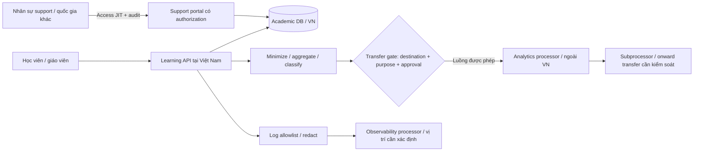
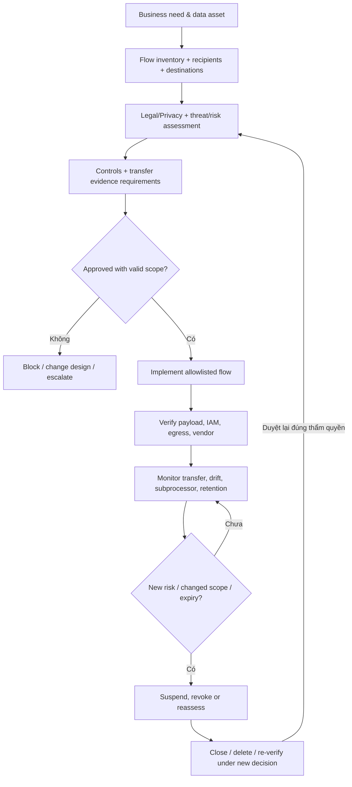

# Cross-border data

## Mục tiêu học tập

Sau bài học này, bạn có thể:

- Giải thích **cross-border data flow/transfer** trong bảo vệ quyền riêng tư và nhận diện việc dữ liệu được **lưu trữ, truy cập, hỗ trợ kỹ thuật, xử lý, sao lưu hoặc chuyển tiếp** qua các quốc gia/vùng lãnh thổ.
- Phân biệt **địa điểm lưu dữ liệu (data residency)**, quyền kiểm soát dữ liệu, quốc gia nhận, nhà xử lý, nhà xử lý phụ (*subprocessor*), **onward transfer** và các nghĩa vụ pháp lý áp dụng.
- Lập **bản đồ luồng dữ liệu xuyên biên giới** có nguồn, đích, mục đích, loại dữ liệu, chủ trách nhiệm, căn cứ xử lý, điều kiện chuyển và bằng chứng kiểm chứng.
- Áp dụng tư duy **risk-based privacy assurance**: đánh giá quyền riêng tư, rủi ro bảo mật, khả năng truy cập của bên nhận, pháp lý/hợp đồng, quyền cá nhân và tính hiệu lực của biện pháp bảo vệ.
- Thiết kế các biện pháp về **data minimization, quyền truy cập, mã hóa, quản lý khóa, egress control, giám sát vùng triển khai, retention, xóa và kiểm soát chuỗi nhà cung cấp**.
- Minh họa một **cross-border transfer gate** trên Java/Spring Boot, kiểm thử trường hợp hợp lệ/không hợp lệ, đồng thời hiểu giới hạn của mã kiểm soát ứng dụng.
- Tạo hồ sơ **Claim – Argument – Evidence** để chứng minh rằng luồng dữ liệu được đánh giá, phê duyệt và vận hành đúng phạm vi, kể cả sau thay đổi vendor, region hoặc kiến trúc.

## 1. Cross-border data là gì?

Trong bối cảnh **privacy assurance**, *cross-border data* đề cập đến dữ liệu có hoạt động **truyền, chia sẻ, lưu trữ, xử lý hoặc được truy cập qua ranh giới quốc gia/vùng lãnh thổ**. Vấn đề không chỉ là máy chủ nằm ở đâu: một hệ thống lưu dữ liệu trong nước vẫn có thể cho nhân viên hoặc nhà cung cấp ở nước khác **truy cập từ xa**; ngược lại, hệ thống sử dụng dịch vụ toàn cầu có thể tạo bản sao qua logs, backup, analytics hoặc dịch vụ hỗ trợ mà đội phát triển không nhận ra.

Ví dụ, nền tảng học tập Java/Spring Boot vận hành tại Việt Nam lưu bảng điểm trong database nội địa. Nhóm sản phẩm tích hợp một dịch vụ phân tích ở quốc gia khác để tính tỷ lệ hoàn thành khóa học. Dù endpoint chỉ gửi `learnerId`, `courseId` và timestamp, các thuộc tính đó **có thể là dữ liệu cá nhân hoặc giúp liên kết danh tính**, nhất là nếu vendor có thêm thông tin để nhận diện người học.

Nền tảng phải biết **dữ liệu gì đang đi**, **ai nhận**, **nhận ở đâu**, **để làm gì**, **được phép theo điều kiện nào**, **bên nhận giữ và chuyển tiếp ra sao** và **làm gì khi điều kiện thay đổi**. Đó là cơ sở để đánh giá bằng chứng, thay vì tuyên bố chung “cloud provider đã bảo mật”.

### 1.1. Cross-border không chỉ là xuất tệp

| Đường xử lý | Tình huống minh họa | Điều dễ bị bỏ sót |
| --- | --- | --- |
| **API outbound** | Gửi sự kiện tiến độ học tập sang dịch vụ phân tích ở nước ngoài. | Event có user identifier, IP, correlation ID hoặc các trường phụ. |
| **Cloud region/storage** | Lưu ảnh, tài liệu hoặc backup trong region khác quốc gia. | Replication, snapshot, disaster recovery region và vị trí khóa. |
| **Remote support** | Nhân viên nhà cung cấp ở nước khác đọc hồ sơ để xử lý ticket. | Không có file export nhưng vẫn có truy cập dữ liệu từ xa. |
| **Observability** | Gửi application logs, traces, APM metrics tới dịch vụ toàn cầu. | Log có email, token, URL hoặc dữ liệu cá nhân không được dự kiến. |
| **Identity/federation** | Chuyển thuộc tính người dùng sang IdP hoặc nhà cung cấp xác thực. | Profile/claims vượt mức tối thiểu và chuỗi xử lý của bên nhận. |
| **CDN và sao lưu** | Caching ảnh/file, đồng bộ bucket, backup sang site dự phòng. | Cấu hình georeplication hoặc cache làm phát sinh bản sao ngoài kế hoạch. |
| **Email/notification** | Gửi thông báo học tập bằng nhà cung cấp bên ngoài. | Nội dung email, địa chỉ liên hệ và log gửi có thể được xử lý ở vùng khác. |
| **Dữ liệu test/BI** | Sao chép dữ liệu production sang môi trường thử nghiệm hoặc kho phân tích khác quốc gia. | Quyền nhân sự, bản sao trung gian, khóa mapping và thời hạn xóa. |
| **Onward transfer** | Vendor ở quốc gia A giao subprocessor ở quốc gia B xử lý. | Quốc gia B và bên nhận tiếp theo không xuất hiện trong sơ đồ ban đầu. |

**Lưu ý:** việc một gói tin đi qua mạng ở nước khác, việc dữ liệu được nhân viên ở nước ngoài xem, hay việc dữ liệu được lưu tại một quốc gia khác có thể được **định nghĩa và xử lý khác nhau theo từng chế độ pháp lý**. Không tự suy ra mọi trường hợp đều cần cùng một thủ tục, hoặc rằng “không có file tải xuống” nghĩa là không có chuyển dữ liệu.

### 1.2. Những thuật ngữ quan trọng

| Thuật ngữ | Ý nghĩa thực hành | Câu hỏi assurance |
| --- | --- | --- |
| **Data residency** | Nơi dữ liệu được lưu trong hạ tầng. | Dữ liệu và bản sao thực nằm tại region nào? |
| **Data sovereignty / jurisdiction** | Khía cạnh thẩm quyền pháp lý và quy tắc áp dụng đối với dữ liệu hoặc hoạt động. | Những quy tắc nào áp dụng cho tổ chức, bên nhận và người có dữ liệu? |
| **Controller / quyết định mục đích** | Chủ thể xác định mục đích, cách thức xử lý theo khái niệm của chế độ pháp lý áp dụng. | Ai chịu trách nhiệm mục đích và việc cho phép chuyển? |
| **Processor / bên xử lý** | Bên xử lý dữ liệu thay mặt hoặc theo chỉ dẫn hợp lệ của bên có thẩm quyền. | Có hợp đồng, ranh giới chỉ dẫn, trách nhiệm và bằng chứng không? |
| **Subprocessor** | Bên xử lý tiếp theo được thuê để hỗ trợ xử lý. | Có được kiểm soát, thông báo và đánh giá trước khi sử dụng không? |
| **Onward transfer** | Dữ liệu tiếp tục được chuyển hoặc cho bên khác nhận. | Ai có thể nhận tiếp, ở đâu và theo điều kiện nào? |
| **Transfer mechanism** | Cơ chế/căn cứ pháp lý cho việc chuyển theo quy định áp dụng. | Có phù hợp nguồn, đích, chủ thể và phạm vi dữ liệu không? |
| **Transfer impact/risk assessment** | Đánh giá nguy cơ đối với cá nhân và hiệu quả của biện pháp khi chuyển. | Rủi ro còn lại, bất định và biện pháp giảm thiểu đã được xem xét chưa? |

Vai trò controller/processor, khái niệm *transfer* và loại thủ tục bắt buộc **không hoàn toàn giống nhau giữa các quốc gia**. Đây là mô hình để thiết kế và kiểm chứng; quyết định tuân thủ phải căn cứ đúng luật, phạm vi và thời điểm áp dụng.

## 2. Privacy assurance cho dữ liệu xuyên biên giới

**Privacy assurance** là khả năng đưa ra **lập luận kèm bằng chứng** rằng tổ chức đáp ứng mục tiêu bảo vệ quyền riêng tư và các yêu cầu xử lý dữ liệu trong **phạm vi được xác định**. Với luồng xuyên biên giới, chương trình phải kiểm soát ít nhất ba câu hỏi:

1. **Quyết định chuyển có phù hợp?** Mục đích, dữ liệu cần thiết, bên nhận, trách nhiệm, cơ chế pháp lý, quyền của cá nhân và mức rủi ro có được đánh giá đúng thẩm quyền?
2. **Biện pháp thực thi có đúng?** Ứng dụng, IAM, hạ tầng, tích hợp và vendor có thực sự chỉ chuyển dữ liệu được cho phép tới nơi được phê duyệt?
3. **Quá trình có được duy trì?** Khi thay cloud region, log exporter, vendor, subprocessor, dữ liệu, khóa hoặc quyền truy cập, có phát hiện và đánh giá lại trước khi tiếp tục không?

Trong module **SECURITY_SECURITY_ASSURANCE**, chuỗi truy vết nên là:

```text
Data asset & classification
  → Purpose / legal & contractual requirements
  → Cross-border flow and recipients
  → Privacy + security risk assessment
  → Transfer decision / approved scope
  → Security & privacy controls
  → Verification procedure / operating evidence
  → Residual risk / findings / exception / reassessment
```

**Một hợp đồng đã ký không đủ chứng minh hệ thống không gửi dữ liệu sai đích.** Ngược lại, một cấu hình cloud region đúng cũng **không đủ chứng minh việc chuyển dữ liệu là phù hợp pháp lý**. Hai lớp bảo đảm này cần được nối với nhau và kiểm chứng riêng.

### 2.1. Mục tiêu bảo vệ

| Mục tiêu | Rủi ro cần giảm | Ví dụ chứng cứ |
| --- | --- | --- |
| **Lawfulness/appropriateness** | Chuyển dữ liệu không có điều kiện hoặc cơ chế phù hợp theo quy định áp dụng. | Kết luận Legal/Privacy về phạm vi và điều kiện chuyển, phiên bản quy định được xét. |
| **Purpose limitation** | Vendor dùng dữ liệu để huấn luyện mô hình hoặc mục đích ngoài hợp đồng. | Data-processing terms, cấu hình tùy chọn chia sẻ, kiểm tra vendor và audit. |
| **Data minimization** | Gửi bảng điểm/ngày sinh khi chỉ cần số lượng học viên hoàn thành. | Schema outbound, test payload, code review, data-flow mapping. |
| **Confidentiality** | Bên nhận hoặc nhân viên ở vùng khác có quyền truy cập quá rộng. | IAM, RBAC/ABAC, test quyền, encryption/keys, access logs. |
| **Integrity** | Bên trung gian làm sai lệch dữ liệu/certificate/analytics. | Signed/authenticated interface, validation, integrity checks, reconciliation. |
| **Availability/recovery** | Dịch vụ ở vùng khác không thể truy cập, dữ liệu mất hoặc không thể khôi phục. | Resilience design, backup/restore tests, exit plan. |
| **Transparency/rights** | Không thể biết bên nhận, xử lý yêu cầu của cá nhân hoặc xóa khi hết mục đích. | Notices/records phù hợp, yêu cầu người dùng, propagation/erasure test. |
| **Accountability** | Không biết ai đã phê duyệt hoặc khi nào transfer vượt scope. | Transfer register, approval trail, monitoring, findings và audit record. |

### 2.2. Security assurance và privacy assurance bổ sung nhau

Một luồng dữ liệu **mã hóa mạnh** vẫn có thể không phù hợp về mục đích, bên nhận hoặc cơ chế chuyển. Một luồng có **quyết định chuyển hợp lệ** vẫn có thể làm lộ dữ liệu vì endpoint mở quyền hoặc gửi log thô. Cần kiểm tra **cả quyết định quản trị lẫn hiệu lực kỹ thuật**, không coi một bên thay thế bên kia.

## 3. Lập bản đồ data flow và trust boundary

### 3.1. Kịch bản học tập

Giả sử dịch vụ `learning-progress-api` xử lý dữ liệu học viên tại Việt Nam. Đội sản phẩm muốn gửi **số liệu thống kê hoàn thành khóa học** cho nhà cung cấp phân tích ở quốc gia khác; đồng thời một dịch vụ quản lý lỗi được cấu hình nhận logs và nhà cung cấp support có thể truy cập hồ sơ khi xử lý sự cố.

Trước khi thiết kế controls, cần phân biệt **ba luồng**:

- `FLOW-ANALYTICS`: dữ liệu thống kê/sự kiện outbound theo một schema.
- `FLOW-OBS`: logs/traces gửi tới hệ thống quan sát.
- `FLOW-SUPPORT`: truy cập từ xa có kiểm soát vào giao diện hỗ trợ.

Mỗi luồng có **data categories, recipient, location, purpose, retention, identity và risk khác nhau**. Không dùng phê duyệt cho `FLOW-ANALYTICS` để tự cho phép cả logs hoặc quyền support.



Sơ đồ **chỉ là giả định đào tạo**, không khẳng định một nhà cung cấp thực tế xử lý dữ liệu tại bất cứ quốc gia cụ thể nào. Các đường được gắn tên quốc gia phải được xác nhận bằng **cấu hình runtime, tài liệu nhà cung cấp và bằng chứng vận hành**.

### 3.2. Metadata tối thiểu của một luồng

| Thuộc tính | Cần ghi gì? | Vì sao quan trọng? |
| --- | --- | --- |
| Flow ID, version | Mã luồng và phiên bản phê duyệt. | Liên kết quyết định với cấu hình cụ thể. |
| Source / destination | Hệ thống, quốc gia/vùng, region, endpoint, môi trường, bên nhận. | Không nhầm “vendor có trụ sở A” với “dữ liệu được xử lý tại B”. |
| Data categories | Trường dữ liệu, classification, có thể nhận diện cá nhân hay không, quy mô. | Đánh giá risk và tránh dùng nhãn quá chung như `user_data`. |
| Data subjects | Học viên, giáo viên, nhân viên, trẻ em nếu có và thuộc phạm vi áp dụng. | Xác định nghĩa vụ và mức độ hậu quả. |
| Purpose/necessity | Vì sao cần chuyển và vì sao không thể gửi ít hơn. | Hỗ trợ data minimization và giới hạn mục đích. |
| Roles | Data owner, service owner, vendor/processor và subprocessor. | Quyền quyết định và nghĩa vụ khác nhau. |
| Processing path | API, object storage, remote support, replication, backup, logs. | Kiểm tra đầy đủ những nơi dữ liệu đi qua. |
| Legal review | Quy tắc áp dụng và kết luận về điều kiện/cơ chế chuyển. | Tránh nhầm mã hóa hoặc consent với quyền chuyển tự động. |
| Security controls | IAM, encryption, egress, redaction, key management, logging, retention. | Dùng để kiểm chứng thiết kế/vận hành. |
| Risks/unknowns | Threat scenarios, bất định, residual risk, các phụ thuộc vendor. | Quyết định minh bạch khi chưa đủ bằng chứng. |
| Conditions and lifecycle | Effective/expiry, trigger review, quyền đình chỉ, deletion/exit plan. | Kiểm soát sau khi luồng được phê duyệt. |

### 3.3. Bên nhận thực tế có thể khác tên sản phẩm

Đội kỹ thuật thường chỉ ghi “gửi sang analytics SaaS”. Để đủ assurance phải biết:

- Ai là **pháp nhân/bên nhận** và ai thực sự xử lý theo hợp đồng?
- Những **cloud region** nào được dùng cho dữ liệu chính, bản sao, queue, backup, logs và khắc phục sự cố?
- Những nhân viên ở vị trí nào có **remote administrative/support access**, vào dữ liệu nào và theo điều kiện gì?
- Có **subprocessors** hoặc các dịch vụ phụ trợ phân tán không?
- Bên nhận có chuyển tiếp dữ liệu sang đối tác khác, và điều kiện thông báo/chấp thuận khi thay đổi là gì?
- Có thể kiểm chứng bằng cách nào ngoài tài liệu tiếp thị “data stored locally”?

**Không đồng nhất region của database với toàn bộ luồng dữ liệu**. Chỉ một exception report chứa thông tin học viên đi tới hệ thống logging ngoài vùng cũng có thể làm thay đổi kết luận.

## 4. Cơ chế pháp lý và điều kiện chuyển: cách đánh giá đúng

Việc chuyển dữ liệu xuyên biên giới có thể chịu **nhiều chế độ pháp luật đồng thời**, tùy tổ chức, loại dữ liệu, nơi người có dữ liệu cư trú/được bảo vệ, vai trò bên nhận, nơi xử lý và mục đích. Đây là phần cần **Legal/Privacy/Compliance kiểm tra đúng quy định đang có hiệu lực**, không được tự suy luận từ tên cloud provider hoặc vùng máy chủ.

### 4.1. Những câu hỏi bắt buộc trước khi kết luận

1. Tổ chức và hoạt động cụ thể chịu những quy định nào? Dữ liệu có thuộc danh mục cá nhân/nhạy cảm/đặc biệt hoặc trẻ em theo chế độ liên quan không?
2. Bên gửi, bên nhận, nhà xử lý và nhà xử lý phụ có vai trò gì theo **chế độ pháp luật áp dụng**?
3. Việc **thu thập và sử dụng dữ liệu** có căn cứ, mục đích, minh bạch và giới hạn cần thiết không? Điều này **khác** câu hỏi cơ chế chuyển xuyên biên giới.
4. Hoạt động có thuộc khái niệm **transfer** hoặc trường hợp phải đánh giá thông báo/hồ sơ/phê duyệt riêng theo quy định đó không?
5. Có **cơ chế chuyển thích hợp** được phép sử dụng không? Nếu cần đánh giá rủi ro/biện pháp bổ sung, ai chịu trách nhiệm?
6. Bên nhận và subprocessor có đảm bảo giới hạn mục đích, quyền cá nhân, an toàn, thông báo sự cố và xóa dữ liệu không?
7. Những điều kiện nào khiến việc chuyển phải **dừng hoặc được đánh giá lại**?

Không được dùng một mẫu “consent” chung làm **điều kiện hợp pháp cho mọi lần chuyển**. Căn cứ xử lý, yêu cầu thông báo, consent và cơ chế chuyển có ý nghĩa và giới hạn khác nhau ở mỗi khuôn khổ.

### 4.2. Ví dụ các khuôn khổ để nhận biết, không phải kết luận tự động

| Phạm vi có thể liên quan | Nội dung cần hỏi chuyên môn | Điểm dễ hiểu sai |
| --- | --- | --- |
| **EU/EEA – GDPR Chapter V** (khi áp dụng) | Có quyết định về mức bảo vệ tương đương (*adequacy*) cho đích cụ thể, safeguards phù hợp như **Standard Contractual Clauses (SCCs)** hoặc **Binding Corporate Rules (BCRs)** trong trường hợp tương ứng, hay cơ chế khác được phép? Cần đánh giá hoàn cảnh chuyển và biện pháp bổ sung theo yêu cầu nào? | DPA thông thường, TLS hoặc SCC ký sẵn **không tự chứng minh** mọi yêu cầu chuyển đã đáp ứng. |
| **Các nghĩa vụ bảo vệ dữ liệu ở Việt Nam** | Hoạt động nào bị xem là chuyển dữ liệu ra nước ngoài hoặc để bên ở nước ngoài xử lý/truy cập? Điều kiện, hồ sơ đánh giá tác động, thủ tục với cơ quan quản lý, quyền cá nhân và các trường hợp được miễn/ngoại lệ theo **văn bản hiện hành** là gì? | Không lấy một số liệu thời hạn hoặc quy trình của phiên bản quy định cũ rồi áp dụng mặc định cho năm hiện tại. |
| **Quốc gia/vùng đích** | Bên nhận có nghĩa vụ về quyền truy cập của cơ quan có thẩm quyền, an toàn, lưu giữ, onward transfer hoặc hoạt động ngành giáo dục không? | “Máy chủ đặt tại nước X” không cho phép kết luận luật của nước X là duy nhất áp dụng. |
| **Hợp đồng/tổ chức giáo dục** | Có giới hạn xử lý, địa điểm lưu trữ, bên nhận, người học/trẻ em, dữ liệu của trường hoặc quy tắc riêng? | Phê duyệt nội bộ không tự sửa nghĩa vụ với trường, đối tác hoặc cá nhân. |

**Nội dung này là phương pháp học thuật và kỹ thuật, không phải tư vấn pháp lý.** Quy định, hướng dẫn và hiệu lực có thể thay đổi; khi lập hồ sơ thật cần đối chiếu **văn bản hiện hành, đúng đối tượng và quy trình**, ghi người kết luận và nguồn phiên bản đã xem. Đặc biệt, không mặc định tất cả dữ liệu từ Việt Nam đi nước ngoài đều theo cùng một thủ tục, cũng không giả định mọi hoạt động chịu GDPR.

### 4.3. Căn cứ xử lý không thay thế cơ chế chuyển

Trong những chế độ pháp luật yêu cầu **căn cứ xử lý** và **cơ chế chuyển quốc tế** riêng, phải giải quyết cả hai. Ví dụ, có mục đích cung cấp dịch vụ hợp lệ không tự biến việc đưa bản sao học viên tới mọi quốc gia thành được phép; ngược lại, ký điều khoản chuyển dữ liệu không tự mở rộng mục đích kinh doanh.

### 4.4. Đánh giá điều kiện thực tế của điểm đến

Khi khuôn khổ áp dụng yêu cầu đánh giá tác động của hoàn cảnh chuyển, cần xem xét **các quy tắc/hoạt động tại điểm đến**, mức truy cập có thể xảy ra, cơ chế đòi dữ liệu, khả năng bên nhận đáp ứng nghĩa vụ và những biện pháp bảo vệ thực sự hữu hiệu. Có thể cần **technical, contractual và organizational measures bổ sung**, nhưng không tuyên bố một giải pháp kỹ thuật luôn đủ trong mọi bối cảnh pháp lý.

**Không có bằng chứng đầy đủ về một điều kiện bắt buộc** thì không thể phê duyệt luồng chỉ bằng suy đoán “vendor lớn chắc đạt”. Quyết định phải được **chặn, chuyển cấp hoặc thay đổi thiết kế** theo quy trình.

## 5. Đánh giá rủi ro và threat modeling cho cross-border data

### 5.1. Phân tích rủi ro theo người có dữ liệu

Ngoài confidentiality/integrity/availability, cần hỏi **cá nhân bị ảnh hưởng thế nào**:

- Dữ liệu có bị dùng để phân loại, theo dõi, dự đoán hoặc đưa ra quyết định ngoài mục đích ban đầu không?
- Việc kết hợp dữ liệu do nhiều bên nắm giữ có làm tăng khả năng nhận diện/suy luận thông tin riêng tư không?
- Người dùng có thể biết dữ liệu được chia sẻ với ai, yêu cầu sửa/xóa, khiếu nại hoặc rút lại quyền khi có căn cứ không?
- Khi vendor ngừng hợp tác, có thể chuyển đổi và xóa dữ liệu/bản sao một cách có kiểm chứng không?
- Trẻ em/người học thuộc nhóm cần bảo vệ đặc biệt có xuất hiện trong tập dữ liệu không?

Không xem rủi ro chỉ là số lượng bản ghi. Một hồ sơ chứng chỉ, minh chứng danh tính hoặc dữ liệu vị trí nhạy cảm cũng có thể có **tác động lớn** dù số lượng nhỏ.

### 5.2. Threat scenarios và biện pháp

| Threat ID | Kịch bản | Hậu quả | Cách giảm rủi ro và kiểm chứng |
| --- | --- | --- | --- |
| `XBD-01` | API chuyển cả hồ sơ học viên thay vì chỉ thống kê được phê duyệt. | Lộ nhiều dữ liệu, xử lý vượt mục đích. | Outbound schema allowlist, data minimization, contract/schema test và log kiểm tra payload giả. |
| `XBD-02` | Region của storage/backup tự chuyển sang địa điểm ngoài danh mục. | Vi phạm điều kiện địa điểm, mất kiểm soát bản sao. | Region policy, IaC/runtime drift check, backup/replication inventory. |
| `XBD-03` | Nhà cung cấp hỗ trợ từ xa có quyền đọc bảng điểm toàn hệ thống. | Quyền truy cập trái nhu cầu, nguy cơ lạm dụng. | JIT, least privilege, object-level authorization, session audit và review quyền. |
| `XBD-04` | Vendor dùng thêm subprocessor không được đánh giá hoặc chuyển tiếp dữ liệu. | Bên nhận/địa điểm ngoài scope được phê duyệt. | Contract controls, cập nhật subprocessor, change notification, re-assessment và chứng cứ vận hành. |
| `XBD-05` | Log exporter gửi token và nội dung học viên tới dịch vụ ngoài vùng. | Lộ thông tin nhạy cảm qua đường thứ cấp. | Structured log allowlist, redaction, test end-to-end từ source đến sink, cấu hình APM. |
| `XBD-06` | Service account outbound có quyền gửi mọi dataset tới mọi endpoint. | Bypass chính sách destination/purpose. | Egress allowlist, policy gate, IAM scope, kiểm thử sai đích và giám sát network. |
| `XBD-07` | Dữ liệu đã xóa tại hệ thống nguồn vẫn tồn tại ở vendor và backup. | Vi phạm mục đích/lưu giữ, xử lý yêu cầu cá nhân không đầy đủ. | Retention schedule, deletion propagation, vendor attestations, sample reconciliation. |
| `XBD-08` | Đối tác xử lý dữ liệu bị chiếm quyền hoặc bị yêu cầu cung cấp dữ liệu. | Lộ dữ liệu, giảm hiệu quả safeguards. | Risk/transfer assessment, key control, minimization, contractual response và phương án đình chỉ. |
| `XBD-09` | Báo cáo pseudonymized bị liên kết lại qua IDs/timestamps. | Tái nhận diện học viên. | Re-identification assessment, domain separation, aggregation, giảm trường và giới hạn bên nhận. |
| `XBD-10` | Token xác thực và approval được dùng lại cho transfer chưa được duyệt. | Chuyển dữ liệu sai scope hoặc khi hết hiệu lực. | Transaction-bound approval, expiry, revoke, event replay protection, worker-side recheck. |

### 5.3. Residual risk phải dựa trên bằng chứng

Nếu dữ liệu được mã hóa khi truyền nhưng bên nhận **phải giải mã để phân tích**, mã hóa đường truyền không ngăn bên nhận nhìn thấy bản rõ. Nếu pseudonymization dùng cùng một khóa cho mọi đối tác, nguy cơ liên kết vẫn tồn tại. Nếu hợp đồng cấm onward transfer nhưng vendor có quyền cấu hình tự thêm subprocessor, cần bằng chứng về **cơ chế giám sát và thực thi**.

Không cộng trừ điểm số tùy ý để khẳng định rủi ro thấp. Cần xác định **đường tấn công**, khả năng xảy ra, hậu quả với người có dữ liệu, control đang hoạt động, bất định và thẩm quyền chấp nhận residual risk.

## 6. Phân loại, minimization và dữ liệu dẫn xuất khi chuyển

### 6.1. Không chuyển dữ liệu chỉ vì có sẵn

Giả sử nhà phân tích chỉ cần báo cáo “tỷ lệ hoàn thành khóa theo tuần”. Những lựa chọn theo thứ tự cân nhắc:

1. **Tính số liệu tổng hợp tại nguồn**, chỉ gửi giá trị đã đủ điều kiện chia sẻ.
2. Nếu cần event-level data, **bỏ các trường không cần** (email, tên, số điện thoại, địa chỉ, ghi chú).
3. Nếu cần liên kết nhiều event, cân nhắc **pseudonymization có giới hạn mục đích** thay vì stable global identifier.
4. Nếu vendor bắt buộc phải nhận định danh cá nhân, **đánh giá lại nhu cầu, cơ chế, privacy risk và bên nhận**, không coi đó là cấu hình nhỏ.
5. Xem số lượng bản ghi, tần suất và **khả năng tái nhận diện** sau khi ghép dữ liệu.

Một giá trị `learnerHash = SHA256(email)` **không tự ẩn danh**: email dễ bị đoán/dictionary attack, và hash ổn định cho phép join giữa các bộ dữ liệu. Thay tên bằng `Student-001` cũng không đủ nếu bên nhận còn ID, thời gian, lớp học hoặc thuộc tính hiếm.

### 6.2. Kế thừa nhãn và data handling rules

| Đối tượng | Ví dụ classification | Lưu ý |
| --- | --- | --- |
| Bảng điểm gắn định danh | `CONFIDENTIAL` trong taxonomy ví dụ. | Không được chuyển theo rule dành cho dữ liệu công khai. |
| Sự kiện analytics có stable learner ID | Có thể vẫn là dữ liệu cá nhân cần bảo vệ. | Pseudonym không đương nhiên là anonymous. |
| Báo cáo tổng hợp theo nhóm lớn | Có thể có mức xử lý khác sau review. | Nhóm nhỏ/differencing attack có thể tiết lộ cá nhân. |
| Log sự kiện export | Metadata về người dùng và đối tượng dữ liệu. | Không gắn nhãn thấp chỉ vì là “log kỹ thuật”. |
| Backup của database học viên | Thường theo dữ liệu gốc trong phạm vi bản sao. | Mã hóa không tự hạ nhãn. |
| Tài liệu identity proofing | Có thể thuộc mức hạn chế đặc biệt. | Chỉ chuyển khi mục đích, nghĩa vụ và quyền thật sự yêu cầu. |

**Thay đổi định dạng không tự thay đổi tính pháp lý của dữ liệu.** Cần data owner và Privacy review trước khi tuyên bố một tập đã được anonymized hoặc có thể công khai/di chuyển không hạn chế.

### 6.3. Liên kết quyết định chuyển với schema

Một approval không nên chỉ ghi “cho phép analytics”. Nên gắn với **dataset version, data fields, destination ID, purpose, processor/subprocessor, region, thời hạn và điều kiện kỹ thuật**. Thêm `learnerEmail` vào event schema hoặc đổi đích phải kích hoạt review; không để bản phê duyệt cũ che thay đổi thực tế.

## 7. Các biện pháp bảo vệ theo từng lớp

**Không có một control đơn lẻ bảo đảm quyền riêng tư cho mọi luồng xuyên biên giới.** Cần chọn các lớp phù hợp với threat, yêu cầu áp dụng và mức rủi ro.

### 7.1. Technical controls

| Control | Công dụng | Giới hạn phải kiểm chứng |
| --- | --- | --- |
| **Data minimization & allowlisted schema** | Không gửi các trường không cần thiết. | Những trường “định danh gián tiếp” vẫn có thể linkable; schema thực có thể drift. |
| **Strong transport protection** | Bảo vệ dữ liệu khi truyền tới endpoint được xác thực. | TLS không hạn chế bên nhận giải mã rồi xử lý ngoài mục đích. |
| **Encryption at rest + key management** | Giảm phơi bày khi lưu hoặc sao chép. | Quyền giải mã, kiểm soát khóa, backup và endpoint xử lý bản rõ vẫn quan trọng. |
| **Pseudonymization/aggregation** | Giảm khả năng gắn dữ liệu với cá nhân khi phù hợp. | Không tự ẩn danh; cùng mapping hoặc dataset phụ có thể tái nhận diện. |
| **IAM/least privilege/JIT** | Giới hạn nhân sự và workload được xem, xuất hoặc quản trị dữ liệu. | Cần xem quyền hiệu lực, role kế thừa, token, đường support và break-glass. |
| **Egress allowlist / routing controls** | Giới hạn đích outbound và endpoint không được phê duyệt. | Proxy, DNS, CDN, IPv6, vendor endpoint thay đổi và traffic từ worker có thể bị bỏ sót. |
| **Cloud region/replication guardrails** | Giảm drift sang vùng không được phép. | Backup, logs, key services, vendor-managed copies có thể nằm ngoài guardrail. |
| **Transfer approval gate** | Chặn hành động không có phê duyệt đúng scope và hiệu lực. | Chỉ chặn đường đi qua gate; batch job và kênh phụ cần kiểm soát riêng. |
| **Audit/monitoring/DLP** | Phát hiện transfer lệch mục đích, region, volume hoặc người nhận. | Không có cảnh báo không đồng nghĩa không có chuyển sai; DLP có false negative. |
| **Retention/deletion propagation** | Hạn lượng dữ liệu tồn tại tại bên nhận và bản sao. | “Đã gửi yêu cầu xóa” chưa chứng minh vendor/backup đã xử lý theo thỏa thuận. |

### 7.2. Organizational và contractual controls

- **DPA/data sharing terms** phù hợp vai trò và nghĩa vụ: mục đích, loại dữ liệu, bảo mật, quyền truy cập, thông báo sự cố, subprocessor, chuyển tiếp, xóa/return và quyền kiểm tra.
- **Phê duyệt có trách nhiệm:** data owner, Privacy/Legal, Security/Risk, vendor manager và risk owner theo mức độ; không để một developer tự xác nhận mọi điều kiện.
- **Đào tạo và runbook:** ai mở kênh mới, ai đánh giá request vendor support, ai đình chỉ transfer nếu có incident hoặc region drift.
- **Đánh giá nhà cung cấp:** danh sách bên nhận thực tế, bảo mật, quyền hỗ trợ từ xa, chính sách thay đổi subprocessor, thông báo và bằng chứng.
- **Kênh xử lý quyền cá nhân:** người dùng được biết và gửi yêu cầu theo quy định áp dụng; hệ thống có trách nhiệm phối hợp với bên nhận.
- **Exit plan:** khi hủy vendor, có cách ngắt luồng, thu hồi khóa/quyền, lấy dữ liệu về và xác minh xóa hoặc xử lý phần còn lại.

Các điều khoản hợp đồng **không tự bảo vệ bản ghi** khỏi lỗi IAM hoặc lộ token. Ngược lại, một encryption scheme hiệu quả **không tự cho phép chuyển** nếu pháp lý hoặc hợp đồng cấm hoạt động ấy.

### 7.3. Data residency khác confidentiality

Một region được phép chỉ cho biết **một phần của bài toán địa điểm**. Nếu nhân viên ở nơi khác dùng tài khoản quản trị xem dữ liệu, privacy assurance vẫn phải đánh giá quyền truy cập xuyên biên giới theo định nghĩa áp dụng. Nếu backup, audit log, CDN hoặc vendor xử lý nằm ở vùng khác, claim “mọi dữ liệu ở trong nước” có thể không đúng.

**Không khẳng định có thể kiểm tra vị trí dữ liệu chỉ từ một hostname.** Cần đối chiếu cloud configuration, replication, contractual statement, data export jobs, support access logs và giới hạn hiển thị của nhà cung cấp.

## 8. Vendor, subprocessor và onward transfer

### 8.1. Phạm vi đánh giá vendor

Với một luồng dữ liệu, hãy ghi:

1. **Bên nhận chính:** tên tổ chức, dịch vụ và tư cách xử lý dữ liệu.
2. **Danh sách subprocessors** và chức năng: hosting, analytics, error reporting, customer support, backup.
3. **Quốc gia/region** xử lý hoặc nơi quyền truy cập được cấp, theo phạm vi có thể xác minh.
4. **Mục đích và loại dữ liệu** vendor/subprocessor được phép nhận.
5. **Cơ chế hợp đồng/chuyển** có áp dụng cho từng đoạn onward transfer hay không, ai giữ hồ sơ.
6. **Thông báo thay đổi và quyền phản đối/ngừng** theo nghĩa vụ và thỏa thuận.
7. **Biện pháp kỹ thuật**: mã hóa, khóa, phân quyền, logs, isolation, retention.
8. **Bằng chứng vận hành**: audit/report phù hợp, review risk, test data deletion, vendor attestations trong giới hạn sử dụng.

### 8.2. Khi vendor đổi subprocessor

Thay đổi một subprocessor có thể làm đổi **quốc gia đích, loại dữ liệu xử lý, mức phơi bày, rủi ro pháp lý và điều kiện hợp đồng**. Nếu phạm vi thay đổi, approval cũ không tự động bao phủ:

```text
Change detected
  → Identify affected data flows and contracts
  → Update recipient/location/purpose map
  → Legal/Privacy and risk reassessment when required
  → Update technical controls and tests
  → Approve or suspend before the new flow is used
  → Record new evidence and decision
```

Đừng chỉ lưu link tới trang “subprocessor list” mà không có **phiên bản, ngày review, kết quả đánh giá và quy trình nhận thông báo**. Khi vendor từ chối cung cấp thông tin bắt buộc, trạng thái phù hợp có thể là **`INSUFFICIENT_EVIDENCE` và không cho qua gate** theo chính sách.

## 9. Ví dụ Java/Spring Boot: chặn transfer không được duyệt

### 9.1. Bối cảnh và kiến trúc minh họa

Dịch vụ `learning-progress-api` nhận yêu cầu đưa một **dataset tổng hợp đã được phê duyệt** tới một đích analytics. Đích có **mã nội bộ cố định** (ví dụ `analytics-partner-A`), được resolve trong catalog backend. Client **không được gửi URL tùy ý** để dịch vụ tạo HTTP request ra bên ngoài.

Một bản `TransferRegistration` được bộ phận có thẩm quyền phê duyệt có thể chứa:

```text
flow_id, source_asset_id, schema_revision
purpose, classification, recipient_id, destination_region
approved_data_categories, legal_review_reference
transfer_mechanism_reference (khi luật áp dụng yêu cầu)
approved_controls, owner, effective_window
subprocessor_scope, retention, residual_risk
status, change_trigger, audit_evidence
```

**Không dùng một cờ `isApproved=true` do client gửi.** Hệ thống phải lấy bản phê duyệt và metadata từ nguồn được quản lý, xác minh hiệu lực và điều kiện trước khi cho phép.

### 9.2. Control statements có thể kiểm chứng

| ID | Requirement | Phép kiểm |
| --- | --- | --- |
| `XBD-GOV-01` | Mọi luồng outbound chứa dữ liệu thuộc phạm vi quản trị phải có flow ID, owner, purpose, recipient/region, legal/risk review và trạng thái được quản lý. | Registry reconciliation với đường gửi thật và vendor records. |
| `XBD-DATA-02` | Payload outbound chỉ chứa các trường được duyệt cho đúng purpose/schema revision. | Contract/integration tests, kiểm tra payload ở egress test environment. |
| `XBD-AUTH-03` | Chỉ người có quyền trên dataset/action mới được yêu cầu transfer; người khác bị từ chối. | Identity/resource negative tests, kiểm tra scope. |
| `XBD-GATE-04` | Không khởi tạo hoặc gửi job nếu flow approval không hợp lệ, sai đích, hết hạn, bị thu hồi hoặc thiếu điều kiện bắt buộc. | Test trạng thái và thời hạn; worker-side recheck. |
| `XBD-DEST-05` | Chỉ gửi tới endpoint/region do server resolve theo danh mục đã duyệt; traffic tới đích khác bị giới hạn. | Runtime config, egress logs, network guardrail tests. |
| `XBD-OPS-06` | Change về schema, region, vendor/subprocessor hoặc dữ liệu phải trigger reassessment. | CI/change tests, vendor notifications, review log. |
| `XBD-RET-07` | Dữ liệu phải được giữ/xóa ở bên nhận theo điều kiện đã duyệt; có cơ chế kiểm chứng phù hợp. | Vendor contract and deletion records, sample reconciliation. |

### 9.3. Kiểm tra quyền và phê duyệt tại service layer

Ví dụ dùng Spring Security **mang tính giảng dạy**, các interfaces và entity do hệ thống tự định nghĩa:

```java
@Configuration
@EnableMethodSecurity
class MethodSecurityConfiguration {}

@Service
class CrossBorderTransferService {
    private final TransferJobRepository jobs;

    CrossBorderTransferService(TransferJobRepository jobs) {
        this.jobs = jobs;
    }

    @PreAuthorize(
        "@crossBorderPolicy.mayRequest(authentication, " +
        "#datasetId, #destinationId)"
    )
    public TransferJobId requestTransfer(UUID datasetId, String destinationId) {
        return jobs.enqueue(datasetId, destinationId);
    }
}
```

`crossBorderPolicy` là **Spring bean giả định**. Nó cần kiểm chứng nhiều điều kiện chứ không phải chỉ role:

```java
@Component("crossBorderPolicy")
class CrossBorderPolicy {
    private final DataCatalog catalog;
    private final TransferRegister register;
    private final DatasetAccess access;

    CrossBorderPolicy(DataCatalog catalog,
                      TransferRegister register,
                      DatasetAccess access) {
        this.catalog = catalog;
        this.register = register;
        this.access = access;
    }

    public boolean mayRequest(Authentication auth,
                              UUID datasetId,
                              String destinationId) {
        if (auth == null || !auth.isAuthenticated()
                || auth instanceof AnonymousAuthenticationToken) {
            return false;
        }
        if (!access.canTransfer(auth, datasetId)) {
            return false;
        }

        // Mọi nguồn là server-side: không tin field do client tự khai.
        DataAsset asset = catalog.find(datasetId).orElse(null);
        TransferApproval approval =
                register.findFor(datasetId, destinationId).orElse(null);
        if (asset == null || approval == null) {
            return false; // Unknown data/recipient => không tự cho phép.
        }

        return approval.isActiveNow()
                && approval.matchesSchema(asset.schemaRevision())
                && approval.matchesClassification(asset.classification())
                && approval.isRecipientAndPurposeAuthorized()
                && approval.hasMandatoryConditionsVerified();
    }
}
```

Các phương thức `isActiveNow`, `hasMandatoryConditionsVerified`, các repositories và các kiểu `DataAsset`, `TransferApproval` là **mô hình ứng dụng giả định**, không phải SDK hay câu trả lời tự động cho yêu cầu pháp lý. Trong production, chúng phải xác thực **đúng bản quyết định Legal/Privacy và risk**, hạn hiệu lực, data category, purpose, đích, quyền của người gọi, role, tenant, schema, trạng thái thu hồi và integrity của hồ sơ. Việc kiểm tra thời điểm cần dùng clock/source đáng tin và được test tại các thời điểm biên.

**Quan trọng:** authorization qua method proxy không chặn được luồng không gọi qua Spring proxy, self-invocation, cron, worker, direct database export hoặc logging. Không thể suy ra “không có transfer trái phép” chỉ vì một method có `@PreAuthorize`.

### 9.4. Kiểm tra lại ở worker và đích gửi

Một yêu cầu hợp lệ tại thời điểm tạo job có thể **không còn hợp lệ** khi worker xử lý: approval hết hạn, vendor thay region, dataset thêm trường hoặc người yêu cầu mất quyền. Do đó:

1. Worker phải tải **đúng approval và dataset revision**, kiểm tra điều kiện theo policy tại thời điểm gửi.
2. Đích phải được resolve từ **server-managed destination catalog**, không tạo URL từ tham số người dùng.
3. Payload phải được xây từ **allowlist đã duyệt**, không serialize toàn bộ entity.
4. Egress/network policies cần giới hạn endpoint và chứng minh traffic thực tế.
5. Bất kỳ chuyển tiếp nào từ vendor/subprocessor phải được quản lý ở lớp hợp đồng/operating controls tương ứng.
6. Khi policy store mất kết nối hoặc flow trạng thái chưa rõ, không mặc định `APPROVED`; chuyển sang trạng thái chờ/blocked theo quy trình.
7. Audit event ghi **flow ID, dataset/version, destination ID, outcome, actor/job và timestamp**, tránh ghi dữ liệu học viên vào log.

Đây là ví dụ về **defense in depth**: control ứng dụng, worker, hạ tầng, vendor và quản trị pháp lý phải hỗ trợ nhau.

### 9.5. Kiểm thử hành vi API

Giả sử fixture trong integration test quy định `dataset-1` là tập đã được phê duyệt cho `analytics-partner-A` và `dataset-2` không có phê duyệt. Người có quyền là `analyst-a`, `analyst-b` không có quyền với `dataset-1`.

```java
@SpringBootTest
@AutoConfigureMockMvc
class CrossBorderTransferIT {
    @Autowired
    MockMvc mockMvc;

    @Test
    @WithMockUser(username = "analyst-a", roles = "ANALYST")
    void approvedFlowMayCreateTransferJob() throws Exception {
        mockMvc.perform(post("/api/datasets/{id}/transfers",
                    "11111111-1111-1111-1111-111111111111")
                .param("destinationId", "analytics-partner-A")
                .with(csrf()))
            .andExpect(status().isAccepted());
    }

    @Test
    @WithMockUser(username = "analyst-a", roles = "ANALYST")
    void unknownDestinationMustBeDenied() throws Exception {
        mockMvc.perform(post("/api/datasets/{id}/transfers",
                    "11111111-1111-1111-1111-111111111111")
                .param("destinationId", "unapproved-destination")
                .with(csrf()))
            .andExpect(status().isForbidden());
    }

    @Test
    @WithMockUser(username = "analyst-b", roles = "ANALYST")
    void unrelatedAnalystCannotTransferDataset() throws Exception {
        mockMvc.perform(post("/api/datasets/{id}/transfers",
                    "11111111-1111-1111-1111-111111111111")
                .param("destinationId", "analytics-partner-A")
                .with(csrf()))
            .andExpect(status().isForbidden());
    }
}
```

Test này là **mẫu**, giả định controller, fixtures, principal mapping, Spring Security Test và CSRF đã được cấu hình phù hợp. `403` đơn lẻ **không chứng minh transfer policy đã chặn đúng**: có thể request thất bại vì CSRF, route không tồn tại hoặc service bean không được gọi. Cần ca tích cực, xác minh job **không được tạo** ở ca từ chối và test policy/worker thật thay vì mock luôn trả giá trị được mong đợi.

Cần thêm test: approval hết hạn hoặc bị thu hồi, schema thay đổi, loại dữ liệu mới, thiếu legal review bắt buộc, đích/tenant sai, worker nhận job cũ, policy unavailable, vendor endpoint bị đổi, log error path, xác minh egress thực trên môi trường mục tiêu. **MockMvc không đi qua cloud networking**, nên không thể một mình chứng minh country/region đang vận hành.

## 10. Quản trị vòng đời transfer

### 10.1. Quy trình tám bước

1. **Đề xuất:** business owner mô tả mục đích, dữ liệu, bên nhận/region và phương án không cần transfer nếu có.
2. **Phân loại & map flow:** inventory, data categories, người bị ảnh hưởng, source, destination, remote support và onward transfers.
3. **Đánh giá legal/privacy/risk:** xác định luật áp dụng, cơ chế/điều kiện, nghĩa vụ bên nhận, quyền cá nhân và hiệu quả biện pháp dự kiến.
4. **Thiết kế controls:** data minimization, access scope, encryption/keys, destination catalog, network guardrails, monitoring, retention.
5. **Phê duyệt:** những người có thẩm quyền quyết định **đúng bản flow/purpose/schema/vendor/region**, với điều kiện, hạn và residual risk.
6. **Triển khai & kiểm chứng:** test payload, quyền, region/egress, logging, vendor behavior và các ca thất bại; chỉ active khi điều kiện tiên quyết đạt.
7. **Giám sát và rà soát:** drift, subprocessor changes, claims mất hiệu lực, quyền, sự cố, data rights và deletion; cảnh báo cho owner.
8. **Dừng, gia hạn/đổi phạm vi hoặc kết thúc:** thay đổi quan trọng phải đánh giá lại; khi ngừng vendor, revoke credentials, ngắt flow, quản lý xóa/return và lưu bằng chứng.



**Approved** phải là trạng thái của **luồng có điều kiện**, không phải cờ cho phép một nhà cung cấp nhận mọi dữ liệu. Việc gia hạn phải dựa trên review mới và evidence hiện hành khi nghĩa vụ/độ rủi ro yêu cầu.

### 10.2. Vai trò và phân tách nhiệm vụ

| Vai trò | Trách nhiệm | Bằng chứng |
| --- | --- | --- |
| **Data/business owner** | Quyết định mục đích, danh mục dữ liệu, tính cần thiết và người nhận theo thẩm quyền. | Purpose/field mapping, business approval. |
| **Privacy/Legal/Compliance** | Xác định phạm vi pháp lý, điều kiện/cơ chế chuyển, nghĩa vụ minh bạch và xử lý quyền cá nhân. | Kết luận có căn cứ, phiên bản quy định, hồ sơ cần thiết. |
| **Security architect/control owner** | Đánh giá threats, safeguards, giới hạn kỹ thuật và residual risk. | Threat model, risk assessment, control mapping. |
| **Vendor/contract owner** | Theo dõi bên nhận, subprocessors, terms, thay đổi/đình chỉ và exit. | Contract, vendor review, subprocessor change log. |
| **Developer/Operator** | Triển khai schema, gates, IAM, egress, region controls và audit. | Code/config/deployment, runtime checks, security tests. |
| **Risk owner** | Chấp nhận/không chấp nhận residual risk **trong thẩm quyền**, không tự miễn nghĩa vụ bắt buộc. | Decision record, scope, conditions, expiry. |
| **Assurance reviewer/auditor** | Kiểm tra lập luận, bằng chứng design/operating và ghi finding độc lập tương xứng rủi ro. | CAE, sampling, re-test và hạn chế kết luận. |

Nếu một developer vừa thêm vendor, tự mở egress, tự đánh dấu “legal approved” và tự kiểm tra PASS, đó là **xung đột vai trò** cần kiểm soát. Quy trình nhỏ có thể sử dụng reviewer độc lập theo risk, nhưng không được hạ yêu cầu bắt buộc vì thiếu nhân sự.

## 11. Hồ sơ transfer có thể audit

### 11.1. Mẫu dữ liệu quyết định

Mẫu YAML sau chỉ dùng để **thể hiện cấu trúc**; mọi ID, quốc gia và trạng thái là giả định. **Không đại diện cho hồ sơ pháp lý hoặc kết quả phê duyệt có thật.**

```yaml
flow_id: "FLOW-ANALYTICS-EXAMPLE"
revision: "draft-1"
state: "PENDING_REVIEW"
source:
  system: "learning-progress-api"
  region: "Vietnam (example)"
  data_owner_role: "learning-data-owner"
destination:
  recipient_id: "analytics-partner-A"
  declared_country: "Example destination country"
  region: "<to-be-verified-region>"
  approved_endpoints: []
  remote_access_locations: []
purpose: "Aggregate course completion reporting"
dataset:
  asset_id: "completion-statistics"
  schema_revision: "<pending-approved-schema>"
  classification: "UNDER_REVIEW"
  data_categories: ["course", "completion-count", "reporting-period"]
  personal_data_assessment: "UNDER_REVIEW"
  subject_groups: ["learners"]
  retention_ref: "<approved-retention-rule>"
recipients:
  primary_processor_ref: "<vendor-record>"
  subprocessors_ref: "<approved-list-version>"
  onward_transfer_scope: "UNCONFIRMED"
privacy_legal:
  applicable_regimes_ref: "<legal-analysis-reference>"
  processing_basis_ref: "<applicable-review-reference>"
  transfer_conditions_ref: "<decision-and-evidence-reference>"
  reviewer_role: "privacy-legal-reviewer"
  decision: "PENDING"
risk:
  threat_model_ref: "<assessed-data-flow>"
  residual_risk: "UNDER_REVIEW"
  risk_owner_role: "authorized-risk-owner"
controls:
  - "Approved outbound field allowlist"
  - "Scoped service identity and destination allowlist"
  - "Encryption, logs, retention and deletion controls"
verification:
  payload_test_ref: "<actual-test-artifact>"
  egress_runtime_ref: "<actual-network-check>"
  recipient_review_ref: "<actual-vendor-evidence>"
  status: "INSUFFICIENT_EVIDENCE"
monitoring:
  reassess_on:
    - "Recipient, region, subprocessor or destination change"
    - "Dataset schema, purpose or classification change"
    - "Security incident, legal assessment or retention change"
  revoke_if:
    - "Mandatory condition fails"
    - "Evidence of unauthorized onward transfer"
closeout:
  exit_and_deletion_evidence_refs: []
```

Đây là mẫu có chủ ý đặt trạng thái **`PENDING_REVIEW` và `INSUFFICIENT_EVIDENCE`**: không được suy ra có quyền chuyển dữ liệu chỉ từ sự hiện diện của một file cấu hình. Phải liên kết tới hợp đồng, quyết định hợp lệ và artifact thật có bảo vệ truy cập; tuyệt đối không đưa token, dữ liệu học viên thô hoặc tài liệu nhận dạng nhạy cảm vào hồ sơ phổ biến.

### 11.2. Kết quả đánh giá nên phân biệt

| Kết quả | Diễn giải | Hành động |
| --- | --- | --- |
| **PASS trong phạm vi** | Những điều kiện đã xác định và các controls được kiểm chứng bằng chứng phù hợp trên phiên bản/môi trường được xét. | Duy trì monitoring, ghi hạn/phạm vi và đánh giá lại khi có trigger. |
| **FAIL** | Có chứng cứ luồng chuyển/đường truy cập không đáp ứng requirement áp dụng. | Block/suspend nếu cần, tạo finding, đánh giá incident/risk, khắc phục và re-test. |
| **INSUFFICIENT_EVIDENCE** | Không xác minh được vùng/bên nhận, thiếu legal/contract review hoặc test runtime không đủ. | Bổ sung evidence; không mặc định `PASS`. |
| **EXCEPTION_APPLIED** | Có ngoại lệ nội bộ được phép, đúng scope, có quyết định và residual risk. | Theo dõi điều kiện, expiry; không dùng để vượt nghĩa vụ pháp lý bắt buộc. |
| **SUSPENDED/REVOKED** | Luồng không còn được phép hoạt động do hết hạn, thay phạm vi, điều kiện thất bại hoặc quyết định có thẩm quyền. | Ngừng gửi, giữ bằng chứng, kiểm tra dữ liệu đã gửi và điều kiện khôi phục. |

**Ngoại lệ** là công cụ quản trị sai khác **nội bộ** trong thẩm quyền cho phép, không phải quyền tự miễn nghĩa vụ pháp luật/hợp đồng. Một luồng trước đây được duyệt **không tự hợp lệ** nếu đổi sang subprocessor, dataset hoặc quốc gia đích khác.

## 12. Claim – Argument – Evidence cho cross-border data

### 12.1. Claim hẹp, có điều kiện

**Claim A – quyết định:** “Với `FLOW-ANALYTICS-EXAMPLE` phiên bản R, tổ chức đã nhận diện data categories, mục đích, nơi nhận, các bên xử lý, điều kiện chuyển và rủi ro còn lại; quyết định triển khai chỉ được cấp trong phạm vi được người có thẩm quyền xác nhận.”

**Argument A:**

1. Flow inventory và data catalog xác định dữ liệu nguồn, người có dữ liệu, bản sao và mọi bên nhận dự kiến.
2. Business owner xác định mục đích, tính cần thiết và schema tối thiểu.
3. Privacy/Legal xem những chế độ áp dụng và điều kiện chuyển tương ứng; vendor owner xác minh contract/subprocessors.
4. Security/Risk đánh giá nguy cơ của các đường truy cập/xử lý và safeguards.
5. Hệ thống quyết định lưu đúng version, owner, scope, hiệu lực, điều kiện dừng và lịch review.

**Evidence A:** data-flow inventory, data catalog/classification review, legal assessment và căn cứ được tham chiếu, vendor contract/subprocessor list, risk assessment, approvals có thẩm quyền, transfer register và change history.

**Claim B – kỹ thuật:** “Trong bản build và môi trường production đã xác minh, chỉ các trường thuộc schema được duyệt của dataset đã đánh giá mới được gửi tới destination ID/endpoint được cho phép; luồng qua gateway/worker không cho phép chuyển khi approval không hợp lệ.”

**Argument B:**

1. API và worker lấy schema/approval/recipient từ catalog tin cậy.
2. Tests chứng minh request sai quyền, sai dataset, sai đích, hết hạn hoặc thay schema bị từ chối.
3. Egress/IAM/region guardrails hạn chế những đường truyền ngoài policy được kiểm kê.
4. Runtime checks xác minh build, config, endpoint thực và các bản sao/logs đã được đánh giá.
5. Monitoring phát hiện drift/subprocessor changes và tự động hoặc thủ công chuyển cấp.

**Evidence B:** code review, contract tests của payload, integration tests, CI artifact, build/config revision, egress policy và runtime flow logs, region/replication snapshot, vendor monitoring và review record.

**Giới hạn:** Claim B không tự chứng minh vendor **không có bản sao hoặc transfer ngoài các đường mà tổ chức chưa kiểm tra**. Claim A không tự chứng minh các controls kỹ thuật đã hoạt động. Nếu thiếu thông tin về backup/vendor support, phải thu hẹp claim hoặc ghi `INSUFFICIENT_EVIDENCE`.

### 12.2. Ma trận bằng chứng

| Control/requirement | Verification | Bằng chứng | Những điểm còn cần xem |
| --- | --- | --- | --- |
| Data minimization | So sánh outbound event với allowlist và business purpose. | Schema revision, test payload, code review. | Log/trace, field mới, hidden metadata. |
| Approved recipient/region | Đối chiếu endpoint thực với transfer register và cloud config. | Network/egress logs, destination catalog, region snapshot. | Vendor-managed copies, failover/replication, remote access. |
| Access & identity | Thử tài khoản có/không có quyền và kiểm tra workload permissions. | Spring security tests, IAM runtime, JIT session logs. | Role kế thừa, token cũ, đường worker bypass. |
| Legal & contract readiness | Review cơ chế chuyển và điều kiện bắt buộc theo luật áp dụng. | Hồ sơ Legal/Privacy, DPA/terms, owner decision. | Thay luật, tình huống mới, onward transfer. |
| Vendor/subprocessor governance | Đối chiếu danh sách và thay đổi với bản phê duyệt. | Vendor review, notification log, audit/attestation. | Nhà xử lý phụ nằm ngoài khả năng quan sát trực tiếp. |
| Data rights/retention | Thử xử lý một yêu cầu hợp lệ và propagation/xóa theo điều kiện. | Request case, deletion record, retention/reconciliation. | Backups, vendor copies, exception lưu giữ. |
| Continuous monitoring | Tạo drift/test alert và kiểm tra tuyến người nhận. | Alert test, on-call record, investigation ticket. | Giám sát có thể mất dữ liệu khi pipeline hỏng. |

### 12.3. Thiết kế phép thử tiêu cực

Ít nhất nên kiểm các trường hợp:

- User có role chung nhưng **không có quyền trên dataset**.
- Dataset có trường cá nhân mới chưa được duyệt và schema revision thay đổi.
- Destination ID không tồn tại, endpoint/region đã thay hoặc bị revoke.
- Vendor/subprocessor mới chưa qua review theo điều kiện bắt buộc.
- Approval **hết hạn**, không có risk owner hợp lệ hoặc không có legal review cần thiết.
- Worker xử lý job cũ khi flow đã bị **SUSPENDED**.
- Logging/exception handler vô tình ghi email hoặc body nguyên gốc sang sink khác.
- Cloud config bật replication/DR sang region ngoài danh mục.
- Policy/transfer register không sẵn sàng: hệ thống **không chuyển** theo logic được duyệt.
- Thử xóa/thu hồi dữ liệu khi bên nhận đã có bản sao, đánh giá bằng chứng của vendor.

Kiểm tra thành công một ca không đủ để tuyên bố **mọi luồng** đều an toàn. Các phép thử phải gắn với population của flow inventory, không chỉ danh sách service mà developer tự gắn nhãn `@CrossBorderTransfer`.

## 13. Khi nào phải giám sát lại, đình chỉ hoặc xử lý sự cố?

### 13.1. Trigger làm evidence mất hiệu lực

| Sự kiện | Nguy cơ mới | Phản ứng assurance |
| --- | --- | --- |
| Vendor đổi location/subprocessor | Có bên nhận hoặc luật áp dụng khác. | Update flow map, legal/risk review và decision. |
| Bổ sung user email vào analytics payload | Vượt danh mục trường đã duyệt, tăng khả năng nhận diện. | Schema diff, chặn luồng tới khi đánh giá lại và test. |
| Kích hoạt georeplication | Tạo bản sao ngoài vùng đã ghi nhận. | Kiểm tra region policy, các bản sao thực và risk/legal scope. |
| Bật debug tracing | Có thể lộ PII/secret sang observability. | Error/log leak test, dữ liệu đã gửi và retention. |
| Support vendor thêm quyền đọc production | Tăng exposure và truy cập từ xa. | IAM JIT/SoD review, session audit và điều kiện hợp đồng. |
| Key/credential bị lộ | Tăng khả năng đọc/chuyển dữ liệu không phép. | Revoke/rotate theo runbook, incident triage, kiểm chứng quyền. |
| Quy định hoặc hợp đồng thay đổi | Điều kiện chuyển cũ có thể không còn phù hợp. | Legal/Privacy reassessment, điều chỉnh luồng và hồ sơ. |
| Dữ liệu hết hạn hoặc có yêu cầu hợp lệ của cá nhân | Bên nhận có thể giữ bản sao ngoài mục đích. | Propagate action, kiểm tra vendor/backup và lưu bằng chứng. |

### 13.2. Ứng phó khi phát hiện chuyển sai đích

Giả sử monitoring cho thấy logs chứa dữ liệu học viên đã được gửi đến region ngoài phạm vi phê duyệt:

1. **Ghi nhận và bảo toàn bằng chứng**: flow ID, thời điểm, destination, payload category, volume, cấu hình và người liên quan. Tránh sao chép thêm dữ liệu cá nhân vào ticket.
2. **Xác minh**: đó có phải chuyển trái chính sách thật hay lỗi quan sát? Kiểm tra endpoint/region/config và phạm vi bản sao.
3. **Giảm tiếp tục phơi bày**: theo thẩm quyền, đình chỉ pipeline hoặc chặn đích, giảm quyền, rollback, thu hồi khóa/credential khi phù hợp.
4. **Đánh giá tác động**: dữ liệu nào và bao nhiêu người liên quan; dữ liệu có đến vendor/subprocessor khác không, có evidence bị truy cập/lộ không?
5. **Kích hoạt tuyến incident/privacy/legal** theo quy trình; đánh giá nghĩa vụ thông báo khi áp dụng mà không tự suy diễn thời hạn chung.
6. **Khắc phục nguyên nhân**: redaction/payload/schema, region config, IAM, vendor onboarding hoặc thay đổi vượt gate.
7. **Re-test & đóng**: xác minh chính luồng runtime, dữ liệu/bản sao cũ, contractual actions và residual risk; reviewer độc lập kiểm tra phù hợp.

**Phát hiện một luồng đi sai đích là control failure trong phạm vi được xác minh**, nhưng không đủ để tự kết luận mọi dữ liệu đã bị người ngoài đọc. Điều tra phải phân biệt **transfer xảy ra**, **bên nhận có quyền truy cập**, **truy cập đã diễn ra** và **thiệt hại đã xác định**.

## 14. Audit, lấy mẫu và đo lường privacy assurance

### 14.1. Lấy mẫu đúng population

Nếu chỉ chọn ba flow đã có hồ sơ `APPROVED`, audit khó tìm ra những flow **không được đăng ký**. Population nên đối chiếu từ nhiều nguồn:

- Data catalog và hệ thống xử lý dữ liệu cá nhân.
- Egress logs, API integrations, service mesh, proxy, firewall hoặc network records.
- Cloud deployment/region/replication và backup configurations.
- Danh sách nhà cung cấp/subprocessors, contracts, procurement records.
- IAM support access, federated identity và session audit.
- CI/CD manifests, telemetry exporters, analytics jobs, queues và data pipelines.

Sau đó **đối soát** danh sách các luồng phát hiện với transfer register. Mỗi mẫu phải kiểm tra đúng bản approval, purpose/data categories, recipient/location, security controls và bằng chứng vận hành. **Lấy mẫu theo rủi ro không tự suy luận thống kê cho toàn bộ population**; cần nêu phương pháp, giới hạn và các nguồn chưa bao phủ.

### 14.2. KPI/KRI gợi ý

| Chỉ số | Câu hỏi quản trị | Cảnh báo khi diễn giải |
| --- | --- | --- |
| Tỷ lệ cross-border flows có owner/purpose/recipient được xác minh | Inventory có đầy đủ và có người chịu trách nhiệm không? | Chỉ đúng nếu mẫu số gồm luồng không đăng ký; tỷ lệ cao có thể do bỏ sót discovery. |
| Số luồng `PENDING_REVIEW`/không rõ region/subprocessor | Những khoảng trống evidence nằm ở đâu? | Không được tự ghi `APPROVED` vì vendor có tài liệu marketing. |
| Số transfer/region drift đã xác nhận | Hạ tầng có giữ đúng scope không? | Số 0 có thể do giám sát yếu, không có nghĩa không có vi phạm. |
| Tỷ lệ schema changes có re-assessment | Việc gửi thêm trường có được xét trước deploy? | Phải theo cả job nền và cấu hình ngoài Git. |
| Tỷ lệ vendor/subprocessor updates được đánh giá trước khi dùng | Chuỗi nhận dữ liệu có bị mở rộng ngoài kiểm soát không? | Không có thông báo không chứng minh vendor không thay đổi. |
| Tỷ lệ phép thử fail-safe/worker recheck đạt | Approval bị revoke có chặn luồng cũ không? | Một MockMvc test không chứng minh egress của worker. |
| Thời gian từ finding đến suspend/remediation/retest | Có chặn rủi ro nhanh và xác minh đã sửa? | “Ticket closed” không tự là evidence của luồng đã dừng. |
| Tỷ lệ deletion/exit requests có evidence bên nhận | Có hoàn thành vòng đời dữ liệu sau chuyển không? | Xác nhận yêu cầu xóa không đồng nghĩa bản sao đã được xử lý hết. |
| Số ngoại lệ quá hạn hoặc không có owner | Sai khác tạm có bị kéo dài không? | Không cho phép ngoại lệ vượt luật/hợp đồng bắt buộc. |

Nên báo cáo **KPI về coverage** song song **KRI về rủi ro và bất định**. Một hệ thống có 100% transfer approvals nhưng không kiểm tra egress thực hoặc subprocessors không thể kết luận là toàn bộ hoạt động xử lý xuyên biên giới đã được kiểm soát.

## 15. Những sai lầm thường gặp

| Sai lầm | Hậu quả | Cách làm đúng |
| --- | --- | --- |
| “Database đặt trong nước thì không có cross-border data.” | Bỏ sót remote support, logs, CDN, backup, analytics và subprocessors. | Lập end-to-end data flow và kiểm chứng vị trí/quyền truy cập thật. |
| “TLS hoặc encryption đủ cho mọi yêu cầu chuyển.” | Chưa giải quyết purpose, recipient, pháp lý và dữ liệu sau giải mã. | Tách legal/privacy decision khỏi technical security controls. |
| “Consent cho mọi mục đích là hợp pháp hóa mọi luồng.” | Bỏ qua giới hạn cơ chế pháp lý và mục đích trong từng chế độ. | Đánh giá đúng yêu cầu áp dụng, cơ sở xử lý và cơ chế chuyển. |
| “Vendor đặt trụ sở ở A thì dữ liệu chỉ ở A.” | Region thực và support/subprocessors có thể ở nơi khác. | Kiểm chứng hosting, remote access, replication và hợp đồng. |
| “SCC/DPA đã ký nghĩa là compliance PASS.” | Safeguards hoặc transfer assessment có thể chưa phù hợp hoàn cảnh. | Review điều kiện pháp lý và hiệu lực vận hành của controls. |
| “Đã bỏ họ tên thì analytics không còn là dữ liệu cá nhân.” | IDs/timestamps và dữ liệu kết hợp có thể tái nhận diện. | Re-identification review và minimization có căn cứ. |
| “Chỉ cần gate ở controller.” | Worker, cron, network, log exporter hoặc direct access có thể bypass. | Kiểm soát nhiều lớp và đối soát các luồng thực. |
| “Đã duyệt vendor thì mọi API mới đều được phép.” | Dataset/schema/region/purpose mới vượt approval. | Phê duyệt theo flow version, field và destination cụ thể. |
| “Xóa bản gốc là đã xóa ở toàn bộ bên nhận.” | Vendor copies, backups và onward transfer vẫn tồn tại. | Propagate và kiểm chứng deletion theo nghĩa vụ/phạm vi. |
| “Không có alert tức không có luồng ngoài danh mục.” | Detection có thể không bao phủ remote access và kênh vendor. | Discovery độc lập, audit sampling, alert drill. |
| “Legal approval thay được security testing.” | Luồng hợp lệ trên giấy vẫn có thể lộ dữ liệu. | Kiểm thử schema, IAM, region, egress và runtime. |
| “Ngoại lệ nội bộ có thể bỏ nghĩa vụ luật.” | Vượt thẩm quyền và làm sai kết luận tuân thủ. | Chuyển cấp Legal/Compliance; dừng hoạt động không đáp ứng bắt buộc. |
| “Chứng cứ staging áp dụng nguyên cho production.” | Config, keys, IAM và region production có thể khác. | Gắn evidence với build, môi trường và post-deploy verification. |

## 16. Tình huống thực hành: analytics và support xuyên biên giới

**Bối cảnh:** nền tảng Java/Spring Boot quản lý khóa học, điểm, tiến độ và chứng chỉ. Nhóm dự định triển khai dashboard analytics qua nhà cung cấp bên ngoài. Họ đưa ra quyết định:

1. Gửi `learnerId`, `email`, `courseId`, `grade`, timestamp và địa chỉ IP sang analytics API; cho rằng tất cả đều là “metadata”.
2. Bật `debug` khi lỗi; logger ghi nguyên request body tới một SaaS observability chưa có trong transfer register.
3. Region của bucket chính được giữ nội địa, nhưng backup tự động sang một vùng khác; nhóm kết luận “data residency đã đạt” từ ảnh cấu hình bucket chính.
4. Vendor được phép thêm subprocessor mới theo cơ chế thông báo nhưng không có owner theo dõi danh sách và quốc gia xử lý.
5. Một nhân viên support của vendor ở nước ngoài có tài khoản read-only vào mọi hồ sơ học viên, không có JIT, phạm vi theo ticket hoặc session audit.
6. Một hợp đồng DPA đã được ký. Nhóm dùng điều đó thay toàn bộ legal transfer review, impact assessment và security tests.
7. Controller chỉ chặn chuyển khi `destinationId` khác `analytics-partner-A`; job nền dùng HTTP client riêng có thể gửi tới URL tùy ý.
8. Dashboard security báo `100% approved transfers` vì chỉ đếm các luồng đã đăng ký; không đối chiếu egress/log exporter.

### 16.1. Nhiệm vụ

1. Liệt kê tối thiểu **tám cross-border data flows hoặc đường phơi bày** trong tình huống, kể cả đường phụ, quyền support và bản sao.
2. Xây **transfer register** cho từng luồng, nêu source, đích, data categories, purpose, người nhận, region, subprocessor, owner, điều kiện và evidence còn thiếu.
3. Tách các câu hỏi **processing basis/purpose**, **cross-border transfer conditions** và **technical security controls**. Giải thích vì sao không thể dùng hợp đồng hay TLS thay cho mọi phần.
4. Thiết kế payload analytics **tối thiểu**, nêu trường nào cần bỏ và điều kiện khi phải giữ identifier để join. Có thể mặc định coi hash email là anonymous không?
5. Viết bốn control statements để bảo vệ **destination/schema**, **worker-side recheck**, **region/backup** và **vendor remote support**.
6. Lập ma trận test cho **luồng hợp lệ**, luồng sai vùng, schema thêm trường, approval hết hạn, unknown endpoint, worker job cũ và log sink bất ngờ.
7. Phân biệt bằng chứng **quyết định được duyệt** với bằng chứng **runtime hoạt động**. Viết ít nhất hai claims theo **Claim – Argument – Evidence**.
8. Đề xuất tuyến xử lý khi vendor thông báo subprocessor mới hoặc khi cloud tự bật replication; nêu khi nào cần đình chỉ và phê duyệt lại.
9. Chỉ ra vì sao chỉ số “100% approved” có thể sai lệch; xác định population từ egress, vendors, IAM support, backups và telemetry.
10. Nếu một log có email đã được gửi sang region ngoài phạm vi phê duyệt, nêu cách xử lý finding/incident và những kết luận **chưa thể khẳng định** nếu thiếu bằng chứng truy cập thực tế.

### 16.2. Gợi ý tự đối chiếu

- Email, IP, `learnerId` hoặc điểm có thể là dữ liệu cá nhân hoặc cho phép nhận diện khi liên kết; không nên gọi chung “metadata vô hại”.
- Dữ liệu analytics chỉ cần số liệu tổng hợp thì ưu tiên tính tại nguồn; nếu giữ identifier cần risk/privacy review, không mặc định hash là ẩn danh.
- Region bucket chính không bao phủ backups, support, logs, CDC, analytics và các bản sao vendor. Data residency khác toàn bộ data flow.
- Phê duyệt DPA là **một phần** của quản trị bên nhận, không chứng minh cơ chế chuyển được chọn phù hợp hoặc worker không gửi sai đích.
- Controller gate không đủ nếu worker có thể bỏ qua và egress không bị hạn chế. Cần kiểm tra **cả lúc tạo job và lúc gửi**, cùng allowlist có nguồn tin cậy.
- Khi không biết quốc gia/onward processor hoặc chưa có legal review bắt buộc, trạng thái phù hợp là **`INSUFFICIENT_EVIDENCE`/chưa cho phép** theo quy trình, không tự chuyển `PASS`.
- Khi xác nhận dữ liệu đi ngoài scope, đó là **FAIL của control** tương ứng; phải điều tra bên nhận, dữ liệu, thời gian, bản sao, nghĩa vụ liên quan và nguy cơ đã bị truy cập, không tự khẳng định có hành vi khai thác mà chưa có chứng cứ.

## Tổng kết

**Cross-border data** đòi hỏi nhìn xuyên suốt **dữ liệu, chủ thể, mục đích, bên nhận, địa điểm, quyền truy cập, onward transfer và vòng đời lưu/xóa**, chứ không chỉ xem region của database. Trong **privacy assurance**, phải nối được **data inventory và classification → đánh giá nghĩa vụ/rủi ro → điều kiện chuyển có thẩm quyền → controls kỹ thuật/tổ chức/hợp đồng → test và evidence runtime → giám sát thay đổi → xử lý finding, đình chỉ và re-assessment**.

Một luồng chỉ đáng tin trong **phạm vi và thời điểm có bằng chứng**. Hợp đồng, cấu hình cloud hoặc một test pass riêng lẻ đều không đủ để chứng minh toàn bộ chuỗi xử lý xuyên biên giới đã đáp ứng mục tiêu quyền riêng tư và bảo mật. Khi thiếu bằng chứng về quốc gia, subprocessor, dữ liệu hoặc hiệu lực controls, phải ghi rõ bất định và hành động cần thiết, thay vì coi mặc định là an toàn.
