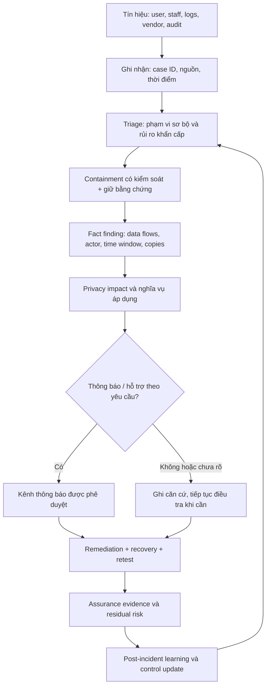
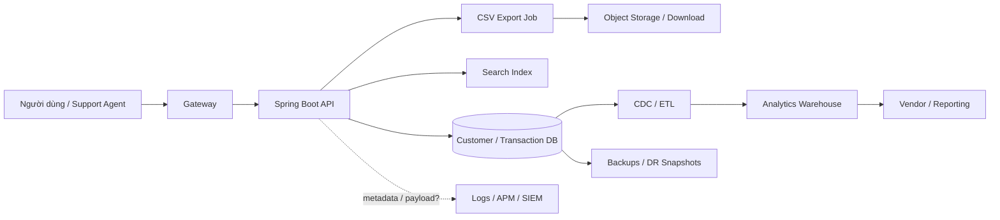
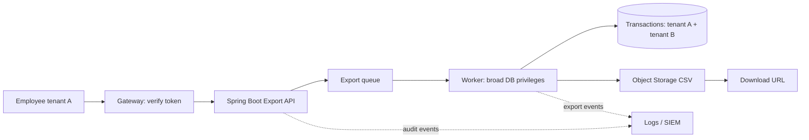

# Privacy incident: Ứng phó sự cố quyền riêng tư và bảo đảm bằng chứng

## 1. Mục tiêu học tập

Sau bài học, người học có thể:

1. Giải thích **privacy incident** (sự cố quyền riêng tư), phân biệt với **security incident**, **personal data breach**, vi phạm chính sách xử lý dữ liệu và cảnh báo chưa xác nhận.
2. Nhận diện sự cố trong toàn bộ vòng đời dữ liệu: thu thập, sử dụng, chia sẻ, tìm kiếm, xuất dữ liệu, lưu giữ, xóa, phân tích và chuyển cho nhà cung cấp.
3. Thiết kế chương trình **phát hiện, tiếp nhận, phân loại, ưu tiên, khoanh vùng, điều tra, khắc phục, thông báo và theo dõi sau sự cố** có trách nhiệm rõ.
4. Đánh giá tác động đến **chủ thể dữ liệu**, bao gồm bí mật, mất kiểm soát, thiệt hại tài chính, nguy cơ giả mạo, phân biệt đối xử, an toàn cá nhân và mất cơ hội thực hiện quyền.
5. Thiết lập quy trình quyết định thông báo cho cơ quan, người bị ảnh hưởng và các bên liên quan **dựa trên nghĩa vụ có hiệu lực**, thay vì áp một thời hạn hoặc ngưỡng giả định cho mọi nơi.
6. Thu thập và bảo toàn **bằng chứng kỹ thuật, quản trị và quyết định**, đồng thời không tạo thêm rủi ro quyền riêng tư do điều tra hoặc lưu hồ sơ quá mức.
7. Xây dựng liên kết **risk scenario → control objective → control → incident finding → evidence → remediation → retest → residual risk**.
8. Phân tích tình huống thực tế trong Java/Spring Boot về API xuất dữ liệu khách hàng bị lỗi phân quyền xuyên tenant, phối hợp với nhóm pháp lý, sản phẩm và bên thứ ba.

Bài thuộc chương **Privacy assurance** trong module **SECURITY_SECURITY_ASSURANCE**. Mục tiêu module là học **đánh giá có bằng chứng** rằng hệ thống đáp ứng mục tiêu bảo mật, đi từ rủi ro, yêu cầu, controls đến kiểm thử, audit và khắc phục phát hiện, rồi vận hành chương trình assurance liên tục. Với sự cố quyền riêng tư, điều quan trọng không chỉ là “đã đóng ticket”, mà còn là **hiểu chính xác điều gì xảy ra, ai bị ảnh hưởng, biện pháp nào có hiệu quả và bằng chứng nào hỗ trợ kết luận**.

## 2. Privacy incident là gì?

**Privacy incident** là một sự kiện hoặc tình trạng có thể làm **thông tin cá nhân hoặc các quyền/lợi ích quyền riêng tư** bị xử lý, truy cập, tiết lộ, thay đổi, mất, giữ hoặc sử dụng **không phù hợp mục đích, chính sách, cam kết hoặc nghĩa vụ áp dụng**.

Nó có thể phát sinh từ:

- Hành vi cố ý của kẻ tấn công bên ngoài hoặc người bên trong.
- Lỗi lập trình, cấu hình IAM, bộ lọc tenant, access policy hoặc hệ thống export.
- Nhân viên gửi nhầm email/tệp chứa dữ liệu cá nhân.
- Một API xử lý đúng quyền kỹ thuật nhưng thu thập hoặc sử dụng dữ liệu **ngoài mục đích được phép**.
- Công cụ analytics, logging hoặc APM nhận quá nhiều trường nhạy cảm.
- Dữ liệu vẫn tồn tại hoặc tiếp tục được dùng sau thời hạn/mục đích hợp lệ.
- Quy trình yêu cầu xóa, sửa hoặc hạn chế xử lý không được áp dụng đúng.
- Bên cung cấp dịch vụ xử lý dữ liệu sai phạm vi hợp đồng hoặc mất kiểm soát bản sao.

**Privacy incident không nhất thiết đồng nghĩa đã có hacker hoặc dữ liệu đã được công bố công khai.** Một lỗi nội bộ làm xử lý sai mục đích vẫn có thể cần đánh giá là sự cố quyền riêng tư, tùy ngữ cảnh và nghĩa vụ.

### 2.1. Một cảnh báo chưa phải kết luận sự cố đã được xác nhận

Ví dụ hệ thống SIEM phát hiện nhiều yêu cầu tải CSV từ tài khoản hỗ trợ. Ban đầu đây có thể là:

- Một chiến dịch xuất dữ liệu đã được phê duyệt.
- Hành vi lạm dụng tài khoản hợp lệ.
- Lỗi tích hợp khiến cùng yêu cầu được lặp.
- Một hoạt động đáng ngờ chưa chứng minh có dữ liệu cá nhân bị tiết lộ.

Quy trình cần giữ **trạng thái và mức tin cậy**: `reported`, `under_investigation`, `confirmed`, `not_substantiated` hoặc kết luận phù hợp. Không tự khẳng định “đã bị đánh cắp dữ liệu” chỉ từ số lượt truy cập cao; cũng không bỏ qua tín hiệu vì chưa có bằng chứng rõ.

## 3. Privacy incident, security incident và personal data breach

Ba khái niệm có quan hệ nhưng **không đồng nhất**.

| Khái niệm | Trọng tâm | Ví dụ |
| --- | --- | --- |
| **Security incident** | Sự kiện đe dọa hoặc ảnh hưởng an toàn thông tin/hệ thống, như bí mật, toàn vẹn, sẵn sàng | Máy chủ bị khai thác, tài khoản quản trị bị chiếm, dịch vụ bị DDoS |
| **Privacy incident** | Sự kiện ảnh hưởng quyền riêng tư, mục đích và phạm vi xử lý thông tin, có thể không cần xâm nhập kỹ thuật | Thu thập nhiều thông tin hơn mục đích; xuất dữ liệu trái quyền; không xử lý yêu cầu xóa |
| **Personal data breach** | Khái niệm có định nghĩa pháp lý theo từng chế độ; thường liên quan vi phạm bảo mật dẫn tới phá hủy, mất, sửa đổi, tiết lộ hoặc truy cập trái phép dữ liệu cá nhân | Database cá nhân bị lộ, email chứa hồ sơ gửi nhầm người, ransomware làm mất quyền truy cập dữ liệu |

**Một sự kiện có thể thuộc cả ba nhóm**. Ví dụ tài khoản nhân viên bị chiếm rồi tải danh sách khách hàng. Nhưng:

- DDoS vào trang cung cấp nội dung công khai có thể là security incident mà không có tác động quyền riêng tư đáng kể.
- Một hệ thống phân tích tiếp tục dùng dữ liệu để quảng cáo sau khi không còn căn cứ/mục đích được phép có thể là privacy incident **mà không có lỗ hổng kỹ thuật bảo mật**.
- Một cơ sở dữ liệu thông tin cá nhân bị xóa ngoài ý muốn có thể ảnh hưởng tính sẵn sàng/toàn vẹn và là một dạng breach theo **định nghĩa pháp lý áp dụng**, kể cả khi không có dữ liệu bị “lấy cắp”.

### 3.1. Vì sao phải phân loại đúng?

Nếu chỉ dùng quy trình security incident:

- Tổ chức có thể chỉ tìm malware/exfiltration mà bỏ qua **purpose, transparency, data-subject rights, retention và vendor obligations**.
- Quyết định thông báo có thể bị chậm vì đội kỹ thuật chờ bằng chứng chắc chắn về attacker.
- Báo cáo không giải thích **ảnh hưởng tới cá nhân**, chỉ nói số máy chủ hoặc số tài khoản bị tác động.
- Khắc phục có thể chỉ khóa một token mà không sửa quy trình thu thập/chia sẻ sai.

Ngược lại, privacy response không được bỏ qua an toàn hệ thống: phải phối hợp **incident response kỹ thuật, privacy/legal, nghiệp vụ, chăm sóc khách hàng và quản trị nhà cung cấp**.

## 4. Phạm vi cần xem trong một privacy incident

Hãy bắt đầu từ câu hỏi “**đối với cá nhân nào và dữ liệu nào, điều kiện kiểm soát nào đã thất bại?**”

Các chiều:

1. **Dữ liệu:** tên, email, số điện thoại, định danh, hồ sơ tài chính, vị trí, nội dung giao tiếp, thông tin sức khỏe, token liên kết cá nhân hoặc dữ liệu suy luận.
2. **Chủ thể:** khách hàng, nhân viên, nhà thầu, trẻ em hoặc nhóm có thể dễ chịu tổn hại hơn theo bối cảnh.
3. **Hoạt động xử lý:** thu thập, truy vấn, kết hợp, phân tích, thay đổi, truyền, xuất, lưu, xóa.
4. **Mục đích:** dịch vụ, hỗ trợ, đối soát, tiếp thị, phát triển sản phẩm, kiểm toán, điều tra.
5. **Bên tham gia:** controller/người quyết định mục đích, processor/bên xử lý theo ủy quyền, phụ nhà cung cấp, đội nội bộ.
6. **Hệ thống:** API, database, index, data warehouse, logs, object store, email, thiết bị và backup.
7. **Thời gian:** cửa sổ phơi nhiễm, thời điểm phát hiện, khoảng hoạt động trước/sau khắc phục.
8. **Khả năng bị ảnh hưởng:** số người, dữ liệu có đọc/tải/sử dụng không, có bên nhận đáng tin hay không, hậu quả có thể xảy ra.
9. **Nghĩa vụ áp dụng:** luật, hợp đồng, chính sách, quy trình xử lý dữ liệu và yêu cầu thông báo; cần được xác minh theo phạm vi thật.

Có thể một dữ liệu **không trực tiếp ghi tên người**, nhưng kết hợp với dữ liệu khác vẫn nhận diện được cá nhân. Vì vậy không mặc định mọi ID, hash hoặc dataset “đã pseudonymize” đều nằm ngoài phạm vi privacy incident.

## 5. Các nhóm tình huống sự cố quyền riêng tư

| Nhóm | Tình huống | Control objective bị đe dọa |
| --- | --- | --- |
| **Unauthorized access** | User/agent xem record ngoài quyền hoặc tenant | Chỉ chủ thể cần biết mới được truy cập |
| **Unauthorized disclosure** | Gửi email/CSV cho người nhận sai; bucket công khai | Không tiết lộ dữ liệu ngoài các bên được phép |
| **Excessive collection** | Thu thêm dữ liệu định danh không cần cho dịch vụ | Chỉ thu thập dữ liệu cần cho mục đích hợp lệ |
| **Incompatible use** | Dùng dữ liệu giao dịch cho mục đích chưa được cho phép | Mục đích xử lý được xác định và tôn trọng |
| **Inaccurate alteration** | Đồng bộ sai thông tin khách hàng ảnh hưởng quyết định | Dữ liệu đúng, có thể sửa và truy vết |
| **Loss/unavailability** | Xóa nhầm dữ liệu cá nhân cần giữ hoặc ransomware mã hóa hồ sơ | Có thể phục hồi đúng và đáp ứng nghĩa vụ liên quan |
| **Retention/deletion failure** | Không purge bản sao đã hết hạn; yêu cầu xóa không lan tới index | Dữ liệu giữ và xử lý đúng vòng đời |
| **Uncontrolled onward sharing** | Vendor/analytics nhận thêm trường nhạy cảm | Chia sẻ có phạm vi, mục đích và kiểm soát |
| **Access governance failure** | Quyền của nhân viên đã nghỉ chưa bị thu hồi | Quyền hạn phù hợp vai trò và thời gian |
| **Transparency/rights failure** | Thực hiện hoạt động xử lý hoặc phản hồi quyền của chủ thể sai nghĩa vụ | Cá nhân nhận thông tin và thực hiện quyền theo quy định áp dụng |

Một sự cố có thể thuộc nhiều nhóm. Ví dụ bug export vừa là unauthorized access vừa là unauthorized disclosure, và có thể làm trầm trọng rủi ro do thiếu logging.

## 6. Chuỗi assurance: từ phát hiện đến giảm rủi ro còn lại

Ứng phó cần tạo một **hồ sơ có thể truy vết**, không chỉ nhiều tin nhắn không nhất quán.



Hai luồng **phản ứng kỹ thuật** và **đánh giá nghĩa vụ/quyền riêng tư** cần chạy song song khi phù hợp. Không nhất thiết chờ toàn bộ điều tra kỹ thuật kết thúc mới hỏi xem có phải giữ mốc ra quyết định thông báo.

### 6.1. Bốn điều không nên đánh đồng

- **Event detected:** hệ thống thấy một dấu hiệu.
- **Incident confirmed:** có bằng chứng đủ kết luận đã xảy ra sự kiện được định nghĩa.
- **Contained:** đường gây tác động đã được giới hạn/chặn theo phạm vi hiện biết.
- **Resolved/closed:** nguyên nhân được xử lý, tác động và nghĩa vụ được xem xét, có retest/decision và rủi ro còn lại được quản trị.

Một endpoint đã tạm khóa chỉ thể hiện **containment một đường**, chưa phải sự cố đã hoàn tất.

## 7. Nguồn phát hiện privacy incident

Một chương trình privacy assurance có nhiều nguồn tín hiệu:

| Nguồn | Ví dụ | Điều cần kiểm tra |
| --- | --- | --- |
| **User/data subject** | Nhận email chứa thông tin người khác, phát hiện thông tin hiển thị sai | Xác thực nội dung báo cáo và bảo vệ người báo |
| **Customer Support** | Ticket về lịch sử giao dịch lạ, xem sai tài khoản | Gắn case với incident, không chuyển dữ liệu qua kênh thiếu an toàn |
| **Engineering** | Negative authorization test fail hoặc phát hiện log raw payload | Xác nhận build/đường tác động/production parity |
| **Security operations** | Tải file bất thường, token misuse, alerts | Phân biệt nghiệp vụ được phép với hành vi trái quyền |
| **Privacy/Compliance** | Audit phát hiện dùng sai mục đích hoặc xử lý deletion request sai | Có rủi ro không liên quan attack hay không |
| **Data engineering** | ETL gửi trường nhạy cảm đến dataset không đúng mục đích | Data lineage, downstream copies và access |
| **Vendor** | Báo sự cố liên quan dữ liệu đã chia sẻ | Xác minh scope/contract/evidence và trách nhiệm |
| **Internal audit** | Hồ sơ retention hoặc access review không đạt | Finding mới hay incident hiện hữu, phạm vi tác động |
| **External report** | Nhà nghiên cứu báo endpoint trả dữ liệu ngoài quyền | Kênh tiếp nhận, bảo quản báo cáo và xác minh được phép |

### 7.1. Thiết kế kênh báo cáo an toàn

- Có cách báo cáo dễ tìm cho nhân viên và khách hàng.
- Không bắt người báo gửi **toàn bộ dữ liệu cá nhân hoặc credentials** để chứng minh.
- Không buộc họ tái tạo hành vi có thể làm lộ thêm dữ liệu trên production.
- Cấp case ID, thời điểm và owner rõ, giữ nguồn thông tin ở mức tối thiểu.
- Có phương án nâng cấp ưu tiên nhanh nếu sự cố đang tiếp diễn.
- Giới hạn người xem ticket, attachments và thông tin người bị ảnh hưởng.

Không được bỏ qua báo cáo chỉ vì người gửi chưa cung cấp được bản dump hoặc “bằng chứng hoàn chỉnh”.

## 8. Triage: câu hỏi trong những phút đầu

Việc triage nhằm **quyết định hành động an toàn trước mắt**, không phải lập tức đưa ra mọi kết luận pháp lý.

Một mẫu câu hỏi:

1. **Điều gì được quan sát?** URL, API, tệp, hành vi, log, thông báo hoặc lỗi cụ thể.
2. **Nó còn xảy ra không?** Endpoint đang phục vụ, link còn truy cập, job còn chạy?
3. **Dữ liệu nào có thể bị ảnh hưởng?** Loại/độ nhạy cảm, có liên kết danh tính không?
4. **Ai có khả năng nhận/truy cập?** Người dùng khác, tài khoản nội bộ, public internet, vendor?
5. **Từ khi nào?** Mốc deploy/config thay đổi; thời điểm sớm nhất có thể, chưa khẳng định nếu chưa kiểm chứng.
6. **Hậu quả tiềm tàng?** Tài chính, lạm dụng danh tính, an toàn, quyền riêng tư, ảnh hưởng đặc biệt tới nhóm dễ bị tổn thương?
7. **Kiểm soát nào có thể thất bại?** AuthZ, data minimization, vendor scope, retention, consent/purpose, encryption, logging?
8. **Containment nào làm giảm tác động nhanh nhất?** Chặn export, thu hồi link, rollback feature, thu hồi token, thay policy?
9. **Bằng chứng gì có thể mất nếu hành động?** Logs quay vòng, ephemeral containers, object access history, cấu hình hiện tại?
10. **Những ai cần tham gia ngay?** Incident commander, AppSec/SecOps, Privacy/Legal, service owner, vendor owner?
11. **Có mốc nghĩa vụ/contract nào phải tính từ sự kiện cụ thể?** Giao Legal/Privacy xác định đúng, không tự dùng một đồng hồ chung.
12. **Bằng chứng đã có gì và còn thiếu gì?** Ghi rõ unknown, assumption và confidence.

### 8.1. Triage tránh thu thập quá nhiều dữ liệu

Khi xác minh bug trả hồ sơ người khác, không nên tải “toàn bộ 100.000 records để chứng minh”. Có thể tái hiện bằng **tài khoản/test data có kiểm soát** và lưu **mẫu tối thiểu đã che nhạy cảm**, kết hợp log và truy vấn thống kê để xác định phạm vi.

Nếu bắt buộc xử lý dữ liệu thật vì điều tra, phải có **quyền, mục đích, nơi lưu, thời hạn và cách hạn chế người truy cập** phù hợp.

## 9. Đánh giá mức độ nghiêm trọng theo tác động tới cá nhân

Một phương pháp phân loại cần dựa trên **nguy cơ và hậu quả đối với người bị ảnh hưởng**, không chỉ số dòng database.

Các yếu tố:

| Yếu tố | Câu hỏi | Ví dụ làm tăng mức quan tâm |
| --- | --- | --- |
| **Độ nhạy cảm** | Dữ liệu có thể dẫn tới nguy cơ gì nếu bị đọc hoặc dùng sai? | Số định danh, thông tin tài chính, sức khỏe, vị trí nhạy cảm |
| **Khối lượng và phạm vi** | Bao nhiêu cá nhân/record/field, ở những nhóm nào? | Nhiều tenant hoặc một tài khoản đặc biệt nhạy cảm |
| **Khả năng nhận diện** | Có thể liên kết dữ liệu với cá nhân không? | Mã giả danh có mapping hoặc dữ liệu có thể join |
| **Bên nhận** | Ai có thể truy cập, có đáng tin và có nghĩa vụ bảo mật không? | Public bucket, người nhận ngoài tổ chức |
| **Khả năng đã truy cập** | Có audit/log đáng tin về download/view không? | GET/download thành công, exfiltration evidence |
| **Thời gian phơi nhiễm** | Đường lộ mở trong bao lâu, có bị indexing/cache không? | Cấu hình public tồn tại qua nhiều đợt release |
| **Khả năng giảm tác động** | Có thể thu hồi link, xóa file, rotate token, kiểm soát người nhận? | Tệp đã tải xuống có thể tiếp tục lan truyền |
| **Tính dễ tổn thương** | Đối tượng bị ảnh hưởng có nguy cơ đặc biệt? | Dữ liệu liên quan trẻ em hoặc người chịu rủi ro an toàn |
| **Khả năng lạm dụng** | Có thể giả mạo, lừa đảo, doxxing, đánh cắp tài khoản? | Credential, thông tin xác thực hoặc dữ liệu tài chính |
| **Độ chắc chắn** | Số liệu và bằng chứng hiện tại tin cậy đến đâu? | Logging thiếu, retention của provider chưa rõ |
| **Nghĩa vụ** | Có điều kiện thông báo, điều tra, lưu giữ chứng cứ cụ thể? | Hợp đồng/khung pháp lý áp dụng yêu cầu hành động |

### 9.1. Severity không chỉ là phép nhân máy móc

Một ma trận `Likelihood × Impact` có thể giúp ưu tiên, nhưng không biến sự thiếu bằng chứng thành mức nguy cơ thấp. Ví dụ log không tồn tại không cho phép kết luận **“chắc chắn không ai tải dữ liệu”**.

Có thể báo hai chiều:

- **Severity/priority tạm thời:** mức ưu tiên hành động dựa trên nguy cơ hợp lý và khả năng còn tiếp diễn.
- **Confidence/scope:** dữ kiện đã xác nhận, ước lượng có căn cứ, phần còn thiếu.

Một sự cố liên quan **một cá nhân** vẫn có thể nghiêm trọng nếu có nguy cơ lộ thông tin gây hại lớn. Ngược lại, một số lượng lớn mã định danh không thể dùng ngoài mục đích có thể có đặc điểm rủi ro khác. Phải xét ngữ cảnh.

### 9.2. Ví dụ quyết định ưu tiên

| Tình huống | Hướng triage | Điều chưa được phép khẳng định |
| --- | --- | --- |
| Link export chứa hồ sơ cá nhân công khai, còn hoạt động | Khoanh vùng khẩn, bảo quản logs, đánh giá truy cập và tác động | Chưa chắc có ai đã tải |
| File chứa dữ liệu nhạy cảm gửi nhầm người nhận ngoài tổ chức | Thu hồi/đề nghị xóa đúng kênh, đánh giá người nhận và khả năng lan truyền | Không mặc định email đã bị đọc hoặc đã được xóa |
| Hệ thống tiếp tục gửi email tiếp thị ngoài lựa chọn của cá nhân | Chặn luồng sai, xem purpose/consent/obligations và số người | Không mặc định có exfiltration từ hacker |
| Dữ liệu khách hàng bị xóa nhầm mà backup còn | Chặn xóa tiếp, đánh giá khả năng phục hồi và nghĩa vụ | Không khẳng định chưa có ảnh hưởng quyền riêng tư |
| Query search lộ tên và ID xuyên tenant | Chặn endpoint/query, đo phạm vi và các phiên đã truy cập | Không chỉ nhìn “không lộ số tài khoản” để giảm nhẹ |

## 10. Containment: dừng phơi nhiễm nhưng giữ bằng chứng

**Containment** giảm thiểu tác động đang diễn ra. Với privacy incident, nó phải cân bằng giữa **chặn lộ thêm, không phá dữ liệu cần bảo toàn và duy trì nghiệp vụ quan trọng**.

Biện pháp có thể gồm:

- Tạm vô hiệu endpoint export hoặc chức năng tra cứu bị lỗi.
- Sửa/rollback policy IAM, row-level filter hoặc feature flag.
- Thu hồi presigned URLs, API credentials, sessions hoặc quyền service account.
- Ngừng job đồng bộ gửi dữ liệu sai cho downstream; khóa luồng analytics.
- Đổi quyền object storage bucket từ public sang private và kiểm tra lại.
- Yêu cầu vendor cách ly dữ liệu hoặc dừng xử lý theo quy trình hợp đồng.
- Chặn tài khoản có hành vi lạm dụng hoặc hạn chế phạm vi dữ liệu được trả.
- Tạm ngưng purge nếu có nguy cơ đang xóa thông tin phải bảo toàn.
- Xóa/chỉnh nội dung công khai ngoài quyền khi có thể và theo thẩm quyền.
- Giảm quyền xem records đã bị ảnh hưởng đến khi có quyết định rõ.

### 10.1. Hành động containment cũng có rủi ro

Ví dụ phát hiện log chứa token. Xóa ngay toàn bộ log có thể **phá mất bằng chứng truy cập**. Cần phối hợp để:

1. Chặn tiếp tục ghi token mới và thu hồi token nếu phù hợp.
2. Giới hạn quyền đọc kho log bị ảnh hưởng.
3. Bảo toàn bản chứng cứ tối thiểu trong nơi được kiểm soát, có nguồn gốc và thời gian.
4. Thực hiện masking, redaction hoặc xử lý theo quy trình khi được phép.
5. Đảm bảo hồ sơ điều tra không làm lộ lại chính token đã bị rò rỉ.

**Không nên ghi raw credential vào incident ticket hoặc chat chung** để chứng minh sự cố.

### 10.2. Containment là trạng thái có phạm vi

Ghi:

> “Tính năng xuất CSV `/v1/export` đã bị chặn từ phiên bản cấu hình X, trong môi trường Y, theo kiểm chứng Z; dữ liệu đã tải xuống trước đó và bản sao ở provider vẫn đang được điều tra.”

Không ghi “đã chặn hoàn toàn” khi **endpoint bulk khác, cache hoặc quyền từ nhà cung cấp** chưa được xem.

## 11. Preservation và chain of custody

Một sự cố quyền riêng tư có thể dẫn tới điều tra nội bộ, hợp đồng, khiếu nại hoặc nghĩa vụ bảo quản bằng chứng. Hồ sơ phải **đủ tin cậy và kiểm tra lại được**.

Bằng chứng có thể gồm:

- Cấu hình IAM, public access policy, feature flag và policy revision ở thời điểm sự cố.
- API gateway logs, access logs, download events và database/query logs khi có.
- Deployment/commit/image digest, thay đổi cấu hình, lịch sử pull requests.
- Data lineage, schema và sample payload đã giảm dữ liệu nhạy cảm.
- Records về quyền truy cập, consent/purpose, data retention, vendor contracts.
- Email header/recipient records, export job metadata, object access reports.
- Test reproduce có kiểm soát, timestamps, người thực hiện và kết quả.
- Approval và incident decision records.

### 11.1. Chain of custody trong thực hành

Mỗi evidence artifact nên ghi:

1. **Evidence ID** ổn định và loại tài liệu.
2. Nguồn hệ thống, địa chỉ logical và **thời gian thu thập**.
3. Người/công cụ thu, quyền và phương pháp.
4. Kiểm tra integrity (hash khi phù hợp), định dạng và bản gốc.
5. Nơi lưu được bảo vệ, quyền truy cập và lịch sử chuyển giao.
6. Biện pháp che/giảm dữ liệu nhạy cảm trong bản dùng để phân tích.
7. Mục đích, thời hạn lưu giữ và policy/hold riêng cho evidence.
8. Những giới hạn như log thiếu, đồng hồ lệch, dữ liệu đã bị rotate.

**Hash không tự chứng minh nguồn gốc đáng tin**. Nó giúp kiểm tra nội dung không đổi từ một thời điểm; vẫn cần ghi rõ ai tạo, hệ thống nào và điều kiện thu thập.

### 11.2. Tránh “shadow breach” từ hồ sơ điều tra

Đội phản ứng có thể vô tình tăng tác động nếu:

- Chụp màn hình đầy đủ hồ sơ nhạy cảm đưa vào ticket không giới hạn người đọc.
- Gửi database dump qua email để nhờ nhiều nhóm xác minh.
- Lưu token, số tài khoản, địa chỉ nguyên văn trong các thông báo diện rộng.
- Lấy bản sao PII production để chạy test trên máy cá nhân.
- Giữ hồ sơ sự cố vô thời hạn mà không có retention schedule.

**Evidence phải đủ để kết luận, không phải càng nhiều PII càng tốt.**

## 12. Điều tra: xây dựng timeline và xác định phạm vi thật

Một điều tra đáng tin cần thiết lập **dòng thời gian có phân loại nguồn và mức chắc chắn**.

Ví dụ:

| Mốc | Dữ kiện | Bằng chứng | Độ tin cậy |
| --- | --- | --- | --- |
| T0 | Pull request thêm endpoint export | Commit và review record | Xác nhận |
| T1 | Build triển khai production | CI/CD deploy record | Xác nhận |
| T2 | Endpoint bắt đầu trả nội dung vượt scope | Reproduce trên cấu hình tương ứng, log | Cần đối chiếu lịch sử |
| T3 | First observed unauthorized download | Access log có actor/response/body-size | Xác nhận request, cần xem dữ liệu thực |
| T4 | Khách hàng báo nhầm hồ sơ | Support ticket | Xác nhận báo cáo, đang đánh giá tính chính xác |
| T5 | Feature bị vô hiệu | Change record, negative test | Xác nhận containment trong phạm vi đã thử |
| T6 | Reconciliation các bản sao | Search/object/vendor review | Có thể còn khoảng trống |

### 12.1. “Available” khác “accessed” và “exfiltrated”

Phải phân biệt:

- **Potentially accessible:** một đường kỹ thuật tồn tại và có thể trả dữ liệu ngoài quyền.
- **Actually accessed:** log hoặc bằng chứng đủ hỗ trợ có yêu cầu truy cập xảy ra.
- **Actually disclosed/downloaded:** có dữ kiện về nội dung/khối lượng được gửi ra hoặc nhận.
- **Misused downstream:** có dấu hiệu sử dụng dữ liệu trái mục đích, đe dọa, fraud hoặc lan truyền.

Không phải mọi request thành công đều chắc chắn chứng minh con người đã đọc nội dung; ngược lại, **thiếu log không chứng minh không có truy cập**.

### 12.2. Phương pháp ước lượng phạm vi khi log thiếu

Có thể dùng:

- Thời điểm deploy/config và thời điểm dừng đường lộ.
- Danh sách endpoints/roles và tập tài nguyên có thể truy vấn.
- Thống kê truy cập từ API gateway/WAF/DB (nếu đáng tin, đúng kỳ).
- Các object IDs trong log đã được giảm nhạy cảm và quan hệ tenant.
- Audit về export job/file object và thời hạn link.
- Vendor logs hoặc confirmation có giới hạn.
- Kiểm tra hệ thống search/cache/index để xác định bản sao phục vụ.

Nên đưa **khoảng ước lượng có căn cứ** và mức bất định, thay vì tạo một con số cá nhân bị ảnh hưởng chính xác giả tạo.

## 13. Data mapping cho phạm vi ảnh hưởng và lan truyền

Một privacy incident không dừng ở dịch vụ đầu vào. Hãy vẽ **data-flow diagram** cho đường dữ liệu thực:



Đối với mỗi node và edge, điều tra:

1. Có chứa dữ liệu thuộc sự cố không? Những trường nào?
2. Bản sao đã được gửi trước hay sau khi đường lộ bị đóng?
3. Ai có khả năng đọc/sao chép hoặc truyền tiếp?
4. Thời gian lưu giữ, encryption và quyền truy cập thực tế?
5. Có log/download/export để xác định việc truy cập không?
6. Có cần containment hoặc remediation ở node đó không?
7. Ai sở hữu quyền quyết định đối với dữ liệu/nhà cung cấp?
8. Bằng chứng xác minh đã giới hạn hoặc xóa bản sao là gì?

**Dữ liệu đã xóa khỏi database chính vẫn có thể tồn tại trong export, log, backup hoặc warehouse.** Đây không nhất thiết chứng minh tất cả các bản sao đều vi phạm, nhưng phải **đánh giá từng bản sao theo mục đích, nghĩa vụ và rủi ro**.

## 14. Phân tích tác động tới chủ thể dữ liệu

Privacy impact assessment sau sự cố không nên chỉ có các cột “record count / server count”. Nó cần suy luận về **các cá nhân và những khả năng xảy ra hậu quả**.

Câu hỏi:

- Dữ liệu có đủ để giả mạo người dùng, lừa đảo, tống tiền hay khai thác danh tính?
- Có thông tin về sức khỏe, trẻ em, tài chính, vị trí, đời sống riêng hoặc quan hệ nhạy cảm không?
- Lộ thông tin có thể gây mất an toàn thể chất, phân biệt đối xử hoặc ảnh hưởng công việc?
- Dữ liệu đã được mã hóa/ẩn danh ở mức nào, ai nắm khóa hoặc bản mapping?
- Người nhận có đáng tin, có thể thu hồi/xóa bản sao hoặc bị ràng buộc nghĩa vụ bảo mật không?
- Khả năng chủ thể tự giảm rủi ro (đổi mật khẩu, cảnh giác phishing, khóa tài khoản) có ý nghĩa không?
- Thiệt hại do mất dữ liệu có thể khiến cá nhân không thực hiện được quyền hoặc dịch vụ thiết yếu?
- Thông báo có thể hỗ trợ họ hành động hay có nguy cơ gây hoang mang/tiết lộ thêm?
- Có nhóm cần cách hỗ trợ/tiếp cận đặc biệt theo ngữ cảnh không?

### 14.1. Chỉ số tài chính không đại diện toàn bộ tác động

Một người dùng có thể **không mất tiền** nhưng vẫn chịu xâm phạm quyền riêng tư nghiêm trọng nếu lịch sử giao dịch, thông tin liên lạc hoặc hồ sơ nhạy cảm được tiết lộ. Ngược lại, sự cố mất dữ liệu có thể ảnh hưởng quyền lợi dù không có hành vi đọc trộm.

Không được kết luận “no privacy harm” chỉ vì chưa có báo cáo mất tiền hoặc fraud.

### 14.2. Đánh giá biện pháp giảm tác động

Ví dụ:

- Thu hồi phiên/token, hướng dẫn thay credential khi thực sự có nguy cơ.
- Hỗ trợ kiểm tra giao dịch đáng ngờ.
- Thu hồi link tải xuống, yêu cầu bên nhận nhầm xóa dữ liệu khi phù hợp.
- Giới hạn kết quả tìm kiếm hoặc dữ liệu đã public.
- Khôi phục dữ liệu mất tính toàn vẹn theo yêu cầu và kiểm chứng.
- Cung cấp kênh hỗ trợ, giải thích rõ điều gì có thể bị ảnh hưởng.

Biện pháp phải **tương xứng với tác động đã xác định**, không gửi đại trà hướng dẫn đổi password khi sự cố chỉ liên quan sai mục đích phân tích mà không có credential bị ảnh hưởng.

## 15. Quyết định thông báo: nghĩa vụ, ngưỡng và thời hạn

**Không có một quy tắc thông báo duy nhất áp dụng cho mọi privacy incident.** Các nghĩa vụ có thể phụ thuộc vào:

- Luật/vùng tài phán và **phiên bản quy định có hiệu lực tại thời điểm liên quan**.
- Tư cách tổ chức và vai trò (bên quyết định mục đích, bên xử lý, nhà cung cấp).
- Loại dữ liệu, hoạt động xử lý và đối tượng bị ảnh hưởng.
- Định nghĩa sự cố/breach được quy định trong chế độ áp dụng.
- Ngưỡng rủi ro/tác động dẫn đến yêu cầu thông báo.
- Mốc bắt đầu tính thời hạn (nhận biết, phát hiện, xác nhận hoặc một thời điểm khác theo nghĩa vụ).
- Trách nhiệm và kênh thông báo tới cơ quan, chủ thể, khách hàng doanh nghiệp và đối tác.
- Nghĩa vụ hồ sơ/bằng chứng ngay cả khi không cần thông báo ra bên ngoài.

**Đội Legal/Privacy/Compliance phải xác nhận yêu cầu áp dụng cụ thể.** Bài không tự đưa ra một số giờ/ngày mặc định như nghĩa vụ cho tất cả tổ chức.

### 15.1. Quy trình ra quyết định notification

1. Tạo incident ID và **nhật ký mốc thời gian**, tránh mất khả năng xác định mốc nghĩa vụ.
2. Xác định loại dữ liệu, vai trò tổ chức, vùng áp dụng, hợp đồng và bên nhận.
3. Đối chiếu định nghĩa sự cố và tiêu chí thông báo theo **văn bản có hiệu lực**.
4. Đánh giá rủi ro tới cá nhân với dữ kiện hiện có, nêu phần chưa chắc chắn.
5. Xác định **người ra quyết định** và quy trình phê duyệt.
6. Chọn bên nhận, kênh, nội dung và thời hạn phù hợp.
7. Nếu chưa đủ dữ kiện, ghi giả định và **hành động điều tra tiếp theo**; không im lặng vì chưa rõ.
8. Lưu căn cứ của quyết định thông báo hoặc không thông báo, phiên bản thông tin và ngày giờ.
9. Theo dõi nội dung/cập nhật bổ sung nếu có yêu cầu, tránh báo kết luận cuối quá sớm.

### 15.2. Đừng đồng nhất các quyết định

- **Đã xác nhận privacy incident** không luôn tự động nghĩa là bắt buộc thông báo theo mọi chế độ pháp lý.
- **Chưa xác minh được exfiltration** không tự động loại trừ nghĩa vụ.
- **Đã gửi thông báo** không có nghĩa sự cố được khắc phục.
- **Không bắt buộc thông báo** không có nghĩa có thể xóa hồ sơ điều tra hoặc bỏ qua remediation.

### 15.3. Hồ sơ quyết định tối thiểu

| Trường | Nội dung |
| --- | --- |
| Decision ID | Liên kết incident ID và phiên bản quyết định |
| Applicable regime/source | Luật/hợp đồng/chính sách, điều khoản, ấn bản liên quan |
| Role and jurisdiction | Tổ chức giữ vai trò nào với dữ liệu nào |
| Facts known | Sự kiện, scope và evidence xác nhận |
| Unknowns | Những điều còn chờ xác minh và ảnh hưởng tới nhận định |
| Risk assessment | Nguy cơ/hậu quả tới cá nhân và lý do |
| Notification determination | Cần/không cần/chờ bổ sung theo quy trình có thẩm quyền |
| Recipient/channel | Cơ quan, cá nhân, khách hàng doanh nghiệp, vendor... khi áp dụng |
| Timelines | Mốc nghĩa vụ thực tế, thời điểm action |
| Approval | Người có thẩm quyền, ngày, căn cứ |
| Follow-up | Những yêu cầu cập nhật, hỗ trợ, remediation và retest |

## 16. Truyền thông và phối hợp với chủ thể bị ảnh hưởng

Thông báo sự cố quyền riêng tư, khi cần và được phê duyệt, nên **dễ hiểu, chính xác và giúp người nhận biết phải làm gì**.

Một cấu trúc thực hành:

- **Điều gì đã xảy ra:** mô tả đã xác minh, không suy đoán attacker hoặc dữ liệu đã bị khai thác nếu chưa có căn cứ.
- **Thông tin nào có thể liên quan:** loại dữ liệu và phạm vi phù hợp, tránh tiết lộ thêm thông tin của người khác.
- **Khi nào:** mốc phơi nhiễm/phát hiện và tình trạng điều tra với mức chắc chắn rõ.
- **Đang làm gì:** biện pháp containment, điều tra, khắc phục và hỗ trợ.
- **Người nhận nên làm gì:** hành động thiết thực, không tạo sợ hãi không cần thiết.
- **Liên hệ:** kênh hỗ trợ chính thức và cách xác minh thông báo để tránh phishing giả danh.
- **Các giới hạn:** những điểm còn chưa xác minh và thời điểm/cách thông tin được cập nhật nếu phù hợp.

### 16.1. Tránh sự cố thứ hai khi thông báo

- Không dùng nhóm email CC hiển thị mọi người nhận nhạy cảm.
- Không đưa dữ liệu cá nhân cụ thể của một chủ thể vào thư gửi người khác.
- Kiểm tra template, merge fields và danh sách nhận trước gửi.
- Cẩn trọng với link yêu cầu đăng nhập và hướng dẫn nhập mã OTP, tránh tạo cơ hội lừa đảo.
- Bảo đảm bộ phận hỗ trợ hiểu thông điệp, không tự bổ sung suy đoán.
- Giữ bằng chứng đã gửi thông báo và giới hạn quyền đọc chúng.

**Truyền thông không phải một bước PR tách khỏi assurance**. Nó liên quan trực tiếp tính chính xác của evidence, quyền của chủ thể và các nghĩa vụ phải đáp ứng.

## 17. Sự cố ở nhà cung cấp và dữ liệu chia sẻ

Nhiều tổ chức không kiểm soát trực tiếp nơi dữ liệu được lưu. Một nhà cung cấp có thể phát hiện API key bị lộ, gửi nhầm báo cáo hoặc hệ thống backup bị mất an toàn.

Một quy trình supplier incident nên quy định từ trước:

1. **Ai báo cho ai**, kênh và tiêu chí khẩn cấp.
2. Dữ liệu nào được chia sẻ, mục đích và giới hạn xử lý theo hợp đồng.
3. Nhà cung cấp phải cung cấp thông tin kỹ thuật/ảnh hưởng gì, ở mức được phép và khả thi.
4. Bên nào containment đường tích hợp, rotate credential hoặc dừng luồng dữ liệu.
5. Vai trò/thẩm quyền quyết định thông báo theo nghĩa vụ áp dụng.
6. Cách đánh giá **subprocessors** hoặc các nhà cung cấp phụ có liên quan.
7. Cách thu bằng chứng của vendor mà không nhận thêm raw PII không cần.
8. Quy trình theo dõi remediation, xác minh và tiếp tục hoặc tạm dừng dịch vụ.
9. Điều kiện bàn giao lại dữ liệu, xóa bản sao và hỗ trợ khách hàng sau sự cố.
10. Những giới hạn của assurance khi một bên không cung cấp được log đầy đủ.

### 17.1. Báo cáo “vendor đã xử lý” chưa đủ

Cần xác định **vendor đã xử lý gì**:

- Có chặn đường public access?
- Đã thu hồi credential và xác minh quyền mới?
- Có thông tin về dữ liệu/records bị ảnh hưởng và thời gian phơi nhiễm?
- Có kiểm tra các bản sao, API, analytics và downloads không?
- Bằng chứng thuộc đúng **tenant, region, phiên bản hệ thống và kỳ** liên quan?
- Có finding hoặc ngoại lệ chưa được xử lý?

Nếu provider không thể cung cấp lịch sử truy cập, báo cáo cần ghi **độ bất định**, không mặc nhiên kết luận không có dữ liệu bị tải.

## 18. Root cause analysis: nguyên nhân kỹ thuật và tổ chức

Phản ứng tốt không kết thúc ở việc “đã rollback”. **Root cause analysis (RCA)** tìm nguyên nhân khiến sự cố xảy ra, vượt qua các lớp kiểm soát và **không được phát hiện sớm hơn**.

Một số nhóm nguyên nhân:

| Lớp | Ví dụ | Câu hỏi RCA |
| --- | --- | --- |
| **Requirements** | Không định nghĩa export là quyền riêng so với view | Ai phê duyệt mục đích và phạm vi truy cập? |
| **Architecture** | Mọi truy vấn dùng quyền service account rộng | Boundary nào bị tin tưởng quá mức? |
| **Implementation** | Thiếu `tenant_id` trong truy vấn report | Vì sao authorization không xảy ra ở nơi có đủ context? |
| **Configuration** | Bucket/CDN có public access mặc định | Baseline, IaC và policy guardrails ở đâu? |
| **Testing** | Chỉ test user có quyền, không test user khác tenant | Kịch bản abuse bị bỏ sót vì sao? |
| **Observability** | Export không có audit actor/resource | Vì sao không thể xác định ai tải dữ liệu? |
| **Operations** | IAM drift hoặc quyền cũ không được thu hồi | Access review và change controls có thực thi không? |
| **Data governance** | Analytics dùng trường PII ngoài mục đích | Data contract, owner và review mục đích ở đâu? |
| **Supplier management** | Không biết vendor giữ raw exports | Shared responsibility và data processing requirements thiếu gì? |
| **Incident readiness** | Không có privacy lead hoặc notification playbook | Quy trình escalation có được diễn tập không? |

### 18.1. “Human error” thường không phải nguyên nhân đủ

Ví dụ nhân viên gửi nhầm file cho người nhận khác. Đổ lỗi “nhân viên không cẩn thận” có thể bỏ qua:

- Ứng dụng tự gợi ý địa chỉ từ nhiều tenant.
- Tên file/tên khách hàng quá giống nhau.
- Không có xác minh người nhận trước gửi.
- Không áp dụng phân quyền hoặc data minimization khi export.
- Email gateway không kiểm tra địa chỉ ngoài tổ chức cho loại dữ liệu nhạy cảm.
- Quy trình yêu cầu gửi raw dataset thay vì bản trích tối thiểu.

RCA nên đưa ra controls **giảm khả năng lặp lại**, không chỉ yêu cầu “đào tạo lại”.

### 18.2. Five whys và fault-tree phải có bằng chứng

Ví dụ:

1. Vì sao người dùng B nhận hồ sơ của A? API trả row ngoài tenant.
2. Vì sao API trả row ngoài tenant? Repository dùng input `tenantId` từ query string.
3. Vì sao code tin tham số đó? Authorization chỉ có ở gateway và kiểm tra role chung.
4. Vì sao design review không phát hiện? Không lập ma trận subject–object–action và data flows cho export.
5. Vì sao CI không chặn? Không có negative integration test xuyên tenant.

Chuỗi này là **giả thuyết minh họa**, cần đối chiếu logs, source/PR review, policy và tests thực để xác định RCA, tránh “five whys” biến thành suy đoán.

## 19. Remediation: sửa cơ chế, dữ liệu và quy trình

Cần phân biệt:

- **Containment:** chặn tiếp diễn sớm, có thể tạm thời.
- **Eradication/correction:** sửa nguyên nhân kỹ thuật/quản trị làm phát sinh sự cố.
- **Recovery:** phục hồi chức năng và dữ liệu đúng, không tái tạo đường rò rỉ.
- **Privacy harm mitigation:** hỗ trợ cá nhân, kiểm soát bản sao đã phát tán và xử lý tác động.
- **Assurance retest:** kiểm tra controls đáp ứng yêu cầu trên phiên bản và điều kiện mục tiêu.
- **Residual risk management:** những điều chưa giải quyết được đưa ra quyết định đúng thẩm quyền.

### 19.1. Một kế hoạch xử lý đầy đủ

| Action | Chủ sở hữu gợi ý | Điều kiện hoàn tất |
| --- | --- | --- |
| Tắt/giới hạn endpoint lỗi | Service/Incident Owner | Không thể khai thác đường đã biết; kiểm tra đúng deployment |
| Sửa authorization theo tài nguyên | Backend + Security Architect | Positive/negative tests bao phủ tenant, role, object và export |
| Rà soát các đường tương tự | AppSec + Engineering | Không tìm thấy bypass tương tự hoặc có findings được xử lý |
| Quản lý file đã xuất | Data/Vendor Owner | Thu hồi link, kiểm tra bản sao và giới hạn bằng chứng |
| Bổ sung event/audit an toàn | Backend + SecOps | Sự kiện đủ điều tra, không log raw PII |
| Đánh giá notification/obligations | Privacy/Legal | Quyết định được phê duyệt có căn cứ và mốc thời gian |
| Bổ sung data minimization | Data Owner + Engineering | Trả đúng fields cho nhiệm vụ, test schema |
| Sửa quy trình vendor/export | Procurement/Legal/Platform | Shared responsibilities và hợp đồng/controls cập nhật |
| Retest và đánh giá rủi ro còn lại | QA/AppSec + Risk Owner | Evidence mới, limitations rõ và quyết định hợp lệ |
| Post-incident learning | Incident Commander + control owners | Risk register, threat model, checklist và playbook được cập nhật |

### 19.2. Đừng đóng finding khi chỉ merge code

Một pull request sửa lỗi không bảo đảm:

- Đúng artifact được deploy production.
- Cấu hình và dữ liệu quyền cùng phiên bản với code.
- Search/bulk/admin/worker paths cũng được bảo vệ.
- Các file đã xuất trước đó được xử lý.
- Đội Legal/Privacy đã đưa ra quyết định nghĩa vụ.
- Mọi người bị ảnh hưởng được hỗ trợ theo yêu cầu áp dụng.

Trạng thái kỹ thuật **“fix deployed and verified in scope”** nên tách khỏi **“privacy incident closed”**. Incident closure còn yêu cầu các quyết định và hành động hậu sự cố.

## 20. Verification và regression tests sau sự cố

**Test sửa lỗi** phải kiểm tra cả đường vừa phát hiện và những đường có chung nguyên nhân.

Ví dụ lỗi xuất dữ liệu xuyên tenant:

| Test ID | Điều kiện | Kết quả mong muốn |
| --- | --- | --- |
| P-001 | Alice thuộc tenant A, xuất dữ liệu được phép của A | Chỉ các records/fields được duyệt của A |
| P-002 | Alice token hợp lệ, gửi `tenantId=B` | Bị từ chối hoặc server ràng buộc scope A; không có dữ liệu B |
| P-003 | Bob thuộc tenant B, export của B | Được xử lý đúng policy B |
| P-004 | Alice dùng report ID do B tạo | Không truy cập được object của B |
| P-005 | User chỉ có quyền view, không có export | Không tạo file/URL export |
| P-006 | Request export bị từ chối | Không enqueue job, không phát event và không tạo object |
| P-007 | Export job chạy sau khi quyền bị thu hồi | Áp policy thời điểm phù hợp; không tạo file ngoài scope |
| P-008 | Dùng bulk/download/search API khác | Cùng nguyên tắc resource authorization |
| P-009 | Object storage link bị hết hạn/thu hồi | Không tải được qua đường truy cập cũ |
| P-010 | Error/exception trong export | Không log raw payload hoặc token |
| P-011 | IAM/service account export có quyền quá rộng | Bị giới hạn theo nhiệm vụ và dữ liệu cần thiết |
| P-012 | Report được cache trước khi đổi quyền | Không trả dữ liệu khác tenant từ cache |
| P-013 | Provider có bản sao report | Trách nhiệm/công việc thu hồi được kiểm chứng trong scope hợp đồng |
| P-014 | Deployment rollback | Không vô tình bật lại phiên bản có lỗi hoặc đổi policy yếu |

### 20.1. Test HTTP 403 không đủ

Một test Bob đọc tài nguyên Alice nhận `403` chưa chứng minh object-level authorization nếu token của Bob hết hạn hoặc request bị chặn vì lỗi unrelated. Để xác minh đúng:

1. Bob có phiên/token hợp lệ với tenant B.
2. Resource/report của Alice **thực sự tồn tại** và thuộc tenant A.
3. Đường request được kiểm tra là chức năng có tác động trong bug.
4. Người được phép truy cập tài nguyên tương ứng vẫn hoạt động.
5. DB, storage, queue và logs không có side effects gây lộ dữ liệu sau từ chối.
6. Điều kiện runtime của bản build/config giống phạm vi claim.

### 20.2. Fault injection cho workflow incident

Các tình huống:

- Feature flag tắt export nhưng worker còn nhận job cũ.
- Object storage revoke thất bại hoặc propagation chậm.
- Logs bị rotate trước khi investigator thu thập.
- Vendor không phản hồi đúng thời điểm nội bộ đặt ra.
- Tính toán phạm vi phải tiếp tục khi search index đã rebuild.
- Cần khôi phục hệ thống sau rollback mà không re-enable bucket public.

Kết quả cần ghi **failed, partial, not assessed** thay vì thay bằng “pass” khi test không chạy được.

## 21. Case study: Lộ dữ liệu khách hàng qua API export Java/Spring Boot

### 21.1. Kiến trúc giả định

Nền tảng thanh toán phục vụ nhiều tenant/doanh nghiệp:

- API Gateway và Identity Provider cung cấp đăng nhập.
- **Report Service** viết bằng Java/Spring Boot.
- **PostgreSQL** lưu thông tin giao dịch/khách hàng.
- Broker và worker tạo CSV bất đồng bộ.
- Object storage lưu file export trong thời hạn được quy định.
- Support Portal cho nhân viên đúng vai trò tìm và tải báo cáo.
- Logs, SIEM, metrics, search và backup hỗ trợ vận hành.
- Một đối tác analytics nhận báo cáo tổng hợp theo data contract.

Nguyên tắc của hệ thống: nhân viên tenant A **không được biết hoặc export thông tin riêng của tenant B**.

### 21.2. Thay đổi gây lỗi

Một bản release bổ sung endpoint:

```text
POST /api/reports/export?tenantId={tenantId}
Authorization: Bearer <access-token>
Body: { "reportType": "transactions", "from": "...", "to": "..." }
```

Code backend chỉ kiểm tra caller có role `REPORT_EXPORT`. Sau đó nó chuyển `tenantId` do client gửi vào query tạo báo cáo. Worker dùng service account có quyền đọc tất cả tenant để sinh CSV.

**Lỗi then chốt:** ứng dụng tin dữ liệu do caller tự khai thay vì ràng buộc truy vấn với **tenant/resource scope lấy từ nguồn đã xác thực và policy đáng tin**.

### 21.3. Data flow và trust boundaries



Các boundaries phải xem:

- Caller → Gateway: token được xác minh thế nào?
- Gateway → API: API có phân quyền theo **subject, action và tenant** không?
- API → Queue: job mang scope đã được **ủy quyền** hay giá trị client khai?
- Worker → Database: quyền rộng có thể biến lỗi nhỏ thành lộ hàng loạt không?
- Worker → Object Storage: file có bảo vệ theo subject/tenant và expiry?
- Download URL → Người nhận: khi file đã tạo, còn kiểm tra quyền hay chỉ bearer link?
- Logs → Investigator: có đủ audit nhưng không sao chép raw PII?

### 21.4. Privacy incident được phát hiện

Nhân viên tenant B nhận báo cáo qua support portal chứa các giao dịch không thuộc B. Support mở ticket. SecOps thấy một số export jobs có tham số tenant khác với tenant được ghi trong identity context.

Đội phản ứng **chưa được khẳng định** tất cả các report được tạo đã bị tải hoặc đã có gian lận. Cần điều tra:

1. Bản release đầu tiên có đường lỗi được triển khai khi nào?
2. Có bao nhiêu job request mà caller tenant không khớp scope?
3. Những job nào hoàn thành, tạo object, phát URL hoặc thực sự download?
4. Những loại dữ liệu/fields trong CSV có thể tiết lộ?
5. Các files đã được gửi tới vendor/email hoặc backup không?
6. Ai sở hữu quyền/đối tượng bị tác động; dữ liệu có thể liên kết cá nhân nào?
7. Có API/worker khác tái sử dụng cùng tham số tin client không?
8. Những controls logging/retention/notification nào áp dụng và bằng chứng của chúng?

### 21.5. Containment

Các biện pháp giả định:

- Vô hiệu endpoint export, dừng enqueue và cách ly jobs đang chờ nếu an toàn.
- Thu hồi hoặc làm hết hiệu lực URLs bị ảnh hưởng, giới hạn object storage access.
- Chặn worker nhận jobs mới cho đến khi policy scope được bảo đảm.
- Bảo toàn log/metadata liên quan trong kho investigation hạn quyền.
- Rà soát các file đã tạo và yêu cầu xử lý bên nhận theo quy trình thích hợp.
- Kiểm tra tác động khi ngừng export tới nghiệp vụ quan trọng và phương án làm việc tạm thời.
- Thông báo nội bộ tới Privacy/Legal/Incident Commander và owner đúng kênh.

**Chặn export hôm nay không làm biến mất CSV đã được tải hôm qua.** Hai vấn đề phải được theo dõi độc lập.

## 22. Chuyển từ lỗi phân quyền sang kiểm soát đáng tin

### 22.1. Thiết kế sai minh họa

Đoạn code sau là **pseudocode không an toàn**, chỉ để người học nhận diện nguyên nhân:

```java
// KHÔNG dùng làm implementation thật.
public ExportJobResponse createExport(
        AuthenticatedPrincipal caller,
        String tenantIdFromRequest,
        ReportRequest request) {

    if (!caller.hasRole("REPORT_EXPORT")) {
        throw new AccessDeniedException("Missing role");
    }

    // LỖI: tin tenantId do client gửi.
    return exportQueue.enqueue(
        tenantIdFromRequest,
        request.from(),
        request.to(),
        request.reportType());
}
```

Bất kỳ caller có role phù hợp nào có thể thử truyền tenant khác nếu không có kiểm tra tiếp. Nếu worker có quyền toàn cục, sự cố có thể lan rộng.

### 22.2. Thiết kế có kiểm tra quyền và scope

Một phác thảo cải thiện:

```java
public ExportJobResponse requestAuthorizedExport(
        AuthenticatedPrincipal caller,
        ExportCommand command) {

    // Scope lấy từ identity context và dữ liệu quan hệ đáng tin.
    AuthorizedDataScope scope =
        authorizationService.resolveExportScope(
            caller.subjectId(),
            Action.EXPORT_TRANSACTION_REPORT,
            command.reportType());

    if (!scope.isPermitted()) {
        securityEvents.recordDeniedExport(
            caller.subjectId(), command.reportType());
        throw new AccessDeniedException("Export not permitted");
    }

    // Không truyền tenantId tùy ý từ client cho worker.
    ExportJob job = exportJobs.create(
        caller.subjectId(),
        scope.approvedTenantIds(),
        scope.allowedFields(),
        command.from(),
        command.to(),
        scope.policyVersion(),
        scope.expirationTime());

    return exportQueue.submit(job);
}
```

Đoạn mã là **pseudocode**: `AuthorizedDataScope`, `ExportJob` và services không phải APIs có sẵn trong Spring Boot. Trong implementation thật còn cần:

- Ràng buộc scope trước/trong SQL và query đến database.
- Kiểm chứng khi job thực thi nếu assignment/permission có thể thay đổi.
- Hạn chế field/row/size của CSV theo nhiệm vụ và chính sách.
- Giới hạn quyền service account và storage.
- Chống job replay, race và confused deputy.
- Xác thực người tải file theo policy/expiry, bảo vệ bearer URLs nếu dùng.
- Phân biệt audit metadata với raw CSV content.
- Lưu `policyVersion`, `buildId` và kết quả verification khi phù hợp.

### 22.3. Đảm bảo tính đúng tại worker

Một kiến trúc sâu hơn nên xét:

1. API quyết định **actor/action/resource/purpose** theo dữ liệu đáng tin.
2. Job chứa **scope đã được phê duyệt**, không chứa yêu cầu rộng do client tự khai.
3. Worker xác minh tính toàn vẹn/nguồn đáng tin của job.
4. Trước truy vấn, worker kiểm tra **quyền thực thi và thời hiệu** theo thiết kế.
5. SQL/query ràng buộc tenant/fields theo scope, không serialize toàn bộ entity.
6. Object storage gán owner/tenant, access policy và lifecycle hạn.
7. Download endpoint tái kiểm tra quyền theo policy nếu cần.
8. Audit event lưu actor, purpose/job ID, số lượng, result và timestamp; không ghi CSV raw.

Một “JWT hợp lệ” chỉ giải quyết authentication, không thay thế authorization tenant hoặc data minimization.

### 22.4. Kiểm tra rủi ro thứ cấp

Fix chỉ ở API mới có thể bỏ qua:

- Old export endpoint và admin reports.
- Search index hoặc cache được tạo từ dataset đã lộ.
- ETL/analytics nhận raw exports.
- Service account của worker vẫn có quyền đọc mọi tenant.
- File cũ không có expiry/thu hồi.
- Quá trình rollback bật lại code có lỗi.
- CI chỉ kiểm tra positive tests mà không có tenant negative tests.

Root cause đáng tin phải dẫn tới một **coverage plan**, không phải một hotfix cô lập.

## 23. Từ incident finding đến assurance case

Một **assurance case** dùng luận điểm, lập luận và evidence để chứng minh một kết quả an toàn **trong phạm vi cụ thể**.

Ví dụ:

- **Claim:** Hệ thống export production version X chỉ cho chủ thể được ủy quyền nhận các trường dữ liệu của tenant/tài khoản thuộc phạm vi đã phê duyệt.
- **Argument:** Mọi entry point và worker đều ràng buộc scope đáng tin; không nhận tenant từ client làm quyết định; object storage và download duy trì giới hạn quyền; đường thất bại không tạo file.
- **Evidence:** Architecture/path review; AuthZ tests dương tính/âm tính; runtime policy/IAM; queue/worker tests; object/download access tests; data lineage; CI/CD build và deployment ID.
- **Assumptions:** Mapping user–tenant chính xác; policy source đúng; môi trường kiểm tra tương đương phần production liên quan.
- **Limitations:** Legacy consumer chưa thử, provider không cung cấp download history đầy đủ hoặc một vùng deployment khác chính sách.
- **Conclusion:** Được hỗ trợ ở mức nào; finding nào còn tồn tại; rủi ro nào cần chủ sở hữu quyết định.

### 23.1. Sự cố là bằng chứng về control thất bại

Một incident đã xác nhận có thể bác bỏ claim “mọi export đều đúng tenant” trong kỳ ảnh hưởng. Sau khi sửa, phải **ghi rõ đoạn thời gian, phiên bản, dữ kiện và scope claim mới** thay vì sửa ngược lịch sử báo cáo.

### 23.2. Retest pass không làm incident chưa từng xảy ra

Ví dụ build X có bug từ T1 tới T5; build Y được sửa và negative tests pass sau T6.

- Build Y có thể **đạt control objective** trong phạm vi test.
- Hồ sơ incident build X vẫn cần bảo quản và xem tác động trong kỳ T1–T5.
- Những file đã xuất trước T5 và nghĩa vụ thông báo không tự được đóng vì Y đã đạt.
- Chương trình assurance phải giữ khả năng **phân biệt trước/sau remediation**.

## 24. Mẫu dữ liệu incident và bằng chứng YAML

Ví dụ YAML là **hồ sơ minh họa để học**, không phải schema bắt buộc và không chứa dữ liệu cá nhân thực.

```yaml
privacy_incident:
  id: "PRIV-INC-EXAMPLE-001"
  title: "Cross-tenant transaction export exposure"
  classification:
    category: ["unauthorized-access", "unauthorized-disclosure"]
    status: "under_investigation"
    severity: "provisional"
    confidence: "partial"
    rationale: "Risk to customer confidentiality; impact scope under review"

  ownership:
    incident_commander: "<assigned-role>"
    privacy_lead: "<privacy-office-role>"
    legal_reviewer: "<legal-role>"
    service_owner: "<service-owner>"
    security_lead: "<security-team>"
    risk_owner: "<authorized-role>"
    vendor_owner: "<if-applicable>"

  scope:
    systems: ["transfer-report-api", "export-worker", "object-storage"]
    data_classes: ["customer-transaction-summary"]
    environments: ["<affected-environment>"]
    tenant_scope: "<access-controlled-reference>"
    potentially_affected_subjects: "unknown"
    confirmed_disclosures: "<evidence-linked-count-or-unknown>"
    time_window:
      earliest_possible: "<UTC-time-or-unknown>"
      first_observed: "<UTC-time>"
      containment_verified_at: "<UTC-time-or-pending>"

  facts:
    confirmed:
      - "Role-only authorization on export endpoint"
    hypotheses:
      - "Some completed exports may have contained another tenant"
    unknowns:
      - "Whether all generated URLs were accessed"

  containment:
    - control_id: "CTRL-EXPORT-DISABLE"
      status: "<verified-in-scope-or-pending>"
      change_ref: "<approved-change-id>"
      evidence_ref: "<runtime-test-or-audit-ref>"

  privacy_impact:
    data_sensitivity: "<assessed-classification>"
    harm_scenarios:
      - "Unauthorized knowledge of account transaction patterns"
    uncertainty: "<what-cannot-yet-be-determined>"
    owner: "<privacy-risk-reviewer>"

  notification:
    applicable_sources:
      - "<law-contract-policy-and-version>"
    determination: "pending-authorized-review"
    decision_owner: "<authorized-privacy-legal-role>"
    deadline_basis: "<applicable-trigger-if-any>"
    decision_record: "<controlled-link>"

  evidence:
    - id: "EV-DEPLOY-001"
      type: "deployment-record"
      artifact: "<protected-link>"
      collected_at: "<UTC-time>"
      provenance: "<actor-and-source>"
      limitations: []
    - id: "EV-AUTHZ-002"
      type: "cross-tenant-negative-test"
      artifact: "<protected-link>"
      build_id: "<build-id>"
      result: "pending"
      limitations: ["<untested-legacy-paths>"]

  remediation:
    owner: "<engineering-team>"
    actions:
      - "Enforce resource/tenant scope in API and worker"
      - "Constrain object access and export retention"
      - "Add negative regression tests and monitoring"
    retest_required: true
    residual_risk: "not_yet_assessed"

  closure:
    technical_containment: "pending"
    privacy_obligations_review: "pending"
    impact_mitigation: "pending"
    verified_remediation: "pending"
    decision_owner: "<authorized-role>"
    post_incident_review: "<date-or-pending>"
```

### 24.1. Những trường không nên có trong hồ sơ chung

- Mật khẩu, access token, private key.
- Raw thông tin định danh khách hàng hoặc CSV chứa dữ liệu nhạy cảm.
- Danh sách chi tiết người bị ảnh hưởng mở cho toàn bộ project.
- Kết luận pháp lý chưa được người có thẩm quyền xác nhận.
- Dữ liệu người báo cáo không cần thiết cho việc xử lý.

Nên lưu dữ liệu nhạy cảm trong **kho evidence được kiểm soát riêng**, đưa reference và quyền truy cập tối thiểu vào hồ sơ sự cố.

## 25. Nhân sự và RACI khi xử lý privacy incident

Một privacy incident điển hình cần phân công **quyết định và thực thi ở nhiều tuyến**.

| Vai trò | Trách nhiệm |
| --- | --- |
| **Incident Commander** | Điều phối timeline, ưu tiên, quyết định kỹ thuật theo phân quyền, cập nhật trạng thái |
| **Privacy Officer / Privacy Lead** | Xác định mục đích/dữ liệu/chủ thể, đánh giá tác động, điều phối nghĩa vụ và quyền |
| **Legal/Compliance** | Xác định luật/hợp đồng/ngưỡng/thời hạn thông báo theo phạm vi thực tế |
| **Security Operations / DFIR** | Điều tra nguồn truy cập, timeline, containment và bảo quản bằng chứng |
| **Engineering / Data Engineering** | Sửa code/query/jobs, rà soát copies và test kỹ thuật |
| **Platform/SRE** | IAM, storage/network, log preservation, backup, deployment, runtime verification |
| **Data Owner / Business Owner** | Xác định mục đích, độ nhạy cảm, nhóm dữ liệu và tác động nghiệp vụ |
| **Risk Owner** | Quyết định treatment/acceptance của residual risk theo thẩm quyền |
| **Customer Support / Communications** | Chuẩn bị kênh hỗ trợ, thông điệp được phê duyệt, tránh thông báo sai người |
| **Vendor/Contract Owner** | Escalation và evidence theo hợp đồng của nhà cung cấp |
| **QA/AppSec/Independent Assessor** | Retest và kết luận hiệu lực controls kèm giới hạn |
| **Internal Audit** | Đánh giá độc lập quy trình và records trong phạm vi được giao |

### 25.1. RACI minh họa

**R:** Responsible; **A:** Accountable; **C:** Consulted; **I:** Informed.

| Hoạt động | Incident Commander | Privacy/Legal | Engineering/SecOps | Risk/Business Owner |
| --- | --- | --- | --- | --- |
| Triage và lập case | **A/R** | C | **R** | I |
| Containment kỹ thuật | **A** | C | **R** | I |
| Bảo quản evidence | **A** | C | **R** | I |
| Đánh giá tác động tới cá nhân | C | **A/R** | C | C |
| Xác định notification obligations | I | **A/R** | C | C |
| Phê duyệt thông điệp đối ngoại | C | **A/R** theo policy | I | C |
| Remediation và retest | **A** (phối hợp) | C | **R** | C |
| Chấp nhận residual risk | C | C | C | **A/R** trong quyền hạn |
| Closure và lessons learned | **A/R** | **R** (privacy) | **R** (technical) | C |

Mô hình thật cần **một người quyết định cuối theo từng hoạt động** và tuân thủ ủy quyền thực tế. Không nên để người viết hotfix tự quyết định nghĩa vụ thông báo hoặc chấp nhận mọi rủi ro.

## 26. Runbook A: email hoặc file gửi nhầm người nhận

Một privacy incident thường **không xuất phát từ tấn công hệ thống** mà từ xử lý thông tin sai người.

### 26.1. Tiếp nhận

- Nhận báo cáo kèm message ID, thời điểm, người gửi, loại dữ liệu và người nhận **ở mức tối thiểu**.
- Xác định có phải dữ liệu cá nhân hoặc thông tin được bảo vệ theo policy không.
- Giới hạn chia sẻ lại tệp gốc hoặc forward email sai tới nhóm quá rộng.
- Mở incident case và bảo toàn metadata/hồ sơ trong kho phù hợp.

### 26.2. Containment và điều tra

- Thu hồi email/link nếu hạ tầng hỗ trợ; **không giả định thu hồi sẽ xóa bản đã nhận**.
- Liên hệ người nhận theo kênh phù hợp để yêu cầu không sử dụng/chia sẻ và xác nhận cách xử lý khi khả thi.
- Kiểm tra khả năng forward, download và truy cập qua shared links.
- Phân loại mức nhạy cảm và tập chủ thể bị ảnh hưởng.
- Xem security controls như encryption, recipient verification, DLP, data minimization.
- Trình Privacy/Legal quyết định notification theo nghĩa vụ có hiệu lực.

### 26.3. Khắc phục nguyên nhân

- Kiểm tra autocomplete, template merge và mapping người nhận.
- Cắt giảm dữ liệu đính kèm; sử dụng portal có phân quyền khi phù hợp.
- Phê duyệt bổ sung cho gửi dữ liệu nhạy cảm hoặc lượng lớn.
- Test gửi nội dung theo recipient/tenant, không chỉ kiểm tra template “đã render”.
- Đào tạo theo nguyên nhân có bằng chứng, không chỉ gắn nhãn human error.

**Closure:** có quyết định tác động/notification, bằng chứng containment hợp lý, biện pháp ngăn lặp và giới hạn phần không kiểm chứng được.

## 27. Runbook B: lưu giữ quá hạn hoặc xử lý yêu cầu xóa sai

Không phải privacy incident nào cũng có một thời điểm tấn công rõ ràng.

Ví dụ khách hàng đã được xử lý yêu cầu xóa dữ liệu profile, nhưng **search index và kho analytics** vẫn chứa record định danh và cho người dùng khác truy vấn.

Các bước:

1. Xác định **dữ liệu, mục đích, retention schedule, trigger và nghĩa vụ** liên quan.
2. Kiểm tra request, người gửi, approval, trạng thái và scope xử lý.
3. Lập bản đồ primary DB, index, warehouse, cache, logs, backup và vendors.
4. Hạn chế truy cập/chia sẻ tiếp theo nếu đang có exposure.
5. Kiểm tra adapter/job và khả năng propagation của deletion/disposition events.
6. Phân biệt dữ liệu **đã xóa operationally** và phần có vòng đời backup/obligation riêng.
7. Đánh giá ai có thể truy cập từ thời điểm dữ liệu đáng ra đã được xử lý.
8. Tạo remediation + reconciliation, retest không trả record ngoài scope.
9. Đánh giá nghĩa vụ thông báo/quyền chủ thể và phản hồi theo chính sách.
10. Bổ sung evidence theo policy version, data store và thời điểm.

### 27.1. Không “xóa sạch” trước khi kiểm tra legal hold

Nếu dữ liệu đang thuộc yêu cầu bảo toàn hợp lệ, việc xóa hàng loạt để “sửa privacy incident” có thể tạo sự cố mới. Cần xác định **nghĩa vụ và quyền phê duyệt disposition** trước khi thực hiện.

### 27.2. Không giữ mãi với lý do “đang điều tra”

Bảo toàn bằng chứng có thể cần thiết nhưng phải có scope, owner, quyền đọc, chính sách lưu giữ và review. Điều tra không phải cái cớ sao chép vô hạn dữ liệu nhạy cảm.

## 28. Runbook C: lộ dữ liệu từ bên thứ ba

Ví dụ nhà cung cấp thông báo storage bucket chứa export của khách hàng có public access.

Một checklist phối hợp:

- Xác nhận **nguồn báo, thời điểm nhận, contract/tenant và loại dữ liệu**.
- Yêu cầu provider chặn public access và lưu evidence với quyền phù hợp.
- Kiểm tra các tích hợp của chính tổ chức, credentials, access tokens và các files đã copy.
- Yêu cầu thời gian phơi nhiễm và access history, ghi rõ trường hợp provider không có log.
- Xem subprocessors/CDN/cache hoặc link đã được chia sẻ bên ngoài.
- Privacy/Legal xác định vai trò và quyết định notification theo nghĩa vụ áp dụng, không mặc định nhà cung cấp xử lý hết.
- Thống nhất remediation, SLA và xác minh hiệu lực của thay đổi.
- Cập nhật vendor risk, data-processing contract, exit plan hoặc kiểm tra định kỳ nếu cần.
- Đánh giá các nhà cung cấp cùng loại có cấu hình lỗi hệ thống hay không.

### 28.1. Evidence bên thứ ba có giới hạn

Một chứng nhận bảo mật hoặc một email “đã fix” không thay thế **thông tin phạm vi, thời điểm, hệ thống và kịch bản**. Khi không thể kiểm chứng trực tiếp, ghi đó là **assurance limitation**, theo dõi bằng chứng bổ sung hoặc quản trị rủi ro còn lại.

## 29. Privacy incident và chương trình assurance liên tục

Một sự cố đã xảy ra cần đi vào **vòng lặp thiết kế và vận hành controls**.

### 29.1. Gắn vào các tài liệu đã tồn tại

- **Risk register:** thêm/sửa kịch bản, đánh giá khả năng/tác động và residual risk.
- **Threat model:** cập nhật actor, data flow, trust boundary, assumptions và attack paths.
- **Control objectives:** nêu kết quả phải bảo vệ và điểm đã thất bại.
- **Security/privacy requirements:** bổ sung tiêu chí có thể kiểm chứng, kể cả negative/failure cases.
- **Control library:** cập nhật thiết kế, owner, shared responsibilities và kiểm chứng.
- **Data inventory/retention schedule:** điều chỉnh data classes, stores, obligations và lineage.
- **Testing:** thêm regression tests theo root cause.
- **Monitoring:** tăng tín hiệu hữu ích nhưng không tạo data exposure mới.
- **Runbooks:** thay escalation/notification workflow theo lessons learned.
- **Audit evidence:** lưu trạng thái trước/sau, không ghi đè lịch sử sự cố.

### 29.2. CI/CD và runtime feedback

| Thời điểm | Privacy assurance action | Evidence |
| --- | --- | --- |
| Phân tích yêu cầu | Mục đích và loại dữ liệu, rủi ro, quyền/retention | Data inventory, requirements, review |
| Design | DFD, trust boundaries, controls, review theo ngữ cảnh | Architecture review, privacy assessment |
| Pull request | Thay đổi API/query/export/log có rò rỉ dữ liệu? | Code review, test plan, security scans phù hợp |
| Integration tests | Role/tenant/field-level negative tests và disclosure paths | CI test report gắn build |
| Pre-release | Có findings còn mở, thiếu evidence hoặc ngoại lệ? | Risk–control–evidence matrix, release decision |
| Production | Access, export, anomalies, policy drift, retention failures | Runtime monitoring, audits, incident reports |
| Sau sự cố | RCA, remediation, retest và risk reassessment | Incident record, before/after evidence |
| Periodic governance | Review vendor, requests, holds, exceptions, training | Hồ sơ kỳ đánh giá và findings |

**Không kết luận “đã đạt privacy assurance” chỉ vì pipeline xanh**. Một hệ thống có thể qua SAST nhưng vẫn xử lý dữ liệu trái mục đích hoặc export dữ liệu sai tenant.

## 30. Đo hiệu quả incident handling mà không làm méo động lực

| Chỉ số | Ý nghĩa | Giới hạn |
| --- | --- | --- |
| Thời gian từ tín hiệu đến triage | Độ nhạy quy trình tiếp nhận | Nhiều sự cố không có mốc xuất hiện rõ |
| Thời gian từ triage đến containment đã xác minh | Khả năng hạn chế phơi nhiễm đang diễn ra | Containment một đường không phải toàn hệ thống |
| Số incident theo loại dữ liệu và root cause | Học những điểm yếu hệ thống | Tăng số báo cáo có thể do kênh phát hiện tốt hơn |
| Tỷ lệ incident có privacy impact assessment | Độ phủ phân tích ảnh hưởng con người | Điền form không đồng nghĩa đánh giá đúng |
| Tỷ lệ notification decisions có căn cứ và approval | Governance theo nghĩa vụ | Không đo bằng “thông báo càng ít càng tốt” |
| Tỷ lệ remediation được retest theo scope | Chất lượng đóng finding | Test sai kịch bản vẫn có thể pass |
| Incident còn unknowns quan trọng quá thời gian review | Độ bất định cần điều tra tiếp | Không được ép mọi unknown thành zero để làm đẹp |
| Số lỗi lặp theo cùng root cause | Hiệu quả chương trình học sau sự cố | Phụ thuộc reporting quality và detection |
| Evidence completeness/provenance | Tính kiểm chứng được của kết luận | Nhiều tệp đính kèm không đồng nghĩa đủ bằng chứng |
| Third-party incident follow-up | Chất lượng shared responsibility | Vendor khó cung cấp đầy đủ logs; cần nêu giới hạn |
| Sự cố do xử lý sai mục đích/retention | Độ phủ ngoài cyber security | Không thể tìm chỉ bằng SOC alerts |

### 30.1. Đừng đặt KPI “zero reported incidents”

KPI này có thể khiến nhân viên **giấu sự cố hoặc trì hoãn báo cáo**. Một chương trình lành mạnh khuyến khích tiếp nhận sớm, phân tích rủi ro chính xác và sửa control đã thất bại. Chỉ số cần đánh giá **năng lực phát hiện và xử lý** cùng chất lượng evidence, không phạt việc phát hiện thêm vấn đề.

### 30.2. Cẩn trọng với mẫu và phạm vi

Nếu dashboard chỉ theo dõi security logs của API nhưng không có dữ liệu từ vendor, email, analytics và support tickets, “0 incident” chỉ phản ánh **những nguồn đã quan sát**. Báo cáo phải trình bày độ phủ detection và phần mù.

## 31. Đánh giá hiệu quả thiết kế và hiệu quả vận hành

### 31.1. Design effectiveness

Câu hỏi: nếu tổ chức vận hành đúng thiết kế, chương trình có khả năng **phát hiện, giới hạn, đánh giá và xử lý** các privacy incident trong scope không?

Review:

- Privacy/security risk assessment và loại sự cố có thể xảy ra.
- Vai trò, ủy quyền, escalation, người trực và kênh liên hệ.
- Data inventory, map dữ liệu và quan hệ nhà cung cấp.
- Phương pháp đánh giá tác động/chủ thể dữ liệu và nghĩa vụ thông báo.
- Runbook containment, preservation, recovery và notification.
- Quy trình legal hold, evidence minimization và access control.
- Verification plan, tabletop và rủi ro khi dependency failure.
- Cơ chế hậu kiểm và cập nhật threat/control library.

### 31.2. Operating effectiveness

Câu hỏi: trong kỳ và hệ thống thực tế, các bước có **được thực hiện, ghi nhận và kiểm chứng** như dự kiến không?

Review:

- Hồ sơ các incidents đã xử lý và thời điểm hành động.
- Mẫu triage/impact assessments cùng quyết định notification có căn cứ.
- Bằng chứng containment và kỹ thuật trước/sau remediation.
- Audit logs và cấu hình trong đúng release/tenant.
- Diễn tập/tabletop, phát hiện sai sót và hành động đã làm.
- Vendor communications, trách nhiệm và thời hạn phản hồi thực tế.
- Access controls và retention của case/evidence.
- Regression tests, metrics và findings chưa đóng.

### 31.3. Không được suy luận quá phạm vi

Một tabletop pass chứng minh đội có thể **làm theo diễn tập trong tình huống đã giả định**. Nó không chứng minh mọi bản sao dữ liệu ở production đã được tìm, mọi vendor có thể cung cấp log, hoặc mọi nghĩa vụ pháp lý đã được đáp ứng trong một sự cố thật.

## 32. Diễn tập tabletop: giả định, vai trò, injects và mục tiêu

### 32.1. Kịch bản diễn tập

Một sáng thứ Hai giả định, Support nhận báo cáo khách hàng có thể tải CSV chứa giao dịch người khác. Đội phát triển xác định một bản release từ trước có endpoint export tin `tenantId` do client khai.

Đầu vào:

- Có một file CSV mẫu đã được **tạo bằng dữ liệu thử**.
- Access logs chỉ lưu một phần download events.
- Export queue còn nhiều jobs chưa chạy.
- Provider analytics có thể đã nhận một bản export.
- Khách hàng hỏi liệu dữ liệu tài chính của họ có bị lộ không.

**Mục tiêu diễn tập:** thử năng lực phối hợp, không cần gây sự cố thật.

### 32.2. Các injects theo tiến trình

| Inject | Tình huống bổ sung | Điều cần quyết định |
| --- | --- | --- |
| **A** | Endpoint bị chặn nhưng worker còn xử lý job chờ | Containment lan tới async paths như thế nào? |
| **B** | Logs không đủ xác định người tải | Đánh giá uncertainty và số người bị ảnh hưởng ra sao? |
| **C** | Một số giao dịch thuộc khách hàng nhạy cảm | Có điều chỉnh severity và hỗ trợ không? |
| **D** | Vendor báo có bản sao CSV nhưng chưa biết nơi lưu | Trách nhiệm, evidence và thời hạn escalation? |
| **E** | Privacy lead yêu cầu quyết định thông báo trước khi RCA hoàn tất | Các mốc nghĩa vụ, known/unknown và phê duyệt? |
| **F** | Engineering muốn xóa mọi file ngay | Bảo toàn evidence và legal holds thế nào? |
| **G** | Hotfix pass ở API nhưng bulk endpoint vẫn lộ | Có đủ điều kiện mở chức năng không? |
| **H** | Có email phishing giả danh thông báo sự cố | Kênh truyền thông chính thức và hỗ trợ khách hàng? |
| **I** | Sau restore, object storage cũ phục vụ lại URLs | Recovery integrity và regression tests? |
| **J** | Một nhân viên nội bộ có quyền quá rộng đã tải báo cáo | Need-to-know, insider access review và harm assessment? |

### 32.3. Điều kiện đánh giá diễn tập

- Có owner, escalation và biên bản quyết định rõ.
- Đội chọn containment hợp lý theo bằng chứng, kể cả queues và storage.
- Privacy impact có xem **nguy cơ đối với cá nhân**, không chỉ CVSS.
- Notification là một **quyết định được nghiên cứu theo nghĩa vụ**, không do developer tự đặt.
- Evidence được bảo vệ, không nhân bản raw PII trong ticket.
- Nhận diện unknowns, confidence và những giới hạn của logs.
- Có remediation, retest và điều kiện release cụ thể.
- Có người sở hữu lessons learned và thời hạn cập nhật.

Sau diễn tập, mở action items và test lại các giả định yếu. **Tabletop không phải chứng nhận hệ thống miễn nhiễm sự cố**.

## 33. Những sai lầm thường gặp

| Sai lầm | Hậu quả | Cách cải thiện |
| --- | --- | --- |
| Cho rằng privacy incident chỉ xảy ra khi bị hack | Bỏ sót sai mục đích, retention, gửi nhầm hoặc quyền chủ thể | Privacy taxonomy rộng hơn security events |
| Chỉ nhìn số records để phân loại severity | Bỏ qua nhóm dễ bị tổn hại, dữ liệu nhạy cảm | Impact assessment theo cá nhân và context |
| Không có log thì kết luận không ai truy cập | Đánh giá thiếu bằng chứng thành mức rủi ro thấp | Báo unknown/confidence, tìm nguồn thay thế |
| Nhầm accessible với downloaded | Công bố kết luận không chính xác | Phân biệt các mức dữ kiện và giới hạn |
| Chờ RCA hoàn tất mới xem notification obligations | Có thể bỏ lỡ mốc theo nghĩa vụ | Legal/Privacy review song song ngay từ đầu |
| Tự đưa một deadline chung cho mọi nơi | Sai pháp lý/hợp đồng | Xác định nghĩa vụ theo phạm vi và văn bản có hiệu lực |
| Chỉ khóa token rồi đóng incident | File đã tải và nguyên nhân vẫn tồn tại | Containment, remediation, harm mitigation, evidence |
| “Đã merge fix” nghĩa là xong | Deployment, worker, cache, vendor còn lỗi | Retest build/config và data flows |
| Copy full database vào incident ticket | Tạo phơi nhiễm mới | Chỉ thu evidence tối thiểu và kho bảo vệ |
| Lưu OTP/token trong log điều tra | Tăng nguy cơ chiếm tài khoản | Redaction, token revocation, access control |
| Gửi thông báo có CC toàn bộ người bị ảnh hưởng | Tạo sự cố tiết lộ mới | Kiểm soát template và người nhận |
| Chỉ khắc phục API, quên worker/export URL | Tiếp tục lộ qua async/downstream | End-to-end data-flow and authorization review |
| “Vendor đã fix” là đủ | Không có scope, evidence, hậu quả đã xảy ra | Shared-responsibility matrix, vendor follow-up |
| Không xem retention và legal hold | Xóa chứng cứ hoặc giữ dữ liệu vô hạn | Evidence lifecycle và approval |
| Không tách authorization với authentication | Token hợp lệ vẫn đọc tenant khác | Object/row-level authorization |
| Hành động quá mạnh phá nghiệp vụ mà không đánh giá | Gián đoạn và dữ liệu mất trái quy trình | Controlled containment và risk assessment |
| “No financial loss” = “no privacy harm” | Bỏ qua quyền riêng tư, an toàn và lạm dụng dữ liệu | Human-centered impact assessment |
| Đánh giá incident dựa trên scanner | Không phát hiện misuse/purpose violation | Risk, data lineage, policies và manual review |
| Không ghi ai quyết định và khi nào | Audit/notification khó chứng minh | Decision log có owner/time/rationale |
| Không kiểm tra sự cố tương tự ở sản phẩm khác | Root cause hệ thống còn tồn tại | Family-wide control reviews và regression suite |
| KPI thưởng việc có ít báo cáo | Khuyến khích che giấu | Đo năng lực phát hiện và xử lý minh bạch |
| Gộp “incident closed” với “security test pass” | Nghĩa vụ và hỗ trợ cá nhân chưa hoàn tất | Closure gates tách kỹ thuật/quyền riêng tư |

## 34. Checklist thực hành privacy incident

### 34.1. Tiếp nhận và khoanh vùng

- [ ] Có incident ID, thời điểm, nguồn báo và người điều phối?
- [ ] Đã phân biệt signal, confirmed fact và hypothesis?
- [ ] Có owner privacy/legal, technical, data và risk rõ ràng?
- [ ] Đã xác định dữ liệu/chủ thể/mục đích/hệ thống có thể liên quan?
- [ ] Đã đánh giá hiện tượng có tiếp diễn và containment cần thiết?
- [ ] Containment được kiểm chứng trên các paths/data copies thực tế?
- [ ] Có bảo toàn bằng chứng cần thiết trước thay đổi không thể hoàn tác?
- [ ] Không đưa raw PII/secret vào ticket hoặc chat quá rộng?
- [ ] Có cập nhật timeline, confidence và những khoảng chưa rõ?

### 34.2. Đánh giá privacy impact và nghĩa vụ

- [ ] Đã xem độ nhạy cảm, nhận diện, khối lượng và khả năng cá nhân chịu hại?
- [ ] Đã phân biệt potential access, actual access và disclosure/exfiltration?
- [ ] Có data-flow map qua API, storage, logs, analytics, backup và vendor?
- [ ] Đã xác định luật, hợp đồng, vai trò và phiên bản nghĩa vụ có hiệu lực?
- [ ] Có đánh giá notification threshold và clock theo đúng nguồn áp dụng?
- [ ] Quyết định thông báo/không thông báo có approval và căn cứ?
- [ ] Có cách hỗ trợ hoặc giảm rủi ro cho chủ thể bị ảnh hưởng?
- [ ] Khi thông báo có kiểm tra người nhận, trường dữ liệu và kênh chính thức?

### 34.3. Remediation và assurance

- [ ] Root cause xét requirements, design, code, configuration, operations và vendor?
- [ ] Findings có owner, priority, deadline, remediation plan?
- [ ] Negative tests và failure tests tái hiện đúng risk scenario?
- [ ] Có review mọi đường bulk/search/export/admin/worker tương tự?
- [ ] Evidence gắn đúng build, runtime config, environment, actor và policy version?
- [ ] Đã kiểm chứng bản sao và link còn truy cập sau containment?
- [ ] Có phân biệt status implemented, verified, partial và insufficient evidence?
- [ ] Residual risk được đánh giá và trình đúng thẩm quyền?
- [ ] Đã cập nhật threat model, data inventory, controls, policies và monitoring?
- [ ] Có quyết định closure rõ, gồm nghĩa vụ, hỗ trợ cá nhân, retest và hậu kiểm?
- [ ] Có bảo vệ, kiểm soát truy cập và retention cho chính hồ sơ incident/evidence?

Checklist là công cụ phối hợp và đánh giá; không thay thế **quy trình incident response, tư vấn pháp lý, chính sách quyền riêng tư và đánh giá kỹ thuật** phù hợp với tổ chức.

## 35. Bài tập vận dụng

**Bài 1 — Phân loại sự cố.** Phân loại các trường hợp: (a) DDoS trang thông tin công khai, (b) email gửi nhầm hồ sơ khách hàng, (c) analytics dùng dữ liệu cho mục đích chưa phê duyệt, (d) ransomware làm mất khả năng phục hồi thông tin cá nhân, (e) service account xem hồ sơ khách hàng ngoài nhiệm vụ. Trình bày sự khác biệt giữa security incident, privacy incident và personal data breach theo những khái niệm được học; nêu phần cần xác minh theo nghĩa vụ cụ thể.

**Bài 2 — Triage 15 câu hỏi.** Support báo portal cho thấy lịch sử giao dịch của khách hàng khác. Lập danh sách dữ kiện cần trong triage, priority/owner, containment, evidence tối thiểu và unknowns. Không đưa ra kết luận số người bị ảnh hưởng khi chưa có log.

**Bài 3 — Privacy impact.** Hai sự cố: (a) một bản ghi liên quan thông tin nhạy cảm của cá nhân được gửi sai người, (b) một bảng thống kê hàng nghìn dòng không có định danh trực tiếp nhưng có thể tái liên kết. So sánh loại dữ liệu, khả năng nhận diện, người nhận, tác động và uncertainty; giải thích vì sao không chỉ đếm records.

**Bài 4 — Notification.** Tổ chức hoạt động ở hai vùng tài phán và sử dụng một payment processor. Mô tả quy trình xác định trách nhiệm và thời hạn thông báo, những điều Legal cần xác minh, thông tin nào phải có trong decision record; tránh suy đoán con số deadline.

**Bài 5 — Bảo toàn bằng chứng.** Sau khi phát hiện URL CSV công khai, một kỹ sư đề xuất xóa tất cả files và logs ngay. Hãy trình bày phương án containment nhanh mà vẫn bảo vệ dữ liệu/chứng cứ tối thiểu, tránh “shadow breach”.

**Bài 6 — Lộ dữ liệu xuyên tenant.** Với Spring Boot API nhận `tenantId` từ client rồi giao worker query database, lập risk scenario, trust boundaries, controls cần thiết, positive/negative tests và evidence sau remediation.

**Bài 7 — Phạm vi bản sao.** Vẽ DFD gồm primary DB, broker, export, object storage, logs, analytics, backup và nhà cung cấp. Với sự cố tiết lộ, nêu quyết định containment, kiểm tra truy cập và owner/evidence cho từng bản sao.

**Bài 8 — Email gửi nhầm.** Nhân viên gửi CSV cho người ngoài tổ chức. Hãy viết runbook đánh giá mức nhạy cảm, thu hồi, xác minh bên nhận, nghĩa vụ, hỗ trợ chủ thể và sửa nguyên nhân gốc, thay vì chỉ “nhắc nhở nhân viên”.

**Bài 9 — Privacy vs authentication.** Bob đăng nhập đúng MFA nhưng lấy dữ liệu tài khoản Alice từ endpoint report. Nêu kiểm soát nào đã làm việc, kiểm soát nào thất bại và vì sao “MFA enabled” không chứng minh privacy assurance.

**Bài 10 — Vendor incident.** Nhà cung cấp báo “đã khắc phục” bucket public nhưng không có access logs. Viết danh sách bằng chứng cần yêu cầu, phương án quản trị unknowns, trách nhiệm thông báo và residual risk.

**Bài 11 — Retention/deletion.** Dữ liệu đã hết hạn ở primary nhưng còn trong search index và warehouse. Đánh giá đây có thể là privacy incident theo điều kiện nào, cách containment/propagation và phương pháp retest; chú ý nghĩa vụ tiếp tục giữ và legal hold.

**Bài 12 — Incident timeline.** Cho sự kiện deploy vào T1, first observation T3, containment T5 và hotfix T7. Lập timeline facts/hypotheses/evidence; viết hai assurance conclusions khác nhau cho thời kỳ T1–T5 và sau T7.

**Bài 13 — Tabletop.** Thiết kế buổi diễn tập 60–90 phút với vai trò Incident Commander, Legal/Privacy, SecOps, Backend, Data Owner và Vendor Owner. Đưa ít nhất bốn injects làm thay đổi scope/urgency và tiêu chí đánh giá.

**Bài 14 — RCA và preventative improvement.** Một nhân viên gửi file sai người. Dùng five whys để xét UI, quyền export, data minimization, địa chỉ người nhận, approval và đào tạo; nêu controls kiểm chứng được.

**Bài 15 — Assurance gap.** Dashboard ghi “0 privacy incidents trong quý” nhưng không kết nối support tickets, vendor reports và data deletion complaints. Viết nhận định cho ban lãnh đạo và đề xuất cải thiện detection coverage.

**Bài 16 — Hồ sơ bằng chứng.** Tạo bản YAML incident chứa classification, facts, unknowns, affected data classes, impact, notification decision, containment, evidence IDs, owners và residual risk. Giải thích vì sao không đưa raw PII vào bản dùng chung.

## 36. Kết luận

**Privacy incident** là một sự kiện hoặc tình trạng có thể làm dữ liệu cá nhân hay các lợi ích/quyền riêng tư bị xử lý **không đúng phạm vi, mục đích, quyền hoặc nghĩa vụ**, dù có hoặc không có tấn công an ninh mạng. Ứng phó đầy đủ phải kết hợp **phát hiện và containment kỹ thuật, bảo quản bằng chứng, xác định phạm vi dữ liệu và bên nhận, đánh giá nguy cơ đối với cá nhân, quyết định nghĩa vụ và thông báo đúng thẩm quyền, khắc phục nguyên nhân cùng retest**.

Trong **SECURITY_SECURITY_ASSURANCE**, chương trình privacy assurance có giá trị khi có thể truy vết **tài sản/dữ liệu và rủi ro → mục tiêu bảo vệ → controls → finding/sự cố → evidence → impact/notification decisions → remediation → verification → residual risk và cải tiến liên tục**. Một endpoint đã sửa hoặc một thông báo đã gửi **không tự đồng nghĩa incident đã được giải quyết**. Kết luận đáng tin phải nêu rõ **điều đã xác minh, bản sao và nhóm cá nhân có thể bị ảnh hưởng, độ bất định còn lại, trách nhiệm của các bên và điều kiện đóng sự cố**, để vừa hạn chế thiệt hại vừa giảm nguy cơ tái diễn.
