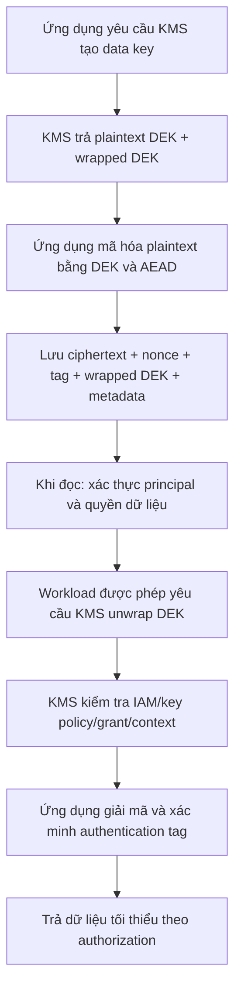

# Mã hóa khi lưu (Encryption at Rest): thiết kế, vận hành và chứng minh hiệu lực

## 1. Mã hóa khi lưu bảo vệ điều gì?

Một hệ thống có thể lưu hồ sơ nhân viên, bảng lương, thông tin thanh toán, tệp export và bản sao lưu trên database, object storage hoặc thiết bị lưu trữ của nhà cung cấp cloud. Khi dữ liệu nằm trên các phương tiện này, **encryption at rest (mã hóa khi lưu)** biến nội dung rõ thành dữ liệu mã hóa, để người không có khóa hoặc quyền giải mã phù hợp không thể đọc được nội dung theo cách thông thường.

Mã hóa khi lưu là một lớp bảo vệ quan trọng cho các tình huống như thiết bị hoặc media bị lấy cắp, snapshot/backup bị truy cập ngoài quyền, tài khoản lưu trữ bị lộ hoặc dữ liệu bị sao chép ra khỏi môi trường kiểm soát. Tuy nhiên, **mã hóa không tự ngăn một ứng dụng đã được phép giải mã trả dữ liệu cho người sai quyền**. Nếu API cho user tenant A đọc hồ sơ tenant B, dữ liệu vẫn có thể bị lộ dù database và disk đều bật encryption.

**Encryption at rest** là việc áp dụng cơ chế mật mã để bảo vệ dữ liệu khi được lưu trên thiết bị, dịch vụ hoặc bản sao lưu, cùng với quản lý khóa bảo đảm chỉ danh tính và quy trình được phép mới có thể sử dụng khóa giải mã. Để đánh giá đúng, phải kiểm tra **phạm vi dữ liệu, phương pháp mã hóa, khóa, quyền sử dụng khóa, đường truy cập, bản sao và khả năng phục hồi**.

Trong chương **Mã hóa và khóa** của module **SECURITY_SECURITY_ASSURANCE**, bài này hướng dẫn xây dựng bằng chứng rằng hệ thống đáp ứng mục tiêu bảo mật: từ phân tích rủi ro và yêu cầu, thiết kế controls, triển khai mã hóa và quản lý khóa, đến kiểm thử, audit, khắc phục và giám sát liên tục trong phát triển/vận hành.

Sau bài này, người học có thể:

1. Xác định tài sản và bản sao dữ liệu thuộc phạm vi encryption at rest.
2. Phân biệt mã hóa thiết bị/volume, database, object storage, field-level và client-side encryption.
3. Giải thích **DEK, KEK, envelope encryption, KMS/HSM, key rotation, revocation và crypto-erasure**.
4. Thiết kế phân quyền, tách nhiệm vụ và phương án phục hồi khóa phù hợp rủi ro.
5. Xây dựng test plan và evidence package có thể kiểm tra lại.
6. Đánh giá đúng giới hạn: encryption enabled, key protected và dữ liệu thực sự được bảo vệ là những tuyên bố khác nhau.

## 2. Mục tiêu, giả định và giới hạn của mã hóa khi lưu

### 2.1. Các mối đe dọa mà encryption at rest có thể giảm

| Tình huống | Vai trò của mã hóa | Controls bổ sung cần có |
| --- | --- | --- |
| Thiết bị/ổ đĩa bị tháo khỏi máy chủ hoặc thất lạc. | Dữ liệu trên media khó đọc nếu không có khóa và cơ chế mở khóa. | Secure boot, kiểm soát thiết bị, quản lý khóa và quy trình xử lý sự cố. |
| Snapshot hoặc backup bị sao chép ngoài tài khoản lưu trữ. | Bản sao không chứa plaintext nếu mã hóa đúng và khóa được bảo vệ độc lập. | IAM, tách quyền, backup isolation, audit và restore controls. |
| Object storage bị truy cập trực tiếp. | Encryption có thể giảm khả năng đọc nội dung khi bản sao bị lấy mà không có quyền giải mã. | Private access, resource policy, signed URL scope/TTL, authorization. |
| Nhà cung cấp hoặc nhân sự vận hành truy cập media. | Mô hình khóa có thể giới hạn ai có khả năng giải mã dữ liệu. | Customer-managed keys hoặc client-side encryption khi cần, hợp đồng, audit, separation of duties. |
| Tệp export hoặc dữ liệu tạm bị lưu ngoài dự kiến. | Mã hóa bảo vệ bản sao nếu key và quyền được kiểm soát. | Inventory, lifecycle, secure deletion, endpoint protection và DLP phù hợp. |
| Kẻ tấn công đọc được database file nhưng không có quyền khóa. | Encryption có thể giữ bí mật nội dung. | Bảo vệ KMS, phát hiện truy cập bất thường, phân quyền DB và response. |

### 2.2. Những điều mã hóa khi lưu không tự giải quyết

- Người dùng có quyền hợp lệ nhưng truy cập **sai tenant, sai hồ sơ hoặc sai mục đích** qua ứng dụng.
- Ứng dụng/server bị xâm nhập và có thể gọi KMS để giải mã theo quyền đang cấp.
- Plaintext xuất hiện trong memory, process dump, cache, log, crash report hoặc file tạm.
- Khóa bị lộ, bị sử dụng trái phép hoặc quyền decrypt bị cấp quá rộng.
- Dữ liệu bị chỉnh sửa nếu chỉ dùng chế độ mã hóa không có xác thực toàn vẹn phù hợp.
- Bản sao không được kiểm kê, không được mã hóa hoặc vẫn còn sau thời hạn cần xử lý.
- Hệ thống không thể phục hồi dữ liệu khi mất khóa, mất vùng KMS hoặc mất danh tính khẩn cấp.

Do đó, encryption at rest phải phối hợp với **authorization, minimization, integrity controls, key management, monitoring, backup/restore, retention và incident response**.

### 2.3. Phân biệt các trạng thái

| Tuyên bố | Điều có thể chứng minh | Chưa thể suy ra |
| --- | --- | --- |
| “Dịch vụ hỗ trợ encryption.” | Nền tảng có khả năng cung cấp tính năng. | Tài sản cụ thể đã bật mã hóa. |
| “Cấu hình encryption đã bật.” | Cấu hình hoặc IaC khai báo trạng thái mong muốn. | Runtime state không drift và toàn bộ bản sao đã được bảo vệ. |
| “Runtime storage đang mã hóa.” | Tài sản và thời điểm kiểm tra có trạng thái mã hóa hiệu lực. | Khóa được phân quyền đúng hoặc backup restore được. |
| “Khóa được bảo vệ.” | Có evidence về KMS/HSM, IAM, lifecycle và audit trong scope. | Ứng dụng không thể trả dữ liệu trái quyền. |
| “Control encryption at rest hiệu quả.” | Design, implementation và operating evidence đáp ứng tiêu chí đã xác định. | Mọi rủi ro dữ liệu đã bằng không hoặc mọi tài sản ngoài scope đều đạt. |

## 3. Xác định phạm vi: dữ liệu nào phải được mã hóa?

Một lỗi thường gặp là chỉ kiểm tra database chính. Trong hệ thống thực, cùng một bản ghi có thể xuất hiện ở nhiều nơi:

- Database primary/replica, transaction log, write-ahead log và database snapshot.
- Object storage, file share, block volume, persistent volume và local disk.
- Backup, archive, disaster recovery copy và bản sao chuyển vùng.
- Queue, event stream, dead-letter queue, cache, search index và data warehouse.
- Tệp CSV/PDF export, file tạm, thư mục staging và thư mục tải xuống.
- Log, trace, crash dump, support attachment và artifact CI/CD.
- Laptop/thiết bị di động, máy trạm vận hành và thiết bị lưu trữ di động.
- Hệ thống SaaS/đối tác nhận dữ liệu, kể cả bản sao do bên nhận tạo.

### 3.1. Data inventory cho encryption at rest

| Trường inventory | Câu hỏi | Ví dụ |
| --- | --- | --- |
| **Asset ID** | Tài sản nào đang được kiểm tra? | `DA-PAYROLL-DB-01`. |
| **Data classification** | Nội dung nhạy cảm đến mức nào? | Restricted: dữ liệu lương. |
| **Storage type** | Cơ chế lưu trữ nào? | Managed database, object storage, backup vault. |
| **Environment/tenant/region** | Phạm vi triển khai ở đâu? | Production, tenant A/B, vùng được phê duyệt. |
| **Data copies** | Có replica, export, snapshot hoặc cache nào? | DB replica, CSV export, DR backup. |
| **Encryption layer** | Mã hóa ở tầng nào? | Volume, database TDE, object SSE, field encryption. |
| **Key reference** | Khóa nào bảo vệ dữ liệu? | KMS key alias/ref, không ghi key material. |
| **Key owner and usage identity** | Ai quản trị và workload nào dùng khóa? | Platform key owner, payroll service role. |
| **Access policy** | Ai có thể đọc plaintext hoặc dùng decrypt? | DB role, storage role, KMS grants. |
| **Lifecycle/retention** | Khi nào dữ liệu hoặc khóa được thay/xóa? | Retention rule, rotation policy, deletion plan. |
| **Evidence refs** | Bằng chứng nào xác nhận trạng thái? | Runtime config, IAM snapshot, test và restore drill. |

### 3.2. Đối soát để tránh bỏ sót

Đối chiếu data inventory với cloud resource inventory, database catalog, backup catalog, job schedules, object storage prefixes, deployment manifests, data-flow diagrams và danh sách integration. Kiểm tra cả **tài sản không còn owner** và tài sản được tạo ngoài pipeline chuẩn.

Nếu một region, bucket cũ hoặc backup provider chưa thể kiểm tra, ghi **Unknown/Unverified** và tạo action. Không loại nó khỏi mẫu số rồi báo “100% encrypted”. Chỉ đánh dấu **Not applicable** khi có căn cứ cho thấy tài sản không lưu dữ liệu thuộc phạm vi hoặc yêu cầu mã hóa không áp dụng theo tiêu chí đã duyệt.

## 4. Các lớp mã hóa khi lưu

### 4.1. Full-disk và volume encryption

Mã hóa toàn bộ ổ đĩa hoặc volume bảo vệ dữ liệu khi media bị tháo rời, snapshot được sao chép hoặc lớp hạ tầng lưu trữ bị truy cập ngoài cơ chế mở khóa. Ở cloud, managed block storage có thể cung cấp mã hóa volume/snapshot; ở máy chủ hoặc laptop, có thể dùng cơ chế full-disk encryption.

**Bằng chứng cần kiểm tra:** asset inventory, runtime volume encryption state, policy mặc định cho volume mới, snapshot/replica settings, key reference, quyền dùng khóa, và negative access tests phù hợp. Một chính sách “default encryption” không chứng minh các volume cũ hoặc tài sản ngoài tài khoản được quản lý đã được chuyển đổi.

### 4.2. Database encryption at rest

Database có thể cung cấp **transparent data encryption (TDE)** hoặc cơ chế mã hóa storage của nhà cung cấp. TDE thường bảo vệ file dữ liệu/log/snapshot ở tầng database/storage theo kiến trúc cụ thể; nó không tự giới hạn truy vấn SQL của một account đã được database cho phép.

Cần xem:

- Database instances, replicas, transaction logs, snapshots và backup có nằm trong scope không?
- Encryption setting có hiệu lực cho tài sản đang chạy hay chỉ ở template tạo mới?
- Key do provider quản lý hay customer-managed; quyền dùng key và audit ra sao?
- Export/replication/restore có duy trì trạng thái bảo vệ không?
- DBA/app roles có bị cấp rộng hoặc tách nhiệm vụ không?

### 4.3. Object storage và file encryption

Object storage thường có server-side encryption với key do provider quản lý hoặc key do khách hàng quản lý. Một số kiến trúc có client-side encryption trước khi upload. File export, archive, attachment và temporary object cần được đưa vào inventory.

Kiểm tra **effective bucket/container policy, object-level settings nếu nền tảng hỗ trợ, replication, lifecycle, signed URL, quyền KMS và đường download**. Encryption không thay private access policy; một bucket public có thể vẫn trả plaintext qua dịch vụ đã được phép giải mã.

### 4.4. Field-level/column-level encryption

Mã hóa một số trường cụ thể có thể giảm phạm vi plaintext mà database administrator hoặc hệ thống phân tích nhìn thấy. Ví dụ, số tài khoản ngân hàng hoặc định danh nhạy cảm có thể được bảo vệ ở tầng ứng dụng.

Đổi lại, cần đánh giá:

- Thành phần nào giữ key và thực hiện encrypt/decrypt?
- Có cần tìm kiếm, join, sort hoặc index trên trường đã mã hóa không?
- Plaintext có xuất hiện trong log, cache, query parameters, backup hoặc error message không?
- Có thể phân quyền decrypt khác quyền đọc database không?
- Key rotation có cần re-encrypt dữ liệu cũ hoặc chỉ rewrap DEK?

### 4.5. Client-side encryption

Client-side encryption thực hiện mã hóa trước khi dữ liệu đi vào storage/provider, giúp giảm khả năng nhà cung cấp hạ tầng đọc plaintext nếu khóa chỉ nằm trong miền kiểm soát của khách hàng/người dùng. Nhưng mô hình này làm tăng trách nhiệm quản lý khóa, phục hồi, chia sẻ và khả năng tìm kiếm/xử lý.

Nếu ứng dụng server vẫn cần decrypt để tính toán, server hoặc workload phải có quyền khóa ở một thời điểm; khi đó lợi ích chống nhà cung cấp/hạ tầng phải được mô tả đúng. **Không tuyên bố zero-knowledge hoặc provider không thể đọc** nếu kiến trúc thực tế vẫn gửi plaintext hoặc quyền decrypt cho họ.

### 4.6. Chọn lớp theo threat model

| Lớp | Phù hợp để bảo vệ | Giới hạn chính |
| --- | --- | --- |
| Full-disk/volume | Media/volume bị lấy hoặc truy cập ngoài máy chủ. | Ứng dụng và OS đã mở khóa vẫn có thể đọc dữ liệu. |
| Database/TDE | Database files, logs, snapshots theo phạm vi triển khai. | Query hợp lệ và account có quyền vẫn nhận plaintext. |
| Object storage SSE | Object lưu trữ, bản sao và một số luồng backup. | Access policy và signed URL vẫn quyết định ai lấy object. |
| Field/column encryption | Một số trường nhạy cảm và phân quyền decrypt chi tiết hơn. | Quản lý key, query và tích hợp phức tạp hơn. |
| Client-side encryption | Giảm khả năng storage provider nhìn plaintext. | Khó xử lý/search/restore; key loss có thể mất dữ liệu. |

Không có một lớp duy nhất thay thế các lớp khác. Tổ chức chọn dựa trên **data classification, attacker model, kiến trúc, năng lực quản lý khóa, yêu cầu phục hồi và chi phí vận hành**.

## 5. Nền tảng mật mã: ciphertext cần có bí mật và toàn vẹn

### 5.1. Encryption và authenticated encryption

Mã hóa đối xứng dùng cùng một khóa bí mật để mã hóa/giải mã. Với dữ liệu lưu, nên sử dụng **authenticated encryption with associated data (AEAD)** theo crypto baseline được tổ chức phê duyệt và thư viện được duy trì. AEAD cung cấp bí mật và kiểm tra tính toàn vẹn/xác thực của ciphertext cùng dữ liệu liên kết.

Một ví dụ phổ biến trong hệ thống hiện đại là AES-GCM khi được cấu hình và sử dụng đúng. Tuy nhiên, bài này không đặt một thuật toán/độ dài khóa bất biến cho mọi tổ chức; cần theo **chuẩn mật mã hiện hành, hướng dẫn nền tảng, đánh giá rủi ro và chính sách được phê duyệt**.

### 5.2. Nonce/IV và dữ liệu liên kết

Với AEAD, nonce/IV phải được tạo và sử dụng theo quy tắc của thuật toán. Ví dụ AES-GCM yêu cầu **không tái sử dụng nonce với cùng một khóa**; vi phạm có thể phá hủy bảo đảm bảo mật. Nếu mỗi object dùng một DEK riêng, vẫn phải tuân thủ yêu cầu nonce của từng DEK.

**Associated data (AAD)** là dữ liệu không mã hóa nhưng được xác thực cùng ciphertext, ví dụ phiên bản định dạng, tenant ID hoặc record ID. AAD giúp phát hiện ciphertext bị gắn nhầm ngữ cảnh, nhưng **không tự cấp quyền truy cập**. Giá trị AAD lúc giải mã phải được lấy từ nguồn tin cậy, không tin tenant ID do client tự truyền.

### 5.3. Tránh tự thiết kế mật mã

- Dùng thư viện mật mã được duy trì và API cấp cao của nền tảng.
- Không tự chế thuật toán, ghép hash/XOR hoặc mã hóa bằng Base64.
- Không dùng cùng một key cố định nhúng trong source code, image hoặc file cấu hình công khai.
- Không hardcode nonce/IV hoặc tái sử dụng nonce trái yêu cầu thuật toán.
- Không log plaintext, key material, password, bearer token hoặc wrapped key cùng dữ liệu nhạy cảm khi không cần.
- Có version/format metadata để hỗ trợ decrypt và migration về sau.
- Review error handling, authentication tag failure và trường hợp ciphertext bị cắt/sửa.

**Encryption chỉ bảo vệ khi implementation và key lifecycle đúng.** Một thư viện tốt không cứu được hệ thống nếu mọi workload đều có quyền decrypt mọi dữ liệu.

## 6. Envelope encryption: tách khóa dữ liệu và khóa bảo vệ khóa

### 6.1. DEK và KEK

**Envelope encryption** là mô hình dùng một **Data Encryption Key (DEK)** để mã hóa dữ liệu, sau đó dùng một **Key Encryption Key (KEK)** hoặc cơ chế wrapping của KMS để bảo vệ DEK. Ứng dụng lưu ciphertext và wrapped DEK; khi cần đọc, workload được phép yêu cầu KMS unwrap DEK rồi giải mã dữ liệu.

- **DEK:** khóa mã hóa dữ liệu hoặc một object/nhóm dữ liệu theo thiết kế.
- **KEK/wrapping key:** khóa dùng bảo vệ DEK, thường được giữ trong KMS/HSM.
- **KMS:** dịch vụ quản lý khóa, policy, grants, audit và lifecycle theo nền tảng.
- **HSM:** phần cứng bảo vệ thao tác/khóa mật mã theo mô hình và mức đảm bảo của thiết bị.

### 6.2. Luồng mã hóa và giải mã



Trong luồng này, plaintext DEK chỉ nên tồn tại trong bộ nhớ cần thiết và thời gian ngắn; cần xử lý lỗi và dọn bộ nhớ theo khả năng nền tảng. **KMS không tự kiểm tra quyền nghiệp vụ trên từng hồ sơ** trừ khi kiến trúc có tích hợp điều kiện phù hợp. Ứng dụng phải kiểm tra quyền trước khi gọi decrypt.

### 6.3. Vì sao envelope encryption hữu ích?

- Tách hoạt động mã hóa dữ liệu khỏi quản lý khóa gốc.
- Có thể thay/rewrap KEK mà không nhất thiết phải mã hóa lại toàn bộ payload.
- Có thể giới hạn workload nào được dùng KEK.
- Tạo audit trail cho các thao tác key usage.
- Cho phép phân vùng khóa theo ứng dụng, môi trường, tenant hoặc mức dữ liệu.

Nhưng envelope encryption **không tự đảm bảo** tách biệt nếu một service role có quyền decrypt mọi DEK, KMS key policy cho phép quá rộng hoặc ứng dụng trả plaintext trái quyền.

## 7. Key management lifecycle: khóa cũng là tài sản cần bảo vệ

Khóa có thể quan trọng ngang hoặc hơn ciphertext. Một hệ thống có encryption nhưng khóa nằm trong source code, cùng quyền với dữ liệu hoặc không thể phục hồi khi disaster recovery vẫn có thể thất bại.

### 7.1. Các giai đoạn vòng đời khóa

| Giai đoạn | Câu hỏi assurance | Evidence |
| --- | --- | --- |
| **Generate/provision** | Khóa được tạo ở đâu, bằng nguồn ngẫu nhiên/cơ chế nào, ai được tạo? | KMS/HSM configuration, audit event, approved key policy. |
| **Store/protect** | Key material có rời vùng bảo vệ không? Ai quản trị? | KMS/HSM evidence, access policy, separation of duties. |
| **Distribute/use** | Workload nào có thể encrypt/decrypt/wrap/unwrap? | IAM grants, runtime identity, usage logs, negative tests. |
| **Rotate** | Khi nào/điều kiện nào đổi key; dữ liệu cũ được xử lý ra sao? | Rotation policy, event, version mapping và test. |
| **Revoke/disable** | Khi compromise hoặc chấm dứt quyền, làm sao chặn sử dụng? | Incident runbook, disabled/revoked state, deny tests. |
| **Backup/recover** | Khóa có thể sử dụng khi khôi phục theo thẩm quyền không? | Key recovery procedure, restore drill và approvals. |
| **Destroy/retire** | Khi nào được hủy, ảnh hưởng dữ liệu và backup ra sao? | Approval, retention/dependency review, destruction evidence. |

### 7.2. Tách nhiệm vụ và quyền tối thiểu

Một mô hình thường cần phân biệt:

- **Key administrator:** quản lý policy, lifecycle và cấu hình khóa.
- **Key user/workload:** sử dụng thao tác cryptographic được cấp, không tự thay key policy.
- **Data/application owner:** quyết định dữ liệu và workload nào cần decrypt theo mục đích.
- **Security/auditor:** review quyền, log, ngoại lệ và kiểm chứng.
- **Recovery approver:** cho phép thao tác khẩn theo quy trình độc lập phù hợp.

Không nhất thiết mọi tổ chức phải có năm nhóm riêng; nhưng với khóa bảo vệ dữ liệu nhạy cảm, cần tránh **một danh tính duy nhất vừa tạo khóa, cấp quyền, dùng khóa, xóa audit và tự phê duyệt ngoại lệ** nếu điều đó vượt ngưỡng rủi ro.

### 7.3. Không chia sẻ key material trong evidence

Evidence có thể gồm key ID/alias, trạng thái, thuật toán/loại khóa, policy, grants, owner, thời điểm, audit events và kết quả test. **Không xuất plaintext key, private key hoặc bí mật KMS** để chứng minh sự tồn tại. Cũng không đặt key material trong Markdown, ticket, CI variables không bảo vệ hoặc log.

## 8. KMS, HSM và lựa chọn mô hình khóa

### 8.1. Provider-managed, customer-managed và external keys

| Mô hình | Đặc điểm | Phù hợp khi | Câu hỏi cần đánh giá |
| --- | --- | --- | --- |
| **Provider-managed key** | Nhà cung cấp quản lý phần lớn lifecycle và key material theo dịch vụ. | Muốn giảm vận hành khóa, yêu cầu nền tảng đáp ứng baseline. | Khả năng kiểm soát policy, audit, rotation, region và trách nhiệm provider? |
| **Customer-managed key (CMK)** | Khách hàng quản lý policy/lifecycle hoặc quyền sử dụng khóa trong KMS của provider. | Cần kiểm soát quyền, revoke, audit và ranh giới quản trị cao hơn. | Ai có quyền quản trị/use; outage/disable key ảnh hưởng gì? |
| **External key management** | Khóa hoặc dịch vụ quản lý khóa nằm ngoài nền tảng lưu trữ chính theo mô hình tích hợp. | Có yêu cầu độc lập hoặc quản trị khóa riêng. | Latency, availability, recovery, rotation và shared responsibility? |
| **HSM-backed key** | Thao tác hoặc key material được bảo vệ bởi HSM theo chứng nhận/cấu hình cụ thể. | Cần kiểm soát vật lý/cryptographic boundary phù hợp. | HSM mode, key exportability, partition, admin roles, audit và DR? |
| **Client-side key** | Client hoặc tổ chức giữ khóa ngoài storage provider. | Cần giảm khả năng provider nhìn plaintext. | Key loss, multi-device, sharing, recovery và xử lý server-side? |

Tên gọi “customer-managed” không tự chứng minh khách hàng có quyền kiểm soát toàn bộ key material hoặc nhà cung cấp không thể truy cập. Cần xem **kiến trúc, hợp đồng, dịch vụ cụ thể và evidence hiện hành**.

### 8.2. Key policy và grants

Key policy/IAM cần giới hạn theo:

- Principal hoặc workload identity cụ thể.
- Các thao tác cần thiết: encrypt, decrypt, generate data key, wrap/unwrap, describe, rotate, disable hoặc administer.
- Resource, environment, tenant và điều kiện context phù hợp.
- Nguồn gọi, network/service condition khi nền tảng hỗ trợ.
- Thời hạn/điều kiện cấp quyền tạm và quy trình khẩn.
- Logging, alert và review thay đổi policy.

**Không dùng quyền decrypt rộng làm cách giải quyết lỗi authorization ứng dụng.** Nếu mọi service đều có thể decrypt mọi dữ liệu, lớp mã hóa có thể vẫn bảo vệ media offline nhưng không còn tạo phân tách hữu ích giữa các workload.

### 8.3. Đánh giá HSM/KMS độc lập với tên sản phẩm

Không suy ra một KMS đạt một chuẩn hoặc chứng nhận cụ thể chỉ từ tên dịch vụ. Kiểm tra tài liệu/chứng nhận đúng **dịch vụ, vùng, chế độ, phiên bản, phạm vi và thời điểm**. Với tổ chức cần assurance của nhà cung cấp, ghi rõ artifact nào được nhận, giới hạn của báo cáo và phần cấu hình tích hợp do tổ chức tự chịu trách nhiệm.

## 9. Mã hóa dữ liệu đa tenant

SaaS nhiều tenant phải quyết định **ranh giới khóa có phản ánh mức cách ly dữ liệu cần đạt hay không**. Không có một mô hình khóa tối ưu cho mọi sản phẩm.

### 9.1. Một số chiến lược

| Chiến lược | Mô tả | Ưu điểm | Đánh đổi/rủi ro |
| --- | --- | --- | --- |
| **Shared KEK, per-object DEK** | Nhiều tenant dùng một KEK bảo vệ các DEK riêng. | Dễ quản lý và scale hơn, giảm số khóa gốc. | KEK/policy chung có blast radius lớn; cần AAD và authorization tenant. |
| **Per-tenant KEK, per-object DEK** | Mỗi tenant có KEK riêng bảo vệ DEK của object. | Phân vùng quyền, revoke và audit theo tenant. | Số lượng khóa/policy lớn, vận hành rotation và DR phức tạp hơn. |
| **Per-tenant data key** | Tenant có DEK riêng cho một nhóm dữ liệu. | Ranh giới mật mã rõ hơn so với một DEK chung. | Cần xử lý rotation, bản sao và truy cập theo tenant. |
| **Client-side tenant keys** | Khách hàng giữ hoặc kiểm soát khóa ở phía họ. | Có thể tăng ranh giới độc lập với SaaS provider. | Khó phục hồi, chia sẻ, tìm kiếm và xử lý khi khách hàng mất khóa. |

### 9.2. Key separation không thay tenant authorization

Nếu hệ thống dùng per-tenant keys nhưng API có thể yêu cầu KMS decrypt bằng tenant ID do client tự gửi, attacker vẫn có thể thử dùng ngữ cảnh sai nếu service role được phép rộng. Ứng dụng cần **binding tenant/resource từ nguồn tin cậy**, policy key phù hợp và test cross-tenant.

AAD có thể gắn ciphertext với tenant ID, record ID hoặc purpose context. Khi giải mã, ứng dụng phải lấy các giá trị này từ metadata đáng tin và xác minh tính nhất quán. **AAD chống gắn ciphertext sai ngữ cảnh; nó không thay kiểm tra quyền**.

### 9.3. Rủi ro blast radius

Vẽ dependency giữa dữ liệu, DEK, KEK, KMS role và workload. Nếu một KEK dùng cho mọi tenant, compromise của quyền decrypt có thể tác động diện rộng. Nếu có nhiều KEK nhưng tất cả được quản trị bởi một admin role chung, điểm lỗi chung vẫn còn.

## 10. Bảo vệ các bản sao: backup, snapshot, log, cache và export

### 10.1. Backup và snapshot

Backup thường chứa tập dữ liệu đầy đủ và có thể được giữ lâu hơn dữ liệu active. Kiểm tra:

- Backup encryption có được bật cho **mọi loại backup** và region không?
- Snapshot/replica được mã hóa bằng key nào; có copy sang account/vùng khác không?
- Backup vault có IAM tách biệt và cơ chế chống xóa/sửa trái quyền không?
- Ai có quyền restore và decrypt; quyền khẩn có cần phê duyệt không?
- Key có thể truy cập trong DR khi vùng chính mất không?
- Retention và deletion có áp dụng cho bản sao theo policy/obligation không?
- Restore có đưa dữ liệu đã hết mục đích trở lại hệ thống active không, và xử lý ra sao?

### 10.2. Log, trace và crash dump

Log có thể chứa token, email, payload, định danh hoặc dữ liệu giao dịch. Encryption at rest ở log storage là cần thiết khi thuộc phạm vi, nhưng trước hết phải **giảm thiểu dữ liệu nhạy cảm**. Một log đã mã hóa vẫn có thể bị đọc bởi nhiều người có quyền logging; cần RBAC, redaction, retention, audit và key access controls.

### 10.3. Cache, queue và tệp tạm

Các thành phần này dễ bị bỏ sót do vòng đời ngắn hoặc do đội khác quản lý. Kiểm tra persistence, disk spill, snapshot, dead-letter retention, export staging, temp files và bản copy do job retry tạo ra. Nếu thành phần chỉ tồn tại trong memory, đánh giá riêng nguy cơ dump/swap/host compromise; không tuyên bố encryption at rest áp dụng cho một nơi không thực sự lưu bền.

### 10.4. Bằng chứng coverage

Tạo ma trận **asset → storage layer → encryption setting → key reference → policy → runtime test → evidence**. Một bản report chỉ có số database instances mà không liệt kê object storage/backup/export không chứng minh coverage toàn bộ dữ liệu.

## 11. Key rotation, rewrap, re-encryption và migration

### 11.1. Rotation không phải lúc nào cũng re-encrypt dữ liệu

Trong envelope encryption, có thể thay KEK bằng cách **rewrap DEK** (giải mã DEK bằng KEK cũ trong môi trường bảo vệ rồi bọc lại bằng KEK mới), trong khi ciphertext dữ liệu giữ nguyên. Nếu thay DEK hoặc thuật toán/format, có thể cần **decrypt và encrypt lại dữ liệu**. Hai quy trình khác nhau về chi phí, rủi ro, thời gian và khả năng rollback.

| Hoạt động | Thay đổi gì? | Bằng chứng cần có |
| --- | --- | --- |
| **KEK rotation** | Thay phiên bản khóa bảo vệ DEK theo cơ chế KMS. | Rotation event, key version mapping, policy và test decrypt dữ liệu cũ/mới. |
| **DEK rotation** | Thay khóa mã hóa dữ liệu. | Migration coverage, ciphertext version, xử lý dữ liệu chưa chuyển. |
| **Rewrap** | Bọc lại DEK bằng KEK khác. | Record count, old/new key refs, integrity/decrypt tests và trạng thái hoàn tất. |
| **Re-encryption** | Mã hóa lại payload bằng khóa/format mới. | Job progress, error handling, verify plaintext equivalence/integrity, rollback. |
| **Algorithm/format migration** | Chuyển cơ chế/format mật mã. | Compatibility tests, versioning, data coverage và retirement plan. |

Không tuyên bố “đã rotate” chỉ vì KMS tạo phiên bản key mới. Phải xác định **dữ liệu nào đang dùng phiên bản nào, key cũ còn cần để đọc backup/ciphertext không, khi nào được retire và cách xác minh**.

### 11.2. Trigger rotation

Trigger có thể gồm lịch theo crypto baseline, nghi ngờ compromise, thay đổi nhân sự/quyền, thay provider, thay thuật toán hoặc yêu cầu của hợp đồng/chính sách. **Không có một chu kỳ chung cho mọi key**; key dùng để ký, key mã hóa dữ liệu, DEK tạm và KEK có vai trò khác nhau.

### 11.3. Quy trình migration an toàn

1. Inventory mọi ciphertext, wrapped DEK, backup và consumer phụ thuộc key cũ.
2. Phê duyệt migration, xác định owner, cửa sổ thay đổi, rollback và tiêu chí thành công.
3. Tạo/enable key mới trong trust boundary được duyệt, thiết lập policy tối thiểu.
4. Rewrap hoặc re-encrypt theo batch có kiểm soát, ghi version/metadata.
5. Kiểm tra số lượng, authentication tag/decrypt, lỗi, dữ liệu chưa xử lý và khả năng restore.
6. Chỉ retire key cũ sau khi xác nhận **mọi phụ thuộc hợp lệ** đã chuyển và backup/retention được xử lý.
7. Lưu evidence, cập nhật inventory, risk register và lịch kiểm tra.

## 12. Revocation, compromise và crypto-erasure

### 12.1. Disable/revoke key

Khi key hoặc quyền sử dụng bị nghi compromise, phản ứng có thể gồm hạn chế principal, disable key, thu hồi grant, đổi key, re-encrypt/rewrap, đánh giá ciphertext và điều tra audit. Nhưng **disable key ngay lập tức** có thể làm mất khả năng phục hồi dữ liệu và gián đoạn nghiệp vụ. Quyết định cần dựa trên incident severity, blast radius, quyền có thể thu hồi, bản sao và người có thẩm quyền.

### 12.2. Crypto-erasure là gì?

**Crypto-erasure** là phương pháp làm dữ liệu mã hóa không thể giải mã bằng cách hủy hoặc làm mất khả năng sử dụng an toàn của các khóa cần thiết, khi kiến trúc và quy trình bảo đảm không còn bản sao khóa/đường giải mã hợp lệ. Đây có thể là một thành phần trong chiến lược xóa dữ liệu, nhưng **không tự động chứng minh mọi bản sao plaintext đã bị xóa**.

Để kết luận crypto-erasure, cần kiểm tra:

- Tất cả ciphertext trong scope thực sự được mã hóa bằng khóa/DEK bị hủy hoặc mất khả năng sử dụng.
- Không còn wrapped DEK có thể unwrap qua key version, backup, replica hoặc principal khác.
- Không còn plaintext copy, export, cache, log, crash dump hoặc downstream recipient ngoài scope.
- Không còn bản backup khóa/credential có thể khôi phục trái mục tiêu.
- KMS/HSM destruction state và audit evidence đáp ứng quy trình được duyệt.
- Khả năng restore dữ liệu hợp lệ khác không bị phá hủy ngoài ý muốn.

Nếu chỉ xóa một key alias hoặc disable một key policy, chưa đủ để tuyên bố crypto-erasure nếu bản key khác hoặc plaintext vẫn còn. Việc hủy khóa là **thao tác có hậu quả khó đảo ngược**; cần xác minh dependencies, retention/legal hold, phê duyệt và phương án trước khi thực hiện.

### 12.3. Tách key destruction khỏi access revocation

| Hành động | Tác động | Điều phải xác minh |
| --- | --- | --- |
| Thu hồi quyền decrypt của một workload. | Workload không còn được dùng key theo policy. | Các workload hợp lệ khác, quyền kế thừa và runtime deny. |
| Disable key tạm thời. | Các hoạt động cần key có thể thất bại. | Phạm vi ảnh hưởng, recovery và điều kiện bật lại. |
| Rotate KEK. | DEK được bọc lại hoặc chuyển sang key version mới. | Ciphertext và wrapped key mapping vẫn đọc được. |
| Destroy key material. | Có thể không thể giải mã dữ liệu phụ thuộc. | Không còn phụ thuộc hợp lệ; approvals và destruction evidence. |

## 13. Availability, recovery và failure behavior

Mã hóa thêm một dependency: dữ liệu chỉ có thể đọc khi **ciphertext, khóa, quyền, KMS/HSM, network, identity và ứng dụng** cùng hoạt động theo điều kiện. KMS outage hoặc key policy sai có thể làm dịch vụ ngừng hoạt động dù storage vẫn khỏe.

### 13.1. Failure mode cần phân tích

| Failure mode | Hậu quả | Kiểm soát/kiểm thử |
| --- | --- | --- |
| KMS unavailable hoặc timeout. | Không tạo DEK/unwrap key, đọc/ghi dữ liệu bị gián đoạn. | HA/DR, retry có giới hạn, timeout, fail behavior và runbook. |
| Workload mất quyền decrypt do policy drift. | Dịch vụ không đọc được dữ liệu. | IAM monitoring, policy test và quy trình phục hồi được duyệt. |
| Key bị disable nhầm. | Nhiều asset có thể không truy cập được. | Change approval, impact map, break-glass có kiểm soát. |
| Key rotation không đồng bộ. | Dữ liệu mới đọc được nhưng ciphertext cũ thất bại hoặc ngược lại. | Mixed-version test và migration reconciliation. |
| Mất vùng KMS chính. | DR storage có thể còn nhưng không giải mã được. | Restore drill ở điều kiện mất vùng/đường phụ thuộc đại diện. |
| KMS admin account bị chiếm. | Attacker thay policy, disable/destroy hoặc cấp quyền decrypt. | Separation, MFA/PAM, alert và incident response. |
| Wrapped DEK metadata mất/corrupt. | Không biết key/version/context để giải mã object. | Metadata integrity, backup và migration test. |
| Plaintext rò qua log/cache. | Encryption at rest không bảo vệ bản sao ngoài kiểm soát. | Redaction, data inventory, log/cache tests. |

### 13.2. Fail-secure không đồng nghĩa bỏ qua availability

Nếu KMS không sẵn sàng, hệ thống không nên **tự bỏ qua mã hóa hoặc trả dữ liệu nhạy cảm không xác minh**. Nhưng một hệ thống y tế hoặc thanh toán cũng phải xem hậu quả của việc không thể truy cập dữ liệu. Có thể thiết kế cache/credential hoặc vùng phục hồi được kiểm soát trong giới hạn được phê duyệt, nhưng cần:

- Ràng buộc thời gian, dữ liệu và principal được phép.
- Bảo vệ vật liệu khóa và audit truy cập.
- Kiểm tra quyền thu hồi và dữ liệu đã stale.
- Có điều kiện hết hạn, giám sát và phương án quay về trạng thái chuẩn.
- Test cả security và availability trong diễn tập.

Không tự thiết kế “emergency key” plaintext hoặc quyền decrypt toàn bộ không kiểm soát chỉ để giữ uptime.

### 13.3. Restore drill phải bao gồm key dependencies

Restore test nên kiểm tra **backup data, key version, quyền KMS, identity khẩn, network, metadata/wrapped DEK, ứng dụng và quy trình phê duyệt**. Ghi thời gian khôi phục và mức mất dữ liệu thực đo, so sánh với **RTO/RPO do nghiệp vụ duyệt**. Một backup job thành công hoặc một KMS health check xanh không chứng minh hệ thống khôi phục hoàn chỉnh.

## 14. Bằng chứng: design, implementation và operating effectiveness

### 14.1. Evidence matrix

| Mức | Câu hỏi | Ví dụ artifact | Giới hạn |
| --- | --- | --- | --- |
| **Design** | Tài sản nào phải mã hóa, threat nào được giảm và key boundary nào? | Data inventory, threat model, encryption architecture, key lifecycle standard. | Chưa chứng minh runtime. |
| **Implementation** | Code/IaC/config đã triển khai cơ chế nào? | Terraform/IaC, database/storage config, KMS policy, key references. | Có thể drift hoặc thiếu resource ngoài pipeline. |
| **Operating** | Tài sản thực tế có mã hóa, quyền đúng và decrypt/restore được? | Runtime API snapshot, effective IAM, negative test, rotation/restore drill. | Chỉ trong asset/time/environment được kiểm tra. |
| **Remediation** | Finding đã được sửa và xác minh chưa? | Change record, before/after, retest, approval, risk decision. | Ticket đóng không đủ nếu thiếu verification. |

### 14.2. Gói evidence tối thiểu

1. **Scope and inventory:** asset IDs, data classes, environment/tenant/region, bản sao và nguồn.
2. **Encryption configuration:** layer, mode, trạng thái hiệu lực, key reference và version.
3. **Key governance:** owner, KMS/HSM boundary, policy, grants, separation, rotation/revoke/destruction rules.
4. **Runtime access:** principal/workload, operation encrypt/decrypt, effective grants, audit events.
5. **Tests:** positive/negative, unauthorized key use, ciphertext integrity, backup/restore, rotation và failure scenarios.
6. **Evidence provenance:** nguồn, collector, thời điểm, build/config version, phương pháp, kết quả và giới hạn.
7. **Finding/decision:** owner, due date, remediation, retest, residual risk và cấp quyết định.

### 14.3. Không lưu bí mật trong hồ sơ kiểm toán

Evidence có thể chứa **key alias/ID, policy đã che, metadata, grant list, event IDs, test result và reference tới kho bảo vệ**. Không đính plaintext DEK/KEK, private key, credential, bearer token hoặc ciphertext kèm wrapped key nếu không cần thiết cho mục đích đánh giá và không có cơ chế bảo vệ phù hợp.

Một screenshot “Encryption: Enabled” không chứng minh **asset coverage, key access, rotation, restore hoặc backup**. Nếu dùng screenshot, kèm asset ID, môi trường, thời gian, context/filter và đối chiếu nguồn runtime.

## 15. Kiểm thử mã hóa khi lưu

### 15.1. Test matrix

| Test ID | Tình huống | Kết quả mong đợi | Evidence |
| --- | --- | --- | --- |
| **ENC-T01** | Tạo asset mới theo policy encryption bắt buộc. | Runtime asset có encryption đúng layer/key theo baseline. | Resource ID, config, timestamp, policy version. |
| **ENC-T02** | Kiểm tra asset cũ, replica và snapshot. | Không có tài sản thuộc scope bị bỏ mã hóa. | Inventory reconciliation, runtime states. |
| **ENC-T03** | Principal không được phép yêu cầu decrypt. | KMS từ chối, không trả plaintext/DEK. | Deny event, principal, policy và test result. |
| **ENC-T04** | Workload được phép decrypt object đúng scope. | Decrypt thành công và integrity/authentication tag hợp lệ. | Test fixture giả, key ref, build và expected/actual. |
| **ENC-T05** | Ciphertext, tag hoặc AAD bị thay đổi. | Xác minh thất bại; không trả plaintext. | Negative crypto test và error handling. |
| **ENC-T06** | Ciphertext của tenant A bị gắn metadata tenant B. | AAD/context validation từ chối. | Tenant fixture, expected/actual, audit. |
| **ENC-T07** | KMS policy thay đổi để cấp quyền rộng. | Change gate/alert phát hiện; test principal ngoài scope bị từ chối. | Policy diff, approval, negative IAM test. |
| **ENC-T08** | Rotate KEK và rewrap DEK. | Dữ liệu cũ/mới vẫn đọc được; key cũ chỉ retire sau xác minh. | Rotation event, record reconciliation, decrypt tests. |
| **ENC-T09** | Disable/revoke key theo kịch bản kiểm soát. | Hành vi phù hợp; không có principal trái phép tiếp tục decrypt. | State, deny/allow tests, recovery procedure. |
| **ENC-T10** | KMS timeout hoặc mất kết nối. | Không bypass encryption; error/fallback theo thiết kế được duyệt. | Fault injection, service logs, availability results. |
| **ENC-T11** | Restore backup trong môi trường DR. | Restore được dữ liệu và giải mã trong RTO/RPO mục tiêu. | Drill report, key dependencies, measured time/data loss. |
| **ENC-T12** | Kiểm tra log/trace/crash dump. | Không chứa key material hoặc plaintext nhạy cảm ngoài policy. | Synthetic marker test, redaction report. |
| **ENC-T13** | Tạo export/temp file và kiểm tra lifecycle. | Bản sao được mã hóa, quyền và retention đúng. | Storage policy, file lifecycle, negative access. |
| **ENC-T14** | Crypto-erasure hoặc key retirement rehearsal. | Phụ thuộc được kiểm kê; chỉ thực hiện theo approval và có thể xác minh trạng thái. | Dependency inventory, approval, KMS audit. |

Các test gây lỗi KMS, disable key, restore hoặc destruction rehearsal cần chạy trong **môi trường được phép và có dữ liệu giả**, không tự ý disable khóa production hoặc tạo rủi ro mất dữ liệu.

### 15.2. Kiểm tra cả đường sử dụng và quyền dữ liệu

Một test có thể chứng minh KMS từ chối principal không được cấp quyền. Nhưng để chứng minh ứng dụng không trả dữ liệu sai tenant, cần **authorization tests ở API/resource**, kiểm tra workload có thể decrypt gì, và đánh giá đường bypass qua storage, export, cache hoặc job. Encryption và authorization phải có kết luận riêng rồi mới đánh giá tổng rủi ro.

### 15.3. Kiểm thử migration

Khi thay key hoặc format, tạo tập dữ liệu giả đại diện các version cũ/mới, test:

- Giải mã dữ liệu cũ trong khi migration chưa hoàn tất.
- Mã hóa dữ liệu mới bằng key/version mục tiêu.
- Rewrap không làm thay đổi plaintext hoặc phá authentication tag.
- Retry/idempotency và xử lý record lỗi/thiếu metadata.
- Rollback trong điều kiện đã định, không tái bật quyền đã thu hồi.
- Restore từ backup được tạo trước và sau rotation.

## 16. Case study: mã hóa bảng lương và export của HR SaaS đa tenant

### 16.1. Bối cảnh

Một HR SaaS phục vụ tenant A và tenant B. Mỗi tenant có hồ sơ nhân viên và bảng lương. Hệ thống dùng database managed, object storage cho CSV, job nền, KMS, audit logs và backup sang vùng DR. Mục tiêu:

- Không đọc được dữ liệu từ media/snapshot nếu không có khóa và quyền.
- Chỉ workload/role được phép mới có thể decrypt dữ liệu cần thiết.
- Tách ranh giới tenant theo mô hình threat và yêu cầu đã duyệt.
- Backup có thể phục hồi ngay cả khi vùng chính gặp sự cố.
- Tệp export và bản sao có lifecycle, quyền và bằng chứng phù hợp.

### 16.2. Asset và key map giả định

| Asset | Data class | Layer | Key model | Bằng chứng trọng yếu |
| --- | --- | --- | --- | --- |
| **DA-DB-HR** | Restricted | Database TDE + storage encryption | Customer-managed KEK bảo vệ key của dịch vụ. | Runtime database state, KMS policy, grants, backup settings. |
| **DA-CSV-EXPORT** | Restricted | Object SSE hoặc envelope encryption | DEK theo object, wrapped bằng KEK theo chiến lược tenant. | Bucket policy, object metadata, decrypt/download tests. |
| **DA-LOG-AUDIT** | Confidential/Restricted theo trường | Log storage encryption + redaction | Key riêng theo log platform. | Field scan, IAM, retention, audit events. |
| **DA-BACKUP-DR** | Restricted | Backup encryption + isolated vault | Key có thể sử dụng theo quy trình DR. | Key access review, restore drill, retention. |
| **DA-CACHE** | Theo dữ liệu cache | Disk encryption nếu persistence; TTL/clear controls. | Theo nền tảng hoặc application encryption nếu cần. | Persistence config, cache access, dump/log tests. |

### 16.3. Threat scenarios

| Risk ID | Tình huống | Control cần chứng minh |
| --- | --- | --- |
| **R-ENC-01** | Snapshot DB bị sao chép ngoài tài khoản. | Snapshot encryption và key access độc lập. |
| **R-ENC-02** | Service role tenant A decrypt object tenant B. | KMS policy/context, application authorization và per-tenant controls. |
| **R-ENC-03** | Admin có quyền sửa key policy và xóa audit. | Separation of duties, privileged review, immutable/independent logging phù hợp. |
| **R-ENC-04** | Rotation xong không đọc được backup cũ. | Key version mapping, restore drill và retirement gate. |
| **R-ENC-05** | CSV export bị public hoặc lưu quá hạn. | Storage private policy, signed URL, lifecycle và effective access test. |
| **R-ENC-06** | KMS outage làm dịch vụ payroll dừng. | HA/DR, fail behavior và recovery test. |
| **R-ENC-07** | Key bị compromise nhưng chỉ đổi alias, dữ liệu vẫn phụ thuộc key cũ. | Incident rotation plan, rewrap/re-encryption coverage và retest. |

### 16.4. Phát hiện và kết luận mẫu

Giả sử kiểm tra cho kết quả:

- Database và snapshot có encryption runtime evidence trong phạm vi.
- Storage export mã hóa, nhưng **một service role có quyền decrypt mọi object của cả hai tenant**.
- Backup job chạy thành công nhưng chưa có restore drill sau khi đổi KMS key.
- Key rotation event xuất hiện, nhưng chưa đối chiếu hết object cũ và wrapped DEK.
- Log có redaction ở API chính, chưa test crash dump của worker.

Kết luận phù hợp:

**Encryption state** đạt ở một số storage assets đã kiểm tra; **key authorization và tenant separation** chưa đạt đầy đủ; **restore assurance và migration coverage** chưa được xác minh; **log/crash dump coverage** còn thiếu. Không thể kết luận toàn bộ dữ liệu HR được bảo vệ chỉ từ việc database bật TDE.

### 16.5. Kế hoạch remediation

1. **R-ENC-02:** thu hẹp service role theo tenant/workload, xác minh tenant context từ nguồn tin cậy, test decrypt chéo tenant bị từ chối và rà soát các quyền tương đương.
2. **R-ENC-04:** inventory backup và wrapped DEK theo key version, diễn tập restore trước khi retire key cũ.
3. **R-ENC-07:** xác định ciphertext thực sự dùng key nào; lập kế hoạch rewrap/re-encrypt và kiểm tra dữ liệu/backup chưa chuyển.
4. **R-ENC-05:** đối chiếu effective object policy, signed URL TTL và lifecycle; test đường tải trực tiếp.
5. **R-ENC-06:** diễn tập KMS outage trong môi trường đại diện, đo availability và xác minh không fail-open.
6. **R-ENC-03:** phân tách key administration/use và bảo vệ log ở miền quyền phù hợp; test thay policy trái phép.

Mỗi action có owner, deadline, evidence và verifier. **Không đóng finding chỉ vì IAM policy đã merge**; phải đọc lại effective permissions và chạy test phù hợp.

## 17. Ví dụ Java: envelope encryption ở mức minh họa

Đoạn mã sau thể hiện một mẫu kiến trúc: ứng dụng yêu cầu KMS tạo DEK, dùng DEK mã hóa dữ liệu bằng AEAD, rồi lưu **ciphertext, nonce, wrapped DEK và metadata**. Nó dùng interface trừu tượng để không gắn với một nhà cung cấp cụ thể; không phải implementation production hoàn chỉnh.

```java
import javax.crypto.Cipher;
import javax.crypto.spec.GCMParameterSpec;
import javax.crypto.spec.SecretKeySpec;
import java.security.SecureRandom;
import java.util.Arrays;

record GeneratedDataKey(byte[] plaintextKey, byte[] wrappedKey) {}

record EncryptedRecord(
        byte[] ciphertext,
        byte[] nonce,
        byte[] wrappedDataKey,
        String keyReference,
        String formatVersion) {}

interface DataKeyProvider {
    GeneratedDataKey generate(String keyReference);
}

final class RecordEncryption {
    private static final int NONCE_BYTES = 12;
    private static final int TAG_BITS = 128;
    private final DataKeyProvider keyProvider;
    private final SecureRandom random = new SecureRandom();

    RecordEncryption(DataKeyProvider keyProvider) {
        this.keyProvider = keyProvider;
    }

    EncryptedRecord encrypt(
            String keyReference,
            String tenantId,
            String recordId,
            byte[] plaintext) throws Exception {

        GeneratedDataKey dataKey =
                keyProvider.generate(keyReference);
        byte[] dek = dataKey.plaintextKey();
        byte[] nonce = new byte[NONCE_BYTES];
        random.nextBytes(nonce);

        try {
            Cipher cipher = Cipher.getInstance("AES/GCM/NoPadding");
            SecretKeySpec key = new SecretKeySpec(dek, "AES");
            cipher.init(
                    Cipher.ENCRYPT_MODE,
                    key,
                    new GCMParameterSpec(TAG_BITS, nonce));

            // AAD is authenticated but not encrypted.
            // Values must come from trusted server-side metadata.
            byte[] aad = (tenantId + ":" + recordId + ":v1")
                    .getBytes(java.nio.charset.StandardCharsets.UTF_8);
            cipher.updateAAD(aad);
            byte[] ciphertext = cipher.doFinal(plaintext);

            return new EncryptedRecord(
                    ciphertext,
                    nonce,
                    dataKey.wrappedKey(),
                    keyReference,
                    "v1");
        } finally {
            // Best-effort cleanup; managed runtimes may retain copies.
            Arrays.fill(dek, (byte) 0);
        }
    }
}
```

**Các điều kiện còn thiếu trước production:** xác minh key length/algorithm theo crypto baseline; `DataKeyProvider` phải gọi KMS qua identity có quyền tối thiểu; key reference phải là version/ID có thể truy vết; mỗi DEK phải tuân thủ nonce uniqueness của AEAD; AAD phải lấy từ metadata đã xác minh; xử lý exception không log plaintext/key; lưu format/algorithm/version; kiểm tra authentication tag khi decrypt; kiểm soát concurrency, retry, memory và rotation. Ví dụ `keyReference` được lưu như metadata tham chiếu, không phải key material.

Không tự triển khai wrapping hoặc tự quản lý KEK trong ứng dụng khi nền tảng đã cung cấp KMS/HSM phù hợp. Cần dùng SDK/API được duy trì và review bảo mật.

## 18. Mẫu evidence register cho encryption at rest

YAML dưới đây là **mẫu hồ sơ assurance**, không phải cấu hình cloud có thể triển khai trực tiếp:

```yaml
assessment_id: "ENC-ASSURE-HR-2026-Q4"
service: "HR SaaS multi-tenant"
scope:
  environments: ["production-review", "staging-tests"]
  assets: ["DA-DB-HR", "DA-CSV-EXPORT", "DA-BACKUP-DR"]
  tenants: ["tenant-A", "tenant-B"]
  exclusions:
    - "Crash dump của worker legacy chưa có evidence"
controls:
  - control_id: "ENC-01"
    objective: "Storage thuộc scope được mã hóa theo baseline"
    design_status: "approved"
    implementation_status: "implemented"
    operating_status: "pass_for_checked_assets"
    evidence_refs: ["EV-DB-01", "EV-STORAGE-02"]
  - control_id: "KEY-02"
    objective: "Workload chỉ dùng key trong phạm vi được cấp"
    design_status: "approved"
    implementation_status: "implemented"
    operating_status: "failed"
    evidence_refs: ["EV-KMS-IAM-03"]
    finding_ref: "FIND-KEY-02"
  - control_id: "DR-01"
    objective: "Khôi phục dữ liệu đã mã hóa theo RTO/RPO"
    design_status: "approved"
    implementation_status: "implemented"
    operating_status: "unverified"
    evidence_refs: ["EV-BACKUP-04"]
    action_ref: "ACT-RESTORE-01"
evidence_manifest:
  - evidence_id: "EV-DB-01"
    type: "runtime_encryption_state"
    source: "Database control plane"
    asset_id: "DA-DB-HR"
    captured_at: "2026-11-28T09:00:00+07:00"
    result: "pass_for_asset"
    storage_ref: "protected-evidence-store:EV-DB-01"
  - evidence_id: "EV-KMS-IAM-03"
    type: "effective_key_permissions"
    source: "KMS/IAM policy and grants"
    asset_id: "DA-CSV-EXPORT"
    captured_at: "2026-11-28T10:00:00+07:00"
    result: "overbroad_decrypt_permission"
    finding_ref: "FIND-KEY-02"
  - evidence_id: "EV-BACKUP-04"
    type: "backup_job_status"
    source: "Backup service"
    asset_id: "DA-BACKUP-DR"
    captured_at: "2026-11-28T11:00:00+07:00"
    result: "backup_created_restore_not_tested"
findings:
  - finding_id: "FIND-KEY-02"
    risk_ref: "R-ENC-02"
    owner_role: "Cloud platform owner"
    verifier_role: "Security QA"
    status: "open"
  - finding_id: "FIND-DR-01"
    risk_ref: "R-ENC-04"
    owner_role: "Operations lead"
    verifier_role: "Assurance reviewer"
    status: "open"
decision:
  risk_owner_role: "HR product risk owner"
  current_residual_risk: "Chưa hạ cho key separation và DR"
  target_residual_risk: "Đánh giá sau retest và restore drill"
  decision_ref: "DEC-ENC-01"
review_triggers:
  - "Key rotation or revocation"
  - "New storage/backup asset"
  - "IAM policy change"
  - "Security incident"
```

Mẫu này cố ý cho thấy **storage encryption Pass, key permissions Fail và restore Unverified** có thể đồng thời đúng. Không gộp chúng thành một nhãn “Encryption compliant”.

## 19. Quản lý finding và residual risk

### 19.1. Finding cần ghi đủ thông tin

Một finding về mã hóa/khóa nên có:

- ID, thời điểm, owner và asset/key reference.
- Data classification, tenant/region/environment và bản sao bị ảnh hưởng.
- Control objective, requirement, risk scenario và failure mode.
- Bằng chứng gốc, nguồn, thời điểm, build/config version, expected/actual.
- Phạm vi phơi nhiễm, giả định và điều chưa biết.
- Biện pháp giảm phơi nhiễm tức thời theo thẩm quyền.
- Remediation owner, deadline, change plan và điều kiện retest.
- Kết quả xác minh sau sửa và người review.
- Current/target residual risk, ngoại lệ hợp lệ nếu có, cấp quyết định.

### 19.2. Phân biệt trạng thái

| Trạng thái | Ý nghĩa |
| --- | --- |
| **Pass in scope** | Evidence đủ cho tài sản, môi trường và thời điểm được kiểm tra. |
| **Partial** | Một số lớp/asset đạt nhưng phần khác fail hoặc chưa bao phủ. |
| **Implemented, unverified** | Có code/config nhưng chưa có test/runtime evidence phù hợp. |
| **Failed** | Có bằng chứng control không đáp ứng tiêu chí. |
| **Unknown** | Không đủ nguồn/permission/evidence để kết luận. |
| **Not applicable with reason** | Có căn cứ chứng minh không thuộc phạm vi. |

### 19.3. Current residual risk không giảm vì đã tạo key mới

Nếu KEK mới đã được tạo nhưng dữ liệu cũ vẫn dùng key cũ, **current residual risk** phải phản ánh trạng thái chuyển đổi hiện tại. Nếu quyền decrypt đang quá rộng, không được giảm rủi ro chỉ vì đã mở ticket thu hẹp quyền. Chỉ cập nhật khi effective state và các dependencies liên quan được kiểm chứng, sau đó risk owner/cấp có thẩm quyền đánh giá.

## 20. RACI cho mã hóa và quản lý khóa

Ma trận dưới đây là ví dụ. **R = Responsible**, **A = Accountable**, **C = Consulted**, **I = Informed**; mỗi hoạt động có một A để xác định người giải trình cuối cùng.

| Hoạt động | Lãnh đạo (LD) | Data/Product owner (PO) | Security/GRC (SEC) | Platform/Key owner (KEY) | Engineering (ENG) | QA/Assessor (QA) | Operations/DR (OPS) |
| --- | :---: | :---: | :---: | :---: | :---: | :---: | :---: |
| Phân loại dữ liệu và xác định yêu cầu mã hóa | I | **A/R** | R | C | C | C | C |
| Chọn encryption architecture và key boundary | I | C | **A** | R | R | C | C |
| Tạo/quản trị KMS/HSM và key policy | I | C | C | **A/R** | C | C | R |
| Triển khai encryption cho DB/storage/app | I | C | C | R | **A/R** | C | R |
| Kiểm tra effective permissions và rotation | I | C | R | **A/R** | C | R | C |
| Xây test plan và xác minh hiệu lực | I | C | C | R | R | **A/R** | R |
| Backup/restore và DR drill | I | C | C | R | C | R | **A/R** |
| Khắc phục finding kỹ thuật | I | C | C | R | **A/R** | R | R |
| Tổng hợp assurance và báo cáo gap | I | C | **A** | R | R | **R** | C |
| Chấp nhận residual risk trong thẩm quyền | I | **A** | R | C | C | C | C |
| Rủi ro vượt thẩm quyền product owner | **A** | R | R | C | C | C | C |
| Review chương trình và nguồn lực | **A** | R | R | R | C | C | R |

Với hệ thống nhỏ, một người có thể đảm nhiệm nhiều vai trò, nhưng cần **kiểm soát xung đột lợi ích**, review chéo và người có thẩm quyền riêng cho thao tác khó đảo ngược như hủy key.

## 21. Metrics: đo coverage và hiệu lực, không chỉ đếm cờ bật

| KPI/KRI | Cách đo | Giới hạn cần nêu |
| --- | --- | --- |
| **Asset encryption coverage** | Assets thuộc scope có runtime encryption evidence / tổng assets đã đối soát thuộc scope. | Chất lượng phụ thuộc inventory completeness. |
| **Key permission review coverage** | Key/KEK quan trọng có effective grants và owner được review / tổng key thuộc scope. | Review chưa chứng minh negative behavior. |
| **Unauthorized decrypt test coverage** | Principal/operation test quan trọng đã thử / tổng kịch bản cần kiểm tra. | Test phải gắn key/resource/tenant thực tế. |
| **Key rotation verification** | Key rotation có evidence version mapping, data coverage và decrypt/restore test / tổng rotation đến hạn. | Tạo key version không đồng nghĩa dữ liệu đã chuyển. |
| **Backup encryption and restore coverage** | Backup thuộc scope có encryption evidence và restore drill đạt / tổng backup scenario cần thử. | Backup job thành công không thay restore. |
| **Stale key/config evidence** | Evidence cũ hơn trigger thay đổi hoặc không đại diện runtime. | Không tự tính Pass. |
| **Overbroad decrypt grants** | Principal/key grants vượt tiêu chí, theo severity và tuổi finding. | Cần xét blast radius, không chỉ số lượng. |
| **Crypto migration completion** | Objects/DEKs đã rewrap/re-encrypt và verify / tổng đối tượng trong migration scope. | Đếm job success chưa chứng minh từng record. |
| **Key dependency recovery** | Diễn tập khôi phục KMS/key access so với RTO/RPO/availability target. | Chỉ kịch bản và vùng đã diễn tập. |
| **Unencrypted or unknown assets** | Asset fail/unknown, phân theo data class, owner, region và thời hạn. | Inventory chưa đủ có thể làm số thấp giả. |
| **Key lifecycle findings** | Finding về rotation/revoke/destruction quá hạn, chưa retest. | Ticket Done không bằng verified. |
| **Audit-to-response latency** | Thời gian từ sự kiện key use/policy change đến alert/triage/action. | Không phản ánh event không được ghi. |

Một dashboard ghi “100% database encrypted” có thể bỏ qua **object exports, backup, snapshots, local files và quyền decrypt quá rộng**. Báo cáo cần tách **coverage, key governance, access behavior, recovery và gaps**.

## 22. Những sai lầm thường gặp

| Sai lầm | Vì sao nguy hiểm? | Cách làm tốt hơn |
| --- | --- | --- |
| Chỉ bật encryption cho database chính. | Bỏ sót backup, export, logs, cache và replica. | Data inventory và reconciliation toàn bộ bản sao. |
| Coi encryption enabled là dữ liệu an toàn. | Quyền decrypt/API có thể quá rộng hoặc trả sai tenant. | Kiểm tra key policy, authorization và negative tests. |
| Để key trong source code/config chung với ciphertext. | Khi storage/app bị lộ, cả dữ liệu và khóa cùng mất. | KMS/HSM hoặc cơ chế key management được duyệt, tách quyền. |
| Coi Base64 là mã hóa. | Base64 chỉ là encoding, không bảo vệ bí mật. | Dùng thư viện mật mã đã duyệt. |
| Tự thiết kế crypto hoặc dùng mode không xác thực. | Dễ có lỗi nonce, integrity hoặc protocol. | AEAD và crypto baseline; review implementation. |
| Tái sử dụng nonce sai cách. | Có thể phá bảo đảm của AEAD như AES-GCM. | Tuân thủ nonce uniqueness, test và quản lý DEK. |
| Dùng một service role decrypt mọi tenant. | Blast radius lớn dù có per-tenant metadata. | Least privilege, tenant binding, policy/context và tests. |
| Nghĩ rotation tự re-encrypt toàn bộ dữ liệu. | Ciphertext cũ vẫn phụ thuộc key/version cũ. | Phân biệt rotation, rewrap và re-encryption; reconciliation. |
| Xóa alias rồi coi key đã hủy. | Key version hoặc bản sao khóa vẫn có thể tồn tại. | Theo dõi key lifecycle và destruction evidence đúng nền tảng. |
| Disable key production để thử negative case. | Có thể gây mất khả dụng hoặc mất khả năng phục hồi. | Dùng test key/môi trường được phép, rollback và approvals. |
| Coi backup success là restore pass. | Không có quyền/khóa/hạ tầng phục hồi vẫn thất bại. | Restore drill với dependencies. |
| Không kiểm tra key outage. | KMS trở thành single point of failure. | HA/DR, failure tests, runbook và RTO/RPO. |
| Lưu plaintext/key vào log hoặc evidence. | Tạo thêm nơi rò rỉ. | Redaction, synthetic data và evidence store có phân quyền. |
| Dùng N/A cho tài sản chưa kiểm tra. | Che lỗ hổng khỏi coverage. | Unknown/unverified, owner và deadline. |
| Hạ residual risk khi đã merge remediation. | Kỳ vọng bị nhầm với hiệu lực runtime. | Retest và xác minh effective state trước kết luận. |

## 23. Bài tập thực hành: đánh giá encryption at rest cho dịch vụ thanh toán

**Bối cảnh:** nền tảng thanh toán đa tenant lưu hồ sơ khách hàng, tài khoản thụ hưởng, giao dịch và audit events. Kiến trúc có managed database, object storage cho chứng từ, message queue, cache, backup sang vùng DR, KMS và một hệ thống analytics. Trong review, nhóm phát hiện:

- Database và snapshot đã bật encryption.
- Object storage dùng provider-managed key; một role ứng dụng có thể đọc tất cả tenant.
- Backup dùng customer-managed key nhưng chưa diễn tập restore sau lần rotation gần nhất.
- Analytics export lưu một số file tạm ở volume chưa có inventory.
- Log job retry có thể ghi payload giao dịch.
- Team đề xuất crypto-erasure khi khách hàng đóng tenant nhưng chưa kiểm kê bản sao.
- Một key administrator có quyền thay policy và xóa log audit trong cùng một role.

### Nhiệm vụ

1. **Lập inventory:** tối thiểu 10 data assets/copies, có classification, storage layer, environment, tenant, key ref, owner và retention.
2. **Threat model:** viết ít nhất sáu kịch bản compromise, key misuse, data copy, restore failure và tenant crossover; xác định điều encryption giảm được và điều cần control khác.
3. **Thiết kế key hierarchy:** mô tả DEK/KEK/KMS/HSM, shared hay per-tenant key, workload identities và policy. Nêu trade-off blast radius/operations.
4. **Đặc tả rotation:** tách KEK rotation, DEK rotation, rewrap và re-encryption; ghi coverage, rollback và tiêu chí retire key cũ.
5. **Test plan:** ít nhất 10 test từ ENC-T01 đến ENC-T14, gồm unauthorized decrypt, AAD mismatch, key policy drift, restore và log leakage.
6. **Evidence manifest:** tạo YAML có scope, source, time, environment, build/config, result, limitation, finding và protected storage ref.
7. **Phân loại trạng thái:** asset nào Pass, Partial, Failed, Unverified hoặc N/A có lý do; không gộp mọi lớp thành một nhãn.
8. **Remediation:** xác định hành động tức thời cho role decrypt quá rộng và log chứa payload; owner, due date, retest và incident criteria.
9. **Crypto-erasure:** lập checklist dependencies và phê duyệt trước thao tác; phân biệt disable, revoke, retire và destroy key.
10. **Báo cáo:** đưa current/target residual risk, backup/restore gap, key blast radius và các giới hạn bằng chứng tới risk owner.

**Tiêu chí đạt:** reviewer độc lập có thể đi từ **asset → threat → encryption/key control → effective permission → test/evidence → finding → remediation/retest → residual risk → decision**, hiểu chính xác những gì được mã hóa và những gì chưa được chứng minh. Không sử dụng khóa, token hay dữ liệu khách hàng thật trong bài tập.

## 24. Câu hỏi tự kiểm tra

**1. Mã hóa database có ngăn API trả dữ liệu sai tenant không?**  
Không. Database/TDE bảo vệ dữ liệu ở tầng lưu trữ; API vẫn cần authorization theo principal, tenant và đối tượng.

**2. DEK và KEK khác nhau thế nào?**  
DEK mã hóa dữ liệu; KEK hoặc wrapping key bảo vệ DEK. Envelope encryption tách hai vai trò và cho phép quản lý key hierarchy.

**3. Vì sao KMS policy là một phần của encryption assurance?**  
Vì principal có thể dùng decrypt mới quyết định ai thực sự có khả năng đọc plaintext. Key policy quá rộng làm giảm lợi ích của encryption.

**4. Rotation KEK có nhất thiết re-encrypt payload không?**  
Không. Có thể chỉ rewrap DEK; thay DEK hoặc format có thể cần re-encrypt. Phải inventory và test theo từng loại migration.

**5. Encryption at rest có bảo vệ plaintext trong memory không?**  
Không. Khi ứng dụng giải mã để xử lý, plaintext tồn tại trong bộ nhớ và có thể lộ qua dump, logs hoặc runtime compromise.

**6. Tại sao backup cần test với key dependencies?**  
Vì bản backup có thể tồn tại nhưng không thể giải mã nếu key, IAM, metadata hoặc KMS không khả dụng trong DR.

**7. Per-tenant key có tự đảm bảo tenant isolation không?**  
Không. Ứng dụng vẫn cần binding tenant đáng tin, authorization, KMS policy và test cross-tenant; một service role rộng vẫn có thể decrypt nhiều tenant.

**8. Hash của evidence có chứng minh encryption runtime đúng không?**  
Không. Hash chỉ hỗ trợ phát hiện nội dung artifact thay đổi sau mốc tham chiếu; cần nguồn runtime, scope và phương pháp thu thập đáng tin.

**9. Crypto-erasure có nghĩa xóa mọi bản plaintext không?**  
Không. Cần kiểm tra mọi key/backup/wrapped DEK và bản plaintext ở cache, export, logs, downstream. Chỉ kết luận trong phạm vi đã chứng minh.

**10. Khi nào có thể retire key cũ sau rotation?**  
Khi đã xác minh mọi ciphertext/DEK/backup phụ thuộc hợp lệ được chuyển hoặc có quyết định xử lý, restore tests đạt và người có thẩm quyền phê duyệt.

**11. Nếu KMS outage, có nên bỏ qua encryption để duy trì dịch vụ?**  
Không. Cần fail securely và phương án availability/DR được phê duyệt, có giới hạn, audit và test; không tự mở quyền plaintext.

**12. Điều gì chứng minh control encryption at rest có hiệu lực?**  
Kết hợp inventory đủ phạm vi, runtime encryption state, key lifecycle/permissions, positive/negative tests, restore/rotation evidence, provenance và kết quả remediation.

## 25. Tổng kết

**Mã hóa khi lưu là một control bảo vệ dữ liệu trên storage, nhưng hiệu lực phụ thuộc vào phạm vi tài sản, cách triển khai mật mã và toàn bộ vòng đời khóa.** Cần kiểm tra database, volume, object, export, log, cache, snapshot, backup và bản sao bên thứ ba; phân biệt encryption layer với quyền đọc plaintext; thiết kế DEK/KEK và KMS/HSM; quản lý generation, use, rotation, revoke, recovery và destruction; đồng thời bảo vệ availability và khả năng restore.

Trong **SECURITY_SECURITY_ASSURANCE**, kết luận có bằng chứng phải đi theo chuỗi **data inventory → threat/risk → encryption requirement → architecture/key design → runtime configuration and effective permissions → negative/positive tests → rotation/restore evidence → finding/remediation/retest → residual risk → decision and continuous monitoring**. Một cờ “Encryption enabled” chỉ là một quan sát. Chỉ khi dữ liệu trong scope, quyền dùng khóa và hành vi vận hành đều được kiểm chứng, tổ chức mới có thể giải trình mức bảo vệ dữ liệu thực tế trong phát triển và vận hành.
