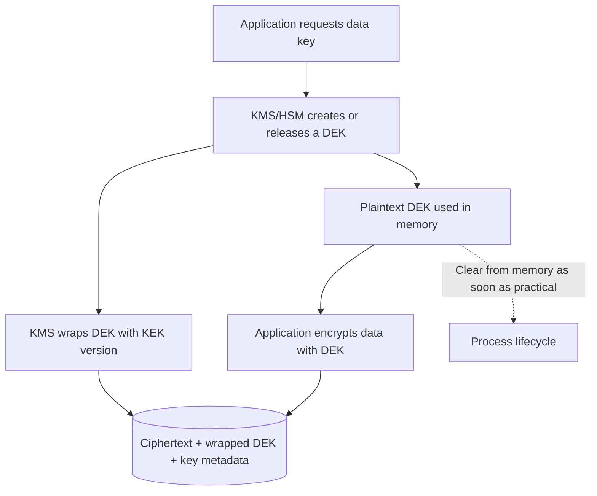
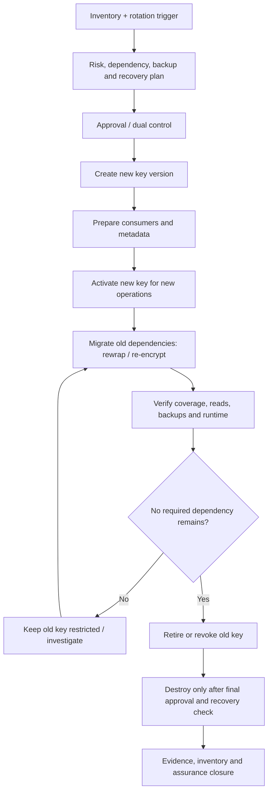

# Key rotation

## Mục tiêu học tập

Sau bài học này, bạn có thể:

- Giải thích **key rotation (xoay vòng khóa)**, cryptoperiod và vòng đời khóa; phân biệt rotation với key renewal, rekeying, rollover, revocation và destruction.
- Xác định **khóa nào cần xoay, vì sao, khi nào và theo trigger nào** dựa trên mục đích sử dụng, độ nhạy dữ liệu, threat model, lượng dữ liệu được bảo vệ và yêu cầu áp dụng.
- Phân biệt cách xoay **DEK (Data Encryption Key)** và **KEK (Key Encryption Key)** trong envelope encryption; lựa chọn rewrap hay re-encrypt và đánh giá ảnh hưởng tới dữ liệu, backup, replica và khả năng phục hồi.
- Thiết kế quy trình rotation theo giai đoạn, có version, kiểm tra tương thích, giám sát, phương án rollback và xử lý khẩn cấp khi nghi ngờ khóa bị lộ.
- Quản trị khóa qua KMS/HSM, IAM, separation of duties, audit trail, backup/recovery và crypto agility.
- Áp dụng rotation cho khóa mã hóa dữ liệu, khóa ký JWT/JWKS, chứng chỉ TLS và secrets/credentials trong hệ thống Java/Spring Boot.
- Viết control statements, test cases và **Claim – Argument – Evidence** để chứng minh rotation thực sự hoàn tất trong phạm vi đã xác định.

## 1. Key rotation là gì?

**Key rotation** là quá trình chuyển hoạt động mật mã từ một khóa đang được sử dụng sang một khóa mới, có quản lý phiên bản và vòng đời rõ ràng. Khóa cũ được chuyển sang trạng thái phù hợp với mục đích còn lại: có thể chỉ được dùng để giải mã dữ liệu cũ trong một khoảng thời gian, bị thu hồi ngay khi có sự cố, hoặc được hủy an toàn khi không còn phụ thuộc hợp lệ.

Ví dụ, một nền tảng học tập lưu bảng điểm và tài liệu học viên bằng mã hóa envelope encryption. Dữ liệu được mã hóa bằng các **DEK**, còn một **KEK** trong KMS dùng để bảo vệ DEK. Khi tổ chức xoay KEK, có thể yêu cầu KMS **rewrap các DEK** bằng KEK phiên bản mới mà không phải giải mã và mã hóa lại toàn bộ bảng điểm. Khi DEK bị lộ hoặc thuật toán/khóa không còn phù hợp, có thể cần tạo DEK mới và **mã hóa lại dữ liệu**.

Rotation làm giảm thời gian một khóa phải gánh chịu rủi ro, giới hạn lượng dữ liệu hoặc số chữ ký phụ thuộc vào một khóa và hỗ trợ thay đổi thuật toán. Tuy nhiên, **xoay khóa không tự làm dữ liệu đã bị lộ trở nên bí mật trở lại**. Nếu attacker đã lấy cả ciphertext và khóa cũ, việc tạo khóa mới không thu hồi bản sao họ đang giữ. Nếu khóa ký đã bị lộ, token/chữ ký đã phát hành cần được đánh giá riêng.

Trong module **SECURITY_SECURITY_ASSURANCE**, rotation là một security control cần chứng minh được: **khóa được nhận diện, có owner, có cryptoperiod/trigger, được thay đúng cách, các consumer đã dùng khóa mới, dữ liệu cũ vẫn được xử lý an toàn, khóa cũ được hạn chế/thu hồi đúng lúc và bằng chứng có thể kiểm toán**.

### 1.1. Vì sao phải xoay khóa?

- **Giảm thời gian phơi bày:** khóa dùng lâu có thêm thời gian bị sao chép, lạm dụng hoặc rò rỉ.
- **Giới hạn phạm vi ảnh hưởng:** giới hạn dữ liệu, workload hoặc khoảng thời gian gắn với một khóa.
- **Ứng phó sự cố:** thay khóa khi nghi ngờ credential, key material hoặc quyền truy cập bị xâm phạm.
- **Thay đổi mật mã:** chuyển thuật toán, kích thước khóa, curve, protocol hoặc cấu hình không còn đáp ứng yêu cầu.
- **Quản lý nhân sự/hệ thống:** thay khóa khi owner, vendor, service account, HSM/KMS hoặc trust boundary thay đổi.
- **Đáp ứng policy và nghĩa vụ:** thực hiện cryptoperiod, lịch review hoặc yêu cầu cụ thể theo bối cảnh.

Không nên coi rotation là thao tác đổi tên một key ID trong cấu hình. Một lần xoay chỉ hoàn tất khi **đường sử dụng khóa, dữ liệu, consumer, quyền và trạng thái khóa cũ** đã được xử lý theo kế hoạch.

## 2. Các khái niệm cần phân biệt

| Khái niệm | Ý nghĩa | Ví dụ |
| --- | --- | --- |
| **Key rotation** | Chuyển sang khóa mới và quản lý việc tiếp tục dùng khóa cũ. | KMS tạo KEK version mới; service bắt đầu wrap DEK bằng version mới. |
| **Key renewal** | Gia hạn thời hạn hoặc phát hành chứng chỉ/credential mới theo quy trình. | Cấp chứng chỉ TLS mới trước khi chứng chỉ cũ hết hạn. |
| **Rekeying** | Tạo khóa mới và chuyển dữ liệu/hoạt động mật mã sang khóa đó. | DEK mới mã hóa lại một tập dữ liệu. |
| **Key rollover** | Chuyển vai trò active giữa khóa cũ và khóa mới, thường có giai đoạn overlap để tương thích. | JWT issuer bắt đầu ký bằng `kid` mới; verifier vẫn nhận public key cũ cho token còn hiệu lực. |
| **Key revocation** | Tuyên bố khóa/chứng chỉ không còn được tin cậy hoặc không được dùng. | Thu hồi certificate hoặc chặn signing key bị lộ. |
| **Key retirement** | Ngừng dùng khóa cho hoạt động mới, nhưng có thể giữ chức năng đọc/giải mã cũ. | KEK cũ ở trạng thái decrypt-only trong giai đoạn chuyển đổi. |
| **Key destruction** | Hủy key material theo quy trình được kiểm soát. | Xóa key version sau khi đã xử lý dữ liệu, backup và phụ thuộc. |
| **Credential rotation** | Thay bí mật xác thực như API key, database password hoặc client secret. | Cập nhật secret và consumer để dùng credential mới. |

Các thao tác có thể diễn ra trong cùng một chương trình nhưng **không đồng nghĩa**. Chứng chỉ TLS được gia hạn không nhất thiết chứng minh private key đã được thay; đổi mật khẩu database không tự thay DEK mã hóa dữ liệu; disable một key ID cũng chưa chứng minh mọi bản sao key material đã bị hủy.

### 2.1. Rotation và cryptoperiod

**Cryptoperiod** là khoảng thời gian một khóa được phép dùng cho một mục đích mật mã nhất định theo policy. Cryptoperiod phù hợp phụ thuộc:

- Loại khóa: mã hóa dữ liệu, ký, xác thực, trao đổi khóa, wrapping hay TLS.
- Mức nhạy cảm và lượng dữ liệu/chữ ký được bảo vệ.
- Thuật toán, độ dài khóa, giao thức và khả năng chống tấn công hiện tại.
- Khả năng KMS/HSM và tác động vận hành khi thay khóa.
- Khả năng phát hiện truy cập trái phép, quyền quản trị và mức độ phơi bày.
- Yêu cầu hợp đồng, tiêu chuẩn hoặc quy định áp dụng.

**Không có một chu kỳ như 30, 90 hoặc 365 ngày phù hợp cho mọi khóa.** Tổ chức phải xác định cryptoperiod trong policy theo loại khóa và risk assessment; trigger sự cố có thể yêu cầu xoay ngay cả khi khóa còn rất xa ngày hết hạn.

## 3. Phân loại khóa trước khi lập kế hoạch rotation

Không thể áp dụng một quy trình duy nhất cho mọi key material. Khóa mã hóa dữ liệu, khóa ký JWT, TLS private key và API secret có **consumer, dependency, cách chuyển đổi và tác động khi thu hồi khác nhau**.

| Loại khóa | Mục đích | Câu hỏi khi rotation |
| --- | --- | --- |
| **DEK** | Mã hóa nội dung dữ liệu hoặc một đối tượng. | Bao nhiêu bản ghi/file đang dùng? Re-encrypt có cần thiết không? |
| **KEK / wrapping key** | Mã hóa hoặc bảo vệ DEK/khóa khác. | Có thể rewrap DEK không? Backup của wrapped key có đọc được sau đổi không? |
| **JWT signing key** | Ký token và assertion. | Verifier đã nhận public key mới chưa? Token cũ còn hạn bao lâu? |
| **JWT encryption/decryption key** | Mã hóa/giải mã token nếu hệ thống sử dụng JWE. | Consumer nào còn cần decrypt key cũ? |
| **TLS private key/certificate** | Xác thực endpoint và thiết lập kênh TLS. | Certificate chain, SAN, trust store, client và reload có tương thích? |
| **Asymmetric key pair** | Ký, xác minh hoặc mã hóa/giải mã theo vai trò. | Public key đã được phân phối? Ciphertext cũ cần private key nào? |
| **Database/service credentials** | Xác thực workload tới DB hoặc dịch vụ. | Consumer nào cần đổi đồng bộ? Có thời gian overlap an toàn không? |
| **Code-signing key** | Xác minh nguồn gốc artifact/software. | Artifact đã ký trước đây được xác minh ra sao? Key compromise có ảnh hưởng trust chain? |
| **Backup/recovery key** | Bảo vệ khả năng khôi phục dữ liệu hoặc khóa. | Nếu xoay/hủy key, bản backup cũ có còn phục hồi được không? |

### 3.1. Key inventory là nền tảng

Một chương trình rotation cần biết ít nhất:

- **Key ID/version**, loại khóa, thuật toán/parameters và mục đích sử dụng.
- KMS/HSM hoặc nguồn quản lý; nơi đặt, region, account/project và owner.
- Consumer/service, dữ liệu hoặc artifact phụ thuộc; môi trường và trust boundary.
- Ngày tạo, ngày active, cryptoperiod, ngày review/expiry và trigger.
- Trạng thái hiện tại, quyền encrypt/decrypt/sign/verify/wrap/unwrap.
- Quy trình backup/recovery, dependency của backup và chính sách destruction.
- Quyền quản trị, người phê duyệt, audit events, findings và exception còn hiệu lực.

Inventory cần được đối chiếu với **KMS/HSM, code/config, cloud IAM, certificate inventory, secrets manager, deployment manifests và runtime telemetry**. Một spreadsheet tự khai có thể hữu ích nhưng không đủ nếu không kiểm tra completeness.

## 4. Envelope encryption: DEK và KEK

### 4.1. Cấu trúc cơ bản

Trong **envelope encryption**, ứng dụng dùng một **DEK** để mã hóa dữ liệu; DEK được bảo vệ bởi **KEK** trong KMS/HSM. Ứng dụng thường lưu ciphertext cùng metadata và wrapped DEK, không lưu plaintext KEK trong database.



KMS/HSM quản lý KEK và quyền sử dụng; DEK có thể được tạo cho một đối tượng, một batch hoặc một phạm vi theo thiết kế. **Không tự lưu plaintext DEK/KEK trong source code, application properties, database hoặc log.**

Một bản ghi mã hóa thường cần metadata để giải mã đúng:

```text
algorithm / suite
key identifier and version
wrapped DEK (if envelope encryption)
nonce / IV and authentication tag
ciphertext
associated data context (or stable references to reconstruct it)
schema / format version
```

Metadata không nhất thiết phải bí mật, nhưng cần integrity và phải được liên kết với đúng dữ liệu. **Không được dùng nonce/IV lặp lại với cùng key trong chế độ yêu cầu nonce duy nhất**, chẳng hạn AES-GCM.

### 4.2. Xoay KEK: rewrap

Khi chỉ cần thay KEK nhưng DEK và thuật toán mã hóa dữ liệu vẫn phù hợp:

1. Tạo hoặc kích hoạt KEK version mới trong KMS/HSM.
2. Kiểm tra service/worker có quyền dùng version mới đúng scope.
3. Dùng thao tác rewrap/reencrypt key của KMS để **bọc lại DEK** bằng KEK mới.
4. Cập nhật metadata version và lưu wrapped DEK mới một cách nguyên tử.
5. Kiểm tra giải mã bằng bản ghi mới và backup/replica có liên quan.
6. Sau khi xác minh đủ coverage, ngừng wrap bằng KEK cũ; giữ khả năng unwrap cũ trong giai đoạn cần thiết.
7. Chỉ retire/destroy KEK cũ khi không còn wrapped DEK hoặc backup cần nó, và quy trình recovery đã được kiểm chứng.

Trong luồng này, **ciphertext dữ liệu có thể giữ nguyên** vì DEK không đổi; chỉ wrapped DEK được thay. Rewrap thường giảm chi phí và thời gian so với giải mã/mã hóa lại toàn bộ dữ liệu, nhưng **không thay DEK** và không xử lý được trường hợp DEK đã bị lộ.

### 4.3. Xoay DEK: re-encrypt

Khi DEK bị nghi ngờ lộ, cần thay thuật toán/parameters, hoặc policy yêu cầu thay key bảo vệ nội dung:

1. Tạo DEK mới và version metadata mới.
2. Đọc ciphertext cũ bằng khóa cũ qua quyền được kiểm soát.
3. Xác thực dữ liệu giải mã và kiểm tra context/AAD.
4. Mã hóa plaintext bằng DEK mới với nonce mới theo yêu cầu thuật toán.
5. Ghi ciphertext và wrapped DEK mới theo transaction/checkpoint có thể phục hồi.
6. Xác minh đọc lại bằng consumer thực và đối chiếu integrity.
7. Theo dõi số đối tượng còn dùng version cũ; xử lý bản sao, cache, backup và dữ liệu dẫn xuất.
8. Chỉ retire/destroy key cũ khi đáp ứng điều kiện phụ thuộc và retention.

**Re-encryption không thể khôi phục tính bí mật của plaintext đã bị attacker lấy trước đó.** Nếu khóa cũ bị xâm phạm, cần điều tra dữ liệu và thời gian phơi bày, không chỉ chạy batch re-encrypt rồi kết luận sự cố đã được khắc phục hoàn toàn.

### 4.4. So sánh rewrap và re-encrypt

| Tiêu chí | Rewrap DEK bằng KEK mới | Re-encrypt dữ liệu bằng DEK mới |
| --- | --- | --- |
| Đối tượng thay đổi | Wrapped DEK/metadata khóa bảo vệ DEK. | Ciphertext dữ liệu, DEK và metadata liên quan. |
| Nội dung ciphertext | Thường không đổi. | Thay đổi. |
| Phù hợp khi | KEK cần rotation nhưng DEK/data cipher vẫn tin cậy. | DEK lộ, thay data key, đổi thuật toán hoặc yêu cầu rekey nội dung. |
| Chi phí | Thường thấp hơn; xử lý số lượng wrapped DEK. | Có thể lớn do đọc/ghi dữ liệu và kiểm tra toàn vẹn. |
| Rủi ro | Quên bản sao/backup wrapped DEK; KMS permission hoặc version mapping sai. | Gián đoạn, dữ liệu hỏng, partial migration, thiếu coverage và race với writes. |
| Không giải quyết | DEK bị lộ hoặc ciphertext/plaintext đã bị đánh cắp. | Bản sao plaintext/ciphertext đã bị attacker lấy; bản backup chưa được chuyển. |

**Chọn thao tác theo loại khóa và threat**, không gọi chung mọi hoạt động là “rotate encryption key”.

## 5. Rotation theo giai đoạn và quản lý trạng thái

### 5.1. Một state model tham khảo

| Trạng thái | Ý nghĩa | Quy tắc |
| --- | --- | --- |
| `PENDING` | Đã tạo nhưng chưa được phê duyệt/đưa vào dùng. | Chưa cho workload sử dụng ngoài phạm vi kiểm thử được phép. |
| `ACTIVE` | Khóa mới dùng cho thao tác mật mã mới theo mục đích được duyệt. | Chỉ một version active cho mỗi purpose/scope trừ khi policy thiết kế khác. |
| `DECRYPT_ONLY` / `VERIFY_ONLY` | Không dùng cho encrypt/sign mới, nhưng cần đọc/verify artifact cũ. | Giới hạn consumer và khoảng thời gian còn cần. |
| `RETIRING` | Đang loại bỏ dependency hoặc chuyển dữ liệu. | Theo dõi coverage, bản sao và consumer chưa chuyển. |
| `REVOKED` | Không còn được tin cậy hoặc được phép dùng. | Chặn theo mục đích; xử lý dữ liệu/token/chứng chỉ liên quan. |
| `DESTROY_PENDING` | Đã qua điều kiện dùng nhưng chờ kiểm tra cuối và phê duyệt hủy. | Không tự hủy khi còn dependency/backup cần phục hồi. |
| `DESTROYED` | Key material đã bị hủy theo quy trình có bằng chứng. | Lưu audit metadata, không lưu lại material. |

Không phải hệ thống nào cũng dùng đúng tên trạng thái trên. Quan trọng là **chuyển trạng thái được kiểm soát, có điều kiện và không tạo khoảng trống**. Ví dụ, một khóa ký cũ có thể cần public key ở trạng thái verify-only; một khóa giải mã cũ có thể cần tồn tại lâu hơn cryptoperiod của việc mã hóa mới.

### 5.2. Quy trình rotation bình thường

1. **Discover:** lấy inventory khóa, consumer, dữ liệu, phiên bản và các dependency.
2. **Plan:** xác định lý do, loại rotation, scope, thời gian, owner, cryptoperiod, compatibility, backup và recovery.
3. **Approve:** kiểm tra separation of duties, risk assessment, maintenance window và điều kiện dừng.
4. **Create:** tạo key version mới trong KMS/HSM; xác minh thuật toán, usage, policy và quyền.
5. **Distribute/prepare:** cập nhật verifier, trust store, workload hoặc metadata trước khi bắt đầu phát hành bằng khóa mới.
6. **Activate:** chuyển hoạt động encrypt/sign mới sang version mới; theo dõi lỗi và latency.
7. **Migrate:** rewrap hoặc re-encrypt các đối tượng cần thiết theo batch/checkpoint.
8. **Verify:** kiểm tra consumer, dữ liệu, backup, replicas, token/certificate và các đường đọc cũ.
9. **Retire/revoke:** hạn chế key cũ theo mục đích; hủy khi không còn dependency và được phê duyệt.
10. **Close:** lưu evidence, cập nhật inventory, findings, metrics và bài học.



### 5.3. Overlap và compatibility

Một số rotation cần thời gian overlap:

- Consumer mới phải biết **public key mới** trước khi issuer bắt đầu ký bằng private key mới.
- Các service đọc ciphertext cần hỗ trợ key version cũ và mới trong lúc migration.
- Database migration có thể phải ghi theo format mới nhưng vẫn đọc được format cũ.
- Credential rotation có thể cần cập nhật nhiều consumer; cần giới hạn overlap và không để hai bí mật hoạt động vô thời hạn.

Overlap phải có **mục đích, phạm vi, thời hạn và điều kiện kết thúc**. Nếu khóa cũ bị compromise, giữ nó hoạt động chỉ để tiện tương thích có thể nguy hiểm; quy trình emergency rotation có thể cần revoke nhanh và chấp nhận gián đoạn theo quyết định incident/risk owner.

## 6. Trigger: lịch định kỳ và rotation khẩn cấp

### 6.1. Scheduled rotation

Rotation định kỳ dựa trên cryptoperiod và policy:

- Đến thời điểm review hoặc cryptoperiod kết thúc.
- Khóa được dùng quá lượng dữ liệu/chữ ký/operations đã định.
- Thay đổi thuật toán, tham số hoặc baseline mật mã.
- Thay owner, vendor, KMS/HSM, account/project hoặc trust boundary.
- Chuyển môi trường, region, tenant hoặc mô hình workload.
- Thay đổi yêu cầu của khách hàng, hợp đồng hoặc quy định áp dụng.

Lịch định kỳ nên **được tự động nhắc và có bằng chứng hoàn tất**, nhưng không tự động hủy key cũ chỉ dựa vào ngày. Hệ thống phải biết còn consumer, backup, ciphertext và nghĩa vụ lưu giữ nào cần khóa đó.

### 6.2. Emergency rotation khi nghi ngờ compromise

Trigger khẩn cấp có thể gồm:

- Phát hiện key material, private key, API secret hoặc plaintext DEK trong repository/log/ticket.
- KMS/HSM audit cho thấy thao tác export, unwrap, sign hoặc policy change bất thường.
- Tài khoản quản trị khóa hoặc workload có quyền quá rộng bị chiếm đoạt.
- Vendor hoặc nhân sự báo mất thiết bị, rò credential hoặc truy cập không được phép.
- Certificate/private key bị lộ, token signing key bị sao chép hoặc thuật toán có điểm yếu nghiêm trọng.
- Nguồn tạo/sao lưu khóa bị xâm phạm hoặc không thể chứng minh tính toàn vẹn.

Một response khẩn cấp cần **containment và đánh giá phạm vi**, không chỉ tạo key mới:

1. Kích hoạt incident process và bảo toàn audit logs, metadata, mốc thời gian, identity và dấu hiệu truy cập.
2. Xác định mục đích/consumer/data/token/certificate phụ thuộc khóa nghi bị lộ.
3. Chặn quyền tạo dữ liệu/chữ ký mới bằng khóa đó; revoke/disable theo phương án đã được incident commander phê duyệt.
4. Tạo và triển khai khóa mới qua KMS/HSM và cập nhật các consumer tin cậy.
5. Re-encrypt/rewrap/revoke token/certificate hoặc credential theo từng loại; đánh giá bản sao đã bị lấy.
6. Tìm kiếm dấu hiệu sử dụng trái phép, dữ liệu bị đọc/sửa và khả năng attacker giữ ciphertext/plaintext.
7. Kiểm tra backup, replica, caches, external processors và khả năng recovery.
8. Re-test, xác nhận khóa cũ không còn được chấp nhận theo mục đích phải chặn; đóng finding khi có evidence.

**Không có một trình tự revoke duy nhất cho mọi loại khóa.** Revoke signing key, disable KEK, thay database password và rotate TLS certificate có tác động khác nhau. Cần runbook riêng, người có thẩm quyền và diễn tập để tránh làm mất khả năng giải mã dữ liệu hoặc gây gián đoạn không kiểm soát.

## 7. KMS/HSM, IAM và quản trị khóa

### 7.1. Vai trò của KMS và HSM

**Key Management Service (KMS)** cung cấp quản lý key ID/version, policy, cryptographic operations, audit và một số workflow rotation. **Hardware Security Module (HSM)** bảo vệ key operations/key material trong ranh giới phần cứng được kiểm soát. Tổ chức có thể dùng KMS dựa trên HSM hoặc HSM chuyên dụng; cần đánh giá thiết kế thực tế.

KMS/HSM giảm nhu cầu tự quản lý raw key material nhưng **không tự đảm bảo**:

- IAM chỉ cấp quyền đúng workload và đúng thao tác.
- Ứng dụng chọn đúng key version và không fallback sang khóa cũ.
- Người quản trị không thể đơn phương đổi policy, export hoặc destroy khóa ngoài quy trình.
- Backup/replica và region có điều kiện phù hợp.
- Audit logs được giữ, bảo vệ và giám sát.
- Mọi consumer đã chuyển sang key mới trước khi retire khóa cũ.

### 7.2. Tách nhiệm vụ và quyền tối thiểu

| Vai trò | Quyền/trách nhiệm phù hợp |
| --- | --- |
| **Key owner / service owner** | Xác định purpose, consumer, cryptoperiod và yêu cầu availability/recovery. |
| **Key administrator** | Quản trị lifecycle và policy theo quy trình; không mặc nhiên đọc dữ liệu ứng dụng. |
| **Security/Risk** | Đánh giá threat, algorithm/parameters, cryptoperiod và residual risk. |
| **Operator** | Triển khai config/rollout và xác minh runtime theo phê duyệt. |
| **Application workload** | Chỉ gọi encrypt/decrypt/sign/verify/wrap/unwrap đúng scope. |
| **Auditor/assurance reviewer** | Kiểm tra quyền, approval, operation logs, coverage và bằng chứng destruction. |
| **Incident commander** | Điều phối hành động khẩn cấp theo thẩm quyền và runbook. |

Các thao tác rủi ro cao như **export key material, thay policy, disable/revoke và destroy** có thể cần dual control, approval độc lập hoặc quorum theo risk. Không cấp quyền `kms:*` cho mọi service chỉ để đơn giản hóa cấu hình.

### 7.3. Audit trail của thao tác khóa

Nên ghi và giám sát các sự kiện phù hợp:

- Key create/import/enable/disable/destroy và version promotion.
- Encrypt/decrypt/sign/verify/wrap/unwrap theo principal, key ID, thời điểm và kết quả.
- Policy/IAM/role changes, grant/revoke và thao tác break-glass.
- Rotation jobs, số đối tượng đã chuyển/chưa chuyển và lỗi.
- Export/backup/restore hoặc truy cập HSM/KMS administration.
- Thay region/replication, key alias hoặc mapping key version.

Không log raw key material, plaintext DEK, private key hoặc token. Audit event cũng cần **integrity, access control và retention**; nếu admin khóa có thể xóa luôn audit evidence thì assurance yếu.

## 8. Java/Spring Boot: tích hợp rotation mà không tự quản lý raw keys

### 8.1. Nguyên tắc thiết kế

Ứng dụng nên phụ thuộc vào **abstraction quản lý khóa** thay vì đọc khóa từ một file properties tĩnh. Tên provider cụ thể phụ thuộc nền tảng KMS/HSM của tổ chức; bài học dùng interface để làm rõ ranh giới:

```java
public record KeyReference(
        String keyId,
        String version,
        String purpose
) {}

public interface KeyManagementPort {
    KeyReference activeKey(String purpose);

    WrappedDataKey generateDataKey(String keyId);

    WrappedDataKey rewrap(
            WrappedDataKey oldWrappedKey,
            String newKeyId
    );

    byte[] decryptDataKey(WrappedDataKey wrappedKey);
}

public record WrappedDataKey(
        String keyId,
        String version,
        byte[] encryptedKey
) {}
```

Đây là **interface minh họa**, không phải API chuẩn của KMS. Trong triển khai thực, phương thức trả plaintext DEK chỉ tồn tại khi cần và phải được giới hạn trong adapter/memory scope thích hợp; không đưa DEK ra controller, DTO, log hoặc persistent store. Có thể dùng API KMS hỗ trợ encrypt/decrypt hoặc data-key generation phù hợp để giảm phạm vi plaintext key trong ứng dụng.

### 8.2. Lưu metadata theo version

Ví dụ một đối tượng mã hóa có thể giữ:

```java
public record EncryptedRecord(
        String algorithm,
        String kekId,
        String kekVersion,
        byte[] wrappedDek,
        byte[] nonce,
        byte[] ciphertext,
        int formatVersion
) {}
```

Metadata này giúp chọn đúng thao tác giải mã và rotation. **Không lưu KEK/DEK dạng rõ** trong record. Cần bảo vệ integrity của metadata và liên kết nó với đúng bản ghi; nếu attacker thay `keyVersion`, `recordId` hoặc context, việc giải mã có thể sai hoặc dẫn đến hành vi không mong muốn.

### 8.3. Minh họa AES-GCM với DEK do KMS quản lý

Đoạn mã dưới đây chỉ minh họa **cách dùng Java Cryptography Architecture (JCA)** sau khi một DEK được cung cấp an toàn từ adapter. Trong production, nên dùng thư viện/SDK và mẫu tích hợp đã được đánh giá; không tự thiết kế giao thức mã hóa hoặc tự quản lý key lifecycle trong controller.

```java
public final class AesGcmDataCipher {
    private static final int TAG_BITS = 128;

    public byte[] encrypt(
            SecretKey dataKey,
            byte[] nonce,
            byte[] plaintext,
            byte[] associatedData
    ) throws GeneralSecurityException {
        if (nonce == null || nonce.length != 12) {
            throw new IllegalArgumentException("Expected a 96-bit nonce");
        }

        Cipher cipher = Cipher.getInstance("AES/GCM/NoPadding");
        cipher.init(
                Cipher.ENCRYPT_MODE,
                dataKey,
                new GCMParameterSpec(TAG_BITS, nonce)
        );
        cipher.updateAAD(associatedData);
        return cipher.doFinal(plaintext);
    }

    public byte[] decrypt(
            SecretKey dataKey,
            byte[] nonce,
            byte[] ciphertext,
            byte[] associatedData
    ) throws GeneralSecurityException {
        Cipher cipher = Cipher.getInstance("AES/GCM/NoPadding");
        cipher.init(
                Cipher.DECRYPT_MODE,
                dataKey,
                new GCMParameterSpec(TAG_BITS, nonce)
        );
        cipher.updateAAD(associatedData);
        return cipher.doFinal(ciphertext);
    }
}
```

**Điều kiện an toàn quan trọng:**

- Nonce 96-bit phải được sinh bằng CSPRNG hoặc cơ chế bảo đảm uniqueness phù hợp; **không bao giờ tái sử dụng nonce với cùng DEK trong AES-GCM**.
- `associatedData` phải được xây từ context ổn định và xác thực (ví dụ record reference, tenant và schema version), không lấy tùy tiện từ client.
- Authentication tag phải được xác minh; lỗi xác thực phải làm thao tác thất bại, không trả plaintext một phần.
- `SecretKey` phải được cấp từ cơ chế KMS/adapter tin cậy và giới hạn vòng đời trong memory; Java garbage collection không bảo đảm xóa vật lý tức thời.
- Mã trên không tạo nonce, không wrap DEK, không quản lý KMS, không lưu ciphertext và không xử lý concurrency/rotation; đây **không phải lớp mã hóa hoàn chỉnh**.

### 8.4. Rewrap DEK qua adapter

Một worker có thể cập nhật wrapped DEK mà không giải mã nội dung:

```java
public class DekRewrapWorker {
    private final KeyManagementPort keyManagement;
    private final EncryptedRecordRepository records;

    public DekRewrapWorker(KeyManagementPort keyManagement,
                           EncryptedRecordRepository records) {
        this.keyManagement = keyManagement;
        this.records = records;
    }

    public void rewrapRecord(
            String recordId,
            String newKekId
    ) {
        EncryptedRecord current = records.getRequired(recordId);

        WrappedDataKey oldDek = new WrappedDataKey(
                current.kekId(),
                current.kekVersion(),
                current.wrappedDek()
        );

        WrappedDataKey newDek = keyManagement.rewrap(oldDek, newKekId);

        records.replaceWrappedKeyIfVersionMatches(
                recordId,
                current.kekVersion(),
                newDek.keyId(),
                newDek.version(),
                newDek.encryptedKey()
        );
    }
}
```

Tên repository và phương thức là **ví dụ giả định**. `replaceWrappedKeyIfVersionMatches` biểu diễn cập nhật có kiểm tra version để tránh ghi đè thay đổi đồng thời. Trong production phải có:

- Idempotency/checkpoint để job chạy lại không làm hỏng record.
- Kiểm tra record chưa bị xóa, thay đổi hoặc đã rewrap bởi job khác.
- Retry có giới hạn, xử lý throttling/KMS errors và dead-letter/quarantine.
- Audit event với record reference và version, không chứa plaintext DEK.
- Đối soát số record theo từng key version và phát hiện record bị bỏ sót.
- Cơ chế rollback metadata nếu KMS operation thành công nhưng database update thất bại; cần bảo đảm old wrapped DEK vẫn dùng được cho tới khi commit.
- Test restore từ backup có wrapped DEK cũ.

### 8.5. JWT signing key rotation với `kid` và JWKS

Với JWT ký bất đối xứng, issuer dùng private key để ký; verifier lấy public key tin cậy qua cấu hình/JWKS. Quy trình rollover thường cần:

1. Tạo key pair mới trong KMS/HSM hoặc hệ thống quản lý khóa phù hợp.
2. Công bố public key mới trong JWKS trước khi ký token bằng nó.
3. Đợi verifier refresh/cache public key theo cơ chế đã định và xác minh họ nhận được `kid` mới.
4. Chuyển issuer sang ký token mới bằng private key mới, đặt `kid` đúng trong header theo giao thức.
5. Tiếp tục giữ public key cũ để verify token còn hiệu lực trong khoảng overlap được tính từ **token lifetime, clock skew và cache behavior**.
6. Sau khi token cũ hết hiệu lực và không còn dependency hợp lệ, gỡ public key cũ theo policy.

Nếu private signing key cũ bị compromise, overlap thông thường có thể không an toàn: cần đánh giá revoke/invalidate token, buộc re-authentication hoặc xử lý theo incident plan. **Không chỉ xóa public key cũ khỏi JWKS** mà bỏ qua token đang phát hành và cache của verifier.

### 8.6. TLS certificate và credential rotation

Với TLS, cần xem **private key, certificate, chain, SAN, trust store, expiry và consumer**. Cấp certificate mới nhưng tái sử dụng private key cũ không phải lúc nào cũng đáp ứng mục tiêu rekey. Cần kiểm tra endpoint thực đang phục vụ certificate nào, reload/rollout có hoàn tất không và client có trust chain phù hợp không.

Với database password/API secret, nên có kế hoạch consumer-by-consumer: tạo credential mới, cấp quyền đúng scope, chuyển workload, xác minh kết nối, revoke credential cũ. Nếu dịch vụ chỉ cho phép một password tại một thời điểm, cần phương án coordinated cutover hoặc cơ chế credential overlap có giới hạn. **Không ghi secret vào log hoặc command history** để kiểm tra rotation.

## 9. Backup, disaster recovery và khả năng đọc dữ liệu cũ

Rotation có thể làm hỏng khả năng phục hồi nếu tổ chức retire khóa trước khi kiểm tra **mọi bản backup và replica**. Một backup mã hóa từ sáu tháng trước có thể vẫn cần KEK/DEK version cũ để restore; việc xóa khóa cũ có thể làm mất dữ liệu vĩnh viễn.

### 9.1. Câu hỏi cần trả lời

- Backup có chứa ciphertext và wrapped DEK version nào?
- KMS/HSM có bản sao key version ở region/DR phù hợp không? Việc replication đó có phù hợp yêu cầu dữ liệu và key residency không?
- Ai được phép restore hoặc sử dụng khóa trong DR; có dual control và audit?
- Quy trình restore có đọc được dữ liệu cũ trong lúc rotation đang chạy không?
- Khi restore snapshot cũ, hệ thống có thể migrate key metadata lên version hiện tại không?
- Key destruction có làm mất khả năng phục hồi của backup đang thuộc retention hợp lệ không?
- Có diễn tập phục hồi với **key version cũ và mới**, chứ không chỉ test database restore?

### 9.2. Rotation không được phá vỡ restore

Một quy trình an toàn cần thử:

1. Tạo snapshot có dữ liệu được bảo vệ bởi key version cũ.
2. Xoay KEK/DEK và migrate dữ liệu theo kế hoạch.
3. Phục hồi snapshot cũ trong môi trường DR được kiểm soát.
4. Xác minh quyền dùng khóa cũ đúng scope và dữ liệu đọc được/tính toàn vẹn đúng.
5. Nếu có migration sau restore, xác minh record được chuyển sang key version mới.
6. Ghi bằng chứng về thời gian phục hồi, lỗi và key dependencies.

**Không hủy khóa chỉ vì database production đã hết record version cũ** nếu backup, archive, replica, exported file hoặc legal retention vẫn cần khóa đó. Ngược lại, không giữ khóa vô thời hạn mà không có owner, lý do và quyền truy cập hạn chế.

## 10. Rollback, lỗi giữa chừng và tính nhất quán

### 10.1. Thiết kế rollback trước khi activate

Một rotation có thể gặp:

- Workload A đã dùng key mới nhưng workload B chưa nhận key.
- KMS đã tạo wrapped DEK mới nhưng DB chưa commit metadata.
- Một batch re-encrypt thành công một phần rồi worker bị dừng.
- JWKS đã publish public key mới nhưng verifier cache chưa refresh.
- Certificate mới không tương thích một số client cũ.
- Credential mới không được deploy tới tất cả consumers.

Rollback cần xác định **có thể quay về trạng thái nào mà vẫn an toàn**. Với scheduled rotation không có compromise, có thể tạm dừng rollout và tiếp tục dùng key cũ trong thời gian kiểm soát nếu policy cho phép. Với key compromise, **không rollback về dùng khóa bị xâm phạm chỉ để phục hồi tiện lợi**; cần phương án recovery/availability khác.

### 10.2. Re-encryption batch phải có checkpoint

Mỗi batch cần lưu:

- Job ID, phạm vi record, key version nguồn/đích và schema/algorithm.
- Checkpoint hoặc cursor; số lượng thành công, lỗi, retry và pending.
- Cơ chế compare-and-swap/version check để không ghi đè update mới.
- Trạng thái xác minh đọc lại và integrity.
- Khả năng chạy lại idempotent, không sinh nonce trùng hoặc dùng lại DEK sai cách.
- Cách xử lý record không thể giải mã, dữ liệu lỗi hoặc KMS unavailable.

Không xóa ciphertext cũ trước khi ciphertext mới được commit và kiểm chứng. Nếu phải giữ cả hai tạm thời, bản cũ vẫn phải được bảo vệ theo classification và retention.

### 10.3. Đoạn chuyển đổi có thể kiểm soát

```text
PREPARE:
  create new version; validate permissions and consumers
ACTIVATE:
  route new encrypt/sign operations to new version
MIGRATE:
  process old records in bounded, checkpointed batches
VERIFY:
  sample and reconcile all objects, backup and replicas
RETIRE:
  restrict old key to required decrypt/verify operations
DESTROY:
  only after dependency, recovery, retention and approval checks
```

Đây là **mẫu trình tự**, không thay thế runbook riêng cho từng key purpose.

## 11. Crypto agility và thay đổi thuật toán

**Crypto agility** là khả năng thay đổi thuật toán, parameters, key size, protocol hoặc provider mà không phải viết lại toàn bộ ứng dụng hoặc mất khả năng đọc dữ liệu cũ.

Nên:

- Lưu **algorithm/suite và format version** cùng metadata cần thiết; tránh giả định mọi ciphertext đều dùng một thuật toán mãi mãi.
- Tách **key ID/version** khỏi logic business và không hardcode key material.
- Có adapter/provider boundary để thay KMS/HSM trong phạm vi đã đánh giá.
- Duy trì test fixtures/ciphertext lịch sử để kiểm tra khả năng đọc trong migration.
- Lập inventory nơi dùng thuật toán, kể cả TLS, JWT, database, backups và file exports.
- Đánh giá kế hoạch thay thuật toán khi có khuyến cáo mật mã mới hoặc yêu cầu hậu lượng tử áp dụng.

**Không tự chọn thuật toán yếu hoặc tự thiết kế cipher** để tiện migration. Dùng thuật toán, mode và thư viện đã được phê duyệt; việc thay đổi phải qua security review và test tương thích.

## 12. Control statements và assurance tests

### 12.1. Mẫu control statements

| Control ID | Phát biểu kiểm soát | Verification |
| --- | --- | --- |
| `KEY-LIFE-01` | Mọi khóa production có owner, purpose, type, version, cryptoperiod, consumer và trạng thái được quản lý trong inventory. | Đối soát KMS/HSM, code/config, certificates và runtime consumers với inventory. |
| `KEY-ROT-02` | Khóa được xoay theo cryptoperiod hoặc trigger rủi ro đã duyệt; rotation phải có kế hoạch, owner và approval phù hợp. | Review schedule/trigger, approval, key version và job evidence. |
| `KEY-USE-03` | Workload chỉ có quyền cryptographic operation cần cho purpose; raw key material không được ghi vào config/log. | IAM review, KMS audit, secret scanning và log tests. |
| `KEY-MIG-04` | Mọi dữ liệu/consumer phụ thuộc khóa cũ được migrate hoặc giữ trong trạng thái decrypt/verify-only có kiểm soát. | Version coverage, decrypt/re-encrypt tests, consumer inventory. |
| `KEY-DR-05` | Backup/DR có thể khôi phục dữ liệu phụ thuộc cả key version cũ và mới trong phạm vi retention. | Restore drill và key dependency evidence. |
| `KEY-REV-06` | Khi key compromise được xác nhận/nghi ngờ theo ngưỡng, quy trình incident/revocation được kích hoạt và các consumer liên quan bị xử lý. | Tabletop/live exercise, audit events, negative verification sau revoke. |
| `KEY-DEST-07` | Key chỉ bị hủy sau khi xác nhận không còn dependency, retention, backup hoặc recovery requirement và có phê duyệt. | Destruction checklist, dependency scan, approval, KMS destruction evidence. |

### 12.2. Kiểm thử các điều kiện quan trọng

| Nhóm test | Ca cần kiểm tra | Kết quả mong đợi |
| --- | --- | --- |
| **New key activation** | Workload được cấp quyền dùng key version mới; workload sai scope thử dùng. | Đúng workload thành công; principal không được phép bị từ chối và có audit. |
| **Old-key handling** | Thử encrypt/sign mới bằng key cũ sau retirement; đọc dữ liệu cũ theo policy. | Không tạo mới bằng key cũ; decrypt/verify chỉ còn trong scope được duyệt. |
| **Data migration** | Rewrap/re-encrypt sample, batch retry, partial failure và concurrent write. | Integrity giữ nguyên, job idempotent, checkpoint/đối soát đúng. |
| **JWT rollover** | Token mới có `kid` mới; token cũ trong overlap; token sau revoke. | Verifier chọn đúng public key; token bị revoke không được tin cậy theo policy. |
| **TLS rotation** | Certificate mới, chain, hostname và consumer/client cũ. | Endpoint phục vụ certificate hợp lệ; không có node/instance còn cert cũ ngoài kế hoạch. |
| **Credential rotation** | Từng consumer chuyển sang secret mới; thử secret cũ sau revoke. | Consumer hợp lệ tiếp tục hoạt động; secret cũ bị từ chối khi đã đến hạn. |
| **Backup/DR** | Restore snapshot được mã hóa bằng key version trước. | Phục hồi đúng dữ liệu và có log truy cập khóa; không mở rộng quyền. |
| **KMS outage** | KMS timeout, throttling hoặc policy store không truy cập được. | Không fallback sang key hardcoded hoặc plaintext; lỗi được xử lý/giám sát an toàn. |
| **Destruction** | Có record/backup còn phụ thuộc thử yêu cầu hủy. | Quy trình chặn hủy và báo dependency chưa hoàn tất. |

### 12.3. Chất lượng bằng chứng

Một log cho thấy `CreateKeyVersion` thành công chỉ chứng minh key mới đã được tạo. Nó **không chứng minh** application đang dùng key mới. Một dashboard cho biết “rotation completed” chỉ đáng tin nếu có cách đối chiếu **population, consumer, dữ liệu và phiên bản thực tế**.

Evidence nên gồm:

- KMS/HSM event và key version metadata.
- Approval, owner, cryptoperiod, risk assessment và change ticket.
- CI/security tests và build ID của adapter/workload.
- Effective IAM permissions, runtime config và consumer discovery.
- Số đối tượng/record đã rewrap hoặc re-encrypt, số còn version cũ, lỗi và checkpoint.
- Decrypt/verify/read tests và integrity reconciliation.
- Backup/restore test, DR key availability và destruction review.
- Negative tests chứng minh key cũ không còn được dùng cho mục đích mới hoặc đã bị revoke.

## 13. Claim – Argument – Evidence cho key rotation

### 13.1. Claim có phạm vi rõ

**Claim:** “Đối với dữ liệu điểm học viên trong production thuộc `learning-platform`, KEK version mới đã được kích hoạt cho hoạt động bảo vệ DEK; các wrapped DEK trong population đã kiểm kê được chuyển sang version mới, dữ liệu có thể giải mã và kiểm chứng toàn vẹn, trong khi KEK cũ chỉ còn quyền cần thiết cho dependency/backup đã ghi nhận.”

**Argument:**

1. Inventory xác định đủ dataset, wrapped DEK, consumer, replica và backup thuộc scope.
2. KEK mới được tạo, phê duyệt và cấp quyền tối thiểu cho workload.
3. Rotation worker rewrap DEK theo version và checkpoint, không làm thay ciphertext.
4. Đối soát cho thấy mọi đối tượng thuộc population có version phù hợp hoặc được ghi nhận rõ là chưa chuyển/ngoại lệ.
5. Test decrypt và integrity xác nhận dữ liệu vẫn đọc được; backup/DR restore được thử.
6. KEK cũ bị giới hạn cho đúng mục đích còn lại; destruction chỉ thực hiện khi dependency được xử lý.

**Evidence:**

| Điều cần chứng minh | Bằng chứng | Giới hạn |
| --- | --- | --- |
| Population đầy đủ | KMS inventory, DB/object catalog, backup/replica list, key-version scan. | Có thể còn bản export offline hoặc hệ thống chưa tích hợp inventory. |
| Key mới đúng | KMS/HSM metadata, approval, policy, key usage test. | Tạo key thành công không chứng minh consumer dùng nó. |
| Rotation thực tế | Worker run, checkpoint, record count theo version, audit operation. | Cần đối chiếu số lượng với population độc lập. |
| Dữ liệu không hỏng | Decrypt/read tests, authentication tag/integrity checks và reconciliation. | Sample không tự chứng minh toàn bộ nếu không có coverage strategy. |
| Backup có thể phục hồi | Restore drill dùng snapshot cũ/mới, key access evidence. | Chỉ bao phủ các backup/version được thử. |
| Key cũ được hạn chế | IAM effective permissions, state, negative encrypt test, audit. | Chưa chứng minh key material không còn ở mọi bản sao nếu chưa có destruction evidence. |

**Giới hạn claim:** Nếu backup ở region khác chưa được kiểm kê, không thể tuyên bố mọi dữ liệu đã chuyển. Nếu một vài consumer còn cần KEK cũ, trạng thái đúng có thể là **retired/decrypt-only có kiểm soát**, không phải destroyed.

### 13.2. Mẫu hồ sơ rotation

```yaml
rotation_id: "ROT-EXAMPLE-001"
key:
  key_id: "learning-data-kek"
  purpose: "Wrap data encryption keys"
  key_type: "KEK"
  old_version: "<previous-version>"
  new_version: "<new-version>"
  algorithm: "<approved-key-wrapping-suite>"
scope:
  system: "learning-platform"
  environment: "production"
  datasets: ["academic-grades", "learner-progress"]
  replicas_and_backups: ["<verified-scope-reference>"]
trigger:
  type: "SCHEDULED"
  policy_ref: "<approved-cryptoperiod-policy>"
owners:
  key_owner_role: "key-owner"
  operator_role: "kms-operator"
  approver_role: "independent-approver"
plan:
  method: "REWRAP_DEK"
  compatibility_window: "<approved-window>"
  rollback_ref: "<tested-runbook>"
execution:
  job_ref: "<actual-rotation-job>"
  total_population: "<reconciled-count>"
  migrated_count: "<verified-count>"
  remaining_old_version_count: "<verified-count>"
  failed_count: "<verified-count>"
verification:
  decrypt_test_ref: "<actual-test-artifact>"
  integrity_check_ref: "<actual-reconciliation>"
  backup_restore_ref: "<actual-restore-evidence>"
old_key:
  state: "DECRYPT_ONLY"
  remaining_dependencies: ["<documented-backup-reference>"]
  destruction_approval_ref: null
assurance:
  status: "INSUFFICIENT_EVIDENCE"
  residual_risk: "UNDER_REVIEW"
  findings: []
reassess_on:
  - "Key compromise or cryptographic guidance change"
  - "New consumer, data store, backup or region"
```

Đây là **mẫu dữ liệu minh họa**, không phải kết quả rotation thực tế. Không điền `PASS` nếu chưa có artifact thật, đối soát population và restore evidence. Hồ sơ phải bảo vệ quyền đọc/sửa và tuyệt đối không chứa key material, plaintext DEK, private key hoặc secret.

## 14. Metrics, audit và continuous assurance

### 14.1. Chỉ số theo dõi

| KPI/KRI | Câu hỏi | Cách tránh hiểu sai |
| --- | --- | --- |
| Tỷ lệ key inventory có owner, purpose, cryptoperiod và consumer | Có biết khóa nào đang bảo vệ tài sản nào không? | 100% metadata không chứng minh inventory đầy đủ nếu KMS/runtime còn key ngoài catalog. |
| Số key version quá cryptoperiod | Có khóa cần review/rotation không? | Cần xét loại key, risk và trigger; không chỉ đếm số ngày. |
| Tỷ lệ workload dùng key version active | Consumer đã chuyển chưa? | Cần quan sát runtime operation, không chỉ config khai báo. |
| Tỷ lệ dữ liệu/DEK còn dùng version cũ | Migration đã bao phủ population? | Phải tính cả backup, replicas, exports và archive. |
| Số operation dùng key cũ sau retirement | Có consumer hoặc fallback ngoài kế hoạch? | Có thể có decrypt hợp lệ; phân biệt encrypt/sign mới với read/verify cũ. |
| Thời gian từ compromise signal tới containment/revoke | Khả năng ứng phó khẩn cấp? | Phải xem mức độ compromise và mục đích khóa. |
| Tỷ lệ backup restore drill đạt | Rotation có làm mất recovery? | Một lần test không bao phủ mọi vùng/phiên bản backup. |
| Số quyền KMS/HSM quá rộng và policy drift | Ai có thể export/disable/destroy key? | Đối chiếu effective permission và audit event. |
| Tỷ lệ rotation có approval và independent verification | Có phân tách trách nhiệm? | Approval hình thức không chứng minh chất lượng kiểm tra. |
| Số key destruction bị chặn vì dependency | Có kiểm soát dependency trước khi hủy? | Không cố giảm chỉ số bằng cách bỏ qua backup/retention. |

### 14.2. Trigger continuous assurance

Đánh giá lại khi:

- Thêm service, worker, microservice hoặc database sử dụng key.
- Thay KMS/HSM, IAM, region, backup/replication hoặc provider.
- Thay thuật toán, thư viện crypto, TLS profile, JWT issuer/verifier hoặc format dữ liệu.
- Có key compromise, access anomaly, secret leak, certificate incident hoặc audit finding.
- Thay chính sách cryptoperiod, hợp đồng hoặc yêu cầu pháp lý.
- Khôi phục backup cũ hoặc migrate dữ liệu giữa môi trường.
- Hủy key hoặc thay đổi retention có ảnh hưởng đến dữ liệu lịch sử.

Một lần rotation thành công **không phải bảo đảm vĩnh viễn**. Nếu code mới hardcode key cũ, deployment drift hoặc một cron job tiếp tục ký bằng version cũ, assurance phải phát hiện.

## 15. Những sai lầm thường gặp

| Sai lầm | Hậu quả | Cách làm đúng |
| --- | --- | --- |
| “Đổi alias là đã rotate key.” | Alias có thể trỏ key mới trong khi consumer hoặc ciphertext vẫn phụ thuộc key cũ. | Kiểm version và runtime operations, migrate dependency, đối soát population. |
| “Xoay KEK nghĩa là phải mã hóa lại mọi ciphertext.” | Chi phí và downtime không cần thiết nếu chỉ cần rewrap DEK. | Phân biệt rewrap với re-encrypt theo threat. |
| “Rewrap là đủ khi DEK đã bị lộ.” | DEK cũ vẫn giải mã ciphertext và có thể đã bị attacker sao chép. | Xem xét DEK rotation/re-encryption và incident response. |
| “Xóa key cũ ngay sau khi activate key mới.” | Backup/replica/ciphertext cũ có thể không giải mã được. | Inventory dependencies, restore drill và destruction approval. |
| “Giữ mọi key cũ vô thời hạn để an toàn.” | Tăng số key có thể bị lạm dụng và không có owner rõ. | Decrypt/verify-only có hạn, review và destroy khi đủ điều kiện. |
| “Rotation theo lịch luôn xử lý được compromise.” | Attacker có thể dùng khóa bị lộ trước lịch xoay. | Trigger khẩn cấp, containment và revoke theo runbook. |
| “JWT có JWKS mới là token cũ tự vô hiệu.” | Verifier vẫn có thể chấp nhận token cũ còn hạn hoặc cache key cũ. | Xác định overlap, token lifetime và revoke/invalidate khi cần. |
| “Certificate mới nghĩa là private key đã đổi.” | Có thể gia hạn certificate nhưng reuse private key cũ. | Xác minh key pair/version và mục tiêu rekey. |
| “KMS tự quản lý nên IAM không cần review.” | Workload/admin vẫn có thể dùng key sai purpose hoặc quyền quá rộng. | Least privilege, dual control, audit và effective permission tests. |
| “Job báo completed là toàn bộ record đã migrate.” | Có thể bỏ sót backup, retry lỗi, replica hoặc record mới ghi đồng thời. | Reconcile độc lập population và key-version coverage. |
| “Mã hóa AES-GCM không cần quan tâm nonce.” | Nonce reuse với cùng key có thể phá vỡ bảo đảm an toàn. | CSPRNG/unique nonce, test và metadata integrity. |
| “Khi key bị lộ chỉ cần rotate, không cần điều tra.” | Không biết dữ liệu/token nào đã bị đọc, ký giả hoặc sao chép. | Incident triage, scope, revoke, re-encrypt/reissue và kiểm tra truy cập. |
| “Staging pass nghĩa production đã dùng key mới.” | Config, IAM, KMS region và runtime có thể khác. | Post-deploy verification gắn với build/region/consumer thực tế. |

## 16. Tình huống thực hành: xoay KEK cho dữ liệu bảng điểm

**Bối cảnh:** nền tảng học tập Java/Spring Boot mã hóa bảng điểm bằng envelope encryption. Một KEK trong KMS bảo vệ các DEK. Đội vận hành được giao xoay KEK theo cryptoperiod:

1. KMS đã tạo KEK version mới và dashboard hiển thị `ACTIVE`.
2. API chính bắt đầu tạo wrapped DEK bằng version mới; export worker vẫn dùng alias cache cũ.
3. Rotation job rewrap 95% DEK trong database chính nhưng không bao gồm object storage exports, snapshots và một số backup.
4. Worker dừng sau khi KMS rewrap thành công nhưng database update timeout; một số record chưa rõ đang dùng wrapped DEK nào.
5. Đội vận hành muốn disable key cũ ngay để “hoàn tất rotation”.
6. Một lần restore thử từ backup tháng trước thất bại vì quyền unwrap version cũ đã bị thu hồi.
7. Log rotation chỉ ghi `completed=true`, không có population, số lỗi, version nguồn/đích hay đối soát.
8. Sau đó phát hiện một service account có quyền `Decrypt` trên tất cả KEK trong project, không giới hạn purpose.

### 16.1. Nhiệm vụ

1. Xác định **ít nhất sáu vấn đề** về coverage, trạng thái, IAM, recovery và evidence trong quy trình hiện tại.
2. Phân biệt những phần cần **rewrap** với trường hợp phải **re-encrypt**; dữ kiện nào cần có để quyết định?
3. Thiết kế cách xử lý record có trạng thái không rõ sau timeout, đảm bảo idempotency và không làm mất khả năng đọc dữ liệu.
4. Lập population gồm database, object storage, snapshots, backup, exports, worker và các consumer khác. Đề xuất cách đối soát độc lập.
5. Viết control statement cho KEK rotation, effective permissions và backup recovery.
6. Đề xuất kế hoạch khôi phục khả năng đọc backup cũ mà vẫn giới hạn quyền dùng KEK cũ; ai phê duyệt và evidence nào cần giữ?
7. Thiết kế negative tests: workload sai scope dùng KEK, encrypt mới bằng KEK cũ sau retirement, destroy key khi còn backup dependency và KMS unavailable.
8. Viết **Claim – Argument – Evidence** cho tuyên bố “KEK mới đã được áp dụng cho toàn bộ dữ liệu thuộc scope” và chỉ ra vì sao dashboard hiện tại chưa chứng minh.
9. Khi nào được retire, revoke và destroy KEK cũ? Phân biệt các trạng thái và điều kiện của từng hành động.
10. Nếu phát hiện key administrator/service account có quyền quá rộng, đánh giá đó là finding nào, cần kiểm tra log gì và có cần emergency rotation hay không?

### 16.2. Gợi ý tự đối chiếu

- Dashboard `ACTIVE` chỉ nói key version mới đã được kích hoạt; không chứng minh mọi consumer dùng nó.
- **95% database records** không phải 95% toàn bộ dữ liệu nếu population thiếu exports, backup, snapshots và replica.
- Sau timeout cần đọc lại trạng thái record/KMS operation bằng ID và version; không gọi rewrap mù lần nữa hoặc ghi đè wrapped DEK mới hơn.
- Backup cũ cần key version cũ cho đến khi đã được xử lý theo retention/restore policy; disable sớm có thể phá recovery.
- Quyền decrypt toàn project có thể tạo blast radius lớn. Cần kiểm tra principal, thời điểm, key IDs, thao tác và dấu hiệu export/unwrap; giảm quyền theo scope.
- Nếu DEK không bị lộ và chỉ đổi KEK, rewrap có thể phù hợp. Nếu DEK bị compromise hoặc data cipher phải thay, cần đánh giá re-encrypt.
- Trạng thái đúng trước khi có population và restore evidence là **`INSUFFICIENT_EVIDENCE`**, không phải `PASS`.
- Chỉ destruction khi đã chứng minh không còn ciphertext, wrapped keys, backup, archive, legal retention hay DR dependency cần khóa và có phê duyệt phù hợp.

## Tổng kết

**Key rotation** là quy trình chuyển hoạt động mật mã sang **khóa mới có version và lifecycle được quản lý**, đồng thời xử lý có kiểm soát các dữ liệu, consumer, token, certificate, backup và hệ thống còn phụ thuộc khóa cũ. Phải phân biệt **rewrap KEK**, **re-encrypt bằng DEK mới**, rollover khóa ký, certificate/credential rotation, revoke và destruction vì mỗi loại có tác động khác nhau.

Trong **security assurance**, kết luận đáng tin cần nối được **key inventory và risk trigger → kế hoạch/approval → tạo và kích hoạt version mới → migration và consumer rollout → kiểm tra decrypt/verify/backup → hạn chế hoặc hủy khóa cũ → evidence, findings và continuous monitoring**. Một dashboard báo rotation hoàn tất hoặc một key version mới ở trạng thái active chưa đủ chứng minh toàn bộ hệ thống đã chuyển an toàn; cần đối soát population, quyền hiệu lực, khả năng phục hồi và trạng thái runtime trong phạm vi đã công bố.
