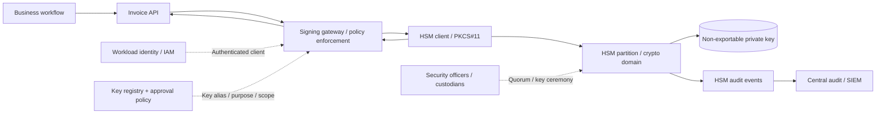
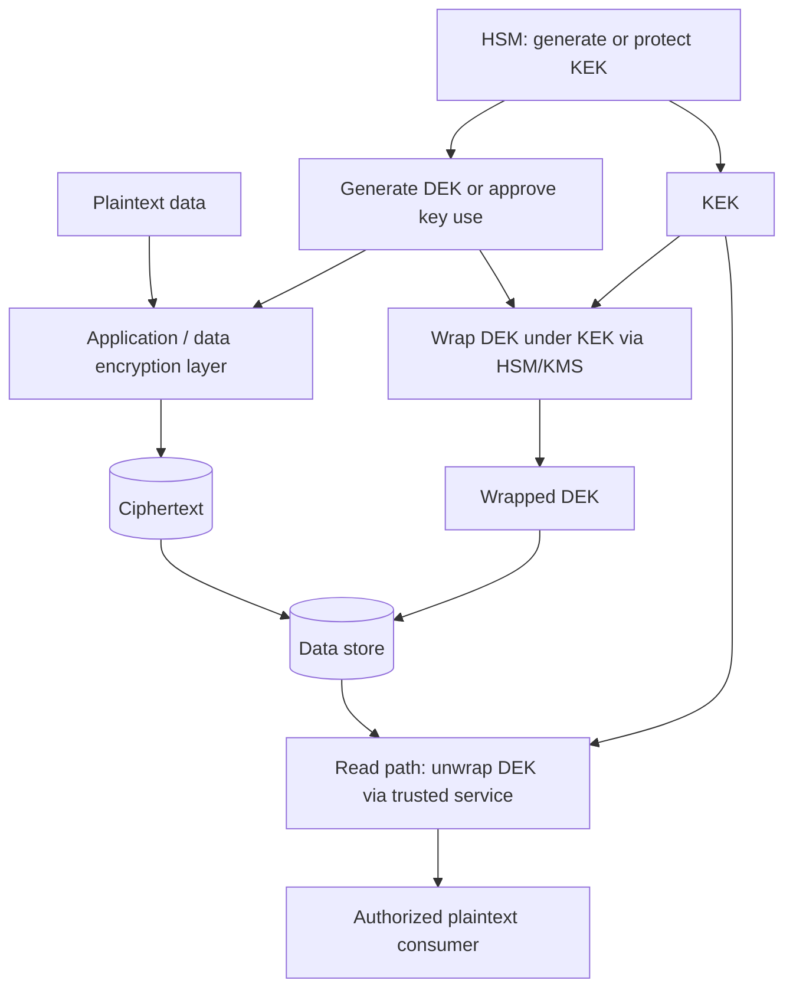
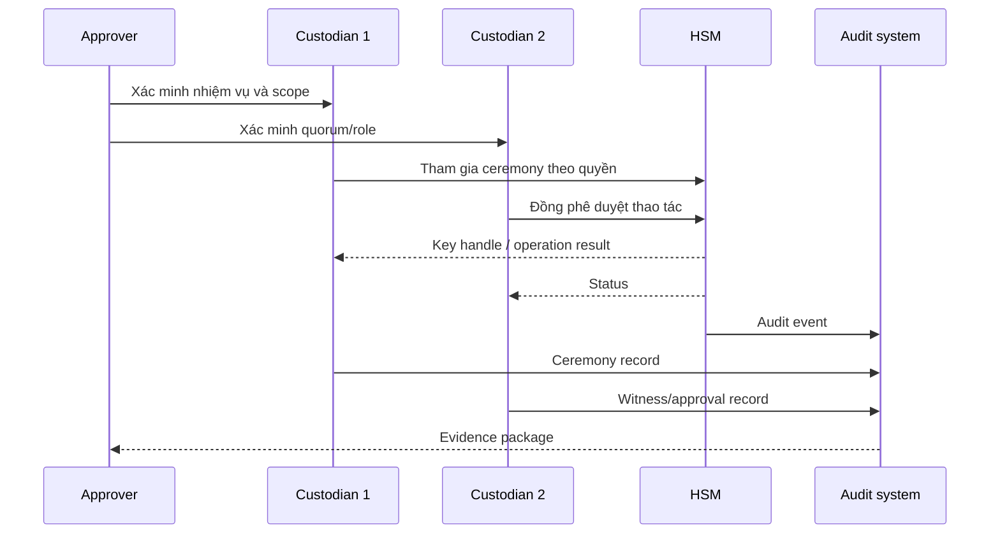

# HSM (Hardware Security Module): bảo vệ khóa mật mã bằng ranh giới tin cậy chuyên dụng

Một nền tảng thanh toán phát hành hóa đơn điện tử và ký số các bản ghi giao dịch. Ứng dụng Java lưu private key trong một file keystore trên máy chủ để ký hóa đơn. File được mã hóa, nhưng tài khoản chạy ứng dụng có thể đọc file và lấy mật khẩu từ cấu hình. Khi máy chủ bị xâm nhập, kẻ tấn công có thể sao chép khóa và tạo chữ ký giả mạo ngay cả sau khi ứng dụng đã được khôi phục.

Đội Security đề xuất dùng **Hardware Security Module (HSM)**. HSM có thể tạo, lưu và sử dụng khóa trong một ranh giới phần cứng được bảo vệ, giúp giảm khả năng khóa riêng bị xuất ra ngoài. Tuy nhiên, điều đó chưa trả lời hết các câu hỏi assurance:

- Ai được phép yêu cầu HSM ký, giải mã hoặc tạo khóa?
- Một ứng dụng bị chiếm quyền có thể yêu cầu HSM ký dữ liệu tùy ý không?
- Khóa được backup, đồng bộ, phục hồi và hủy theo quy trình nào?
- Ai được quản trị HSM, ai giữ quyền kiểm soát mật mã và có cần phê duyệt nhiều người không?
- Nếu một node HSM hỏng, thay firmware hoặc mất kết nối, hệ thống có fail-open không?
- Bằng chứng nào cho thấy cấu hình thực tế, quyền, thuật toán, key lifecycle và audit logs đáp ứng yêu cầu?

**HSM** là một thiết bị hoặc mô-đun mật mã chuyên dụng được thiết kế để thực hiện các thao tác mật mã và bảo vệ vật liệu khóa trong ranh giới được kiểm soát. HSM thường hỗ trợ sinh khóa, lưu khóa, ký, giải mã, unwrap/wrap khóa và các phép toán mật mã khác. Khóa riêng có thể được cấu hình **không cho xuất dạng plaintext** khỏi HSM; ứng dụng chỉ nhận kết quả hoặc một handle tham chiếu tới khóa.

Trong chương **Mã hóa và khóa** của module `SECURITY_SECURITY_ASSURANCE`, HSM cần được đánh giá như một **security control có vòng đời**, không chỉ là một thiết bị mua về. Assurance phải nối **rủi ro → yêu cầu bảo vệ khóa → thiết kế trust boundary → cấu hình và phân quyền → kiểm thử/audit → bằng chứng → khắc phục và đánh giá lại**.

> **Nguyên tắc:** HSM có thể bảo vệ vật liệu khóa trong phạm vi phần cứng và chính sách của nó. HSM **không tự đảm bảo ứng dụng gửi yêu cầu hợp lệ, dữ liệu cần ký là đúng, người dùng được phép thực hiện nghiệp vụ, hoặc toàn hệ thống không bị xâm nhập**. Khả năng assurance phụ thuộc cả cách cấp quyền gọi HSM và cách kiểm soát những thao tác mà khóa được phép thực hiện.

## 1. HSM là gì và giải quyết vấn đề nào?

**Hardware Security Module** là một mô-đun mật mã chuyên dụng có phần cứng, firmware và cơ chế quản trị được thiết kế để bảo vệ khóa và thực hiện các thao tác mật mã trong một ranh giới tin cậy xác định.

Tùy sản phẩm và cấu hình, HSM có thể cung cấp:

- Sinh khóa bằng nguồn ngẫu nhiên và cơ chế được kiểm soát.
- Lưu khóa đối xứng, khóa riêng bất đối xứng và các đối tượng mật mã.
- Ký số, xác minh, mã hóa/giải mã, wrap/unwrap hoặc derive key.
- Quản lý key attributes như mục đích sử dụng, khả năng export, thời hạn và quyền truy cập.
- Phân vùng hoặc tách miền quản trị (partition/crypto domain).
- Xác thực operator/client, audit events và cơ chế kiểm soát nhiều người.
- Backup/restore khóa theo cơ chế bảo vệ của sản phẩm.
- Cụm HA hoặc cơ chế dự phòng/replication theo kiến trúc hỗ trợ.

HSM thường được dùng cho những khóa có tác động lớn: **root/KEK, khóa ký code hoặc tài liệu, CA private key, khóa ký token, khóa thanh toán, khóa database encryption, khóa bảo vệ dữ liệu nhạy cảm và khóa phục vụ hạ tầng danh tính**.

### 1.1. Tại sao không chỉ lưu private key trong file?

Giả sử private key nằm trong file keystore mã hóa trên máy chủ. Mã hóa file giúp bảo vệ dữ liệu lưu trữ khi chưa có khóa mở, nhưng khi ứng dụng cần ký, tiến trình phải có khả năng sử dụng private key hoặc mở nó. Nếu attacker chiếm được cùng quyền của tiến trình và có thể lấy cả file lẫn bí mật mở khóa, ranh giới bảo vệ có thể bị vượt qua.

Với HSM, ứng dụng thường gửi **yêu cầu ký** tới mô-đun. Private key không cần được trả về ứng dụng ở dạng plaintext. HSM thực hiện phép toán và trả chữ ký. Điều này giúp giảm khả năng sao chép private key, nhưng vẫn có rủi ro **attacker dùng chính ứng dụng đã bị chiếm để yêu cầu HSM ký** nếu quyền gọi không được giới hạn.

### 1.2. Những thuộc tính HSM có thể hỗ trợ

| Thuộc tính | Ý nghĩa | Cần kiểm chứng |
|---|---|---|
| **Key isolation** | Vật liệu khóa được giữ trong ranh giới mật mã được bảo vệ | Key attributes, export policy, module boundary |
| **Non-exportability** | Khóa riêng không thể xuất ra dạng plaintext theo policy | Thử API export, quyền operator, cấu hình key object |
| **Controlled cryptographic operations** | Client phải được xác thực và được cấp quyền thực hiện operation | Client identity, role, partition policy, authorization logs |
| **Tamper resistance/evidence** | Thiết bị có cơ chế phát hiện hoặc phản ứng với can thiệp theo thiết kế | Model, firmware, validation scope, physical controls |
| **Key lifecycle** | Có cơ chế tạo, backup, rotate, suspend và destroy khóa | Ceremony records, lifecycle states, restore/destroy evidence |
| **Auditability** | Thao tác quản trị và mật mã có thể được ghi nhận | Audit settings, retention, integrity, monitoring |

Không phải mọi HSM đều cung cấp cùng tính năng, mức bảo vệ hoặc API. Cần kiểm tra **model, firmware, license, configuration, operational mode và tài liệu chính thức** của sản phẩm được triển khai.

## 2. Phân biệt HSM, KMS, TPM, TEE và software keystore

Các công nghệ này có thể kết hợp với nhau nhưng **không thay thế nhau một cách tự động**.

| Công nghệ | Vai trò điển hình | Ranh giới bảo vệ | Câu hỏi assurance |
|---|---|---|---|
| **HSM** | Bảo vệ khóa và thực hiện phép toán mật mã chuyên dụng | Phần cứng/firmware và miền mật mã được quản trị | Khóa, operation, operator và client có bị giới hạn đúng không? |
| **KMS (Key Management Service)** | API/dịch vụ quản lý key lifecycle, policy, grants và audit | Dịch vụ quản lý; có thể dùng HSM bên dưới | KMS dùng loại key backing nào, ai quản trị và scope của dịch vụ? |
| **Cloud HSM** | HSM phần cứng được cung cấp qua dịch vụ cloud, thường có quyền kiểm soát riêng hơn KMS API thông thường | HSM/partition/cluster theo mô hình provider | Mức cô lập, customer control, HA, backup và shared responsibility là gì? |
| **TPM (Trusted Platform Module)** | Gắn với thiết bị, boot measurement, device identity, sealing và một số phép toán khóa | Chip/mô-đun gắn với nền tảng thiết bị | Có bảo đảm trạng thái boot/device và key binding theo use case không? |
| **TEE / Secure Enclave** | Cô lập code/data đang thực thi trong một vùng bảo vệ của CPU/platform | Môi trường thực thi tin cậy | Attestation và giới hạn bảo vệ runtime ra sao? |
| **Software keystore** | Lưu khóa trong file, process, OS keychain hoặc secret manager | Phần mềm, OS và quyền truy cập | Bí mật mở khóa, memory exposure, backup và host compromise được kiểm soát thế nào? |

**KMS không đồng nghĩa HSM.** Một KMS có thể dùng HSM nội bộ để bảo vệ key material, nhưng khách hàng chỉ tương tác với API quản lý. Ngược lại, HSM tự quản lý có thể đòi hỏi tổ chức vận hành thiết bị, firmware, backup, partition và key ceremonies. Chọn kiến trúc theo yêu cầu về **mức kiểm soát, độ sẵn sàng, hiệu năng, trách nhiệm vận hành, chi phí và bằng chứng cần có**.

### 2.1. HSM không thay thế mọi lớp bảo vệ

- HSM không tự xác thực người dùng cuối hoặc quyền nghiệp vụ.
- HSM không tự xác nhận dữ liệu đầu vào có đúng hay không.
- HSM không tự bảo vệ ứng dụng khỏi SQL injection, SSRF hoặc account takeover.
- HSM không tự đảm bảo private key chỉ được sử dụng cho mục đích hợp lệ nếu client được phép gửi yêu cầu ký tùy ý.
- HSM không thay thế IAM, network segmentation, secure boot, patching, backup governance hay incident response.

## 3. Các dạng triển khai HSM

### 3.1. Network-attached HSM

HSM được kết nối qua mạng bảo mật. Ứng dụng hoặc cryptographic service gọi tới HSM qua client library/protocol. Mô hình này có thể phục vụ nhiều ứng dụng, nhưng phải kiểm soát **client authentication, network path, partition, rate, timeout và HA**.

### 3.2. PCIe hoặc HSM gắn máy chủ

Thiết bị được lắp trực tiếp vào máy chủ hoặc môi trường chuyên dụng. Nó có thể giảm một số phụ thuộc mạng, nhưng tạo ràng buộc về phần cứng, vị trí, vận hành, khả năng mở rộng và DR. Cần quản lý host, physical access và thay thiết bị.

### 3.3. Cloud HSM

Provider cung cấp HSM qua hạ tầng cloud, theo mô hình quản lý khác nhau. Khách hàng có thể quản trị cluster, partition, client, key hoặc operator tùy dịch vụ. Không nên giả định mọi cloud HSM đều cho quyền kiểm soát giống nhau; phải đọc **service boundary, SLA, key export/backup, region, access model và provider responsibilities**.

### 3.4. Managed HSM / HSM-backed KMS

Một dịch vụ có thể cung cấp giao diện KMS đơn giản nhưng thực thi một số thao tác trong HSM. Điều quan trọng là hiểu **key type, key custody, isolation, administrative control, audit visibility và service-specific limitations**. Tên sản phẩm có chữ “HSM” không thay thế việc xác minh kiến trúc và bằng chứng.

## 4. Kiến trúc trust boundary của một hệ thống dùng HSM

Ví dụ nền tảng Java cần ký hóa đơn điện tử. Ứng dụng `invoice-service` gửi hash/tài liệu tới một signing gateway. Gateway xác thực service identity, kiểm tra purpose và quyền ký, rồi gọi HSM. HSM giữ private key và trả chữ ký.



### 4.1. Những ranh giới phải xác định

| Boundary | Điều cần tin cậy | Kiểm soát cần có |
|---|---|---|
| User → Invoice API | Người yêu cầu và nghiệp vụ có quyền ký | Authentication, business authorization, approval |
| API → Signing gateway | Workload gọi là service được đăng ký | mTLS/workload identity, client allowlist, audience |
| Gateway → HSM client | Client được quyền dùng partition/key cụ thể | HSM client identity, role, key ACL |
| HSM client → HSM | Kênh, giao thức và thiết bị đúng | TLS/secure channel nếu hỗ trợ, network controls, device identity |
| Operator → HSM admin plane | Người quản trị có thẩm quyền | MFA, dual control, quorum, privileged access monitoring |
| HSM → Backup/DR | Bản sao khóa được bảo vệ đúng | Backup wrapping, custodians, restore ceremony, region policy |
| HSM → Audit platform | Audit events đầy đủ và không bị âm thầm sửa | Secure export, retention, integrity, alerting |

**HSM bảo vệ một boundary, không bảo vệ toàn bộ request path.** Nếu signing gateway bị chiếm và được phép ký mọi payload bằng khóa hóa đơn, attacker có thể tạo chữ ký hợp lệ mà không cần trích xuất private key. Do đó cần đánh giá **quyền gọi operation và nghiệp vụ được phép ký** như một phần của control.

## 5. Key hierarchy và cách HSM bảo vệ khóa

### 5.1. Các lớp khóa thường gặp

Một hệ thống có thể tổ chức khóa theo nhiều tầng:

- **Root/master key trong HSM:** dùng để bảo vệ các khóa khác hoặc tạo miền bảo vệ nội bộ, tùy kiến trúc sản phẩm.
- **KEK (Key Encryption Key):** khóa dùng để wrap/encrypt các khóa dữ liệu hoặc khóa con.
- **DEK (Data Encryption Key):** khóa mã hóa dữ liệu ứng dụng, thường được dùng ngoài HSM cho dữ liệu lớn theo mô hình envelope encryption.
- **Signing key:** private key dùng ký số; cần tách theo mục đích, môi trường, tenant hoặc hệ thống khi yêu cầu.
- **Transport/wrapping key:** bảo vệ khóa khi chuyển giữa các miền hoặc trong backup theo cơ chế được thiết kế.

Tên gọi và cấu trúc thực tế phụ thuộc hệ thống. **Không giả định mọi HSM có cùng một “master key” hoặc key hierarchy chuẩn**; hãy xác minh tài liệu sản phẩm và sơ đồ key management của tổ chức.

### 5.2. Envelope encryption

Với dữ liệu lớn, ứng dụng thường mã hóa dữ liệu bằng DEK; HSM/KMS bảo vệ KEK và dùng KEK để wrap DEK. Database lưu ciphertext cùng wrapped DEK và metadata cần thiết.



Luồng cụ thể có thể khác: HSM tạo DEK, wrap key, hoặc KMS làm orchestration. Điểm cốt yếu là **DEK plaintext chỉ tồn tại ở nơi cần mã hóa/giải mã**, trong khi KEK được bảo vệ theo policy. Nếu ứng dụng cần dùng DEK plaintext, HSM không thể bảo vệ dữ liệu khỏi mọi tiến trình có quyền đọc DEK trong memory.

### 5.3. Tách khóa theo mục đích và phạm vi

| Khóa | Mục đích | Nguyên tắc |
|---|---|---|
| `K-SIGN-INVOICE-PROD` | Ký hóa đơn production | Chỉ signing service được gọi đúng operation |
| `K-ENCRYPT-CUSTOMER-KEK` | Wrap DEK dữ liệu khách hàng | Phân quyền decrypt/unwrap theo service và data scope |
| `K-TLS-EDGE` | Chứng thư TLS cho một ranh giới | Lifecycle theo certificate/PKI |
| `K-CODE-SIGN` | Ký artefact phát hành | Gắn với release approvals và provenance |
| `K-BACKUP-WRAP` | Bảo vệ backup key material | Quản lý custody và restore độc lập |
| `K-DEV-SIGN` | Ký trong môi trường phát triển | Không chia sẻ quyền/khóa với production |

Một khóa dùng chung cho nhiều mục đích làm tăng **blast radius**. Một khóa riêng cho mỗi request có thể tạo gánh nặng vận hành không cần thiết. Phạm vi khóa cần cân bằng **cô lập, hiệu năng, rotation, backup và yêu cầu kiểm toán**.

## 6. Các thao tác mật mã HSM thường cung cấp

| Operation | Ý nghĩa | Assurance questions |
|---|---|---|
| **GenerateKey / GenerateKeyPair** | Sinh khóa đối xứng hoặc cặp khóa | Ai có quyền, thuật toán/kích thước nào, nguồn ngẫu nhiên và thuộc tính key? |
| **Sign** | Tạo chữ ký bằng private key | Caller nào được ký, loại payload/purpose nào, rate và approval? |
| **Verify** | Xác minh chữ ký bằng public key | Trust store và algorithm policy có đúng không? |
| **Encrypt / Decrypt** | Mã hóa/giải mã | Ai có quyền giải mã, dữ liệu có được đưa ra khỏi HSM? |
| **Wrap / Unwrap** | Bảo vệ hoặc mở khóa con | Wrapping key, target, backup và import/export policy? |
| **DeriveKey** | Dẫn xuất khóa theo cơ chế được hỗ trợ | Parameters, context separation và key usage? |
| **DestroyKey** | Hủy đối tượng khóa | Có bản sao, wrapped copy, backup hoặc replication nào còn? |
| **Random generation** | Sinh số ngẫu nhiên mật mã | DRBG/entropy claims và trạng thái module có phù hợp? |

Không phải mọi thuật toán hoặc operation đều được hỗ trợ trong mọi HSM, firmware hay validation mode. **Chọn thuật toán theo tiêu chuẩn và chính sách đã được phê duyệt**, kiểm tra khả năng hỗ trợ thực tế, và có lộ trình thay thế khi thuật toán yếu hoặc bị loại bỏ.

## 7. Key lifecycle: từ tạo đến hủy

Một key lifecycle có thể biểu diễn:

```text
REQUEST → APPROVE → GENERATE/IMPORT → ACTIVATE → USE
                                      ↓
                       MONITOR → ROTATE / SUSPEND
                                      ↓
                          ARCHIVE / REVOKE
                                      ↓
                                  DESTROY
```

### 7.1. Request và approval

Yêu cầu tạo khóa cần mô tả:

- Mục đích nghiệp vụ và risk/control liên quan.
- Loại key, thuật toán, tham số, môi trường và key usage.
- Owner kỹ thuật, owner dữ liệu và người phê duyệt.
- Phạm vi service/tenant/region và operation cần cấp.
- Thời hạn, rotation trigger, backup/restore requirement.
- Mức nhạy cảm và yêu cầu kiểm soát nhiều người.

Không cho phép một developer tự tạo khóa production rồi tự gán quyền sử dụng không qua quy trình nếu chính sách yêu cầu phê duyệt.

### 7.2. Generate hoặc import

Ưu tiên sinh khóa bên trong HSM khi use case và sản phẩm hỗ trợ, nhằm giảm phơi lộ key material. Nếu import là cần thiết, cần xác định nguồn, phương pháp wrapping/transport, custody, người tham gia và bằng chứng key không bị lộ trong quá trình.

**Key import không mặc nhiên sai**, nhưng phải có rationale và kiểm soát tương xứng. Một khóa được sinh ngoài HSM rồi import có thể đã bị lộ trước khi tới thiết bị.

### 7.3. Activation và use

Khóa có thể được tạo nhưng chưa được kích hoạt. Khi activate, cần xác nhận đúng key ID, attributes, owner, partition, purpose, allowed mechanisms và expiration/rotation policy. Mọi client sử dụng khóa cần được xác thực và phân quyền theo **least privilege**.

### 7.4. Rotation

Rotation thay thế khóa đang dùng bằng khóa mới theo chính sách hoặc sự kiện. Cần phân biệt:

- **New key generation:** tạo key mới.
- **Key activation:** bắt đầu dùng key mới cho dữ liệu/operation mới.
- **Re-encryption/rewrap:** chuyển ciphertext hoặc wrapped DEK sang key mới nếu cần.
- **Old key retention:** giữ key cũ trong thời gian cần để đọc/verify dữ liệu lịch sử hợp lệ.
- **Old key destruction:** chỉ hủy khi không còn nghĩa vụ hoặc nhu cầu phục hồi.

Với signing key, cần quản lý certificate, public key distribution, verification period, revocation và chữ ký lịch sử. Xóa private key không làm chữ ký đã tạo biến mất; hệ thống xác minh cần biết **public key/certificate và trạng thái tin cậy tại thời điểm ký**.

### 7.5. Suspend, revoke và destroy

- **Suspend/disable:** tạm ngừng sử dụng key; có thể khôi phục theo policy.
- **Revoke:** loại bỏ sự tin cậy hoặc quyền sử dụng theo ngữ cảnh như certificate, credential hay key reference.
- **Destroy:** hủy đối tượng khóa theo cơ chế của HSM; cần kiểm tra wrapped copies/backup/replica.
- **Crypto erase:** có thể dùng hủy khóa để làm ciphertext không giải mã được, nhưng chỉ khi key topology và tất cả bản sao được kiểm soát.

**Không nhầm xóa key object trên một partition với hủy mọi bản sao có thể giải mã.** Cần kiểm tra backup, replication, export-wrapped key, disaster recovery và các bản sao key material theo kiến trúc.

## 8. Key attributes và non-exportability

Một HSM có thể lưu key object cùng các thuộc tính điều khiển cách dùng. Ví dụ ở mức khái niệm:

| Attribute | Ý nghĩa | Câu hỏi review |
|---|---|---|
| **Sensitive** | Hạn chế hiển thị key material | Có đúng policy và API semantics? |
| **Extractable / non-extractable** | Có cho phép xuất khóa hay không theo cơ chế sản phẩm | Có thể xuất wrapped hay plaintext? Ai có quyền? |
| **Sign / Decrypt / Encrypt / Wrap** | Các operation được phép | Có cấp nhiều operation hơn use case? |
| **Token / persistent object** | Đối tượng tồn tại theo cơ chế token/HSM | Backup/restore và ownership ra sao? |
| **Label / ID** | Định danh tham chiếu | Có thể bị giả mạo hoặc trùng alias? |
| **Key type / mechanism** | Loại khóa và thuật toán/operation | Có đáp ứng crypto policy và validation mode? |
| **Allowed client/partition** | Chủ thể/miền được dùng key | Có phân tách dev/prod và tenant đúng không? |

Tên thuộc tính cụ thể phụ thuộc API, ví dụ PKCS#11. Không nên giả định `CKA_EXTRACTABLE=false` là đủ để chứng minh không có đường lấy key khác; cần kiểm tra **backup, wrapping, operator role, firmware, vendor mechanism và administrative interface**.

**Non-exportable không đồng nghĩa non-usable.** Một service được cấp quyền ký vẫn có thể sử dụng key để ký nội dung không hợp lệ về nghiệp vụ nếu signing gateway không kiểm tra purpose/approval.

## 9. Partition, roles, dual control và quorum

### 9.1. Partition/crypto domain

Partition có thể cung cấp ranh giới logic để tách key objects, clients và roles. Mức cô lập thực tế tùy sản phẩm: một số mô hình dùng thiết bị vật lý riêng, một số dùng phân vùng logic trên cùng HSM. Cần xác minh **shared resources, admin plane, backup domain và failure domain**.

Ví dụ:

| Partition | Môi trường | Nội dung | Client được phép |
|---|---|---|---|
| `PART-DEV` | Development | Khóa thử nghiệm | CI dev, developer test |
| `PART-STAGE` | Staging | Khóa kiểm thử tích hợp | Staging services |
| `PART-PROD-SIGN` | Production | Khóa ký hóa đơn | Signing gateway production |
| `PART-PROD-ENC` | Production | KEK dữ liệu khách hàng | Data encryption service |
| `PART-DR` | DR | Tài nguyên dự phòng theo policy | DR operators/approved clients |

**Tên partition không tự tạo isolation**. Phải kiểm tra quyền client, khả năng truy cập chéo, policy quản trị, network và cách restore/replicate.

### 9.2. Separation of duties

Các vai trò thường gặp:

- **Security officer:** quản trị policy/role và giám sát thiết lập bảo mật.
- **Crypto officer/key custodian:** tham gia thao tác quản lý key theo quyền được giao.
- **Application operator:** vận hành ứng dụng/client, không mặc nhiên quản trị key lifecycle.
- **Backup/DR operator:** thực hiện backup/restore theo quy trình.
- **Auditor:** đọc audit evidence, không thay đổi key.
- **Approver/risk owner:** phê duyệt rủi ro hoặc key ceremony theo thẩm quyền.

Một người không nên tự thực hiện toàn bộ chuỗi **tạo khóa → cấp quyền → phê duyệt → export/backup → xác minh** nếu policy yêu cầu phân tách.

### 9.3. Dual control và M-of-N quorum

**Dual control** yêu cầu nhiều người cùng tham gia/cho phép một thao tác nhạy cảm. **M-of-N quorum** yêu cầu tối thiểu M trong N người/secret shares/custodians tham gia theo cơ chế được thiết kế.

Ví dụ, một thao tác khôi phục key domain yêu cầu 2 trong 3 custodians. Cần làm rõ:

- Mỗi custodian có danh tính và quyền độc lập không?
- Có thể một người lấy được đủ phần thông tin để vượt quorum không?
- Cơ chế lưu/khôi phục từng share có bảo vệ không?
- Mất custodian hoặc thay nhân sự được xử lý ra sao?
- Thao tác khẩn cấp có đường bypass không, ai review hậu kiểm?
- Log có chứng minh đúng người và đúng thứ tự phê duyệt?

**M-of-N không phải phép thuật**: nếu một operator có thể thay cấu hình để bỏ quorum hoặc mọi share đều lưu trong cùng một vault, kiểm soát có thể mất ý nghĩa.

## 10. Key ceremony: tạo và quản lý khóa có kiểm soát

Một **key ceremony** là quy trình được lập kế hoạch và ghi bằng chứng cho thao tác mật mã quan trọng, như khởi tạo HSM, tạo root/CA key, backup/restore, thay custodian hoặc hủy khóa.

### 10.1. Trước ceremony

- Xác định mục đích, scope, key type, algorithm, key attributes và partition.
- Phân vai operator, custodian, witness, approver và auditor.
- Chuẩn bị môi trường vật lý/mạng, thiết bị, firmware và tài liệu quy trình.
- Xác định điều kiện abort, rollback và xử lý lỗi.
- Xác minh đồng hồ, logging, camera/physical evidence nếu policy yêu cầu và phù hợp.
- Tạo checklist, runbook và evidence ID.

### 10.2. Trong ceremony

- Xác minh danh tính và thẩm quyền của người tham gia.
- Thực hiện các bước theo runbook đã được phê duyệt.
- Kiểm tra key attributes và key references.
- Kiểm tra quorum/dual control, không chia sẻ credential trái policy.
- Ghi timestamp, HSM ID, firmware, partition, operator actions và kết quả.
- Không ghi plaintext key, PIN hoặc secret vào biên bản/log.

### 10.3. Sau ceremony

- Xác minh key object và policy bằng công cụ/đường đọc được phê duyệt.
- Kiểm tra một operation thử phù hợp (ví dụ ký test payload), không dùng dữ liệu thật không cần thiết.
- Lưu audit records và evidence package theo quyền/retention.
- Cập nhật key inventory, owner, rotation/expiry và DR documentation.
- Ghi sai lệch, ngoại lệ và việc cần khắc phục.



Sơ đồ mô tả nguyên tắc, không phải trình tự API cụ thể của một nhà cung cấp. **Key ceremony phải có procedure theo sản phẩm thực tế**, được thử nghiệm và phê duyệt.

## 11. Backup, restore, HA và disaster recovery

### 11.1. Phân biệt HA, replication và backup

| Cơ chế | Mục đích | Không tự đảm bảo |
|---|---|---|
| **High availability (HA)** | Duy trì dịch vụ khi một node/đường kết nối lỗi | Khôi phục sau mất toàn bộ miền hoặc xóa nhầm |
| **Replication** | Đồng bộ key/config/state giữa các node theo kiến trúc | Có bản backup độc lập hoặc chống thao tác phá hoại được replicate |
| **Backup** | Lưu bản khôi phục theo thời điểm/quy trình | Có thể restore được nếu thiếu quorum, wrapping key hoặc firmware tương thích |
| **Disaster recovery (DR)** | Khôi phục dịch vụ/khóa tại miền khác sau thảm họa | RPO/RTO đạt nếu chưa diễn tập và đo thực tế |

Một lỗi phổ biến là nghĩ **cluster HA chính là backup**. Nếu một key bị xóa hoặc partition bị cấu hình sai và thay đổi đó được replicate, toàn cụm có thể cùng chịu ảnh hưởng.

### 11.2. Backup key material

Backup HSM cần theo cơ chế được sản phẩm hỗ trợ, có thể gồm wrapped backup, backup appliance, security domain hoặc quorum. Cần kiểm tra:

- Backup có mã hóa/bọc theo cơ chế được duyệt không?
- Khóa bảo vệ backup ở đâu và ai kiểm soát?
- Có yêu cầu quorum/custodian độc lập khi restore?
- Bản backup có được bảo vệ vật lý, logic và theo region?
- Có thể khôi phục trên model/firmware/partition tương thích không?
- Restore có tạo ra key object/attributes giống policy không?
- Có log và evidence cho thao tác backup/restore?
- Retention của backup có phù hợp key lifecycle và nghĩa vụ không?

Không tự sao chép file hệ thống hoặc dữ liệu thiết bị HSM ra ngoài bằng phương pháp không được nhà sản xuất hỗ trợ.

### 11.3. DR exercise

Một bài tập DR cần đo:

1. Thời gian khôi phục HSM/partition và client connectivity.
2. Khả năng phục hồi key objects và attributes.
3. Khả năng thực hiện các operation nghiệp vụ cần thiết.
4. Quy trình quorum/custodian khi một số người không sẵn sàng.
5. Khả năng xác minh certificate/public key và chữ ký lịch sử.
6. Audit trail có liên tục hoặc được đối soát sau DR?
7. Failover có vô tình mở quyền rộng hoặc chuyển sang key yếu hơn không?

**RTO/RPO là mục tiêu cho tới khi có test evidence**. Cần ghi actual results, lỗi và corrective actions.

## 12. Hiệu năng và tính sẵn sàng của HSM

HSM là tài nguyên mật mã chuyên dụng, có thể có giới hạn về số operation/giây, concurrent sessions, key slots, network latency hoặc throughput theo thuật toán.

### 12.1. Những câu hỏi capacity

- Peak signing/decryption throughput và latency là bao nhiêu?
- Một request có thể tạo nhiều operation hay phải batch?
- Có giới hạn session, connection pool hoặc login contexts?
- HSM/partition nào là bottleneck?
- Quota và license ảnh hưởng ra sao?
- Nếu HSM chậm, ứng dụng queue/backoff thế nào?
- Có thể chuyển sang node khác mà không đổi trust/key semantics?
- Khi HSM unavailable, hệ thống có fail-closed đối với thao tác nhạy cảm không?

### 12.2. Tránh fallback nguy hiểm

Một số hệ thống có thể được cấu hình fallback sang private key trong file nếu HSM không sẵn sàng. Cách này có thể làm mất chính mục tiêu bảo vệ khóa. Nếu có fallback, cần:

- Risk assessment và approval rõ ràng.
- Key khác với quyền/mục đích giới hạn, không sao chép private key HSM ra file.
- Cơ chế cảnh báo, thời hạn và điều kiện quay lại.
- Không tự động fail-open khi HSM lỗi.
- Bằng chứng cho biết request nào đã dùng fallback và ai cho phép.

Với thao tác ký hoặc giải mã nhạy cảm, **từ chối/hoãn an toàn** thường phù hợp hơn việc âm thầm dùng một đường khóa yếu hơn. Tuy nhiên, quyết định availability phụ thuộc business impact và threat model; phải ghi rõ trade-off.

## 13. HSM interfaces: PKCS#11, JCA/JCE, KMIP và API dịch vụ

Ứng dụng không nên tự thao tác phần cứng bằng giao thức tùy biến. Nên sử dụng **API/SDK được hỗ trợ** và hiểu rõ ranh giới.

| Interface | Vai trò | Điểm cần review |
|---|---|---|
| **PKCS#11** | API tiêu chuẩn cho token/cryptographic devices, key objects và crypto operations | Mechanism support, sessions, object attributes, login roles, error handling |
| **Java JCA/JCE Provider** | Tích hợp thuật toán mật mã qua provider trong Java | Provider implementation, provider selection, key handle và fallback |
| **KMIP** | Giao thức quản lý key objects giữa client và key management service | Authentication, TLS, object lifecycle, policy mapping |
| **Vendor SDK/API** | API riêng cho thiết bị/dịch vụ | Version, dependency, supported operation, audit và upgrade path |
| **KMS API** | Giao diện dịch vụ quản lý key/policy/crypto operation | Key custody, service scope, IAM, audit, rate limits |

### 13.1. PKCS#11 ở mức khái niệm

PKCS#11 thường mô tả:

- **Slot/token:** nơi biểu diễn thiết bị hoặc miền mật mã.
- **Session:** ngữ cảnh kết nối tới token.
- **Object:** key/certificate/data object.
- **Attributes:** thuộc tính như loại key, usage, extractability và sensitivity.
- **Mechanism:** phép toán/thuật toán được hỗ trợ.
- **User role/login:** quyền truy cập token/objects theo policy.

Một ứng dụng không nên suy ra “token đã login” nghĩa là mọi key trong mọi partition đều được phép dùng. Cần phân quyền theo **client, role, key object và operation**.

### 13.2. JCA/JCE trong Java

Java Cryptography Architecture cho phép ứng dụng dùng API như `Signature`, `Cipher`, `KeyStore` qua provider. Một HSM có thể được tích hợp qua **SunPKCS11** hoặc provider do vendor cung cấp.

Điểm cần chú ý:

- Chọn đúng provider; tránh vô tình chạy operation bằng software provider khi HSM không sẵn sàng.
- Xác nhận key object thực sự là token/HSM-backed key, không phải bản copy trong file.
- Xử lý lỗi session, login, timeout và failover.
- Không log PIN, secret, private key hoặc dữ liệu ký nhạy cảm.
- Xác minh algorithm/mechanism mapping và tham số.
- Không dùng `getEncoded()` để mong nhận private key không exportable; kết quả null có thể là đặc tính provider nhưng không phải bằng chứng duy nhất.
- Quản lý phiên bản JDK, provider và native library theo change control.

## 14. Java 17: ký dữ liệu qua PKCS#11 provider

Ví dụ sau minh họa **JCA sử dụng SunPKCS11 provider** để tham chiếu một private key nằm trong HSM. File cấu hình PKCS#11 và thư viện native phụ thuộc thiết bị/OS/vendor; ví dụ không thể dùng nguyên trạng trên mọi HSM.

### 14.1. Cấu hình provider minh họa

Tệp cấu hình do môi trường triển khai quản lý, ví dụ:

```text
name = CorpHsm
library = /opt/vendor/lib/libpkcs11.so
slotListIndex = 0
```

Đường dẫn thư viện và slot chỉ là placeholder. Cần xác minh library ký số, slot/token, firmware và provider tương thích với phiên bản Java đang chạy.

### 14.2. Java signing adapter

```java
import java.security.KeyStore;
import java.security.PrivateKey;
import java.security.Provider;
import java.security.Security;
import java.security.Signature;
import java.util.Arrays;
import java.util.function.Supplier;

public final class HsmSigner {
    private HsmSigner() {}

    public static byte[] sign(
            String pkcs11Config,
            String keyAlias,
            byte[] payload,
            Supplier<char[]> pinSupplier) throws Exception {

        if (pkcs11Config == null || keyAlias == null
                || keyAlias.isBlank() || payload == null
                || pinSupplier == null) {
            throw new IllegalArgumentException("Invalid signing input");
        }

        Provider base = Security.getProvider("SunPKCS11");
        if (base == null) {
            throw new IllegalStateException(
                    "SunPKCS11 provider is unavailable");
        }

        Provider hsmProvider = base.configure(pkcs11Config);
        Security.addProvider(hsmProvider);

        char[] pin = pinSupplier.get();
        if (pin == null || pin.length == 0) {
            throw new IllegalStateException("HSM credential unavailable");
        }

        try {
            KeyStore token = KeyStore.getInstance(
                    "PKCS11", hsmProvider);
            token.load(null, pin);

            // PrivateKey là handle do provider cung cấp.
            // Không đọc hoặc lưu private key material vào ứng dụng.
            PrivateKey privateKey = (PrivateKey)
                    token.getKey(keyAlias, null);

            if (privateKey == null) {
                throw new IllegalStateException(
                        "HSM key alias not found");
            }

            Signature signer = Signature.getInstance(
                    "SHA256withRSA", hsmProvider);
            signer.initSign(privateKey);
            signer.update(payload);
            return signer.sign();
        } finally {
            Arrays.fill(pin, '\0');
        }
    }
}
```

**Những điều ví dụ không tự chứng minh:**

- `pinSupplier` phải lấy credential từ một cơ chế được bảo vệ; không trả về PIN hardcode, environment variable rộng hoặc log.
- `keyAlias` phải được xác thực với key registry và policy phía server; không để client tùy ý chọn khóa production.
- HSM/provider phải thực sự hỗ trợ `SHA256withRSA` và mechanism tương ứng; một số cấu hình yêu cầu tham số/provider cụ thể.
- `Security.addProvider` và cấu hình provider cần được quản lý cẩn trọng trong môi trường nhiều ứng dụng; cần tránh cấu hình trùng tên hoặc provider không mong muốn.
- Ví dụ dùng `throws Exception` để ngắn gọn; production cần xử lý lỗi phân loại, timeout, session exhaustion, retry an toàn và audit correlation.
- Xóa PIN khỏi mảng Java chỉ giảm thời gian tồn tại trong vùng bộ nhớ do ứng dụng quản lý; không chứng minh mọi bản sao trong heap/GC đã bị xóa tuyệt đối.
- Chữ ký trả về không chứng minh payload đã được nghiệp vụ phê duyệt; gateway phải kiểm tra nội dung, requester, purpose và approval trước khi gọi HSM.

### 14.3. Signing policy ở phía gateway

Không nên cho bất kỳ client nào gọi trực tiếp một key alias bất kỳ. Một lớp policy ở signing gateway có thể giới hạn alias, purpose và loại dữ liệu. Đầu vào `VerifiedSigningContext` dưới đây phải được tạo từ authentication/authorization và workflow approval đáng tin cậy.

```java
import java.util.Set;

record VerifiedSigningContext(
        String workloadId,
        String purpose,
        String keyAlias,
        boolean approvalVerified) {}

enum SigningDecision {
    PERMIT,
    DENY,
    REVIEW_REQUIRED
}

final class SigningPolicy {
    private SigningPolicy() {}

    static SigningDecision evaluate(
            VerifiedSigningContext context,
            Set<String> allowedWorkloads,
            Set<String> allowedAliases,
            Set<String> allowedPurposes) {

        if (context == null || allowedWorkloads == null
                || allowedAliases == null || allowedPurposes == null) {
            return SigningDecision.REVIEW_REQUIRED;
        }

        if (context.workloadId() == null
                || context.keyAlias() == null
                || context.purpose() == null) {
            return SigningDecision.REVIEW_REQUIRED;
        }

        if (!allowedWorkloads.contains(context.workloadId())
                || !allowedAliases.contains(context.keyAlias())
                || !allowedPurposes.contains(context.purpose())
                || !context.approvalVerified()) {
            return SigningDecision.DENY;
        }

        return SigningDecision.PERMIT;
    }
}
```

Đây là **policy demo**, không phải hệ thống authorization hoàn chỉnh. Danh sách allowed phải đến từ registry/config được quản lý và version hóa; `approvalVerified` không được nhận từ client như một boolean tự khai. Với production, cần ràng buộc **payload digest, document type, tenant, amount/transaction scope, key version, idempotency và rate limit** nếu use case yêu cầu.

### 14.4. JUnit 5 cho signing policy

```java
import static org.junit.jupiter.api.Assertions.assertEquals;
import java.util.Set;
import org.junit.jupiter.api.Test;

class SigningPolicyTest {
    private static final Set<String> WORKLOADS =
            Set.of("invoice-signing-service");
    private static final Set<String> ALIASES =
            Set.of("K-SIGN-INVOICE-PROD");
    private static final Set<String> PURPOSES =
            Set.of("invoice-signing");

    @Test
    void permitsApprovedWorkloadAndPurpose() {
        var context = new VerifiedSigningContext(
                "invoice-signing-service",
                "invoice-signing",
                "K-SIGN-INVOICE-PROD",
                true);

        assertEquals(SigningDecision.PERMIT,
                SigningPolicy.evaluate(
                        context, WORKLOADS, ALIASES, PURPOSES));
    }

    @Test
    void deniesUnapprovedWorkload() {
        var context = new VerifiedSigningContext(
                "debug-service", "invoice-signing",
                "K-SIGN-INVOICE-PROD", true);

        assertEquals(SigningDecision.DENY,
                SigningPolicy.evaluate(
                        context, WORKLOADS, ALIASES, PURPOSES));
    }

    @Test
    void deniesWrongPurposeAndAlias() {
        var context = new VerifiedSigningContext(
                "invoice-signing-service", "code-signing",
                "K-SIGN-CODE-PROD", true);

        assertEquals(SigningDecision.DENY,
                SigningPolicy.evaluate(
                        context, WORKLOADS, ALIASES, PURPOSES));
    }

    @Test
    void deniesMissingApproval() {
        var context = new VerifiedSigningContext(
                "invoice-signing-service", "invoice-signing",
                "K-SIGN-INVOICE-PROD", false);

        assertEquals(SigningDecision.DENY,
                SigningPolicy.evaluate(
                        context, WORKLOADS, ALIASES, PURPOSES));
    }

    @Test
    void requiresVerifiedContext() {
        assertEquals(SigningDecision.REVIEW_REQUIRED,
                SigningPolicy.evaluate(
                        null, WORKLOADS, ALIASES, PURPOSES));
    }
}
```

Unit tests này chỉ kiểm tra **logic policy**. Cần integration tests trên HSM test partition để xác minh key thật được dùng, private key không exportable theo cấu hình, client thiếu quyền bị từ chối, audit event được tạo, failover hoạt động và không có software fallback ngoài policy.

## 15. Threat modeling HSM theo STRIDE và misuse cases

| STRIDE / abuse | Kịch bản | Controls cần xem | Bằng chứng |
|---|---|---|---|
| **Spoofing** | Client giả mạo signing service hoặc operator | Mutual authentication, client identity, MFA, certificate lifecycle | Invalid client/operator tests, IAM config |
| **Tampering** | Thay key attributes, firmware, provider config hoặc trust policy | Change control, signed firmware/update process, dual control | Config diff, approval, firmware inventory |
| **Repudiation** | Operator phủ nhận thao tác ký hoặc backup | Audit logs gắn actor, time, key ID và correlation | Log integrity, time sync, review trail |
| **Information disclosure** | Lộ PIN, key material, backup share hoặc plaintext qua log | Non-exportability, secure ceremony, secret handling, access restriction | Export tests, secret scans, backup review |
| **Denial of service** | HSM/network/partition hết session hoặc mất node | HA, capacity, monitoring, DR | Failover/load/failure tests |
| **Elevation of privilege** | App role được phép dùng key quản trị hoặc đổi ACL | Separation of duties, least privilege, quorum | Role matrix, negative authorization tests |
| **Misuse by authorized client** | App bị chiếm yêu cầu HSM ký payload trái phép | Signing gateway, purpose/payload policy, approval, rate limit | Abuse-case tests, request audit |
| **Key lifecycle failure** | Key cũ vẫn dùng được sau rotation/revocation | State machine, inventory, disable/destroy verification | Key status diff, retest, DR/backup evidence |

### 15.1. Câu hỏi quan trọng về misuse

- Client có thể ký **bất kỳ bytes nào** hay chỉ payload đã được nghiệp vụ phê duyệt?
- Có thể dùng key alias của production từ dev/test không?
- Operator có thể thay quyền key mà không cần người thứ hai?
- Một key được cấp cả `SIGN` và `DECRYPT` dù chỉ cần ký?
- Có thể tạo key không có expiry/owner hoặc key không nằm trong inventory?
- Khi HSM không khả dụng, ứng dụng có tự động fallback sang software key?
- Có thể xóa audit event hoặc tắt log mà không có cảnh báo?
- Backup key có thể restore vào một HSM/partition khác ngoài kế hoạch?

HSM phải được đánh giá theo **threat model toàn đường sử dụng khóa**, không chỉ chứng minh vỏ thiết bị có khả năng chống can thiệp.

## 16. FIPS 140-3 và cách diễn giải validation

Một số tổ chức cần sử dụng cryptographic module đã được xác nhận theo một chương trình đánh giá như **FIPS 140-3**. Cần diễn giải chính xác:

- FIPS 140-3 là tiêu chuẩn yêu cầu bảo mật đối với **cryptographic modules**.
- Validation áp dụng cho **mô-đun cụ thể** trong phạm vi certificate, phiên bản, firmware, operational environment và mode được xác định.
- Một sản phẩm có nhiều cấu hình hoặc firmware không có nghĩa mọi cấu hình đều nằm trong cùng phạm vi validation.
- Việc dùng một HSM validated **không chứng minh toàn bộ ứng dụng, key policy, IAM, quy trình backup hoặc vận hành tuân thủ**.
- Cần kiểm tra trạng thái/certificate và điều kiện sử dụng từ nguồn có thẩm quyền tại thời điểm đánh giá; không lấy logo marketing làm evidence.

Một assurance record nên ghi **module name, model, hardware/firmware revision, certificate reference, operational mode và phạm vi thực tế sử dụng**. Nếu policy yêu cầu mode cụ thể, cần xác minh HSM đang hoạt động đúng mode; không suy từ tên model.

**Validation không phải bảo đảm không thể bị tấn công.** Nó là bằng chứng rằng một cryptographic module đã được đánh giá theo yêu cầu trong phạm vi xác định, không phải chứng nhận toàn bộ hệ thống an toàn tuyệt đối.

## 17. HSM control mapping: từ rủi ro tới bằng chứng

| Risk | Requirement | Control | Assessment method / test | Evidence |
|---|---|---|---|---|
| `RISK-HSM-01`: private key bị trích xuất | Khóa nhạy cảm phải được bảo vệ trong module được phê duyệt | `CTRL-HSM-01`: non-exportable key policy | Export attempts với role phù hợp, key attributes review | Key object attributes, HSM policy, negative test |
| `RISK-HSM-02`: app ký trái phép | Chỉ workload/purpose được duyệt mới gọi operation | `CTRL-HSM-02`: client identity + signing gateway | Unauthorized client, wrong purpose, payload abuse tests | IAM mapping, policy config, request audit |
| `RISK-HSM-03`: admin đơn phương thay key | Thao tác nhạy cảm cần dual control/quorum | `CTRL-HSM-03`: role separation and ceremony | Single-admin negative test, quorum exercise | Role matrix, ceremony log, approvals |
| `RISK-HSM-04`: key mất sau sự cố | Key backup/DR phải phục hồi được an toàn | `CTRL-HSM-04`: protected backup and restore | Restore exercise, operation test, RTO/RPO | Backup evidence, restore logs, DR report |
| `RISK-HSM-05`: key cũ tiếp tục sử dụng | Lifecycle và revoke phải có hiệu lực | `CTRL-HSM-05`: rotation/revocation control | Disabled key operation, old cert validation | Key state, certificate status, retest |
| `RISK-HSM-06`: audit bị thiếu/sửa | Operation/admin events phải được lưu và giám sát | `CTRL-HSM-06`: protected audit pipeline | Log completeness/tampering tests | HSM audit export, SIEM alerts, retention |
| `RISK-HSM-07`: firmware/config không an toàn | Chỉ thay đổi được phê duyệt mới triển khai | `CTRL-HSM-07`: firmware/config change control | Version/config comparison, rollback test | Vendor release notes, change approvals |
| `RISK-HSM-08`: HSM outage gây fail-open | Operation nhạy cảm phải có failure behavior phù hợp | `CTRL-HSM-08`: HA and safe degradation | Node/network/session failure test | Load/failover test, incident evidence |

Các ID là ví dụ nội bộ của bài học, không phải điều khoản từ tiêu chuẩn. Khi áp dụng thật, mapping cần tham chiếu **risk register, security requirements, crypto policy và control catalogue đã phê duyệt**.

## 18. Kiểm thử HSM: positive, negative, operational và lifecycle

Một kế hoạch assessment nên bao gồm nhiều lớp:

| Test ID | Kịch bản | Kết quả mong đợi | Evidence |
|---|---|---|---|
| `TEST-HSM-01` | Client được phép ký bằng key alias đúng | HSM trả chữ ký hợp lệ | HSM operation log + signature verification |
| `TEST-HSM-02` | Client không có role gọi signing key | Bị từ chối | Authorization denial/audit event |
| `TEST-HSM-03` | Thử export private key theo quyền client | Không thể export plaintext theo policy | Key attributes + negative export test |
| `TEST-HSM-04` | App dev gọi partition production | Bị từ chối | Client/partition policy evidence |
| `TEST-HSM-05` | App bị chiếm gửi payload không đúng purpose | Signing gateway từ chối trước operation | Abuse-case test, request audit |
| `TEST-HSM-06` | Operator đơn lẻ thực hiện thao tác yêu cầu quorum | Không đủ điều kiện | Dual-control negative test |
| `TEST-HSM-07` | Custodian/quorum hợp lệ thực hiện key ceremony | Thành công, audit đầy đủ | Ceremony package |
| `TEST-HSM-08` | Restore backup theo quy trình DR | Khôi phục đúng key/attributes và operation | Restore test, verification |
| `TEST-HSM-09` | Node HSM hoặc network path lỗi | Failover hoặc fail-closed theo policy | HA/failure evidence |
| `TEST-HSM-10` | HSM hết session/đạt capacity | Backpressure, alert, không fallback trái phép | Load test, logs |
| `TEST-HSM-11` | Key hết hạn/disable/revoke | Operation mới bị chặn theo semantics | Key state, retest |
| `TEST-HSM-12` | Rotate key ký | Key mới dùng cho signing; key cũ xử lý theo verification policy | Key inventory, certificate transition |
| `TEST-HSM-13` | Firmware/config update | Đúng version/mode, có approval và rollback plan | Change record, firmware evidence |
| `TEST-HSM-14` | Tắt hoặc gián đoạn audit pipeline | Có cảnh báo/đường lưu đệm theo policy | Alert test, log completeness |
| `TEST-HSM-15` | Khóa cùng alias nhưng sai partition/environment | Không dùng nhầm key | Namespace/partition negative test |
| `TEST-HSM-16` | Backup/replication chứa key đã bị destroy | Không tự phục hồi ngoài policy | Backup/restore lifecycle test |

**Không phải mọi test đều được chạy trực tiếp trên production.** Dùng test partition hoặc môi trường được ủy quyền, và xác định cách đối chiếu config/runtime production. Các thử nghiệm physical tamper, firmware fault hoặc key destruction có thể phá hủy thiết bị/khóa; phải thực hiện theo quy trình được phê duyệt, không dùng như test thường ngày.

## 19. Claim – Argument – Evidence cho HSM assurance

Một kết luận assurance cần giới hạn theo **HSM, partition, keys, operations, clients, thời kỳ và môi trường**.

| Thành phần | Ví dụ |
|---|---|
| **Claim** | Các private keys ký hóa đơn production thuộc scope được bảo vệ trong HSM đã xác định; chỉ signing gateway được duyệt có thể dùng key cho purpose được cho phép; key lifecycle và audit có thể kiểm chứng |
| **Argument** | Key attributes và partition policy hạn chế export/use; client identity và gateway kiểm soát operation; dual control quản trị; backup/DR và audit được thử nghiệm |
| **Evidence: module** | Model/firmware, validation reference/mode nếu áp dụng, HSM inventory |
| **Evidence: key** | Key registry, attributes, owner, lifecycle state, ceremony/approval |
| **Evidence: access** | Client identities, role/partition ACL, negative authorization tests |
| **Evidence: operation** | Signing gateway policy, request approval, signature verification, HSM audit |
| **Evidence: operations** | Backup/restore, HA/failover, firmware changes, capacity and monitoring |
| **Assumptions** | Vendor module hoạt động theo phạm vi tài liệu, host/gateway và IAM được bảo vệ theo control liên quan |
| **Limitations** | Một legacy client vẫn dùng software keystore; DR exercise chưa test custodian thay thế |
| **Conclusion** | Đạt/chưa đạt/chưa đủ bằng chứng trong scope; residual risks và finding có owner |

**Một HSM validated không tự hỗ trợ claim “chữ ký đều hợp lệ về nghiệp vụ”.** Claim đó cần evidence về caller, payload, approval, purpose và ứng dụng xử lý kết quả.

### 19.1. Design, implementation và operating effectiveness

| Mức | Câu hỏi | Ví dụ evidence |
|---|---|---|
| **Design effectiveness** | Kiến trúc, role, key hierarchy và lifecycle có giảm đúng rủi ro? | Architecture, threat model, crypto policy, RACI |
| **Implementation effectiveness** | HSM, partition, client, key attributes và provider có cấu hình đúng? | Config snapshot, key attribute review, client tests |
| **Operating effectiveness** | Trong kỳ, key operations, admin actions, rotation, backup và audit có diễn ra theo policy? | HSM logs, access reviews, ceremony records, DR reports |
| **Remediation effectiveness** | Finding về quyền/key lifecycle đã được sửa và retest? | Change record, negative test, production verification |

Một lần thử ký thành công không chứng minh non-exportability. Một lần kiểm tra key attribute không chứng minh app không thể gọi key sai mục đích. Phải dùng **nhiều loại evidence cho từng claim**.

## 20. Mẫu HSM assurance record bằng YAML

Mẫu sau là dữ liệu học tập. Các placeholder phải được thay bằng tham chiếu có thật khi sử dụng trong tổ chức.

```yaml
hsm_assurance_id: "HSM-ASSURE-008"
module: "SECURITY_SECURITY_ASSURANCE"
scope:
  environment: "production"
  application: "invoice-service"
  operations: ["SIGN"]
  partitions: ["PART-PROD-SIGN"]
  assessed_period: "<start-to-end>"
hsm:
  vendor: "<verified-vendor>"
  model: "<exact-model>"
  hardware_revision: "<revision>"
  firmware_version: "<version>"
  operational_mode: "<approved-mode>"
  validation:
    scheme: "<FIPS-140-3-or-none>"
    certificate_reference: "<verified-reference-or-none>"
    scope_confirmed: "PENDING"
key:
  key_id: "K-SIGN-INVOICE-PROD"
  key_type: "RSA"
  key_size: "<approved-parameter>"
  algorithm: "SHA256withRSA"
  owner: "<key-owner>"
  purpose: "invoice-signing"
  partition: "PART-PROD-SIGN"
  export_policy: "NON_EXPORTABLE"
  lifecycle_state: "ACTIVE"
  rotation_due: "<date>"
  backup_policy: "<approved-backup-reference>"
access:
  allowed_clients: ["invoice-signing-gateway"]
  operator_roles: ["security-officer", "crypto-custodian"]
  dual_control: true
  quorum: "2-of-3"
controls:
  - id: "CTRL-HSM-01"
    evidence_refs: ["<key-attributes-review>", "<export-negative-test>"]
  - id: "CTRL-HSM-02"
    evidence_refs: ["<client-authorization-test>", "<signing-policy-review>"]
  - id: "CTRL-HSM-04"
    evidence_refs: ["<backup-restore-exercise>"]
assessment:
  release: "<application-release>"
  tested_at: "<ISO-8601>"
  tests: ["TEST-HSM-02", "TEST-HSM-03", "TEST-HSM-08"]
  result: "INCONCLUSIVE"
  limitations:
    - "DR quorum recovery with alternate custodian not tested"
findings:
  - "<open-finding-or-none>"
decision:
  approver: "<authorized-risk-owner>"
  status: "PENDING"
  residual_risk: "<documented-risk-reference>"
reassessment_triggers:
  - "Firmware, provider, partition or trust policy change"
  - "Key rotation, suspected compromise or HSM incident"
  - "New client, operation or production use case"
```

Không đưa PIN, key material, split secret, private certificate password hoặc thông tin có thể giúp truy cập HSM vào assurance record. Dùng **reference IDs** tới evidence gốc được phân quyền và lưu theo retention policy.

## 21. Finding mẫu: signing gateway bị cấp quyền dùng key quá rộng

Giả định `invoice-signing-gateway` có quyền gọi `SIGN` bằng key production cho mọi payload, trong khi ứng dụng chưa kiểm tra invoice status và approval.

| Trường | Ví dụ |
|---|---|
| **Finding ID** | `FND-HSM-008` |
| **Criteria** | `REQ-HSM-02`: chỉ workload/purpose và nghiệp vụ được phê duyệt mới được sử dụng signing key |
| **Condition** | HSM ACL chỉ giới hạn client identity; gateway không ràng buộc loại tài liệu và trạng thái approval |
| **Evidence** | HSM role config, API review, test gửi payload không gắn invoice hợp lệ |
| **Risk** | Ứng dụng bị chiếm có thể tạo chữ ký hợp lệ cho nội dung trái phép |
| **Root cause cần xác minh** | Thiết kế coi non-exportability là đủ, bỏ qua operation authorization |
| **Owner** | Invoice team, IAM/HSM team và Security |
| **Remediation** | Purpose/payload validation, approval workflow, key-specific policy, rate/abuse monitoring |
| **Verification** | Test đúng/sai nghiệp vụ, kiểm tra HSM audit và cấu hình production |
| **Residual risk** | Quyền ký khẩn cấp và đường batch/legacy cần review riêng |

Việc private key không thể export vẫn đúng, nhưng **security objective chưa đạt** vì key operation có thể bị lạm dụng. Finding này cần khắc phục ở signing gateway và quyền client, không chỉ đổi thuộc tính key.

## 22. Audit HSM: kiểm tra population và chất lượng bằng chứng

Auditor nên bắt đầu từ **inventory HSM, partitions, keys, clients, operations và admin roles**, sau đó đối chiếu với thực tế triển khai.

### 22.1. Population completeness

Cần xác định:

- Tất cả HSM/cloud HSM/managed key services thuộc scope.
- Tất cả partitions/crypto domains và key objects quan trọng.
- Tất cả client applications, service identities và integrations.
- Tất cả operator/custodian roles và người được cấp quyền.
- Tất cả key operations, key lifecycle events và backup/restore jobs trong kỳ.
- Các legacy software keys hoặc fallback paths vẫn tồn tại.
- HSM/keys được vendor hoặc cloud provider quản lý trong phạm vi trách nhiệm.

Một báo cáo từ HSM console có thể không bao phủ **KMS khác, file keystore cũ hoặc key đã copy ra ngoài**. Phải đối chiếu với application inventory, crypto discovery và deployment configuration theo phạm vi.

### 22.2. Kiểm tra mẫu

Ví dụ auditor chọn 15 key objects từ inventory, trong đó 2 key thiếu owner và 1 key không có rotation review. Kết luận chắc chắn là **3/15 key được chọn có sai lệch tương ứng**; không suy ra tỷ lệ toàn bộ key nếu cách chọn không hỗ trợ kết luận thống kê. Nếu inventory ban đầu thiếu các partition, kết quả sampling càng bị giới hạn.

### 22.3. Evidence quality

| Thuộc tính | Câu hỏi |
|---|---|
| **Relevance** | Evidence hỗ trợ đúng claim key custody, operation authorization hay lifecycle? |
| **Completeness** | Có đủ HSM, partition, keys, clients, admin và backup? |
| **Provenance** | Ai/công cụ nào tạo, HSM ID, firmware, timestamp và environment? |
| **Integrity** | Log/config có bị sửa hoặc xóa mà không phát hiện? |
| **Freshness** | Evidence có khớp key/policy/release hiện tại? |
| **Repeatability** | Có test procedure và expected result rõ? |
| **Independence** | Người quản trị key có tự duyệt/đóng finding của chính mình? |
| **Confidentiality** | Evidence có lộ PIN, secret shares hoặc key material? |

Không dùng một ảnh chụp dashboard làm bằng chứng duy nhất cho mọi thuộc tính. Cần kết hợp **config export, key inventory, approval records, operation logs, negative tests, restore exercise và kiểm tra độc lập**.

## 23. Metrics quản trị HSM

| Metric | Ý nghĩa | Giới hạn |
|---|---|---|
| **Key inventory coverage** | Keys trong hệ thống đã được phát hiện/đăng ký / tổng keys thuộc scope có thể xác định | Khó chính xác nếu key nằm trong file hoặc vendor |
| **Non-exportable key coverage** | Keys cần bảo vệ có policy non-exportable đã kiểm tra | Không chứng minh không có đường backup/export khác |
| **Owner and purpose coverage** | Key objects có owner/purpose hợp lệ | Metadata đầy đủ chưa chứng minh quyền dùng đúng |
| **Privileged access review completion** | Roles/operators được review trong kỳ | Review xong không chứng minh separation thực thi |
| **Rotation compliance** | Keys được rotate theo policy và đã xác minh | Rotation không đồng nghĩa old key bị destroy |
| **Verified revocation/destruction** | Keys/certificates đã bị disable/revoke/destroy có evidence | Phải tính backup/replica/wrapped copies |
| **Dual-control coverage** | Thao tác nhạy cảm được bảo vệ bằng quorum theo policy | Cần test bypass và custodian lifecycle |
| **Backup/restore test success** | DR/restore exercises đạt criteria | Một test không chứng minh mọi tình huống phục hồi |
| **HSM availability and latency** | Khả năng phục vụ crypto operations | Không nói lên key security hoặc authorization |
| **Audit event completeness** | Operations/admin actions có event phù hợp | Cần kiểm tra integrity và alert response |
| **Open high-risk findings** | Rủi ro quan trọng chưa xử lý | Phải xét impact, không chỉ số lượng |

Không dùng `99.9% HSM uptime` để kết luận `99.9% key security`. Availability, confidentiality, integrity, lifecycle và authorization là những thuộc tính khác nhau.

## 24. Governance và trách nhiệm

| Vai trò | Trách nhiệm |
|---|---|
| **Crypto/key owner** | Xác định mục đích, scope, key lifecycle, rotation và người được dùng |
| **HSM platform owner** | Vận hành thiết bị, firmware, capacity, HA, monitoring và maintenance |
| **Security officer** | Quản lý security roles, policy, access review và ceremony governance |
| **Key custodian** | Tham gia tạo/backup/restore/ủy quyền key theo quyền được giao |
| **Application owner** | Kiểm soát use case, payload, client identity và operation requests |
| **IAM/Platform team** | Workload authentication, network, client certificates và authorization |
| **Backup/DR owner** | Backup protection, custody, restore exercise và recovery evidence |
| **Auditor/assessor** | Kiểm tra độc lập scope, control effectiveness và evidence |
| **Risk owner** | Quyết định residual risk/exception theo thẩm quyền |

### 24.1. Quản trị thay đổi

Các thay đổi cần trigger review:

- Thay HSM model, firmware, client library hoặc JDK/provider.
- Tạo/xóa partition, đổi crypto domain hoặc trust relationship.
- Thay key attributes, algorithm, key size hoặc operation policy.
- Thêm client, workload, API, tenant hoặc mục đích sử dụng khóa.
- Thay backup/DR design, custodian, quorum hoặc region.
- Thay certificate/CA chain hoặc validation mode.
- HSM outage, suspected compromise, audit gap hoặc key incident.
- Thay đổi yêu cầu pháp lý, hợp đồng hoặc crypto policy.

Mọi thay đổi cần **impact assessment, approval, test plan, rollback, evidence và cập nhật inventory**. Không sửa firmware hoặc policy production bằng thao tác thủ công không có change record.

## 25. Continuous HSM assurance trong SDLC và vận hành

| Giai đoạn | Việc cần làm | Evidence |
|---|---|---|
| **Architecture** | Chọn HSM/KMS model, key hierarchy, trust boundary, HA/DR | Architecture decision, threat model, crypto policy |
| **Development** | Dùng provider/API đúng, không hardcode PIN/key, purpose-specific operations | Code review, dependency inventory, unit tests |
| **CI/CD** | Bảo vệ config/provider, branch/release và signing workflow | Pipeline policy, provenance, signing audit |
| **Pre-production** | Test client ACL, non-exportability, quorum, backup/restore, failure modes | Test reports, ceremony/DR evidence |
| **Release** | Xác minh key alias, partition, certificate, approver và fallback | Release checklist, config/version snapshot |
| **Production** | Theo dõi operations, admin changes, capacity, errors và audit pipeline | HSM logs, SIEM alerts, access reviews |
| **Rotation/revocation** | Thay key, chuyển dữ liệu/verification và xác minh old key behavior | Rotation plan, key state, retest |
| **Incident** | Cô lập client/partition, xử lý credential/key compromise, kiểm tra misuse | IR record, audit query, recovery/rotation evidence |
| **Decommission** | Thu hồi client, key, partition, backup và thiết bị theo policy | Destruction/retirement record, custody evidence |

Một chương trình tốt kiểm tra **HSM và mọi client sử dụng nó**. Nếu chỉ monitor trạng thái thiết bị mà không biết signing gateway đã gọi bao nhiêu operation hoặc ai yêu cầu, assurance vẫn thiếu.

## 26. Những ngộ nhận thường gặp

| Ngộ nhận | Vì sao sai | Cách hiểu phù hợp |
|---|---|---|
| “Có HSM là private key không thể bị lạm dụng.” | App vẫn có thể yêu cầu operation hợp lệ nhưng sai nghiệp vụ | Bảo vệ key custody và kiểm soát key usage riêng |
| “Non-exportable nghĩa là không có bản sao.” | Backup, wrapping, replication và vendor mechanisms có thể tồn tại | Review toàn key lifecycle và copy topology |
| “HSM thay thế KMS/IAM.” | HSM tập trung vào crypto boundary, KMS/IAM quản lý policy/service/identity | Phân định rõ từng lớp và trách nhiệm |
| “Một partition riêng nghĩa là cách ly vật lý.” | Partition có thể là logical isolation | Xác minh isolation model và shared failure domains |
| “HA cluster chính là backup.” | Xóa nhầm/cấu hình lỗi có thể replicate | Backup độc lập và DR exercise |
| “Đổi key là hủy key cũ.” | Key cũ có thể vẫn cần cho decrypt/verify hoặc tồn tại trong backup | Lifecycle transition và destruction evidence |
| “HSM validated nghĩa toàn hệ thống đạt chuẩn.” | Validation có scope module cụ thể | Xác minh certificate/mode và các control xung quanh |
| “Ứng dụng gọi HSM qua TLS là đủ.” | Client có thể được quyền ký mọi payload | Workload authn, purpose/approval và key ACL |
| “PIN trong environment variable là bí mật an toàn.” | Có thể bị đọc qua process/config/log | Secret management và access boundary |
| “Một chữ ký hợp lệ chứng minh giao dịch hợp lệ.” | Chữ ký chỉ chứng minh phép toán theo key, không xác nhận nghiệp vụ | Verify business authorization và payload |
| “Tắt key là xóa vĩnh viễn.” | Disable có thể đảo ngược, wrapped copies còn | Phân biệt suspend/revoke/destroy/crypto erase |
| “HSM lỗi thì fallback sang software key để duy trì dịch vụ.” | Làm suy yếu control và tạo đường bypass | Fail-safe theo risk và exception có thẩm quyền |
| “Audit log có trong console là đủ.” | Có thể thiếu retention, integrity, alerting hoặc external review | Kiểm tra pipeline end-to-end |
| “Unit test Java chứng minh HSM production đúng.” | Unit test không kiểm tra phần cứng, provider, role, firmware và DR | Integration tests trên partition phù hợp và runtime evidence |

## 27. Bài tập tình huống

Một nền tảng Java ký hóa đơn và mã hóa dữ liệu khách hàng bằng HSM. Hệ thống có ba partition: dev, staging và production. Sau một cuộc rà soát, phát hiện:

- `invoice-service` production và một debug job cùng dùng client identity có quyền ký.
- Private key được đánh dấu non-exportable, nhưng backup procedure chưa ghi rõ ai giữ wrapping credentials.
- Một operator có thể thay key ACL mà không cần quorum.
- Khi HSM outage, ứng dụng tự động fallback sang private key trong file.
- HSM audit logs được lưu local 7 ngày, chưa chuyển sang hệ thống giám sát tập trung.
- Key production đã rotate nhưng chưa xác định khi nào được hủy bản cũ.
- Báo cáo assurance kết luận “key protected because HSM is FIPS validated”.

**Hãy phân tích:**

1. Vẽ trust boundaries từ user/API đến signing gateway, HSM, backup và audit system.
2. Xác định tối thiểu **sáu risk scenarios** liên quan tới key custody, operation misuse, separation of duties, backup và availability.
3. Viết requirements/controls cho **client identity**, key ACL, quorum, backup/DR và audit integrity.
4. Giải thích vì sao `non-exportable` và validation của module không đủ cho kết luận toàn hệ thống.
5. Thiết kế positive/negative tests cho debug client, wrong purpose, quorum bypass và software fallback.
6. Đề xuất key rotation/old-key retention/destruction plan cho chữ ký lịch sử.
7. Xác định evidence cần để đóng finding sau khi thay đổi.
8. Viết một **Claim–Argument–Evidence** có giới hạn, nêu module/firmware/mode, partition, keys, clients, kỳ và residual risks.

**Gợi ý tự đối chiếu:** phải tách **key extraction risk** và **key operation misuse**; tách HA với backup; kiểm tra quorum thực thi ở HSM, không chỉ trên tài liệu; software fallback cần được kiểm soát hoặc loại bỏ theo risk decision; old signing key cần chính sách xác minh lịch sử. Một module validated không chứng minh client, gateway, backup, audit và governance đã được kiểm soát.

## 28. Checklist đánh giá HSM

- [ ] **Scope:** HSM, model, firmware, partition, key types, operations, clients và environment được xác định.
- [ ] **Trust boundary:** luồng user/workload → gateway → HSM → backup/DR → audit được mô tả.
- [ ] **Technology choice:** giải thích vì sao chọn HSM, Cloud HSM, KMS, TPM hoặc giải pháp khác.
- [ ] **Validation:** certificate/scope, module version, firmware, mode và operational environment được xác minh nếu yêu cầu.
- [ ] **Key inventory:** mỗi key có ID, owner, purpose, algorithm, attributes, partition và lifecycle state.
- [ ] **Key hierarchy:** root/KEK/DEK/signing/wrapping relationships và copy topology được tài liệu hóa.
- [ ] **Non-exportability:** kiểm tra key attributes, export mechanisms, backup/wrapped copies và quyền operator.
- [ ] **Least privilege:** client chỉ có operation/keys/partition cần thiết; dev/staging/prod được phân tách.
- [ ] **Signing authorization:** caller, purpose, payload, tenant/transaction scope và approval được kiểm tra ngoài HSM.
- [ ] **Roles/SoD:** operator, security officer, custodian, app owner và auditor có quyền phù hợp.
- [ ] **Dual control/quorum:** thao tác nhạy cảm có M-of-N thực thi và được test bypass.
- [ ] **Key ceremony:** có runbook, participant, witness, approval, timestamps và evidence.
- [ ] **Rotation/revocation/destruction:** trạng thái và thời điểm có căn cứ, xử lý old key/backup/certificates.
- [ ] **Backup/DR:** backup được bảo vệ, restore/quorum đã diễn tập, RTO/RPO có kết quả thực.
- [ ] **HA/failure:** node/network/session failure không làm hệ thống fail-open hoặc fallback trái policy.
- [ ] **Performance:** throughput/latency/session/connection limits được kiểm tra ở tải dự kiến.
- [ ] **Firmware/config:** version, update, rollback, vendor advisories và change approvals được theo dõi.
- [ ] **Physical/security operations:** access, tamper evidence, custody và thiết bị thay thế có kiểm soát.
- [ ] **Audit:** key operations/admin actions có log, đồng bộ thời gian, integrity, retention và alert.
- [ ] **Testing:** có positive/negative, integration, failover, lifecycle và DR evidence phù hợp.
- [ ] **Finding/remediation:** có owner, risk, deadline, retest và residual risk.
- [ ] **Continuous review:** đổi client, key, firmware, partition, policy, provider hoặc threat trigger assessment.
- [ ] **Assurance claim:** kết luận đúng phạm vi module/keys/clients/period, không suy rộng từ logo hoặc một test thành “an toàn tuyệt đối”.

**Ghi nhớ:** **HSM** tạo một ranh giới bảo vệ chuyên dụng cho khóa và phép toán mật mã, nhưng giá trị của nó phụ thuộc vào **key lifecycle, non-exportability, client authorization, role separation, quorum, backup/DR, firmware, audit và kiểm thử vận hành**. Trong `SECURITY_SECURITY_ASSURANCE`, một kết luận đáng tin phải chứng minh không chỉ **khóa nằm trong HSM**, mà còn **ai có thể dùng khóa, dùng cho operation nào, điều gì xảy ra khi lỗi/rotation/restore và bằng chứng nào hỗ trợ kết luận đó**.
