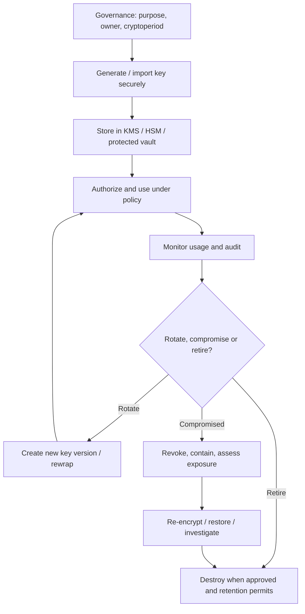
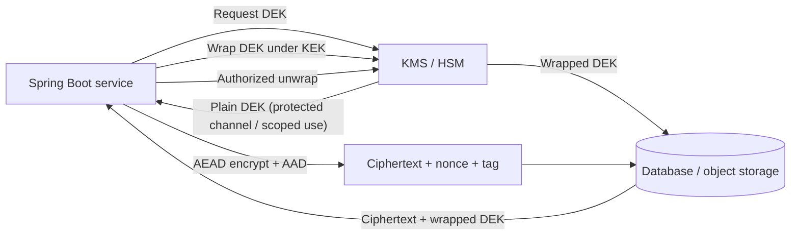

# Algorithm baseline: chuẩn lựa chọn thuật toán mật mã có thể kiểm chứng

## 1. Algorithm baseline là gì?

**Algorithm baseline (chuẩn nền thuật toán mật mã)** là tập quy tắc được tổ chức phê duyệt, mô tả **thuật toán, giao thức, tham số, độ dài khóa, cách sử dụng và trạng thái vòng đời** được phép dùng cho từng mục đích bảo vệ thông tin. Baseline giúp các nhóm phát triển và vận hành lựa chọn mật mã nhất quán, tránh thuật toán lỗi thời, cấu hình yếu, triển khai không an toàn hoặc tự ý dùng một primitive sai mục đích.

Trong chương **Mã hóa và khóa** của module **SECURITY_SECURITY_ASSURANCE**, một baseline có giá trị phải trả lời được:

- Dữ liệu nào cần bảo vệ, khỏi mối đe dọa nào và trong bao lâu?
- Dùng **mã hóa đối xứng, mã hóa khóa công khai, chữ ký, MAC, hash, KDF hay giao thức** nào cho mục đích đó?
- Thuật toán được dùng với **mode, nonce/IV, tag, key size, curve, parameter, padding và protocol version** nào?
- Ai phê duyệt baseline, ai triển khai, ai quản lý khóa và ai đánh giá bằng chứng?
- Hệ thống có kiểm tra cấu hình thực tế, ngăn downgrade và phát hiện việc dùng thuật toán ngoài danh sách không?
- Khi thuật toán hoặc khóa yếu đi, có lộ khóa hay chuẩn mới xuất hiện, tổ chức **migrate, rotate, revoke và đánh giá lại** thế nào?
- Có đủ evidence để chứng minh claim “dữ liệu được bảo vệ bằng mật mã phù hợp” trong đúng scope không?

Ví dụ, nền tảng học tập Java/Spring Boot lưu bài thi và điểm số. Việc ghi “database encryption enabled” chưa chứng minh dữ liệu được bảo vệ đúng. Cần biết **thuật toán và mode**, cách sinh nonce, nơi lưu khóa, ai có quyền giải mã, dữ liệu backup có được bảo vệ, TLS giữa các dịch vụ ra sao, và cách hệ thống phản ứng khi key bị compromise.

**Security assurance** kết nối risk → yêu cầu bảo mật → baseline → implementation → kiểm thử → evidence → finding/remediation → continuous monitoring. Một thuật toán được xem là mạnh trên lý thuyết vẫn có thể bị triển khai sai, dùng sai mode hoặc bị lộ khóa.

### Mục tiêu học tập

Sau bài này, người học có thể:

1. Phân biệt algorithm, cryptographic primitive, mode, parameter, protocol và key management.
2. Thiết kế baseline theo data classification, threat model, tuổi thọ bảo vệ và yêu cầu tuân thủ.
3. Phân loại thuật toán thành **approved, approved with conditions, deprecated, prohibited hoặc exception**.
4. Lựa chọn đúng nhóm thuật toán cho encryption, AEAD, hashing, MAC, signature, KDF, key exchange và TLS.
5. Nhận diện rủi ro nonce reuse, weak random, key reuse, downgrade, algorithm confusion và hard-coded secrets.
6. Áp dụng baseline trong Java/Spring Boot, KMS/HSM, PKI và pipeline CI/CD.
7. Xây dựng test matrix, evidence package, quy trình deprecation/migration và crypto agility.

> **Nguyên tắc:** Không phê duyệt một tên thuật toán tách rời cách sử dụng. Baseline phải ghi **thuật toán + mục đích + tham số + cách quản lý khóa + điều kiện triển khai + bằng chứng kiểm chứng**.

## 2. Tại sao tổ chức cần một baseline?

Không có baseline thống nhất, mỗi đội có thể tự chọn thư viện, thuật toán, mode và tham số khác nhau. Hệ quả thường xuất hiện nhiều năm sau, khi hệ thống khó nâng cấp hoặc dữ liệu cũ vẫn phụ thuộc vào khóa/thuật toán yếu.

| Tình huống | Vấn đề | Hệ quả assurance |
| --- | --- | --- |
| Một service dùng AES-GCM, service khác dùng AES-ECB. | Không có quy tắc mode và kiểm tra implementation. | Không thể tuyên bố mọi dữ liệu được mã hóa theo cùng mức bảo vệ. |
| Developer dùng SHA-256 trực tiếp cho password. | Hash nhanh không phù hợp chống đoán mật khẩu. | Password database dễ bị brute-force khi lộ. |
| Dùng AES-CBC mà không có MAC hoặc kiểm padding sai. | Thiếu integrity/authentication, có thể tạo padding oracle. | Ciphertext có thể bị sửa hoặc làm lộ plaintext. |
| Dùng RSA-1024 cho certificate mới. | Tham số yếu theo baseline hiện đại. | Rủi ro cryptanalysis và không đáp ứng chính sách. |
| Tạo IV bằng `java.util.Random`. | PRNG không dành cho cryptographic secrets. | Nonce/IV có thể đoán hoặc lặp. |
| Khóa mã hóa lưu cạnh ciphertext trong source repository. | Không có separation of duties/key protection. | Kẻ có bản sao dữ liệu cũng có thể lấy khóa. |
| Chỉ kiểm cấu hình ở lúc triển khai. | Runtime drift hoặc downgrade không được phát hiện. | Evidence cũ không đại diện trạng thái hiện tại. |
| Không có crypto inventory. | Không biết nơi nào dùng thuật toán/khóa cũ. | Không thể đánh giá tác động khi deprecate. |

Baseline cung cấp **một điểm tham chiếu có version** để kiến trúc sư, developer, platform, assessor và auditor cùng đánh giá. Nó cũng giúp đưa chính sách vào **code, configuration, CI checks, runtime telemetry và change management**.

## 3. Phân biệt thuật toán, primitive, mode, parameter và protocol

Các thuật ngữ thường bị dùng thay nhau nhưng chúng mô tả các lớp khác nhau:

| Thành phần | Ý nghĩa | Ví dụ |
| --- | --- | --- |
| **Cryptographic primitive** | Chức năng mật mã cơ bản. | Encryption, hash, MAC, signature, key agreement. |
| **Algorithm** | Thuật toán cụ thể thực hiện chức năng. | AES, SHA-256, HMAC, RSA-PSS, ECDSA, Ed25519. |
| **Mode/construction** | Cách dùng primitive để xử lý dữ liệu hoặc tạo tính chất bảo mật. | GCM, CCM, XTS, HKDF construction. |
| **Parameter** | Tham số ảnh hưởng an toàn và khả năng tương thích. | Key length, nonce length, tag length, curve, iteration count. |
| **Protocol** | Quy tắc phối hợp nhiều thuật toán và thông điệp. | TLS 1.3, SSH, IPsec, OAuth token signing profile. |
| **Implementation/provider** | Thư viện, runtime, module hoặc thiết bị thực thi. | JCA/JCE provider, OpenSSL, HSM, cloud KMS. |
| **Key management** | Vòng đời tạo, lưu, phân phối, sử dụng, xoay, thu hồi và hủy khóa. | KMS, HSM, envelope encryption, key rotation. |

**Ví dụ:** “Dùng AES-256” vẫn thiếu thông tin: AES-GCM hay CBC? Nonce/IV ra sao? Tag có đủ độ dài không? Khóa được sinh và lưu ở đâu? Ai được decrypt? Key được rotate thế nào?

Một baseline tốt có thể quy định:

```text
Purpose:        Bảo vệ dữ liệu bài thi lưu trữ
Primitive:      Symmetric authenticated encryption
Algorithm:      AES-256-GCM (nếu profile yêu cầu/đã phê duyệt)
Nonce:          96-bit, duy nhất dưới cùng key theo construction
Authentication: 128-bit tag
Key source:     DEK sinh an toàn; KEK quản lý tại KMS/HSM
Key scope:      Tách production / staging / development
AAD:            Tenant, object ID, schema version, purpose
Evidence:       Config, KMS policy, test vectors, tamper tests, audit
```

Đây là ví dụ policy record; các lựa chọn cuối phải phù hợp chuẩn/phiên bản và giới hạn triển khai của tổ chức.

## 4. Governance: trạng thái thuật toán trong baseline

Không nên chỉ có danh sách “được dùng/không được dùng”. Nên mô hình hóa **trạng thái và điều kiện** để biết cách xử lý cả hệ thống mới lẫn legacy.

| Trạng thái | Ý nghĩa | Cách sử dụng |
| --- | --- | --- |
| **APPROVED** | Được phép cho mục đích và tham số đã chỉ định. | Dùng cho hệ thống mới và nâng cấp trong scope. |
| **APPROVED_WITH_CONDITIONS** | Được phép nếu đáp ứng điều kiện cụ thể. | Ví dụ thuật toán chỉ dùng cho compatibility hoặc use case giới hạn. |
| **DEPRECATED** | Không dùng cho thiết kế mới; hệ thống cũ phải có migration plan. | Gắn owner, deadline, risk acceptance nếu cần, và theo dõi inventory. |
| **PROHIBITED** | Không được dùng trong scope chính sách. | Block ở CI/config/runtime; phát hiện phải mở finding. |
| **EXCEPTION** | Một hệ thống cụ thể được chấp thuận tạm thời theo thẩm quyền. | Scope, lý do, compensating controls, expiry và remediation. |
| **NOT_ASSESSED** | Chưa có đủ cơ sở phân loại. | Không tự coi là approved; cần review. |

### Baseline record phải có

- ID và version của baseline, ngày hiệu lực, người phê duyệt.
- Mục đích/use case và data classification.
- Primitive, algorithm, mode/construction, parameter và protocol version.
- Provider/library/runtime/HSM/KMS và các điều kiện cấu hình.
- Key sizes, cryptoperiod, key separation, rotation/revocation requirements.
- Compatibility constraints và thuật toán legacy được phép đọc dữ liệu cũ.
- Trạng thái, ngày review/deprecation, exception authority.
- Kiểm tra tự động, runtime evidence, owner và assessor.

**Không gắn một trạng thái toàn cục cho tên thuật toán mà bỏ qua mục đích.** Một thuật toán có thể phù hợp cho hash integrity checksum trong một bối cảnh nhưng không phù hợp làm password hash; một mode lưu trữ có thể phù hợp cho sector encryption nhưng không phù hợp mã hóa message tùy ý.

## 5. Chọn baseline theo rủi ro và tuổi thọ dữ liệu

Baseline phải được xây dựng từ **mục tiêu bảo mật**, không phải chạy theo tên thuật toán mới nhất.

| Yếu tố | Câu hỏi | Ảnh hưởng tới lựa chọn |
| --- | --- | --- |
| **Confidentiality** | Kẻ tấn công có thể đọc dữ liệu nếu lấy được storage/network/backup? | Encryption, key separation, protocol. |
| **Integrity/authenticity** | Có cần phát hiện dữ liệu hoặc thông điệp bị sửa/giả mạo? | AEAD, MAC, digital signature. |
| **Data sensitivity** | Dữ liệu công khai, nội bộ, điểm thi, PII hay secrets? | Mức bảo vệ, key access, audit và retention. |
| **Protection lifetime** | Dữ liệu phải bí mật trong vài ngày hay nhiều thập kỷ? | Key size, algorithm lifetime, PQC migration. |
| **Adversary capability** | Kẻ tấn công có thể lấy DB, chạy code, chiếm cloud account hay có năng lực lớn hơn? | Threat model, HSM/KMS, separation, protocol. |
| **Environment** | Mobile, browser, server, embedded, cloud, FIPS-required? | Primitive/protocol/provider tương thích. |
| **Performance/availability** | Throughput, latency, offline access, recovery? | Mode, key hierarchy, caching, availability design. |
| **Interoperability** | Nhiều hệ thống/vendor/protocol phải trao đổi? | Standards-based suites, version negotiation, crypto agility. |
| **Compliance/contract** | Có yêu cầu cụ thể về thuật toán hoặc module đã validation? | Approved algorithms/modules theo đúng profile. |
| **Operational maturity** | Có KMS, key custodians, rotation và incident response? | Chọn giải pháp có thể vận hành an toàn thực tế. |

### Ví dụ phân loại dữ liệu

| Data class | Ví dụ | Yêu cầu baseline cần xem |
| --- | --- | --- |
| **Public** | Nội dung khóa học công khai. | Integrity/authenticity của nguồn phân phối; không phải mọi dữ liệu đều cần encryption riêng. |
| **Internal** | Cấu hình không bí mật, tài liệu vận hành. | TLS cho truyền tải theo policy, access control, integrity. |
| **Confidential** | Bài nộp, thông tin liên hệ, tài liệu nội bộ. | Encryption at rest/in transit, key access restrictions, audit. |
| **Restricted** | Điểm thi, dữ liệu nhận dạng nhạy cảm, secrets. | Stronger key governance, separation, access review, incident/retention controls. |
| **Cryptographic secrets** | DEK, KEK, private keys, API signing secrets. | KMS/HSM/secret vault, strict access, rotation, no source/log exposure. |

Không suy ra data class chỉ từ tên bảng. Cần có **data inventory và owner**.

## 6. Symmetric encryption: AES và ChaCha20

**Mã hóa đối xứng** dùng cùng một khóa bí mật (hoặc khóa dẫn xuất liên quan) để mã hóa/giải mã. Nó phù hợp cho dữ liệu lớn và có hiệu năng tốt, nhưng việc giữ khóa bí mật và bảo đảm integrity là trọng tâm.

| Thuật toán | Cách dùng thường gặp | Ghi chú baseline |
| --- | --- | --- |
| **AES-128** | Symmetric encryption/AEAD. | Mức bảo vệ mạnh cho nhiều ứng dụng; không mặc định mọi hệ thống cần AES-256. |
| **AES-192** | Symmetric encryption. | Được định nghĩa trong AES nhưng ít phổ biến trong profile ứng dụng. |
| **AES-256** | Symmetric encryption/AEAD. | Có thể chọn theo data lifetime/profile; không bù được key handling yếu. |
| **ChaCha20-Poly1305** | AEAD, thường hữu ích trên nền tảng không có AES acceleration. | Nonce và cách dùng phải theo construction/specification; không tự tách ChaCha20 và Poly1305 tùy ý. |

**Không tự xây dựng thuật toán mã hóa.** Dùng thư viện/crypto provider đã được duyệt, API cấp cao và cấu hình phù hợp. Không dùng `java.util.Random`, XOR tự thiết kế, rotate/shift hay “mã hóa Base64” để bảo vệ bí mật.

### Key length không đồng nghĩa với mức bảo vệ tổng thể

AES-256 không làm ứng dụng an toàn nếu:

- Khóa được hard-code hoặc ghi vào log.
- Nonce GCM bị lặp dưới cùng khóa.
- Không xác thực ciphertext.
- Kẻ tấn công có quyền gọi API decrypt tùy ý.
- Plaintext bị lộ ở cache, trace hoặc file tạm.
- Key backup và recovery không được bảo vệ.

## 7. AEAD: mã hóa kèm xác thực

**Authenticated Encryption with Associated Data (AEAD)** cung cấp tính bí mật và xác thực ciphertext, đồng thời có thể xác thực metadata không cần mã hóa qua **AAD**. Đây là lựa chọn phù hợp cho nhiều ứng dụng mới.

| Construction | Cách dùng | Điều kiện phải quản lý |
| --- | --- | --- |
| **AES-GCM** | AEAD phổ biến cho ứng dụng và protocol. | Nonce không lặp dưới cùng key; tag được kiểm; parameter/usage limits đúng spec. |
| **AES-CCM** | AEAD trong một số protocol/embedded contexts. | Nonce, tag length và message limits theo profile. |
| **ChaCha20-Poly1305** | AEAD trên nhiều nền tảng. | Nonce uniqueness và key/nonce construction theo RFC/spec. |

### AAD dùng để làm gì?

Ví dụ ciphertext chứa điểm thi của một học viên. AAD có thể bao gồm tenantId, studentRecordId, purpose (ví dụ grade-record), schemaVersion và keyVersion. Nếu attacker chuyển ciphertext của học viên A sang record B, ứng dụng giải mã với AAD của B sẽ thất bại xác thực, **nếu metadata được lấy từ nguồn tin cậy và bind đúng**. AAD không bí mật; nó được xác thực cùng ciphertext.

### Những lỗi nghiêm trọng

- Reuse nonce với cùng AES-GCM key.
- Bỏ qua lỗi authentication tag hoặc trả plaintext một phần.
- Cắt ngắn tag ngoài profile được phê duyệt.
- Không kiểm AAD hoặc lấy AAD từ client không tin cậy.
- Tái sử dụng key cho nhiều mục đích không được thiết kế.
- Để lộ ciphertext/metadata qua log mà quên dữ liệu có thể nhạy cảm.

**AES-GCM không phải “một lựa chọn an toàn tự động”.** Baseline cần quy định nonce strategy, key usage/rotation limits, tag, AAD, error handling và test tampering.

## 8. Mode legacy và các trường hợp sử dụng chuyên biệt

| Mode/construction | Đánh giá | Cách xử lý trong baseline |
| --- | --- | --- |
| **ECB** | Lộ cấu trúc lặp của plaintext; không phù hợp mã hóa dữ liệu tùy ý. | Prohibit cho ứng dụng mới; tìm và migrate legacy. |
| **CBC** | Chỉ cung cấp confidentiality; cần integrity protection riêng và triển khai padding/error handling đúng. | Không chọn cho thiết kế mới khi AEAD phù hợp; legacy chỉ được chấp thuận có điều kiện và review. |
| **CTR** | Stream-like mode; không tự xác thực; nonce/counter reuse nguy hiểm. | Chỉ dùng trong construction có authentication và parameter controls được duyệt. |
| **XTS** | Dành cho sector/disk storage encryption, không cung cấp authentication như AEAD. | Chỉ cho mục đích storage block/sector đúng profile; không dùng cho message/API payload. |
| **GCM** | AEAD. | Ưu tiên khi đáp ứng profile, kiểm nonce và tag. |
| **CCM** | AEAD. | Chỉ khi protocol/device profile yêu cầu và đã kiểm giới hạn. |

Không dùng XTS để mã hóa một JSON record rồi cho rằng dữ liệu đã được xác thực. Không tự ghép “AES-CBC + SHA256” mà thiếu construction chuẩn, thứ tự MAC/encrypt và xử lý lỗi. Nếu cần legacy compatibility, phải có **threat model, compensating controls, expiry và migration plan**.

## 9. Hash functions: integrity, fingerprints và các giới hạn

**Cryptographic hash** biến dữ liệu có độ dài tùy ý thành digest cố định. Hash không phải mã hóa: không có khóa giải mã và không bảo đảm ai tạo dữ liệu.

| Algorithm | Baseline định hướng | Ghi chú |
| --- | --- | --- |
| **SHA-256 / SHA-384 / SHA-512** | Approved cho nhiều mục đích hash/signature constructions khi dùng đúng chuẩn. | Lựa chọn phổ biến; cần xem output/security strength và protocol. |
| **SHA-3 family** | Có thể approved theo profile. | Khác cấu trúc SHA-2; dùng đúng construction. |
| **SHA-1** | Deprecated/prohibited cho chữ ký mới và collision-resistance claims. | Legacy verification cần đánh giá riêng, không phát hành chữ ký mới dựa trên SHA-1. |
| **MD5** | Prohibited cho security-sensitive integrity/signature uses. | Collision weaknesses; không dùng để chứng minh authenticity. |

### Hash không thay MAC hoặc chữ ký

Nếu client gửi dữ liệu và digest SHA-256 cạnh nhau, attacker có thể sửa cả hai. Khi cần chứng minh dữ liệu do bên có secret tạo, dùng **MAC**; khi cần xác minh bằng public key, dùng **digital signature** theo protocol.

### Hash password là use case khác

Không dùng SHA-256/SHA-512 trực tiếp trên password. Password có entropy thấp và attacker có thể thử hàng tỷ candidate offline. Dùng **password hashing/KDF chuyên dụng**, có salt riêng và cost parameter phù hợp. Xem mục KDF bên dưới.

## 10. MAC và HMAC: xác thực thông điệp bằng secret

**Message Authentication Code (MAC)** giúp người có cùng secret kiểm tra tính toàn vẹn và xác thực nguồn trong mô hình chia sẻ khóa.

| Construction | Mục đích | Điều kiện |
| --- | --- | --- |
| **HMAC-SHA-256 / HMAC-SHA-384** | Xác thực message/API payload hoặc derive/check theo profile phù hợp. | Key entropy đủ, key separation, constant-time comparison. |
| **KMAC** | MAC dựa trên SHA-3 family theo specification. | Chỉ dùng nếu provider/protocol đã phê duyệt. |
| **Poly1305** | MAC trong construction như ChaCha20-Poly1305. | Không tự tái sử dụng one-time key hoặc dùng tách rời sai spec. |

Không tự viết `hash(secret || message)` làm MAC. Dùng HMAC construction chuẩn và thư viện phù hợp. Khi so sánh tag/MAC, cần tránh timing leaks trong implementation; dùng API/primitive có so sánh constant-time phù hợp.

**HMAC và digital signature khác nhau:** HMAC verifier cũng cần secret, vì vậy có thể tạo MAC; chữ ký số dùng private key để ký và public key để xác minh, phù hợp các mô hình trust/distribution khác.

## 11. Digital signatures: xác minh nguồn và tính toàn vẹn

Chữ ký số không phải encryption. Nó hỗ trợ xác minh rằng dữ liệu được ký bởi holder của private key tương ứng và không bị sửa theo construction, nhưng **không tự bảo đảm người ký có thẩm quyền nghiệp vụ** hoặc nội dung đúng sự thật.

| Algorithm family | Ví dụ | Điều kiện baseline |
| --- | --- | --- |
| **RSA signatures** | RSA-PSS với hash được duyệt. | Key size/profile, padding, digest, randomness và library support. |
| **ECDSA** | P-256/P-384 theo profile. | Curve được duyệt; nonce/signing implementation an toàn; kiểm public key. |
| **EdDSA** | Ed25519/Ed448. | Chỉ dùng khi protocol, provider và compliance profile cho phép. |
| **DSA/SHA-1 legacy** | Hệ thống cũ. | Không chọn cho thiết kế mới; inventory/deprecation/migration. |

### Các lỗi signature cần phát hiện

- Dùng RSA encryption padding thay signature padding hoặc ngược lại.
- Chấp nhận thuật toán chữ ký do header/request không tin cậy tự chọn.
- Không kiểm certificate chain, revocation/status, key usage hoặc trust anchor khi protocol yêu cầu.
- Dùng key của một môi trường cho môi trường khác.
- Private key nằm trong source code, image, log hoặc developer workstation không kiểm soát.
- Không có key rotation/revocation và quy trình xác minh chữ ký lịch sử.

**RSA-PSS** thường là lựa chọn phù hợp cho RSA signature mới trong profile hỗ trợ; **RSA PKCS#1 v1.5 signatures** có thể tồn tại trong compatibility contexts nhưng cần đánh giá theo chuẩn/protocol và chính sách. Không tự tuyên bố mọi PKCS#1 v1.5 usage đều giống nhau: encryption padding và signature encoding là hai use cases khác.

## 12. Key agreement và trao đổi khóa

Key agreement cho phép hai bên thiết lập secret qua một kênh công khai, thường được dùng trong TLS và protocol hiện đại.

| Family | Ví dụ | Baseline cần quy định |
| --- | --- | --- |
| **ECDH** | P-256, P-384 theo profile. | Curve, public-key validation, protocol context và key derivation. |
| **X25519** | ECDH function dùng trong nhiều protocol hiện đại. | Protocol/provider/compliance compatibility và context binding. |
| **Finite-field DH** | FFDHE groups được chuẩn hóa. | Group size, parameter validation và protocol. |
| **Static RSA key transport** | Legacy TLS configurations. | Không chọn cho thiết kế TLS mới; ưu tiên forward-secret key exchange. |

Không dùng shared secret trực tiếp làm AES key mà không qua KDF/context separation theo protocol. Key agreement phải được kết hợp với **authentication** để ngăn man-in-the-middle; ECDH thuần túy không tự xác minh danh tính peer.

## 13. TLS và bảo vệ dữ liệu khi truyền

Baseline TLS cần mô tả **protocol version, cipher suite policy, certificate, key exchange, peer verification và lifecycle**, không chỉ thuộc tính HTTPS.

| Giao thức | Định hướng |
| --- | --- |
| **TLS 1.3** | Ưu tiên cho kết nối mới nếu hệ thống và client support. |
| **TLS 1.2** | Có thể được chấp thuận khi cấu hình cipher suites an toàn và tương thích profile. |
| **TLS 1.1 / TLS 1.0 / SSL** | Deprecated/prohibited cho hệ thống mới; loại bỏ theo migration plan. |
| **Cleartext HTTP cho dữ liệu nhạy cảm** | Prohibited trừ kênh/điều kiện cô lập được phê duyệt rất cụ thể; không truyền bí mật qua mạng không tin cậy. |

### TLS baseline phải kiểm

- TLS version và cipher suites thực sự negotiate ở runtime.
- Certificate chain, SAN/hostname verification, trust store và expiry.
- Server private key được lưu và cấp quyền ra sao.
- Mutual TLS (nếu áp dụng): client certificate identity và authorization.
- Không cho downgrade sang protocol/cipher yếu hơn mà không có quyết định policy.
- TLS termination ở load balancer/service mesh; **mọi hop sau termination** có được bảo vệ?
- Certificate/key rotation, revocation và cảnh báo hết hạn.
- Không tắt certificate validation chỉ để sửa lỗi kết nối.

**TLS không thay encryption at rest** và không bảo vệ dữ liệu plaintext trong ứng dụng, log, memory dump hoặc backup.

## 14. Password hashing và key derivation functions

Hai use cases này cần phân biệt:

- **Password hashing:** bảo vệ password verifier nếu database bị lộ; phải làm cho mỗi lần đoán password tốn tài nguyên.
- **KDF (Key Derivation Function):** dẫn xuất key từ input/secret entropy cao hoặc từ password theo construction chuyên biệt.

| Construction | Mục đích | Điều kiện baseline |
| --- | --- | --- |
| **Argon2id** | Password hashing, memory-hard. | Salt riêng, memory/time/parallelism được hiệu chỉnh theo môi trường và version/library. |
| **scrypt** | Password hashing memory-hard. | Parameters đủ mạnh, salt riêng, resource limits. |
| **bcrypt** | Password hashing legacy/phổ biến. | Cost factor, input length semantics, version handling. |
| **PBKDF2** | Password-based KDF, hữu ích trong một số compliance/provider contexts. | HMAC/hash, iteration count theo policy hiện hành, salt riêng. |
| **HKDF** | Dẫn xuất key từ input keying material có entropy phù hợp. | Salt/info/context separation và output length theo use case. |

### Quy tắc password hashing

1. Salt ngẫu nhiên, duy nhất cho mỗi password; lưu salt cùng verifier.
2. Cost parameter được đo trên hạ tầng thật và nâng cấp theo policy.
3. Có version/metadata để rehash khi người dùng đăng nhập sau khi baseline đổi.
4. Pepper nếu dùng phải được quản lý riêng trong secret manager/KMS, không lưu cùng DB.
5. Rate limiting và MFA vẫn cần; password hashing không thay chống credential stuffing.
6. Không log password, salt/pepper bí mật, verifier đầy đủ hoặc reset token.

**Không dùng fast hash như SHA-256 trực tiếp** cho password. Với hệ thống cần FIPS-validated modules, phải kiểm tra password KDF và implementation có nằm trong profile/validation được yêu cầu; không tự suy từ tên thuật toán.

## 15. Randomness, nonce, IV và salt

Các giá trị ngẫu nhiên đóng vai trò khác nhau:

| Giá trị | Vai trò | Quy tắc |
| --- | --- | --- |
| **Key** | Bí mật điều khiển encryption/MAC/signature. | Cryptographic random/key generation hoặc KMS/HSM; kiểm entropy và access. |
| **Nonce** | Giá trị dùng một lần/không lặp theo construction. | Đảm bảo uniqueness theo key; không tự reuse. |
| **IV** | Initialization vector theo mode/protocol. | Độ dài, uniqueness/unpredictability theo đúng mode/spec. |
| **Salt** | Làm khác password hash/KDF giữa các bản ghi. | Ngẫu nhiên, unique; không cần bí mật. |
| **Challenge** | Chống replay trong protocol. | Unpredictable/fresh và gắn đúng session/context. |
| **Ephemeral key** | Key tạm cho key agreement. | Sinh mới theo protocol, không tái sử dụng trái spec. |

### Trong Java

- Dùng `java.security.SecureRandom` hoặc API/provider phù hợp để sinh randomness.
- Không dùng `java.util.Random`, timestamp, UUID đơn giản hoặc hash của username làm encryption key/nonce.
- Không tự thiết kế nonce scheme bằng bộ đếm nếu không có quản lý atomicity, rollback, multi-node và persistence được kiểm chứng.
- Với AES-GCM, nonce 96-bit thường được dùng; baseline phải bảo đảm **không lặp nonce dưới cùng key** và kiểm usage/rotation limits theo chuẩn đã chọn.
- Salt của password hash cần unique, nhưng không phải secret.

**Nonce reuse trong AES-GCM là lỗi nghiêm trọng** có thể phá tính bí mật và authenticity. Nếu hệ thống không chứng minh được nonce uniqueness/limits, cần đánh giá lại thiết kế và key scope, không chỉ thay một dòng code.

## 16. Key management: thuật toán tốt vẫn thất bại nếu khóa yếu

Key management bao trùm toàn bộ vòng đời khóa:



### Vòng đời khóa

| Giai đoạn | Kiểm soát cần có | Evidence |
| --- | --- | --- |
| **Plan** | Purpose, owner, key type, cryptoperiod, backup/recovery và access policy. | Key inventory/design approval. |
| **Generate** | CSPRNG/KMS/HSM, entropy và thuật toán được duyệt. | KMS audit/config, module/provider evidence. |
| **Distribute/import** | Kênh an toàn, authentication, dual control khi phù hợp. | Import logs, approvals, key custody. |
| **Store** | Non-exportable khi phù hợp, least privilege, separation of duties. | KMS/HSM policy, access reviews. |
| **Use** | Workload identity, allowed operation, scope, rate/usage limits. | API logs, key-use audit, anomaly detection. |
| **Rotate** | Theo cryptoperiod/risk/event, hỗ trợ nhiều version có kiểm soát. | Rotation record, decrypt/re-encrypt tests. |
| **Revoke/compromise** | Disable/revoke, incident response, impact assessment. | Revocation evidence, incident timeline. |
| **Archive/retain** | Giữ khả năng verify/decrypt dữ liệu cần retention với quyền hạn phù hợp. | Archive policy, access test. |
| **Destroy** | Hủy an toàn khi không còn nghĩa vụ, backup/replica cũng được xem xét. | Destruction record, verification. |

### Key inventory tối thiểu

- Key ID, key version, algorithm, key size/curve, purpose, environment.
- Owner, service/workload identity và business data scope.
- KMS/HSM/provider, region, exportability, access policy.
- Created/activated/last-used/rotated/expiry/revocation/destroy timestamps.
- Cryptoperiod, rotation trigger, dependencies và recovery/backup.
- Certificate/key references, associated data/ciphertext formats.
- Exception, last review, evidence references và next assessment.

**Không lưu raw key trong inventory hoặc ticket.** Sử dụng key identifiers và references; secret material cần bảo vệ bằng cơ chế phù hợp.

## 17. KMS, HSM và envelope encryption

**KMS** cung cấp dịch vụ quản lý khóa; **HSM** là thiết bị/phân vùng phần cứng bảo vệ thao tác và key material theo mô hình được triển khai. Việc dùng KMS/HSM không tự bảo đảm cấu hình đúng, nhưng có thể hỗ trợ kiểm soát truy cập, audit, key separation và thao tác mật mã.

### Envelope encryption

Một mô hình phổ biến:

1. KMS/HSM quản lý **Key Encryption Key (KEK)** hoặc key-encryption operation.
2. Service tạo hoặc yêu cầu **Data Encryption Key (DEK)** phù hợp.
3. DEK mã hóa dữ liệu bằng AEAD trong ứng dụng hoặc dịch vụ được duyệt.
4. KEK bảo vệ DEK (wrap/encrypt) để lưu cùng metadata ciphertext.
5. Khi decrypt, service được authorize yêu cầu KMS unwrap DEK rồi giải mã ciphertext.



### Metadata cần lưu cùng ciphertext

- Algorithm/construction và format version.
- Key ID/version hoặc wrapped DEK reference.
- Nonce/IV và tag theo format AEAD.
- AAD context hoặc dữ liệu đủ để tái tạo AAD từ nguồn tin cậy.
- Ciphertext và schema/data version.

**Không lưu plaintext DEK cùng ciphertext.** Cần xem memory handling, caching, process dumps, telemetry và thời gian key tồn tại trong service. KMS policy phải giới hạn ai được gọi encrypt/decrypt/unwrap và trên resource nào.

### Key separation

Tách khóa theo **mục đích, environment, tenant hoặc data class** khi risk/architecture yêu cầu. Không dùng một secret duy nhất cho password reset, JWT signing, database encryption và HMAC audit. Nếu một khóa bị lộ, blast radius không nên lan tới mọi chức năng.

## 18. Rotation, re-encryption và cryptoperiod

**Key rotation** thay khóa theo lịch hoặc trigger; **re-encryption** chuyển dữ liệu sang key/algorithm mới. Chúng có thể là hai thao tác khác nhau:

- Nếu dùng envelope encryption và DEK riêng cho từng object/batch, có thể **rewrap DEK** bằng KEK mới mà không giải mã rồi mã hóa lại toàn bộ payload, tùy kiến trúc.
- Nếu DEK trực tiếp mã hóa dữ liệu, có thể cần decrypt/re-encrypt dữ liệu theo batch, kiểm toàn vẹn và quản lý trạng thái migration.
- Với signature, việc đổi signing key không làm chữ ký cũ tự mất giá trị; cần giữ public key/certificate và policy verify lịch sử phù hợp.
- Khi key compromise, lịch rotate định kỳ có thể không đủ: cần **revoke/contain ngay theo incident plan**, xác định dữ liệu/credential có thể bị ảnh hưởng.

### Cryptoperiod không có một con số áp dụng cho mọi khóa

Thời gian sử dụng phụ thuộc key type, mức phơi lộ, khối lượng thao tác, protocol, chuẩn/luật, khả năng rotate và hậu quả nếu lộ. Baseline phải tham chiếu guidance và risk decision được duyệt; không đặt “mọi khóa rotate mỗi 90 ngày” mà không phân biệt:

- DEK mã hóa từng object hoặc data set.
- KEK tại KMS.
- TLS server certificate/private key.
- JWT signing key.
- HMAC integration secret.
- Password hashing parameters (không phải rotation key theo cùng nghĩa).
- Long-term signing/archive keys.

### Migration không làm mất khả năng đọc dữ liệu hợp lệ

Khi thay thuật toán, phải hỗ trợ đọc format cũ trong một khoảng có kiểm soát, migrate sang format mới, kiểm checksum/authentication và theo dõi tỷ lệ dữ liệu chưa chuyển. Khi kết thúc, thu hồi khả năng encrypt mới bằng legacy algorithm, nhưng **giữ verify/decrypt capability cũ** nếu cần cho retention và có căn cứ bảo vệ.

## 19. PKI và certificate lifecycle

Public-key cryptography thường dựa vào **Public Key Infrastructure (PKI)** để ràng buộc public key với danh tính/chủ thể thông qua certificate và trust chain.

### Những thành phần cần kiểm

- CA hierarchy, trust anchors và chính sách cấp certificate.
- Subject/SAN, key usage, extended key usage và validity.
- Algorithm, key size/curve, signature algorithm.
- Certificate issuance, renewal, rotation, revocation/status.
- Private key storage, exportability và access control.
- Hostname verification và trust-store management.
- Certificate transparency/monitoring nếu profile áp dụng.
- Expiry alerts, emergency replacement và dependency inventory.

### Lỗi phổ biến

- Tắt hostname verification hoặc trust mọi certificate để “sửa lỗi TLS”.
- Dùng self-signed certificate không có trust/bootstrap policy rõ.
- Certificate hết hạn nhưng monitoring không cảnh báo.
- Một private key dùng chung cho nhiều service/tenant.
- Không thu hồi certificate sau khi key compromise hoặc server retire.
- Dùng certificate cho mục đích không phù hợp với key usage/profile.

**Certificate hợp lệ không tự chứng minh authorization nghiệp vụ.** mTLS có thể xác thực workload identity theo trust configuration; service vẫn cần kiểm role/scope và resource access.

## 20. FIPS và compliance profile: phân biệt algorithm approval với module validation

Trong môi trường có yêu cầu **FIPS**, cần phân biệt:

- **Thuật toán được chuẩn hóa/được phép** trong profile áp dụng.
- **Cryptographic module** đã được đánh giá/validation theo yêu cầu cụ thể.
- **Cấu hình và operational environment** nằm trong phạm vi chứng nhận/validation.
- **Ứng dụng thực sự gọi module/provider đã được phê duyệt** thay vì tự fallback sang provider khác.

FIPS 140-3 liên quan đến validation của cryptographic modules. Một thuật toán có mặt trong chuẩn FIPS **không tự chứng minh** ứng dụng dùng module đã được validation; ngược lại, một module validated không bảo đảm mọi API/config trong ứng dụng được sử dụng đúng hoặc key management đã đáp ứng toàn bộ risk.

### Evidence cần xem trong compliance profile

1. Certificate/module identifier và trạng thái validation có phù hợp?
2. Phiên bản module, provider, runtime và operating environment có nằm trong scope?
3. Algorithm implementation và parameter được duyệt theo profile?
4. Có fallback sang provider không được phê duyệt?
5. Key generation/import/storage/access có tuân thủ yêu cầu?
6. Có kiểm soát khi module/provider update hoặc certificate hết hiệu lực?

**Không tự gắn nhãn “FIPS compliant”** chỉ vì dùng AES-256 hoặc chạy trên cloud có KMS. Cần evidence chính thức và đánh giá scope.

## 21. Crypto agility: chuẩn bị thay thuật toán mà không viết lại mọi thứ

**Crypto agility** là khả năng thay đổi thuật toán, tham số, provider hoặc protocol có kiểm soát khi chuẩn thay đổi, key compromise hoặc yêu cầu mới xuất hiện.

| Thiết kế khó nâng cấp | Thiết kế hỗ trợ agility |
| --- | --- |
| Hard-code AES/GCM/NoPadding ở nhiều module và không lưu format version. | Crypto service/abstraction được quản lý, format có version và algorithm ID allowlist. |
| Key ID gắn cứng trong source. | Key resolver theo ID và policy, không cho client chọn arbitrary key. |
| Dữ liệu cũ không có metadata algorithm. | Ciphertext envelope lưu algorithm/format/key version. |
| Một lần deploy phải migrate toàn bộ dữ liệu đồng thời. | Dual-read/controlled-write, migration batches, progress metrics và rollback plan. |
| Không có crypto inventory. | CBOM/crypto inventory, dependency scanning và owner. |
| Không thể kiểm thuật toán negotiate ở runtime. | Telemetry/config conformance và downgrade detection. |

Agility không có nghĩa runtime chấp nhận mọi algorithm từ header/request. **Danh sách được phép phải được kiểm soát**; client không thể tự yêu cầu downgrade hoặc chọn cipher yếu hơn.

## 22. Post-quantum cryptography (PQC) readiness

Máy tính lượng tử có khả năng đủ lớn trong tương lai có thể làm suy yếu một số public-key constructions hiện dùng, đặc biệt các hệ dựa trên factoring và discrete logarithm. Điều này tạo rủi ro **harvest now, decrypt later** đối với dữ liệu cần bí mật lâu dài.

### Hành động chuẩn bị

1. **Inventory:** tìm TLS, VPN, PKI, signing, key exchange, certificates, libraries và thiết bị.
2. **Classify lifetime:** dữ liệu nào cần bí mật 10–20 năm hoặc lâu hơn; dữ liệu nào có thể thay.
3. **Map dependencies:** vendor, protocol, firmware, client ecosystem, HSM/KMS và interoperability.
4. **Follow standards:** theo dõi các tiêu chuẩn NIST PQC và profile migration được cơ quan có thẩm quyền lựa chọn.
5. **Pilot safely:** thử nghiệm hybrid key establishment hoặc PQC profile khi protocol/provider hỗ trợ và được duyệt.
6. **Plan migration:** certificate sizes, handshake size, performance, storage, logging, backup, recovery và fallback.
7. **Avoid premature custom crypto:** không tự ghép thuật toán hậu lượng tử với ECDH/RSA nếu chưa theo profile đã được kiểm.

### Chuẩn NIST PQC đã công bố

Các chuẩn FIPS hậu lượng tử đầu tiên được NIST công bố năm 2024 gồm:

- **FIPS 203 – ML-KEM:** key encapsulation mechanism.
- **FIPS 204 – ML-DSA:** digital signature.
- **FIPS 205 – SLH-DSA:** stateless hash-based digital signature.

Baseline cần ghi **phiên bản/profile và mục đích**; không đồng nhất KEM với encryption trực tiếp hoặc chữ ký. Tương thích protocol, provider validation, certificate ecosystem và migration guidance phải được đánh giá trước production rollout.

**PQC không phải lý do để tự động thay AES-256** trong mọi use case. Ưu tiên inventory public-key dependencies và dữ liệu có confidentiality lifetime dài; symmetric algorithms có cách đánh giá tác động khác.

## 23. Java/Spring Boot: mã hóa dữ liệu bằng AES-GCM

Ví dụ dưới minh họa cách dùng **Java Cryptography Architecture (JCA)** với AES-GCM. Khóa được lấy từ KMS/secure key provider; bài không chứa khóa thật và không tạo key từ mật khẩu.

### 23.1. Encrypt với nonce ngẫu nhiên và AAD

```java
import java.security.SecureRandom;
import javax.crypto.Cipher;
import javax.crypto.SecretKey;
import javax.crypto.spec.GCMParameterSpec;

public final class AeadEncryption {
    private static final int NONCE_BYTES = 12; // 96-bit GCM nonce
    private static final int TAG_BITS = 128;
    private static final SecureRandom RANDOM = new SecureRandom();

    public record EncryptedValue(
            String formatVersion,
            String keyId,
            byte[] nonce,
            byte[] ciphertextAndTag) {}

    public static EncryptedValue encrypt(
            byte[] plaintext,
            byte[] aad,
            SecretKey dataKey,
            String keyId) throws Exception {

        byte[] nonce = new byte[NONCE_BYTES];
        RANDOM.nextBytes(nonce);

        Cipher cipher = Cipher.getInstance("AES/GCM/NoPadding");
        cipher.init(Cipher.ENCRYPT_MODE, dataKey,
            new GCMParameterSpec(TAG_BITS, nonce));
        cipher.updateAAD(aad);

        byte[] ciphertextAndTag = cipher.doFinal(plaintext);
        return new EncryptedValue(
            "v1", keyId, nonce, ciphertextAndTag);
    }
}
```

**Các điều kiện quan trọng:**

- Khóa dữ liệu phải được tạo/cấp bởi cơ chế được duyệt, có key ID/version và scope; không hard-code.
- Nonce 96-bit được sinh từ SecureRandom, nhưng hệ thống vẫn phải quản lý **nonce uniqueness/usage limits** theo key và construction. Chỉ dùng random không cho phép bỏ qua giới hạn va chạm/volume.
- AAD phải được dựng từ metadata đáng tin (ví dụ tenant/object/purpose/version), không lấy nguyên từ client.
- Phương thức doFinal trả ciphertext kèm authentication tag theo provider; không bỏ tag hoặc lưu thiếu nonce/key ID/format version.
- Production code cần quản lý key rotation, exception handling, memory exposure, serialization và audit.

### 23.2. Decrypt và kiểm authentication tag

Đây là **method excerpt** dùng kiểu `EncryptedValue` ở ví dụ trước. `KeyResolver`, `UnsupportedCryptoFormatException` và `InvalidCiphertextException` là các kiểu do ứng dụng định nghĩa; cần triển khai resolver có allowlist, kiểm scope/purpose và ánh xạ lỗi an toàn. Đoạn trích không phải một class độc lập có thể biên dịch nguyên trạng.

```java
public static byte[] decrypt(
        EncryptedValue value,
        byte[] trustedAad,
        KeyResolver keyResolver) throws Exception {

    if (!"v1".equals(value.formatVersion())) {
        throw new UnsupportedCryptoFormatException();
    }

    // Resolver enforces an allowlisted key ID and purpose/scope.
    SecretKey dataKey = keyResolver.resolveForDecrypt(value.keyId());
    if (value.nonce().length != 12) {
        throw new InvalidCiphertextException();
    }

    Cipher cipher = Cipher.getInstance("AES/GCM/NoPadding");
    cipher.init(Cipher.DECRYPT_MODE, dataKey,
        new GCMParameterSpec(128, value.nonce()));
    cipher.updateAAD(trustedAad);

    // Authentication failure must reject the whole message.
    return cipher.doFinal(value.ciphertextAndTag());
}
```

**Không trả plaintext một phần khi tag sai.** Không ghi raw ciphertext/plaintext/key vào error log; phân biệt lỗi nội bộ để điều tra nhưng tránh tiết lộ cho caller liệu key ID hay tag cụ thể nào sai.

### 23.3. Tạo AAD có cấu trúc

Đây cũng là method excerpt bên trong một class Java; cần import `java.util.UUID` và `java.nio.charset.StandardCharsets` trong file thực tế. Chuỗi nối bằng dấu phân cách chỉ minh họa ý tưởng; production phải dùng encoding canonical không nhập nhằng và version hóa.

```java
static byte[] buildAad(
        UUID tenantId, UUID recordId, String purpose, int schemaVersion) {
    String canonical = tenantId + "|" + recordId + "|"
        + purpose + "|" + schemaVersion;
    return canonical.getBytes(StandardCharsets.UTF_8);
}
```

Đây là serialization minh họa. Production cần **canonical encoding có phân tách không nhập nhằng**, encoding/length-prefix hoặc định dạng nhị phân ổn định; version hóa và test khi đổi schema. AAD cần được tái tạo từ nguồn server-side đáng tin.

## 24. Spring Boot configuration và crypto policy

Không nên để từng service tự chọn provider hoặc cipher. Có thể tạo **central crypto policy component** cung cấp các construction đã duyệt và reject cấu hình ngoài baseline.

### Ví dụ cấu hình policy (minh họa)

```yaml
security:
  cryptography:
    policy-version: "crypto-baseline-2026-01"
    encryption:
      approved:
        - "AES/GCM/NoPadding"
      tag-bits: 128
      nonce-bits: 96
      key-source: "managed-kms"
      aad-required: true
    password-hashing:
      approved: "argon2id"
      per-account-salt: true
      parameters-managed-by: "password-policy"
    signatures:
      approved:
        - "RSASSA-PSS"
        - "SHA256withECDSA"
      key-source: "managed-signing-key"
    tls:
      minimum-version: "TLSv1.2"
      preferred-version: "TLSv1.3"
      reject-legacy-protocols: true
```

Đây là cấu hình **minh họa**, không phải schema Spring Boot chuẩn và không thể copy thẳng để bảo đảm TLS/crypto. Tên property, provider và parameter cần được triển khai qua typed configuration/validation; test phải kiểm runtime state và cipher negotiation.

### PasswordEncoder trong Spring Security

Đối với mật khẩu, dùng implementation password hashing đã được review:

```java
// Example API; verify constructor/defaults against the project's
// actual Spring Security version and the approved password policy.
PasswordEncoder encoder =
    Argon2PasswordEncoder.defaultsForSpringSecurity_v5_8();

String verifier = encoder.encode(rawPassword);
boolean matches = encoder.matches(candidatePassword, verifier);
```

**Không tự động dùng defaults mà không review**: cost/memory/parallelism phải phù hợp production capacity, library version và compliance constraints. Không log rawPassword; khi parameter đổi, hỗ trợ upgrade verifier theo policy và theo dõi tài khoản chưa rehash.

## 25. JWT, JWS và algorithm confusion

Các hệ thống dùng JWT cần baseline cho **token signing/validation**. Không được cho token tự quyết thuật toán tin cậy chỉ qua header.

| Kiểm tra | Yêu cầu |
| --- | --- |
| alg | Chỉ chấp nhận algorithm allowlist theo issuer/profile; từ chối none và các thuật toán không được duyệt. |
| kid | Chỉ dùng tra key trong nguồn đã cấu hình/allowlist; không cho đường dẫn/URL tùy ý từ token. |
| Signature | Xác minh đúng key, algorithm và key usage. |
| iss | Issuer chính xác, gắn tenant/trust domain. |
| aud | Token dành cho đúng API/client. |
| exp, nbf, iat | Thời hạn và clock skew theo policy. |
| Token type/use | Không dùng ID token làm access token hoặc ngược lại. |
| Key rotation | Hỗ trợ overlap/retire có kiểm soát và xử lý token đã phát hành. |

**Không tự triển khai JWT parser/crypto.** Dùng framework/library có cấu hình rõ, cập nhật và test negative cases. Chữ ký hợp lệ không tự chứng minh claim role do IdP phát hành là đúng với quyền nghiệp vụ hiện tại; application vẫn cần authorization và lifecycle controls.

## 26. Algorithm deprecation và migration

Thuật toán có thể bị deprecate do cryptanalysis, tăng năng lực tính toán, protocol weakness, lỗi triển khai hoặc tiêu chuẩn mới. Tổ chức cần quy trình **phát hiện → phân loại → quyết định → migrate → verify → retire**.

### Quy trình

1. **Discover:** quét source, dependencies, configs, certificates, traffic, DB formats, KMS keys và vendor products.
2. **Inventory:** map thuật toán/parameter/provider với dữ liệu, service, owner và thời gian bảo vệ.
3. **Assess:** xác định mức độ yếu, khả năng khai thác, confidentiality lifetime và compliance impact.
4. **Set status:** APPROVED, DEPRECATED hoặc PROHIBITED với ngày hiệu lực và điều kiện.
5. **Plan:** target algorithm/profile, compatibility, key migration, data re-encryption, rollback và owner.
6. **Pilot:** thử với dữ liệu giả, tải thực tế, interoperability và recovery.
7. **Migrate:** controlled rollout; dual-read/controlled-write nếu cần, đo tiến độ và lỗi.
8. **Verify:** kiểm dữ liệu đã chuyển, không còn legacy encryption mới, test negative/downgrade.
9. **Retire:** revoke/destroy legacy keys khi an toàn và nghĩa vụ retention cho phép; lưu evidence.

### Ví dụ deprecation

| Legacy | Hành động |
| --- | --- |
| SHA-1 certificate signatures | Ngăn issuance mới; inventory chain cũ; migrate CA/certificate theo profile và kiểm trust clients. |
| TLS 1.0/1.1 | Loại khỏi listener mới; đo client compatibility; chuyển client/server; xác minh không còn negotiation. |
| AES-ECB | Chặn dùng cho dữ liệu mới; xác định format cũ, migrate sang AEAD với integrity. |
| RSA key size dưới policy | Inventory certificates/keys; cấp key mới; thay certificate, rotate và verify trust. |
| Password hash legacy | Hỗ trợ rehash khi login hoặc migration theo phương án đã duyệt; bảo vệ reset cho tài khoản lâu không đăng nhập. |

**Không xóa khả năng decrypt dữ liệu legacy quá sớm.** Nếu dữ liệu vẫn phải được lưu/đọc hợp pháp, cần kế hoạch giữ key decrypt/verify cũ trong môi trường hạn chế cho tới khi migration/retention hoàn tất.

## 27. Threat modeling cho algorithm baseline

| Threat ID | Kịch bản | Tác động | Control |
| --- | --- | --- | --- |
| **THR-CRY-01** | Developer dùng mode/algorithm ngoài baseline. | Confidentiality/integrity suy yếu. | Approved library/API, CI scanning, code review. |
| **THR-CRY-02** | GCM nonce reuse dưới cùng key. | Mất tính bí mật và authenticity. | Nonce strategy, usage limits, tests, key rotation. |
| **THR-CRY-03** | Khóa bị hard-code trong Git/image/log. | Attacker giải mã/ký/giả mạo. | Secret scanning, KMS/HSM, key separation, incident response. |
| **THR-CRY-04** | TLS downgrade hoặc cipher yếu được negotiate. | MITM hoặc crypto protection yếu. | Protocol allowlist, negotiation tests, telemetry. |
| **THR-CRY-05** | JWT algorithm confusion/kid injection. | Forged token acceptance. | Strict algorithm/key allowlist, trusted issuer/key source. |
| **THR-CRY-06** | Password dùng SHA-256 nhanh. | Offline cracking khi DB leak. | Argon2id/scrypt/PBKDF2 policy, salt, rate limiting, MFA. |
| **THR-CRY-07** | HMAC/signature key dùng chung giữa dev/prod. | Blast radius xuyên môi trường. | Environment separation, access review. |
| **THR-CRY-08** | KMS role quá rộng cho decrypt mọi dữ liệu. | Insider/compromised service giải mã hàng loạt. | Least privilege, context conditions, rate/anomaly monitoring. |
| **THR-CRY-09** | Legacy algorithm tồn tại ngoài inventory. | Không migrate được hoặc bị khai thác. | Crypto inventory/CBOM, runtime discovery, owner attestations. |
| **THR-CRY-10** | Key bị compromise nhưng chỉ rotate theo lịch. | Attacker tiếp tục sử dụng khóa. | Emergency revoke/incident playbook. |
| **THR-CRY-11** | Certificate hết hạn/CA sai trust. | Service outage hoặc chấp nhận peer sai. | PKI inventory, expiry/revocation tests. |
| **THR-CRY-12** | PQC migration tự ghép thuật toán chưa chuẩn hóa. | Interoperability/security failure. | Follow approved standards/profile, pilot and review. |

Threat model cần gắn **data flow, key boundaries, trust boundaries và attacker capabilities**. Không phải mọi sự cố crypto đều là lỗi thuật toán; có thể là lỗi key custody, authorization, deployment hoặc operations.

## 28. Control baseline mẫu cho algorithm governance

Các ID dưới đây là **mẫu học tập** để tổ chức xây dựng control register; không phải mã điều khoản chính thức của NIST/ISO.

| Control ID | Mục tiêu | Evidence/assessment |
| --- | --- | --- |
| **CRY-01** | Có algorithm inventory/CBOM theo service, data class và owner. | Scan source/dependency/config/runtime, reconciliation. |
| **CRY-02** | Mọi algorithm/mode/parameter có trạng thái baseline rõ. | Approved policy version, allowlist, exception register. |
| **CRY-03** | Primitive được dùng đúng mục đích. | Design review: encryption vs hash/MAC/signature/KDF. |
| **CRY-04** | AEAD/nonces/IV/tags/AAD đúng construction. | Unit/property tests, tamper/nonce tests, code review. |
| **CRY-05** | Password storage dùng password hashing chuyên dụng. | Config/encoded hash review, parameter tests, no fast-hash paths. |
| **CRY-06** | Random/key generation dùng CSPRNG/KMS/HSM phù hợp. | Provider config, KMS generation audit, negative scan. |
| **CRY-07** | Key access, separation, rotation, revoke và destroy có quản trị. | Key inventory, IAM policy, rotation/revocation tests. |
| **CRY-08** | TLS/protocol/certificates tuân thủ baseline. | Runtime handshake scan, certificate validation/expiry tests. |
| **CRY-09** | JWT/signature verification không algorithm confusion/downgrade. | Wrong-key/alg/issuer/aud/type tests. |
| **CRY-10** | Crypto module/provider đáp ứng compliance profile nếu áp dụng. | Validation evidence, module/version/runtime verification. |
| **CRY-11** | Legacy algorithms được deprecate/migrate có deadline. | Crypto inventory, migration metrics, exception/retire evidence. |
| **CRY-12** | Có crypto agility và PQC readiness phù hợp data lifetime. | Dependency inventory, migration plan, pilot assessment. |
| **CRY-13** | Crypto errors và key compromise có detection/response. | Alert tests, incident playbook, revoke/restore exercise. |
| **CRY-14** | Evidence, findings, owner và periodic review được duy trì. | Assessment reports, retests, risk decisions, review records. |

## 29. Test matrix: chứng minh baseline được thực thi

| Test ID | Tình huống | Expected result |
| --- | --- | --- |
| **TC-CRY-01** | Service mới dùng algorithm/mode nằm trong approved baseline. | CI/config validation chấp nhận đúng use case. |
| **TC-CRY-02** | Developer thêm AES-ECB vào module production. | CI/policy gate phát hiện và chặn. |
| **TC-CRY-03** | AES-GCM ciphertext bị sửa một bit. | Decrypt thất bại authentication; không trả plaintext. |
| **TC-CRY-04** | AAD của tenant/object không khớp. | Decrypt thất bại, không đọc chéo record. |
| **TC-CRY-05** | Nonce lặp dưới cùng key trong test harness. | Nonce manager/guard phát hiện hoặc test chứng minh construction tránh reuse. |
| **TC-CRY-06** | Key ID không thuộc allowlist được gửi tới decrypt API. | Bị từ chối; không gọi KMS tùy ý. |
| **TC-CRY-07** | KMS role không được cấp quyền decrypt. | Operation bị deny, audit được tạo. |
| **TC-CRY-08** | Password verifier dùng fast hash hoặc thiếu salt. | Policy test/scan fail; không cho release. |
| **TC-CRY-09** | Password hashing parameter thấp hơn baseline. | Từ chối hoặc tạo finding; migration path rõ. |
| **TC-CRY-10** | TLS client thử TLS 1.0/1.1 hoặc cipher bị cấm. | Handshake không được chấp nhận. |
| **TC-CRY-11** | TLS certificate sai hostname/expired/untrusted. | Client/server từ chối theo policy; không disable verification. |
| **TC-CRY-12** | JWT dùng alg=none, key sai hoặc thuật toán ngoài allowlist. | Token bị từ chối. |
| **TC-CRY-13** | JWT đúng chữ ký nhưng sai issuer/audience/type. | Token bị từ chối. |
| **TC-CRY-14** | Signing key rotation diễn ra trong overlap window. | Key mới được dùng; key cũ chỉ được verify theo policy/thời hạn. |
| **TC-CRY-15** | DEK được rewrap sang KEK mới. | Ciphertext vẫn decrypt được; wrapped DEK cũ được retire theo plan. |
| **TC-CRY-16** | KMS/provider unavailable. | Failure behavior an toàn, không fallback sang key/plaintext không được phép. |
| **TC-CRY-17** | Key compromise giả lập trong tabletop/lab. | Revoke, rotate, scope assessment, incident evidence đúng playbook. |
| **TC-CRY-18** | Certificate gần hết hạn. | Alert/renewal workflow kích hoạt trước khi outage. |
| **TC-CRY-19** | Legacy ciphertext cần decrypt sau migration. | Chỉ reader được duyệt đọc legacy; dữ liệu được verify và re-encrypt. |
| **TC-CRY-20** | Source code chứa key/secret canary giả. | Secret scanning phát hiện, pipeline xử lý theo policy. |
| **TC-CRY-21** | Config runtime khác baseline do drift. | Monitoring/attestation tạo alert/finding. |
| **TC-CRY-22** | Provider FIPS mode được kỳ vọng nhưng app fallback sang provider khác. | Runtime compliance check phát hiện mismatch. |
| **TC-CRY-23** | PQC/hybrid pilot gặp client không tương thích. | Fallback/negotiation theo profile được duyệt, không downgrade tùy tiện. |
| **TC-CRY-24** | Algorithm baseline đổi version. | Impact analysis, regression, approval và evidence được cập nhật. |

### Kiểm thử phải bao gồm

- **Positive:** dữ liệu đúng format/algorithm/key decrypt/verify thành công.
- **Negative:** ciphertext/tag/signature/cert/token/parameter sai bị từ chối.
- **Failure:** KMS down, key revoked, provider mismatch, clock skew, rotation overlap.
- **Concurrency/scale:** nonce/key usage ở nhiều node, throughput, queue retry, migration batch.
- **Compatibility:** client/protocol/certificate/key versions cũ trong scope cho phép.
- **Runtime:** cấu hình thực tế sau deploy, không chỉ unit tests.

Không tự chạy fuzz/penetration tests lên HSM/KMS production nếu chưa có kế hoạch và quyền phù hợp; dùng test environment hoặc quy trình kiểm thử được phê duyệt.

## 30. Evidence package cho security assurance

| Artifact | Điều cần thể hiện | Giới hạn cần ghi |
| --- | --- | --- |
| **Crypto baseline** | Version, approved algorithms/parameters, use cases, owners, exceptions. | Policy chưa chứng minh runtime compliance. |
| **Crypto inventory/CBOM** | Algorithms, libraries, providers, certificates, key references, services. | Scanner có thể bỏ sót dynamic/runtime/managed crypto. |
| **Architecture/data-flow** | Encryption boundaries, key custody, KMS/HSM, TLS termination, trust. | Diagram cần đối chiếu triển khai. |
| **Code/config review** | Primitive/mode/parameter, error handling, key access. | Không chứng minh vận hành hoặc key material an toàn. |
| **Automated test results** | Positive/negative/failure cases, build/version, test data. | Coverage phải rõ; test không bao phủ mọi môi trường. |
| **Runtime handshake/config evidence** | TLS versions, cipher suites, cert chain và actual negotiation. | Snapshot có timestamp, endpoint/region. |
| **KMS/HSM evidence** | Key policy, module/provider, audit, access review, rotation. | Không xuất raw key; scope/module validation cần xác minh. |
| **Migration evidence** | Legacy inventory, re-encryption/rewrap, validation, remaining backlog. | Dữ liệu chưa migrate và lý do/expiry. |
| **Incident/exception records** | Key compromise, algorithm exception, approver, expiry, compensating controls. | Risk acceptance không biến control fail thành pass. |
| **Continuous monitoring** | Drift, key/cert expiry, provider health, weak algorithm detections. | Mất telemetry phải được coi là coverage gap. |

### Evidence quality

Mỗi artifact cần có **source, time, environment, service, baseline version, algorithm parameters, build/provider version, reviewer, result, coverage và limitation**. Không đưa key material, plaintext nhạy cảm hoặc credential vào report. Dùng key IDs, fingerprints/certificate references và metadata đã được bảo vệ.

## 31. Exceptions và risk acceptance

Một hệ thống legacy có thể chưa thể thay cipher suite ngay vì thiết bị/đối tác cũ. Exception cần được quản trị có thời hạn:

| Trường | Nội dung |
| --- | --- |
| Exception ID | Định danh duy nhất. |
| Baseline requirement | Algorithm/mode/protocol/parameter đang không đạt. |
| Scope | Service, endpoint, data class, environment, client population. |
| Rationale | Tại sao chưa thể migrate, dependency nào bị ảnh hưởng. |
| Risk assessment | Confidentiality/integrity, exposure, lifetime, impact, uncertainty. |
| Compensating controls | Network isolation, access restriction, data minimization, monitoring. |
| Owner/approver | Control owner, risk owner và cấp có thẩm quyền. |
| Expiry/milestones | Ngày hết hạn, mốc migration, trigger thu hồi. |
| Evidence | Test/monitoring và review theo chu kỳ. |
| Closure | Retest trên baseline mới, xác minh legacy path đã tắt. |

**Exception không làm thuật toán yếu trở thành approved.** Control vẫn ghi gap/exception; nếu nghĩa vụ bắt buộc không cho phép, không thể tự ký chấp nhận thay quy định.

## 32. RACI và trách nhiệm

| Vai trò | Trách nhiệm |
| --- | --- |
| **Cryptography/standard owner** | Duy trì baseline, version, approved list, deprecation policy và review chuẩn. |
| **Security architect** | Phân tích use case, threat model, crypto design, key hierarchy và crypto agility. |
| **Application/service owner** | Áp dụng baseline vào code/config, quản lý data format, test và remediation. |
| **Platform/KMS/HSM owner** | Quản lý provider/module, key generation/storage/access/rotation và availability. |
| **PKI owner** | Certificate issuance, trust, renewal, revocation và private key custody. |
| **DevSecOps** | CI checks, dependency/secret scanning, SBOM/CBOM, runtime drift detection. |
| **Security assessor/auditor** | Kiểm chứng implementation/operation/evidence và báo finding độc lập phù hợp. |
| **Risk owner** | Quyết định treatment/residual risk trong thẩm quyền. |
| **Incident responder** | Xử lý key compromise, weak crypto exposure và điều tra tác động. |

### RACI minh họa

R = Responsible; A = Accountable; C = Consulted; I = Informed.

| Hoạt động | Standard owner | App owner | Platform/KMS | Assessor | Risk owner |
| --- | :---: | :---: | :---: | :---: | :---: |
| Ban hành algorithm baseline | **A/R** | C | C | C | C |
| Thiết kế crypto theo use case | C | **A/R** | R | C | I |
| Quản lý key/KMS policy | C | C | **A/R** | C | I |
| Thực thi CI/runtime conformance | A | **R** | R | C | I |
| Assessment và báo findings | C | C | C | **A/R** | I |
| Remediation crypto/code/config | C | **A/R** | R | C | C |
| Chấp nhận residual risk/exception | C | C | C | C | **A/R** |
| Deprecation/migration program | **A** | R | R | C | C |

Tổ chức cần điều chỉnh RACI theo quyền thật. Người phát triển không tự phê duyệt ngoại lệ production chỉ vì họ hiểu compatibility issue; assessor không sở hữu remediation thay service owner.

## 33. Case study: dữ liệu điểm dùng AES-GCM nhưng nonce bị tái sử dụng

### Bối cảnh

Một service mã hóa bài thi và điểm bằng AES-GCM. Developer dùng một nonce cố định được cấu hình trong môi trường để giảm chi phí sinh ngẫu nhiên. Unit test cho thấy encrypt/decrypt thành công, nên control được ghi PASS.

Sau một lần review, assessor phát hiện cùng key được dùng cho nhiều bản ghi với cùng nonce. Ciphertext vẫn decrypt bình thường nên lỗi không xuất hiện trong happy-path test.

### Phân tích

| Thành phần | Quan sát | Kết luận |
| --- | --- | --- |
| Algorithm | AES-GCM là AEAD construction được baseline chấp thuận. | Tên thuật toán đúng không bảo đảm cách dùng đúng. |
| Nonce | Một giá trị cố định dưới cùng key. | **Nonce reuse** vi phạm điều kiện an toàn của construction. |
| Key scope | Một key dùng cho nhiều records/nodes. | Usage/uniqueness risk tăng; cần xem key hierarchy. |
| Test coverage | Chỉ encrypt/decrypt round-trip. | Không test nonce uniqueness, tamper và concurrent writes. |
| Assurance claim | “Dữ liệu được mã hóa AES-GCM nên an toàn.” | Claim quá rộng, bỏ qua implementation failure. |

### Xử lý và remediation

1. **Containment:** dừng encryption path lỗi theo change/incident process; tránh tạo ciphertext mới bằng nonce strategy không an toàn.
2. **Impact assessment:** xác định key, records, thời gian, node, backup và khả năng plaintext/ciphertext đã bị phơi lộ; phối hợp incident response.
3. **Key strategy:** xác định key rotation/revocation cần thiết, DEK scope và KMS hierarchy; không chỉ đổi nonce config rồi bỏ qua dữ liệu cũ.
4. **Data migration:** thiết kế format version mới, re-encrypt dữ liệu trong scope, kiểm tag/integrity và khả năng phục hồi.
5. **Implementation:** dùng nonce strategy có kiểm chứng theo baseline, quản lý usage limits và tránh reuse giữa node/retry.
6. **Testing:** thêm tests nonce collision/reuse guard, tamper/AAD mismatch, concurrency, KMS failure và legacy read.
7. **Evidence:** lưu code/config review, build, test report, key rotation/incident records và danh sách data đã migrate.
8. **Closure:** assessor retest; control owner cập nhật inventory/baseline; risk owner quyết định residual risk và monitoring.

### Claim sau remediation

“Trong service và build đã đánh giá, dữ liệu mới dùng AES-GCM theo profile được duyệt; nonce strategy và key usage được kiểm thử trên các node thuộc scope, AAD gắn với tenant/record, tamper test bị từ chối. Dữ liệu cũ được phân loại và migrate theo kế hoạch; các bản ghi chưa xác minh được giữ trong finding riêng.”

Không nói “đã khắc phục toàn bộ” nếu chưa đối soát backup, replica, export và ciphertext ngoài inventory.

## 34. Continuous assurance: chỉ số và trigger

| KPI/KRI | Mục tiêu theo dõi | Cẩn trọng khi diễn giải |
| --- | --- | --- |
| **Crypto inventory coverage** | Service/dependency/runtime có algorithm và owner. | Source scanning không bao phủ mọi managed service. |
| **Approved baseline conformance** | Tỷ lệ endpoints/workloads đúng version/profile. | Phải xác định mẫu số và telemetry freshness. |
| **Prohibited/deprecated usage** | Số trường hợp, severity, tuổi exception. | Không che giấu bằng cách loại khỏi inventory. |
| **Key rotation/revocation compliance** | Khóa đến hạn, rotate/revoke đúng trigger. | Không dùng một cadence cho mọi key type. |
| **KMS/HSM access anomalies** | Decrypt/export/administrative activity bất thường. | Cần kiểm sensor/alert health. |
| **Certificate expiry posture** | Cert gần hết hạn/expired và ownership. | Một cert hết hạn có thể ảnh hưởng nhiều services. |
| **TLS negotiation posture** | Version/cipher suites thực tế đang được negotiate. | Config file không chắc phản ánh load balancer/client path. |
| **Crypto exception aging** | Gap và milestone quá hạn. | Risk acceptance không làm giảm technical weakness tự động. |
| **Migration progress** | Dữ liệu/keys còn ở legacy format. | % cao không nói rõ phần còn lại có risk cao nhất không. |
| **Test coverage** | AEAD tamper, nonce, key rotation, downgrade, JWT algorithm tests. | Test count không thay risk-based coverage. |

### Trigger reassessment

- Advisory mới hoặc standard/profile thay đổi.
- Library/JDK/OpenSSL/KMS/HSM/provider update.
- Certificate/key compromise, suspected leak, secret scanning finding.
- Thêm service, data class, region, processor hoặc protocol.
- Thay key hierarchy, key rotation, KMS IAM policy, HSM configuration.
- TLS endpoint/ingress/service mesh thay đổi.
- Thêm workload, mobile/embedded client hoặc vendor không support baseline.
- PQC standards/profile hoặc threat horizon thay đổi.
- Exception sắp hết hạn, migration chậm hoặc runtime telemetry mất coverage.

Mỗi trigger cần **impact analysis**: algorithm, key, data, service, test và evidence nào bị ảnh hưởng; không tự tái sử dụng kết luận PASS ngoài scope.

## 35. Sai lầm thường gặp

| Sai lầm | Vì sao sai? | Cách sửa |
| --- | --- | --- |
| “AES-256 là đủ an toàn cho mọi thứ.” | Không xét mode, nonce, key management, integrity và data lifetime. | Baseline đầy đủ theo use case. |
| “Hash dữ liệu là mã hóa dữ liệu.” | Hash không thể giải mã và không chứng minh nguồn. | Phân biệt encryption/hash/MAC/signature. |
| “SHA-256 phù hợp lưu password.” | Hash nhanh, dễ brute-force offline. | Password KDF như Argon2id/scrypt/PBKDF2 theo profile. |
| “AES-GCM nonce có thể cố định.” | Reuse nonce dưới cùng key phá tính chất AEAD. | Unique nonce strategy và usage controls. |
| “CBC chỉ cần padding đúng.” | Không có integrity, có thể tạo oracle. | Ưu tiên AEAD; legacy cần MAC và review construction. |
| “XTS cũng là AEAD.” | XTS không cung cấp authentication như GCM. | Chỉ dùng đúng storage sector context. |
| “TLS có HTTPS là xong.” | Có thể downgrade, cert sai, hop sau termination cleartext. | Runtime handshake/cert/peer verification. |
| “JWT có signature thì tin alg header.” | Algorithm confusion và key selection attack. | Allowlist, issuer/audience/type, trusted key resolver. |
| “KMS nghĩa là khóa không thể bị lộ.” | Policy/identity/decrypt access có thể quá rộng. | Least privilege, audit, separation, incident plan. |
| “Rotate khóa theo 90 ngày cho mọi loại.” | Không xét cryptoperiod, key type và usage limits. | Risk/standard-based policy theo từng key class. |
| “FIPS algorithm đồng nghĩa FIPS compliant.” | Module validation và operational scope là yêu cầu khác. | Kiểm module/provider/version/environment. |
| “Không tìm thấy crypto trong source nghĩa không có.” | Có managed services, runtime config và protocol termination. | Crypto inventory/CBOM và runtime discovery. |
| “PQC là thay AES bằng thuật toán mới.” | PQC chủ yếu tác động public-key families; migration phức tạp. | Inventory, standards, pilot và protocol transition. |
| “Exception được ký nghĩa control PASS.” | Risk acceptance không xóa gap. | Giữ trạng thái exception và deadline. |

## 36. Bài tập tình huống và gợi ý trả lời

### Tình huống A — AES-256-CBC không có MAC

Một service mã hóa dữ liệu nhạy cảm bằng AES-256-CBC, lưu IV cạnh ciphertext. Developer nói key size 256 bit nên an toàn.

**Câu hỏi:** Baseline cần đánh giá gì?

**Định hướng:** CBC không tự xác thực; xem integrity/padding oracle, MAC construction, error handling và migration sang AEAD. Key size không bù thiếu authentication.

### Tình huống B — Hash password bằng SHA-512

Database lưu SHA-512(password) với salt cố định cho cả hệ thống.

**Câu hỏi:** Lỗi nằm ở đâu?

**Định hướng:** Fast hash và salt dùng chung không phù hợp password storage; chuyển sang password KDF chuyên dụng, salt riêng, parameter phù hợp, migration/rehash và incident response nếu DB lộ.

### Tình huống C — TLS 1.0 còn ở load balancer

Ứng dụng Spring Boot chỉ khai báo TLS 1.3 nhưng public load balancer vẫn negotiate TLS 1.0.

**Câu hỏi:** Evidence nào quyết định?

**Định hướng:** Runtime handshake tại edge và mọi hop; kiểm load balancer, service mesh, cert, client path. Source config của backend không đủ.

### Tình huống D — KMS role cho phép mọi service decrypt

Một role dùng chung có quyền decrypt tất cả keys trong production.

**Câu hỏi:** KMS có tự làm giảm rủi ro không?

**Định hướng:** Không. Cần scope theo purpose/key/tenant, workload identity, separation, audit/anomaly detection, key access review và tests từ role không được phép.

### Tình huống E — Hệ thống legacy dùng RSA-1024

Một đối tác cũ chỉ hỗ trợ certificate/key legacy.

**Câu hỏi:** Có thể giữ không thời hạn?

**Định hướng:** Không. Lập inventory, đánh giá exposure/data lifetime/compliance, exception có expiry/compensating controls và migration milestones; kiểm negotiation thực tế.

### Tình huống F — AES-GCM tag sai nhưng API vẫn trả dữ liệu

Developer catch exception rồi trả cache plaintext trước đó để tránh lỗi.

**Câu hỏi:** Vi phạm gì?

**Định hướng:** Bỏ qua authentication failure và có thể trả dữ liệu sai/nguy hiểm. Phải fail closed theo policy, không trả plaintext không được xác thực; log an toàn và test tamper.

### Tình huống G — JWT kid lấy từ URL

JWT header có kid là URL; backend fetch key từ URL đó để verify.

**Câu hỏi:** Rủi ro?

**Định hướng:** Attacker kiểm soát key source/SSRF/algorithm confusion. kid chỉ tra trong key set/issuer đã tin, không fetch URL tùy ý.

### Tình huống H — Chuẩn PQC mới

Một vendor đề xuất tự ghép thuật toán hậu lượng tử với RSA hiện tại cho TLS.

**Câu hỏi:** Có nên triển khai ngay?

**Định hướng:** Không tự ghép crypto. Kiểm chuẩn/profile chính thức, protocol/provider interoperability, hybrid migration guidance, performance, certificates, logging và test trong pilot.

## 37. Checklist và tài liệu tham khảo

Trước khi tuyên bố **algorithm baseline đã được triển khai và đáp ứng security assurance**, hãy kiểm:

1. **Purpose:** Mục tiêu bảo mật, data classification và protection lifetime đã rõ?
2. **Inventory:** Có crypto inventory/CBOM cho source, dependencies, certificates, KMS/HSM và runtime?
3. **Governance:** Baseline có version, owner, approver, effective date và review triggers?
4. **Algorithm:** Đã chỉ rõ primitive, algorithm, mode/construction và mục đích?
5. **Parameters:** Key length, nonce/IV, tag, curve, padding, KDF cost và protocol version có được định nghĩa?
6. **AEAD:** Nonce uniqueness, tag verification, AAD binding và failure behavior được kiểm?
7. **Hash/MAC/signature:** Dùng đúng primitive, không nhầm integrity/hash với authenticity?
8. **Passwords:** Có password KDF, salt riêng, parameter review, migration/rehash?
9. **Randomness:** CSPRNG/key generation được dùng đúng, không hard-code hoặc weak PRNG?
10. **Key management:** KMS/HSM, key separation, IAM, rotation, revoke, backup, recovery và destroy?
11. **TLS/PKI:** Protocol negotiation, cert chain/hostname, private key, expiry/revocation và mọi hop?
12. **JWT/protocol:** Algorithm allowlist, issuer/audience/type/time, key selection và downgrade controls?
13. **Compliance:** Module/provider validation đúng scope nếu FIPS/contract yêu cầu?
14. **Legacy:** Deprecated/prohibited algorithms có migration, exception expiry và reader controls?
15. **Crypto agility/PQC:** Metadata/version, dependency inventory, data lifetime và migration readiness?
16. **Tests:** Positive, negative, failure, tamper, nonce, concurrency, rotation, revocation và runtime?
17. **Evidence:** Source, build, environment, baseline version, reviewer, coverage và limitations?
18. **Ownership:** Standard, app, platform/KMS, PKI, assessor và risk owner rõ?
19. **Findings:** Gap có remediation, retest, deadline và quyết định residual risk đúng thẩm quyền?
20. **Continuous:** Drift, key/cert expiry, advisory, provider update và telemetry health được theo dõi?

**Ghi nhớ:** Algorithm baseline không phải danh sách tên thuật toán đẹp mắt. Đó là **quy tắc có thể kiểm chứng về cách lựa chọn và sử dụng mật mã** trong từng mục đích, đi kèm tham số, provider, khóa, vòng đời, test và bằng chứng. Một chương trình **security assurance** đáng tin phải chứng minh được cả thuật toán được chọn đúng, implementation đúng, key được bảo vệ và hệ thống có thể thay đổi an toàn khi chuẩn hoặc rủi ro thay đổi.

### Tài liệu tham khảo định hướng

- **NIST SP 800-57 Part 1:** khuyến nghị quản lý khóa mật mã, key types, cryptoperiod và lifecycle.
- **NIST SP 800-131A:** chuyển đổi thuật toán/key lengths và trạng thái chấp nhận/deprecation theo phiên bản.
- **NIST SP 800-38A / 800-38D:** các block cipher modes và GCM authenticated encryption.
- **FIPS 197:** Advanced Encryption Standard (AES).
- **FIPS 180-4 / FIPS 202:** Secure Hash Standard và SHA-3.
- **FIPS 186-5:** Digital Signature Standard.
- **FIPS 140-3:** yêu cầu validation cho cryptographic modules; cần kiểm đúng certificate/scope.
- **FIPS 203, FIPS 204, FIPS 205:** các chuẩn PQC đầu tiên cho ML-KEM, ML-DSA và SLH-DSA.
- **RFC 8446 và RFC 9325:** TLS 1.3 và hướng dẫn cấu hình an toàn cho TLS/DTLS.
- **RFC 5869:** HKDF; **RFC 9106:** Argon2; **RFC 9180:** HPKE.
- **OWASP Cryptographic Storage Cheat Sheet và Password Storage Cheat Sheet:** thực hành triển khai encryption, key handling và password hashing.
- **Java Cryptography Architecture (JCA/JCE) và Spring Security documentation:** API/provider và password encoder; phải đối chiếu đúng phiên bản dự án.

Các bảng trạng thái, tham số, SQL/code, YAML, test IDs và ví dụ trong bài là **nội dung học tập/định hướng thiết kế**, không phải chứng nhận một hệ thống production đạt chuẩn. Khi áp dụng phải kiểm tra **ấn bản tiêu chuẩn, profile pháp lý/hợp đồng, provider/module, môi trường, key lifecycle, risk và bằng chứng runtime**.
