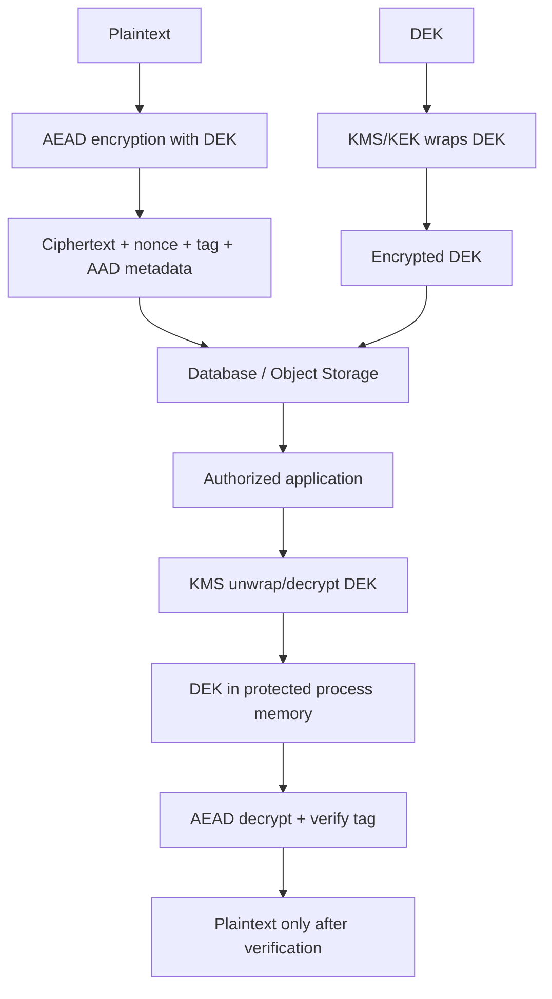

# Bằng chứng cryptography: Chứng minh các kiểm soát mật mã hoạt động đúng

## 1. Mục tiêu học tập

Sau bài học, người học có thể:

1. Giải thích **bằng chứng cryptography** trong security assurance: bằng chứng nào cho thấy cơ chế mật mã được lựa chọn, triển khai, cấu hình và vận hành phù hợp mục tiêu.
2. Phân biệt **design evidence, source/configuration evidence, deployment evidence, runtime evidence, test evidence và provider attestation**, đồng thời hiểu giới hạn suy luận của từng loại.
3. Lập **cryptographic inventory** gồm dữ liệu được bảo vệ, thuật toán, giao thức, khóa/chứng chỉ, nơi sử dụng, chủ sở hữu và vòng đời.
4. Đánh giá bằng chứng cho **encryption in transit, encryption at rest, application-level encryption, key management, digital signatures, MAC, hashing và certificate lifecycle**.
5. Hiểu cách KMS/HSM, envelope encryption, key rotation, access separation, revocation và cryptographic erasure ảnh hưởng tới assurance.
6. Thiết kế kiểm thử positive, negative và failure cho TLS, mã hóa dữ liệu, xác minh chữ ký, quyền dùng khóa, rotate/revoke và phục hồi.
7. Đánh giá **provenance, integrity, freshness, scope, completeness, confidentiality và reproducibility** của evidence artifact.
8. Áp dụng vào hệ thống Java/Spring Boot có API, database, broker, worker, payment provider, KMS và backup; xây risk-control-evidence mapping có giới hạn kết luận rõ.

Bài thuộc chương **Mã hóa và khóa** của module **SECURITY_SECURITY_ASSURANCE**. Mục tiêu module là đánh giá **có bằng chứng** rằng hệ thống đáp ứng các mục tiêu bảo mật, từ rủi ro và security controls đến kiểm thử, audit, khắc phục phát hiện và assurance liên tục. Với cryptography, câu hỏi không chỉ là “đã bật encryption chưa?” mà là **“đúng dữ liệu có được bảo vệ bằng cơ chế phù hợp, khóa được quản lý an toàn, verifier kiểm tra đúng, và bằng chứng nào chứng minh điều đó trên phiên bản đang chạy?”**

## 2. Bằng chứng cryptography là gì?

**Bằng chứng cryptography** là thông tin có thể kiểm tra, có nguồn gốc và phạm vi rõ ràng, hỗ trợ một nhận định về **thiết kế, triển khai hoặc vận hành các kiểm soát mật mã**.

Ví dụ về các nhận định cần chứng minh:

- Kết nối giữa client và API chỉ chấp nhận giao thức/cipher suites được tổ chức cho phép.
- Dữ liệu nhạy cảm trong database/object storage được mã hóa theo chính sách và khóa được bảo vệ.
- Ứng dụng lấy khóa từ KMS/secret manager được phê duyệt, không hard-code khóa trong source hoặc image.
- Chỉ workload/role được ủy quyền mới có thể yêu cầu KMS encrypt/decrypt.
- Dữ liệu được xác minh integrity/authenticity trước khi xử lý.
- Chứng chỉ được kiểm tra đúng hostname, chain, validity và trust policy.
- Key rotation/revocation được thực hiện và có thể chứng minh.
- Khi một khóa bị nghi lộ, tổ chức có quy trình containment, re-encryption/rewrap và đánh giá tác động.
- Phương pháp mật mã không còn phù hợp được nhận diện và thay thế theo kế hoạch crypto agility.

**Có thư viện crypto trong dependency tree không chứng minh hệ thống dùng đúng thư viện. Có cấu hình encryption không chứng minh mọi bản sao dữ liệu đều được mã hóa. Có KMS không chứng minh quyền gọi KMS được giới hạn.** Assurance phải nối claim với artifact, test và runtime evidence đúng phạm vi.

### 2.1. Crypto assurance không chỉ là kiểm tra thuật toán

Một cơ chế mật mã có thể dùng thuật toán mạnh nhưng thất bại vì:

- Khóa bị commit vào Git hoặc ghi trong log.
- Nonce/IV bị tái sử dụng sai cách.
- Chứng chỉ không được xác minh hostname.
- JWT được ký nhưng verifier chấp nhận sai issuer/audience.
- Dữ liệu đã mã hóa nhưng plaintext còn trong cache, trace hoặc export.
- Key rotation chỉ đổi alias, trong khi dữ liệu vẫn phụ thuộc khóa cũ không còn quản lý.
- Quyền decrypt được cấp cho quá nhiều service.
- Recovery hoặc backup làm sống lại khóa/credential đã bị thu hồi.

Do đó, đánh giá cryptography phải bao phủ **thuật toán + protocol + implementation + key lifecycle + data flows + access control + operations + evidence**.

## 3. Từ claim tới bằng chứng có thể kiểm chứng

Một kết luận assurance nên có cấu trúc:

- **Claim:** điều tổ chức muốn chứng minh.
- **Argument:** vì sao thiết kế và kiểm soát được cho là đạt mục tiêu.
- **Evidence:** artifacts, tests, configuration, runtime records và kết quả đánh giá.
- **Assumptions:** giả định về cloud provider, client, HSM, trust roots, clock hoặc dữ liệu.
- **Scope:** service, environment, region, tenant, build, key version và thời gian.
- **Limitations:** đường chưa thử, bản sao không kiểm chứng trực tiếp hoặc phụ thuộc ngoài phạm vi.
- **Decision:** trạng thái đạt/không đạt/chưa đủ bằng chứng và residual risk owner.

Ví dụ claim: “Mọi kết nối từ Internet tới Transfer API trong production được xác thực máy chủ và sử dụng cấu hình TLS phù hợp baseline được phê duyệt.”

Bằng chứng cần liên kết baseline TLS, cấu hình load balancer/gateway, backend TLS termination, kết quả kiểm tra endpoint, negative tests với chứng chỉ sai/hết hạn/chain không tin cậy, deployment revision và phạm vi chưa kiểm tra. Một dòng “TLS enabled” trong checklist không đủ hỗ trợ claim này.

## 4. Phân biệt các loại bằng chứng

| Loại evidence | Nó chứng minh điều gì? | Ví dụ | Giới hạn |
| --- | --- | --- | --- |
| **Design evidence** | Cơ chế dự kiến có khả năng đáp ứng mục tiêu? | Crypto architecture, threat model, key hierarchy | Không chứng minh đã triển khai |
| **Source/code evidence** | Code gọi thư viện và áp dụng logic nào? | Review encryption/decryption, signature verification | Không chứng minh production dùng đúng build/config |
| **Configuration evidence** | Policy/cấu hình được khai báo ra sao? | TLS policy, KMS key policy, storage encryption setting | Có thể khác runtime hoặc có bypass |
| **Deployment evidence** | Artifact/cấu hình nào được triển khai, ở đâu? | Release ID, image digest, IaC revision | Không chứng minh hành vi thực tế |
| **Runtime evidence** | Hệ thống đang vận hành thế nào? | TLS handshake, KMS audit logs, certificate status | Có thể chỉ bao phủ một thời điểm/đường |
| **Test evidence** | Kết quả trong các tình huống đã thử? | Wrong-key, tampered ciphertext, revoked cert | Không chứng minh tình huống chưa thử |
| **Operational evidence** | Kiểm soát được thực hiện liên tục? | Rotation records, access review, expiry alerts | Cần kiểm tra sampling và độ đầy đủ |
| **Independent assessment** | Bên đánh giá đã xem xét trong phạm vi nào? | Audit report, penetration test, attestation | Không tự bao phủ mọi service/key/region |
| **Provider assurance** | Dịch vụ nền tảng cung cấp kiểm soát gì? | KMS documentation, compliance report | Phải kiểm tra scope, shared responsibility và kỳ hiệu lực |

### 4.1. Evidence không phải một ảnh chụp màn hình bất kỳ

Screenshot của cloud console có thể hỗ trợ kiểm tra một setting tại một thời điểm, nhưng thường thiếu người thu thập, thời gian, account/project, region, resource, runtime mapping, policy exception và tính toàn vẹn sau khi thu thập.

Nên lưu **export có nguồn, API/config snapshot, command output có ngữ cảnh, test report và deployment reference** khi phù hợp. Screenshot là phần bổ trợ, không nên là bằng chứng duy nhất cho control trọng yếu.

## 5. Cryptographic inventory: biết hệ thống đang dùng mật mã ở đâu

Không thể chứng minh độ phủ nếu không biết hệ thống có những cơ chế mật mã nào.

| Thuộc tính | Nội dung cần ghi |
| --- | --- |
| Asset/data class | Dữ liệu, secret, message, credential hoặc tài sản cần bảo vệ |
| Security objective | Confidentiality, integrity, authenticity hoặc mục tiêu liên quan |
| Location/data flow | API, database, broker, object store, backup, vendor |
| Algorithm/protocol | TLS, AES-GCM, RSA/ECDSA, HMAC, hash/KDF |
| Parameters | Key size, mode, tag, curve, protocol version, digest, salt/work factor theo policy |
| Key/certificate ID | Định danh tham chiếu; không ghi secret key/private key |
| Key owner/provider | Team, KMS/HSM hoặc bên cung cấp |
| Usage/purpose | Encrypt, decrypt, sign, verify, wrap, derive |
| Access principals | Workloads/roles được phép sử dụng |
| Lifecycle | Creation, activation, rotation, suspension, revocation, destruction |
| Environment | Dev/test/staging/prod, region, tenant hoặc boundary |
| Evidence refs | Config, test, audit log, attestation và review |
| Exception/deprecation | Legacy use, expiry, compensating controls và kế hoạch thay thế |

### 5.1. Inventory phải gắn với data flow

Một ứng dụng có thể mã hóa database nhưng đồng thời gửi plaintext sang broker, ghi payload vào log, lưu CSV ở object storage, đồng bộ analytics, tạo backup khác chính sách, dùng cache persistence hoặc gửi dữ liệu tới payment provider.

Vì vậy, inventory nên nối **data class → data flow → cryptographic boundary → key → consumer → evidence**. Danh sách thuật toán riêng lẻ không đủ. Mỗi entry cần owner và ngày review; khi thêm field nhạy cảm, broker topic hoặc vendor consumer, inventory phải được cập nhật cùng change control.

## 6. Chọn thuật toán và cấu hình theo chính sách

Assurance cần chứng minh lựa chọn mật mã **phù hợp mục tiêu và chuẩn/phiên bản áp dụng**, không tự tạo một danh sách thuật toán vĩnh viễn.

Các câu hỏi:

- Mục tiêu là confidentiality, integrity, authenticity hay key establishment?
- Dữ liệu cần bảo vệ bao lâu và trước năng lực tấn công nào?
- Thuật toán, mode và tham số có được baseline cho phép không?
- Thư viện có được duy trì và sử dụng đúng API?
- Có nguy cơ downgrade hoặc fallback sang thuật toán yếu?
- Có yêu cầu validation/chứng nhận module mật mã trong môi trường cụ thể?
- Có kế hoạch thay thế khi thuật toán/protocol bị deprecate?

| Nhóm | Mục đích | Ví dụ | Không nên nhầm |
| --- | --- | --- | --- |
| **Symmetric encryption** | Mã hóa/giải mã bằng khóa bí mật | AES-GCM | Không tự cung cấp key distribution |
| **Asymmetric cryptography** | Cặp khóa công khai/bí mật | Chữ ký, thiết lập khóa theo protocol | Không phải lúc nào cũng mã hóa trực tiếp payload lớn |
| **AEAD** | Confidentiality + integrity/authentication của ciphertext và AAD | AES-GCM, ChaCha20-Poly1305 | Phải quản lý nonce và xác minh tag |
| **Hash** | Digest một chiều | SHA-256 fingerprint | Hash thường không phải encryption |
| **MAC/HMAC** | Integrity/authentication với khóa chung | HMAC-SHA-256 | Không có non-repudiation giữa các bên cùng giữ khóa |
| **Digital signature** | Xác minh chữ ký bằng public key | Ký artifact/chứng từ | Không tự bảo đảm dữ liệu bí mật |
| **Password KDF** | Lưu verifier cho password | Argon2id, scrypt, PBKDF2 theo policy | Không dùng hash nhanh thông thường thay KDF |

Ví dụ chỉ nêu loại primitive phổ biến. Lựa chọn cụ thể phải dựa vào **baseline tổ chức, chuẩn đúng ấn bản, thư viện được phê duyệt và threat model**.

## 7. Bằng chứng encryption in transit

**Encryption in transit** bảo vệ dữ liệu khi truyền qua một kết nối hoặc trust boundary. Cần xem từng đoạn, không chỉ public endpoint:

- Browser/mobile → CDN/load balancer.
- Load balancer → API Gateway.
- Gateway → Spring Boot service.
- Service → database.
- API → broker.
- Worker → payment provider.
- Service → KMS/secret manager.

| Claim | Bằng chứng |
| --- | --- |
| Endpoint dùng TLS theo baseline | TLS handshake scan và cấu hình listener |
| Server certificate đúng hostname và trust chain | Certificate chain/hostname tests |
| Client không chấp nhận chứng chỉ không tin cậy | Negative tests với cert sai, hết hạn hoặc CA không tin |
| Internal hop được bảo vệ theo policy | Service mesh/mTLS/gateway config và connection tests |
| Không có plaintext fallback ngoài policy | Protocol review và downgrade tests |
| Certificate lifecycle được quản lý | Inventory, expiry alert, renewal/rotation logs |
| Private key được bảo vệ | KMS/HSM/secret manager settings, access policy và audit |

### 7.1. TLS termination và đoạn truyền phía sau

Nếu TLS kết thúc tại load balancer, phải xem **đoạn load balancer → application**. Không thể tuyên bố end-to-end encryption chỉ từ việc browser thấy HTTPS. Nếu đoạn nội bộ dùng plaintext trong một network boundary, cần nêu rõ đường nào mã hóa, đường nào không, lý do, risk treatment và phạm vi.

### 7.2. Kiểm tra certificate validation ở client

Một client HTTPS có custom trust manager chấp nhận mọi certificate sẽ làm mất mục tiêu xác thực máy chủ, dù dữ liệu vẫn được mã hóa.

Tests nên bao gồm hostname đúng/sai, chain tin cậy/không tin cậy, certificate hết hạn/chưa có hiệu lực, trạng thái revocation theo cơ chế đã chọn và protocol/cipher bị cấm. Không dùng `trust all` hoặc tắt hostname verification trong production để “sửa nhanh” lỗi chứng chỉ.

## 8. Bằng chứng encryption at rest

**Encryption at rest** có thể được cung cấp ở storage/media, database/tablespace, file/object storage, application-level field/record, backup/snapshot và endpoint/device. Một hệ thống có thể dùng nhiều lớp nhưng phải nói rõ **lớp nào bảo vệ trước threat nào**.

Evidence nên gồm:

- Cấu hình encryption của database instance/cluster.
- Encryption setting và key reference của bucket/object.
- Policy ngăn tạo storage resource không mã hóa.
- KMS key policy và principals được phép encrypt/decrypt.
- Runtime metadata của objects/snapshots thực tế.
- IaC plan/deployment state và negative tests với resource mới.
- Audit logs cho thao tác thay đổi encryption hoặc key association.

Storage encryption không tự bảo vệ khỏi workload có quyền đọc plaintext, admin có quyền decrypt, SQL injection đọc dữ liệu qua ứng dụng, log/export/cache lưu plaintext, backup key bị lộ hoặc service được quyền dùng KMS quá rộng. Cần kết hợp **encryption + access control + key management + data minimization + monitoring**.

## 9. Envelope encryption: DEK và KEK

Một mô hình phổ biến là **envelope encryption**:

- **DEK (Data Encryption Key):** khóa dùng mã hóa dữ liệu thực tế.
- **KEK (Key Encryption Key):** khóa bảo vệ/bao bọc DEK.
- KMS/HSM giữ hoặc kiểm soát KEK; ứng dụng nhận kết quả encrypt/decrypt theo policy.
- Ciphertext và encrypted DEK có thể được lưu cùng metadata cần thiết; plaintext key không được ghi vào log hay kho dữ liệu không bảo vệ.



### 9.1. Bằng chứng envelope encryption

- Sơ đồ key hierarchy và data flow đã review.
- KMS key ID/alias và policy revision.
- Application configuration dùng đúng key reference.
- Audit logs cho encrypt/decrypt/unwrap, principal, context và thời điểm.
- Tests với key ID sai, ciphertext bị sửa, AAD sai và caller không được phép.
- Bằng chứng DEK plaintext không được ghi vào log hoặc persistence.
- Quy trình rotate KEK và xử lý DEK đã được kiểm thử.

### 9.2. AAD giúp ràng buộc ngữ cảnh

AEAD có thể nhận **Additional Authenticated Data (AAD)**: dữ liệu không mã hóa nhưng được bảo vệ integrity cùng ciphertext. Ví dụ AAD gắn tenant ID, record type hoặc schema version để ciphertext không thể bị chuyển sang context khác mà vẫn xác minh thành công.

AAD không bí mật và không thay thế authorization. Phải dùng **canonical encoding** nhất quán khi encrypt/decrypt; nếu nối chuỗi không phân định rõ, có thể tạo nhập nhằng.

## 10. Quản lý khóa: lifecycle là phần cốt lõi của evidence

Một key lifecycle thường gồm:

1. **Generation:** tạo khóa bằng nguồn ngẫu nhiên và cơ chế được phê duyệt.
2. **Registration/activation:** ghi metadata, purpose, owner, algorithm và trạng thái.
3. **Distribution/binding:** cấp quyền dùng khóa cho principals được phép.
4. **Storage/protection:** KMS/HSM/secret store và kiểm soát truy cập.
5. **Use/monitoring:** log operation metadata, phát hiện sử dụng bất thường.
6. **Rotation/rekey:** thay khóa theo lịch, risk hoặc sự kiện.
7. **Suspension/revocation:** dừng sử dụng khi nghi lộ, sai mục đích hoặc hết hiệu lực.
8. **Archival/recovery:** giữ khả năng giải mã dữ liệu còn nghĩa vụ nếu chính sách yêu cầu.
9. **Destruction:** hủy theo thẩm quyền và xác minh đúng phạm vi.
10. **Retirement:** đóng metadata, loại bỏ dependency cũ và giữ evidence theo lịch.

Key inventory nên ghi Key ID/version, purpose, algorithm, creation/activation time, owner, provider, environment/region, principals, state, rotation/review date, dependencies, recovery requirements và evidence references.

**Không ghi raw key, private key, seed hoặc secret value vào inventory/evidence.** Dùng định danh tham chiếu và kho được bảo vệ.

## 11. KMS/HSM: bằng chứng về quyền, cấu hình và hoạt động

KMS/HSM có thể cung cấp chức năng tạo, lưu, sử dụng và quản lý khóa, nhưng không tự bảo đảm ứng dụng sử dụng đúng.

Các câu hỏi assurance:

- Key được tạo bằng cơ chế phù hợp và thuộc đúng account/region/environment?
- Key purpose/usage có giới hạn?
- Policy có principal wildcard hoặc quyền admin/decrypt quá rộng?
- Service có thể decrypt bất kỳ ciphertext nào hay chỉ đúng context?
- Có separation of duties cho key admin và data operator?
- KMS audit logs có bật, được bảo vệ và giám sát?
- Rotation có được hỗ trợ cho key type đang dùng và dữ liệu có thực sự theo key mới?
- Disable/revoke có ảnh hưởng đúng tới workloads và recovery?
- Có backup/replication/cross-region behavior phù hợp?
- Provider outage có tạo fallback yếu?

Evidence thực tế gồm KMS key metadata, key/IAM policy export, cloud audit events, IaC/deployment state, access review, positive/negative tests, rotation report và provider assurance report.

### 11.1. Chứng nhận module không phải chứng nhận toàn hệ thống

Nếu HSM/crypto module có validation theo scheme cụ thể, cần xác minh đúng module/version/firmware/operational mode, validated configuration, algorithm/service trong scope và cách ứng dụng quản lý key/permissions/plaintext/lifecycle.

Một chứng nhận của thành phần không tự chứng minh **toàn bộ ứng dụng hoặc quy trình crypto** đáp ứng mọi yêu cầu.

## 12. Key access control và separation of duties

Khóa là tài sản đặc quyền. Cần xem xét tách biệt quyền tạo key, sửa policy/alias/rotation, gọi encrypt/decrypt/sign/verify, disable/revoke/destroy và quản lý audit logs.

Developer có thể cần deploy service nhưng không mặc nhiên cần decrypt mọi dữ liệu production. SRE có thể vận hành KMS nhưng không nhất thiết cần đọc plaintext nghiệp vụ.

Evidence gồm IAM/KMS policy export có revision, mapping principal → action → resource, access review, negative tests từ role không được phép, audit event cho policy changes và break-glass records có scope/expiry/approval.

**Một policy JSON nhìn có vẻ chặt** vẫn cần kiểm tra role inheritance, group membership, resource policy, organization policy, service-linked roles và runtime identity thực tế.

## 13. Key rotation: thay khóa có nghĩa gì?

“Rotate key” có thể mô tả nhiều thao tác:

- Thay key version để mã hóa dữ liệu mới.
- Rewrap DEK bằng KEK version mới.
- Re-encrypt dữ liệu bằng DEK mới.
- Thay chứng chỉ/private key của endpoint.
- Thay API secret hoặc signing key.
- Thay trust root hoặc key của bên liên kết.

| Hành động | Thay đổi | Bằng chứng cần |
| --- | --- | --- |
| **KEK rotation** | Khóa bảo vệ DEK thay đổi; có thể rewrap encrypted DEKs | Key version, rewrap completion, decrypt tests, old-key retirement plan |
| **DEK rotation** | Dữ liệu được mã hóa lại bằng khóa dữ liệu mới | Record coverage, re-encryption jobs, integrity/decrypt verification |
| **Certificate renewal** | Certificate/validity thay đổi; private key có thể giữ hoặc đổi | Certificate inventory, deployment, handshake và expiry tests |
| **Signing-key rotation** | Verifier tin key mới và xử lý chữ ký cũ theo policy | JWKS/trust update, key overlap, old-key revocation/verification plan |

Một log “KMS rotation completed” không chứng minh mọi ciphertext đã được chuyển. Báo cáo cần chỉ rõ dữ liệu mới dùng key version nào, dữ liệu cũ còn phụ thuộc key nào, khi nào có thể retire old key và record nào chưa migrate.

## 14. Revocation, compromise và key incident

Khi key/certificate bị nghi lộ, tổ chức cần **ngăn sử dụng trái phép và đánh giá dữ liệu/đối tượng phụ thuộc**.

Các bước:

1. Xác nhận key ID/version, owner, purpose, scope và dấu hiệu compromise.
2. Bảo toàn audit evidence của các thao tác key và workload.
3. Đánh giá thời gian phơi nhiễm, principals đã dùng key và dữ liệu có thể truy cập.
4. Disable/revoke theo quy trình và điều kiện an toàn nghiệp vụ.
5. Rotate/rekey, cập nhật trust configuration và credential consumers.
6. Re-encrypt/rewrap dữ liệu khi cần và khả thi.
7. Kiểm tra certificates, JWT signing keys, message signatures và integrations.
8. Theo dõi errors, unauthorized calls và fallback.
9. Kiểm thử key cũ không còn được chấp nhận ở những đường phải chặn.
10. Quyết định residual risk và thông báo nếu có nghĩa vụ áp dụng.

### 14.1. Disable không luôn đồng nghĩa destroy

Disable có thể chặn thao tác sử dụng key trong khi vẫn giữ metadata hoặc khả năng phục hồi theo policy. Destroy có thể khiến dữ liệu không thể giải mã. Phải phân biệt **containment, revocation, retirement và destruction**.

### 14.2. Key compromise có thể ảnh hưởng chữ ký và mã hóa khác nhau

- Lộ **encryption key** có thể làm dữ liệu đã mã hóa bị đọc.
- Lộ **signing private key** có thể cho phép tạo chữ ký giả được verifier tin.
- Lộ **HMAC key** có thể cho phép tạo MAC hợp lệ và giả mạo thông điệp.
- Lộ **TLS private key** có tác động tùy giao thức, cấu hình forward secrecy, thời gian và khả năng thu thập traffic trước đó.

Incident response phải hiểu **key purpose** và các phụ thuộc thực, không chỉ gọi tất cả là “lộ khóa”.

## 15. Certificate lifecycle và PKI evidence

Chứng chỉ số là một đối tượng trong trust model, không phải chỉ một file có ngày hết hạn.

Inventory nên ghi Subject/SAN và service identity, Issuer/CA, chain/trust store, serial/fingerprint, validity, public key type/parameters, key usage/extensions, private key storage/provider, principals, environment, endpoint, owner, renewal/rotation và revocation evidence.

Các claim thường gặp:

- Chứng chỉ được cấp bởi CA/issuer thuộc trust policy.
- Hostname/service identity được xác minh đúng.
- Certificate không hết hạn/chưa có hiệu lực.
- Private key không xuất hiện trong repository/image/log.
- Renewal diễn ra trước hạn và không tạo fallback yếu.
- Consumers cập nhật trust state sau revoke/replace.
- Không còn certificate test/self-signed yếu trong production ngoài ngoại lệ được duyệt.

OCSP/CRL và các cơ chế revocation có đặc điểm khác nhau; cache, network failure và client support ảnh hưởng kết quả. Không tuyên bố “revocation tức thời toàn cầu” nếu kiến trúc không bảo đảm. Cần mô tả **cơ chế được chọn, hành vi khi không kiểm tra được và giới hạn thực tế**.

## 16. Digital signatures, MAC và hash: chứng minh đúng mục tiêu

| Cơ chế | Ai có thể tạo? | Ai xác minh? | Bằng chứng hỗ trợ |
| --- | --- | --- | --- |
| **Digital signature** | Bên giữ private signing key | Bên có public key và trust policy | Signature validation, certificate/key provenance, signed content |
| **MAC/HMAC** | Bên có shared secret | Bên có cùng secret | MAC verification, key access policy, replay/context tests |
| **Cryptographic hash** | Bất kỳ bên nào tính digest | So sánh digest với nguồn tin cậy | Hash algorithm, source integrity và chain-of-custody |
| **AEAD tag** | Bên có encryption key khi encrypt | Bên có key khi decrypt | Tamper tests, nonce/AAD rules, tag verification |

Một file có SHA-256 checksum không tự chứng minh ai tạo file. Nếu attacker thay file và checksum ở cùng nơi, đối chiếu vẫn có thể thành công. Muốn chứng minh nguồn gốc, cần **trusted channel, digital signature, HMAC với key được bảo vệ, immutable evidence store hoặc quy trình ký/đối chiếu đáng tin**.

Chữ ký giúp xác minh integrity và nguồn ký theo trust model; nội dung vẫn có thể đọc công khai. Nếu cần confidentiality, phải có encryption riêng. Password verifier thường cần **password hashing/KDF có salt và tham số phù hợp**, không cần khả năng giải mã password; không dùng hash nhanh thông thường thay KDF.

## 17. Cryptographic implementation evidence trong Java/Spring Boot

Ứng dụng Java nên dùng **JCA/JCE và thư viện/SDK được duy trì, cấu hình theo policy**; không tự xây thuật toán, padding, random generator hoặc protocol.

### 17.1. Ví dụ AES-GCM có xác thực

Mẫu dưới đây minh họa cấu trúc sử dụng AEAD. Trong hệ thống thật, khóa được lấy từ KMS hoặc key provider được kiểm soát; không tạo key tĩnh trong source và không dùng lại nonce với cùng key.

```java
public final class FieldEncryption {
    private static final String TRANSFORMATION = "AES/GCM/NoPadding";
    private static final int TAG_BITS = 128;
    private static final int NONCE_BYTES = 12;

    private final SecureRandom secureRandom;
    private final DataKeyProvider keyProvider;

    public EncryptedValue encrypt(
            String keyReference,
            byte[] plaintext,
            byte[] canonicalAad) throws GeneralSecurityException {

        SecretKey dataKey = keyProvider.activeEncryptionKey(keyReference);
        byte[] nonce = new byte[NONCE_BYTES];
        secureRandom.nextBytes(nonce);

        Cipher cipher = Cipher.getInstance(TRANSFORMATION);
        cipher.init(
            Cipher.ENCRYPT_MODE,
            dataKey,
            new GCMParameterSpec(TAG_BITS, nonce),
            secureRandom
        );
        cipher.updateAAD(canonicalAad);

        byte[] ciphertextAndTag = cipher.doFinal(plaintext);
        return new EncryptedValue(
            keyReference, nonce, ciphertextAndTag, "AES-256-GCM", 1);
    }

    public byte[] decrypt(
            EncryptedValue value,
            byte[] canonicalAad) throws GeneralSecurityException {

        SecretKey dataKey = keyProvider.keyForDecryption(
            value.keyReference(), value.keyVersion());

        Cipher cipher = Cipher.getInstance(TRANSFORMATION);
        cipher.init(
            Cipher.DECRYPT_MODE,
            dataKey,
            new GCMParameterSpec(TAG_BITS, value.nonce())
        );
        cipher.updateAAD(canonicalAad);

        // AEAD tag được xác minh trong doFinal.
        // Không sử dụng plaintext nếu xác minh thất bại.
        return cipher.doFinal(value.ciphertextAndTag());
    }
}
```

Đây là **mẫu giảng dạy**, chưa phải lớp hoàn chỉnh để đưa thẳng vào production. `DataKeyProvider` và `EncryptedValue` là abstraction minh họa. Cần thêm:

- Quản lý key version và migration.
- Đảm bảo nonce **không lặp với cùng key** theo mô hình/giới hạn sử dụng đã chọn.
- Xác thực độ dài, encoding, version và input bounds.
- Canonical AAD nhất quán, có ràng buộc tenant/record/schema nếu phù hợp.
- Không log key/plaintext hoặc context nhạy cảm.
- Xử lý lỗi authentication tag an toàn, không trả partial plaintext.
- Quản lý memory, concurrency và key cache theo threat model.
- Tests cho tampering, wrong AAD, wrong key, nonce metadata và rotation.

### 17.2. Bằng chứng cho implementation

- Code review xác minh dùng `AES/GCM/NoPadding` hoặc transformation được policy phê duyệt.
- Review nguồn `SecureRandom`/provider và key retrieval.
- Tests với ciphertext thay đổi một bit, tag sai và AAD khác.
- Runtime evidence về key ID/version và principal gọi KMS.
- Scan source/image/repository tìm hard-coded key hoặc secrets.
- Xác minh plaintext không xuất hiện trong logs/traces/errors.
- Kiểm tra deployed build digest tương ứng source/test report.

### 17.3. Ví dụ về sai lầm cần phát hiện

```java
// CHỈ MINH HỌA CẤU HÌNH NGUY HIỂM - KHÔNG DÙNG.
Cipher cipher = Cipher.getInstance("AES/ECB/PKCS5Padding");
cipher.init(Cipher.ENCRYPT_MODE, hardCodedKey);
byte[] encrypted = cipher.doFinal(plaintext);
```

Các vấn đề: ECB không cung cấp cấu trúc bảo vệ integrity/authenticity phù hợp; khóa hard-code có thể bị trích xuất từ source/image; không có key lifecycle, nonce/IV management, AAD/context hoặc evidence về quyền truy cập và rotation.

## 18. Kiểm thử mật mã: positive, negative và failure

Một kế hoạch test phải chứng minh **đường hợp lệ hoạt động và đường sai bị chặn**.

| Test ID | Kịch bản | Kết quả mong đợi |
| --- | --- | --- |
| CRYPTO-01 | Encrypt/decrypt với key và context hợp lệ | Plaintext khôi phục đúng |
| CRYPTO-02 | Ciphertext bị thay đổi | AEAD/signature verification thất bại |
| CRYPTO-03 | AAD khác tenant/record | Decrypt thất bại |
| CRYPTO-04 | Key ID không tồn tại hoặc không đúng purpose | Từ chối, không fallback yếu |
| CRYPTO-05 | Principal không có quyền decrypt | KMS từ chối và có audit |
| CRYPTO-06 | Nonce metadata không hợp lệ | Input bị từ chối an toàn |
| CRYPTO-07 | TLS certificate sai hostname | Client từ chối |
| CRYPTO-08 | Certificate hết hạn hoặc chain không tin | Client từ chối theo policy |
| CRYPTO-09 | Protocol/cipher suite bị cấm | Không thương lượng |
| CRYPTO-10 | Key rotation khi dữ liệu cũ còn tồn tại | Dữ liệu được giải mã theo kế hoạch; version được truy vết |
| CRYPTO-11 | Old key bị disable/revoke | Hành vi đúng policy; không vô tình mở lại quyền |
| CRYPTO-12 | KMS timeout/outage | Không dùng fallback hard-coded/plaintext |
| CRYPTO-13 | Signed artifact bị sửa | Signature verification thất bại |
| CRYPTO-14 | Wrong issuer/public key | Signature/JWT verification thất bại |
| CRYPTO-15 | Replay message có chữ ký hợp lệ | Anti-replay/business state controls chặn nếu yêu cầu |
| CRYPTO-16 | Restore từ backup có ciphertext cũ | Recovery theo key lifecycle, không mất kiểm soát |
| CRYPTO-17 | Rotation/re-encryption job crash giữa chừng | Retry an toàn, trạng thái partial rõ |
| CRYPTO-18 | Log/exception khi decrypt lỗi | Không chứa key hoặc plaintext |

Một test encrypt/decrypt pass chỉ chứng minh một cặp dữ liệu/khóa/context hoạt động; không chứng minh tất cả records/stores được bảo vệ, key không bị chia sẻ rộng, backup/export/logs cùng chính sách hoặc rotation/revocation đã hoạt động trong production.

Negative tests cần xác nhận đúng nguyên nhân. Ví dụ request decrypt trả 403 vì user không đăng nhập không chứng minh KMS từ chối principal trái quyền. Test cần **principal đã xác thực nhưng không được phép**, để kiểm tra đúng boundary.

## 19. Failure modes và cách đánh giá hành vi

Cryptographic control phải có hành vi rõ khi phụ thuộc hoặc dữ liệu lỗi:

- KMS/HSM unavailable hoặc latency cao.
- Certificate hết hạn hoặc renewal thất bại.
- Signing key rotate nhưng verifier chưa cập nhật trust.
- Secret cache giữ key cũ sau revoke.
- Clock skew làm sai validity/expiry checks.
- AEAD tag sai hoặc ciphertext bị truncate.
- Một vùng cloud chưa nhận key version mới.
- Key backup/replication lỗi.
- Rotation job chạy một phần rồi dừng.
- Provider đổi thuật toán mặc định hoặc loại bỏ cipher suite.

Nếu KMS không sẵn sàng, ứng dụng có thể không thực hiện decrypt dữ liệu nhạy cảm; nhưng vẫn có thể phục vụ thao tác công khai hoặc read-only không cần khóa đó theo policy. Cần định nghĩa operation nào được tiếp tục, operation nào phải dừng, retry, thông báo và quyền emergency exception. **Không dùng fallback plaintext hoặc key hard-code chỉ để giữ availability.**

Test cả retry có backoff, circuit breaker, queue reconciliation, duplicate payment prevention, rotation resume sau restart, backup restore với key version cần thiết và monitoring phân biệt permission denied/invalid ciphertext/provider outage.

## 20. Crypto agility và quản lý thuật toán lỗi thời

**Crypto agility** là khả năng thay đổi thuật toán, tham số, key format, certificate và protocol có kiểm soát khi yêu cầu an toàn thay đổi.

Một chương trình cần inventory algorithm/protocol/key version; phân loại legacy/approved/deprecated theo baseline có phiên bản; tìm dependencies trong source/runtime/certificate/data stores/vendors; ưu tiên theo exposure và thời gian cần bảo vệ dữ liệu; thiết kế migration cho dữ liệu cũ; hạn chế overlap; kiểm tra rollback không quay lại cấu hình yếu; lưu evidence của rollout, test và exceptions.

Nếu ciphertext cũ vẫn dùng thuật toán hoặc key cũ, đổi cấu hình cho dữ liệu mới không tự migrate lịch sử. Cần xác định **data-at-rest migration strategy**, cách xác minh dữ liệu sau chuyển đổi và xử lý records không migrate được.

## 21. Cryptographic erasure: bằng chứng xóa bằng khóa

**Cryptographic erasure** là phương pháp làm dữ liệu không còn giải mã được bằng cách xử lý khóa cần thiết, trong điều kiện dữ liệu đã được mã hóa đúng và mọi bản sao khóa liên quan được kiểm soát.

Claim cần chứng minh:

- Tất cả dữ liệu trong scope thực sự được mã hóa bằng key/DEK được định danh.
- Không còn plaintext copy ngoài scope đã xác định.
- Không còn key copy, backup key, escrow hoặc wrapped key có thể khôi phục theo threat model.
- Key destruction được thực hiện đúng thẩm quyền và provider xác nhận trong phạm vi.
- Khả năng giải mã đã bị mất theo phương pháp kiểm chứng được.
- Export, logs, cache và vendor copies đã được đánh giá riêng.

Rotate KEK thường giữ khả năng giải mã dữ liệu cũ bằng key version khác; nó không chứng minh dữ liệu đã bị xóa. Disable có thể reversible; destruction có thể irreversible. Nếu khóa dùng chung cho nhiều tenant/records, hủy khóa có thể làm mất dữ liệu vẫn cần giữ. Phải đánh giá key hierarchy và dependency graph trước khi chấp nhận claim.

## 22. Third-party, cloud provider và shared responsibility

Một phần cryptography có thể do cloud provider, payment provider, SaaS hoặc service mesh cung cấp.

| Control area | Provider có thể chịu trách nhiệm | Khách hàng vẫn cần chịu trách nhiệm |
| --- | --- | --- |
| KMS/HSM infrastructure | Bảo vệ hạ tầng dịch vụ, vận hành module theo dịch vụ | Key policy, principals, key purpose và lifecycle |
| Storage encryption | Cơ chế mã hóa nền tảng | Bật đúng cấu hình, chọn key, kiểm soát access |
| TLS endpoint | Quản lý cert ở managed edge theo dịch vụ | TLS policy, origin/backend hop và trust |
| Certificate authority | Cấp/duy trì CA theo hợp đồng | Kiểm tra hostname, trust roots, renewal và usage |
| Backup encryption | Mã hóa nền tảng | Scope, retention, restore access và key dependencies |
| Audit logging | Cung cấp event sources | Bật, thu, bảo vệ, giám sát và giữ evidence |
| Payment provider encryption | Bảo vệ phần provider kiểm soát | Data minimization, integration security và contract review |

Khi dùng report/attestation, kiểm tra dịch vụ/region trong scope, kỳ đánh giá, controls do khách hàng cấu hình, exceptions, complementary user entity controls, subprocessors và sự liên quan đúng key/service/tenant. Không coi chứng nhận cloud tổng quát là bằng chứng mọi KMS policy của tenant đã cấu hình đúng.

## 23. Cryptographic evidence package: cấu trúc hồ sơ

Một evidence package có thể chia:

1. **Claim and scope:** control ID, service, data classes, environment, region, build.
2. **Crypto inventory:** algorithms, protocols, keys/certificates, owners và dependencies.
3. **Design:** architecture, threat model, key hierarchy, trust boundaries.
4. **Configuration:** TLS/KMS/storage/IAM settings, policy versions.
5. **Implementation:** source review, dependency versions, secure coding findings.
6. **Deployment:** artifact digest, IaC revision, runtime mapping.
7. **Verification:** positive/negative/failure tests và independent assessment.
8. **Operations:** key rotation, access review, expiry, revocation, audit logs.
9. **Exceptions:** legacy algorithms, provider limitations, approved risk decisions.
10. **Conclusion:** evidence coverage, limitations, residual risk và next review trigger.

Metadata nên có Evidence ID, claim/control ID, system/build, environment/region, crypto object, policy version, method, collected-at UTC, collector/source, result, scope, limitations, integrity/provenance và reviewer/owner.

Evidence có thể chứa key IDs, certificate metadata, architecture, IAM principal names hoặc cấu hình nhạy cảm. Dùng kho có access control; không đưa private key/secret/plaintext vào artifact; che thông tin không cần; bảo vệ integrity/provenance; đặt retention cho evidence; ghi rõ bản gốc, bản trích hay bản đã redact.

## 24. Mẫu YAML: cryptographic control evidence

Mẫu sau chỉ phục vụ học tập và thiết kế evidence record. Placeholder không phải cấu hình đã được đánh giá.

```yaml
cryptographic_assurance:
  service: "scheduled-transfer-platform"
  assessment_id: "CRYPTO-ASSURANCE-DEMO"
  build_id: "<release-or-image-digest>"
  environment: "<environment>"
  region: "<region>"
  scope:
    data_classes:
      - "transaction-record"
      - "customer-contact"
    flows:
      - "client-to-api"
      - "api-to-database"
      - "worker-to-payment-provider"
      - "backup-and-restore"

  crypto_inventory:
    - id: "CRYPTO-TLS-EDGE"
      purpose: "Protect client-to-api transport"
      protocol: "TLS"
      baseline_ref: "<approved-crypto-baseline-version>"
      endpoint: "<endpoint-reference>"
      owner: "<platform-owner>"
      evidence:
        - id: "EV-TLS-HANDSHAKE"
          type: "runtime-test"
          artifact: "<protected-link>"
          collected_at: "<UTC-time>"
          result: "pending"
          scope: ["<tested-hosts>"]
          limitations: ["<untested-internal-hops>"]

    - id: "CRYPTO-DB-AT-REST"
      purpose: "Protect database storage"
      mechanism: "<provider-or-application-encryption>"
      key_reference: "<non-secret-key-id>"
      owner: "<data-platform-owner>"
      evidence:
        - id: "EV-DB-ENCRYPTION-CONFIG"
          type: "configuration-and-runtime"
          artifact: "<protected-link>"
          result: "pending"

    - id: "CRYPTO-APP-FIELD"
      purpose: "Protect selected sensitive fields"
      algorithm: "AES-GCM"
      key_management: "KMS envelope encryption"
      aad_context: ["tenant-id", "record-type", "schema-version"]
      owner: "<application-owner>"
      evidence:
        - id: "EV-AEAD-TAMPER-TEST"
          type: "negative-test"
          artifact: "<protected-link>"
          result: "pending"

  key_management:
    provider: "<KMS-or-HSM>"
    key_policy_version: "<policy-revision>"
    principals_reviewed: false
    rotation:
      method: "<KEK-rewrap-or-DEK-reencrypt>"
      last_verified_at: null
      old_key_dependencies: "<inventory-reference>"
    revocation_test:
      result: "not_assessed"
      evidence_ref: null

  assurance:
    design_effectiveness: "not_assessed"
    operating_effectiveness: "not_assessed"
    findings: []
    exceptions: []
    limitations:
      - "<scope-or-provider-evidence-limit>"
    residual_risk_owner: "<authorized-risk-owner>"
    conclusion: "insufficient_evidence"
    next_review_trigger:
      - "New data flow, key purpose, provider or crypto baseline"
      - "Key compromise, rotation failure or certificate incident"
```

Các trường key reference, certificate ID và artifact là **định danh hoặc đường dẫn kiểm soát**, không phải nơi chép secret value. Không lưu key material trong Git, Markdown, ticket hoặc evidence manifest thông thường.

## 25. Risk–control–evidence matrix

| Risk | Control objective | Control | Evidence |
| --- | --- | --- | --- |
| R-CR-01: nghe lén dữ liệu API | Bảo vệ dữ liệu trên đường truyền | TLS policy, hostname validation | Handshake/config, wrong-cert tests |
| R-CR-02: plaintext ở storage | Bảo vệ data at rest theo scope | DB/object/backup encryption | Runtime metadata, KMS key reference, access policy |
| R-CR-03: key lộ trong source | Không lưu secret trong code/artifact | KMS/secret provider, secret scanning | Repo/image scan, runtime identity |
| R-CR-04: decrypt trái quyền | Chỉ workload được phép dùng key | KMS IAM/key policy, least privilege | Policy review, unauthorized principal test, audit |
| R-CR-05: ciphertext bị sửa | Phát hiện tampering | AEAD hoặc integrity mechanism phù hợp | Bit-flip/AAD mismatch tests |
| R-CR-06: cert hết hạn | Duy trì xác thực peer | Inventory, renewal, monitoring | Expiry alerts, renewal test, live endpoint checks |
| R-CR-07: old key vẫn dùng sau rotation | Chuyển đổi và retire đúng | Key rotation/re-encryption plan | Key version mapping, decrypt/rewrap test |
| R-CR-08: signing key bị compromise | Ngăn chữ ký giả tiếp tục được tin | Revocation/trust update | Wrong-key/revoked-key verification tests |
| R-CR-09: backup không thể giải mã khi DR | Duy trì khả năng phục hồi có kiểm soát | Backup key lifecycle, restore procedure | Restore exercise, key access audit |
| R-CR-10: KMS outage gây fallback yếu | Không hạ cấp bảo mật khi lỗi | Failure policy, circuit breaker, retry | Fault tests, runtime logs |
| R-CR-11: xóa khóa không xóa mọi bản sao | Crypto-erasure đúng phạm vi | Key dependency inventory, destruction process | Key lifecycle attestation, decryptability assessment |
| R-CR-12: thuật toán cũ không được phát hiện | Crypto agility | Inventory, deprecation review, migration | Scan/report, approved exception, retest |

Một KMS key có thể bảo vệ nhiều data classes; một data class có thể được bảo vệ ở TLS, application encryption, database encryption và backup. Giữ canonical key/control IDs và mapping nhiều–nhiều; không suy diễn evidence của một flow áp dụng cho mọi flow.

## 26. Case study: Cryptographic assurance cho nền tảng chuyển tiền

### 26.1. Kiến trúc giả định

- Mobile/web client kết nối API Gateway.
- Transfer API viết bằng Java/Spring Boot.
- PostgreSQL lưu tài khoản, giao dịch và lịch chuyển.
- Broker và payment worker xử lý giao dịch bất đồng bộ.
- KMS quản lý KEK; ứng dụng dùng DEK cho một số field nhạy cảm.
- Object storage giữ file export và backup.
- SIEM lưu security events; payment provider là hệ thống ngoài.
- CI/CD quản lý artifact và triển khai.

### 26.2. Mục tiêu bảo vệ

1. **Confidentiality in transit:** dữ liệu không bị đọc khi truyền qua trust boundaries được xác định.
2. **Confidentiality at rest:** bản lưu thuộc scope được mã hóa theo policy.
3. **Integrity/authenticity:** ciphertext, message và artifact được kiểm tra trước khi sử dụng.
4. **Key protection:** chỉ principal được ủy quyền mới có thể dùng key theo purpose.
5. **Availability/recoverability:** hệ thống có thể phục hồi dữ liệu hợp lệ mà không làm lộ khóa.
6. **Lifecycle:** rotation, revocation, backup và destruction được quản trị.
7. **Evidence:** claim có test/runtime evidence đúng build, region và kỳ.

### 26.3. Evidence plan

| Control | Verification | Artifact |
| --- | --- | --- |
| Edge TLS | Scan handshake, invalid cert, hostname | Endpoint test + listener config |
| Internal mTLS/TLS | Service-to-service test và trust config | Mesh/gateway policy + runtime events |
| DB encryption | Instance/storage metadata và key mapping | Cloud config export + KMS policy |
| Field AEAD | Tamper, wrong AAD, wrong key | Integration test report + code review |
| KMS access | Allowed/denied principals | Key policy + audit logs |
| Worker identity | Giả mạo service và gọi ngoài scope | Workload IAM/mTLS tests |
| Key rotation | KEK rewrap và old/new key verification | Rotation run report + record coverage |
| Backup recovery | Restore với key version cần thiết | DR test và access audit |
| Signing | Artifact sửa đổi hoặc wrong signing key | Signature verification tests |
| Incident readiness | Disable/revoke key và phản ứng | Tabletop/runbook + evidence |

### 26.4. Finding giả định: TLS đúng ở edge nhưng plaintext ở internal hop

Test cho thấy mobile → gateway dùng TLS, nhưng gateway → Transfer API chạy HTTP trên network nội bộ. Tổ chức từng ghi “all application traffic encrypted in transit”.

- **Finding:** claim rộng hơn phạm vi bằng chứng.
- **Risk:** attacker đã có foothold trong network có thể quan sát dữ liệu giữa gateway và API.
- **Root cause:** trust boundary nội bộ được coi là an toàn mà không có assessment/evidence.
- **Treatment:** bật TLS/mTLS theo architecture, xác minh service identity và trust roots; nếu có exception cần risk treatment.
- **Retest:** kiểm tra đúng hop, cert invalid tests và service-to-service authentication.
- **Evidence:** config revision, deployed build, handshake report và negative tests.
- **Conclusion:** claim cũ không được hỗ trợ; chỉ công bố phạm vi đã retest.

### 26.5. Finding giả định: KMS rotate nhưng ciphertext cũ vẫn dùng key cũ

Dashboard cho thấy automatic rotation bật, nhưng metadata record cho biết nhiều DEK còn wrapped bằng version cũ.

- **Finding:** rotation của KEK chưa đồng nghĩa toàn bộ data key đã rewrap.
- **Risk:** nếu key version cũ bị compromise, dữ liệu phụ thuộc có thể bị ảnh hưởng.
- **Treatment:** inventory wrapped DEKs, rewrap theo policy, kiểm tra backup/replicas và giữ old key tới khi dependencies được xử lý.
- **Retest:** giải mã records cũ/mới theo version đúng, kiểm tra old key usage và coverage.
- **Evidence:** mapping key versions, job report, decrypt tests, audit.
- **Conclusion:** báo riêng “new encryptions use current key” và “legacy wrapped keys pending”; không gộp thành “all keys rotated”.

### 26.6. Quyết định release

Nếu TLS, KMS và AEAD tests pass nhưng **backup restore chưa kiểm thử**, kết luận không phải “cryptography fully assured”. Báo cáo cần ghi controls đã verified, backup/restore chưa assessed, owner/thời hạn DR test, release gate hoặc exception và điều kiện retest trước khi công bố claim rộng hơn.

## 27. Bằng chứng vận hành định kỳ và metrics

Một control được cấu hình đúng tại ngày triển khai có thể suy giảm do drift, key access change hoặc certificate expiry.

Các hoạt động định kỳ:

- Kiểm tra inventory và key/cert owners.
- Review principals và KMS permissions.
- Kiểm tra certificate expiry/renewal và TLS policy.
- Theo dõi failed decrypt/sign/verify và bất thường KMS calls.
- Kiểm tra rotation coverage và old-key dependencies.
- Rà soát deprecated algorithms/protocols.
- Đối chiếu storage/backup encryption state với baseline.
- Kiểm tra log redaction và plaintext exposure.
- Thực hiện recovery/restore tests theo kế hoạch.
- Review exceptions, compensating controls và expiry.
- Kiểm tra vendor evidence theo đúng kỳ và scope.

| Chỉ số | Ý nghĩa | Giới hạn |
| --- | --- | --- |
| Tỷ lệ data flows có crypto inventory và owner | Độ phủ inventory | Không chứng minh cấu hình đúng |
| Tỷ lệ endpoints pass TLS baseline | Độ phủ kiểm tra transport | Cần tính internal hops và client validation |
| Tỷ lệ stores có encryption metadata được xác minh | Độ phủ at-rest | Không chứng minh plaintext copies không tồn tại |
| Tỷ lệ keys có owner/purpose/access review | Quản trị khóa | Có metadata không đồng nghĩa quyền chặt |
| Keys/algorithms deprecated | Crypto agility backlog | Cần phân tích exposure và migration |
| Rotation coverage theo key version/dependency | Theo dõi chuyển đổi | Auto-rotation không đồng nghĩa re-encryption |
| Số principal có decrypt/sign quyền rộng | Nhận diện blast radius | Phải xét IAM conditions và actual use |
| Certificate sắp hết hạn/quá hạn | Rủi ro outage/trust | Cần đánh giá renewal và endpoint thực tế |
| Failed integrity/decrypt events | Phát hiện lỗi/tampering | Có thể gồm lỗi vận hành; cần triage |
| Evidence freshness | Bằng chứng còn áp dụng cho build/config? | Mới không đồng nghĩa đủ |
| Backup restore test coverage | Khả năng phục hồi crypto | Một lần test không bao phủ mọi region/data class |
| Open exceptions/old-key dependencies | Rủi ro còn tồn tại | Không được ẩn ngoại lệ chưa hết hạn |

Một tỷ lệ “100% storage encryption enabled” không cho biết **KMS key policy, app-level copies, logs, exports, backup hoặc plaintext access**. Dashboard cần hiển thị cả scope và các chiều evidence.

## 28. Vai trò, sai lầm thường gặp và checklist

### 28.1. Vai trò và trách nhiệm

| Vai trò | Trách nhiệm |
| --- | --- |
| **Data Owner** | Phân loại dữ liệu, mục đích, thời gian bảo vệ và yêu cầu confidentiality/integrity |
| **Crypto/Security Architect** | Crypto baseline, protocol/key architecture, algorithm lifecycle và threat model |
| **KMS/HSM Owner** | Key creation, policy, lifecycle, audit và provider coordination |
| **Platform/SRE** | TLS, certificates, storage encryption, backup, runtime configuration và monitoring |
| **Application Engineering** | Sử dụng thư viện an toàn, key references, AEAD/signature logic và không lộ plaintext |
| **IAM Team** | Principal/role lifecycle và separation of duties |
| **QA/AppSec/Assessor** | Positive/negative/failure tests, evidence review và limitations |
| **Risk Owner** | Quyết định treatment/acceptance của residual risk |
| **Vendor/Contract Owner** | Shared responsibilities, provider evidence và remediation |
| **Internal Audit** | Kiểm tra độc lập theo phạm vi được giao |

Người có quyền vận hành KMS không mặc nhiên có quyền đọc dữ liệu nghiệp vụ; người viết code crypto cũng không tự phê duyệt ngoại lệ cho chính implementation của mình.

### 28.2. Những sai lầm thường gặp

| Sai lầm | Hậu quả | Cách cải thiện |
| --- | --- | --- |
| “Có AES” là coi đạt encryption | Bỏ qua mode, key, nonce, integrity và storage | Review design/implementation/lifecycle |
| “HTTPS” là coi end-to-end encrypted | Bỏ qua TLS termination và internal hops | Map từng trust boundary |
| “KMS có mặt” là coi key an toàn | Policy có thể quá rộng hoặc service không đúng key | Review principal/action/resource và runtime audit |
| “Auto rotation enabled” là mọi data đã đổi key | Ciphertext/DEK cũ vẫn phụ thuộc key cũ | Kiểm tra key version và rewrap/re-encryption |
| Lưu key cạnh ciphertext | Attacker lấy cả dữ liệu và khóa | Key separation và KMS/HSM |
| Dùng ECB hoặc tự thiết kế crypto | Rủi ro pattern leakage/misuse | Dùng AEAD và thư viện được duy trì |
| Tái sử dụng nonce sai cách | Có thể phá confidentiality/integrity | Nonce strategy có review và test |
| Tắt certificate validation để fix lỗi | Mất xác thực peer | Sửa trust/hostname/cert lifecycle |
| Coi hash là chữ ký | Không chứng minh nguồn gốc | Chọn MAC/signature và quản lý key |
| Coi ký là mã hóa | Dữ liệu vẫn công khai | Kết hợp confidentiality control riêng |
| Ghi secret vào logs/evidence | Tạo đường lộ khóa mới | Redaction, metadata references và access control |
| Chỉ dùng screenshot console | Thiếu provenance, scope và runtime mapping | Config export, deployment, tests và logs |
| Chứng nhận module = toàn hệ thống đạt | Bỏ qua operational mode và app integration | Kiểm tra scope/validated config/shared responsibility |
| Không thử wrong key/AAD/tampering | Không biết integrity được thực thi | Negative tests có chủ đích |
| Bỏ qua backup và restore | Có thể mất khả năng phục hồi hoặc tái lộ dữ liệu | Restore exercises và key dependency inventory |
| Disable key là coi đã destroy | Key có thể bật lại hoặc còn backup | Phân biệt key states và semantics |
| Rotation làm mất dữ liệu cũ | Không có plan giải mã/migration | Versioned key mapping và rollback/recovery |
| Không quản lý legacy algorithm | Crypto debt tích lũy | Inventory, exception expiry và crypto agility |
| Tin provider report chung | Không đúng region/key/tenant | Kiểm tra scope và customer responsibilities |
| Không gắn evidence với build | Test cũ bị suy rộng cho release mới | Build/config/version provenance |

### 28.3. Checklist đánh giá bằng chứng cryptography

- [ ] Có crypto inventory đầy đủ theo data class, data flow, key, certificate, protocol và owner?
- [ ] Mỗi claim có scope, objective, threat model và tiêu chí được duyệt?
- [ ] Algorithm/mode/parameters nằm trong baseline có phiên bản?
- [ ] TLS được kiểm tra ở mọi trust boundary quan trọng, gồm internal hops?
- [ ] Client kiểm tra hostname, chain, validity và trust đúng policy?
- [ ] Encryption at rest bao phủ database, object store, snapshots và backup trong scope?
- [ ] Plaintext copies trong logs, cache, export, queue và analytics được xem xét?
- [ ] Key hierarchy, DEK/KEK và KMS/HSM responsibilities rõ?
- [ ] Key policies giới hạn principal, purpose và actions?
- [ ] Không có raw key/private key/seed trong source, image, logs hoặc evidence?
- [ ] Nonce/IV, AAD, tag và error handling được thiết kế/test đúng?
- [ ] Signature/MAC/hash được dùng đúng mục tiêu và trust model?
- [ ] Certificate/key lifecycle có inventory, renewal, rotation, revocation và owner?
- [ ] Rotation evidence phân biệt key version change, rewrap và re-encryption?
- [ ] Old-key dependencies và backup/recovery được kiểm kê?
- [ ] Có negative tests cho tamper, wrong key, wrong AAD, invalid cert, wrong issuer/audience và unauthorized KMS use?
- [ ] Có failure tests cho KMS outage, rotation partial, clock skew và provider dependency?
- [ ] Crypto-erasure claim có key/data-copy dependency evidence?
- [ ] Provider assurance report đúng scope, version, region, period và shared responsibilities?
- [ ] Evidence có provenance, integrity, freshness, completeness, confidentiality và limitations?
- [ ] Findings/exceptions có owner, deadline, retest và residual-risk decision?
- [ ] Crypto inventory và evidence được cập nhật khi thêm data flow, key, service hoặc vendor?

Checklist là công cụ assurance, không thay thế baseline mật mã, tiêu chuẩn áp dụng hoặc đánh giá chuyên môn cho môi trường cụ thể.

## 29. Bài tập vận dụng

**Bài 1 — Claim và evidence.** Một nhóm tuyên bố “mọi dữ liệu khách hàng đều được mã hóa”. Hãy xác định claim cần làm rõ, data flows cần inventory và evidence để kiểm tra database, log, cache, export, broker, analytics và backup.

**Bài 2 — TLS boundary.** Browser → gateway dùng HTTPS nhưng gateway → Spring Boot chạy HTTP. Viết finding, risk, remediation, negative tests và giới hạn của claim sau khắc phục.

**Bài 3 — KMS policy.** Một KMS key cho phép toàn bộ workload trong account decrypt. Phân tích blast radius, least privilege, principal review và test chứng minh workload không liên quan bị từ chối.

**Bài 4 — Envelope encryption.** Thiết kế key hierarchy DEK/KEK cho field nhạy cảm; nêu AAD, metadata, rotation và evidence mà không ghi plaintext key.

**Bài 5 — Nonce reuse.** Review một implementation AES-GCM dùng nonce cố định. Giải thích rủi ro và thiết kế test/nonce management strategy theo library và usage model.

**Bài 6 — Rotation.** KMS báo automatic rotation hoàn tất nhưng 30% records vẫn tham chiếu key version cũ. Viết assurance report phân biệt new encryption, rewrap, re-encryption và old-key dependencies.

**Bài 7 — Certificate lifecycle.** Một service certificate hết hạn nhưng monitoring không cảnh báo. Thiết kế inventory, expiry alert, renewal test, wrong-hostname test và evidence.

**Bài 8 — Hash hay signature.** Một team lưu SHA-256 cạnh file và gọi đó là bằng chứng nguồn gốc. Hãy chỉ ra hạn chế và đề xuất cơ chế integrity/authenticity phù hợp.

**Bài 9 — Key compromise.** Private signing key của service bị nghi lộ. Lập response plan cho revoke/trust update, signed artifacts/tokens, evidence, consumer migration và residual risk.

**Bài 10 — Backup restore.** Database restore từ snapshot cũ cần key đã bị disable. Xác định các quyết định về key retention, access, recovery, risk và tests trước khi production restore.

**Bài 11 — Cryptographic erasure.** Tổ chức destroy một KEK nhưng có escrow/backup copy. Đánh giá claim erasure, key dependency graph và evidence cần bổ sung.

**Bài 12 — Assurance package.** Tạo YAML evidence record cho TLS, DB encryption, application AEAD và KMS; ghi rõ scope, build, policy version, result, limitations và risk owner.

**Bài 13 — Validated module.** Một nhà cung cấp gửi chứng nhận module mật mã. Lập danh sách kiểm tra version, operational mode, algorithm scope, deployment configuration và customer responsibilities trước khi sử dụng làm evidence.

**Bài 14 — Crypto agility.** Một thuật toán/protocol được đưa vào danh sách deprecation theo baseline mới. Thiết kế inventory query, prioritization, migration, exception expiry và regression tests.

## 30. Kết luận

**Bằng chứng cryptography** phải chứng minh được mối liên hệ giữa **mục tiêu bảo mật, dữ liệu và trust boundaries, thuật toán/giao thức, implementation, key/certificate lifecycle, quyền sử dụng khóa và hành vi vận hành**. Một cấu hình encryption, một thư viện crypto, một chứng nhận của nhà cung cấp hoặc một test encrypt/decrypt đơn lẻ chỉ hỗ trợ một phần claim; chúng không tự chứng minh mọi bản sao dữ liệu được bảo vệ hay mọi principal sử dụng khóa đúng quyền.

Trong **SECURITY_SECURITY_ASSURANCE**, kết luận đáng tin cần truy vết **risk → crypto requirement → control → inventory/config/build → positive/negative/failure tests → runtime and lifecycle evidence → limitations → residual risk and remediation**. Bằng chứng phải có nguồn gốc, toàn vẹn, đúng phạm vi và còn hiệu lực; đồng thời không được chứa chính bí mật mà nó cần bảo vệ. Khi key, protocol, data flow, provider hoặc môi trường thay đổi, crypto inventory và evidence phải được đánh giá lại để duy trì assurance liên tục.
